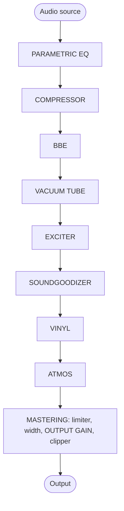
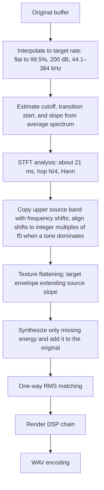

[한국어](README.md)&emsp;&emsp;English

# ANALOG SOUL DSP ENGINE

> If you have collaborated on or contributed to this project, or would like to do so, please contact me personally. This is source-available software that anyone can use free of charge. You may use it at no cost for personal, non-commercial purposes, and you are free to modify it for your own use. However, copyright and ownership belong to the original author, collaborators and contributors. You may not claim this program as your own, or distribute or sell it elsewhere.

**An analog-tone processor that runs in the browser, and a restoration tool that fills in high frequencies removed from lossy-compressed audio.**

`v3.1` · Single HTML file · No installation · Works without an internet connection · Audio never leaves your device

Each section in Parts 1 through 4 is organized into four paragraphs. **Why it is needed** explains why the feature or design was necessary; **Basis** gives the underlying principles, standards and measurements; **Implementation** describes the implementation; and **Why this approach** explains why this method was chosen over alternatives and what the measurements showed.

---

## Contents

- [Part 1 · A plain-language overview](#part-1)
- [Part 2 · Principles](#part-2)
- [Part 3 · How it works](#part-3)
- [Part 4 · Algorithms, equations, physics and architecture](#part-4)
  - [4.1 Sample-rate conversion and the STFT kernel](#s41) · [4.2 Cutoff and slope estimation](#s42) · [4.3 Frequency-shifted copying and f0 alignment](#s43) · [4.4 Envelope extrapolation and texture](#s44) · [4.5 Level matching](#s45)
  - [4.6 Nonlinear transfer functions](#s46) · [4.7 Aliasing budget](#s47) · [4.8 Band splitting](#s48) · [4.9 Dynamics](#s49)
  - [4.10 The physics of space](#s410) · [4.11 Stereo](#s411) · [4.12 Record model](#s412) · [4.13 The physics of hearing](#s413)
  - [4.14 Architecture](#s414) · [4.15 Bit depth](#s415) · [4.16 Issues and fixes](#s416) · [4.17 Optimization](#s417) · [4.18 Known limitations](#s418) · [4.19 Distinctive features](#s419)
- [Repository layout](#repo)
- [Changelog](#changelog)
  - [3.1](#cl-v31) · [3.0](#cl-v30) · [2.4](#cl-v24) · [2.3](#cl-v23) · [2.2](#cl-v22)
- [References](#refs)
- [License](#license)

---

<a id="part-1"></a>

## Part 1 · A plain-language overview

### What is this?

**Why it is needed.** Sometimes you want to change the character of a music file: make it warm as though it passed through old recording equipment, let it spread out as though heard in a large performance venue, or even out an inconsistent volume. Music downloaded from the internet also often has its highest frequencies removed to reduce file size.

**Basis.** The effects mathematically imitate the ways real equipment and real rooms change sound. The behavior of a vacuum tube, a record and turntable, and a room's dimensions and walls is expressed in equations. The method and initial strength for filling in missing high frequencies were chosen by comparison with original audio that had not been bandwidth-limited.

**Implementation.** Load a music file and the program changes its character. It can also read patterns in the surviving sound and plausibly fill in the missing upper range. There is nothing to install: open one file in a browser and it runs. Your music is not sent anywhere; all processing stays on your computer. Even the fonts are embedded, so the screen looks the same offline and makes no external requests.

**Why this approach.** Playback and export use the same calculations in the same order so the sound you choose while listening becomes the file you save. When filling in missing frequencies, the original is retained and only the deficit is added. Only in a narrow transition just below the cutoff is the original slightly attenuated to join it smoothly to the added sound.

### Getting started

**Why it is needed.** A first-time user should be able to try changing the sound and save a file without first reading every manual.

**Basis.** This application was developed and tested against a recent desktop version of Chrome. Some display details or behavior may differ in other browsers.

**Implementation.**

1. Open `analog-soul-dsp.html` in a browser. Chrome is recommended.
2. Read and accept the terms shown first. Loading an audio file directly is also treated as acceptance.
3. Drag a music file into the box at the top of the screen.
4. Press Play, then enable the feature cards one at a time and listen to the changes. Enabled cards have neon-like borders, making their state easy to see.
5. When satisfied, select the sampling density and numerical precision in EXPORT at the bottom, then press Export to create a new file.

Start at `index.html` for the manuals. There are five, ranging from plain explanations to in-depth discussions.

**Why this approach.** Chrome is recommended because features such as very-high-rate export at 192 or 384 differ between browsers, and testing was performed in Chrome. Enabling effects one at a time makes it easier to hear each effect separately and decide what you like.

### Nine features

**Why it is needed.** Sound processing is easier to manage when divided into individual tasks, so each card represents one feature. Even the same effects sound different in a different order; that order must therefore be visible and editable.

**Basis.** Each card models a studio process. PARAMETRIC EQ raises or lowers selected frequency ranges; the tube card models an actual tube circuit; VINYL calculates record cutting and stylus playback; and DOLBY ATMOS calculates sound reflecting from walls in a room. The principles are explained in [Part 2](#part-2) and [Part 3](#part-3).

**Implementation.** The signal-flow map above the cards shows the order sound follows. Drag a map label or card to change the order, which changes the sound. While dragging a node on a single-row map, other nodes move aside to open its destination; when the order changes, nodes and cards slide into their new positions. HD reconstruction at the front and MASTER at the end of production have fixed positions, shown with dashed borders, and cannot be dragged in either the map or the card layout.

| Card | What it does |
|---|---|
| **PARAMETRIC EQ** | Raises or lowers selected frequencies. Add up to 20 points and drag them while watching the graph. |
| **COMPRESSOR** | Reduces louder sounds a little while preserving quieter sounds to make the overall level more even. |
| **BBE** | Clarifies speech and the beginnings of instrument notes. |
| **VACUUM TUBE** | Calculates a tube-amplifier stage from its circuit behavior, adding warmth and fullness as though the signal passed through that equipment. |
| **EXCITER** | Adds sparkle to high frequencies. |
| **SOUNDGOODIZER** | Separates low, middle and high frequencies and adds fullness to each. |
| **VINYL** | Imitates playing a record, including dust, a scratch that clicks once per revolution, slight pitch fluctuations, and high frequencies becoming softer toward the inner grooves. |
| **DOLBY ATMOS** | Calculates how sound reverberates in a selected studio, club, cinema, concert hall or stadium. |
| **MASTERING** | Final cleanup: shapes four frequency regions separately and prevents the sound from becoming loud enough to clip. |

**Why this approach.** Reordering is available because order itself changes the sound. HD reconstruction remains first so MASTER can finish the added high frequencies together with everything else and prevent clipping. MASTER's position is fixed because it is the final production stage.

**Card layout**

**Why it is needed.** Packing cards of unequal heights without gaps scattered their order into a zigzag, making processing order unclear from the boxes alone.

**Basis.** People scan left to right and top to bottom, as when reading. Scrollbar width was chosen through a simulation balancing ease of grabbing against the remaining slider length. Even the dim text of disabled cards was designed to retain readable contrast of at least 3:1.

**Implementation.** On wide screens, 900px or more, cards have the same height of 385px and follow left-to-right, top-to-bottom order, so position communicates processing order. The high-resolution reconstruction card comes first, as in the flow map, and is also first in document order so Tab navigation and screen-reader order match the visual layout. An enabled card scrolls internally when its contents overflow, using a 22px scrollbar on the right; scrolling beyond its end does not scroll the page. As cards narrow, labels and value fields retain their widths while only the slider track shrinks. The shortest track is about 100px in a scrollbar-reserving card when the three-column layout has just begun and cards are narrowest, at 360px. Overflowing cards—VINYL, ATMOS and MASTERING—have an expand button with up/down chevrons in their header. It expands only that card to its content height so all controls can be seen together. Press it again to return to tile height; the choice is remembered in this browser. Disabled cards recede into an inactive background, and the mouse wheel scrolls the page over them. If page scrolling begins outside an enabled card, it continues even if an enabled card passes beneath the cursor, until the wheel has stopped for 0.4 seconds. Moving the mouse releases this immediately so the newly targeted card receives scrolling and clicks. Dragging a card creates a dashed placeholder that follows the cursor while other cards move aside; on release, the card slides from its release point into the placeholder. Narrow screens stack cards in a single column.

**Why this approach.** Equal sizes make position communicate processing order. Making disabled cards behave as background and preserving ongoing page scrolling prevents scrolling from unexpectedly getting trapped inside a card that passes under the cursor. Overflowing cards always reserve scrollbar space, even when disabled, so their content does not jump sideways. At the end of an internal scroll, passing wheel input to the page had moved the card's lower controls beneath the sticky playback bar, causing a click intended for a control to hit playback instead. This was especially common with VINYL, whose contents are about 2.7 times the visible card height. Expanding a card increases only its row's height; other cards in that row retain tile height, preserving positional processing order. Only slider tracks shrink because clipped labels or values would obscure what is being adjusted and by how much. Putting high-resolution reconstruction first in document order ensures keyboard and screen-reader users follow the same sequence as sighted users.

**MACRO % and initial settings**

**Why it is needed.** Adjusting several controls separately to change an effect's strength is cumbersome, and finding compatible values is difficult. The initial sound should also be appropriate rather than excessive.

**Basis.** Initial settings were selected by comparing two approaches on four uncut reference tracks, using their middle 20 seconds. The MACRO approach left low frequencies and the sense of width almost unchanged, at around +2.2dB, while reducing excessive high-frequency gain from +4.2 to +2.4dB and level loss from −6.2 to −4.9dB.

**Implementation.** The MACRO control at the top of a card moves its main controls together between their weakest settings at 0% and reference design values at 100%. It works like AUTO % in high-resolution reconstruction, with values rounded to slider steps. Manually adjusted controls retain their values until MACRO is moved again; settings files save MACRO and the individual values together. Initially, COMPRESSOR 50%, BBE 40%, EXCITER 80%, SOUNDGOODIZER 65% and MASTERING CHAIN 95% are enabled. PARAMETRIC EQ, VACUUM TUBE, VINYL RECORD and DOLBY ATMOS are disabled, with MACRO at 100%. PARAMETRIC EQ's MACRO does not move its controls; it scales the boosts and cuts assigned to its points, becoming flat at 0%. At 0%, level remains unchanged within ±0.1dB except for MASTERING CHAIN. Its ceiling limiter works independently of MACRO, so limited or clipped loud masters may become 0.2–0.9dB quieter. BBE, SOUNDGOODIZER and MASTERING CHAIN still rotate phase through phase networks and crossovers, so their output is not sample-identical to the original. Disable a card to remove its processing completely.

**Why this approach.** A single strength control reduces the number of controls needed to adjust the cards' intensity from 16 to five.

**Playback stage**

**Why it is needed.** When VINYL and ATMOS could only precede MASTER, playback noises such as record crackle were also compressed and magnified by MASTER.

**Basis.** An actual LP is pressed from a lacquer cut from the master and then played on a turntable, so crackle, pops, surface noise and warp occur after mastering. Atmos likewise renders space for the listening device after mastering is finished.

**Implementation.** The section after MASTER represents listening to the finished master through a playback medium. Only VINYL and ATMOS can be moved there. Select before or after MASTER in the processing-position controls beneath either card's title, or drag the card or map node past MASTER; Alt+→ also crosses the boundary in the map. The playback stage appears after a teal playback boundary in the flow map and under the “Playback stage · after MASTER” area in the card layout, with teal numbered badges. Dragging another card there shows that it cannot be dropped. The CEILING guarantee extends only through MASTER, so audio after the playback stage can exceed it. Slots and settings files also save playback-stage order.

**Why this approach.** Playback-generated noise must arise after MASTER, as in real playback, to avoid being compressed or inflated by it. Processing-position buttons sit outside the card body and remain usable even when the card is disabled.

**VINYL, VACUUM TUBE and DOLBY ATMOS controls**

**Why it is needed.** Different people imagine different record, tube and room sounds. Selecting the state of the actual modeled object, rather than an abstract strength, makes the desired result easier to reach.

**Basis.** VINYL uses units found in equipment manuals, such as clicks per second, decibels, millimeters and picofarads. VACUUM TUBE's DRIVE and BIAS represent voltages applied to the tube. DOLBY ATMOS rooms are matched to reverberation durations commonly measured in rooms of those types.

**Implementation.** VINYL's controls are grouped into record, turntable and stylus. Set how dusty, scratched or warped the record is and how many times it has been played, then choose rotation stability and stylus shape. Entering the values from equipment specifications produces the modeled sound of that combination. Clicks heard during playback appear at the same positions in the saved file.

VACUUM TUBE's DRIVE is the strength of the signal entering the tube, while BIAS describes its resting operating point. Lower BIAS makes one side distort first and increases warmth; higher BIAS is cleaner. DOLBY ATMOS's SPACE controls room size, DEPTH controls source distance, and HEIGHT and OBJECT control the strength of ceiling and side-wall returns. The midpoint of 50 for SPACE, HEIGHT and OBJECT represents the actual modeled room values.

**Why this approach.** Clicks are prepared in a fixed sequence and emitted according to track time, so playback and saved audio match. Real units let users enter the specifications of their own equipment directly.

**PARAMETRIC EQ**

**Why it is needed.** A track may have booming lows, vocals buried beneath instruments or harsh highs. Often only that frequency region needs a small boost or cut, rather than changing everything.

**Basis.** This is the function of a studio equalizer. Examining sound by frequency shows how boosts and cuts shape timbre. The displayed curve uses the same calculation as the actual processing, so what you see corresponds to what you hear.

**Implementation.** Numbered points appear on the card's graph, each controlling a frequency. Drag horizontally to change frequency and vertically to change boost or cut. Scroll over a point to narrow or widen the affected region. Double-click empty space to add a point, up to 20; double-click a point to temporarily disable it; right-click to remove it. Each point can be a **bell**, boosting or dipping one region; a **shelf**, raising or lowering the whole low or high end; a **cut**, removing low or high frequencies; or a **notch**, making a deep narrow cut. The enlarge button opens a larger graph and a table of all points for numerical editing, with playback and enable controls inside the window. During playback, the pre-EQ spectrum is drawn as a line and the post-EQ spectrum as a filled area. EQ starts disabled with four flat points that leave the sound unchanged when enabled. **Import AutoEQ** in the large window can load a headphone-correction file as points, but that correction will also be included in exported audio. Use the monitoring correction described below if you only want to correct the headphones you are listening through.

**Why this approach.** EQ starts at the front of the default chain so unwanted boom or low-frequency noise does not first drive downstream compression and distortion. Move it after COMP if you want to shape the compressed result. Points retain their creation-order numbers when disabled.

**INPUT GAIN**

**Why it is needed.** Effects that add character through distortion respond more strongly to louder input. Their individual input levels therefore need separate controls.

**Basis.** Equipment such as tubes and compressors distorts or compresses more as input increases.

**Implementation.** Every card has **INPUT GAIN** at the top: the level entering that effect, from −24 to +24dB in 0.1dB steps, initially 0. Raising it intensifies effects that color the sound through distortion; for non-distorting effects such as PARAMETRIC EQ, it changes only the level.

**Why this approach.** INPUT GAIN is inserted immediately before its card only while the card is enabled, preventing a disabled card's gain setting from changing overall volume.

### Filling in missing high frequencies

**Why it is needed.** Size-reduced music files have very high frequencies removed. Saving them at a denser sample rate alone leaves that missing region empty.

**Basis.** The surviving upper frequencies contain patterns in their decay slope and the pitches sounding. Reconstruction methods and defaults were selected against uncut reference audio, favoring results closer to those originals.

**Implementation.** The **HD** and **ULTRA · eXtreme HD** panels handle this. Select an export sample rate higher than the original—48, 88.2, 176.4 or 352.8 for a 44.1kHz source; 96, 192 or 384 for a 48kHz source—and the missing region is filled for that target. When one instrument or voice dominates, the synthesized pitches align with the original's harmonic positions. **HF SYNTH** controls how much is added; **SMOOTH** controls how evenly it spreads as frequency increases. At HF SYNTH 0, the rate increases without adding high-frequency content.

Enable **LIVE** to preview the result before exporting. There is a short wait when enabling it because the entire track is first scanned for the cutoff, then reconstructed once in full. Changing controls, or choosing settings in PRESET and closing the panel, regenerates the preview.

**Why this approach.** This does not retrieve the original missing sound; it creates a plausible continuation from what remains. It therefore preserves the original and adds only the deficit, attenuating the original by up to half only in the narrow transition just below the cutoff. Harmonic alignment is used because simply shifting and copying would place added components away from the original note's harmonic positions. Whether a difference is audible depends on the file, listener and equipment. Heavily reduced files change more; good original files change very little.

### Seeing the sound

**Why it is needed.** Judging every change by ear is difficult, especially whether very high frequencies have been filled in.

**Basis.** Splitting sound into frequencies and plotting the level at each one makes the removed and reconstructed regions visible.

**Implementation.** The top graphs show original audio on the left and processed audio on the right, at the same moment for direct comparison. Click a graph to switch to a view that advances through time; brighter colors mean stronger sound at that frequency.

The X-AXIS switch above the graphs—Adaptive, 48, 96 or 192—can lock the horizontal range. The graphs then stop expanding and contracting when reconstruction is toggled, making the newly filled region easier to see.

**Why this approach.** Both graphs use the same color scale, because different scales would prevent comparing their levels. A fixed horizontal range keeps any given frequency at the same position.

### Matching your listening device

**Why it is needed.** Headphones and speakers each emphasize some frequencies and reduce others. Adjusting music while hearing that coloration can lead you to correct resonances not present in the track or add frequencies the listening device has attenuated.

**Basis.** AutoEQ is a public project providing device-specific correction to a target response from published headphone and earphone measurements. Its ParametricEQ.txt files contain around ten filters of the same types as PARAMETRIC EQ points, plus an overall attenuation value, Preamp.

**Implementation.** Press **Monitor correction** in the playback bar. Under **Import AutoEQ**, choose your headphones' ParametricEQ.txt file or paste its contents, then apply it. Correction is enabled immediately and the button shows the headphone name. The window displays the correction curve and filter table, lets you switch correction on or off, and adjusts Preamp in 0.1dB steps. If the curve rises above 0dB, a warning explains that loud passages could clip; lower Preamp by the indicated amount.

**Why this approach.** Correction is applied only during playback, after all processing and immediately before output to the device. It is not included in exported audio or processing-settings files and is remembered only in this browser. Headphone coloration belongs to the listening device, not the song; baking its correction into a file would make it wrong for other equipment or listeners. The processed spectrum also shows the signal before correction—the sound that will be saved. Use PARAMETRIC EQ's AutoEQ import only when intentionally making a file specifically for those headphones.

### Comparing at the same loudness

**Why it is needed.** Listeners tend to prefer louder sound. Effects often make an already loud master quieter, by 3–10dB at the initial settings, so switching an effect on and off can make bypass sound better. Matching loudness is necessary to hear the actual difference.

**Basis.** Loudness is measured in LUFS using international standard ITU-R BS.1770, the method used by broadcasters and music services for loudness matching. It weights higher frequencies, where hearing is more sensitive, somewhat more strongly and excludes quiet gaps.

**Implementation.** Press **Compare** in the playback bar to switch to the reference; the button gains an amber border and a label such as Original. Press again to return to processed audio. Initially, the reference is the untouched original. The adjacent **Reference sound** button can instead select the processed sound with one enabled effect omitted, such as “Without SOUNDGOODIZER.” Everything else remains active, isolating that effect's contribution. The first switch or a new selection takes a moment while loudness is measured. With **Match loudness** enabled, as it is initially, the reference is adjusted to the processed signal and the applied amount is shown, for example “Original −5.6dB” or “Without SG −2.6dB.” Changes to controls or cards trigger a new measurement after a short delay.

**Why this approach.** Only the reference is adjusted; the processed signal always plays at the level that will be exported. If the reference needs boosting, it is raised only as far as its loudest peak can go without clipping, and the button shows a limit indication. The paths are time-aligned to compensate processing delay—about 45ms for the original at initial settings, or the omitted card's delay for a single-effect comparison—so switching does not shift the beat. Omitting a feature routes around it rather than running a second full chain, avoiding heavier playback processing. Comparison affects listening only and is not included in exported music or settings files.

### Keeping settings

**Why it is needed.** Once you find settings you like, you should be able to retain them, compare different setups and move them to another computer.

**Basis.** Settings consist only of control values, switches, card order and EQ points, so they fit in a small text file. Quick slots use browser storage.

**Implementation.** Only processing settings are included; audio and monitor correction are not.

| Button | What it does |
|---|---|
| **Save screen settings** | Saves the current interface settings to a file for transfer to another computer. |
| **Quick slots 1–4** | Short press loads; long press for 0.6 seconds stores the current setup. Pressing an empty slot restores initial settings. |
| **Copy** | Press this, then two slots in order to copy the first into the second. The first is unchanged. |
| **Clear one slot** | Press this, then a slot to clear only that slot. |
| **Clear all slots** | First press requests confirmation; a second clears all slots. |
| **Back up all slots** | Packs all four slots into one file. |
| **Load** | Automatically distinguishes a settings file from a backup and restores it. |

Quick slots remain only in the browser currently in use. Save to a file for another computer. Loading settings saved in version 3.0, before EQ existed, restores EQ to its initial disabled state with four flat points, preserving the sound of the saved setup.

When saving, the signal-flow map and cards flash twice in processing order to indicate that both values and order were stored. Loading makes map nodes and cards slide into their saved positions.

**Why this approach.** Omitting audio keeps settings files small and portable. An empty slot means no stored setup, so selecting it restores the initial state. Clearing all slots cannot be undone and therefore asks again. Automatic file-type detection removes the need to choose the type manually. Flashing in processing order demonstrates that the order was saved too.

### Saving audio to a file

**Why it is needed.** To listen to the changed sound elsewhere, it must be saved as a new audio file. Different uses require different sampling density and numerical precision.

**Basis.** An audio file divides each second into samples and writes the sound level at each as a number. How finely time is divided and how precisely each number is stored determine file size.

**Implementation.** Choose both controls in EXPORT at the bottom, then press **Export**.

| Control | Choices | Meaning |
|---|---|---|
| **SAMPLE RATE** | 44.1 · 48 · 96 · 192 · 384 | How densely each second is sampled. Above the source rate, missing high frequencies are filled for that target; below it, the rate is reduced while preserving the source as far as possible. Loading a file selects its source rate and labels that step Original. If no step matches, the next higher step is selected, or the maximum if the source exceeds it, without an Original label. For 44.1-family sources—44.1, 88.2, 176.4, 352.8—the upper three steps become 88.2, 176.4 and 352.8. |
| **BIT DEPTH** | 16 · 24 · 32 | The precision stored for each sample. If the source is 16-bit or lower, choosing 24 or 32 fills between the quantization steps. |

The processing sequence appears below the button. Larger numbers produce larger files. One minute is approximately 10MB at 44.1/16, 33MB at 96/24, 88MB at 192/32 and 176MB at 384/32. Exporting the same file again with the same settings produces byte-identical output.

**Why this approach.** Initially matching the source rate means leaving the setting alone exports without changing that rate. Upper steps become 88.2, 176.4 and 352.8 for 44.1-family inputs because exact twofold and fourfold ratios are faster to compute. Raising a 44.1kHz file to 88.2 is 32% faster than raising it to 96, with a difference smaller than the least significant unit written to the file. Filling between a 16-bit file's steps stays inside the original value's quantization cell, increasing precision without departing from the original constraints.

### Good to know

**Why it is needed.** A few behaviors can be confusing or surprising. Knowing them in advance helps prevent misleading comparisons or lost settings.

**Basis.** These points follow from hearing's sensitivity to level, browser capabilities and the way the program manages settings.

**Implementation.**

- **If merely enabling something seems to improve the sound,** it may simply be louder. Hearing tends to prefer increased loudness. Conversely, effects can reduce an already loud master by 3–10dB, making bypass seem better. Compare with **Match loudness** enabled. To isolate one feature, omit it through **Reference sound**, as described above.
- **MASTERING does not automatically make audio louder.** It leaves quiet material alone and reduces loud material. Raise MASTERING's INPUT GAIN to drive the limiter if you want more loudness.
- **If a notice says 192 or 384 cannot be exported,** the browser does not support that render rate. Use Chrome or select 96, or 88.2 for a 44.1-family source.
- **Navigating to another manual after changing settings prompts for confirmation,** because settings are not saved automatically.
- **Choose the screen theme at the right of the top bar.** Automatic follows the computer's light/dark preference; Night and Day remain dark or light. The choice is remembered in this browser and applies to both the app and manuals.
- **Exported audio contains sound only.** It does not retain the settings used to create it, so save those separately for later reuse.

**Why this approach.** MASTERING avoids hidden automatic gain so users directly control how much louder an enabled process becomes. Confirmation before opening another manual prevents unsaved changes from disappearing when leaving the page.

---

<a id="part-2"></a>
## Part 2 · Principles

This part explains the physical and perceptual phenomena behind each feature. Part 3 covers the computations, and Part 4 covers the equations. Each section explains, in order, why the program needs the principle (Why it is needed), the theories and sources it draws on (Basis), how the program uses the principle (Implementation), and why that method was chosen (Why this approach).

### 2.1 Two views of sound — time and frequency

**Why it is needed.** This program handles sound in two forms: a waveform (time) and a spectrum (frequency). Preserving the source sample rate, filling in missing high frequencies, and choosing an export sample rate all begin with the question, “How much can this file contain?” Reading the two on-screen analyzers also requires an understanding of logarithmic frequency axes and decibels.

**Basis.** Sound is a change in air pressure over time. A recorded file is a sequence of numbers measuring this change at regular intervals, and the reciprocal of that interval is the **sample rate**. A rate of 44.1 kHz means 44,100 measurements per second. By the sampling theorem, the **Nyquist frequency**, half the sample rate, is the highest frequency the file can contain. The same sound can also be decomposed into frequency components. This is the **spectrum**, which shows how much of each pitch is present. Human hearing perceives frequency on a logarithmic scale. Moving from 100 Hz to 200 Hz sounds like the same one-octave interval as moving from 1 kHz to 2 kHz. Level is measured in **decibels (dB)**. Doubling the amplitude adds approximately +6 dB, and a difference of 10 dB sounds roughly twice as loud.

**Implementation.** The analyzers draw the horizontal axis of the bar spectrum and the vertical axis of the spectrogram logarithmically, from 20 Hz to the displayed Nyquist frequency. The 128 bars are evenly spaced along the logarithmic axis, and each bar displays the maximum FFT-bin value within its interval. The vertical scale is −100 to −30 dB (Section 3.7). When a file is opened, its original sample rate is read directly from the file header before it is passed to the browser decoder (Section 3.9). Export sample rates range from 44.1 to 384 kHz (Section 3.8).

**Why this approach.** The graphs use a logarithmic scale because that is how the ear hears. On a linear axis, the width occupied by each octave doubles as frequency rises, squeezing nearly six octaves from 20 Hz to 1 kHz into the far left of the display. The original sample rate is read from the header because the browser decoder always converts it to the playback device's sample rate. Knowing the original Nyquist frequency is necessary to identify which region was originally empty.

### 2.2 Dynamics — compression

**Why it is needed.** If the level varies widely, the depth of distortion in the following saturation stage also varies from passage to passage. That is why COMPRESSOR comes first in the chain (Section 3.2). The final MASTERING stage also uses band compressors and a limiter to control the final level and peaks.

**Basis.** When a signal exceeds the **threshold**, a compressor reduces the excess by dividing it by the **ratio**. At 4:1, a signal that exceeds the threshold by 8 dB is reduced to only 2 dB above it. **Attack** determines how quickly reduction begins after the threshold is exceeded, and **release** determines how quickly the signal returns to its original level after it falls back below. The **knee** determines whether compression begins abruptly or gradually around the threshold. Compression reduces level variation. It reduces the **crest factor**, the difference between the largest instant and the average, allowing the average level to rise within the same maximum level. Raising the entire signal again to compensate for the reduction caused by compression is called **makeup** gain.

**Implementation.** The compressor element is Web Audio's `DynamicsCompressorNode`. Its knee extends **only upward** from the threshold, so compression begins half a knee width higher than with a hardware compressor's symmetrical knee. The specification always applies automatic makeup $`(1/c(1))^{0.6}`$, which also boosts signals below the threshold. This program calculates that value using the same equation and cancels it with its reciprocal immediately after the compressor (6.03 dB at the COMPRESSOR defaults). As a result, the compressor itself leaves quiet signals below the threshold untouched, and only the amount set by MAKEUP is applied. The output compressor in SOUNDGOODIZER, the four band compressors in MASTERING, and the limiter are canceled in the same way. Equations and values are in [4.9](#s49).

**Why this approach.** Leaving automatic makeup enabled makes the sound louder merely by switching on the compressor, and the amount depends on the threshold, knee, and ratio. Before cancellation, quiet signals at the COMPRESSOR defaults gained a hidden 6.03 dB on top of MAKEUP's 4 dB, for a +10.0 dB increase. MASTERING boosted its bands by different amounts from +5.4 to +7.1 dB, making the midrange stand out by 1.7 dB. After cancellation, only the MAKEUP knob adds gain, giving the knob a single unambiguous meaning and making it easier to compare enabled and disabled processing at the same loudness (2.10). The tradeoff is that the default output is approximately 6 dB quieter than before cancellation. Cancellation relies on the specification's equation, so environments that implement a different equation will differ by the corresponding amount.

### 2.3 Phase and clarity

**Why it is needed.** Blurred onsets make the outlines of instruments sound indistinct. The BBE card changes timing relationships to shape these outlines. Also, mixing a phase-rotated signal with the original cancels certain frequencies, so cards with parallel paths (the former BBE structure and SOUNDGOODIZER) must avoid this effect. BBE's PROCESS and SOUNDGOODIZER's presence boost target the frequency region that determines the clarity of speech and instruments.

**Basis.** Speakers cannot emit every pitch at the same time. Low frequencies in particular tend to emerge later than high frequencies. This frequency-dependent arrival time is called **group delay**. BBE's published processing delays low frequencies by approximately 2.5 ms and midrange frequencies by approximately 0.5 ms relative to high frequencies. The manufacturer describes this as speaker phase correction, but it further delays the low frequencies that the speaker has already delayed. Rather than undoing that delay, it emphasizes the outline of an onset by letting the high-frequency attack arrive first. A filter that changes only phase while leaving magnitude unchanged is an **all-pass filter**. Passing the signal directly through this filter can delay low frequencies without changing magnitude. Conversely, mixing the filtered signal with the original causes cancellation at frequencies where their phases are opposite, so they must not be mixed if the aim is to change timing alone. The 2–5 kHz band, where speech consonants are concentrated, governs **intelligibility**. The ear canal is a tube closed at one end by the eardrum, giving it a quarter-wavelength resonance (approximately 3.4 kHz). This resonance and reflections from the pinna boost 2–5 kHz by 10–15 dB. This is also the region of greatest ear sensitivity in the equal-loudness contours (ISO 226). Raising this band slightly makes speech seem to move forward.

**Implementation.** BBE passes through two all-pass filters (220 Hz Q 0.59 and 1850 Hz Q 1.47) **in series**, creating only group delay while preserving magnitude. With all three knobs at 0, the response is 0.0 dB across the entire band, and group delay is 2.58 ms at 50 Hz, 0.61 ms at 500 Hz, and 0.03 ms at 5 kHz. The subsequent PROCESS stage uses a 3 kHz high shelf (0 to +8 dB) to broadly raise the region containing consonants and attacks, while HI DEF handles the region above it with a 10 kHz high shelf (0 to +6 dB). SOUNDGOODIZER raises the presence region with a 2.5 kHz peaking filter (Q 0.7, +AMOUNT×3 dB). When adding the processed bands in parallel to the original, it applies the same all-pass response as the band sum to the original path to align their phases ([4.8](#s48)).

**Why this approach.** The centers and Q values of the two all-pass filters are least-squares fits to the target group delay (2.5 ms below 150 Hz, 0.5 ms from 0.4 to 1.5 kHz, and 0 above 5 kHz). The old structure added the all-pass output to the original, creating dips where the phase was −180°. At a mixing ratio of g = 0.6, the dip is −12 dB; in practice, LO CONTOUR 100 produced −9.3 dB at 100–125 Hz and 315 Hz. With the current series structure, the response is flat at knob 0, and LO CONTOUR 100 provides a smooth boost of +9.7 dB at 31.5 Hz, +7.0 dB at 63 Hz, and +3.1 dB at 100 Hz. The hardware varies its high-frequency boost with the signal, but this implementation uses a fixed shelf. Raising PROCESS above +6 dB on vocals also raises sibilance.

### 2.4 Nonlinearity and harmonics

**Why it is needed.** VACUUM TUBE, EXCITER, and SOUNDGOODIZER deliberately distort the sound to color it, and MASTERING's safety clipper is nonlinear as well. The harmonics generated and their amounts determine each card's timbre. Digital distortion can also introduce unrelated pitches that were not present in the original, so those must be controlled too.

**Basis.** Distorting a sound generates **harmonics** that were not present originally. Distorting a 100 Hz tone introduces new components at 200, 300, and 400 Hz. The type of distortion determines which harmonics appear and how strong they are. A **symmetrical** process that compresses both polarities identically (an odd function satisfying $`f(-x) = -f(x)`$) produces only odd harmonics (3rd, 5th, …). An **asymmetrical** process that compresses one side more strongly also produces even harmonics (2nd, 4th, …). In the Taylor expansion $`f(x + b) = f(b) + f'(b)\,x + \tfrac12 f''(b)\,x^2 + \cdots`$, the coefficient of the $`x^2`$ term that creates the second harmonic is proportional to the curvature $`f''(b)`$ at the operating point. The second harmonic is one octave above the original, blending well with it and sounding fuller; the third harmonic is a fifth above that octave, giving a somewhat rougher color. The warmth attributed to vacuum tubes comes from the even harmonics generated by their asymmetry. A triode's curve is inherently asymmetrical because of the space-charge law's 3/2 power and grid current (Koren's triode model). Digital distortion requires care. When newly generated harmonics exceed the Nyquist frequency, they do not disappear: they **fold** downward and appear at pitches unrelated to the original. This is called **aliasing**. Also, even at the same distortion percentage, the higher-order intermodulation generated by a curve with rapidly changing curvature is the most objectionable (Geddes & Lee).

**Implementation.** VACUUM TUBE obtains its curve by solving the equations of a 12AX7 common-cathode amplifier stage. At the defaults (DRIVE 30, BIAS 50), a 1 kHz input at −6 dBFS produces a second harmonic of −33.7 dB and a third harmonic of −67.5 dB. EXCITER sets different positive and negative saturation limits of +1 and −0.7 for its $`\tanh`$ curve, while SOUNDGOODIZER shifts the operating point by $`b = 0.08\,\mathrm{SAT}`$ to generate even harmonics. Aliasing is reduced in two layers. Curves are applied with 4× oversampling, and the EXCITER and SOUNDGOODIZER high bands place a $`\max(1.4\,f_{\mathrm{lo}},\ f_s/3)`$ low-pass filter only before the saturation path, raising the harmonic order at which audible aliasing begins from 7 to 10.5. The DC component also generated by an asymmetrical curve is blocked by a high-pass filter after saturation (TUBE 10 Hz, EXCITER FREQ, SOUNDGOODIZER 12 Hz). Curves and measurements are in [4.6](#s46), and the aliasing budget is in [4.7](#s47).

**Why this approach.** The tube curve is solved from a circuit rather than chosen by hand because, contrary to its comment, the old curve produced a third harmonic 17 dB stronger at the default BIAS. The current model reproduces the physical tendencies: the second harmonic is 34 dB stronger than the third for small signals, the third takes the lead under heavy drive, and the second becomes stronger at a cold bias. SOUNDGOODIZER's old curve was a pure odd function, so its second harmonic reached only −68.6 dB. Multiplying only the negative half-cycle by a gain does not change the curvature at the origin and therefore generates almost no even harmonics for small signals, so shifting the operating point was chosen instead. The aliasing order is independent of sample rate because the input upper limit rises in proportion to Nyquist. Increasing the rate alone does not improve it; the input bandwidth must be constrained to a fraction of Nyquist. Rendering the entire chain at a high multiple was rejected because render time and memory increase by that multiple, another resampling step is introduced, and it applies only to export, making the file differ from what is heard. TUBE has no bandwidth limit. At MIX 100, the entire signal passes through the curve, so such a limit would impose a 16 kHz cutoff that does not exist in the real amplifier stage.

### 2.5 Processing separate frequency bands

**Why it is needed.** Low and high frequencies have different characteristics, so applying the same processing can damage one of them. SOUNDGOODIZER saturates three bands separately, and MASTERING compresses four bands separately. Each band needs different settings to preserve low-frequency punch without making the high frequencies pump.

**Basis.** A **crossover** splits the signal into bands, which are processed separately and then recombined. Recombining the unprocessed pieces must restore the original magnitude. A split with this property is called **complementary**. Otherwise, the sound swells or dips at the boundaries. A fourth-order Linkwitz–Riley split is made by cascading two second-order Butterworth sections. Its low-pass and high-pass outputs sum to exactly a second-order all-pass response, with a magnitude of 1 at every frequency.

**Implementation.** Both cards use fourth-order Linkwitz–Riley filters. SOUNDGOODIZER has two crossover points per mode (250 Hz / 4 kHz for A, for example), while MASTERING splits at 120 Hz / 500 Hz / 5 kHz. With two or more crossover points, a tree structure multiplies the lower bands by the all-pass response of each higher crossover, making the sum $`AP_a AP_b \cdots`$. Because the Web Audio specification interprets Q for `lowpass` and `highpass` in dB, a Butterworth filter requires −3.0103 rather than 0.707. Derivations and values are in [4.8](#s48).

**Why this approach.** The former SOUNDGOODIZER placed LPF, BPF, and HPF in parallel, causing the band sum to vary from 0.906 to 1.568 and swell by approximately +4 dB around 2 kHz. Splitting only adjacent bands creates a −1.22 dB dip around 411 Hz in MASTERING. Entering 0.707 directly for Q makes the sum swell by +7.4 dB at the crossover. With the current tree structure, the sum computed from the specification's coefficients deviates by ±0.0000 dB. The tradeoff is phase rotation. The band sum is −180° at the crossover, so adding processed bands in parallel to the original requires the same all-pass response in the original path to avoid cancellation (otherwise, −2.3 dB at 250 Hz). Maximum group delay is approximately $`0.543/f_c`$, or approximately 4.5 ms at MASTERING's 120 Hz crossover, below the discrimination threshold for low-frequency group delay. Saturated bands are nonlinear, so the flat sum holds only at low levels; all four modes stay within ±1.3 dB in that response.

### 2.6 Space — reflections and reverberation

**Why it is needed.** The DOLBY ATMOS card places the sound in a room. The former card used ten fixed reflections and newly randomized reverberation each time, changing the texture of the reverb even at identical settings. Controlling the space through real quantities such as room size, wall absorption, source distance, and source width requires principles of room acoustics.

**Basis.** Sound heard in a room has three parts: **direct sound** arriving straight from the source, **early reflections** that bounce off the walls or ceiling once or twice, and **late reverberation** mixed through countless reflections. Early reflections convey the room's size and shape; late reverberation conveys its resonance. The time it takes reverberation to decay by 60 dB is called **RT60**. A small recording studio has a value of 0.3–0.5 seconds, and a concert hall around 2 seconds. More wall absorption and a smaller room shorten the reverberation (the Sabine and Eyring reverberation equations). Air also absorbs high frequencies (ISO 9613-1), so high-frequency reverberation is shorter in larger rooms. As the listener moves away from the source, direct sound weakens, but reverberation remains evenly distributed throughout the room. Beyond a certain distance, reverberation becomes stronger than direct sound. This is the **critical distance**. Early reflections from side walls send different sounds to the two ears, making the source sound wider (Barron & Marshall, Hidaka et al.). Sound arriving from above is emphasized around 8 kHz by the pinna, and the ear uses this emphasis as a cue that the sound comes from above (Blauert's directional bands). Reflection paths can be calculated with the image-source method, repeatedly placing mirror images of the source across the walls (Allen & Berkley).

**Implementation.** ATMOS creates early reflections from image-source reflections in a rectangular room and diffuse reverberation from frequency-dependent decay combining the Eyring reverberation time with air absorption, then applies convolution. Direct sound remains the unmodified original. Early reflections and late reverberation crossfade around the mixing time (Polack, $`\min(\sqrt{V}\ \mathrm{ms},\ 150\ \mathrm{ms})`$) with their energy sum held at 1. The knobs represent physical quantities. SPACE sets the room dimensions; DEPTH sets the distance between source and listener; OBJECT sets the amount of side-wall reflections; HEIGHT sets the amount of ceiling and floor reflections and the 8 kHz emphasis of overhead reflections (up to +8 dB); and REVERB sets the amount of diffuse reverberation. On first opening (SPACE 60), the 1 kHz reverberation time is 0.28 s for STUDIO and 2.02 s for CONCERT, and critical distance ranges from 1.24 m for STUDIO to 26.4 m for STADIUM. Reflection and reverberation levels follow Barron's revised theory to account for listening distance. Scene tables and equations are in DOLBY ATMOS in Section 3.4 and [4.10](#s410).

**Why this approach.** Above an absorption coefficient of 0.2, the Sabine equation overestimates reverberation time (by approximately 28 % at α 0.4), so the Eyring equation is used. Eyring assumes that energy falls to $`1 - \alpha`$ at each reflection, sharing the same assumption as the image-source reflections. Reflections are truncated by arrival time rather than order, including all reflections that arrive before the mixing time regardless of order. Diffuse reverberation applies decay to each bin in the frequency domain instead of filtering noise into octave bands. This avoids overlapping filter skirts through which adjacent bands with longer reverberation could leak. Random numbers come from a deterministic generator seeded by the settings, so identical settings always produce the same response. Responses are cached by input combination so that turning another knob does not alter the reverberation texture. Most measured reverberation times are within 5 % of the expected values, and reflection and reverberation energy is 0.4–0.9 dB below Barron's revised theory. Despite its name, this is a two-channel room-acoustics model unrelated to the object-based multichannel format.

### 2.7 Stereo image

**Why it is needed.** SOUNDGOODIZER's STEREO and MASTERING's width control widen or narrow the sound. VINYL removes low-frequency left–right differences during cutting and simulates cartridge crosstalk. All of these rely on viewing left and right as mid and side components. Because listeners may use a single speaker, such as a smartphone speaker, it is also necessary to know what survives in mono.

**Basis.** Left and right signals can be converted into **mid (M)** and **side (S)**. Mid is the component common to both channels, and side is their difference ($`M = (L + R)/2`$, $`S = (L - R)/2`$). Raising the side component widens the sound, and lowering it narrows the sound. **Mono compatibility** requires care. In single-channel playback, left and right are added ($`L' + R' = 2M`$), and the side components cancel completely. An instrument pushed too far into the sides may disappear in mono.

**Implementation.** A single shared block implements width control. It uses $`L' = M + wS`$ and $`R' = M - wS`$: $`w = 1`$ leaves the original unchanged, while 0 produces mono. The implementation relies on the rule that multiple connections arriving at the same `ChannelMergerNode` input are summed. SOUNDGOODIZER STEREO ranges from 0 (mono) to 2×, with the default 55 giving approximately 1.1×. MASTERING's width ranges from 0 to 200 (default 110) and sits after the limiter but before OUTPUT GAIN and the safety clipper. VINYL applies a 150 Hz high-pass filter only to the side component, centering the bass. Equations are in [4.11](#s411).

**Why this approach.** Widening adds side signal and raises peaks again, so it precedes the clipper that maintains the ceiling ([4.9](#s49)). The mono sum is $`2M`$ regardless of $`w`$, so any information placed in the sides with $`w > 1`$ disappears in mono. Also, $`w > 1`$ only raises the side component; it does not **decorrelate** left and right. Frequency-dependent phase rotation or short randomized delays are more effective at lowering interaural cross-correlation (IACC) to increase apparent source width. In this program, ATMOS's side-wall reflections (OBJECT) perform that role.

### 2.8 Record imperfections

The sound of a record comes from the physics of making it and reading it. The VINYL card is a physical model that follows this process, and every control represents a physical quantity found in actual turntable, cartridge, or record specifications. The real-time engine and rendering engine build this block with the same function, `buildVinylChain`. Structure and controls are in VINYL in Section 3.4, and equations are in [4.12](#s412).

**Cutting**

**Why it is needed.** The characteristic rounded “tick,” full-bodied surface noise, and centered bass of a record are determined when the groove is cut. Reproducing this texture requires following the order created by the cutting and playback curves, rather than adding noise arbitrarily.

**Basis.** The groove records the velocity of the sound. Cutting it directly would make low frequencies move the groove too far and high frequencies too small to rise above the noise. The groove is therefore cut with an **RIAA recording curve** that reduces bass and boosts treble, and playback restores the sound with the inverse curve. The time constants of the RIAA playback curve are 3180 µs, 318 µs, and 75 µs; the IEC amendment adds a 20.02 Hz low-frequency cutoff. Noise and dust sounds generated in the groove pass only through the playback curve, cutting their treble and swelling their bass to produce the record's characteristic rounded “tick” and full-bodied surface noise. Stereo grooves record the left and right walls separately. Low-frequency left–right differences move the groove strongly up and down, making the stylus jump, so the bass is centered during cutting (elliptical EQ).

**Implementation.** Input first passes through elliptical EQ. The side (L−R) component is filtered with a 150 Hz LR4 high-pass filter (two second-order Butterworth sections), and the mid (L+R) component passes through a second-order all-pass filter with the same phase. Surface noise, crackle, pops, scratches, rumble, and warp are all generated in the groove domain and pass through the RIAA playback curve (including IEC). Their target levels are calibrated by measuring them after actually passing through the curve. White noise passing through the playback curve is flat from 500 Hz to 2 kHz, with −6 dB/oct slopes above that range and from 50 to 500 Hz. Short impulses are integrated through the 75 µs pole, becoming rounded “ticks.” Because the recording curve rises without limit at high frequencies and cannot be realized as-is, a 50 kHz Neumann pole is added. The level reference is 0 dBFS = a groove velocity of 10 cm/s at 1 kHz.

**Why this approach.** The character of the playback curve is easily distorted by a bilinear transform. A direct transform attenuates 20 kHz by 9 dB more than the standard value at a 48 kHz sample rate. Adding a correction zero and finding the value that minimizes the maximum error in the audible band reduces the error to 0.274 dB at 44.1 kHz and 0.175 dB at 48 kHz. In elliptical EQ, high-pass filtering only the side component misaligns mid and side through phase rotation, mixing left and right even in the midrange above the crossover. With the former single second-order high-pass filter, a left-only signal leaked into the right at −8 dB at 300 Hz and −19 dB at 1 kHz. Applying an all-pass filter with the same phase to the mid leaves only magnitude differences above the crossover, reducing leakage to −30 dB at 300 Hz, −72 dB at 1 kHz, and below −110 dB above 3 kHz. The low-frequency side component falls at 24 dB per octave, leaving −38 dB at 50 Hz, −16 dB at 100 Hz, and −6 dB at 150 Hz (previously −19 · −8 · −3 dB).

**Groove velocity**

**Why it is needed.** Even for the same track, high frequencies and distortion vary with where it is cut on the disc and the rotation speed in rpm. TRACK POS and SPEED control these differences.

**Basis.** A disc rotates at a constant number of revolutions per minute, so the velocity of the groove passing beneath the stylus is proportional to radius. At 33⅓ rpm, the outer groove of a 12-inch LP travels at approximately 0.51 m per second and the inner groove at 0.21 m per second. At the same pitch, groove undulations are more closely spaced toward the center, increasing **tracing distortion**, where the rounded stylus tip cannot follow the curvature, and **scanning loss**, where it smooths over the undulations. The second harmonic from tracing distortion is proportional to stylus-tip radius × velocity amplitude × angular frequency / linear velocity². This makes the last track on a side the most disadvantaged and favors 45 rpm for sound quality.

**Implementation.** Assuming constant groove spacing, the radius decreases linearly with track time from an outer 146 mm to an inner 60 mm. A four-minute track placed at the beginning of the side travels from 146 → 130 mm; at the end, it travels from 76 → 60 mm. Scanning loss uses a second-order low-pass filter with cutoff $`v/\lambda_e`$, and tracing distortion uses the product of groove velocity and its derivative, $`V\,dV/dt`$. Radius-dependent values are scheduled as automation curves over the remaining portion of the track. With an elliptical stylus and wear 0.4, the second harmonic of an 8 kHz signal at −20 dBFS is 0.96 % at the outer groove and 5.63 % at the inner groove. At 45 rpm, the same condition falls to 3.1 %.

**Why this approach.** For a sine wave, $`V\,dV/dt = \tfrac{A^2\omega}{2}\sin 2\omega t`$, so this product reproduces exactly the dependencies of tracing distortion. Because frequency warping in the bilinear transform makes the scanning-loss filter's attenuation sample-rate dependent even at the same cutoff (inner-groove 10 kHz is −0.43 dB at 48 kHz and −1.94 dB at 192 kHz), it is prewarped at 10 kHz to produce the same loss at every export sample rate.

**Rotation**

**Why it is needed.** Much of what makes a record sound like a record is its time structure repeated once per revolution: slow pitch fluctuations, clicks at the same position, a warped disc's vertical movement, and echoes from the previous groove.

**Basis.** Even a slightly off-center spindle hole changes the radius beneath the stylus once per revolution, slowly varying the pitch (**wow**). The same eccentricity becomes proportionally greater at a smaller radius ($`\Delta f/f = e/r`$), so wow is stronger toward the center. The belt creates slow drift, while the motor creates faster fluctuations (**flutter**). Other effects also repeat once per revolution. A radial scratch clicks at the same point each rotation, large dust particles spanning several grooves repeat for several revolutions, and a warped disc rises and falls with the rotation period. An impression pressed into the groove by the immediately following groove remains as a faint **echo** one revolution later.

**Implementation.** An eccentricity of 0.21 mm produces ±0.14 % wow at the outer groove and ±0.35 % at the inner groove. Belt drift (0.05–0.8 Hz) and motor fluctuation (4–12 Hz) are mixed in a 1 : 2 ratio so that the RMS pitch deviation equals the WOW & FLUTTER value, then integrated into delay variation on a delay line centered at 12 ms. Scratches occur at the same angle every revolution, and large dust particles repeat once per revolution for 1–4 occurrences, gradually weakening. Warp is a vertical (L−R) component at the rotation frequency, and the echo is added exactly one revolution later at −54 + 14w dB.

**Why this approach.** The components are generated from fixed-seed random numbers, and the loop lengths of rotation-related components are integer multiples of the rotation period. Each component starts at the corresponding track-time position, so the same click occurs in the same place after pausing, seeking, or replacing the chain, and in both playback and export. Large dust particles are rare; putting them in a short loop would make repeated clicks audible, so they are generated as a track-length event list and scheduled individually. Fine dust uses a ranked, fixed event stream and includes only the fraction corresponding to the density, so increasing density retains existing clicks and adds only new ones. The tradeoff is that enabling VINYL introduces 12 ms of latency, equal to the center of the delay line.

**Cartridge**

**Why it is needed.** A cartridge cannot separate left and right perfectly, and resonance between its coil and the amplifier input changes the high-frequency texture. SEPARATION, AZIMUTH, and LOAD CAP control this coloration.

**Basis.** The stylus cannot separate the left and right groove walls perfectly, so sound leaks between them (**crosstalk**), increasingly at higher frequencies. Sideways stylus tilt (azimuth error) makes it worse. In an MM cartridge, coil inductance and load capacitance form an RLC resonance.

**Implementation.** Leakage is shaped by a 5 kHz first-order high-pass filter to equal the SEPARATION value exactly at 1 kHz and become approximately 8 dB worse at 10 kHz, with flat leakage of $`\tan\theta`$ added for azimuth. Cartridge resonance is calculated from the circuit equations for a coil of 0.5 H · 600 Ω and a 47 kΩ load. It lies at 22.5 kHz with a load capacitance of 100 pF and at 10.4 kHz with 470 pF.

**Why this approach.** Mapping the resonance to a biquad low-pass filter makes the peak 2 dB higher and attenuates 20 kHz by over 9 dB more at a 48 kHz sample rate. Instead, poles are mapped with a matched z-transform to preserve resonance, and the numerator is fitted to minimize audible-band dB error, reducing maximum error to 0.21 dB at 44.1 kHz and 0.13 dB at 48 kHz. Crosstalk is multiplied by a normalization coefficient to keep the overall level unchanged.

### 2.9 Lossy compression and missing high frequencies

**Why it is needed.** Lossy files such as mp3 and AAC are empty above a certain frequency. HD · ULTRA HD · eXtreme HD restoration fills that gap, and the same processing is used when an export sample rate higher than the original is selected. Filling the gap first requires identifying the cutoff and the slope below it.

**Basis.** mp3 and AAC reduce file size by discarding components that are difficult to perceive. They exploit **masking**, in which a quiet sound close to a loud sound becomes inaudible. At lower bitrates, more must be discarded, so the entire region above a certain frequency is cut off. This creates a steep **cliff** in the spectrum. Natural sounds weaken gradually as frequency rises; the cliff produced by encoding is much steeper. MPEG-4's **SBR** technology separately records a rough description of the high-frequency shape during encoding, then restores the high frequencies during playback by copying lower frequencies and shaping them accordingly. This program has no such description and creates the high frequencies using only the remaining lower frequencies. This method is called **blind bandwidth extension**.

**Implementation.** An average spectrum sampled evenly across the entire file locates the cliff (cutoff) and the slope below it. The slope is constrained to −24 to 0 dB per octave. The entire original band below the start of the transition is shifted upward to cover the gap, its magnitude is matched to a curve extrapolated from the original slope, and only the energy missing below that curve is synthesized and added to the original. Not a single sample of the original signal below the transition start changes; only in the transition region immediately below the cutoff is the original reduced to as little as half to join the synthesis. The stages are in Section 3.5, and the equations in [4.2](#s42)–[4.5](#s45).

**Why this approach.** Blind extension lacks the envelope information carried by SBR, so estimating the original slope by least squares and extrapolating it is the next-best option. The shift translates frequencies rather than multiplying bin indices by an integer. This preserves the source's component density and prevents inter-frame phase errors from accumulating into amplitude modulation at the hop period ([4.3](#s43)). No restoration is performed if the cutoff is at least 0.95 times the target Nyquist frequency, preventing synthetic content from overwriting real high frequencies when the source is already high resolution. The remaining limitation is that the shifted content comes from the source band. If its mix of instruments differs from the true high-frequency region, those proportions cannot be recovered (high-frequency ratio just before a hi-hat: ground truth −10.6 dB, restoration −4.0 dB).

### 2.10 The loudness illusion

**Why it is needed.** Enabling a card usually increases the level, and louder sound simply seems better. This illusion must be removed to judge whether processing actually improves the sound. That is why this program cancels hidden compressor makeup gain and matches levels after high-frequency restoration.

**Basis.** People tend to prefer a sound that is even slightly louder. A difference of just 1 dB can bias the judgment. A fair comparison of processing must first match levels. The criterion used for matching matters too. The ear's sensitivity varies with frequency, making 2–5 kHz sound louder even at the same energy. The broadcast standard **ITU-R BS.1770** measures loudness with **K-weighting**, which reflects this property. K-weighting raises frequencies above approximately 2 kHz by nearly +4 dB.

**Implementation.** Automatic makeup is canceled in every compressor to give unity gain below the threshold (2.2). After high-frequency restoration, RMS is measured per channel, and any increase of more than 1 % over the original is rolled back ([4.5](#s45)). Each card has INPUT GAIN, and MASTERING has OUTPUT GAIN, allowing manual loudness matching between enabled and disabled processing. The original and processed analyzers use the same dB range and color scale.

**Why this approach.** RMS matching is a one-way correction that reverses only increases, preventing a systematic bias toward a louder processed version. However, this measure is unweighted RMS. Bandwidth extension adds energy precisely where K-weighting emphasizes it, so if the fraction of added high-frequency energy is $`\rho`$ and that band's K-weighting gain is $`G`$, the matched result may still sound approximately $`10\log_{10}(1 + (G - 1)\rho)`$ LU louder. At $`G = 2.51`$ (+4 dB) and $`\rho = 0.05`$, this is approximately +0.3 LU. A rigorous listening comparison should match gated loudness to within ±0.1 LU and then use ABX with randomized order.

### 2.11 The limits of hearing

**Why it is needed.** High-frequency restoration can fill content up to 96 · 192 · 384 kHz, but the listener's ears and playback equipment determine how much of that content is actually audible. Understanding the size of the expected benefit is necessary to choose appropriate settings and an output sample rate.

**Basis.** The highest audible frequency decreases with age. Teenagers can hear close to 20 kHz, but by their 50s the limit often falls to around 12–14 kHz. Playback equipment also has limits: a device operating at 48 kHz cannot output frequencies above 24 kHz because its Nyquist frequency is 24 kHz.

**Implementation.** Only the interval $`[\,f_{\mathrm{cut}},\ f_{\mathrm{hearing}}\,]`$ among the frequencies filled by bandwidth extension is audible. A listener in their 20s hearing a 128 kbps mp3 (cut off around 17 kHz) has an interval 1–2 kHz wide, while a listener in their 40s hearing 320 kbps (approximately 20 kHz or higher) has an empty interval and no benefit. LIVE preview rebuilds the audio engine at 96 kHz or 192 kHz. If the device does not accept that rate, it falls back to an available value and reports it on screen (Section 3.6). When a fixed analyzer horizontal axis (48 · 96 · 192 kHz) extends beyond the actual data, a dashed line marks the boundary and the region to its right is shaded dark. The age-based table is in [4.13](#s413).

**Why this approach.** The interval of effective benefit is usually within the audible band, so even a 48 kHz device can convey it. The 20–48 kHz region filled by 96 kHz restoration, and the additional 48–96 kHz filled at 192 kHz, are not directly perceived at any age. Instead, components above the hearing limit can encounter nonlinearity in an amplifier stage and create intermodulation products within the audible band, so settings that add excessive high-order harmonics may be counterproductive. A report suggested that ultrasound affects brain activity (Oohashi et al., 2000), but subsequent studies have not consistently reproduced the result.

---

<a id="part-3"></a>
## Part 3 · How it works

### 3.1 Two engines

**Why it is needed.** The program supports both listening during playback and exporting to a file. These used to be implemented separately. Playback ignored the dragged card order and processed a fixed sequence, and export also once used a fixed sequence (BBE → TUBE → VINYL → EXCITER → SG → ATMOS → COMP). Disabled effects sometimes remained enabled in the exported file. A typo present on only one side once made only the exported file sound dark. The problem was that what you heard differed from what you saved.

**Basis.** It uses two Web Audio execution environments. `AudioContext` runs in real time and outputs to a device; `OfflineAudioContext` renders the same node graph as fast as possible without a device and returns a buffer. They follow the same node types and specification, so building the same graph with the same functions produces the same processing.

**Implementation.** The program contains two engines that perform the same processing.

| | Real-time engine | Rendering engine |
|---|---|---|
| Purpose | Listening during playback | Exporting to a file |
| Foundation | `AudioContext` | `OfflineAudioContext` |
| Nodes | Rebuilt when playback starts and when order, card switches or VINYL speed change during playback. Ordinary knob changes retain the nodes and update their values | Rebuilt for every export |
| Value changes | Applied immediately during playback. However, ATMOS scene/SPACE changes requiring a new diffuse reverb response wait until the knob has stopped for 200 ms. PARAMETRIC EQ moves values with a 10 ms time constant; changes to band count, type, slope or enabled state rebuild only the EQ filter chain and crossfade for 20 ms | Fixed when built |
| High-frequency reconstruction | Plays a previously reconstructed buffer | Reconstructs before entering the chain |

Each card is built by one shared builder returning `{ in, out, set(p) }`, and both engines use the same builders and parameter-reading functions. Both engines **read the same on-screen card order.** One function determines order by dividing the cards into those before MASTERING (production) and after it (playback stage), and both engines share that function. Listening and file export therefore process the same sequence.

Changing order or switching cards on/off during playback replaces only the processing chain, retaining the source node, playback position and continuous playback. VINYL's noise material restarts at the current playback position. Reordering through the signal-flow map moves cards in the same way, so the engines always read a single order. Cards move to their new positions with the same spring as preset loading (§3.10). Order changes through the map or presets defer chain replacement until after the next frame has rendered; if another change arrives beforehand, only the last replacement is performed. Direct card drops replace the chain immediately.



MASTERING is the final production stage. Only VINYL and ATMOS assigned to the playback stage can follow it. OUTPUT GAIN is applied inside MASTERING immediately before the ceiling clipper; when MASTERING is disabled, it is applied at the very end of the chain. The real-time engine adds monitor correction after the output and before the device. This selects the listening-device correction, so it is absent from the rendering engine (§3.11).

**Why this approach.** A single set of builders and one ordering function structurally prevent fixes to only one engine from making the results diverge. Rebuilding the real-time chain for every knob movement would be costly. One rebuild during playback takes a little over 0.1 s. Immediate rebuilding on every order change made the screen freeze for 0.6 s before cards moved when loading a preset that changed four enabled cards. Deferring replacement one frame lets card motion begin first. Creating ATMOS's diffuse response for a large room can take up to 0.3 s, so during playback it is generated once after the knob stops. Generated responses are cached and reused, making a return to the same settings immediate.

### 3.2 Why this default order

**Why it is needed.** Cards are connected in series: one stage's output becomes the next stage's input. The same card can produce a different final tone depending on its position. The initial order needs to give reasonable results without rearrangement.

**Basis.** The order follows the properties of dynamics, nonlinear and linear processing, and the sequence of real production and playback. A nonlinear stage's saturation depth depends on its input level; a compressor responds to everything in its detector signal. A linear stage's EQ response is unchanged by position, but the compressors and nonlinear stages receiving its output behave differently. An actual LP is played from a record pressed from a lacquer cut from a master; spatial rendering occurs on the playback device after mastering.

**Implementation.** The initial order is EQ → COMP → BBE → TUBE → EXCITER → SG → VINYL → ATMOS → MASTER. First establish broad tonal balance, then control level, add coloration, and finally texture and space.

| Stage | Character | Reason for this position |
|---|---|---|
| PARAMETRIC EQ | Linear tone shaping | Removes unwanted components such as boom and low-frequency noise before they drive downstream compression and saturation. |
| COMPRESSOR | Dynamics | Evens out level before the depth of subsequent distortion can vary between passages. |
| BBE | Phase adjustment | Has meaning while the original phase relationships remain, before harmonics are added. |
| VACUUM TUBE | Nonlinear | Establishes the basic harmonic structure. |
| EXCITER | High-frequency nonlinear | Extends the high end using even the tube-generated harmonics as material. |
| SOUNDGOODIZER | Per-band nonlinear | Balances the preceding result by frequency band. |
| VINYL | Degradation/noise | Added after tone shaping so later nonlinear stages do not inflate the noise. |
| ATMOS | Space | Reverb placed earlier makes subsequent compression respond to the tail and pump. |
| MASTERING | Final control | Processing after it would invalidate its ceiling setting. |

**Why this approach.** Reordering changes the result as follows. TUBE before COMP rounds peaks through saturation first, lowering the crest factor entering compression. At the same threshold, less gain reduction leaves a firmer attack. VINYL at the front sends surface noise and clicks through subsequent saturation, creating harmonics that spread noise into the high end. ATMOS early in the chain mixes reverb into the band-compressor detectors, creating pumping as gain recovers in the tails. EQ after COMP lets boosted bands grow without that compression, while low frequencies you intended to remove have already driven its detector. That position is appropriate when shaping the tone after compression.

### 3.3 Input gain

**Why it is needed.** Nonlinear cards sound different depending on input level. Controls inside a card cannot independently set the level it receives. Each card therefore needs its own input-level control.

**Basis.** This is gain staging. Linear gain is 10^(dB/20): −6 dB is 0.501× and +6 dB is 1.995×. Nonlinear operating points and compressor thresholds are defined relative to input level, so raising the input acts in the same direction as lowering a threshold or increasing drive.

**Implementation.** A −24 to +24 dB gain stage, in 0.1 dB steps and initially 0 dB, is inserted immediately before each card. Disabling a card removes its gain too, avoiding a volume change from a supposedly bypassed effect. Reordering carries the input gain with its card. During playback, changing the value updates gain without rebuilding the chain.

| Card | Effect of increasing input gain |
|---|---|
| VACUUM TUBE · EXCITER · SOUNDGOODIZER | Moves the operating point along the curve and deepens saturation, effectively like increasing drive. |
| COMPRESSOR | +3 dB input gives the same reduction as lowering threshold by 3 dB, with correspondingly higher output. |
| PARAMETRIC EQ · BBE · ATMOS | Linear processing: only the level changes. |
| VINYL | Music grows while surface noise, clicks and rumble remain, changing signal-to-noise ratio. Tracing distortion grows with the square of the signal. |
| MASTERING | Fixed band-compressor thresholds mean input level directly controls compression depth. |

**Why this approach.** Leaving a disabled card's gain in the chain would change volume merely by bypassing the card, undermining on/off comparison. Gain is therefore treated as part of the card and removed with it. The 0.1 dB step permits level matching to 0.1 dB and direct entry of values specified in 0.1 dB increments, such as AutoEQ's Preamp; keyboard arrows also move 0.1 dB. MASTERING's input gain is also its loudness control. Once the compressors' hidden automatic makeup is canceled, signals below threshold are no longer amplified automatically; push the limiter with MASTERING INPUT GAIN to make the result louder.

### 3.4 Structure of each card

**Why it is needed.** Finding the desired sound requires knowing what each card processes, in what order, and what its controls actually change. Initial values and MACRO ranges also differ between cards.

**Basis.** Each card models equipment or a physical phenomenon; the specific basis is given below. All use Web Audio specification nodes (`DynamicsCompressor`, `BiquadFilter`, `WaveShaper`, `Convolver`, `IIRFilter`), so their specified behavior is also part of the basis.

**Implementation.** Vertical branches in the diagrams below indicate parallel paths; `(+)` is summation. `D` means drive and `fs` sample rate. “Initial” in the tables means the values when first opening the program. MACRO at the top of a card linearly moves its main controls together between their weakest positions (0%) and reference design values (100%), rounding to slider increments. PARAMETRIC EQ alone uses MACRO as a depth multiplier on bell/shelf gain without moving knobs. Manual knob edits remain until MACRO is moved again. Initially, COMPRESSOR 50%, BBE 40%, EXCITER 80%, SOUNDGOODIZER 65% and MASTERING 95% are enabled; PARAMETRIC EQ, VACUUM TUBE, VINYL and ATMOS are disabled at 100%. Every compressor is followed by a gain that calculates and reverses the specification's automatic makeup using the same formula, giving exactly unity gain below threshold ([4.9](#s49)). Cards mixing a saturated path with dry audio insert an identity curve with the same oversampling into the dry path to align latency ([4.6](#s46)).

**Why this approach.** MACRO makes one control set the strength of a card. To choose initial settings, the five cards at reference values were compared with the reduced-MACRO configuration on four reference tracks. MACRO preserved most bass and width effects, around +2.2 dB, while reducing high-frequency exaggeration from +4.2 to +2.4 dB and loudness loss from −6.2 to −4.9 dB, and reduced the controls requiring adjustment from 16 to five. MACRO 0% means the weakest positions of the controls it moves, not necessarily no effect. Comparing a single card at 0% with all cards off using quiet pink noise, a ceiling-limited loud master and a clipped loud master (48 kHz, 20 seconds), COMPRESSOR, BBE, EXCITER and SOUNDGOODIZER are within ±0.1 dB; only MASTERING measures −0.01, −0.18 and −0.91 dB. Its band compressors do not compress at ratio 1 (−0.02 dB), but the ceiling limiter remains active and crossover phase rotation increases loud-master peaks (+3.4 and +4.5 dB). BBE, SOUNDGOODIZER and MASTERING contain phase networks/crossovers and are not sample-identical to the original. Disable the card to remove it completely.

**PARAMETRIC EQ**

**Why it is needed.** Other cards alter tone using fixed bands and curves and cannot directly address track-specific issues such as a particular resonance, boomy bass, harsh sibilance or unwanted sub-bass. An equalizer with user-selected frequency, width and gain was needed. The effect must be visible while adjusting it, and the graph must agree with the sound.

**Basis.** Web Audio's `BiquadFilter`. Its specified coefficients follow RBJ's Audio EQ Cookbook, and `getFrequencyResponse` calculates the response using those same coefficients. Steep cuts are cascades obtained by factoring a Butterworth polynomial into second-order sections ([4.8](#s48)).

**Implementation.**

```
Input → Band 1 → Band 2 → … → Band n → Output    (n ≤ 20; disabled bands are omitted)
          │ Bell, shelf, notch, 12 dB/oct cut = one biquad
          └ 24, 36, 48 dB/oct cut = 2, 3, 4 Butterworth second-order sections
```

| Parameter | Range | Initial | Applicable types |
|---|---|---|---|
| Type | Bell, low shelf, high shelf, low cut, high cut, notch | ① Low shelf ② Bell ③ Bell ④ High shelf | — |
| Frequency | 20 Hz–20 kHz | 80 Hz · 400 Hz · 2.5 kHz · 10 kHz | All |
| Gain | ±24 dB | 0 dB | Bell and shelf |
| Q | 0.1–18 | Bell: 1 | Bell, notch, 12 dB/oct cuts |
| Slope | 12 · 24 · 36 · 48 dB/oct | — | Cuts |
| MACRO | 0–100% | 100% | Multiplies bell/shelf gain |

Bands are connected in list order. One band is one biquad: bell `peaking`, shelves `lowshelf`/`highshelf`, notch `notch`, low cut `highpass`, high cut `lowpass`. Cuts of 24 dB/oct or steeper cascade second-order sections of fourth-, sixth- or eighth-order Butterworth filters. Q for a 12 dB/oct cut controls resonance at cutoff. Shelves do not use Q under the specification. Because specified Q for `lowpass` and `highpass` is in dB, linear Q is converted to $`20\log_{10}Q`$ dB. Disabled bands are removed; with none enabled, the input passes at unity. MACRO multiplies only bell/shelf gain, so cuts and notches remain at 0%. Initially, the card is off with four flat bands; enabling it does not change the sound. Up to 20 bands are supported, numbered in creation order. Value changes move with a 10 ms time constant during playback; band-count, type, slope or enable changes create a new filter chain and crossfade for 20 ms. Switching to a cut sets Q to Butterworth 1/√2 (displayed as 0.71); switching from a cut/shelf to a bell/notch sets it to 1.

The small card graph and large editor (“Expand”) graph get responses from `getFrequencyResponse` on filters of the same types and values as the audio filters, calculated at the playback sample rate. They show the total curve and selected band. Points sit at (frequency, gain × MACRO), representing audible gain; the vertical scale expands from ±12 to ±24 dB if a curve or point exceeds 11.5 dB, and remains fixed during dragging. During playback, spectra before EQ (line) and after EQ (fill) are overlaid: FFT length 8192, time smoothing 0.75, one-sixth-octave averaging and a +3 dB/octave tilt referenced to 1 kHz make pink noise appear flat. Drag a point for frequency/gain (Shift gives one-fifth sensitivity), use the wheel over it for Q or steep-cut slope, double-click empty space to add a band, double-click a point to enable/disable it, and right-click to delete. Keyboard controls cover everything: left/right change frequency by semitones, up/down gain by 0.5 dB, PgUp/PgDn Q by 10%, brackets select bands, Insert/Delete add/delete, Space enables/disables, and Shift gives finer control. The large editor includes an all-band table, EQ switch and playback button for listening and comparing while it remains open. **Import AutoEQ** reads AutoEQ ParametricEQ.txt in Equalizer APO format, replaces the band list and sets the card's INPUT GAIN from the file's Preamp. Parsing follows §3.11. Correction imported into this card is part of the processing chain and therefore also appears in exports.

**Why this approach.** Drawing the response of the same nodes makes graph and sound agree. An impulse-response measurement with all types active differed from the graph by at most 0.002 dB at 36 frequencies from 40 Hz to 20 kHz; steady-state sine measurements at 20–35 Hz were within 0.001 dB (48 kHz; high-rate limits in [4.18](#s418)). Design values also hold: a +6 dB bell gives 6.000 dB at center, a shelf's corner is half its gain (+4 dB → 2.000 dB), and cutoff is −3.01 dB regardless of cut slope ([4.8](#s48)). Disabled bands are removed because even zero-gain filters perform computation. No bands or all bands disabled gives sample-identical input/output (measured maximum difference 0), as do the initial four flat bands on noise input. MACRO is depth because each band's values differ and there is no shared reference setting as on other cards. Crossfading structural changes avoids clicks from newly created filters starting at zero state. On a 1 kHz sine, maximum sample-to-sample change while adding/removing bands remains the ordinary 0.065. Resetting cut Q to 1/√2 avoids a large resonance peak if a high-Q bell is converted directly to a cut (Q 4 gives +12 dB). Band numbers are not reassigned by frequency so they do not change during dragging. Its initial position is explained in §3.2.

**COMPRESSOR**

**Why it is needed.** Level variation is reduced first so downstream nonlinear cards do not saturate differently between passages. Previous versions hid the compressor node's specified automatic makeup. At reference settings, hidden +6.03 dB added to MAKEUP 4 dB amplified even a quiet signal 24 dB below threshold by +10.0 dB. MAKEUP once failed only during playback while export applied +4 dB after the compressor, producing a hotter file than what was heard.

**Basis.** Web Audio's `DynamicsCompressor`, a feed-forward design. The specification requires automatic makeup at all times: take the reciprocal of the compression curve's value at 1.0 and raise it to the power 0.6, giving (1 / curve(1.0))^0.6. The knee extends only upward from threshold, with slope changing exponentially from 1 to 1/ratio.

**Implementation.**

```
Input → DynamicsCompressor → Automatic-makeup cancellation → Makeup gain → Output
```

| Parameter | Range | Initial (MACRO 50%) | MACRO 0% → 100% |
|---|---|---|---|
| THRESHOLD | −60 to 0 dB | −9 dB | 0 → −18 dB |
| RATIO | 1:1–20:1 | 2.5:1 | 1:1 → 4:1 |
| ATTACK | 0.1–200 ms | 10 ms | — |
| RELEASE | 10–3000 ms | 250 ms | — |
| KNEE | 0–40 dB | 10 dB | — |
| MAKEUP | 0 to +24 dB | +2 dB | 0 → +4 dB |

Automatic makeup is +1.49 dB initially and +6.03 dB at reference settings (−18 dB, 10 dB knee, 4:1). Calculating it with the specification's formula and immediately multiplying by its inverse removes it, leaving quiet-signal gain exactly at MAKEUP. At reference settings, 1 kHz sine inputs of −42 / −24 / −12 / 0 dBFS give −38.0 / −20.0 / −9.5 / −6.0 dBFS output. The formula is in [4.9](#s49).

The gain-reduction meter uses reduction in dB times four as its percentage, so full scale is about 25 dB of reduction. Each animation frame during playback reads the compressor's reduction inside the COMPRESSOR block.

**Why this approach.** Canceling automatic makeup makes the compressor transparent below threshold, like hardware, with gain controlled only by MAKEUP. Merely enabling it no longer boosts the sound. The upward-only knee follows the specification. Unlike hardware conventions that center the knee around threshold, identical numbers put the onset of compression half a knee-width higher. Both engines use `buildCompBlock`, placing makeup immediately after the compressor to keep playback/export gain aligned.

**BBE**

**Why it is needed.** It emphasizes definition through timing relationships rather than only level. Earlier versions added an all-pass-filtered signal to the dry signal. Opposing phase caused dips: LO CONTOUR 100, intended to boost bass, instead cut 100–125 Hz and 315 Hz by −9.3 dB. A mistyped HI DEF filter name was once ignored, leaving an 8 kHz low-pass filter and making BBE sound muffled.

**Basis.** BBE's published approach delays bass by about 2.5 ms and midrange by about 0.5 ms relative to treble. The manufacturer describes speaker-phase correction, but woofer low-frequency cutoff and crossovers are minimum-phase and speakers already delay bass. The delay therefore emphasizes high-frequency attacks rather than undoing the speaker. An all-pass filter rotates phase without changing magnitude. A second-order all-pass has group delay starting at τ(0) = 2/(Q·ω₀), reaching 4Q/ω₀ near ω₀.

**Implementation.**

```
Input → All-pass 220 Hz → All-pass 1850 Hz → Low shelf 80 Hz → High shelf 3 kHz → High shelf 10 kHz → Output
```

| Element | Value | Initial (MACRO 40%) | MACRO 0% → 100% |
|---|---|---|---|
| All-pass 1 | 220 Hz, Q 0.59 | — | — |
| All-pass 2 | 1850 Hz, Q 1.47 | — | — |
| LO CONTOUR | Low shelf 80 Hz, 0 to +10 dB | 16 (+1.6 dB) | 0 → 40 (+4.0 dB) |
| PROCESS | High shelf 3 kHz, 0 to +8 dB | 24 (+1.9 dB) | 0 → 60 (+4.8 dB) |
| HI DEF | High shelf 10 kHz, 0 to +6 dB | 20 (+1.2 dB) | 0 → 50 (+3.0 dB) |

All three knobs range from 0 to 100, with proportional shelf gain. The two all-pass stages are **in series**, delaying bass by about 2.5 ms and midrange by about 0.5 ms relative to treble. With all knobs at zero the magnitude response is 0.0 dB throughout; only group delay changes: 2.58 ms at 50 Hz, 0.61 ms at 500 Hz and 0.03 ms at 5 kHz.

**Why this approach.** Adding an all-pass signal at gain g to the original gives magnitude |1 + g·e^(jφ)|/(1 + g), falling to (1 − g)/(1 + g) at −180° (−12 dB when g = 0.6). Two stages create two such dips, so they are cascaded without dry summing. After the change, LO CONTOUR 100 smoothly boosts 31.5 Hz by +9.7 dB, 63 Hz by +7.0 dB and 100 Hz by +3.1 dB. The centers and Q values were least-squares fitted to target group delay: 2.5 ms below 150 Hz, 0.5 ms at 0.4–1.5 kHz, and zero above 5 kHz. Hardware varies treble emphasis with the signal; rather than porting that into Web Audio without a sidechain, this uses fixed shelves. PROCESS above +6 dB also raises vocal sibilance.

**VACUUM TUBE**

**Why it is needed.** It adds saturation and harmonics from a tube-amplifier stage. Earlier versions hand-picked a tanh curve with only its negative half-cycle multiplied by 1.15. The bass bypass and saturation paths had different cutoffs and were not complementary. Only the saturation path was delayed by 4 ms, causing −8.0 dB cancellation at 250 Hz; post-saturation filters attenuated 20 kHz by −17 dB.

**Basis.** Koren's (1996) plate-current equation for the 12AX7 triode, the plate load line, grid current with a positive grid, and Miller input capacitance. These determine the transfer curve and high-frequency limit rather than a manually chosen curve. The BIAS 50 operating point—200 V plate, 0.5 mA, gain 51—is typical of a 12AX7 stage with a 100 kΩ load.

**Implementation.**

```
Input ─┬─→ Miller LPF(f_M) → 12AX7 curve 4× → DC block 10 Hz → ×MIX ─→ (+) → OUT → Output
       └─→ Delay alignment (same 4× delay) ───────────────→ ×(1−MIX) ─┘
```

Equations solve one common-cathode 12AX7 stage with B+ 250 V, 100 kΩ plate load and 68 kΩ source resistance. DRIVE is the grid signal voltage for 0 dBFS; BIAS is grid bias. Dividing output by small-signal gain keeps small-signal level unchanged as DRIVE increases, deepening saturation only. The low-pass caused by Miller input capacitance is placed before the grid, hence before the curve. Depending on BIAS its cutoff is 19.6–77.5 kHz, or 26.0 kHz at BIAS 50. Matching oversampling delay in the dry path aligns both paths sample by sample at any MIX. Equations appear in [4.6](#s46).

| Parameter | Range | Initial (MACRO 100%) | MACRO 0% → 100% | Physical quantity |
|---|---|---|---|---|
| DRIVE | 0–100 | 30 | 0 → 30 | Grid signal voltage 0.1 · 100^DRIVE V (0.1–10 V; 0.40 V at 30) |
| BIAS | 0–100 | 50 | — | Grid bias −3 + 2.5 · BIAS V (−3 to −0.5 V; −1.75 V at 50) |
| OUTPUT | −12 to +6 dB | 0 dB | — | Output gain |
| MIX | 0–100 | 50 | 0 → 50 | Saturated-path fraction |

The card starts disabled. At MACRO 0%, MIX is zero and the saturated path is not mixed in.

**Why this approach.** A physical model gives knobs a voltage meaning and produces expected trends naturally. At initial DRIVE 30 / BIAS 50, the second harmonic of a 1 kHz −6 dBFS sine is 34 dB stronger than the third. Cold bias favors the second harmonic; hot bias is cleaner; hard drive clips both sides and favors the third. Rendered results agree with the equations within 0.1 dB. The actual stage's Miller cutoff is the only high-frequency limit retained. An extra pre-saturation band-limit filter would impose an artificial 16 kHz cutoff absent from the real stage when MIX is 100% and the entire signal passes through the curve. Consequently, extreme settings such as DRIVE 100 can raise aliasing from a −6 dBFS 12 kHz sine to −43 dB ([4.7](#s47)).

**EXCITER**

**Why it is needed.** It restores weakened high-frequency harmonic character after recording/playback, adding brightness and attack clarity. The old curve changed slope by only 5% over the entire DRIVE range, moving harmonics by little more than 1 dB. A post-saturation band-pass removed upper generated harmonics, and the saturated path's 4 ms delay created ±3 dB comb ripple at 3–12 kHz.

**Basis.** The technique first commercialized by Aphex's Aural Exciter in the 1970s: generate harmonics in a high-pass sidechain and mix them in quietly. At the same level, content following the original harmonic structure sounds more natural than EQ-boosted noise. Generated harmonics sit an octave or more above their sources and fill regions the original cannot mask.

**Implementation.**

```
Input ─┬─→ Delay alignment ──────────────────────────────────────────────────→ (+) → Output
       └─→ HPF(FREQ) → LPF(max(1.4·FREQ, fs/3)) → Saturation 4× → HPF(FREQ) → ×0.5·MIX ─┘
```

| Parameter | Range | Initial (MACRO 80%) | MACRO 0% → 100% |
|---|---|---|---|
| FREQ | 2–12 kHz | 6 kHz | — |
| DRIVE | 0–100 | 32 | 0 → 40 |
| MIX | 0–100 | 28 | 0 → 35 |

The saturation curve has the form $`f(Du)/D`$, leaving the small-signal linear component independent of DRIVE while increasing harmonics. DRIVE spans 0–24 dB; unequal positive/negative saturation limits of +1 and −0.7 also generate even harmonics. The pre-saturation low-pass acts only on the sidechain to reduce aliasing, with cutoff capped at 0.45·fs. The post-saturation FREQ high-pass preserves generated harmonics while removing low-frequency products and DC. Maximum MIX contributes a factor of 0.5.

**Why this approach.** With f(D·u)/D, DRIVE now works materially: on a 7 kHz −12 dBFS sine with FREQ 6 kHz and MIX 100%, the second harmonic moves by over 20 dB, measuring −68.9 / −50.1 / −54.8 dBFS at DRIVE 0 / 50 / 100. Replacing the post-saturation band-pass with the FREQ high-pass preserves upper harmonics. The pre-saturation low-pass pushes the first harmonic order aliasing into the audible band under 4× oversampling from 7 to 10.5. Harmonics of content above 16 kHz are outside hearing anyway, so this does not sacrifice the intended effect. A shallow dip near FREQ and roughly +1 dB above it are inherent sidechain shapes from the two high-pass stages' phase. It needs surviving source treble; fully bandwidth-cut audio is handled by high-frequency reconstruction (§3.5).

**SOUNDGOODIZER**

**Why it is needed.** It preserves the original signal while adding density and presence by mixing in signals saturated separately by band. The old version used low-pass, band-pass, and high-pass paths in parallel, making the sum of the bands vary from 0.906 to 1.568. Even silence produced −42.3 dBFS of DC, and the export path alone had +7.4 dB peaks at each crossover. The phase of the band sum also caused −2.3 dB cancellation with the dry signal at 250 Hz. STEREO once changed only the compressor release rather than width.

**Basis.** Parallel processing, often called New York processing, preserves the dry signal's transients while adding the processed signal's density. Saturating separate bands prevents intermodulation in which large low-frequency energy dictates high-frequency saturation. The crossovers are fourth-order Linkwitz–Riley ([4.8](#s48)). The 2.5 kHz emphasis targets the ear's most sensitive range: the ear canal's quarter-wave resonance (about 3.4 kHz) and pinna reflections boost 2–5 kHz by 10–15 dB.

**Implementation.**

```
Input ─┬─▶ AP(lo) ─▶ AP(hi) ─▶ Delay alignment ───────────────────────────────▶ (+) ─▶ ÷(1+0.3·AMT) ─▶ Peaking 2.5 kHz ─▶ Compression ─▶ M/S width ─▶ Output
       ├─▶ LR-LP(lo) ─▶ AP(hi) ──────────────────────▶ Saturation ─▶ ×0.7·LOW ─┐                 │
       ├─▶ LR-HP(lo) ─▶ LR-LP(hi) ───────────────────▶ Saturation ─▶ ×0.5·MID ─┼─▶ DC block 12 Hz ─▶ ×0.6·AMT ─┘
       └─▶ LR-HP(lo) ─▶ LR-HP(hi) ─▶ LPF(max(1.4·hi, fs/3)) ─▶ Saturation ─▶ ×0.4·HI ─┘
```

| Mode | Character | Crossovers lo / hi | Drive (low / mid / high) | SAT low / mid / high · STEREO set by button |
|---|---|---|---|---|
| A | Warm & Punchy | 250 Hz / 4 kHz | 0.40 / 0.34 / 0.28 | 60 / 50 / 35 · 55 |
| B | Bright & Airy | 180 Hz / 6 kHz | 0.55 / 0.47 / 0.39 | 35 / 45 / 70 · 70 |
| C | Full & Rich | 300 Hz / 3.5 kHz | 0.50 / 0.43 / 0.35 | 75 / 60 / 45 · 45 |
| D | Crispy & Detailed | 200 Hz / 8 kHz | 0.60 / 0.51 / 0.42 | 40 / 65 / 80 · 65 |

| Parameter | Range | Initial (MACRO 65%, mode A) | MACRO 0% → 100% |
|---|---|---|---|
| AMOUNT | 0 ~ 100 | 33 | 0 → 50 |
| LOW SAT | 0 ~ 100 | 39 | 0 → 60 |
| MID SAT | 0 ~ 100 | 33 | 0 → 50 |
| HI SAT | 0 ~ 100 | 26 | 0 → 40 |
| STEREO | 0 ~ 100 | 55 | — |

The mode buttons change the crossovers and drive, and overwrite the three SAT sliders and STEREO with the values above. The three bands split in a tree, so their sum is $`AP(lo)\cdot AP(hi)`$. The dry path receives the same all-pass filters, preventing the dry signal and band sum from meeting in opposite phase and cancelling at the crossovers. The saturation curve mixes soft clipping and a cubic polynomial, adds an operating-point offset b = 0.08·SAT, and subtracts f(0) so that zero input produces zero output. The peaking filter is 2.5 kHz, Q 0.7, +3·AMOUNT dB. The output compressor uses threshold `−10 − 8·AMOUNT dB`, ratio 2:1, attack 3 ms, release 200 ms, and knee 6 dB; its automatic makeup is cancelled. Below AMOUNT 25, compression enters with AMOUNT. Reading AMOUNT as 0–1, with `c = min(1, AMOUNT / 0.25)`, the ratio is `1 + c` and the threshold is `c·(−10 − 8·AMOUNT) dB`. At AMOUNT 0, the ratio is 1 and threshold 0 dB, so nothing is compressed. STEREO adjusts M/S width from 0 (mono) to 2×; 50 preserves the original width, and the initial 55 gives about 1.1×. All four modes have a low-level response within ±1.3 dB, with the peak coming from the 2.5 kHz emphasis.

**Why this approach.** The tree crossover makes the sum of the three bands a unity-magnitude all-pass response. Matching all-pass filters and delay alignment in the dry path eliminate cancellation during parallel summing. Both saturation functions are odd functions, so merely mixing them produces only odd harmonics; the operating-point offset creates even harmonics. The static portion of the resulting DC is subtracted in the curve, and a 12 Hz high-pass immediately after the three bands are summed blocks its signal-dependent portion, making the output for silent input exactly zero. Only the high band needs a pre-saturation bandwidth limit because the crossovers already constrain the low and mid bands. Compressor release is fixed at 200 ms, separating it from width control. Compression enters with AMOUNT because at AMOUNT 0 it should rest along with saturation and presence. Through 3.1.6, even AMOUNT 0 compressed levels above −10 dBFS at 2:1, making loudly mastered test signals 2.7–3.3 dB quieter merely by enabling the card. Reaching the designed settings at AMOUNT 25 leaves the initial sound (AMOUNT 33) unchanged.

**VINYL**

**Why it is needed.** This creates the sound by following how a record is cut and played, rather than merely placing noise over the audio. The old version implemented the two engines separately. A misspelled high-shelf name on the export side was ignored, leaving an 8 kHz low-pass that made exports darker than playback. Large dust clicks were stored in a short loop, repeating the same click at regular intervals, and noise continued even while paused.

**Basis.** The model uses RIAA recording/playback curves (T1 3180 µs, T2 318 µs, T3 75 µs), the IEC 20 Hz low-frequency cut (7950 µs) in the noise path, elliptical EQ during cutting, scanning loss and tracing distortion determined by stylus radius and linear velocity, and the RLC resonance of an MM cartridge coil (0.5 H · 600 Ω) and load (47 kΩ). Every control is a physical quantity found in actual turntable, cartridge, or record specifications.

**Implementation.**

```
Input ─▶ Elliptical EQ (LR4, 150 Hz) ─┬────────────────────────────────────────▶ (+) Groove
                                    ├─▶ Post-echo (one revolution later) ─────▶ ┤
                                    └─▶ RIAA recording ─▶ V·dV/dt ─▶ RIAA playback ─▶ HP 1k ─▶ ┤
   Surface noise · Crackle · Pops · Scratches · Rumble · Warp ─▶ RIAA playback + IEC 20 Hz ─▶ ┘
(+) Groove ─▶ Scanning-loss LP (radius-dependent) ─▶ Cartridge resonance ─▶ Wow/flutter delay ─▶ Frequency-dependent crosstalk ─▶ Output
```

| Category | Parameter | Range · Initial | Role in the model |
|---|---|---|---|
| Record | SPEED | 33⅓ / 45 rpm · 33⅓ | Linear velocity, rotation period, side duration |
| | TRACK POS | 0 ~ 100% · 30 | Radial range occupied by the track |
| | SURFACE S/N | 40 ~ 75 dB · 60 | Surface-noise RMS = −S/N dBFS |
| | CRACKLE | 0 ~ 40 /s · 8 | Density of fine-dust clicks |
| | POPS | 0 ~ 120 /min · 10 | Density of large-dust clicks, repeating for 1–4 revolutions |
| | SCRATCH | −60 ~ −10 dBFS · None | Scratch at the same position each revolution |
| | WARP | 0 ~ 3 mm · 0.5 | Vertical velocity 2π·f_rot·h |
| | ECCENTRICITY | 0 ~ 0.5 mm · 0.10 | Eccentricity wow e/r |
| | PLAYS | 0 ~ 1000 plays · 100 | Wear w = 1 − e^(−n/300) |
| Turntable | WOW & FLUTTER | 0.01 ~ 0.30% · 0.08 | RMS of belt drift and motor flutter |
| | RUMBLE | −80 ~ −40 dB · −65 | Rumble RMS |
| | ARM RESONANCE | 6 ~ 16 Hz · 10 | Tonearm resonance peaking |
| Cartridge | STYLUS | Conical · Elliptical · Microline · Elliptical | Radius 15.2 · 7.6 · 2.8 µm |
| | SEPARATION | 15 ~ 35 dB · 25 | Leakage at 1 kHz, about +8 dB at high frequencies |
| | AZIMUTH | 0 ~ 3° · 0.5 | Additional flat leakage of tan θ |
| | LOAD CAP | 100 ~ 470 pF · 200 | MM coil RLC resonance |

Initially, the card is off and MACRO is 100%. MACRO moves SURFACE S/N from 75 → 60 dB, CRACKLE 0 → 8, POPS 0 → 10, WARP 0 → 0.5, ECCENTRICITY 0 → 0.1, PLAYS 0 → 100, WOW & FLUTTER 0.01 → 0.08%, and RUMBLE −80 → −65 dB together. Even at 0%, surface noise at −75 dBFS, rumble at −80 dB, wow at 0.01%, elliptical EQ, scanning loss, and crosstalk remain.

The level reference is 0 dBFS = a groove velocity of 10 cm/s at 1 kHz. Both engines construct this block with the same `buildVinylChain` function and read its values with the same function. Radius-dependent values (scanning-loss cutoff, tracing coefficient, and eccentricity-wow depth) are scheduled in one batch as automation curves over the track's entire remaining duration. Material is generated using a seeded random generator and starts at the corresponding track-time position, so the same clicks occur at the same positions during playback and export. The wow/flutter delay line is centered on 12 ms, so enabling the card adds that delay. The equations are in [4.12](#s412).

**Why this approach.** Noise and clicks originate inside the groove, so they pass through the playback curve. White noise passing through that curve takes on the characteristic shape of record surface noise; a short impulse passing through its 75 µs pole becomes a rounded “tick.” Tracing distortion is generated from groove velocity multiplied by its derivative, V·dV/dt. For a sine wave, this product creates a second harmonic proportional to level and frequency and inversely proportional to the square of linear velocity, matching a real stylus's dependencies. Pops are rare events, and a short loop makes their repetition audible, so they are scheduled separately over the entire track. Pre-echo requires looking ahead and could not give the same result in real time, so it was omitted. A single shared builder prevents a mistake in one engine from making the file differ from what was heard.

**DOLBY ATMOS**

**Why it is needed.** It adds the spatial impression of audio sounding in a room. The old version used ten fixed reflections unrelated to room size and randomized reverberation that changed each time. Every export had different reverberation, and it also differed from playback. The reverb tail was dark, with its first cutoff around 150 Hz, and the direct sound was included in the early response, so it also passed through the height shelf. OBJECT added a delayed copy of one channel to the dry signal, creating comb filtering.

**Basis.** The model uses image-source reflections in a rectangular room, Eyring reverberation time, air absorption from ISO 9613-1 (20 °C · 50% relative humidity), mixing time ≈ √V ms (Polack), Barron's revised theory for reflected energy, and binaural coherence sin(kd)/(kd). It also draws on research showing that side-wall reflections reduce interaural correlation and increase apparent source width (Barron · Marshall, Hidaka · Beranek · Okano), and on overhead directional bands (Blauert).

**Implementation.**

```
Input ─┬────────────────────────────────────────────────────────────────▶ (+) ─▶ Output    Direct sound (unchanged original)
       ├─▶ Early-reflection IR (image sources, two sources × two ears) ─▶ ×MIX ─┤
       └─▶ Diffuse-reverb IR (frequency-dependent decay, two sources × two ears) ─▶ ×MIX·2·REV·r·e^(−0.02r/T) ─┘
```

Despite its name, this is a **two-channel room-acoustics model**, unrelated to the object-based multichannel format. It calculates an impulse response from image-source reflections in a rectangular room and Eyring reverberation time, then applies convolution. Stereo input is treated as two sources on a stage, producing a four-channel response received by two ears. Early reflections include every image source arriving within 1.5 times the mixing time, regardless of reflection order. Diffuse reverberation is synthesized with an exact decay rate for each frequency, and the two share energy across the 0.5–1.5× mixing-time interval to join smoothly. The same settings always produce the same response. Equations and validation appear in [4.10](#s410).

| Scene | Dimensions (SPACE 60) | Absorption coefficient | Reverberation time at 125 / 1k / 8k Hz | Critical distance |
|---|---|---|---|---|
| STUDIO | 7.6 × 5.4 × 3.2 m | 0.37 | 0.28 / 0.28 / 0.23 s | 1.24 m |
| CLUB | 21.6 × 16.2 × 5.4 m | 0.29 | 0.80 / 0.79 / 0.52 s | 2.77 m |
| CINEMA | 27.0 × 19.4 × 9.7 m | 0.40 | 0.82 / 0.81 / 0.53 s | 4.49 m |
| CONCERT | 43.2 × 27.0 × 19.4 m | 0.29 | 2.10 / 2.02 / 0.87 s | 6.00 m |
| STADIUM | 162 × 119 × 43 m | 0.40 | 4.14 / 3.84 / 1.10 s | 26.4 m |

| Knob | Initial (MACRO 100%) | Physical quantity |
|---|---|---|
| SPACE | 60 | Scales every room dimension by 0.6–1.4×. Reverberation time and reflection delays change together. |
| DEPTH | 50 | Source-to-listener distance `r = 1 + DEPTH·(0.7·length − 1)` m |
| HEIGHT | 45 | Ceiling/floor reflections 0–2×, 8 kHz emphasis of overhead reflections 0–+8 dB |
| OBJECT (displayed as OBJECT MIX) | 40 | Side-wall reflections 0–2× — source width |
| REVERB | 35 | Diffuse reverberation 0–2× |
| MIX (displayed as DRY/WET) | 60 | Overall amount of reflections and reverberation. Direct sound always preserves the original. |

All knobs range from 0 to 100. Initially, the card is off and the scene is CINEMA. MACRO moves all six knobs from zero to the initial values above; at 0%, MIX is zero, so only direct sound passes. A value of 50 for HEIGHT, OBJECT, or REVERB represents the room's physical value. The scene table uses SPACE 60, the initial setting. Pressing a scene button also changes SPACE, HEIGHT, DEPTH, REVERB, and OBJECT to values defined for that scene, yielding 1 kHz reverberation times of STUDIO (SPACE 25) 0.21 s, CLUB (SPACE 55) 0.76 s, CINEMA (SPACE 75) 0.90 s, CONCERT (SPACE 85) 2.37 s, and STADIUM (SPACE 95) 4.73 s.

**Why this approach.** For rooms with absorption coefficients above 0.2, Sabine's formula overestimates reverberation time (by about 28% at α 0.4), so Eyring's formula, which treats energy as decreasing by (1 − α) at each reflection, is used. This matches the assumption behind image-source reflections, letting early reflections join the reverberation smoothly. Generating diffuse reverberation using band filters lets the overlapping filter skirts leak long-decay bands into high frequencies. Instead, exact reverberation times and binaural coherence are applied bin by bin in the frequency domain. Direct sound remains unchanged in the dry path, so none of the knobs alters it. OBJECT controls side-wall reflection strength instead of a delayed copy so that only comb filtering from actual room reflections remains. Responses are generated with a fixed seed and cached for each input combination, so moving another knob does not change the reverb's texture.

**MASTERING**

**Why it is needed.** At the final production stage, it handles multiband compression, peak control, stereo width, and output gain, keeping output samples below the ceiling. In the old version, hidden automatic makeup in the four bands and limiter raised even quiet passages by +5.4–+7.1 dB per band and emphasized the midrange by 1.7 dB. Splitting only adjacent bands left a −1.2 dB dip near 411 Hz, and impulse trains produced outputs up to +2.97 dBFS. OUTPUT GAIN came after the clipper, so increasing it by just +3 dB drove output up to +2.38 dBFS.

**Basis.** Multiband compression prevents pumping in which large low-frequency energy pulls down high-frequency gain. The crossover is a fourth-order Linkwitz–Riley tree ([4.8](#s48)). The final ceiling clamp addresses the Gibbs phenomenon: band-limiting a sharply clipped waveform leaves oscillations near its corners that overshoot the original height by roughly 9%. ITU-R BS.1770 defines how to measure intersample peaks (true peak).

**Implementation.**

```
Input ─┬─▶ LR-LP(120) ─▶ AP(500) ─▶ AP(5k) ─────────▶ Compressor 1 ─┐
       ├─▶ LR-HP(120) ─▶ LR-LP(500) ─▶ AP(5k) ─────▶ Compressor 2 ─┤
       ├─▶ LR-HP(120) ─▶ LR-HP(500) ─▶ LR-LP(5k) ─▶ Compressor 3 ─┼─▶ (+) ─▶ Limiter ─▶ M/S width ─▶ OUTPUT GAIN ─▶ Safety clipper 4× ─▶ Ceiling clamp ─▶ Output
       └─▶ LR-HP(120) ─▶ LR-HP(500) ─▶ LR-HP(5k) ─▶ Compressor 4 ─┘
```

| Band | Range | Threshold | Ratio | Attack | Release | Knee |
|---|---|---|---|---|---|---|
| 1 | ~120 Hz | −24 dB | min(LOW, 4) | 30 ms | 80 ms | 10 |
| 2 | 120~500 Hz | −22 dB | LOW | 15 ms | 120 ms | 8 |
| 3 | 500 Hz~5 kHz | −20 dB | MID | 5 ms | 180 ms | 6 |
| 4 | 5 kHz~ | −22 dB | min(HIGH, 3) | 2 ms | 150 ms | 5 |

| Parameter | Range | Initial (MACRO 95%) | MACRO 0% → 100% |
|---|---|---|---|
| LOW · MID · HIGH COMP (ratio) | 1 ~ 10 | 2 · 3 · 2 | 1 → 2 · 3 · 2 |
| STEREO WIDTH | 0 ~ 200 | 110 | 100 → 110 |
| CEILING | −6 ~ 0 dB | −0.3 dB | — |
| OUTPUT GAIN | −12 ~ +12 dB | 0 dB | — |

Because of scale rounding, the initial 95% produces the same values as 100%. The limiter uses threshold = CEILING, ratio 20:1, attack 1 ms, release 50 ms, and a hard knee. Automatic makeup is cancelled for every compressor, so quiet signals below compression pass at 0.0 dB across all bands. At MACRO 0% (band ratios of 1), the band compressors do not compress anything, but the limiter operates independently of MACRO. Although the crossover sum has unity magnitude, its phase rotates, raising peaks in loud masters already compressed or clipped to a ceiling (+3.4 and +4.5 dB in test signals). The limiter reduces those peaks, making the signals 0.18 and 0.91 dB quieter. M/S width, OUTPUT GAIN, a soft clipper, and another ceiling clamp at the original sample rate follow, so MASTERING's output samples never exceed the ceiling. The soft clipper is completely linear below 0.85 times the ceiling and approaches the ceiling asymptotically above it. VINYL or ATMOS placed in the playback stage after MASTERING can produce output above the ceiling.

**Why this approach.** With three crossovers, splitting only adjacent bands does not produce an all-pass sum. A tree instead makes the sum AP(120)·AP(500)·AP(5k). Attack is long in the bass and shorter toward the treble. One cycle at 120 Hz is 8.3 ms, so a 30 ms attack spans about 3.6 cycles, responding to the envelope without distorting the waveform; high-frequency transients are short enough to catch with 2 ms. Compressing bass above 4:1 removes punch, while compressing treble above 3:1 makes gain recovery audible during cymbal decay, so bands 1 and 4 have ratio caps. The compressor-based limiter has a 20:1 ratio, leaving 1/20 of the excess above the ceiling, so a clipper follows it. With the 4× oversampled clipper, the downsampling filter reintroduces Gibbs overshoot. Another clamp at the original sample rate therefore guarantees the maximum sample value. Width follows the limiter so the limiter does not compress the larger peaks created by widening; the clipper follows width and output gain, keeping samples below the ceiling even when OUTPUT GAIN or width increases. The guarantee covers maximum sample values only; true peak is not calculated separately. Lossy re-encoding can raise peaks by 0.5–1.5 dB, so a −1.0 dB ceiling is recommended for distribution.
### 3.5 High-frequency reconstruction pipeline

**Why it is needed.** Lossy codecs such as MP3 and AAC save bits by cutting frequencies above roughly 16 kHz, leaving a vertical cliff in the spectrum. Natural sound gradually diminishes toward the treble rather than ending abruptly at a single frequency, so the overall impression can become muffled even when the ear does not directly detect the cliff. The lower part of the removed range, 16–20 kHz, can also be clearly audible depending on the listener and age. Exporting at a higher sample rate with interpolation alone leaves the newly available upper band empty. This pipeline fills that space in a way suited to the original. “Reconstruction” is a convenient term; strictly speaking, it is synthesis. It cannot recover the original signal that was removed.

**Basis.** It takes inspiration from MPEG-4 SBR band replication. SBR uses four stages: patching, envelope adjustment, noise floor, and inverse filtering; the encoder sends the envelope and noise floor in the bitstream. Since that information is unavailable here (a blind approach), patching and envelope adjustment take place in the STFT domain, while texture flattening serves the role of inverse filtering. The envelope extends the source spectrum's slope estimated by least squares. Interpolation follows Kaiser-windowed sinc filter design. The target curve's shape and various constants were tuned by cutting lossless originals, reconstructing them, and comparing the result with ground truth ([4.4](#s44)).

**Implementation.** Processing follows this sequence.



1. **Interpolation.** Raise the original to the target sample rate. Calculating this directly instead of leaving it to the browser's resampler preserves a flat original band to 99.5% of Nyquist and leaves the new upper region empty ([4.1](#s41)).
2. **Estimation.** Select 64 positions per channel distributed uniformly across the file. From their averaged spectrum at approximately 23.4 Hz resolution, identify the cliff's position (cutoff), where it begins (transition start), and the slope across 0.5–0.85 times the cutoff. If the cutoff is at least 0.95 times the target Nyquist frequency—meaning the source already fills the target band—stop here ([4.2](#s42)).
3. **Analysis.** Advance frames of about 21 ms (2048 points at 96 kHz, 4096 at 192 kHz) by a quarter-frame, using a Hann window to resolve frequency components. Handle stereo as mid (M) and side (S) rather than left and right.
4. **Shifted copying.** Shift the entire source band below the transition start (half the cutoff through the transition start) upward to cover the empty region. Overlap patch edges and join them with power-complementary cos/sin weights. From the fourth patch onward, shift the source window gradually downward, and reverse some patches along the frequency axis. In frames dominated by one tone, align the shift to an integer multiple of that tone's fundamental frequency ($`f_0`$), placing the shifted harmonics consistently on the original harmonic grid ([4.3](#s43)).
5. **Envelope.** Flatten the copied sound's texture progressively toward higher frequencies (SMOOTH) and fit its level to one curve. The curve extends the original slope, then falls by 30 dB over one octave above the cutoff with a cosine S shape before continuing in parallel. Above the end of the musical range (KNEE 2), it drops another 30 dB over two octaves. The synthesized component tapers from 70% of Nyquist to zero at Nyquist. Patch boundaries do not appear as level changes ([4.4](#s44)).
6. **Supplementation.** Synthesize only the shortfall below the curve and add it to the original. Below the transition start, addition alone preserves the original components. In the transition region (transition start to cutoff), reduce the original with a cosine curve, never below half amplitude, and increase synthesis correspondingly to join the regions. If the codec leaves a hole extending below the transition start in a frame, begin filling from that hole.
7. **Matching.** If a channel's RMS has increased by more than 1% over the original, return it to the original RMS. Leave decreases unchanged ([4.5](#s45)).
8. **Rendering.** Pass the reconstructed buffer through enabled cards in their onscreen order. This matches LIVE, and MASTERING's ceiling also covers the reconstructed treble. Only VINYL or ATMOS placed in the playback stage after MASTERING comes afterward.

**Why this approach.** Interpolation is implemented directly because the specification does not define the browser resampler's quality. Linear interpolation attenuates the passband (−3.9 dB at 16 kHz) and leaves images above the original Nyquist frequency. Estimating the cutoff from one frame has high variance, so averaging the spectrum across the track reduces it. This prevents real-time reconstruction (see 3.6). The previous approach repeatedly attached the same source at each octave, causing jumps in level and changes in sparseness at boundaries that could make octaves sound like separate layers. With the current single-curve method, the standard deviation of differences between adjacent 1/12-octave bands fell from 1.05 dB to 0.25 dB (ground truth: 0.26 dB; [4.4](#s44)). $`f_0`$ alignment is a parallel translation that shifts the whole band by the same amount, preserving transient timing and phase continuity between frames. Patches are shifted and reversed because using the same source for all patches repeated its internal patterns at each patch interval (autocorrelation of the track-averaged fine texture: 0.55–0.64 versus 0.1 in the original). Shifting from the second patch slightly worsened transient smearing and harmonic alignment, so shifting begins with the fourth. The curve drops in an S shape because actual recordings fall that way above the cutoff. An almost straight extension was +10–+20 dB too strong at 20–24 kHz. The taper at the Nyquist edge follows a format property of real files: converter filters make them roll off from roughly 70% of Nyquist. Adding only the shortfall avoids thickening the sound by overlapping original and synthetic energy at the same positions. However, using addition alone in the transition region filled only deficient bins above the original energy scattered by MP3, leaving the track average a little over 1 dB above ground truth. The original is therefore partially reduced, but not eliminated, retaining at least half of the instantaneous strength preserved by the codec. Leaving holes unfilled created a step in each affected frame from an “empty uppermost source region” to a “filled reconstructed band” (43% of frames in real 64 kbps MP3). Reducing RMS only when it increases prevents A/B comparisons from favoring the processed version. Placing reconstruction before the chain matches LIVE's order and lets MASTERING maintain its ceiling after reconstruction. Previously, export reconstructed after the chain and differed from LIVE.

### 3.6 LIVE preview

**Why it is needed.** It lets you hear the reconstruction before exporting and check the effect of your reconstruction-control settings.

**Basis.** Because cutoff estimation must examine the entire file (see 3.5), frame-by-frame streaming in real time is fundamentally impossible. The DSP chain, however, can run in real time using Web Audio nodes. Reconstruction is therefore precomputed, while the chain runs in real time as usual.

**Implementation.** When the switch is enabled, the entire track is reconstructed using the same method as export (direct interpolation → reconstruction), cached, and played back.

- HD LIVE uses 96 kHz and ULTRA HD LIVE uses 192 kHz, or 88.2 kHz and 176.4 kHz for sources in the 44.1 kHz family. The two switches cannot be on simultaneously.
- Enabling LIVE recreates the audio engine itself at that sample rate. If the device rejects it, the device default is used and “Device limit” appears onscreen. The reconstructed result is then directly downsampled to that rate in advance, preventing conversion during playback from aliasing treble into the audible band. Playback position and state are preserved.
- Only the active mode's result is cached. No recalculation is needed if the combination of mode, SYNTH, SMOOTH, other reconstruction controls (AUTO, KNEE, ATTACK, SUSTAIN, WIDTH), and file (name and size) is unchanged. Turning the switch off or opening a new file discards the cached result, so enabling it again reconstructs from the start.
- Reconstruction controls respond on release and trigger reconstruction only when that mode's LIVE is enabled. They do not continuously recalculate during dragging.
- Values selected in the PRESET panel are applied once when it closes—including clicking outside, pressing Esc, or switching to another mode's panel—and trigger reconstruction then. While the panel is open, mixing choices across its tabs does not rebuild the preview; neither does a selection whose resulting values match the current preview. When that mode's LIVE is enabled, the panel shows “The LIVE preview will be rebuilt when this panel closes.” at the bottom.
- If controls change again during reconstruction, such as through repeated keyboard adjustments, the change is retained and another reconstruction runs afterward using the latest values. All control values are captured together when reconstruction starts, so values changed midway are not mixed into the current operation.
- Processing order matches export: both use **reconstruction → chain**. Reconstruction runs only once before the chain, so changing card knobs does not recalculate it.
- Export always starts fresh from the original, independently of the LIVE switch. Reconstruction is never applied twice.

**Why this approach.** Precomputing the entire track adds preparation time when LIVE is enabled, but allows exactly the same algorithm as export. Downsampling the reconstruction in advance when the device rejects the target rate avoids the aliasing that can occur when conversion is left to the browser during playback. Reconstruction within the audible band is preserved. Controls respond only on release because each reconstruction recalculates the entire track; rebuilding during dragging would repeat that work. The order heard in LIVE must match the file's processing order for the file to contain what was heard. Previously, LIVE reconstructed the original first while export reconstructed after the chain, so their results were not identical. Preset choices apply when the panel closes to avoid reconstructing the whole track after every selection while mixing choices from different tabs. Through 3.1.9, presets moved the controls without signaling reconstruction, leaving the controls at new values (SYNTH 65 for Bright) while the sound still came from the previous values (50).

### 3.7 Analyzers

**Why it is needed.** The analyzers show before-and-after spectra side by side, making it possible to see where lossy compression cut the treble and where reconstruction filled it in.

**Basis.** The browser's AnalyserNode performs FFT and time smoothing and returns values normalized to 0–255 over the specified dB range. The bars' dB grid and the spectrogram's color scale reference the same upper and lower bounds, so both displays always agree.

**Implementation.** The original signal is branched immediately before all cards and measured separately; the processed signal is measured immediately before output. Monitor correction (§3.11) comes after this measurement point, so the processed graph represents the sound that will become the file. Both graphs use the same dB range and color scale, so the same color represents the same sound level. With LIVE on, the playback buffer is the reconstructed version, so reconstructed treble also appears in the original-signal graph. Clicking a graph switches between bars and spectrogram.

| Item | Value |
|---|---|
| Transform length | 2048 (1024 bins) |
| Time smoothing | 0.8 |
| Display range | −100 ~ −30 dB, 10 dB ticks |
| Bars | 128 logarithmically spaced bands (20 Hz to the display limit), maximum within each band |
| Spectrogram | 2 px per frame, about 8.7 seconds of history (at a width of 1040 px and 60 frames per second) |
| Fixed horizontal axis | Adaptive · 48 · 96 · 192 kHz (display limit is half the selected rate) |

If the fixed range extends beyond the actual data, a dashed line marks the boundary and the region to its right is darkened. In the spectrogram, the region above the actual Nyquist frequency is also painted with the empty color.

The spectrum in the PARAMETRIC EQ graph is measured separately from these analyzers, before and after the EQ card (PARAMETRIC EQ in §3.4).

**Why this approach.** Bars use the maximum within each band rather than the average because averaging dilutes narrow peaks among neighboring bins until they disappear. Bars are grouped into logarithmic intervals because linear-bin bars did not align with the logarithmic scale. Time smoothing of 0.8 suppresses abrupt frame-to-frame changes for readability, but makes the instantaneous peaks of short transients appear smaller. A spectrogram is provided because a static spectrum shows only one instant; a time axis is needed to judge bandwidth limitation over a whole track. Fixing the horizontal axis prevents a component from moving onscreen when toggling LIVE changes the actual Nyquist frequency. With the axis fixed, only the newly filled region changes visibly. The area beyond the boundary stays empty because extending the boundary value would make nonexistent signal appear present.

### 3.8 Export

**Why it is needed.** It saves the processed result at the desired sample rate and bit depth. Selecting specifications above the source fills the empty upper band and additional bits; selecting lower specifications reduces them without aliasing.

**Basis.** It relies on sample-rate conversion according to the sampling theorem (Nyquist frequency; [4.1](#s41)), TPDF dither that converts integer PCM rounding error into uniform noise (Lipshitz · Wannamaker · Vanderkooy 1992), bit-depth enhancement using the source's integer grid ([4.15](#s415)), the WAV (RIFF) format, and uncompressed (store) ZIP.

**Implementation.** Select the sample rate (44.1 · 48 · 96 · 192 · 384 kHz, or 44.1 · 48 · 88.2 · 176.4 · 352.8 kHz for sources in the 44.1 kHz family) and bit depth separately. When a file is loaded, both controls select the tick matching the source, with “(Original)” below that tick's number. If the source is below the available ticks, select 44.1 kHz · 16-bit; if it is above them, select the highest rate · 32-bit; if it lies between ticks, select the next higher tick without an original marker. A lossy source of unknown bit depth selects 16-bit. For sources without an integer grid, such as 32-bit float WAV or AIFF, the bit depth is read from the file header.

| Relative to source | Processing |
|---|---|
| Same | No conversion |
| Higher | Upscaling — highest-specification interpolation (upsampling) → high-frequency reconstruction (HD settings for output rates up to 96 kHz, ULTRA HD for 176.4 · 192 kHz, eXtreme HD for 352.8 · 384 kHz) |
| Lower | Downsampling — efficient-specification conversion, no reconstruction |

| Bit depth | Encoding | Processing |
|---|---|---|
| 16 | Integer PCM | TPDF dither |
| 24 | Integer PCM | Bit-depth enhancement → TPDF dither |
| 32 | Floating point | Bit-depth enhancement |

When the dither switch is on (the default), TPDF dither adds a triangular distribution of ±1 LSB. Samples already on the grid, such as digital silence or untouched integer sources, are written unchanged without dither. The full order is **enhancement → conversion → reconstruction → chain → encoding**. Conversion uses different specifications for increasing and decreasing the rate ([4.1](#s41)), and reconstruction is skipped if SYNTH is zero. Bit-depth enhancement runs first at the original sample rate only when the source is an integer file of 16 bits or less, the output is deeper, and REFINE is nonzero ([4.15](#s415)). The filename records the processing path. If reconstruction was used, it includes HD, UHD, or XHD, as in `_HD48k24bit`, `_UHD192k32bit`, or `_XHD384k32bit`; otherwise it includes dsp, as in `_dsp44.1k16bit`.

Two checks run before starting: whether the browser can render at that sample rate, and whether the estimated size (duration × sample rate × channels × bytes per sample) exceeds approximately 1.8 GB. If it does, export does not start and an explanation appears.

Monitor correction is absent from the rendering engine and is never included in exported files (§3.11).

In a normal browser, the result is saved directly as a `.wav` file. In embedded environments where file saving is restricted and WAV is not an allowed format, it is delivered inside an uncompressed ZIP. Since no compression is applied, extraction yields the original file unchanged.

**Why this approach.** Offering 88.2, 176.4, and 352.8 kHz ticks for sources in the 44.1 kHz family lets such sources select their own rate and export without conversion. Upsampling a 44.1 kHz source to 88.2 kHz is 32% faster than upsampling it to 96 kHz. The sound-quality difference between the two rate families is below the file format's rounding-noise floor. Upsampling uses the highest specification because interpolation should transfer the original faithfully without prioritizing cost; the efficient specification is sufficient for downsampling. Dither makes rounding error into uniform noise independent of the signal, rather than signal-dependent distortion, preventing fading tails from breaking up harshly. Bit-depth enhancement runs first because the source's integer grid remains intact only at its original sample rate. Testing the rate before rendering prevents an earlier problem in which an unhandled exception on browsers rejecting 192 kHz blocked every subsequent export. Size is estimated beforehand because files that large exceed browser limits. ZIP wrapping is used because the publishing environment's save feature permits the zip extension but not wav.

### 3.9 Reading the original sample rate

**Why it is needed.** The browser decoder always resamples to the rate of the audio context used for decoding. That would make export's “Original” sample-rate option fail to live up to its name and reduce high-resolution sources to the device rate, such as 48 kHz.

**Basis.** Parsing follows the locations where each container specification stores the sample rate: RIFF/WAVE, FLAC `STREAMINFO`, the Vorbis identification header, MPEG audio frame headers, and the box structure of the ISO base media file format.

**Implementation.** Preserving the original rate requires knowing it before decoding, so the file header is read directly and decoding uses a context at that rate.

| Format | Location read |
|---|---|
| WAV | Sample-rate field in the `fmt ` chunk |
| FLAC | 20-bit field in the `STREAMINFO` block |
| OGG Vorbis | 32-bit field in the identification-header packet |
| MP3 | Version/index combination in the first frame header after skipping the ID3v2 tag |
| MP4 · M4A · AAC | AudioSampleEntry's 16.16 fixed-point field, reached through `moov → trak → mdia → minf → stbl → stsd` |

MP4 often stores the same value in the `mdhd` timescale, but SBR-family AAC can store half the output rate there. Therefore, `stsd` is checked first, and `mdhd` is used only if that fails. If parsing fails or the value falls outside 8–768 kHz, decoding uses the device default. If decoding at the original rate fails, it retries with the device default. AIFF is not in the table and decodes at the device default.

**Why this approach.** `stsd` comes first because `mdhd` can give the wrong value for the SBR family described above. The upper limit is 768 kHz because Chromium accepts rates up to that value. With the former 192 kHz limit, loading a 352.8 or 384 kHz source immediately converted it to 48 kHz.

### 3.10 Presets

The entire interface configuration is serialized into one JSON object. Audio is not included. Settings can be saved to or loaded from a `.json` file, and four quick slots persist in the browser (short press to load, hold for 0.6 seconds to save).

#### What is included

**Why it is needed.** Carefully adjusted settings can be restored later and reused on another track.

**Basis.** All interface state resides in input elements (sliders and checkboxes), the cards' document order, and the selected mode and scene buttons. Only PARAMETRIC EQ's band list is stored separately from the input elements.

**Implementation.** The preset contains 85 sliders, 13 checkboxes, card order, SOUNDGOODIZER mode, ATMOS scene, and the PARAMETRIC EQ band list (`peq`: type, frequency, gain, Q, slope, and enabled state for each band). EQ editing fields have no id, so they are not mixed into the slider and checkbox lists. Since every onscreen slider and checkbox is captured, presets also include reconstruction controls, export sample rate and bit depth, the analyzer horizontal axis, and LIVE switches. Monitor correction is excluded (§3.11).

**Why this approach.** Without audio, a file is only a little over 3 KB (about 5.5 KB with all 20 EQ bands), and the same settings can be reused unchanged on another track.

#### Application order

**Why it is needed.** Some values overwrite others, so applying them in arbitrary order does not faithfully restore the saved settings.

**Basis.** Scene and mode buttons immediately overwrite their subordinate sliders with their defaults. Enabling LIVE immediately reconstructs the entire track (see 3.6).

**Implementation.** Settings are applied in this order: ATMOS scene → SOUNDGOODIZER mode → EQ bands → sliders → toggles → card order → LIVE switches. For a 3.0 preset, which predates EQ, EQ resets to its initial state (off, four flat bands, MACRO 100%, INPUT GAIN 0). Because its saved card order has no EQ entry, the EQ card goes first. When applying card order, the high-resolution reconstruction panel always stays in the first position, and only VINYL and ATMOS may remain after MASTERING.

**Why this approach.** Applying scenes and modes first allows the saved slider values to overwrite their defaults. LIVE must run once after all other values are in place to avoid repeated reconstruction. Resetting EQ for a 3.0 preset prevents an EQ that did not exist when the preset was saved from remaining enabled and changing its sound.

#### Empty slots

**Why it is needed.** An empty slot represents “no settings.” Clicking it restores every value to its default.

**Basis.** Each input's initial values in the HTML (`defaultValue` and `defaultChecked`) define the defaults.

**Implementation.** The state immediately after the page opens is stored as the default and applied when needed. Sliders and checkboxes use the HTML's `defaultValue` and `defaultChecked`; EQ returns to four flat bands.

**Why this approach.** The values written in the document remain authoritative even if app initialization has changed the current values.

#### Identifying imports

**Why it is needed.** Preset files and slot-backup files can be loaded through the same button without requiring the user to choose a type.

**Basis.** Each saved file records its type in a `format` field.

**Implementation.** A `format` of `asde-preset` applies the file to the current settings; `asde-slots` restores the slots. Dropping a file onto the panel works the same way. Old names (`uhd…`) in settings saved before 3.0.27 are read as their new counterparts (`uxhd…`).

**Why this approach.** The second reconstruction module was renamed ULTRA · eXtreme HD, so mapping the old names preserves earlier settings.

#### Slot editing modes

**Why it is needed.** Normally, a slot button loads on a short press and saves on a long press. Copying or clearing requires those same buttons to select a target.

**Basis.** Modes give each button only one meaning at a time.

**Implementation.** Copy mode (click the source slot, then the destination) and single-slot clear mode cannot be active simultaneously. While a mode is active, normal slot behavior pauses; clicking the same mode button or pressing `Esc` cancels it. Selecting an empty copy source or trying to clear an already empty slot keeps the mode active so another slot can be selected. Clearing every slot requires pressing the button again within six seconds.

**Why this approach.** Suspending normal behavior during a mode prevents a target-selection click from loading or overwriting settings. Clearing every slot cannot be undone, so it requires a second confirmation.

#### Save feedback

**Why it is needed.** The interface immediately indicates whether saving succeeded and what was included.

**Basis.** Preset code must work without the interface layer, so the app core emits events and the interface layer handles drawing.

**Implementation.** A successful file save or long-press slot save emits `asde:preset-saved`. The interface layer receives it and flashes flow-map nodes and card interiors twice over 640 ms, staggered by 38 ms in processing order (HD reconstruction → chain → MASTERING). Each flash uses the processor's cap color.

**Why this approach.** Flashing in processing order visually communicates that the order was saved as well.

#### Movement when loading

**Why it is needed.** Loading a preset changes card order. If cards teleport, it is easy to lose track of what moved where.

**Basis.** It uses FLIP, which measures positions before and after a change and animates their difference, together with the closed-form solution of a damped oscillator (spring) with unit mass.

**Implementation.** `asde:preset-apply-start` and `asde:preset-apply-end` are emitted synchronously immediately before and after application. Before application, the interface layer measures card positions relative to the card board. Afterward, it immediately redraws the flow map and moves cards and flow-map nodes using FLIP. The trajectory uses transform keyframes sampled at 120 Hz from the closed-form unit-mass damped-oscillator solution (response 0.38 s, damping ratio 0.86, overshoot about 0.5%), so animation runs on the compositor. It ends when the oscillation envelope falls within 0.25 px (0.15–1 s). For an 800 px move, it reaches 90% in about 0.2 s, 99% in about 0.3 s, and comes to rest in about 0.6 s. Loading again during motion carries the current position and velocity forward as initial conditions. If the operating system's reduced-motion setting is enabled, cards do not animate and save feedback uses only one faint flash.

**Why this approach.** A spring with a damping ratio around 0.86 makes a stationary card start decisively without delay, slow smoothly before its destination, and settle after only a tiny overshoot. Measuring relative to the card board isolates movement between cards even when content above grows or shrinks and shifts the entire board. Animating only transforms keeps the work on the compositor, and sampling at 120 Hz makes it smooth on high-refresh-rate displays. Carrying velocity forward prevents moving cards from stopping and restarting.

#### Flow-map motion

**Why it is needed.** When the order changes through node dragging, Alt+←/→, card dragging, or a preset, the flow map adopts the new order too. Like the cards, it needs to show where each item moved from and to.

**Basis.** It uses the same FLIP technique and spring keyframes as the cards.

**Implementation.** Every flow-map redraw creates new nodes. Immediately before and after drawing, the positions of cells (wire + node) are therefore measured and paired by each node's `data-mod`. Cells whose positions changed move using the same spring keyframes as the cards. A redraw during motion inherits the current velocity. While dragging a node in a single row, other cells shift sideways by the difference between their positions in the new order and their current positions (a 0.3 s transition), leaving a gap for the drop. Cell widths do not depend on order—the wires share remaining width equally—so these positions match the post-drop positions (measured difference within 0.2 px). Drop-position detection uses layout positions before the shift, so motion does not destabilize it. With multiple rows, wrapping can change, so cells do not shift and only an insertion line is shown. A dropped node starts from its drop position at the pointer.

**Why this approach.** Because nodes are recreated, old and new positions must be matched by `data-mod` rather than by element identity. The gap shows the drop destination, so the insertion line is hidden during dragging. Using layout positions for hit detection ensures that dropping at the same location produces the same order.

#### Rebuilding the chain

**Why it is needed.** Rebuilding the chain during playback (`hotswapDSP`) takes a little over 0.1 s per call. Doing it after every module switch or order change caused the interface to freeze for 0.6 seconds before cards moved when loading a preset with four different enabled states.

**Basis.** Deferring heavy work until after the browser draws the next frame sends card movement to the compositor first, keeping the interface responsive.

**Implementation.** Requests during preset application are collected and executed only once after the next frame is drawn. If another preset is loaded in the meantime, only the latest request runs. Card order is left alone when the resulting order matches the current one.

**Why this approach.** Reattaching cards in the same order needlessly rebuilds the playback chain. Deferring replacement until after the first frame when reordering in the flow map brought that first frame forward from 102–142 ms to 23–34 ms.

### 3.11 Monitor correction

**Why it is needed.** Listening devices—headphones and speakers—do not have flat frequency responses. Adjusting a track while listening through those irregularities changes the track to compensate for the device. Loading AutoEQ corrections into the PARAMETRIC EQ card makes monitoring sound right, but also writes the correction into the file, making it wrong on other devices. A separate correction stage was needed outside the processing chain, applied only during playback.

**Basis.** AutoEQ's ParametricEQ.txt uses the Equalizer APO configuration format. It contains a line such as `Preamp: -6.2 dB` and one line per filter specifying type, frequency, gain, and Q, such as `Filter 1: ON PK Fc 105 Hz Gain -2.7 dB Q 0.70`. PK, LSC, and HSC are the RBJ cookbook's peaking, low-shelf, and high-shelf biquads, so they can map to the same `BiquadFilter` nodes as PARAMETRIC EQ.

**Implementation.**

```
… ─▶ MASTERING ─▶ (Playback stage) ─▶ Output gain ─▶ Processed analyzer ─▶ Preamp ─▶ Filters 1 … n ─▶ Device
                                                                      └─ Monitor correction (playback only) ─┘
```

| Item | Value |
|---|---|
| Position | After the real-time engine's output and before the device (after the processed analyzer). Absent from the rendering engine. |
| Filters | Up to 20 bands built with the same builder as PARAMETRIC EQ (`buildPEQBlock`), depth 100% |
| Preamp | −24 ~ +24 dB, in 0.1 dB steps |
| Disabled | Preamp gain exactly 1, no bands — samples pass unchanged |
| Changes during playback | Preamp changes with a 10 ms time constant and reaches the exact value after 0.1 s; changes to band count, type, or enabled state use a 20 ms crossfade |
| Storage | This browser's storage (`asde.monitor.v1`) — excluded from presets and slots |

Files are parsed according to the following rules. PARAMETRIC EQ's AutoEQ import (§3.4) uses the same rules.

| File line | Interpretation |
|---|---|
| `Preamp: x dB` | Preamp (0 dB if absent). Maps to the card's INPUT GAIN when imported into the EQ card. |
| `PK` · `PEQ` · `Modal` | Bell |
| `LSC` · `LS`, `HSC` · `HS` | Low and high shelves |
| `NO` | Notch (Q defaults to 10) |
| `HP` · `HPQ`, `LP` · `LPQ` | Low and high cuts at 12 dB/oct (Q defaults to 1/√2) |
| `BW Oct b` | $`Q = \sqrt{2^b}\,/\,(2^b - 1)`$ (1 octave → √2) |
| `OFF` | Imported as a disabled band |
| Other types (`BP`, etc.) | Skipped with a notice |
| `GraphicEQ:` | Not parsed (a different format drawing a curve with hundreds of points) |

Out-of-range values are clamped to PARAMETRIC EQ's limits (20 Hz–20 kHz, ±24 dB, Q 0.1–18), filters beyond the first 20 are discarded, and adjustments are listed in the preview line. Decimal commas, comments (`#`), and unnumbered `Filter:` lines are also accepted. FileReader reads the file only on this computer. The correction name is derived from the filename by removing ` ParametricEQ` and `.txt`. The panel plots the actual combined Preamp-and-band response at the playback sample rate using the same `getFrequencyResponse` as the audio. If the curve's maximum exceeds 0.1 dB, it recommends reducing Preamp by that amount.

**Why this approach.** Placing correction after the analyzer makes the displayed processed spectrum and exported file refer to the same sound. Because this stage is absent from the rendering engine, files exported with correction on and off are byte-identical (with only PARAMETRIC EQ enabled), and monitor-correction functions are never called even during exports with every card enabled. With correction off, output and input are sample-identical (measured maximum difference 0). With it on, rendered audio and the plotted curve agree within 0.0006 dB (48 kHz, 12 points from 50 Hz to 16 kHz). Switching it on or off and changing Preamp while playing a 1 kHz sine keeps the maximum sample-to-sample change equal to normal (0.065), so there is no click. From 0.1 s after disabling it, samples are identical to audio that never had correction enabled. Preamp is set immediately when playback starts so the opening does not play loudly without attenuation. Shelf slope is fixed by the specification (S = 1, equivalent to Q 1/√2), slightly different from AutoEQ's shelf Q of 0.70, but the difference is only 0.029 dB for ±6 dB shelves and 0.045 dB for ±10 dB shelves ([4.18](#s418)). Correction is excluded from presets because it belongs to the device, not the track or processing settings; carrying it to another computer in a settings file would apply the wrong correction. For the same reason, changing only monitor correction does not count as an unsaved settings change and does not trigger confirmation when navigating to another document. The warning when the curve exceeds 0 dB exists because MASTERING's ceiling ends before correction, so the correction's boost can cause clipping at the device.

### 3.12 Comparison, reference sound, and level matching

**Why it is needed.** Enabling the processing chain makes loudly mastered tracks quieter because no MAKEUP is added to compensate for SOUNDGOODIZER's bus compression and MASTERING's multiband compression and limiting (−5.6 and −7.0 dB at the initial settings in test signals). Toggling processing can therefore bias comparison toward the original, since louder tends to sound better. INPUT GAIN can match levels manually, but that also changes how the processing chain sounds. Toggling a card's power to hear its contribution adds another problem: beyond the same level bias, timing shifts by the card's latency (2–21 ms at the initial settings—COMPRESSOR, SOUNDGOODIZER, and MASTERING each include 6 ms of compressor lookahead).

**Basis.** Level matching uses ITU-R BS.1770-4 integrated loudness: K-weighting (shelf + high-pass), 400 ms blocks with 75% overlap, an absolute −70 LUFS gate, and a relative −10 LU gate. At rates other than 48 kHz, the analog prototype underlying the specification's coefficient table is bilinearly transformed to the current sample rate.

**Implementation.**

```
Original:
Input gain ─▶ Processing chain … ─▶ Output gain ─▶ Processed analyzer ─▶ × Processed gain ─┐
    └─▶ Delay (chain latency) ─▶ × Original gain ────────────────────────────────────────(+)─▶ Monitor correction ─▶ Device

Without card X:
… ─▶ Before X ─▶ [X's INPUT GAIN ─▶ X] ─▶ × Through gain ─┐
          └─▶ Delay (X's latency) ─▶ × Bypass gain ───────(+)─▶ Subsequent cards … ─▶ Output gain ─▶ Processed analyzer ─▶ × Processed gain ─▶ Monitor correction ─▶ Device
```

| Item | Value |
|---|---|
| Position | Real-time engine only. Original: after the processed analyzer and before monitor correction. Without a card: around that card. Absent from the rendering engine. |
| Reference sound | Original, or the signal without one enabled card (listed in processing order). Selecting one rebuilds and measures the chain before switching to that sound. Disabling the selected card returns to original/processed comparison. |
| Switching | Original: crossfade processed/original gains linearly over 30 ms. Without a card: crossfade through, bypass, and processed gains over 30 ms between (1, 0, 1) and (0, 1, $`g`$). |
| Original | Chain input (after input gain, reconstructed audio if LIVE reconstruction is enabled), delayed by the measured chain latency |
| Bypass | Branches before the selected card's INPUT GAIN, delays by that card's latency, and rejoins at its output. The processed-side sum is $`1\cdot x + 0\cdot y = x`$, sample-identical to the card output. No second chain runs. |
| Without MASTER | When MASTER is disabled, export applies OUTPUT GAIN at the chain's end after the playback stage (VINYL · ATMOS). It is multiplied into processed gain to match that position. |
| Level matching | Reference gain $`g = 10^{(L_B - L_A)/20}`$; the processed side always passes with gain 1. Boost is limited so peaks stay below −0.1 dBFS (over the whole track for the original, over the measurement segment for a card-omitted signal; shown as “Limit”). |
| Measurement segment | From 2 seconds before to 8 seconds after the playback position (10 seconds, shifted earlier near the end). Another 2 seconds preceding it are rendered and discarded so compressors and reverb settle before measurement. |
| Rendering | Processed: the same functions as export (`buildOfflineChain` · `getParams`), at the original sample rate. Card-omitted: the same values with only that card disabled. The processed render is reused if the track, values, and order match and its segment is near playback (within 15 seconds of its center). |
| Latency | Cross-correlation of the two signals' channel sums over the central 2 seconds of the measurement segment: coarse estimation by summing in groups of 8 samples, refined at the original sample rate within ±8 samples (maximum 0.25 seconds). Chain latency compares original and processed; card latency compares card-omitted and processed. |
| Analyzers | Show the processed signal when comparing with the original, or the card-omitted signal before level matching when listening without a card. |
| Remeasurement | On first activation; when selecting a reference (switching after measurement); after settings change and remain idle for 1.2 seconds; or when playback moves more than 15 seconds from the measurement segment's center. Never measured if the comparison has never been activated. |
| New track and storage | A new track resets to processed/original comparison and discards measurements. Not included in settings files or slots. |

**Why this approach.** Keeping processed gain at 1 ensures the processed sound always matches the exported file. Running the real-time graph in an OfflineAudioContext shows that the processed path is sample-identical to the export chain (maximum difference 0), while the original path matches the original multiplied by matching gain and delayed by chain latency within floating-point rounding (3.6 × 10⁻⁸). Continuously adjusting original gain to follow short-term levels would effectively compress the original, so one integrated-loudness value over the measurement segment is used. Measuring near the playback position rather than across the whole track is appropriate because compression acts differently in quiet and loud passages; the difference at the current listening position is what matters for comparison. It also shortens rendering (12 seconds at the initial settings takes about 1.5 seconds in this test environment). Limiting boosts to the original prevents device clipping from defeating the purpose of level matching. Measured matching gains in the test signals are −5.6 dB for a loud master compressed to the ceiling, −7.0 dB for a clipped loud master, and +0.6 dB for quiet pink noise. Chain latency is 2,184 samples (48 kHz, 45.5 ms). The loudness calculation gives −20.000 LUFS for a 997 Hz sine at −20 dBFS and 48 kHz, matching the specification. At 44.1 and 96 kHz, it gives −19.997 and −20.017 LUFS because the bilinearly transformed K filters have slightly different responses. Original and processed signals are measured at the same sample rate, so this does not affect matching.

Card-omission comparison (3.1.9) places a bypass around the selected card instead of running a second complete chain. Two chains would double computation, and their separate compressor states would have to settle again after each switch. With the bypass, downstream cards receive the card-omitted signal directly. As long as those cards are time-invariant, this equals an export with only that card disabled, delayed by the omitted card's latency. Running the real-time graph in an OfflineAudioContext shows that even with the bypass connected, the processed path remains sample-identical to the export chain (maximum difference 0). The card-omitted path matches an export with only that card disabled, multiplied by matching gain and delayed by card latency, with residuals of COMPRESSOR −46.8, BBE −42.9, EXCITER −53.4, SOUNDGOODIZER −42.8, and MASTERING CHAIN −150.3 dB. Residuals remain for cards with compressors downstream because Chromium's DynamicsCompressor calculates gain in 32-sample blocks, so delays that are not multiples of 32 do not produce sample-identical output (isolated residual −41 to −49 dB; for multiples of 32, zero after startup). In the chain too, after the first 0.5 seconds, COMPRESSOR and EXCITER, whose card latencies are multiples of 32, give −97.0 and −94.2 dB, while BBE and SOUNDGOODIZER, whose latencies are not, give −43.1 and −45.3 dB. Card latency is measured directly by cross-correlating the two renders (card-omitted and processed). Calculating it as the difference between two delays measured through the original fluctuates by ±8 samples for phase-changing cards. At the initial settings, measured card latencies are COMPRESSOR 288, BBE 108, EXCITER 192, SOUNDGOODIZER 569, and MASTERING CHAIN 996 samples (48 kHz; 6.0, 2.3, 4.0, 11.9, and 20.8 ms). After alignment, cross-correlation delay between card-omitted and processed signals is 0–4 samples, and loudness difference is within 0.005 LU. Even with all nine cards enabled and omitted one at a time, the processed path remains identical to export (maximum difference 0). Omitting a card before VINYL RECORD increases the residual to −15 to −29 dB because VINYL adds groove noise (surface noise, crackle, pops, scratches) and warp according to track time; delaying only the music by the omitted card's latency offsets it from those sounds by that amount (their level and character remain the same). Measured matching gains are +0.14 dB without COMPRESSOR, +0.37 without BBE, +0.01 without EXCITER, −2.59 without SOUNDGOODIZER, and −2.75 without MASTERING CHAIN (original: −5.60 dB). SOUNDGOODIZER and MASTERING CHAIN account for making loudly mastered tracks quieter. Selecting a card for the first time takes about 2.7 seconds because two renders are required. Switching to another card reuses the processed render and takes about 1.6–2.0 seconds; switching to the original requires no render and takes about 0.25 seconds (48 kHz loud master, during playback, in this test environment).

---

<a id="part-4"></a>
## Part 4 · Algorithms and equations, physics, and system design

Notation: $`x[n]`$ is the original signal, $`f_s`$ the sampling rate, $`N`$ the frame length, $`R`$ the hop, $`\Delta f = f_s/N`$ the bin spacing, and $`X_m[k]`$ the spectrum of frame $`m`$. Uppercase parameters are values normalized to $`[0,1]`$.

<a id="s41"></a>

### 4.1 Sample-rate conversion and the STFT kernel

**Sample-rate conversion**

**Why it is needed.** Bandwidth extension operates on a signal raised to the target sample rate, so the conversion method sets the upper bound for everything that follows. Delegating conversion to the browser's playback node leaves its quality unknown because the specification does not define it. In an environment implemented with linear interpolation, the response becomes $`\mathrm{sinc}^2(f/f_{s,\mathrm{in}})`$: a 44.1 kHz source loses −0.37, −1.50 and −3.94 dB at 5, 10 and 16 kHz, and images above the original Nyquist remain at −12 to −25 dB relative to the upper octave. These images are exported even with extension disabled; with extension enabled, the attenuated upper band becomes its source. The previous internal interpolator also ended its passband at 0.45 times the lower sample rate (19.85 kHz for 44.1 kHz), so the original 20–22 kHz band reached reconstruction already attenuated (−7.1 dB at 21 kHz) and was filled with synthesized sound.

**Basis.** The method uses polyphase sample-rate conversion, a Kaiser-windowed sinc filter and Kaiser's (1974) design equations. When the output/input rate ratio is reduced to $`L/M`$ (320/147 for 44.1→96 kHz), the fractional input position has exactly $`L`$ possible values. The weights are a Kaiser-windowed sinc:

$$
h(d) = 2f_c\,\mathrm{sinc}(2f_c d)\,\frac{I_0\!\left(\beta\sqrt{1-(d/D)^2}\right)}{I_0(\beta)},\qquad |d| < D
$$

$`d = u - i`$ is distance in input samples, $`f_c`$ is the midpoint between the passband and stopband boundaries divided by the input sample rate, and $`D`$ is the half-length. Once stopband attenuation $`A`$ and transition width $`\Delta`$ (cycles per input sample) are selected, Kaiser's equations determine the rest:

$$
\beta = 0.1102\,(A - 8.7),\qquad 2D \approx \frac{A - 7.95}{14.36\,\Delta}
$$

**Implementation.** Output sample $`n`$ lies at input position $`u = nM/L`$. Positions are tracked with integers rather than accumulated floating-point values, so position error does not build up in long files. Conversion has two branches. Upsampling interpolates the original faithfully and uses the highest specification without prioritizing cost; downsampling prioritizes efficiency while preserving as much of the original as possible.

| Item | Upsampling (interpolation) | Downsampling |
|---|---|---|
| Passband | Flat to 99.5% of input Nyquist (21.94 kHz for 44.1 kHz) | Flat to 98% of output Nyquist (21.61 kHz for 44.1 kHz) |
| Stopband | 200 dB from input Nyquist ($`\beta = 21.08`$) | 180 dB from output Nyquist ($`\beta = 18.88`$) |
| Sharp filter | Once at twice the input rate (10,701 taps for a 44.1 kHz source) | Once at the rate after halving stages, below four times output rate (96→44.1 kHz: 2,610 taps at 96 kHz; 48→44.1 kHz: at 48 kHz; 384→44.1 kHz: at 96 kHz) |
| Surrounding stages | A short polyphase stage reaches the target; absent when the target is exactly twice the input | Short halving stages first if input is at least four times target, then a short final polyphase stage; if the remaining rate is exactly twice output, filter and discard alternate samples without a final stage |
| Phase | Linear phase; all $`L`$ phases calculated exactly ($`L \le 8192`$; common rates are all at most 2560) | Same |

The sharp filter uses overlap-save FFT convolution. Blocks are at least four times the filter length, leaving at least three quarters as valid output, and all calculations use double precision. Subtracting the delay $`(L_h - 1)/2`$ of the odd-length symmetric filter aligns output with input time.

The short polyphase stage needs fewer taps because its images are distant: 28 taps for 44.1→96 kHz, 24 for 96→44.1 kHz, and 148 for the closer rates 48→44.1 kHz. The final target-matching stage places its cutoff (−6 dB point) at that stage's input Nyquist and its stopband start at the stage's input sample rate minus the content ceiling. A halving stage need only reject components that would fold into the output band, so its stopband starts at its output sample rate minus the final output Nyquist. Each phase's weights are divided by their sum to make DC gain exactly 1. Weight tables use double precision. Interstage buffers also use double precision, leaving only one final rounding, and the short polyphase stage copies input in blocks with margins rather than copying the entire input.

**Why this approach.** Upsampling's 200 dB specification lies below float32 storage rounding; downsampling's 180 dB is at the precision level of SoX VHQ's 28-bit setting. Direct convolution of the 10,701-tap sharp upsampling filter would require over 5,000 multiplications per output sample. Overlap-save FFT convolution has a cost almost independent of tap count. The first image in a short polyphase stage must lie fully inside its stopband: if it overlaps the transition, phase-wise DC normalization includes that image and distorts passband gain. Float32 weight tables produced coefficient-rounding patterns that clustered into tones around −166 dBc rather than noise. With float32 interstage buffers, 192→48 kHz aliasing measured −149.7 dBc; changing to double precision reduced it to −158.1 dBc, matching SoX.

The same inputs were converted with libsoxr, SoX's resampler, and measured side by side. Response is relative to 1 kHz; image/alias levels are the maximum components that should have remained out of band; residual is the largest component left after subtracting a 997 Hz sine. Amplitude was estimated by least-squares sine fitting at known frequencies to exclude measurement-window losses.

| Upsampling | This program | SoX VHQ (28-bit · 95%) | SoX highest (33-bit · 99.5%) |
|---|---|---|---|
| 44.1→96, response at 21.5 kHz | 0.0000 dB | −6.10 dB | −0.0056 dB |
| 44.1→96, response at 21.9 kHz | 0.0000 dB | −71.4 dB | −0.0075 dB |
| 44.1→96, maximum image | −166.8 dBc | −168.7 dBc | −166.6 dBc |
| 44.1→384, maximum image | −170.8 dBc | −172.0 dBc | −168.8 dBc |
| 44.1→96, maximum 997 Hz residual | −180.5 dBc | −180.7 dBc | −180.4 dBc |

| Downsampling | This program | SoX VHQ (28-bit · 95%) | SoX (28-bit · 98%) |
|---|---|---|---|
| 96→44.1, response at 21.6 kHz | 0.0000 dB | −13.5 dB | −0.0042 dB |
| 96→44.1, maximum alias | −164.8 dBc | −164.8 dBc | −164.8 dBc |
| 48→44.1, maximum alias | −159.4 dBc | −159.4 dBc | −159.4 dBc |
| 384→44.1, maximum alias | −168.7 dBc | −170.6 dBc | −170.6 dBc |
| 192→48, maximum alias | −158.1 dBc | −158.1 dBc | −158.1 dBc |
| 96→44.1, maximum 997 Hz residual | −179.7 dBc | −180.0 dBc | −179.6 dBc |

Both branches have a wider, flatter passband than SoX, while images, aliases and residuals match SoX within 2 dB, far below the roughly −150 dBc float32 rounding floor. Block-wise copying keeps memory use and speed equivalent to using float32 intermediate buffers (±7%). Time-alignment error is zero samples for every conversion. Processing ten seconds of mono takes 0.29–0.45 s for upsampling and 0.27–0.48 s for downsampling in Node. In actual Chromium, converting a 96 kHz 24-bit file to 44.1 kHz gives 0.00 dB at 1 kHz and −171.2 dBc at 14.1 kHz, where a 30 kHz sine would alias.

**STFT kernel**

**Why it is needed.** Bandwidth extension moves spectra and adjusts magnitude frame by frame, then converts them back to a time signal. This analysis/synthesis kernel must neither blur the original nor leave joins after reconstruction.

**Basis.** The method uses the short-time Fourier transform (STFT), overlap-add and the constant-overlap-add (COLA) condition for perfect reconstruction. Applying the same window in analysis and synthesis gives an effective window $`w^2`$. Perfect reconstruction requires overlapping copies of $`w^2`$ to sum to a constant.

**Lemma — COLA for Hann².** For $`w[n] = \tfrac12 - \tfrac12\cos(2\pi n/N)`$ and $`R = N/4`$, in the interior:

$$
w^2[n] = \frac38 - \frac12\cos\frac{2\pi n}{N} + \frac18\cos\frac{4\pi n}{N}
$$

The four terms shifted by $`R = N/4`$ are spaced uniformly by 90° for the first cosine and 180° for the second, so each cosine sums to zero. Therefore:

$$
\sum_m w^2[n - mR] = 4 \cdot \frac38 = \frac32 .
$$

**Implementation.**

| Item | Value | 96 kHz | 192 kHz |
|---|---|---|---|
| Frame length N | Approximately 21 ms | 2048 | 4096 |
| Hop R | N/4 | 512 (5.3 ms) | 1024 (5.3 ms) |
| Bin spacing Δf | fs/N | 46.9 Hz | 46.9 Hz |
| Window | Hann | Main-lobe width 4Δf | Highest sidelobe −31.5 dB |

The frame length is the power-of-two point count nearest 0.0213 s. Frames start at $`m = -3`$, or $`-3R`$, so every file sample is covered by four frames and division by the constant $`3/2`$ is exact even at the beginning and end. Only each frame's additive contribution $`h`$ is transformed back; the original $`x`$ itself does not pass through the transform. $`h`$ includes both synthesized high frequencies and the reduction of some original energy in the transition (the partial crossfade in 4.4).

$$
h[n] = \frac{2}{3}\sum_m w[n - mR]\;\mathcal{F}^{-1}\{Y_m\}[n - mR],\qquad y = x + h
$$

The synthesized contribution accumulates in a ring buffer of length $`N + R`$ and is added to the original once each hop's segment is finalized. The next frame reads beyond it, so already-added samples do not contaminate analysis of the original. The real FFT packs even/odd samples into the real/imaginary parts of an $`N/2`$-point complex FFT and unpacks them by postprocessing, halving computation (Sorensen et al., 1987). Its difference from a directly computed DFT is at most $`10^{-11}`$.

Only cutoff detection uses a separate transform at 23.4 Hz resolution: 4096 points at 96 kHz and 8192 at 192 kHz. It uses the same Hann window.

**Why this approach.** Defining frame length in time rather than samples keeps time/frequency resolution the same at 96 and 192 kHz. Roughly 21 ms balances following a hi-hat attack within one or two hops against separating source-band partials within a 187.5 Hz main-lobe width. Compared with the auditory filter bandwidth at 16 kHz (ERB about 1.75 kHz), 46.9 Hz bins are sufficiently fine. The $`N/4`$ hop makes overlapping Hann² windows sum exactly to a constant and restricts inter-frame phase rotation in 4.3 to $`1, i, -1, -i`$, avoiding rounding error. Not allocating a synthesis buffer as long as the file saves about 230 MB per channel for five minutes at 192 kHz. The separate 23.4 Hz cutoff transform locates the spectral cliff twice as finely as the extension kernel. Hann was chosen for its sidelobes: a −31.5 dB highest sidelobe and −18 dB/oct decay prevent leakage from obscuring the next section's −30 dB decision threshold. A rectangular window (−13 dB, −6 dB/oct) would fill the region beneath the cliff with leakage.

**44.1-family rate steps**

**Why it is needed.** Mapping 88.2, 176.4 and 352.8 kHz sources to 96, 192 and 384 kHz steps leaves no matching source-rate step, so the default setting always converts them.

**Basis.** Ratios between integer multiples of 44.1 kHz can be integers, simplifying conversion stages. Measurements compare upsampling the same 44.1 kHz input into both families.

**Implementation.** For sources whose rate is an integer multiple of 44.1 kHz, the 96, 192 and 384 kHz steps change to 88.2, 176.4 and 352.8 kHz. In this family, the extension kernel uses 2048, 4096 and 8192 points (approximately 23.2 ms, 5.8 ms hop, 43.1 Hz bins), and cutoff detection has 21.5 Hz resolution. HD, ULTRA HD and eXtreme HD are classified by output sample rate (up to 96 kHz; 176.4/192 kHz; 352.8/384 kHz), so reducing a 352.8 kHz source to 176.4 kHz is downsampling without reconstruction regardless of its bandwidth.

**Why this approach.** The purpose is not a sound-quality improvement but to give 88.2, 176.4 and 352.8 kHz sources matching default steps that avoid conversion. Differences between the two families when upsampling the same 44.1 kHz input lie far below the file format's rounding floor.

| 44.1→ | Response at 21.9 kHz | Maximum image | 997 Hz residual maximum / total | 60-second processing |
|---|---|---|---|---|
| 88.2 / 96 | 0.0000 / 0.0000 dB | −171.1 / −166.8 dBc | −181.0 / −151.9 · −180.5 / −150.7 dBc | 539 / 793 ms |
| 176.4 / 192 | 0.0000 / 0.0000 dB | −169.7 / −168.9 dBc | −181.8 / −151.3 · −181.3 / −150.7 dBc | 1,017 / 1,028 ms |
| 352.8 / 384 | 0.0000 / 0.0000 dB | −171.2 / −170.8 dBc | −181.7 / −151.0 · −181.5 / −150.7 dBc | 1,361 / 1,530 ms |

88.2 kHz is exactly twice the source rate, eliminating the final polyphase stage and making it 32% faster.

<a id="s42"></a>

### 4.2 Estimating cutoff and slope

**Why it is needed.** What to fill and by how much depends on where the original ends (cutoff $`c`$), the downward slope of its upper frequencies before the cutoff, and where the encoder began attenuating them (transition start $`f_{lo}`$). Incorrect estimates can overwrite real high frequencies with synthesis or create gaps and steps at the join.

**Basis.** Encoder bandwidth limits appear as cliffs in the average spectrum. A single-frame periodogram has high variance, so Bartlett averaging reduces it. The 1–4 kHz reference band lies in the most sensitive region of equal-loudness curves and receives priority bit allocation from perceptual codecs, making it a reference that survives coding across genres. Slope is modeled as a straight line on a logarithmic frequency axis, in dB per octave.

**Implementation.**

**Average spectrum.** Select 64 positions spread evenly over the whole file for each channel, then average magnitudes and powers across all channels together (Bartlett averaging). Mean magnitude is used for cutoff detection; mean power for slope fitting.

$$
\bar A[k] = \frac{1}{M}\sum_{m=1}^{M} \left| X_m[k] \right|,\qquad
\bar P[k] = \frac{1}{M}\sum_{m=1}^{M} \left| X_m[k] \right|^2
$$

**Smoothing and dB.** After a nine-tap moving average, $`D[k] = 20\log_{10}\max(\bar A_9[k],\ 10^{-12})`$. This is the logarithm of an arithmetic mean, not a logarithmic average, so higher-energy frames receive more weight and quiet passages are less likely to mislead the estimate.

**Reference level.** $`D_{\mathrm{ref}}`$ is the average over 1–4 kHz.

**Search.** The upper bound is 0.995 times the lower of source and target Nyquist. Search downward from that bound in six-bin steps; the first twelve-bin average exceeding $`D_{\mathrm{ref}} - 30\,\mathrm{dB}`$ defines cutoff $`c`$ at the upper end of those twelve bins. If the twelve-bin average starting twelve bins above the cutoff is not at least 15 dB below the average immediately beneath it, the candidate is not treated as a cliff; search again for a difference exceeding 20 dB between adjacent twelve-bin averages. Clamp the result between 0.05 times $`N/2`$ and the upper bound. If the cutoff is at least 0.95 times target Nyquist, there is no band to fill and reconstruction is skipped.

| Threshold | Amplitude ratio | Meaning |
|---|---|---|
| −30 dB | 1/31.6 | Presence of substantial signal |
| −15 dB | 1/5.6 | Cliff validation |
| −20 dB | 1/10 | Sharp-drop criterion for the second search |
| −1.5 dB | 1/1.19 | Transition start relative to the fitted line |

**Slope.** Divide $`[0.5c,\ 0.85c]`$ into 1/12-octave bands, calculate each band's mean power per bin in dB, and fit a least-squares line against $`x = \log_2(f/c)`$:

$$
L(x) = L_c + \alpha x,\qquad \alpha \in [-24,\ 0]\ \mathrm{dB/oct}
$$

**Transition start.** Move downward from the cutoff until mean power within a ±1% window first comes within −1.5 dB of the fitted line; this is transition start $`f_{lo}`$, clamped to $`[0.8c,\ c]`$. This marks the start of the encoder's low-pass transition and the region where intermittently present upper bands (MP3 sfb21) pull down the average. Below it, trust the original; above it, fill missing energy.

**Why this approach.** The search upper bound excludes frequencies the original never contained. The 0.95 rule prevents synthesized content from covering genuine high frequencies in an already high-resolution source. Fitting band averages weights logarithmic frequency evenly; fitting individual bins would let the more numerous upper bins dominate the slope. Upward slopes are clamped to zero: an upward trend in the original treble does not justify continued growth into ultrasound. A −3 dB transition criterion stopped midway through intermittently absent upper content, leaving gaps of roughly 0.5 kHz in frames with an empty top band. Frames more than 10 dB below the reference fell from 40.8% to 9.4% when using −1.5 dB. This estimate assumes a constant track-wide bandwidth limit; frames with a lower cutoff are handled by the hole filling in 4.3.

<a id="s43"></a>

### 4.3 Frequency-shift copying and f0 synchronization

**Source and patches (single-sideband frequency-shift copying)**

**Why it is needed.** Filling the region above the cutoff requires material with the same texture as the original. The previous method multiplied bin indices by $`k`$ to move the source. This introduced hop-period amplitude modulation in the extended band, made components sparser with each octave and changed the texture between layers, and smeared high-frequency content ahead of transients.

**Basis.** Single-sideband (SSB) modulation translates an entire band while retaining its envelope and temporal structure. In the STFT domain, bin shifts and interframe phase rotation represent this exactly.

**Proposition 1 — Shift and phase rotation.** Frame $`m`$ sees $`x[mR + n]`$. Shifting positive-frequency bins upward by $`s`$ and filling negative frequencies with their conjugates is equivalent to multiplying the windowed frame's analytic signal by $`e^{\,i2\pi sn/N}`$ and taking the real part. For the concatenated frames to form one modulation $`e^{\,i2\pi s(mR+n)/N}`$ over the full timeline, each frame also requires multiplication by $`e^{\,i2\pi smR/N}`$. With $`R = N/4`$,

$$
e^{\,i2\pi smR/N} = e^{\,i\pi sm/2} = i^{\,sm}
$$

The result is equivalent to **single-sideband (SSB) modulation** shifting the source band by $`s\Delta f`$. The multipliers are only $`1, i, -1, -i`$, so there is no rounding error either (f0 synchronization uses the accumulated rotation below).

**Proposition 2 — Density preservation.** A shift does not change bin spacing, so component density in the extended band matches the source.

**Implementation.** The source lies below the transition start, at $`[c/2,\ f_{lo}]`$ (bins $`k_A`$–$`k_B`$, width $`W`$). Since $`f_{lo} \ge 0.8c`$, its width is 0.68–1 octave. Patch $`p`$ shifts the entire source upward by $`s_p`$ bins.

$$
s_1 = k_{lo} - v - k_A,\qquad s_{p+1} = s_p + W - v,\qquad v = \max\!\big(8,\ \mathrm{round}(W/4)\big)
$$

The first patch starts $`v`$ bins below the transition start, and adjacent patches overlap by $`v`$ bins. The overlap uses power-complementary weights $`\cos(\pi t/2)`$ and $`\sin(\pi t/2)`$.

$$
P_m[k] = \sum_p w_p(k)\; X_m[k - s_p]\; i^{\,s_p m}
$$

For a 16 kHz cutoff, the 8.0–15.9 kHz source is shifted at 5.9 kHz intervals, producing six patches at 96 kHz and fourteen at 192 kHz, with approximately 2 kHz overlap between neighbors. Starting with the fourth patch, the source window shifts slightly, and some patches are mirrored (see Repeating patch patterns below).

**Why this approach.** All bins forming a partial's main lobe move together, preserving the main-lobe shape and thus the partial's position between bins. Multiplying bin indices by $`k`$ as before separates neighboring bins by $`k`$ positions and locks the carrier to a bin center. Its difference from the partial's actual frequency accumulates as interframe phase error, up to $`k\pi/4`$ per hop. At $`k \ge 4`$, this became hop-period amplitude modulation (+16 to +23 dB → −1.8 to +2.0 dB with shift copying; the reference signal itself is +1 to +7.5 dB). Multiplying bin indices by $`k`$ also fills only every $`k`$th target bin, halving density with each octave and changing the texture between layers. Spectral flatness improved from −6.7 dB at 35 kHz and −18.1 dB at 70 kHz to −0.8 dB with shift copying (reference: −0.1 dB). Power-complementary overlap is used because the two patches come from different source bins and are nearly uncorrelated: their powers, rather than amplitudes, add. Amplitude-complementary weights would create an approximately −3 dB dip at the crossover center. Translating the source band's temporal structure unchanged keeps transients in place. High-frequency energy smeared 12–1 ms before a click fell from −14.9 dB with the old method (−12.3 dB at 192 kHz) to −37.8 dB.

**Inharmonicity and f0-synchronized shifts**

**Why it is needed.** A shifted partial $`f + s\Delta f`$ falls off the harmonic grid unless the shift is an integer multiple of the fundamental. In a test with a single 220 Hz tone cut off at 16 kHz, shifting alone placed 0% of extended-band energy on the harmonic grid (±10 Hz).

**Basis.** Several partials fall within one auditory filter at 16 kHz (ERB approximately 1.75 kHz), so pitch in this band is conveyed by the temporal envelope's periodicity more than individual component positions. SSB modulation preserves that periodicity. Matching the positions as well is still preferable. Snapping the shift to an integer multiple of $`f_0`$ places the shifted harmonics on the grid because $`k f_0 + n f_0 = (k + n) f_0`$.

**Implementation.** In frames dominated by one note, each patch's shift is snapped to an integer multiple of that note's $`f_0`$.

$$
\Delta_p = \mathrm{round}\!\left(\frac{s_p\,\Delta f}{f_0}\right) f_0,\qquad k f_0 + \Delta_p = (k + n_p)\,f_0
$$

Because $`\Delta_p`$ can be a fractional bin, rotation accumulates separately for each patch as $`\theta_p(m) = \theta_p(m-1) + \tfrac{\pi}{2}\,\Delta_p/\Delta f`$. Without snapping, the increment is an integer-bin increment, equivalent to $`i^{\,s_p m}`$. Snapping is allowed only when $`f_0 \le v\Delta f/2`$, so overlap between neighboring patches never falls below half its original width.

$`f_0`$ is estimated each frame from tonal peaks in the source band. A tonal peak stands at least 6 dB above the troughs on either side (an existing tonal peak is retained down to 3 dB), and its instantaneous frequency must remain within 0.5 bin of the preceding frame for at least three frames. Instantaneous frequency is corrected by subtracting the expected hop advance $`\pi k/2`$ from the interframe phase difference. When one note dominates, neighboring tonal peaks are neighboring harmonics, so the median spacing (values greater than two bins) becomes a candidate, refined by least squares: $`f_0 = \sum F_i k_i / \sum k_i^2`$. It is accepted only with at least six peaks and at least 70% lying at integer multiples (±0.1). If detection fails, the preceding value is held for eight frames (approximately 43 ms). Frames containing multiple notes that cannot be explained by one $`f_0`$ use the original shifts.

| 44.1 kHz (16 kHz cutoff) → 96 kHz, HF SYNTH 60 · SMOOTH 40 | Shift only | f0 synchronization |
|---|---|---|
| Single 220 Hz tone — energy on harmonic grid (±10 Hz) | 0% | 100% |
| Single tone — occupied harmonic indices, 16.5–24 kHz · 24–40 kHz | 0/35 · 0/72 | 34/35 · 72/72 |
| Two tones, 220 · 277.18 Hz — on grid, ±10 Hz · ±20 Hz | 26.1% · 45.3% | 32.2% · 49.8% |
| Difference in fill energy (harmonic · noise · mixture) | Reference | −0.1 · 0.0 · 0.0 dB (versus 3.0.24 with f0 synchronization disabled: single tone −0.27 dB, multiple tones + noise −0.02 dB) |
| Variation in adjacent 1/3-octave differences · maximum bend | 0.14 · 0.27 dB | 0.14 · 0.28 dB |
| Pre-smear of click-induced reconstruction (5–40 ms) | −31.8 dB | −31.2 dB |

Processing time increases by approximately 40% (four seconds of mono: 0.42 → 0.58 s).

**Why this approach.** Shifted harmonics lie on the grid while retaining $`f_0`$ spacing, preserving both density and envelope periodicity. The shift remains uniform across each complete patch, so the properties in Proposition 1 (timing within a frame and phase continuity between frames) remain intact. Holding for eight frames prevents positions from jumping when transients disturb detection. If the shift jumps, the extension of background tones changes position and looks like smearing.

**Rejected alternative — Integer-multiple transposition.** Another way to align harmonics is to multiply each peak's frequency by $`T`$ (Laroche–Dolson 1999; harmonic transposition in MPEG USAC eSBR). Single-tone grid alignment was 100%, but only every $`T`$th new harmonic was filled (17/35 at 16.5–24 kHz and 30/72 at 24–40 kHz in the improved version). Spacing and envelope periodicity became $`T`$ times larger, and moving each peak by a different amount disrupted within-frame timing and smeared transients. Even after adding predictive tonal-peak continuation through transient frames, click-only pre-smear was −28.7 dB, worse than f0 synchronization at the time (−31.2 dB), while the sparse texture remained. It was rejected because it undid the density preservation of Proposition 2.

**Seams in real codec material**

**Why it is needed.** Smooth test signals make slope extrapolation easy and hide seam defects. Real MP3 and AAC material had 1–3 dB dips at the seam between the original and synthesized treble.

**Basis.** Thirty seconds of music (kick, snare, hi-hat, bass, chords, and melody) were encoded with actual codecs and upscaled to 96 kHz in actual Chromium. Dips and peaks over the seam region (transition start to 1.15 times the cutoff) were measured in 1/24-octave bands against a trend line fitted on both sides (default settings; this Chromium could not decode AAC, so the same file was decoded to WAV before upload).

**Implementation.** When measuring energy already present in the original, the averaging window cannot cross the cutoff and is narrowed to ±2 bins below it. The transition uses a partial crossfade that lowers the original as far as half level while raising the synthesis (4.4, Adding only the deficit).

| Real codec material → 96 kHz (transition region) | Track-average dip / peak, 3.0.18 → current | 1-second block dip, median · worst 5%, 3.0.18 → current | Per-frame step, upper 5%, 3.0.20 → current |
|---|---|---|---|
| MP3 128 kbps (16.45–16.73 kHz) | −1.2 / +0.0 → +0.0 / +0.3 dB | −1.0 · −2.0 → −0.2 · −0.8 dB | +9.9 → +4.8 dB |
| AAC 96 kbps (15.77–16.73 kHz) | −2.8 / +0.1 → −0.1 / +0.4 dB | −1.3 · −2.0 → −0.2 · −0.9 dB | +5.5 → +5.5 dB |
| MP3 64 kbps (10.52–11.25 kHz) | −2.7 / −0.1 → −0.8 / +1.3 dB | −2.3 · −4.3 → −1.0 · −2.4 dB | +42.6 → +8.8 dB |

**Why this approach.** The previous version underfilled in two places. Multiplying the deficit by a raised-cosine weight $`r`$ across the entire transition left its middle at $`(1-r)\langle|X|^2\rangle + rT^2`$, below the target. Also, averaging original power over a wide window (roughly ±330 Hz) crossed the cutoff and the steep upper transition slope, overestimating the original. The remaining values at 64 kbps reflect ripple in the copied fill (±1.6 dB even outside the seam) and a small bias from filling only frame-by-frame deficits in the lower transition where the original still retains its level.

**Frame-by-frame steps**

**Why it is needed.** A flat track average can still hide frame-by-frame steps. MP3 empties the entire top band below the cutoff in approximately 6% of frames at 128 kbps and one-third at 64 kbps. The previous version fixed the fill start to the track-wide transition start, treating this hole as original content. In each affected frame, a filled reconstruction band sat above the empty top band, creating a horizontal boundary in the spectrogram.

**Basis.** A straight trend line is fitted on both sides of the seam for each frame. The measurement is the difference between trend deviations immediately above the cutoff (reconstructed side) and immediately below the transition start (original side), using 43 ms frames.

**Implementation.** If the codec leaves a whole-band hole below the cutoff in a frame, that frame is filled starting at the hole. Moving downward below the transition start, at least four consecutive bins more than 30 dB below the target identify a hole. The lower bound is 75% of the cutoff, and scanning never goes below the first patch's reach. In frames with holes, the transition region is empty as well, so it is filled completely without transition weighting. Bins containing original content have no deficit and receive no addition.

**Why this approach.** The upper 5% of per-frame steps fell from +42.6 to +8.8 dB for MP3 64 kbps and from +9.9 to +4.8 dB for 128 kbps (table above). The remaining cases are downward steps (−2 to −8 dB in the lower 5%). The reconstruction level extrapolates the slope over one octave below the cutoff, so frames with stronger original top-band energy, such as transients, meet a reconstruction band one step lower.

**Repeating patch patterns**

**Why it is needed.** Identical sources repeat their internal patterns at the patch interval (approximately 6 kHz). Autocorrelation of the track-average fine spectral structure was 0.46–0.64 (approximately 0.1 in the original).

**Basis.** Mirroring the source window in frequency still preserves transient timing when conjugation and rotation are applied together. Different irrational sequences do not repeat in lockstep. MP3 128k was upscaled in actual Chromium, and frequency-axis autocorrelation was measured on the residual after removing the broad trend from the track-average spectrum.

**Implementation.** Some patches mirror the source window in frequency, and starting with the fourth patch, the source window shifts slightly downward (within ⅙ of its width). A mirrored patch places the conjugate of source bin $`c-k`$ at target bin $`k`$ and rotates by $`c`$ each frame. Conjugation and rotation cancel for transient timing, keeping the transient in place; snapping $`c`$ to an integer multiple of f0 also keeps mirrored harmonics on the grid. The $`\sqrt2-1`$ sequence selects mirrored patches, and a golden-ratio sequence determines the offset, preventing the two sequences from repeating together. The first patch remains unchanged to preserve the seam.

| Result | Patch-interval repetition (maximum fine-structure autocorrelation at 2–40 kHz lags), 3.0.21 → current |
|---|---|
| 44.1 → 176.4 / 352.8 kHz | 0.46 / 0.55 → 0.10 / 0.12 |
| 48 → 192 / 384 kHz | 0.51 / 0.64 → 0.08 / 0.13 |

**Why this approach.** Offsetting alone stopped around 0.3. The pattern retained its shape and merely changed position, so among nearly twenty patches some pairs landed in similar positions again. Increasing the offset range to ⅓, ½, or ⅔ of the source width moved the source lower and worsened click smear and continuity. Mirroring alone gave 0.26 and 0.29 (only two mirror states meant roughly half of patch pairs shared a pattern). Starting ⅙-width offsets at the second patch (3.0.22) met the repetition target but slightly worsened two-tone harmonic alignment at ±20 Hz from 49.8 to 47.2% and click-only pre-smear from −31.2 to −31.0 dB. Reducing the range to ⅑ or 1/12 changed the entire placement combination and made results worse (±20 Hz: 40.7 and 39.1%; smear: −29.8 and −30.3 dB). Starting offsets at the fourth patch, farther from the seam, improved all of them beyond 3.0.21.

| Conditions to preserve (synthetic signal, 16 kHz cutoff → 96 kHz) | 3.0.21 | Offsets from second patch (3.0.22) | Offsets from fourth patch (current) |
|---|---|---|---|
| Single-tone harmonic alignment, ±10 / ±20 Hz | 100 / 100% | 100 / 100% | 100 / 100% |
| Two-tone harmonic alignment, ±10 / ±20 Hz | 32.2 / 49.8% | 37.0 / 47.2% | 32.5 / 53.2% |
| 1/3-octave continuity variation / maximum bend | 0.14 / 0.28 dB | 0.13 / 0.26 dB | 0.12 / 0.24 dB |
| Click-only pre-smear | −31.2 dB | −31.0 dB | −32.0 dB |

Seam measurements fluctuate within ±0.1 dB of 3.0.21 (for MP3 64 kbps, the median and upper 5% of framewise steps are slightly larger by +0.1 dB, and the track-average peak by +0.01 dB; the dip and 1-second block median are slightly smaller). The first patch and transition region are identical to 3.0.21. Differences come from upper patches in the 1.5–1.8-times-cutoff band covered by the fitted measurement trend. Click smear is the ratio of energy before (5–40 ms) to after (0–20 ms) the click, using only click-induced reconstruction after subtracting the background signal's reconstruction.

**Reference-based tests**

**Why it is needed.** Metrics without a reference cannot show how closely the synthesized treble resembles the original sound.

**Basis.** Forty seconds of a lossless original (FLAC, 96 kHz, 24-bit, produced at 48 kHz) served as the reference. It was downsampled to 44.1 kHz with SoX, encoded as MP3 128k (16.2 kHz cutoff), MP3 96k (15.2 kHz), and AAC 128k (17.3 kHz), then upscaled to 96 kHz using only the app's interpolation and reconstruction. Results were compared with the original, without the DSP chain.

**Implementation.** Synthesized treble cannot reproduce the same waveform, so evaluation uses magnitude spectra. LSD is the root-mean-square dB difference between output and reference from the cutoff to 22 kHz for each 43 ms frame. Approximate perceptual error divides the seam neighborhood into auditory-filter-width (ERB) bands and compares loudness (energy^0.23) with the reference every 10 ms (track-average timbral error plus envelope error).

| 3.0.23 → 3.0.24 | MP3 128k | MP3 96k | AAC 128k |
|---|---|---|---|
| LSD (cutoff–22 kHz) | 16.5 → 11.0 dB | 15.9 → 11.6 dB | 14.9 → 11.0 dB |
| Level bias at 20–22 kHz | +13.4 → +1.7 dB | +14.5 → −0.1 dB | +10.2 → +3.1 dB |
| Transition-region level bias | +2.6 → −0.3 dB | +2.5 → +0.1 dB | +1.6 → −0.8 dB |
| Level bias in the 1 kHz above cutoff | +2.8 → −0.1 dB | +3.0 → +0.7 dB | +2.3 → −0.1 dB |
| Seam-step error (bias relative to reference step) | +3.4 → +2.3 dB | +1.2 → +2.0 dB | +5.7 → +4.5 dB |
| Approximate perceptual error | 78.2 → 33.8% | 63.4 → 27.6% | 84.4 → 38.2% |

Testing was expanded to three additional codecs using real music.

| Additional codecs (3.0.23 → 3.0.24) | Cutoff · transition start | LSD | Bias in transition · 1 kHz above cutoff · 20–22 kHz (3.0.24) | Approximate perceptual error |
|---|---|---|---|---|
| MP3 VBR (LAME -V 6) | 15.9 · 13.4 kHz | 15.8 → 11.9 dB | +0.5 · +0.6 · +1.9 dB | 81.6 → 35.4% |
| Ogg Vorbis (-q 2) | 16.6 · 15.7 kHz | 16.7 → 12.2 dB | +0.7 · +1.5 · +4.1 dB | 80.4 → 43.3% |
| Opus 32 kbps | 20.0 kHz (no transition) | 15.0 → 13.7 dB | — · +6.8 · +7.5 dB | 80.8 → 70.7% |

The LIVE preview reconstruction buffer undergoes the same sample-rate conversion and reconstruction as export and is sample-for-sample identical (maximum difference 0 in actual Chromium at HD 88.2 kHz and ULTRA HD 176.4 kHz). Differences are the bit-depth enhancement (at most ½ LSB) and DSP chain applied only on export, plus playback conversion when the device rejects the target sample rate.

**Why this approach.** The previous target curve (an almost straight extrapolation with 3 dB/oct² curvature) tracked when the treble grew and shrank well (16–20 kHz temporal correlation 0.84–0.88, unchanged now). However, it could not follow this recording's slope steepening from −20 to −45 dB per octave above 16 kHz, overfilling 20–24 kHz by 10–20 dB. The new curve (4.4) follows that shape—falling and then flattening—and starts with zero slope, avoiding a cliff at the seam. An unmodified inverted cycloid dropped vertically at the cutoff and produced 3.7 dB error at 16.5–24 kHz; the cosine S-curve gave 1.0 dB.

Addition alone cannot flatten the transition. Original energy (0.87 and 0.89 relative to the reference) plus the required fill (reference minus original in each bin: 0.37 and 0.38) already exceeds 1 for MP3 128k and 96k. MP3 quantization redistributes energy within this band, leaving some bins above the reference and others empty. Even exact filling of deficient bins alone raises the track average by +0.9–1.0 dB. Widening original-energy averaging, temporal smoothing, and a soft deficit reduced this by only 0.1–0.3 dB. A crossfade (rolling off the original while fading in synthesis) brought the track average within ±0.8 dB of the reference, but replaced codec-preserved instantaneous intensity with synthesis and increased framewise seam-step error by 0.5–1.6 dB. Approximate perceptual error was within 1 percentage point for addition alone, partial crossfade, and full crossfade, with partial crossfade marginally lowest. Therefore the partial crossfade lowers the original only as far as half level. The largest approximate perceptual error occurs not at the seam but in the first 1–2 auditory filter bands above the cutoff (17–22 kHz, 46–71%), where the synthesized treble's 10 ms envelope differs from the reference.

Opus improves less because its cutoff is high, at 20 kHz. This recording already falls steeply from 16 kHz, whereas the S-curve begins falling at the cutoff, and there is no transition region to trigger local slope correction. Natural musical roll-off is tied to absolute frequency rather than the codec cutoff.

The conditions preserved are 100% single-tone f0 synchronization; two-tone harmonic alignment at ±10 / ±20 Hz improving from 32.5 / 53.2 to 51.6 / 60.0%; click-only pre-smear improving from −32.0 to −34.1 dB (−34.7 dB before partial crossfade); and patch-pattern repetition of 0.08–0.13. Reference-free metrics that fit straight trend lines on both sides of the seam, and continuity metrics examining three 1/3-octave bands over 17–40 kHz, now interpret the target's intentional curvature as a defect. Decisions therefore use reference-based metrics.

**Steps near the cutoff**

**Why it is needed.** Analyzer bars showed a step near the cutoff (16–20 kHz for a 44.1 kHz source). It was most visible with the Maximum PRESET but occurred with the defaults and other presets, across HD, ULTRA HD, and eXtreme HD.

**Basis.** The app's analyzer was reproduced exactly (2048-point Blackman window, smoothing 0.8, 128 bars, maximum within each bar's interval), drawing bars every 0.25 seconds. A step was counted where a drop exceeded the typical lower-band drop by more than 3.3 dB and subsequent bars were flatter than usual. Steps at the same positions in the original's bars and drops caused by bars reaching the floor (−100 dB) were excluded, leaving reconstruction-only steps. As in the app, the entire file was analyzed once. Four excerpts from two MP3/AAC 320 kbps tracks were measured at the app's sample rates (88.2, 176.4, and 352.8 kHz). The reference set comprised 84 cases made by re-encoding decoded versions of those same two tracks (with music extending to 19.5 kHz) as MP3, AAC, and Vorbis at various bitrates.

**Implementation.** There were three causes.

1. Attenuation at 16–20 kHz in the test tracks belonged to the original itself. This band's texture (spectral flatness 0.45–0.54) matched the lower band, only 0.1–1.5% of bins had been discarded by the codec (18–47% after low-bitrate re-encoding), and re-encoding at 320 kbps did not reduce it. The original below the transition start remains unchanged, so this drop remains.
2. Immediately below the cutoff, the target followed the original's steep local slope, but above the cutoff it restarted from the global slope. The slope therefore suddenly became gentler at the cutoff, creating a flat shelf after the original's steep upper edge. Above the cutoff, the local slope difference is now carried forward and released over one octave. The first S-curve is made shallower by the corresponding amount, retaining the previous total attenuation above it ($`J`$ in [4.4](#s44)).
3. Above SYNTH 50, the nearly flat line abruptly switched to −3 dB per octave at the cutoff. Tracks whose original top-band slope was −31 to −39 dB per octave developed a flat shelf immediately after the drop. The flat line now starts at the cutoff with the same slope as the S-curve branch, relaxes over one octave, and never becomes brighter than the old flat line ($`F`$ in [4.4](#s44)).

| 3.1.10 → 3.1.11 | Subtle | Default | Bright | Rich | Maximum |
|---|---|---|---|---|---|
| Reconstruction-only steps (four excerpts from two tracks, app sample rates) | 3.1 → 1.8% | 4.6 → 3.0% | 9.1 → 4.2% | 6.5 → 3.4% | 19.8 → 11.5% |

| 84 reference cases | Default, 3.1.10 → 3.1.11 | Maximum, 3.1.10 → 3.1.11 |
|---|---|---|
| Bias in 1 kHz above cutoff · above that to 19.5 kHz (mean absolute value) | 2.64 · 2.69 → 2.61 · 2.60 dB | 2.74 · 4.74 → 2.62 · 3.77 dB |
| LSD · steps absent from reference | 6.06 dB · 5.9% → 6.02 dB · 5.9% | 7.36 dB · 9.2% → 6.74 dB · 7.3% |

**Why this approach.** Raising the original to the trend line would remove its drop, but would alter existing sound, so this was not done. The slope join is disabled for cutoffs below 16 kHz and fully enabled at 17 kHz, with proportional weighting in between. For files cut just above 16 kHz, where music's natural roll-off begins, the join made the already dark region above the cutoff darker (without weighting, the [c, c+1 kHz) metric for cutoffs below 16 kHz increased from 2.27 to 2.40 dB). With this gate, no group among the 84 reference cases became worse than before, and output below a 16 kHz cutoff is sample-identical. Relaxing the flat line over only 0.5 octave introduced a new step immediately above the cutoff (whole-track analysis events: 25 previously → 46); one octave restored the previous level (23). A final slope of zero recovers the level farther up, while a bound prevents exceeding the old flat line. Without that bound, upscaling bright tracks to 352.8 kHz made frequencies above 60 kHz +1.7 to +4.4 dB brighter than before, raising output peaks and causing RMS restoration to lower the original band as well. A mechanism measuring original level at the top of the transition and lowering the target was also tested but excluded. Whole-file analysis in the app did not activate it on the test tracks, yet a change of only a few hundred samples in decoder delay did. Switching across its activation boundary caused transition output to jump by up to 0.9 dB, and sources with gentle prior low-pass filtering became 2 dB darker than the reference above the cutoff. A mechanism setting each frame's starting level to the original top band was also excluded because it moved the step to the seam or broke SYNTH monotonicity.

**AUTO rules and control-variable cross-validation**

**Why it is needed.** Treble characteristics differ between tracks, so one default setting cannot suit them all.

**Basis.** All combinations of the control variables were measured against four lossless reference tracks (ref5 and three digital releases: bright hip-hop, a dark ballad OST, and a wide-band ballad). Forty seconds per track were encoded as MP3 128k and reconstructed. Evaluation used the reference-based score J = RMS of band-level bias (dB) + LSD (dB) + 3 × relative error of rises and falls at 17–20 kHz. The approximate perceptual metric was excluded from decisions because it was biased toward lower levels. The grid actually reconstructed SMOOTH 9 × ATTACK 3 × SUSTAIN 3 combinations, then applied level changes from the target-curve formula for SYNTH 21 × KNEE 7, calculating 11,907 combinations per track.

**Implementation.** Only rules that improved at least two tracks were accepted. Dark tracks with a lower-band slope of −14.8 dB/oct or steeper receive ATTACK −3 dB. Tracks whose top-band local slope is gentler than −21.9 dB/oct receive KNEE at cutoff + 0.5 kHz. Both rules are scaled by the AUTO percentage. SMOOTH varies its texture flattening by frame: none at attacks, and a separately specified strength for tonal frames (frames with low spectral flatness in the original band). The three variables—SMOOTH in sustained frames, attacks, and tonal frames—were validated across different tracks. The combination improving all four tracks while keeping synthetic tests within the range of earlier versions became AUTO 100%.

| AUTO | J change across four tracks (relative to 0%) | Total | Two-tone alignment, ±10 / ±20 Hz | Click-only pre-smear |
|---|---|---|---|---|
| 0% (3.0.25) | 0 · 0 · 0 · 0 | 0 | 51.6 / 60.0% | −34.1 dB |
| 50% | −0.04 · −0.39 · −1.13 · −1.78 | −3.35 | 50.5 / 58.6% | −34.5 dB |
| **75% (default)** | −0.09 · −0.72 · −1.24 · −2.54 | −4.58 | 50.1 / 58.1% | −33.9 dB |
| 100% | −0.13 · −1.02 · −0.95 · −2.92 | −5.02 | 49.8 / 57.6% | −33.4 dB |

**Why this approach.** Each track had a clear optimum (J improved by 0.7–5.0 per track), but formulas predicting track-specific settings from lower-band cues performed worse than the default under leave-one-track-out validation (mean 3.1 versus 2.1 dB), so they were not used. SYNTH had no rule based on a principled cue; a rule based on stereo width was treated as coincidence and rejected. Stronger SMOOTH improved all four tracks because the reference treble had a more even texture, but worsened click pre-smear (−34.1 → −29.7 dB) and two-tone harmonic alignment (51.6 → 49.0%). Isolating the causes showed that flattening magnitudes in attack frames spread transient energy throughout the frame, while doing so in tonal frames shaved harmonic peaks. Hence the frame-dependent treatment. All four tracks improve at every AUTO percentage, and at 75%, click behavior matches 3.0.25. Single-tone f0 synchronization (100% at ±10 / ±20 Hz) and occupied harmonic indices remain unchanged.

<a id="s44"></a>

### 4.4 Envelope extrapolation and texture

**Target envelope**

**Why it is needed.** Leaving the shifted material's magnitudes in the source band's shape makes patch boundaries visible in the level. A single curve continuing the original's slope below the cutoff must determine the fill magnitude. A straight extrapolation also overfilled 20–24 kHz by 10–20 dB relative to actual recordings (4.3, Reference-based tests).

**Basis.** The global slope and transition start from 4.2, together with the actual treble shape measured against lossless originals: steepening above the cutoff and then flattening. The curve is a cosine S-shape obtained by plotting a cycloid's height against its rolling angle.

**Implementation.** Each frame refits slope $`\alpha_m`$ over source band $`[0.5c,\ \min(0.85c,\ f_{lo})]`$, pulls it toward the global value, and smooths it over time.

$$
\alpha' = \mathrm{clip}\!\big(\alpha + 0.5\,\mathrm{clip}(\alpha_m - \alpha,\ \pm 6),\ [-24,\ 0]\big),\qquad
\bar\alpha_m = a\,\bar\alpha_{m-1} + (1-a)\,\alpha',\quad a = e^{-R/(0.05 f_s)}
$$

The frame level is the least-squares intercept with slope fixed at $`\bar\alpha_m`$: $`L_m = \bar y - \bar\alpha_m \bar x`$ ($`\bar x`$ and $`\bar y`$ are the mean positions and levels of the fitted bands). The target starts from this straight line, follows the original's actual bend in the transition, then falls along a cosine S-curve above the cutoff before continuing parallel to the original line.

$$
T_m^2(f) = g^2 \cdot 10^{\left(L_m + \bar\alpha_m x + e(x) + J(x) - (D - c_J)\,S(x)\right)/10},\qquad x = \log_2\frac{f}{c},\qquad S(x) = \tfrac12\Big(1-\cos\big(\pi \min(1,\,\max(0,x)/W)\big)\Big)
$$

$$
e(x) = \begin{cases} 0 & x < x_\ell \\ o + \Delta\alpha\,\big(\min(x,0) - x_\ell\big) & x \ge x_\ell \end{cases},\qquad x_\ell = \log_2\frac{\ell}{c},\qquad D = 30\ \mathrm{dB},\ W = 1\ \mathrm{oct}
$$

$$
J(x) = \frac{s_J}{3}\Big(1 - \big(1 - \min(1,\,x^{+})\big)^3\Big),\qquad s_J = \Delta\alpha \cdot \mathrm{clip}\Big(\frac{c - 16\ \mathrm{kHz}}{1\ \mathrm{kHz}}\Big),\qquad c_J = \min\Big(D,\ -\frac{s_J}{3}\Big),\qquad x^{+} = \max(0, x)
$$

$`S`$ starts with zero slope, retaining the original slope at the cutoff, becomes steepest in the middle, and flattens at the bottom. $`J`$ carries the local slope difference $`\Delta\alpha`$ from the transition below the cutoff into the region above it, relaxing it to zero over one octave. Making the first S-curve shallower by that amount ($`c_J`$) keeps total attenuation one octave above at $`D`$. This is disabled below a 16 kHz cutoff and fully enabled from 17 kHz (4.3, Steps near the cutoff). $`e(x)`$ corrects the transition. If the track-average local slope immediately below transition start $`\ell`$ (0.8ℓ–ℓ) is steeper than the extrapolation, the curve descends more steeply by the difference $`\Delta\alpha`$ (local slope is clamped at −48 dB per octave; a gentler slope gives $`\Delta\alpha = 0`$). It also starts lower by $`o`$, the amount by which the original at transition start is below the extrapolation (0 to −3 dB).

| Above cutoff | 0.25 octave | 0.5 octave | At least 1 octave |
|---|---|---|---|
| S-curve attenuation $`D\,S(x)`$ | −4.4 dB | −15.0 dB | −30 dB |

Several controls add to this formula. Raising KNEE above the cutoff moves the start of $`S`$ to $`x_0 = \log_2(\mathrm{KNEE}/c)`$. From the end of musical content (KNEE 2), the same cosine shape adds 30 dB of attenuation over two octaves. Near Nyquist, edge attenuation is multiplied in (below). ATTACK and SUSTAIN are added to that frame's $`L_m`$.

SYNTH controls the curve's shape and amount. Below 50, it lowers the entire curve without changing shape ($`g = 0.5 + \mathrm{SYNTH}`$). Above 50, it linearly interpolates in dB between the above-cutoff curve and flat line $`F`$, reaching $`F`$ at 100. $`F`$ starts at the cutoff with slope $`\bar\alpha_m`$, matching the S-curve branch, and relaxes to flat over one octave. It never becomes brighter than the old flat line (−3 dB per octave) or falls below the S-curve branch.

$$
F(x) = \max\Big(E_S(x),\ \min\big(\bar\alpha_m\,(x^{+} - R(x)),\ -3\,x^{+}\big)\Big),\qquad R(x) = \int_0^{x^{+}} \tfrac12\big(1 - \cos(\pi \min(1, t))\big)\,dt
$$

$`E_S(x)`$ is the S-curve branch above the cutoff ($`\bar\alpha_m x + J(x) - (D - c_J)S(x)`$). Once fully relaxed, the flat line lies $`|\bar\alpha_m|/2`$ below the cutoff level (−8 dB for a track slope of −16 dB per octave). Farther up, where the old −3 dB/oct line becomes lower, it follows that line. SYNTH 0 skips reconstruction and performs sample-rate conversion only.

| SYNTH | 0 | 1 | 25 | 50 (default) | 75 | 100 |
|---|---|---|---|---|---|---|
| Target | Interpolation only | Curve −5.8 dB | Curve −2.5 dB | Unmodified curve | Midway between curve and flat line | Flat line (relaxes over 1 octave, bounded by old −3 dB/oct line) |

**Why this approach.** The slope refitted each frame has high variance because only about nine bands are available. Clipping the difference from the global value to ±6 dB/oct and applying half of it reduces deviation variance to 1/4. Exponential smoothing over 50 ms (approximately nine hops) filters the remaining fluctuations. Bright moments therefore produce a brighter extension without short-frame fitting errors shaking the envelope. The cost is a bias that follows only half of a genuinely bright moment's slope change. The level is calculated as an intercept at fixed slope, following the frame's magnitude directly. The cosine S-curve starts with zero slope and avoids a cliff at the seam, matching the reference more closely (1.0 dB error at 16.5–24 kHz) than an unmodified cycloid that drops vertically at the cutoff (3.7 dB). $`D`$ and $`W`$ are provisional values fitted against a lossless reference (4.3, Reference-based tests). Straight extrapolation inflated the transition by 1–2 dB relative to the reference, motivating correction $`e(x)`$. Join $`J`$ and the starting slope of flat line $`F`$ remove steps caused by the target slope suddenly becoming gentler at the cutoff (4.3, Steps near the cutoff).

**Controls and AUTO**

**Why it is needed.** Even with reference-calibrated defaults, treble amount, bend position, impact, and width need independent control for different tracks, listening environments, and preferences.

**Basis.** Controls map directly to target-curve and texture-flattening parameters. AUTO rules come from the control-variable cross-validation in 4.3.

**Implementation.** The HD and ULTRA/eXtreme HD modules provide these controls (KNEE 2 is available only in ULTRA/eXtreme HD).

| Control | Range · default | Function |
|---|---|---|
| AUTO | 0–100% · 75% | Applies rules determined from source analysis when opening a file to ATTACK and KNEE at this percentage; sets SMOOTH between 10 (0%) and 50 (100%); and shifts texture-flattening strength in tonal frames from 0.1 to 0.25. 0% gives the default behavior of 3.0.25 (disabling texture flattening at attacks always applies, regardless of percentage) |
| HF · UHF SYNTH | 0–100 · 50 | Target shape and amount in the table above |
| SMOOTH | 0–100 · determined by AUTO (40 at 75%) | Amount of texture flattening toward higher frequencies |
| KNEE | AUTO · 12–24 kHz | Start of the first S-curve bend. AUTO uses the cutoff; it cannot be set below the cutoff, because reconstruction would start below the original level and create a step at the seam |
| KNEE 2 | AUTO · 24–64 kHz | End of musical content. AUTO selects where the target is 42 dB below the cutoff level, clamped to 24–48 kHz; brighter originals give higher values. From there, another 30 dB is gently removed over two octaves |
| ATTACK · SUSTAIN | −6 to +6 dB · 0 | Adjust only attacks and their decaying tails in the reconstructed treble. Active only more than 6 dB above the background; an extended tail cannot exceed a line 1 dB below the attack height after ATTACK is applied |
| WIDTH | 0–150% · AUTO (100%) | Stereo width of reconstructed treble (see below) |

**Why this approach.** KNEE 2 exists because actual recordings' musical content ends somewhere between 15 and 48 kHz, leaving only noise above. ATTACK and SUSTAIN operate only more than 6 dB above the background to leave small fluctuations unchanged. Section 4.3 explains why AUTO uses rules validated on at least two tracks instead of a formula predicting each track's optimum.

**Edge attenuation and mid/side reconstruction**

**Why it is needed.** Filling synthesized content all the way to Nyquist differs from real high-resolution files. Synthesizing left and right independently produced dissimilar synthesized signals and made reconstructed treble approximately 10 dB too wide (side/mid at 17–20 kHz: +3.0 dB versus reference values of −7.5 and −10.8 dB).

**Basis.** Converter filters in real files begin rolling off near 70% of Nyquist and reach the floor at the edge (75% for a 96 kHz original, 68% for a 384 kHz original). Stereo width is represented by the ratio of mid (M) and side (S) components. MP3/AAC joint stereo reduces the high-frequency side component.

**Implementation.** For every output, the fill ends at its own Nyquist frequency. Synthesized amplitude tapers with a cosine from 70% of Nyquist to zero at Nyquist (the original is unchanged; this always applies regardless of SYNTH). Stereo reconstruction operates on mid and side instead of left and right. Side synthesis extends the original side component's treble, so width follows the original moment by moment. A +6 dB correction compensates for joint-stereo reduction (WIDTH scales this; 100% is AUTO). This multiplier does not apply to the crossfade component that reduces the original in the transition region.

**Why this approach.** Edge attenuation is a property of the format and therefore applies regardless of settings. The +6 dB side-synthesis correction reduced mean width error across four tracks from 1.7 to 0.8 dB.

**Presets**

**Why it is needed.** With multiple controls, selecting a desired direction in one action is difficult, while AUTO's track-specific settings must remain effective.

**Basis.** The Reference tab selects a reference-validated AUTO percentage. Other tabs offer preference presets based on how controls change the sound.

**Implementation.** Pressing PRESET in either reconstruction module opens a tabbed panel (Reference, Brightness, Texture, Space, and Music Type; ULTRA/eXtreme HD adds Ultrahigh Frequencies). One option from each tab can be combined. The Reference tab sets AUTO percentage (Natural 75%, Accurate 100%, Preserve Original Texture 0%). Other tabs specify offsets from AUTO's track-specific settings (for example, Bright = SYNTH +15 · KNEE +1 kHz; Hip-Hop/Electronic = SYNTH +10 · KNEE +1 kHz · ATTACK +2 · SUSTAIN −1 dB). When a file opens, the selected presets are reapplied over AUTO's track-specific values. Moving a slider manually changes the summary to “Custom.” When LIVE is enabled, closing the panel runs reconstruction once with the selected settings (see 3.6).

**Why this approach.** Presets use offsets rather than fixed values to retain track-specific AUTO behavior. Only the Reference tab has been validated against references.

**Texture flattening (SMOOTH)**

**Why it is needed.** Shifted material retains the source's tonal peaks, making them increasingly prominent compared with real instrument treble at higher frequencies. In frames with multiple notes where f0 synchronization is inactive, inharmonicity also remains.

**Basis.** Real instruments' upper frequencies become increasingly noise-dominated rather than harmonic-dominated. Exponentiating only fine magnitude structure and renormalizing by local mean power changes contrast without changing level.

**Implementation.** The shifted spectrum's fine structure $`F = |P|/\sqrt{\langle |P|^2\rangle}`$ is exponentiated to flatten peaks increasingly at higher frequencies. $`\langle\cdot\rangle`$ denotes a moving average spanning ±4.5% of the center frequency.

$$
G = F^{\gamma},\qquad \gamma(x) = \frac{1}{1 + 12\,\mathrm{SMOOTH}\cdot\max(0,\,x)},\qquad \hat G = \frac{G}{\sqrt{\langle G^2\rangle}}
$$

The local mean power of $`\hat G`$ is exactly 1, so only $`T`$ determines level. At the cutoff, $`\gamma = 1`$ keeps texture continuous with the original. Farther up, tonal peaks spread into an increasingly even, noise-like texture. Phase remains unchanged, preserving temporal structure.

The exponent is blended per frame. With attack strength $`a`$ from the ATTACK detector and tonality $`t`$ (1 at source-band spectral flatness of 0.15 or below, 0 at 0.45 or above), $`\gamma = (1-a)\big((1-t)\,\gamma_S + t\,\gamma_L\big) + a\cdot 1`$. $`\gamma_S`$ uses SMOOTH in the formula above; $`\gamma_L`$ uses the AUTO-selected strength in the same formula (0.1 at 0%, up to 0.25 at 100%). Texture is not flattened at attacks.

| SMOOTH (22.6 · 32 · 48 · 96 kHz when $`c`$ = 16 kHz) | $`x = 0.5`$ | 1 | 1.58 | 2.58 |
|---|---|---|---|---|
| 0 | 1 | 1 | 1 | 1 |
| 10 (AUTO 0%) | 0.62 | 0.45 | 0.34 | 0.24 |
| 40 (AUTO 75%, default) | 0.29 | 0.17 | 0.12 | 0.07 |
| 50 (AUTO 100%) | 0.25 | 0.14 | 0.10 | 0.06 |
| 100 | 0.14 | 0.08 | 0.05 | 0.03 |

**Why this approach.** Exponentiation followed by level renormalization changes only peak-to-trough contrast without redistributing power. The texture-flattening scale was quadrupled when AUTO was introduced (formula coefficient 3 → 12; slider 50 equals the former 200) because stronger SMOOTH improved the four-track reference tests. Section 4.3, AUTO rules, explains why attack and tonal frames receive separate treatment.

**Adding only the deficit**

**Why it is needed.** Simply adding synthesis over the original duplicates existing energy and thickens the sound. Conversely, in the codec-attenuated transition region, energy redistributed by the codec meant addition alone made the track average approximately 1 dB higher than the reference.

**Basis.** Synthesis $`H`$ is uncorrelated with original $`X`$ in the same bin, so $`E|X + H|^2 = |X|^2 + E|H|^2`$. Setting $`E|H|^2 = T^2 - \langle|X|^2\rangle`$ makes the sum exactly $`T^2`$ where the original is below target, while adding nothing where it already meets or exceeds target. The transition method was selected through the reference-based tests in 4.3.

**Implementation.** Existing original energy is measured first. Original power $`\langle S_m\rangle`$ is averaged without crossing the cutoff, using a narrower ±2-bin window below it. The original below transition start is unchanged. Transition region $`[\ell,\ c)`$ uses a partial crossfade: a cosine lowers the original to half amplitude (−6 dB, a roll-off filter), while synthesis rises toward the target by $`1 - w_o^2`$ (a fade). Above the cutoff, the entire deficit is filled.

$$
D_m^2(k) = \begin{cases} \big(1 - w_o^2(k)\big)\,T_m^2(k), & \ell \le f_k < c \\ \max\!\big(0,\ T_m^2(k) - \langle S_m\rangle(k)\big), & f_k \ge c \end{cases},\qquad
w_o(k) = \max\!\Big(\tfrac12,\ \cos\frac{\pi\,(k - k_\ell)}{2\,(k_c - k_\ell)}\Big)
$$

$$
Y_m(k) = D_m(k)\,\hat G(k)\,\frac{P_m(k)}{|P_m(k)|} - \big(1 - w_o(k)\big)\,X_m(k)
$$

The second term exists only in transition region $`\ell \le f_k < c`$. $`S_m = |X_m|^2`$ is original power. If the codec leaves a whole-band hole below the cutoff in a frame (4.3, Frame-by-frame steps), that frame is filled from the hole's start using the second branch, $`\max(0,\ T^2 - \langle S\rangle)`$, without attenuating the original. The original below transition start remains unchanged; frames with empty transition and upper bands receive only the missing amount. Original and synthesized content do not overlap at the same location and thicken the sound.

**Why this approach.** The previous version multiplied the transition-region deficit by a raised-cosine weight, leaving the center below target, while wide averaging crossed the cutoff and steep slopes and overestimated the original (4.3, Seams in real codec material). Partial crossfade does not remove the original completely, retaining half of the instantaneous intensity preserved by the codec. Full crossfade matched the track average but increased framewise seam-step error by 0.5–1.6 dB. Reference tests reduced transition-region bias from +1.6–+2.6 dB to −0.8–+0.1 dB.

Synthetic music at 192 kHz with a known reference (strings, brass, bass, hi-hat, and room noise) was downsampled to 44.1 kHz, cut off at 16 kHz, and reconstructed for comparison with the previous method.

| 96 kHz, 16 kHz cutoff | Reference | Previous method | Current |
|---|---|---|---|
| Standard deviation of adjacent 1/12-octave band differences | 0.26 dB | 1.05 dB | 0.25 dB |
| Maximum jump | 0.6 dB | 4.2 dB | 0.5 dB |
| Change in original band, 12–14.4 kHz | — | −4.9 dB | 0.00 dB |
| Spectral flatness at 35 kHz | −0.1 dB | −6.7 dB | −0.8 dB |
| Mean extension-band error relative to reference | — | 11.8 dB | 0.7 dB |

Across eight conditions, including cutoffs of 11 and 19.5 kHz, a 192 kHz output, and sources whose upper band appears and disappears frame by frame, standard deviation is 0.22–0.29 dB (reference 0.14–0.27 dB; previous method 0.68–1.61 dB), and maximum jump is 0.5–1.0 dB (previously 2.2–7.0 dB). For the intermittent source, the fraction of frames with an empty top band whose 16–16.6 kHz region is more than 10 dB below the reference fell from 96.5% previously to 9.4% now.

<a id="s45"></a>

### 4.5 Level matching

**Why it is needed.** Filling the treble increases signal level. Louder audio tends to sound better when comparing processed and original versions, so leaving that increase in place biases A/B comparisons toward the processed version.

**Basis.** The simple metric matches signal energy (RMS) to the original. Its limitations are examined using ITU-R BS.1770 K-weighted loudness. K-weighting boosts frequencies above approximately 2 kHz by nearly +4 dB.

**Implementation.** After reconstruction, each channel's RMS is compared with the original and restored only if it has increased by more than 1%.

$$
\mathrm{RMS}_{\mathrm{out}} > 1.01\,\mathrm{RMS}_{\mathrm{in}}
\ \Rightarrow\
y \leftarrow y\cdot\frac{\mathrm{RMS}_{\mathrm{in}}}{\mathrm{RMS}_{\mathrm{out}}}
$$

This is a one-way correction, applied only to increases. Reconstruction precedes the DSP chain, so the MASTERING ceiling at the end of the chain manages peaks; the reconstruction stage does not separately clip samples.

**Why this approach.** One-way correction prevents A/B bias from a systematic increase in processed level. However, this metric is **unweighted RMS**. Bandwidth extension adds energy precisely where K-weighting emphasizes it, so some weighted loudness increase remains after unweighted RMS matching. Let added treble energy as a fraction of total energy be $`\rho = \Delta E/E_{\mathrm{tot}}`$ and the band's K-weighting gain be $`G`$ (an energy ratio). The approximate loudness difference remaining after unweighted matching is

$$
\Delta L \approx 10\log_{10}\!\big(1 + (G - 1)\rho\big)\ \mathrm{LU}
$$

K-weighting of +4 dB corresponds to energy ratio $`G = 10^{0.4} \approx 2.51`$. At $`\rho = 0.05`$, $`\Delta L \approx 10\log_{10}(1 + 1.51 \times 0.05) \approx +0.32`$, or approximately +0.3 LU. Thus the processed version can still sound slightly louder after matching, and part of the perceived improvement from raising SYNTH may come from this loudness increase. A rigorous listening comparison should match gated loudness within ±0.1 LU and use ABX with randomized order. The current RMS matching does not meet that requirement.

<a id="s46"></a>

### 4.6 Nonlinear transfer functions

#### Vacuum tube — 12AX7 triode

**Why it is needed.** VACUUM TUBE in the previous version used a $`\tanh`$ curve with only the negative half-cycle multiplied by 1.15. Bass bypassed the saturation path through a 120–200 Hz low-pass filter and was added to the saturation path, which had a 100–180 Hz high-pass filter. Their different cutoff frequencies made the filters noncomplementary, and only the saturated path was delayed by 4 ms, causing −8.0 dB cancellation at 250 Hz. Filters after saturation also reduced 20 kHz by −17 dB. The knobs did not represent physical quantities, so it was unclear what DRIVE and BIAS corresponded to in an actual amplifier stage.

**What it is based on.** Plate current uses the Koren (1996) SPICE triode model and its 12AX7 coefficients. Space charge limits current flow, making plate current proportional to the effective voltage raised to the power of 3/2 (the Child–Langmuir law). Plate voltage is determined by the load line, and the high-frequency limit before the grid by the Miller effect (Miller, 1920): the small grid-to-plate capacitance $`C_{gp}`$ appears at the input multiplied by the stage gain.

**How it works.** Instead of choosing a curve by hand, the program solves the triode plate-current equations (Koren) together with the circuit.

$$
E_1 = \frac{V_p}{k_p}\ln\!\left(1 + \exp\!\left(k_p\left(\frac{1}{\mu} + \frac{V_g}{\sqrt{k_{vb} + V_p^2}}\right)\right)\right),\qquad
I_p = \frac{2\,E_1^{\,x}}{k_{g1}}\quad(E_1 > 0)
$$

For the 12AX7, $`\mu = 100`$, $`x = 1.4`$, $`k_{g1} = 1060`$, $`k_p = 600`$ and $`k_{vb} = 300`$. Plate voltage is obtained by solving the load line $`V_p = B^{+} - I_p(V_g, V_p)\,R_p`$ ($`B^{+} = 250`$ V, $`R_p = 100`$ kΩ) with 50 bisection iterations. When the grid becomes positive, grid current $`K_g V_g^{1.5}`$ ($`K_g = 0.5`$ mA/V^1.5) drops voltage across the source resistance $`R_s = 68`$ kΩ, giving $`V_s = V_g + R_s K_g V_g^{1.5}`$. This equation is also inverted by bisection to find $`V_g`$ from $`V_s`$. The 3/2-power space-charge law and grid current make the curve inherently asymmetric.

The knobs set $`V_b = -3 + 2.5\,\mathrm{BIAS}`$ V and $`V_d = 0.1\cdot 100^{\mathrm{DRIVE}}`$ V (BIAS and DRIVE range from 0 to 1, corresponding to −3 to −0.5 V and 0.1 to 10 V). Output is the change relative to the operating point, divided by the small-signal gain $`A`$.

$$
y(x) = \frac{V_q - V_p\big(V_b + V_d\,x\big)}{A\,V_d},\qquad A = -\frac{dV_p}{dV_g}\bigg|_{V_b}
$$

This reverses the stage's inversion, passes through zero at zero input, and gives unity small-signal gain. The Miller input capacitance before the grid produces a low-pass cutoff of

$$
f_M = \frac{1}{2\pi R_s\big(C_{gk} + (1 + A)\,C_{gp}\big)},\qquad C_{gk} = 1.6\ \mathrm{pF},\ C_{gp} = 1.7\ \mathrm{pF}
$$

and the filter is placed before the curve. Because this cutoff can exceed Nyquist, the pole of a one-pole filter is chosen to match the analog magnitude exactly at DC and $`\min(f_M, 0.35 f_s)`$. Changing BIAS changes both $`A`$ and $`f_M`$, so the filter is rebuilt and replaced. A 10 Hz high-pass filter after saturation acts as a coupling capacitor (see [DC](#s46)), and MIX blends the result with the dry path.

| BIAS | Grid | Plate voltage | Plate current | Gain A | Miller cutoff |
|---|---|---|---|---|---|
| 0 | −3.00 V | 243.4 V | 0.066 mA | 15.8 | 77.5 kHz |
| 50 | −1.75 V | 200.3 V | 0.497 mA | 51.0 | 26.0 kHz |
| 100 | −0.50 V | 123.9 V | 1.261 mA | 68.3 | 19.6 kHz |

**Why this design.** Dividing output by $`A\,V_d`$ keeps small-signal volume unchanged as DRIVE increases; only saturation deepens. The previous shelves and peaking filters were discarded, leaving the Miller cutoff as the actual amplifier stage's high-frequency limit. Around 26 kHz, that cutoff exceeds Nyquist at 48 kHz, so a prewarped bilinear transform cannot be used. Matching a one-pole magnitude at two points was chosen instead; at 48 kHz it stays within 0.3 dB of the analog response through 16 kHz. The BIAS 50 operating point (200 V plate, 0.5 mA, gain 51) matches a typical 12AX7 stage with a 100 kΩ load. Because DRIVE and BIAS now represent voltages, presets saved in the previous version sound different even at the same knob values.

The model was rendered at 1 kHz, −6 dBFS and MIX 100 to verify that it survives 4× oversampling and curve sampling (values relative to the fundamental). Rendered values agree with direct evaluation of the equations within 0.1 dB.

| DRIVE / BIAS | 2nd harmonic | 3rd harmonic | Fundamental gain |
|---|---|---|---|
| 30 / 50 (default) | −33.7 dB | −67.5 dB | 0.0 dB |
| 50 / 50 | −25.6 dB | −51.4 dB | −0.1 dB |
| 100 / 50 | −18.8 dB | −11.8 dB | −7.6 dB |
| 50 / 0 | −13.6 dB | −38.1 dB | +0.3 dB |
| 50 / 100 | −38.0 dB | −54.5 dB | −0.1 dB |

All physically expected trends appear. For small signals, the second harmonic is 34 dB above the third; strong drive clips both sides and makes the third dominant. Cold bias is closer to current cutoff and produces a stronger second harmonic, whereas hot bias uses the straighter part of the curve and remains cleaner.

#### EXCITER curve

**Why it is needed.** The previous curve was $`\tanh(3x\,(1 + 0.05\,\mathrm{DRIVE}))`$, so turning DRIVE through its full range changed the slope by only 5% and the harmonics by about 1 dB. DRIVE was effectively nonfunctional.

**What it is based on.** This is the method commercialized by the Aphex Aural Exciter in the 1970s: generate harmonics in a high-pass sidechain and blend them at a low level. An odd transfer function produces only odd harmonics, so even harmonics require breaking symmetry by using different positive and negative saturation limits (see [Symmetry and harmonics](#s46)).

**How it works.** With $`D = 10^{1.2\,\mathrm{DRIVE}}`$ (0–24 dB),

$$
y = \frac{f(D\,u)}{D},\qquad
f(u) = \begin{cases} \tanh u, & u \ge 0\\[2pt] 0.7\tanh(u/0.7), & u < 0 \end{cases}
$$

The positive half-cycle saturates at +1 and the negative half-cycle at −0.7. Before the curve are the FREQ high-pass filter and a band limit applied only to the saturation path ([4.7](#s47)). Another FREQ high-pass follows the curve, retaining only harmonics above FREQ; half of MIX is then added to the dry signal.

**Why this design.** Both sides have unity slope at the origin, so the small-signal linear component is independent of DRIVE and only the harmonics increase. With a 7 kHz, −12 dBFS input, FREQ 6 kHz and MIX 100, DRIVE 0 / 50 / 100 gives second harmonics of −68.9 / −50.1 / −54.8 dBFS and third harmonics of −65.7 / −45.4 / −41.3 dBFS: a range exceeding 20 dB rather than the previous version's small change. Very deep drive approaches an asymmetric square wave, equivalent to a symmetric square wave plus DC, so even harmonics decrease again. The second harmonic peaks near DRIVE 75. The post-saturation filter is now a FREQ high-pass instead of the previous band-pass at 1.5·FREQ, Q 0.8. That band-pass removed the upper generated harmonics and blended the fundamental with shifted phase.

#### SOUNDGOODIZER curve — symmetry and harmonics

**Why it is needed.** Merely mixing two odd-function terms, or applying gain only to the negative half-cycle, generates almost no even harmonics at small signal levels. A different way of breaking symmetry is needed if SAT is to control even harmonics in each band.

**What it is based on.** An odd function satisfying $`f(-x) = -f(x)`$ contains only odd-order terms in its Chebyshev expansion and therefore produces only odd harmonics. **Shifting the operating point** produces even harmonics.

$$
f(x + b) = f(b) + f'(b)\,x + \tfrac12 f''(b)\,x^2 + \cdots
$$

The $`x^2`$ term generates the second harmonic and DC, with a coefficient proportional to $`f''(b)`$. An odd function has $`f''(0) = 0`$, so **zero bias means zero second harmonic**. Applying gain only to the negative half-cycle does not change curvature at the origin, and therefore generates little even-harmonic content at small signal levels.

**How it works.** With $`\kappa = 1 + 2.5\,\mathrm{SAT}`$, $`d = 1 + 1.5\,\mathrm{DRIVE}`$, $`b = 0.08\,\mathrm{SAT}`$ and $`u = (x + b)d`$,

$$
f(x) = \mathrm{clamp}\!\left[\left(1 - 0.3\,\mathrm{SAT}\right)\frac{u}{1 + \kappa|u|}
  + 0.3\,\mathrm{SAT}\left(u - \frac{u^3}{3\kappa}\right),\ -1,\ 1\right],\qquad
y(x) = f(x) - f(0)
$$

Both terms are odd functions, so mixing them alone would not create even harmonics; $`b`$ shifts the operating point and breaks symmetry. Shifting the operating point means $`f(b) \ne 0`$ even at zero input, so $`f(0)`$ is subtracted from the curve to remove static DC. DRIVE is the mode's drive amount; the mid band uses 0.85 times that amount and the high band 0.7 times.

| SOUNDGOODIZER, DRIVE 0.4, amplitude 0.7 | 2nd harmonic | 3rd harmonic | 4th harmonic |
|---|---|---|---|
| SAT 0.2 | −37.8 dB | −17.2 dB | −44.4 dB |
| SAT 0.6 | −28.8 dB | −17.8 dB | −35.2 dB |
| SAT 1.0 | −26.7 dB | −20.4 dB | −33.5 dB |

**Why this design.** Moving the operating point directly creates origin curvature $`f''(b)`$, so even harmonics appear even in small signals and increase with SAT (table above). The cubic component has a constant third derivative and zero derivatives above that, limiting the harmonic orders it generates. The dynamic DC also produced by the operating-point shift ($`\tfrac12 f''(b)\,A^2/2`$) varies with signal amplitude and cannot be removed by the curve itself; a high-pass filter after saturation handles it (see [DC](#s46)).

#### Sampling the curve

**Why it is needed.** In the previous EXCITER and SOUNDGOODIZER curves, the grid was displaced by half a step, placing zero input between two samples. The curves did not pass through the origin, creating small DC and even harmonics even for symmetric curves. `WaveShaper` also clamps inputs outside ±1 to the curve's endpoints, so signals above 0 dBFS are clipped regardless of the intended curve.

**What it is based on.** The Web Audio specification maps input $`x`$ to curve index $`v = \tfrac{N-1}{2}(x + 1)`$ and uses linear interpolation.

**How it works.** Sample $`i`$ is placed at input $`2i/(N-1) - 1`$ to match that mapping. Curves have 4097 points. TUBE and EXCITER, whose inputs can exceed 0 dBFS, attenuate the input by 1/8 and construct the curve over ±8 (+18 dBFS). The curve calculates at the original amplitude internally, so no output compensation is needed. SOUNDGOODIZER is designed to saturate at ±1, so its curve is generated over ±1 without range scaling.

**Why this design.** Using $`2i/N - 1`$ offsets the grid by half a step, misses the origin and creates slight DC and even harmonics even from a symmetric curve. Dividing by $`N - 1`$ puts zero input exactly at the middle sample. The odd count of 4097 provides that middle sample.

#### Oversampling latency

**Why it is needed.** The 4×-oversampled saturated path was delayed by 4 ms while the dry path was not, so mixing them created a comb filter. Previously, TUBE cancelled by −8.0 dB near 250 Hz and EXCITER showed ±3 dB ripples across 3–12 kHz.

**What it is based on.** Oversampling's upsampling and downsampling filters introduce latency; the specification leaves its amount to the implementation. Reproducing Chromium's filters (Blackman-windowed sinc, 128-tap upsampling and 256-tap half-band downsampling) gives 128 samples at 2× and 192 samples at 4×: 2.67 ms and 4 ms at 48 kHz. Adding the saturated path in parallel with the dry signal turns this delay into a comb filter.

$$
H(f) = 1 + g\,e^{-j2\pi f\tau},\qquad f_{\mathrm{notch}} = \frac{2k+1}{2\tau}
$$

**How it works.** The dry path receives an **identity curve with the same oversampling**. To stay within the curve's ±1 range, the signal is reduced by 1/8 before it and multiplied by 8 afterward. TUBE, EXCITER and SOUNDGOODIZER all use this latency twin.

**Why this design.** Entering a numerical delay would misalign implementations with different latencies. Passing both paths through the same filters matches their delay regardless of the implementation. At TUBE MIX 50, an impulse produces only one peak at sample 192, demonstrating sample-level alignment of both paths.

#### DC

**Why it is needed.** An asymmetric curve generates DC as well as even harmonics. DC consumes headroom on one side and shifts a limiter's operating point, causing asymmetric clipping. Earlier versions lacked post-saturation high-pass filtering and leaked DC into the output (SOUNDGOODIZER −26 dB, TUBE −30 dB). Even afterward, missing DC blocking after SOUNDGOODIZER's mid/high saturators produced −42.3 dBFS DC with silent input.

**What it is based on.** The $`x^2`$ term of an operating-point shift generates DC together with the second harmonic ([Symmetry and harmonics](#s46)). DC consists of a zero-input component, static DC, and a component that changes with signal amplitude, dynamic DC.

**How it works.** Static DC is removed by defining the curve to pass through the origin. A post-saturation high-pass filter blocks the signal-dependent component.

| Module | Static DC (zero input) | Dynamic DC (signal-dependent) |
|---|---|---|
| TUBE | Output defined as the operating-point-relative change $`V_q - V_p`$ | 10 Hz high-pass after saturation (coupling capacitor) |
| EXCITER | Curve passes through the origin | FREQ high-pass after saturation |
| SOUNDGOODIZER | Subtract $`f(0)`$ from the curve | One 12 Hz high-pass on the bus summing all three bands |

**Why this design.** A high-pass only **before** saturation cannot remove DC generated by saturation. The previous version assumed the crossover high-pass served this purpose, but it was before the saturator. SOUNDGOODIZER blocks DC once on the summed bus rather than separately per band. All three modules now output exactly zero for silent input.

#### Intermodulation and perception

**Why it is needed.** Matching total harmonic distortion alone cannot determine whether a curve sounds pleasant. Harmonic distortion correlates poorly with the perceptual unpleasantness of nonlinearity.

**What it is based on.** Even at the same distortion percentage, preference varies greatly with higher derivatives of the curve. Smooth compression dominated by low-order even harmonics is preferred, while high-order intermodulation from rapidly changing curvature is most disliked (Geddes & Lee).

**How it works.** The three curves are considered against this criterion. The triode curve is smooth except around cutoff and grid-current regions; EXCITER's $`\tanh`$ is infinitely differentiable; SOUNDGOODIZER's cubic component has a constant third derivative.

**Why this design.** Smooth curves are advantageous by this criterion. For small signals, the triode's second harmonic is tens of decibels above the third, approaching the preferred low-order, even-harmonic-dominated shape. SOUNDGOODIZER's cubic component has zero derivatives above the third, limiting the harmonic orders it creates.

<a id="s47"></a>

### 4.7 Aliasing budget

**Why it is needed.** Saturation generates higher-order harmonics absent from the input. Components exceeding Nyquist fold into the audible band as nonharmonic components, or aliases. The specification allows at most 4× oversampling, so the onset of audible folding within that constraint must be understood before choosing the band limit.

**What it is based on.** At 4× oversampling, the curve operates at internal rate $`4f_s`$ and internal Nyquist $`2f_s`$, then the signal is downsampled. A component $`f`$ above internal Nyquist folds to $`4f_s - f`$; it survives subsequent downsampling when

$$
4f_s - f < \frac{f_s}{2}\ \Longleftrightarrow\ f > 3.5\,f_s .
$$

If input is limited to $`f_c`$, the harmonic order at which audible aliasing begins is

$$
n^{*} = \frac{3.5\,f_s}{f_c}.
$$

Because the input limit rises in proportion to Nyquist, this value is **independent of sample rate**. Without limiting, $`f_c = f_s/2`$ gives $`n^{*} = 7`$. A low-pass at $`f_s/3`$ before saturation raises it to $`n^{*} = 10.5`$. Raising the rate alone does not improve it; the input bandwidth must be bounded to a fraction of Nyquist.

**How it works.** EXCITER and SOUNDGOODIZER's high band use a second-order Butterworth low-pass at $`\min\!\big(0.45\,f_s,\ \max(1.4\,f_{\mathrm{lo}},\ f_s/3)\big)`$ only in the saturated path. $`f_{\mathrm{lo}}`$ is EXCITER's FREQ or SOUNDGOODIZER's high-band crossover. SOUNDGOODIZER's low and mid bands are already limited by the crossover, so no additional filter is used there. The dry path is untouched. TUBE omits this filter; its physical Miller input capacitance ([4.6](#s46)) acts as the low-pass before the curve.

Sines were placed at frequencies avoiding overlap with harmonics or their folded positions. Nonharmonic power within the audible band was measured relative to the fundamental at 48 kHz.

| Setting | 5 kHz, −6 dBFS | 12 kHz, −6 dBFS | 16 kHz, −12 dBFS |
|---|---|---|---|
| TUBE DRIVE 60, MIX 100 | −126 dB | −125 dB | −120 dB |
| TUBE DRIVE 100, MIX 100 | −53 dB | −43 dB | −49 dB |
| EXCITER DRIVE 100, MIX 100 | −101 dB | −55 dB | −63 dB |
| SOUNDGOODIZER D, AMOUNT·SAT 100 | −82 dB | −53 dB | −59 dB |

**Why this design.** Applying the low-pass only to the saturated path does not lose the intended effect, because harmonics of components above 16 kHz would lie outside the audible band anyway. TUBE is not additionally band-limited because, at MIX 100, the entire signal passes through its curve; doing so would introduce a 16 kHz cutoff absent from the real amplifier stage. The worst table values use a loud high-frequency sine and maximum drive. TUBE DRIVE 100 drives the grid with 10 V and clips heavily, generating strong high-order harmonics. In real music, 12–16 kHz components are typically 30–40 dB below the midrange, so folded products at the same settings are roughly −70 to −90 dBFS; at TUBE DRIVE 60 or below, they approach the measurement floor.

Rendering the entire chain at a multiple of the target rate and then downsampling shifts $`n^{*}`$ upward by that multiple. This was added to export once, then reverted in the next build and not adopted.

| Internal render rate | Starting order (band-limited path) | Render time | Peak memory (5-minute stereo, 48 kHz) |
|---|---|---|---|
| 1× (current) | 10.5 | Baseline | 220 MB |
| 2× | 21 | 2× | 439 MB |
| 4× | 42 | 4× | 879 MB |

- Render time and memory increase by the same multiple, leaving less headroom at higher output sample rates. Chromium caps offline rendering at 768 kHz, so 384 kHz output allows at most 2×.
- Resampling increases from one pass to two, introducing additional passband ripple and ringing before and after transients.
- Because this applies only to export, the sound heard during playback and the saved file diverge again in this respect.

<a id="s48"></a>

### 4.8 Band splitting — fourth-order Linkwitz–Riley

#### LR4 filter pairs

**Why it is needed.** The previous SOUNDGOODIZER placed LPF, BPF, and HPF branches in parallel, making the band sum vary from 0.906 to 1.568 in mode A and producing a roughly +4 dB boost near 2 kHz. Splitting and recombining the bands should restore the original signal when no processing is applied.

**What it is based on.** A fourth-order Linkwitz–Riley consists of two cascaded second-order Butterworth sections ($`Q = 1/\sqrt2`$). With $`s = j\omega/\omega_c`$ and $`D(s) = s^2 + \sqrt2\,s + 1`$,

$$
H_{LP} = \frac{1}{D^2},\qquad H_{HP} = \frac{s^4}{D^2}.
$$

The sum of the two paths is

$$
H_{LP} + H_{HP} = \frac{1 + s^4}{D^2}
= \frac{(s^2 + \sqrt2 s + 1)(s^2 - \sqrt2 s + 1)}{(s^2 + \sqrt2 s + 1)^2}
= \frac{s^2 - \sqrt2\,s + 1}{s^2 + \sqrt2\,s + 1}
$$

which is exactly a **second-order all-pass**.

**How it works.** SOUNDGOODIZER and MASTERING use the same arrangement: two second-order Butterworth biquads in series form each filter branch.

**Why this design.** The summed magnitude is 1 at every frequency, with only the phase rotating from 0° to −360°. Numerical checks at $`f/f_c`$ = 0.25, 0.5, 1, 2, 4 give magnitude 1.000000 and phase −41.3°, −86.6°, −180.0°, +86.6°, +41.3° (the last two are −273.4° and −318.7° wrapped into ±180°). The cost is group delay. With $`u = (\omega/\omega_c)^2`$,

$$
\tau(\omega) = \frac{2\sqrt2}{\omega_c}\cdot\frac{1 + u}{1 + u^2},
$$

its maximum at $`u = \sqrt2 - 1`$ is $`\tau_{\max} \approx 0.543/f_c`$. At MASTERING's 120 Hz crossover, this is about 4.5 ms, below the discrimination threshold for low-frequency group delay (tens of milliseconds).

#### The specification's Q units

**Why it is needed.** Entering 0.707 directly to obtain a Butterworth response produced peaks in every low-pass and high-pass filter. The MASTERING and SOUNDGOODIZER band sums rose by as much as +7.4 dB at their crossovers. The rendering engine's SOUNDGOODIZER filter pairs were created with the filter type supplied as a variable, so they were missed in the first correction; for a time, only exported files retained a +7.4 dB peak at each crossover.

**What it is based on.** The derivation above assumes a linear $`Q = 1/\sqrt{2}`$. The Web Audio specification interprets Q for `lowpass` and `highpass` **in dB**.

$$
\alpha = \frac{\sin\omega_0}{2\cdot 10^{Q/20}}
$$

**How it works.** A Butterworth filter receives $`Q = 20\log_{10}(1/\sqrt{2}) = -3.0103`$ (`Q_BUTTER` in the code). A critically damped low-pass similarly receives $`20\log_{10}0.5 = -6.0206`$. `peaking`, `allpass`, and `bandpass` use linear Q; only these two types are exceptions.

**Why this design.** Entering 0.707 directly produces a linear value of 1.085, creating a +1.74 dB peak in each section and a +7.4 dB rise in the LR4 sum at the crossover. A simulation using linear Q would not reveal this defect, so coefficients are calculated and checked using the specification's equations. Since both engines began creating their filters through one builder, this discrepancy between the two has no longer occurred.

#### Three or more crossover points

**Why it is needed.** Splitting MASTERING's four bands only between adjacent bands produced a −1.2 dB dip near 411 Hz.

**What it is based on.** Splitting only adjacent bands at crossover points $`a < b < c`$ ($`LP_a + HP_a LP_b + HP_b LP_c + HP_c`$) does not yield an all-pass sum. Crossovers at 120 / 500 / 5000 Hz produce a −1.22 dB dip around 411 Hz (at 48 kHz).

**How it works.** A tree structure adds the all-pass responses of higher crossovers to the lower bands, and the high-pass responses of lower crossovers to the higher bands.

$$
LP_a AP_b AP_c + HP_a LP_b AP_c + HP_a HP_b LP_c + HP_a HP_b HP_c = AP_a AP_b AP_c
$$

Here, $`AP_x = LP_x + HP_x`$. Each all-pass is an `allpass` filter with linear Q $`1/\sqrt2`$.

**Why this design.** The tree's summed magnitude is exactly 1. RBJ's `allpass` uses the same prewarping as the low-pass and high-pass filters, so the identity also holds exactly in the digital domain. The summed deviation calculated from the specification's coefficients is ±0.0000 dB at 44.1, 48, and 192 kHz.

#### Phase in a parallel sum

**Why it is needed.** Even after the oversampling delay was matched, SOUNDGOODIZER retained a −2.3 dB dip at 250 Hz.

**What it is based on.** Although the band sum has magnitude 1, its phase rotates and reaches −180° at the crossover. Adding processed bands in parallel to the dry signal, as SOUNDGOODIZER does, makes the dry signal and band sum meet in opposite phase and cancel at the crossover.

**How it works.** The dry path receives the same $`AP(lo)\cdot AP(hi)`$. SOUNDGOODIZER's three bands are low = $`LP^2(lo)\,AP(hi)`$, mid = $`HP^2(lo)\,LP^2(hi)`$, and high = $`HP^2(lo)\,HP^2(hi)`$; the dry path passes through two all-pass filters and a delay twin ([4.6](#s46)).

**Why this design.** Both paths now have the same phase, so at low levels the band sum adds in phase with the dry signal, and the response merely tilts gently according to the band gains. Saturated bands are nonlinear, so flat summation holds only at low levels; all four modes remain within ±1.3 dB in that regime. The peak is the intended presence boost at 2.5 kHz. The previous parallel LPF + BPF + HPF arrangement had a linear-term sum of 0.906 to 1.568 in mode A, producing roughly +4 dB near 2 kHz.

#### Parametric EQ biquads

**Why it is needed.** PARAMETRIC EQ bands should sound exactly as configured. A bell's center gain, a shelf's corner, and a cut's cutoff frequency and slope should match the displayed numbers. Increasing a cut's slope should neither create a boost near the cutoff nor move the cutoff frequency.

**What it is based on.** The specification's biquads use the RBJ coefficient equations. For a bell (`peaking`), $`A = 10^{G/40}`$ and $`\alpha = \sin\omega_0/(2Q)`$ give a center gain of exactly $`G`$ dB. A shelf uses the shelf equation with slope S = 1, so its gain at the corner $`f_0`$ is $`G/2`$ dB. The poles of an $`n`$th-order Butterworth lie evenly spaced on the unit circle in the left half-plane, and each conjugate pole pair gives a second-order factor $`s^2 + s/Q_k + 1`$.

$$
Q_k = \frac{1}{2\sin\dfrac{(2k-1)\pi}{2n}},\qquad k = 1,\dots,\frac{n}{2}
$$

**How it works.** Each slope cascades the following sections.

| Slope | Order | Q of each section |
|---|---|---|
| 12 dB/oct | 2 | User Q (switching to a cut sets 1/√2 ≈ 0.707, Butterworth) |
| 24 dB/oct | 4 | 0.541 · 1.307 |
| 36 dB/oct | 6 | 0.518 · 0.707 · 1.932 |
| 48 dB/oct | 8 | 0.510 · 0.601 · 0.900 · 2.563 |

The specification defines Q for `highpass` and `lowpass` in dB, so each section receives $`20\log_{10}Q_k`$ (for the same reason explained in “The specification's Q units” above). `peaking` and `notch` use linear Q directly. MACRO depth $`d`$ (0 to 1) enters bell and shelf bands only through $`G \to dG`$. Because the bands are in series, the complete response is the product of their section responses. The graph uses the same section list and the same node types, multiplying their `getFrequencyResponse` results.

**Why this design.** A Butterworth cascade has a maximally flat passband and a cutoff magnitude of $`1/\sqrt2`$ (−3.01 dB) regardless of order, so changing only the slope does not move the cut. Impulse-response measurements at 48 kHz are as follows.

| Band | Measurement |
|---|---|
| Bell +6 dB · 1 kHz · Q 1.41 | Center 6.000 dB |
| Bell −9 dB · 250 Hz · Q 4 | Center −9.000 dB |
| Low shelf +4 dB · 100 Hz | Corner 2.000 dB, 20 Hz 4.00 dB |
| High shelf −6 dB · 8 kHz | Corner −3.000 dB |
| Notch 3 kHz · Q 8 | Center −119 dB, 1 kHz −0.009 dB |
| Low cut 200 Hz · 12 / 24 / 36 / 48 dB/oct (12 uses Q 1/√2) | Cutoff −3.01 dB, one octave below −12.3 / −24.1 / −36.1 / −48.2 dB |
| 12 dB/oct low cut · Q 4 | Cutoff +12.04 dB ($`20\log_{10}4`$) |

Q remains adjustable only for a 12 dB/oct cut because, with one second-order section, Q directly controls the cutoff resonance and is useful. Changing individual section Q values in a steeper cut would break the Butterworth alignment, losing both the cutoff position and passband flatness.

<a id="s49"></a>

### 4.9 Dynamics

#### Static curve

**Why it is needed.** Interpreting the KNEE knob as if it belonged to a hardware compressor leads to an incorrect estimate of where compression begins.

**What it is based on.** COMPRESSOR, SOUNDGOODIZER's bus compressor, and MASTERING's four band compressors and limiter all use Web Audio's `DynamicsCompressorNode`, whose processing algorithm is defined by the specification. Conversion between dB and linear gain is $`g = 10^{\,\mathrm{dB}/20}`$: −6 dB → 0.501, +6 dB → 1.995.

**How it works.** The Web Audio compressor's knee extends $`K`$ dB **only upward** from threshold $`T`$. Below the threshold, the signal is unchanged; the knee follows the exponential curve $`y = T_{\mathrm{lin}} + (1 - e^{-k(x - T_{\mathrm{lin}})})/k`$; above it is a straight line with slope $`1/R`$. Fifteen iterations of geometric bisection determine $`k`$ so that the slope at the knee's upper end is $`1/R`$.

**Why this design.** This curve is fixed by the specification and cannot be changed. Unlike a hardware compressor's symmetrical knee $`[T - K/2,\ T + K/2]`$, compression begins $`K/2`$ higher for the same numerical settings. Canceling automatic makeup gain (below) also requires recalculating this exact curve.

#### Automatic makeup gain

**Why it is needed.** Simply enabling this node raises even quiet passages. The previous version was designed without accounting for this: COMPRESSOR added a hidden 6.03 dB to MAKEUP 4 dB, raising quiet signals by +10.0 dB, and the limiter exceeded its ceiling by 0.17 dB, passing that burden to the clipper.

**What it is based on.** The specification always multiplies the output by the reciprocal of the curve's value at 1.0 raised to the power 0.6.

$$
\mathrm{makeup} = \left(\frac{1}{c(1)}\right)^{0.6}
$$

Quiet signals below the threshold receive this gain too, and its amount depends on threshold, knee, and ratio.

**How it works.** This program calculates the same expression and applies its reciprocal immediately after each compressor, canceling it. Every compressor therefore has unity gain below threshold, and makeup gain comes only from MAKEUP.

| Compressor (settings) | Threshold · knee · ratio | Canceled automatic makeup gain |
|---|---|---|
| COMPRESSOR (initial state, MACRO 50 %) | −9 · 10 · 2.5 | 1.49 dB |
| COMPRESSOR (MACRO 100 %) | −18 · 10 · 4 | 6.03 dB |
| MASTERING bands 1 / 2 / 3 / 4 (defaults) | −24·10·2 / −22·8·2 / −20·6·3 / −22·5·2 | 5.68 / 5.43 / 6.93 / 5.90 dB |
| SOUNDGOODIZER bus (AMOUNT 33 initial state / 50 / 100) | −12.6·6·2 / −14·6·2 / −18·6·2 | 2.94 / 3.35 / 4.55 dB |
| MASTERING limiter (ceiling −0.3) | −0.3 · 0 · 20 | 0.17 dB |

**Why this design.** With hardware compressors, the user sets makeup gain. In multiband compression with different settings per band, differences in this hidden gain directly tilt the tone. Without cancellation, MASTERING raises quiet signals by differing amounts from +5.4 to +7.1 dB across the bands, emphasizing the midrange by 1.7 dB. After cancellation, COMPRESSOR matches the specified curve plus MAKEUP at every input level. The cancellation does, however, depend on the specification's formula; an environment implementing a different formula will deviate by that difference. Removing the hidden gain makes the default output quieter than in the previous version. To make it louder, drive the limiter with MASTERING's INPUT GAIN.

#### Lower bound on the attack time constant

**Why it is needed.** An excessively short multiband-compressor attack deforms low-band waveforms and becomes audible as distortion. Each band therefore needs a minimum attack time.

**What it is based on.** If gain $`g(t)`$ varies with time constant $`\tau`$, the spectrum of $`y = g\,x`$ spreads by $`\pm 1/(2\pi\tau)`$. If these sidebands reach inside the band's lowest frequency $`f_{\mathrm{lo}}`$, the waveform itself is deformed.

$$
\frac{1}{2\pi\tau} < f_{\mathrm{lo}}\ \Longleftrightarrow\ \tau > \frac{1}{2\pi f_{\mathrm{lo}}}
$$

**How it works.** The attacks of MASTERING's four bands are set above this lower bound.

| Band | f_lo | Lower bound on τ | Setting | Margin |
|---|---|---|---|---|
| 1 | ~20 Hz | 8.0 ms | 30 ms | 3.8× |
| 2 | 120 Hz | 1.33 ms | 15 ms | 11× |
| 3 | 500 Hz | 0.32 ms | 5 ms | 16× |
| 4 | 5 kHz | 0.03 ms | 2 ms | 63× |

Bands 1 and 4 have ratio limits of 4:1 and 3:1.

**Why this design.** Band 1 has the smallest margin because this constraint is genuinely binding in the low frequencies, rather than because the design is tight. Shortening the attack below 30 ms begins to deform the waveform of a kick drum's fundamental. The ratio limits prevent loss of low-frequency punch and high-frequency pumping.

#### Safety clipper

**Why it is needed.** `DynamicsCompressor` has no sidechain input, and its 20:1 ratio leaves 1/20 of the amount above the ceiling. A limiter alone cannot enforce the ceiling. The previous version overshot to +2.97 dBFS on an impulse train. Because OUTPUT GAIN was after the clipper, adding just +3 dB with a −0.3 dB ceiling sent the output to +2.38 dBFS.

**What it is based on.** A downsampling low-pass filter reconstructs the edges of a clipped waveform and recreates peaks (the Gibbs phenomenon, roughly 9 % for a band-limited square wave). Peaks that a playback device creates between samples (true peaks) are a separate measurement defined by ITU-R BS.1770.

**How it works.** The final stage uses a static curve normalized to the ceiling. With $`c = 10^{\,\mathrm{CEIL}/20}`$ and $`t = 0.85`$,

$$
|y| =
\begin{cases}
|x|, & |x| \le t\\[2pt]
t + (1-t)\tanh\!\left(\dfrac{|x| - t}{1 - t}\right), & |x| > t
\end{cases}
$$

The curve receives $`x/c`$, and its result is multiplied by $`c`$ again. The curve approaches 1 asymptotically and is applied with 4× oversampling to reduce clipping harmonics. The signal is then clamped once more to $`\pm c`$ at the original sample rate. The order is limiter → M/S width adjustment → OUTPUT GAIN → clipper, with the clipper at the very end of the chain.

| Worst-case condition (ceiling −0.3 dBFS) | Without final clamp | After final clamp |
|---|---|---|
| 100 Hz square wave at 0 dBFS, OUTPUT +12 dB | +0.32 dBFS | −0.30 dBFS |
| Impulse train at +12 dBFS, OUTPUT +12 dB | +2.97 dBFS | −0.30 dBFS |
| 40 Hz sine at −6 dBFS, INPUT +24 dB | −0.62 dBFS | −0.62 dBFS |

**Why this design.** Below 85 % of the ceiling, the curve is completely linear and does not color ordinary signals. Above that point, its soft knee generates fewer high-order harmonics than hard clipping. A curve that never exceeds 1 does not, however, ensure that the output stays below the ceiling. The last clamp at the original sample rate catches overshoot restored by the downsampling filter. Such overshoots are small and infrequent, so the aliasing produced by this clamp is negligible. The guarantee concerns the maximum **sample** value. Peaks between samples created by a playback device's reconstruction filter (true peaks) are not calculated separately. The clipper belongs **after** M/S width adjustment and OUTPUT GAIN, at the very end of the chain, because widening adds more side signal and output gain enlarges the whole signal, either of which can raise peaks again.

| OUTPUT GAIN | Output peak with gain after clipper | Output peak with gain before clipper |
|---|---|---|
| −6 dB | −6.62 dBFS | −6.30 dBFS |
| 0 dB | −0.62 dBFS | −0.62 dBFS |
| +3 dB | +2.38 dBFS (above ceiling) | −0.62 dBFS |
| +12 dB | +11.38 dBFS (above ceiling) | −0.62 dBFS |

These results use a −0.3 dB ceiling with the limiter output compressed to the ceiling. A signal exactly at the ceiling emerges at −0.62 dBFS because the curve approaches 1 but never reaches it ($`0.85 + 0.15\tanh 1 = 0.964`$, −0.32 dB).

<a id="s410"></a>

### 4.10 The physics of space

ATMOS calculates how a sound source resonates in a rectangular room. It leaves the direct sound unchanged and generates early reflections and diffuse reverberation separately, then adds them.

#### Image-source reflections

**Why it is needed.** The previous version's early reflections were ten fixed delays unrelated to room size. Its direct sound was included in the early response, so it also passed through the height shelf. Changing the room did not make reflection times and strengths follow the room's geometry.

**What it is based on.** Repeatedly mirroring a source across walls turns reflected paths into straight lines (Allen & Berkley). The pinna emphasizes sound arriving from above around 8 kHz, and emphasizing this band makes a sound seem to come from above (Blauert's directional bands).

**How it works.** The image along the $`x`$ axis is

$$
x_n = nL + \begin{cases} x_s, & n\ \text{even}\\ L - x_s, & n\ \text{odd}\end{cases}
$$

and the same applies to $`y`$ and $`z`$. The reflection count is $`|n_x| + |n_y| + |n_z|`$, and the amplitude of one reflection is

$$
a = \frac{1}{\sqrt2}\,\beta^{\,\mathrm{order}}\,\frac{r_0}{d}\,e^{-m(d - r_0)/2}\,\sqrt{1 - w(t)},\qquad \beta = \sqrt{1 - \alpha},\quad t = \frac{d - r_0}{c}
$$

where $`r_0`$ is the direct-sound distance to the center of the head, $`m`$ is the air-absorption coefficient at 1 kHz, and $`1/\sqrt2`$ accounts for splitting the stereo input into two sources. Four responses connect the two sources to the two ears (true stereo). Reflections are truncated by **arrival time**, not order: every reflection arriving within 1.5 times the mixing time is included, regardless of order. Sidewall reflections are scaled by OBJECT and ceiling/floor reflections by HEIGHT, each from 0 to 2×. For reflections arriving from above the head, HEIGHT adds up to +8 dB around 8 kHz.

**Why this design.** Computing reflections from room geometry makes their arrival times and strengths change together with room size and distance. Truncating by arrival time includes every reflection before the mixing time regardless of order; diffuse reverberation handles what follows. Each of the two sources carries half the input power, preventing reflection energy from doubling for a mono signal. Direct sound remains in the dry path rather than the response, so it does not pass through the height emphasis.

#### Reverberation time

**Why it is needed.** The previous reverb tail was noise filtered through three first-order low-pass filters with coefficients 0.98, 0.95, and 0.90. Its first cutoff was around 150 Hz at 48 kHz, producing a dark tail, and that cutoff moved with the sample rate.

**What it is based on.** Assuming that energy falls by $`1 - \alpha`$ at each reflection is consistent with Eyring's equation. Above an absorption coefficient of 0.2, Sabine's equation overestimates reverberation time (by about 28 % at α 0.4). Air absorption follows ISO 9613-1.

**How it works.** Air absorption is added to Eyring's equation.

$$
T(f) = \frac{0.161\,V}{-S\ln(1 - \alpha) + 4\,m(f)\,V}
$$

$`m(f)`$ is air absorption at 20 °C and 50 % relative humidity (ISO 9613-1), interpolated log–log between octave-band values. Below 125 Hz, the first value is used; above 8 kHz, it is extended as $`f^2`$. Each scene has a mean absorption coefficient α, and SPACE scales all room dimensions from 0.6 to 1.4×.

**Why this design.** Using the same assumptions as the image-source reflections makes the early reflections and reverberation fit within one model. At the default SPACE (1.08×), α is chosen so that Eyring's reverberation time matches a typical value for that room at 1 kHz: recording studio 0.28 s, club and cinema 0.8 s, concert hall 2.0 s, and indoor stadium 3.8 s. Air absorption increases approximately with the square of frequency, so larger rooms have shorter high-frequency reverberation.

#### Distance and reverberation level

**Why it is needed.** As a source moves farther away, direct sound weakens while reverberation remains distributed throughout the room. For DEPTH to change the direct-to-reverberant ratio physically, the reverberation strength as a function of distance must be known.

**What it is based on.** At the critical distance $`r_c = \sqrt{0.161\,V/(16\pi T)}`$, direct and reverberant energies are equal. At listening distance $`r`$, the ratio of reflected to direct energy follows Barron's revised theory.

$$
\frac{E_{\mathrm{refl}}}{E_{\mathrm{direct}}} = \left(\frac{r}{r_c}\right)^2 e^{-0.04\,r/T}
$$

The mixing time $`t_{\mathrm{mix}} = \min(\sqrt{V}\ \mathrm{ms},\ 150\ \mathrm{ms})`$ uses Polack's approximation.

**How it works.** DEPTH sets distance to $`r = 1 + \mathrm{DEPTH}\cdot(0.7L - 1)`$ m. Reflected-energy density decays from the arrival of the direct sound as $`\varepsilon(t) = E\,k\,e^{-kt}`$, with $`k = 13.82/T`$. Late reverberation takes the share given by crossfade weight $`w(t)`$. This $`w`$ is a raised cosine increasing from 0 to 1 over 0.5 to 1.5 times $`t_{\mathrm{mix}}`$; early reflections receive energy $`1 - w`$ and late reverberation receives $`w`$, so the total is 1. The late response is generated at a reference distance of 1 m, and distance-dependent strength $`r\,e^{-0.02\,r/T}`$ (amplitude) is applied as gain.

**Why this design.** Early reflections and diffuse reverberation are uncorrelated signals, so energy, rather than amplitude, must be split for the total to equal 1. Making the late response depend only on the room and its size means that turning DEPTH changes only gain, without regenerating the response.

#### Synthesizing diffuse reverberation

**Why it is needed.** The previous version generated late reverberation with `Math.random()`, so the reverb differed on every export and also differed from playback. Precise reverberation times for each band and correlation between the ears were also needed.

**What it is based on.** Interaural coherence in a diffuse field is $`\gamma(f) = \sin(kd)/(kd)`$ ($`d = 0.18`$ m, Cook et al.): nearly identical at low frequencies and increasingly uncorrelated at high frequencies.

**How it works.** Decay is applied to each bin in the frequency domain (frame 1024, hop 256, Hann synthesis window).

$$
X(f, t) \propto e^{-\delta(f)\,t}\,N,\qquad \delta(f) = \frac{6.91}{T(f)}
$$

The signals at the two ears are constructed to have this coherence:

$$
L = a N_1 + b N_2,\qquad R = a N_1 - b N_2,\qquad a^2 = \frac{1+\gamma}{2},\ b^2 = \frac{1-\gamma}{2}
$$

(with $`\gamma`$ set to 0 wherever it would be negative). One complex inverse transform produces both real signals. Random numbers come from a deterministic generator whose seed is set by the settings, so identical settings always produce the same response.

**Why this design.** Unlike filtering noise through octave-band filters, there are no overlapping filter skirts, so neighboring bands with longer reverberation cannot leak in. The result was compared with theory. Reverberation times measured by Schroeder reverse integration of STFT band energy are mostly within 5 % of the expected octave-band integrals; low bands fluctuate by up to 10 % because they contain fewer bins. Interaural coherence at 125 / 500 / 1000 Hz is 0.96 / 0.54 / 0.04 (theory: 0.97 / 0.60 / 0.00). Reflection-plus-reverberation energy is 0.4 to 0.9 dB below Barron's revised theory because the geometric early reflections differ from the smooth density assumed by the statistical theory. The table below gives the reflection-plus-reverberation to direct-sound energy ratio measured with a mono impulse at SPACE 60 (1.08×), with MIX, REVERB, OBJECT, and HEIGHT set to their physical values.

| Scene · DEPTH | r | Rendered | Barron's revised theory |
|---|---|---|---|
| STUDIO 20 | 1.9 m | 1.7 dB | 2.4 dB |
| CINEMA 70 | 13.5 m | 6.1 dB | 6.7 dB |
| CONCERT 50 | 15.6 m | 6.2 dB | 7.0 dB |
| STADIUM 30 | 34.7 m | −0.1 dB | 0.8 dB |

#### Sidewall reflections and source width

**Why it is needed.** The previous OBJECT added a copy of the right channel delayed by 1 to 5 ms to the dry signal, creating comb filtering within the same channel (at τ = 3 ms, the first notch is 167 Hz and spacing is 333 Hz).

**What it is based on.** Lower interaural cross-correlation over the first 80 ms, IACC<sub>E</sub>, makes a source sound wider (Hidaka et al.). Sidewall reflections lower IACC by reaching the two ears at different times and strengths (Barron & Marshall).

**How it works.** OBJECT scales the strength of sidewall reflections ($`n_y \ne 0`$) among the image-source reflections from 0 to 2×. At 50 %, they have the room's physical strength.

**Why this design.** Reducing IACC through reflections leaves only the comb filtering produced by reflections in a real room. Measured with an impulse in the left input alone, IACC<sub>E</sub> is 0.40 / 0.27 / 0.20 at OBJECT 0 / 50 / 100.

<a id="s411"></a>

### 4.11 Stereo

#### M/S width

**Why it is needed.** MASTER STEREO WIDTH and SOUNDGOODIZER STEREO control stereo width. Previously, MASTER STEREO WIDTH had a slider and value display but no processing, while SOUNDGOODIZER's STEREO changed only compressor release rather than width.

**What it is based on.** M/S decomposition separates left and right signals into mid (M) and side (S) components.

$$
M = \frac{L + R}{2},\quad S = \frac{L - R}{2},\qquad
L' = M + wS,\quad R' = M - wS
$$

**How it works.** Channel splitters and gain nodes create $`M`$ and $`S`$, then add $`+wS`$ and $`-wS`$ to the respective channels. The implementation relies on the rule that multiple connections to the same `ChannelMergerNode` input are summed. $`w = 0`$ gives mono; $`w = 2`$ doubles the side component.

**Why this design.** At $`w = 1`$, $`L' = L`$ and $`R' = R`$, an identity operation. Its limitations are also clear. Summing to mono gives

$$
L' + R' = 2M
$$

so $`S`$ disappears entirely, and all information placed in the sides by $`w > 1`$ vanishes in mono. Also, $`w > 1`$ merely boosts the side component; it does not **decorrelate** it. Frequency-dependent phase rotation or short randomized delays are more effective at reducing interaural correlation (IACC) and increasing apparent source width (ASW).

#### Channel crosstalk

**Why it is needed.** During record playback, sound from one channel leaks into the other, increasingly so at high frequencies. VINYL should reproduce this crosstalk directly from a cartridge datasheet's separation and azimuth values.

**What it is based on.** Cartridge separation worsens at high frequencies. If the stylus tilts sideways (azimuth error $`\theta`$), it worsens further by a frequency-independent $`\tan\theta`$.

**How it works.** Given 1 kHz separation SEP, let $`L_1 = 10^{-\mathrm{SEP}/20}`$ and let $`H_1(f)`$ be a first-order high-pass at 5 kHz:

$$
\ell(f) = L_1\big(a + b\,H_1(f)\big) + \tan\theta,\qquad n = \frac{1}{1 + aL_1 + \tan\theta}
$$

$$
L' = n\big(L + \ell * R\big),\qquad R' = n\big(R + \ell * L\big)
$$

The flat and high-pass components are added separately to the opposite channel, so $`\ell`$ is a complex sum. Coefficients $`a, b`$ are therefore solved using the complex response of the digital high-pass actually used at that sample rate. The constraints are $`|a + b\,H_1(1\ \mathrm{kHz})| = 1`$ and $`|a + b\,H_1(10\ \mathrm{kHz})| = 2.5`$. They reduce to the positive root of a quadratic in $`r = b/a`$, calculated only once per sample rate. At 48 kHz, $`a = 0.874`$ and $`b = 1.832`$; over 44.1 to 384 kHz, $`a`$ ranges from 0.858 to 0.877 and $`b`$ from 1.819 to 1.904. The normalization $`n`$ reduces the direct sound by the flat leakage amount, preserving the level of a low-frequency mono signal.

**Why this design.** Leakage at 1 kHz must match the specified separation exactly to allow direct entry of cartridge datasheet values. The 2.5× (+7.96 dB) level at 10 kHz is a design value representing the deterioration in separation at high frequencies. The old coefficients, 0.579 and 2.149, assumed that the two component magnitudes simply added. Actual leakage, summed with phase included, was therefore about 2.3 dB below $`L_1`$ at 1 kHz (35 dB separation measured as 37.3 dB). Solving with phase included makes 1 kHz leakage match $`L_1`$ within 0.01 dB at 44.1, 48, 96, and 192 kHz, while 10 kHz remains 7.96 dB above 1 kHz. Leakage at 10 and 20 kHz remains within 0.2 dB of the old values. The table below shows leakage relative to direct sound, measured by rendering left-only sines through the actual crosstalk nodes at 48 kHz.

| Separation · azimuth | 1 kHz | 10 kHz | 20 kHz |
|---|---|---|---|
| 35 dB · 0° | −35.0 dB | −27.0 dB | −26.4 dB |
| 25 dB · 0.5° | −23.8 dB | −16.5 dB | −15.9 dB |
| 15 dB · 3° | −12.8 dB | −6.1 dB | −5.5 dB |

<a id="s412"></a>

### 4.12 The record model

VINYL models the physical process from cutting to playback, rather than simply laying noise over the source. Noise and clicks are assumed to originate inside the groove and pass through the RIAA playback curve. Losses and distortion at the stylus-reading stage vary over time with the song's position on the record side. The level reference is 0 dBFS = 10 cm/s groove velocity at 1 kHz.

#### RIAA curves

**Why it is needed.** Noise originating in the groove and distortion between recording and playback must pass accurately through the RIAA recording and playback curves to sound like a real record. However, the digital RIAA curve was attenuating 20 kHz by an extra 9 dB at 48 kHz.

**What it is based on.** The playback curve is

$$
H_P(s) = \frac{1 + sT_2}{(1 + sT_1)(1 + sT_3)},\qquad
T_1 = 3180\,\mu\mathrm{s},\ T_2 = 318\,\mu\mathrm{s},\ T_3 = 75\,\mu\mathrm{s}
$$

The noise path also includes the IEC amendment's low-frequency cut, $`sT_4/(1 + sT_4)`$, with $`T_4 = 7950\,\mu\mathrm{s}`$ (20.02 Hz). The recording curve $`H_R = 1/H_P`$ rises without bound at high frequencies and is therefore unrealizable, so a Neumann pole $`T_5 = 3.18\,\mu\mathrm{s}`$ (50 kHz) is added.

**How it works.** Because the denominator of $`H_P`$ is one order higher, the bilinear transform places a zero at $`z = -1`$, attenuating 20 kHz at 48 kHz by 9 dB more than the standard −19.6 dB. A correction factor $`(1 + sT_z)`$ is added to the numerator to match the orders. A golden-section search on a logarithmic axis finds the $`T_z`$ that minimizes maximum error from 20 Hz to min(20 kHz, 0.45 $`f_s`$). The curve is normalized to 0 dB at 1 kHz.

| Sample rate | 44.1 kHz | 48 kHz | 96 kHz | 192 kHz |
|---|---|---|---|---|
| Maximum audible-band error | 0.274 dB | 0.175 dB | 0.006 dB | 0.002 dB |

**Why this design.** Adding the correction zero removes the forced zero at Nyquist. The error curve is unimodal with respect to $`T_z`$, so the golden-section search converges. As the table shows, audible-band error is below 0.2 dB even at 48 kHz.

#### Groove geometry

**Why it is needed.** A record's high-frequency loss and distortion differ greatly between its outer and inner grooves. Tracking where a song sits on a side is necessary to reproduce the changing sound between the beginning and end of that song.

**What it is based on.** A 12-inch LP has outer groove radius $`R_o = 146`$ mm, inner radius $`R_i = 60`$ mm, and maximum side duration $`S`$ (22 minutes at 33⅓ rpm, 15 minutes at 45 rpm). With constant groove spacing, radius decreases linearly with revolution count and therefore with time.

**How it works.** For song duration $`T`$ and TRACK POS $`p`$,

$$
s(t) = p\left(1 - \frac{T}{S}\right) + \frac{t}{S},\qquad
r(t) = R_o - (R_o - R_i)\,s(t),\qquad
v(t) = 2\pi\,r(t)\,\frac{\mathrm{rpm}}{60}
$$

(if $`T \ge S`$, the song spans the entire side). A four-minute song placed at the start of the side travels from 146 to 130 mm; at the end, it travels from 76 to 60 mm. Three radius-dependent values—scanning-loss cutoff, tracing coefficient, and eccentricity-wow depth—are scheduled as 96-point curves over the remaining interval.

**Why this design.** Song duration and TRACK POS determine the starting point, so the same song has less loss and distortion at the front of a side and more at the end. Scheduling all three values as curves over the entire remaining interval makes them follow song time without continuously submitting values during playback.

#### Scanning loss

**Why it is needed.** High frequencies diminish when the recorded wavelength $`\lambda = v/f`$ approaches the stylus contact width. Attenuation should increase toward the inner groove and as the stylus wears. However, converting this to a biquad produced different attenuation at each sample rate even for the same $`f_c`$ (inner-groove loss at 10 kHz was −0.43 dB at 48 kHz and −1.94 dB at 192 kHz).

**What it is based on.** The effective scanning wavelength determines the analog cutoff.

$$
f_c = \frac{v(t)}{\lambda_e},\qquad \lambda_e = 10.7\,\mu\mathrm{m}\cdot\frac{r_s}{7.6\,\mu\mathrm{m}}\,(1 + 1.5\,w)
$$

**How it works.** A critically damped second-order low-pass approximates the loss (the cutoff is never lowered below 800 Hz). To avoid the biquad's bilinear frequency warping, it is prewarped to match the analog response at reference frequency $`f_r = \min(10\,\mathrm{kHz},\ 0.4f_s)`$.

$$
f_{c,d} = \frac{f_s}{\pi}\arctan\!\left(\tan\frac{\pi f_r}{f_s}\cdot\frac{f_c}{f_r}\right)
$$

| 10 kHz loss, elliptical | w 0 | w 0.4 | w 1 |
|---|---|---|---|
| Outer groove | −0.37 dB | | |
| Inner groove | −2.01 dB | −4.44 dB | −8.40 dB |

**Why this design.** After this correction, 10 kHz loss agrees to two decimal places across all four rates. The loss is the same when listening at 48 kHz and exporting at 192 kHz. Since $`\arctan`$ never exceeds $`\pi/2`$, the result cannot exceed Nyquist either.

#### Tracing distortion

**Why it is needed.** A rounded stylus tip cannot follow groove curvature exactly and generates a second harmonic. This is the familiar inner-groove distortion of records, increasing toward the inner groove and in the sibilance range.

**What it is based on.** The maximum curvature of groove displacement $`a\sin(2\pi x/\lambda)`$ is $`a(2\pi/\lambda)^2`$. Substituting velocity amplitude $`V = a\omega`$ and $`\lambda = v/f`$ gives $`V\omega/v^2`$. The second harmonic caused by a stylus tip of radius $`r_s`$ failing to follow this curvature is

$$
D_2 \propto \frac{r_s\,V\,\omega}{v^2}.
$$

**How it works.** For a sine wave,

$$
V\,\frac{dV}{dt} = A\sin\omega t \cdot A\omega\cos\omega t = \frac{A^2\omega}{2}\sin 2\omega t
$$

so the product of groove velocity and its derivative gives exactly the same dependence. The product is applied to groove velocity after the recording curve, then passed back through the playback curve. A 1 kHz high-pass removes low-frequency envelope products. The coefficient is $`K(t) = 0.006\,(r_s/7.6\,\mu\mathrm{m})\,(v_{\mathrm{ref}}/v(t))^2\,(1 + 2w)`$, with $`v_{\mathrm{ref}} = 0.51`$ m/s (outer-groove linear velocity at 33⅓ rpm). Here $`r_s`$ is stylus-tip radius (conical 15.2, elliptical 7.6, MicroLine 2.8 µm), and $`w`$ is wear. Signals entering an `AudioParam` are summed to mono, so the channels are split before multiplication.

| Second harmonic, elliptical, w 0.4 | Outer groove | Inner groove |
|---|---|---|
| 1 kHz −10 dBFS | 0.12 % | 0.69 % |
| 4 kHz −10 dBFS | 0.76 % | 4.49 % |
| 8 kHz −20 dBFS | 0.96 % | 5.63 % |

**Why this design.** Applying the operation to groove velocity after the recording curve reproduces distortion in an actual groove with pre-emphasized high frequencies. The table contains sample-by-sample simulation results (48 kHz, 12-inch, 33⅓). Distortion is proportional to level and frequency and inversely proportional to the square of linear velocity, so at 45 rpm the inner-groove 8 kHz, −20 dBFS case falls to 3.1 %. The safety curve after multiplication does not use oversampling: this small product signal did not contribute to aliasing, and oversampling only added 2.67 ms of delay.

#### Wear

**Why it is needed.** A frequently played record develops more noise, less treble, and more distortion. A single play-count control moves these changes together.

**What it is based on.** For play count $`n`$, wear is

$$
w = 1 - e^{-n/300}
$$

The 300-play time constant is a model assumption that depends on stylus condition and tracking force.

**How it works.** Wear is 0.28 at 100 plays, 0.63 at 300, and 0.96 at 1000. The value $`w`$ enters the scanning wavelength ($`1 + 1.5w`$), tracing coefficient ($`1 + 2w`$), surface noise (+12w dB), and post-echo (+14w dB).

**Why this design.** Exponential saturation rises quickly over the first few hundred plays and then approaches 1. The 300-play time constant is a model assumption rather than a measurement, so real equipment with different styli and tracking forces may behave differently.

#### Speed fluctuations

**Why it is needed.** A record's center hole is slightly off-center (eccentricity), and its belt and motor also fluctuate in speed. These fluctuations cause pitch variation.

**What it is based on.** Speed variation caused by eccentricity $`e`$ (ECCENTRICITY) is inversely proportional to radius and independent of rotational speed.

$$
\frac{\Delta f}{f}(t) = \frac{e}{r(t)},\qquad A(t) = \frac{e/r(t)}{2\pi f_{\mathrm{rot}}}
$$

**How it works.** $`A(t)`$ is delay amplitude. At $`e = 0.21`$ mm, variation is ±0.14 % at the outer groove and ±0.35 % at the inner groove. Belt drift (0.05 to 0.8 Hz) and motor flutter (4 to 12 Hz) are mixed in a 1 : 2 ratio so that RMS pitch deviation equals WOW & FLUTTER. Integration as $`\tau(t) = -\int p\,dt`$ converts this to delay variation. The delay line is centered at 12 ms.

**Why this design.** Integrating pitch deviation into delay allows direct use of datasheet % WRMS values. Measured RMS is 0.0997 % for a 0.1 % target, and maximum delay deviation is 2.5 ms at 0.30 %. The delay line sits after the cartridge so that everything read from the groove—music, noise, and clicks—undergoes the same fluctuations.

#### Cartridge

**Why it is needed.** An MM cartridge develops high-frequency peaks and rolloff according to the phono input's load capacitance. Converting this response to a biquad distorted the resonance (more than 9 dB error at 20 kHz with a 48 kHz sample rate).

**What it is based on.** The coil inductance and load capacitance of an MM cartridge resonate. For a 0.5 H, 600 Ω coil and standard 47 kΩ load,

$$
H(s) = \frac{1}{LC\,s^2 + (L/R_L + R_c C)\,s + 1 + R_c/R_L}
$$

| Load capacitance | Resonance | 10 kHz | 15 kHz | 20 kHz |
|---|---|---|---|---|
| 100 pF | 22.5 kHz | −0.4 dB | −1.2 dB | −2.6 dB |
| 200 pF | 15.9 kHz | +0.9 dB | −0.1 dB | −3.2 dB |
| 300 pF | 13.0 kHz | +2.0 dB | −0.5 dB | −5.6 dB |
| 470 pF | 10.4 kHz | +3.3 dB | −3.4 dB | −9.6 dB |

**How it works.** The poles are mapped by the matched z-transform $`z = e^{sT}`$. The three numerator coefficients are fitted with Nelder–Mead to minimize the sum of squared dB errors from 100 Hz to min(20 kHz, 0.45 $`f_s`$). Since IIR coefficients cannot be changed after creation, the filter is replaced only when load capacitance changes.

**Why this design.** Mapping the response to a biquad low-pass makes the peak 2 dB higher and attenuates 20 kHz by over 9 dB extra at 48 kHz. The correction-zero technique used for RIAA also left a 2 dB error in this resonant second-order system. The matched z-transform preserves resonant frequency and damping without warping. Maximum error above 1 kHz is 0.21 dB at 44.1 kHz, 0.13 dB at 48 kHz, and 0.00 dB at 192 kHz.

#### Sounds inside the groove

**Why it is needed.** Surface noise and clicks originate inside the groove and pass through the playback curve. Simply adding noise after the playback curve does not produce the distinctive noise color or rounded “tick” of a record.

**What it is based on.** White noise passing through the playback curve becomes the characteristic record-surface noise spectrum: flat from 500 Hz to 2 kHz, with a −6 dB/oct slope above that and from 50 to 500 Hz. A short impulse is integrated by the 75 µs pole into a rounded “tick.”

**How it works.** All components are generated in the groove domain and passed through the RIAA playback curve, including IEC. Target levels are calibrated by generating the material, actually passing it through the playback curve, and measuring it.

| Component | Generation | Target after playback curve |
|---|---|---|
| Surface noise | White noise with left/right correlation 0.2 | RMS = −S/N + 12w dBFS |
| Crackle | Selected by rank from a fixed stream of 40 events per second; Pareto α 1.6; width 20 to 60 µs | Median −40 dBFS |
| Pops | Selected by rank from a fixed stream of 120 events per minute; each event in a song-wide list is scheduled separately; α 1.3; width 150 to 600 µs; 1 to 4 per revolution | Median −28 dBFS |
| Scratches | Same angle each revolution; paired pulses 0.3 ms apart | SCRATCH value |
| Rumble | 3 to 28 Hz; predominantly vertical (L−R); tonearm resonance +8 dB | RMS = RUMBLE value (excluding resonance) |
| Warp | Sine at rotational frequency, vertical (L−R) | 2π·f_rot·h / 10 cm/s, −40 dBFS at 1 mm |
| Post-echo | Dry signal delayed by one revolution | −54 + 14w dB |

**Why this design.** Measuring and calibrating the material after generation keeps the target level consistent even when the playback curve differs slightly between sample rates. A warp height of 1 mm is −29.1 dB in the groove domain and becomes −40 dBFS after the playback curve and IEC low-frequency cut. Surface noise requires millions of samples; because broadband noise is characterized sonically by its spectrum rather than its distribution, it uses uniformly distributed random numbers with variance 1.

#### Determinism

**Why it is needed.** Clicks must not occur in different positions during playback and export, and adjusting density must not rearrange the dust pattern. The same sound should occur at the same position after pausing, seeking, or replacing the chain.

**What it is based on.** A deterministic random-number generator with a fixed seed always produces the same sequence from that seed. Rotation-related phenomena—dust spanning several grooves, scratches, warp, eccentricity, and speed fluctuations—repeat with the rotation period.

**How it works.** Crackle assigns a rank to every event in a fixed stream of 40 events per second and includes only the fraction specified by density. Pops are a song-length event list, with each event scheduled individually. Materials use fixed-seed random numbers. Click times, amplitudes, and widths are defined in seconds and drawn at each sample rate. Rotation-related material has a loop length equal to an integer multiple of the rotation period. When playback begins, each source starts at offset $`t_0 \bmod L`$ for song time $`t_0`$. Materials are generated once per sample-rate/rotational-speed combination, and the two most recent combinations are cached.

**Why this design.** Rank-based selection preserves existing clicks as density rises and only adds new ones. Pops are sparse, so a short loop would make repeated clicks audible; they therefore use a song-wide list. Defining events in seconds makes their positions and amplitudes identical when listening at 48 kHz and exporting at 192 kHz. Making loop lengths integer multiples of the rotation period preserves periodicity across loop boundaries. Starting at a song-time offset keeps the same sounds in the same positions after pausing, seeking, or replacing the chain.

<a id="s413"></a>

### 4.13 The physics of hearing

**Upper hearing limit.**

**Why it is needed.** Knowing how much of the band filled by high-frequency restoration is actually audible is necessary to explain which files benefit from this feature and which do not.

**What it is based on.** The upper limit of human hearing falls with age. Even young people with good hearing generally reach a limit of 18 to 20 kHz.

| Age group | Approximate upper limit |
|---|---|
| Late teens | 17 to 20 kHz |
| Thirties | 15 to 17 kHz |
| Fifties | 12 to 14 kHz |

**How it works.** The program does not ask the listener's age. Instead, it fills above the cutoff up to the target sample rate's Nyquist frequency and separately identifies the audible portion through the effective benefit interval below.

**Why this design.** Different listeners have different upper hearing limits even for the same file, so audible benefit is described as an interval rather than promised as one number. The technical manual's “Is it really audible?” discussion follows the same criterion.

**Effective benefit interval.**

**Why it is needed.** Bandwidth extension can create an audible difference only between the source's cutoff and the listener's upper hearing limit. If that interval is empty, restoration provides no audible benefit.

**What it is based on.** This uses the cutoff of lossy compression and the upper hearing limits in the table above. With LAME's default settings, 128 kbps MP3 cuts off around 17 kHz; 320 kbps reaches roughly 20 kHz or higher.

**How it works.** The interval of audible benefit is only

$$
[\ f_{\mathrm{cut}},\ \ f_{\mathrm{hearing}}\ ]
$$

For someone in their twenties listening to a 128 kbps MP3 (cut off around 17 kHz with LAME's default settings), this produces an interval 1 to 2 kHz wide. For someone in their forties listening to 320 kbps (roughly 20 kHz or higher), the interval is empty and there is no benefit. The 20 to 48 kHz portion filled by 96 kHz restoration, the additional 48 to 96 kHz filled by 192 kHz, and the additional 96 to 192 kHz filled by 384 kHz are not directly perceived at any age.

**Why this design.** Lower-bitrate sources have lower cutoffs and a wider interval; better sources have a narrower interval. The feature is therefore described as useful for 128 kbps MP3, subtle for 320 kbps, and meaningless for lossless sources.

**Critical bands.**

**Why it is needed.** If the restoration kernel's frequency resolution is coarser than the bandwidth hearing can distinguish, the texture of the synthesized highs becomes audible. Its resolution must be checked for the band it processes.

**What it is based on.** Moore–Glasberg equivalent rectangular bandwidth is $`\mathrm{ERB}_N = 24.7\,(4.37F + 1)`$ Hz, where $`F`$ is in kHz.

**How it works.** The bandwidth at 16 kHz is about 1752 Hz. The restoration kernel's frame is approximately 21 ms, giving bin spacing of 46.9 Hz at 48, 96, 192, and 384 kHz, and 43.1 Hz at 88.2, 176.4, and 352.8 kHz. At 46.9 Hz spacing, this band is sampled by 37 bins.

**Why this design.** This resolution is ample in the high frequencies handled by restoration. By contrast, the ERB at 1 kHz (133 Hz) spans only 3 bins, so using this kernel for low-frequency processing would require a multiresolution transform. Restoration handles only high frequencies, making one resolution sufficient.

**Fusion and segregation.**

**Why it is needed.** The result depends on whether synthesized partials **fuse** with the source into one sound or **segregate** into a separate layer. If they segregate, the highs sound like an independent sound placed on top of the source.

**What it is based on.** Bregman's auditory scene analysis identifies common onset, common amplitude modulation, continuity of the spectral envelope, and harmonicity as cues for fusion.

**How it works.** Common onset and common amplitude modulation are strongly satisfied because the source band's temporal envelope is transferred intact. **Spectral-envelope continuity** is guaranteed by the structure: a target curve extends the source's slope. This target is an S-shaped curve starting with zero slope at the cutoff, so there is no cliff at the join. In the ground-truth test, level bias 1 kHz above the cutoff is −0.1 to +0.7 dB ([4.3](#s43), [4.4](#s44)). Harmonicity is conditional. Shifted partials depart from integer multiples, but auditory filters in this band receive several partials together and convey pitch through the envelope period; single-sideband shifting preserves that period. In frames dominated by one note, the shift is aligned to an integer multiple of $`f_0`$ ([4.3](#s43)). SMOOTH reduces tonality with increasing frequency so that sparse tonal peaks do not stand out with a metallic quality high in the spectrum ([4.4](#s44)).

**Why this design.** Three of the four cues can be maintained structurally, but harmonicity cannot be aligned when several notes are mixed. Positions are therefore aligned only when possible, and residual inharmonicity is treated as a matter of individual partial positions, which matter less in this band. Limitations are described in [4.18](#s418).

**Indirect effects of ultrasonic components.**

**Why it is needed.** It is necessary to consider whether filling inaudible bands has no effect on sound, or could even be harmful.

**What it is based on.** This concerns amplifier-stage nonlinearity and intermodulation. A report suggested that ultrasound affects brain activity (Oohashi et al., 2000), but subsequent research has not reproduced it consistently.

**How it works.** Components above the upper hearing limit can interact with amplifier-stage nonlinearity and produce intermodulation products inside the audible band. This is distortion rather than improvement. Restoration applies a cosine taper to synthesized content starting at 70% of output Nyquist, reaching zero at Nyquist. ULTRA and eXtreme HD additionally attenuate the region above the musical endpoint (KNEE 2) by 30 dB over two octaves ([4.4](#s44)).

**Why this design.** Intermodulation is the physical basis for excessive high-order harmonic settings potentially becoming counterproductive. The extreme highs therefore taper off at the end, like the converter filter of an actual file. To reduce the burden on playback equipment, the “Equipment protection” preset lowers KNEE 2.

<a id="s414"></a>

### 4.14 System

**Preset format.**

**Why it is needed.** Saving settings without recreating them, moving them to another computer, and alternating between two settings require a file format for settings and quick slots inside the browser.

**Basis.** Every on-screen control is a slider or checkbox with a unique id, and card order is the DOM order in the card area. These are transferred directly to JSON.

**Implementation.**

```json
{
  "format": "asde-preset",
  "version": 1,
  "savedAt": "2026-09-28T12:00:00.000Z",
  "sliders": { "compThr": "-18", "tubeDrive": "30" },
  "toggles": { "compOn": true, "hdLiveOn": false },
  "order": ["mod-hd", "mod-peq", "mod-comp", "mod-bbe", "mod-tube", "mod-exciter", "mod-sg", "mod-vinyl", "mod-atmos", "mod-master"],
  "sgMode": "A",
  "atmosScene": "cinema"
}
```

| Field | Contents |
|---|---|
| `format` | `asde-preset` for one setting, `asde-slots` for a collection of slots |
| `sliders` | Slider id → value (string) |
| `toggles` | Checkbox id → enabled state |
| `order` | Arrangement of card ids. The HD reconstruction card (`mod-hd`) always occupies the first position, and only playback-stage cards (VINYL · ATMOS) may follow MASTER. Files saved through 3.1.4 have `mod-hd` at the end; it moves to the front when loaded |
| `slots` | In a slot collection, `"1"`–`"4"` → a settings object or `null` |

Audio is not included. Quick slots reside in browser storage at `asde.preset.slot.1` through `.4`. Loading reads the `format` field: a settings file applies to the current values, whereas a slot collection restores only the slots. The application order is scene · mode → sliders → toggles → card order → LIVE. Values saved under old names (`uhd…`) map to their new names (`uxhd…`) when loaded.

**Why this approach.** Scene and mode buttons overwrite their subordinate sliders, so they apply first; LIVE reconstructs the entire track again, so it runs only once at the end. If the order already matches, neither the cards nor the chain are touched. All browser-storage access is wrapped in exception handling, so blocked storage produces a notice instead of stopping the application. Files with an incompatible format and files that are not JSON are rejected with different messages.

**WAV encoding.**

**Why it is needed.** Processed audio must be stored losslessly at the selected bit depth. If the scaling used for integer output disagrees with the decoder, samples change even with settings identical to the source.

**Basis.** The standard RIFF/WAVE header and format codes (1 for PCM, 3 for IEEE float), and the division convention Chrome uses when decoding integers.

**Implementation.**

| Bits | Format code | Conversion |
|---|---|---|
| 16 · 24 | 1 (PCM) | Negative values $`\times 2^{b-1}`$, positive values $`\times (2^{b-1}-1)`$, followed by TPDF dither and rounding. 24-bit output uses 3-byte little-endian samples |
| 32 | 3 (IEEE float) | Written unchanged |

A standard 44-byte header is followed by channel-interleaved samples. Channel arrays are retrieved just once, outside the sample loop. Scaling and dither are described in [4.15](#s415).

**Why this approach.** Scaling must exactly reverse the decoder's division so that output at the same depth, with every card disabled, is bit-identical to the source. Requesting channel arrays for every sample caused about 92 million calls for four minutes of 192 kHz stereo and made the application appear frozen ([4.16](#s416)).

**Graph lifecycle.**

**Why it is needed.** Changing card order or enabled states during playback requires rebuilding the processing graph. If this disconnects internal wiring in composite blocks or leaves source nodes running, audio disappears or noise continues to play.

**Basis.** Web Audio's `disconnect()` removes only a node's outgoing connections. An `AudioBufferSourceNode` cannot be restarted once started, and disconnecting it does not stop it.

**Implementation.** The live engine keeps the source node and replaces the processing graph with a newly built one. When rewiring, composite blocks (M/S width, the record model, and LR filter pairs) disconnect only their external outputs, preserving internal wiring. The preceding node's `disconnect()` handles incoming connections. The record model's materials use `AudioBufferSourceNode`, so all three paths—stop, pause, and chain replacement—explicitly stop them; in the new chain, they restart at the same position in the track.

**Why this approach.** Disconnecting internal wiring broke blocks and caused silence after rebuilding the chain. Leaving record materials running made surface noise audible while paused and accumulated wow oscillators on every playback, increasing CPU use ([4.16](#s416)).

**Numerics.**

**Why it is needed.** Processing long tracks across millions of frames accumulates rounding error, and filters at very low normalized frequencies become sensitive to coefficient error. Processing must not blur the original audio.

**Basis.** Double-precision accuracy (approximately $`10^{-16}`$), pole sensitivity in direct-form IIR structures, and the floating-point behavior of exponentially decaying signals entering the subnormal range.

**Implementation.** Reconstruction overlap-adds only the synthesized component in double precision, then adds each finalized hop to the original once. Only four frames are added per sample, so accumulated error is on the order of $`10^{-16}`$; the original undergoes no transform and retains its original values. The resampler stores its per-phase weight tables in double precision, accumulates sums in double precision, and uses double-precision buffers between stages, so rounding occurs only once at the end. A 120 Hz crossover at 192 kHz has a normalized frequency of $`f_c/f_s = 6.25\times10^{-4}`$, concentrating direct-form poles near $`z = 1`$ and increasing coefficient sensitivity. Reverb tails and compressor envelopes approach zero exponentially and enter the subnormal range.

**Why this approach.** Storing weight tables as float32 left clustered residual components around −166 dBc due to coefficient rounding. Crossovers pose little practical risk because the browser implementation uses double precision internally, but state-variable or lattice structures are worth considering when porting to another environment. Subnormal numbers also need explicit handling in a port.

**Analyzer quantization.**

**Why it is needed.** Reading differences on screen requires knowing how finely spectrum and spectrogram colors and bars represent actual dB values.

**Basis.** The Web Audio analyzer's byte output normalizes the `minDecibels`–`maxDecibels` range to 0–255.

**Implementation.** The range is −100 to −30 dB. Dividing these 70 dB into 256 levels (255 intervals) gives a display resolution of about 0.27 dB. Both the original and processed panels use the same range and the same 256-level color palette.

**Why this approach.** Matching ranges and colors make the same color mean the same dB value, allowing side-by-side comparison. The explicit range keeps colors and legends consistent with actual values.

<a id="s415"></a>

### 4.15 Bit depth

**Why it is needed.** Saving a 16-bit source as 24- or 32-bit leaves its original rounding noise intact. Compressor makeup and limiting in the chain amplify this noise along with quiet passages. Conversely, writing integers introduces new rounding error that can break up fading tails.

**Basis.** Integer-source grids, consistent reconstruction (Thao & Vetterli 1994), decision-directed Wiener filtering (Ephraim & Malah 1984), minimum-statistics-family noise estimation (Martin 2001), noise shaping (Wannamaker 1992), and TPDF dither (Lipshitz, Wannamaker & Vanderkooy 1992).

**Implementation.** Detect the source grid, then reduce rounding noise within the cell that contained the original value only when writing an integer source of 16 bits or less at a greater depth. Detect shaped sources separately and filter them using frequency-dependent noise power. Add dither for integer output and reverse the decoder's division when scaling. The following subsections describe each stage.

**Why this approach.** The grid exists only in the source, so refinement runs at the original sample rate, before sample-rate conversion. Keeping estimates inside their cells maintains the guarantee that the source is not damaged.

**Grid detection.**

**Why it is needed.** Refinement and bit shifting require knowing the source's original integer bit depth. Applying them to lossy or floating-point sources would be unjustified.

**Basis.** After decoding, every sample of a $`b`$-bit integer source still has the form $`k/S`$. The divisor $`S`$ depends on the decoder. Chrome divides negative values by $`2^{b-1}`$ and positive values by $`2^{b-1}-1`$, mapping −1.0 and +1.0 to the two ends of the integer range; other decoders divide both signs by $`2^{b-1}`$.

**Implementation.** Test the two candidates separately for each sign. Uniformly inspect roughly 400,000 samples; if 99.9% of the nonzero samples of each sign fall within 0.005 LSB of a grid, identify that depth. Test 8, 16, and 24 bits in that order. Do not classify nearly silent files with fewer than 500 samples of both signs.

**Why this approach.** Values divided by $`2^{b-1}-1`$ cannot be represented exactly in float32, so a tolerance is allowed; for 24-bit sources, test only $`2^{23}`$, because float32 precision at that depth equals the grid spacing. Lossy and floating-point sources have no grid and receive no refinement.

**Consistent reconstruction.**

**Why it is needed.** The exact value lost through rounding cannot be recovered, but a more plausible value can be chosen within the range that contained it. Estimates outside the source's constraints must not be allowed.

**Basis.** For a source rounded without dither, sample $`q`$ is the original value $`x`$ rounded to its nearest grid point, so $`x`$ lay in the cell $`C_q = [\,q-\Delta/2,\ q+\Delta/2\,]`$. For TPDF-dithered sources, $`x`$ may deviate by up to ±1.5 LSB, making this cell a conservative approximation. An estimate compatible with the cell is called a consistent estimate (Thao & Vetterli 1994).

**Implementation.** Refinement searches for a more plausible value within this cell.

1. Transform using an STFT (window 2048, hop 512, √Hann). Treating rounding error as white noise with variance $`\sigma^2=\Delta^2/12`$ gives noise power per bin of $`P_n = \sigma^2 \sum_n w_n^2 = \sigma^2 N/2`$.
2. Apply Wiener gain using the posterior SNR $`\gamma_k = |Y_k|^2/P_n`$ and the decision-directed prior SNR (Ephraim & Malah 1984). Gain never falls below 0.1.
3. If the overlap-added inverse result $`\hat x`$ falls outside its cell, project it back to the cell boundary. The result never differs from the source by more than ½ LSB. Cell half-widths follow the decoder's divisor for each sign ($`1/2S_+`$, $`1/2S_-`$).
4. Mix by the REFINE amount $`r`$. Since the cell is convex, the mixed value remains inside it. Digital silence consisting of more than 64 consecutive zero samples remains zero.

```math
\xi_k(t) = \alpha\, G_k(t-1)^2\, \gamma_k(t-1) + (1-\alpha)\max\bigl(\gamma_k(t)-1,\ 0\bigr),\qquad G_k(t) = \max\!\Bigl(\frac{\xi_k(t)}{1+\xi_k(t)},\ 0.1\Bigr),\qquad \alpha = 0.98
```

```math
\tilde x = \min\bigl(\max(\hat x,\ q-\Delta/2),\ q+\Delta/2\bigr),\qquad y = q + r\,(\tilde x - q)
```

**Why this approach.** Temporal smoothing of the prior SNR avoids musical noise from bins switching on and off. Projection to the cell boundary keeps the result consistent with the source. This process runs only once: more iterations increase error on dense, undithered sources (measurements below).

**Noise-shaped sources.**

**Why it is needed.** Commercial releases often use noise-shaped dither to produce 16-bit audio. Their error extends several LSB beyond the ±½ LSB cell, and the flat-noise assumption is wrong, so refinement based on flat noise had almost no effect (0.04 dB).

**Basis.** Error feedback $`q_n = \mathrm{round}(s_n - \sum_j F_j e_{n-j} + d_n)`$ pushes rounding noise into high frequencies with the shape $`|1 - F(e^{i\omega})|^2`$ (Wannamaker 1992). Music comes and goes, but rounding noise remains, so the floor of quiet moments reveals the noise shape (the minimum-statistics family, Martin 2001).

**Implementation.** Detect these sources and use frequency-dependent noise power.

1. Store each channel's per-frame spectra after smoothing over 7 bins, and find the 10th percentile $`L_k`$ for each bin. Calibration measured with white noise gives $`\hat P_k = L_k / 0.4915`$. Exclude digitally silent frames.
2. Classify a source as shaped only when its 15–19.5 kHz floor meets all three criteria. Its height must be at least 10 times and at most 4000 times (+36 dB) the flat rounding level $`P_\text{flat} = (\Delta^2/12)\,N/2`$; its shape must exceed both the 3–5 kHz floor and the 8–11 kHz floor by at least a factor of 3. For stationarity, sum this band's energy in each frame: the frame at the 2nd percentile must have at least 0.794 times (−1 dB) the energy of the frame at the 10th percentile.
3. Above 8 kHz, smooth $`\hat P_k`$ once more; below it, cap the estimate at $`\min(\hat P_k, P_\text{flat})`$.
4. Change the posterior SNR in the Wiener gain to $`|Y_k|^2/P_k`$ and widen the cell to $`[\,q - K\Delta,\ q + K\Delta\,]`$. $`K`$ is three times the estimated shaped-noise standard deviation $`\sigma = \sqrt{\tfrac{2}{N^2}\big(P_0 + P_{N/2} + 2\sum_k P_k\big)}\,/\,\Delta`$, rounded up, and never exceeds 16 LSB (−66 dBFS). The progress dialog reports this width.

**Why this approach.** The assumption that the floor is always noise breaks down in music with continuous high-frequency content. Tracks with sustained hi-hat, ride, or cymbal retain high-frequency music even in quiet moments; treating that floor as noise removes music (through 3.1.9: on a synthetic hi-hat track, error relative to ground truth increased by up to 34.8 dB and samples moved up to 16 LSB from the source). Step 2 therefore checks three properties of a shaped-noise floor. Shaped noise rises steeply into the top octave (+5.3 to +39.0 dB relative to 8–11 kHz), whereas cymbal and hi-hat floors are flat at the top (+0.3 to +2.1 dB). Dither noise has a constant level, keeping the 2nd- and 10th-percentile frames within 0.6 dB; decaying tails spread them apart. The upper limit is 5 dB above the strongest known curve (SoX high-shibata, +31 dB). Shaping only reduces low-frequency noise, so the cap in step 3 prevents persistent low-frequency music from being mistaken for noise. Per-frame spectra are used only for estimation and released before refinement, so peak memory does not increase. Flat sources do not trigger the classifier and are processed exactly as before, retaining the ½ LSB guarantee.

**Measurements.**

**Why it is needed.** Numbers are needed to establish how much closer refinement comes to the original values, and on which sources its improvement is large or small.

**Basis.** Signals with known ground truth were converted to 16-bit, then error energy measured how much closer the refined result came to that truth (REFINE 100; parentheses show bits gained).

**Implementation.**

| Source \ method used to produce 16-bit | No dither | TPDF | Lipshitz 5th-order shaping | F-weighted 9th-order shaping | Improved E-weighted 9th-order shaping |
|---|---|---|---|---|---|
| Sparse music (four instruments, −20 → −100 dBFS) | 6.8 dB (1.1) | 6.3 dB (1.0) | 18.7 dB (3.1) | 19.2 dB (3.2) | 18.3 dB (3.0) |
| Same music + recording noise at −110 dBFS | 6.2 dB (1.0) | 5.8 dB (1.0) | 18.2 dB (3.0) | 18.9 dB (3.1) | 18.2 dB (3.0) |
| Sustained quiet tone at −60 dBFS | 10.4 dB (1.7) | 6.4 dB (1.1) | 19.5 dB (3.2) | 19.7 dB (3.3) | 18.6 dB (3.1) |
| Dense music (harmonic tones + 40% pink noise) | 0.4 dB (0.1) | 1.3 dB (0.2) | 2.4 dB (0.4) | 3.3 dB (0.5) | 4.3 dB (0.7) |
| Cell width $`K`$ for shaped sources (estimated σ) | ½ LSB | ½ LSB | 7 LSB (2.0) | 13 LSB (4.2) | 16 LSB (7.1) |

Exporting an F-weighted, noise-shaped 16-bit WAV to 24-bit in actual Chromium lowers the error floor from −77.9 to −97.1 dBFS, an improvement of 19.2 dB, with a maximum deviation from the source of exactly 13 LSB. The previous version achieved 0.04 dB on shaped sources. Refining a four-minute stereo track takes about 6 seconds in Chrome, and less than twice that with shaping detection added.

**Classification tests (3.1.10).** Fifteen synthetic signals with known ground truth were converted to 16-bit by 16 methods (no dither · TPDF · sloped TPDF · eight SoX shaping curves · 1st–3rd-order high-pass · two hearing-threshold curves), producing 450 cases at 44.1 and 48 kHz (20-second stereo, REFINE 100; at 48 kHz, the two SoX curves restricted to 44.1 kHz were excluded). Numbers report error reduction; negative values mean moving farther from ground truth.

| Source | 3.1.9 | 3.1.10 |
|---|---|---|
| Seven kinds of music with continuous high frequencies (three hi-hats · ride · two mixed tracks · noise above 10 kHz at −66 dBFS), 210 cases | All shaped (K=16) · −34.8 to +2.7 dB · 16 LSB from the source | All flat · −0.06 to +0.40 dB · within ½ LSB |
| Intermittent hi-hat (1 second on, 1 second off), without dither | Shaped (K=16) · −33.5 dB | Flat · +0.15 dB |
| Shaped sources (sparse music · quiet tones · recording noise at −110 and −90 dBFS · pink noise at −85 dBFS · intermittent hi-hat), 119 cases | Shaped | Classification, K, and error reduction unchanged |
| Weakest 1st-order high-pass shaping (K=3) | Shaped · +2.8 to +18.0 dB | Flat · +1.1 to +2.8 dB |
| Weak curves over recording noise at −90 dBFS (modified E-weighted · 2nd-order) | Shaped (K=5) · +3.6 to +3.7 dB | Flat · +0.3 to +0.4 dB |
| Continuous noise only above 10 kHz at −78 dBFS | Shaped (K=13–16) · −22.2 to +7.6 dB | Unchanged (cannot distinguish) |

Music floors and shaped noise differ in three measurements. The rise relative to 8–11 kHz is +5.3 to +39.0 dB for shaped sources versus +0.3 to +2.1 dB for music; stationarity is −0.27 to −0.57 dB versus −0.53 to −2.03 dB (−10.4 to −11.5 dB for an undithered intermittent hi-hat); floor height is +13.3 to +32.0 dB versus +34.4 to +73.9 dB. The revised classifier only reduces the set of sources classified as shaped, so flat sources are processed exactly as before.

**Why this approach.** Spectral density determines the improvement. A musical component overlapping noise in the same bin at a similar level cannot be distinguished from it, so improvement shrinks as more components cover a broad bandwidth. Dense sources rounded without dither already have error distributed uniformly within the cell, so an estimate moving randomly inside that cell can actually increase error by 3 dB ($`\Delta^2/12 \to \Delta^2/6`$). Additional iterations worsen these cases, so only one pass is used. Sparsity-based dequantization (Brauer et al. 2016, Záviška et al. 2021) repeats transforms dozens of times or more, making it expensive for processing a complete track in a browser. These improvements matter after amplification in the chain. Rounding noise in 16-bit sources rises with quiet passages through compressor makeup and limiting, so reducing it before the chain lowers the noise floor of 24- and 32-bit output by the corresponding amount.

**Dither.**

**Why it is needed.** Simply rounding integer output creates signal-dependent distortion in the error and breaks up fading tails.

**Basis.** Triangular probability density function (TPDF) dither makes the first and second moments of the total error independent of the signal (Lipshitz, Wannamaker & Vanderkooy 1992).

**Implementation.** Before rounding integer output, add TPDF dither $`d = u_1 - u_2`$ ($`u_i \sim U[0,1)`$, in LSB). Rounding error becomes steady noise with variance $`\Delta^2/4`$. Do not add it to samples already on the grid (within 0.005 LSB of the output grid, digital silence, or untouched integer sources). Random numbers come from xorshift32 with a fixed seed; draw the same two numbers even for samples receiving no dither, so each sample's random numbers are fixed by position. Do not add dither to 32-bit float. DITHER can disable it (enabled by default).

**Why this approach.** For 16-bit output, white noise around −96 dBFS is added in exchange for smoothly fading tails. Leaving on-grid samples untouched preserves bit-identical output, and a fixed seed produces the same file for the same input. Skipping random-number draws at on-grid samples would let a tiny earlier difference shift the dither for every subsequent sample and change the entire file; therefore every sample consumes the same number of random values ([4.16](#s416)).

**Integer scaling.**

**Why it is needed.** Using the positive scaling factor (32767) for negative samples shifted negative samples above −6 dBFS toward zero by 1 LSB (0.23% of samples in the test track). Expanding 16-bit to 24-bit also scaled only positive values by 256.0078, applying slightly different gains to the two signs.

**Basis.** Chrome's integer-decoding division (negative $`2^{b-1}`$, positive $`2^{b-1}-1`$) and the actual source scaling found by grid detection.

**Implementation.** Multiply negative values by $`2^{b-1}`$ and positive values by $`2^{b-1}-1`$. If a source grid has been detected and the output depth is equal or greater, multiply the detected scale by $`2^{b-b_0}`$. Expanding 16-bit to 24-bit then multiplies the original integers by exactly 256; only values filled in by refinement fall between them. Test grid membership in source units.

**Why this approach.** Exactly reversing the decoding division makes output bit-identical to the original integers when every card is disabled and the output depth matches the source (100% measured). Grid membership is tested in source units because float32 rounding error in $`k/32767`$ can reach 0.4 LSB in 24-bit units.

<a id="s416"></a>

### 4.16 Issues and fixes

**Why it is needed.** Differences between playback and saved files, unresponsive knobs, ceiling overshoots, and steps in reconstructed high frequencies directly damage the audible result.

**Basis.** Defects were found through three routes: reading implementation code while writing documentation (version 2.3), remeasuring every effect with an offline renderer following the Web Audio specification (2.4.31), and tests using lossless originals as ground truth (version 3.0).

**Implementation.** Each row below lists the symptom (why it is needed), its cause and evidence (basis), the fix (implementation), and the reason for that fix or its measured result (why this approach). Build-by-build details are in the [changelog](#changelog).

**Why this approach.** Several defects arose because the playback and rendering engines implemented the same processing separately (MAKEUP, the VINYL high shelf, and SOUNDGOODIZER filter-pair Q). Most fixes therefore make both engines use the same block builders and value-reading functions.

| Why it is needed (symptom) | Basis (cause and evidence) | Implementation (fix) | Why this approach (reason · result) |
|---|---|---|---|
| Playback differs from the saved file | Drag order affected only export; playback used a fixed order | Both engines read the on-screen order | The file should match what was heard. Both engines now use the same function to divide card order into stages before MASTER (production) and after it (playback stage) |
| SMOOTH has no effect | Passed to the reconstruction function but unused | Connected to reconstruction smoothing strength (now the texture-flattening exponent, [4.4](#s44)) | Texture flattening normalizes local mean power to 1, so the target curve alone sets the level while only texture changes |
| STEREO WIDTH · VINYL WOBBLE · CROSSTALK are unresponsive (knobs before v2.3) | Values existed but were absent from the signal path | Implemented M/S width, variable-delay modulation, and channel crossmixing | Wow followed the 33⅓ rpm rotation cycle (0.556 Hz), and flutter used 4.2 Hz to match real equipment; crosstalk used sum compensation to preserve overall level. The record section now uses a physical model in specification-sheet units ([4.12](#s412)) |
| SOUNDGOODIZER STEREO does not change width | It adjusted only the output compressor release | Replaced with actual M/S width; release fixed at 200 ms | Behavior now matches the name (0 mono, 50 original, 100 doubles the side component) |
| Amplitude flutter in synthesized high frequencies | Copying the source phase directly during transposition broke alignment between frames | Multiplied phase by harmonic order | This attempted to match phase progression between frames. It still left hop-period flutter at $`k \ge 4`$, so it was later replaced by single-sideband shifting (see “Reconstructed band flutters at the hop period” below) |
| SOUNDGOODIZER has no even harmonics | Both terms were odd functions, preventing even harmonics (2nd harmonic −68.6 dB, contrary to the comment's intent) | Introduced operating-point bias (−28.9 dB) | Shifting the curve input by $`b = 0.08 \times \mathrm{sat}`$ creates asymmetry and even harmonics. At sat 0.6, the 2nd harmonic is −28.9 dB |
| DC component in the output | No high-pass after asymmetric saturation, and the master's low band is low-pass, allowing DC through (SOUNDGOODIZER −26 dB, TUBE −30 dB) | 12 Hz high-pass immediately after saturation | A 2nd-order high-pass suppressed DC to −274 dB. TUBE now blocks it at 10 Hz, like a coupling capacitor |
| Bulge around 2 kHz | Parallel LPF+BPF+HPF, sum 0.906–1.568 | 4th-order Linkwitz–Riley, sum 1.000 | The LR4 low-pass/high-pass pair sums to an all-pass response with flat magnitude ([4.8](#s48)) |
| Harsh noise as drive increases | Saturation harmonics fold back past Nyquist | 4× oversampling + bandwidth limitation before saturation, first aliasing order 7 → 10.5 | Limiting bandwidth to one-third of the sample rate raises the first aliasing order to 10.5 regardless of sample rate. Rendering the entire export at a multiple of the rate was reverted because it applied only to standard 16-bit output and required two resampling passes ([4.7](#s47)) |
| Reverb processing is expensive | Early and late stages convolved the same response twice | Split into separate responses; the early response was about 0.1 seconds at the time | Shortening the early response reduced computation. Early reflections and diffuse reverberation now split at the mixing time ([4.10](#s410)) |
| Peaks exceed the ceiling | A limiter ratio of 20:1 leaves one-twentieth of the excess | Final-stage safety clipper | Completely linear below 85% of the ceiling and asymptotic above it. Placed after stereo width so widening cannot raise peaks again |
| Raising OUTPUT GAIN exceeds the ceiling | Output gain followed the clipper (+2.4 dBFS at +3 dB) | Moved before the clipper (below the ceiling even at +12 dB) | The final stage enforcing the ceiling must remain last |
| MAKEUP has no effect during playback | The live engine wrote MAKEUP to the final output node, which the master block immediately overwrote. Export applied the default +4 dB after the compressor, causing a mismatch | Added a makeup node immediately after the compressor to align both engines | Exhaustively compared the target nodes of all 60 controls across both engines and verified that no node received overlapping writes from two controls |
| Resuming after a pause starts from the beginning | Playback first called stop, which reset the position to zero. Seeking and LIVE switching used the same path and also returned to the beginning | Saved the position before stopping, then restored it | All three paths pass through the playback function, so only that one location needed fixing |
| Seeking with the progress bar during playback appears to stop playback | Seeking stopped the old source and started a new one, but the old source's asynchronous `ended` arrived late and marked the new playback as finished. Audio continued at the new position while the button showed ▶ PLAY, time stopped, and pressing it restarted the track | Accept `ended` only from the currently playing source | This remained after the preceding fix (2.4.29). Tested by seeking to the middle of a four-second track and checking that playback continued 0.4 seconds later (2.40 s) (3.1.8) |
| Surface noise remains audible while paused | Pause stopped only the track, leaving noise sources running. Buffer sources keep running even when disconnected | Stop every record material on stop, pause, and chain replacement | Materials restart at the same track position, so audible clicks occur at the same positions in the file |
| Enabling BBE makes audio duller and HI DEF unresponsive | Filter type was written as `'highShelf'`. Web Audio accepts only lowercase `'highshelf'` and silently ignores invalid values, leaving the default 8 kHz low-pass. Both engines had the same error, hiding it in comparisons | Corrected to lowercase; ATMOS HEIGHT had the same typo | Specification enum values are case-sensitive, and invalid values are silently ignored. Comparing two engines cannot reveal an identical error in both |
| VINYL export sounds darker than playback | Separate implementations; the export high shelf had the same typo and applied an 8 kHz low-pass | Both engines use the same builder and value-reading function | A single implementation prevents one-sided errors |
| Enabling MASTERING or SOUNDGOODIZER boosts particular bands | Web Audio interprets `lowpass`/`highpass` Q in dB, but 0.707 was supplied directly for a Butterworth response. This becomes a linear Q of 1.085, raising the LR4 sum to +7.4 dB at crossover | Corrected Q to −3.0103 dB at 36 low-pass/high-pass locations | $`20\log_{10}(1/\sqrt2) = -3.0103`$ dB is Butterworth Q in the specification's units |
| −1.2 dB dip in the MASTERING sum | Three crossover points, but only adjacent bands were split (around 411 Hz) | Tree structure and all-pass compensation; sum ±0.0000 dB | Every band must undergo the same phase rotation for a flat four-band sum ([4.8](#s48)) |
| ATMOS produces only a reverb tail during playback | The value-update path created one late response without a distinguishing argument and assigned it to both early and late convolvers | Assigned separate responses and reused them when inputs were unchanged | Restores direct sound and early reflections and avoids regenerating reverb when unrelated knobs change |
| CPU use increases with repeated playback | Wow oscillators created on each playback accumulated without stopping | Clean them up on stop | The live chain is recreated for every playback, so every started source must be stopped on the stop path |
| Audio disappears after rebuilding the chain | Internal wiring of composite blocks was disconnected | Disconnect only outputs | `disconnect()` removes outgoing connections; the preceding node removes incoming ones, so disconnecting outputs alone removes the block from the chain ([4.14](#s414)) |
| Export stays permanently locked after a 192 kHz failure | An unused context was created outside exception handling, leaving the lock set | Wrapped the entire operation in exception handling and added preflight checks | Test the target sample rate with a small context first, report unsupported rates before starting, and block estimated sizes above 1.8 GB |
| 192 kHz encoding appears frozen | Requested the channel array for every sample (about 92 million times for four-minute stereo) | Retrieve channel arrays once outside the loop | Only computation remains inside the sample loop |
| Saving large files silently cancels | Temporary URL revoked before saving began | Attach the link to the document and delay revocation | Revocation waits 60 seconds, allowing large downloads time to start |
| Original sample rate is lost | Decoder converts to device rate | Read the container header directly and decode at that rate | `decodeAudioData` converts to the context's sample rate, so decoding in a context at the original rate is necessary to preserve the source |
| 352.8 and 384 kHz sources become 48 kHz immediately on upload | Header rates above 192 kHz were decoded at the device default instead of the source rate | Raised the limit to 768 kHz; retry at the default on failure | Chromium accepts rates up to 768 kHz |
| Some values are wrong after loading a preset | Scene/mode buttons overwrite sliders | Apply scenes/modes first, sliders afterward | Saved slider values must override scene-preset values to restore exactly what was saved |
| Loading a preset during playback freezes the display before responding (0.6 s for a preset changing four enabled states) | Rebuilt the chain for each module whose enabled state changed, even with unchanged order. Each rebuild took a little over 0.1 seconds | Batch requests into one rebuild after the next frame; skip unchanged order | 0.61 seconds fell to 32 ms; presets with unchanged order fell from 144 ms to 28 ms. Card movement appears first |
| Reordering in the flow map during playback stalls for slightly over 0.1 s before applying | Chain replacement happened immediately | Defer until after the next frame is drawn; retain only the last of consecutive changes | First-frame time fell from 102–142 ms to 23–34 ms |
| Navigating between documents lands in the middle | Browser automatic scroll restoration and smooth scrolling cancel navigation scrolling | Disable automatic restoration and use instant scrolling only during navigation | Smooth scrolling is an animation that can be canceled during loading, so only navigation uses instant scrolling |
| Enabling compression also raises quiet passages | Automatic makeup in the compressor component (COMPRESSOR +6.03 dB, MASTERING +5.4 to +7.1 dB per band) | Cancel with the reciprocal calculated from the same formula | Reversing the specification's makeup formula gives unity gain below threshold; only the MAKEUP knob adds gain. Default output is about 6 dB quieter than before |
| Ceiling overshoot remains after the safety clipper | Downsampling filters reconstruct the waveform clipped at 4× rate, causing Gibbs overshoot (up to +2.97 dBFS) | Clamp to the ceiling again at the original sample rate | Band-limiting filters cannot avoid overshoot at clipped corners, so the clamp must operate at the rate where overshoot occurs to guarantee the sample maximum |
| BBE LO CONTOUR cuts bass | Adding all-pass output to the original cancels frequencies with opposite phase (100 Hz −9.3 dB) | Put the all-pass in series; use a shelf for bass | An all-pass used only in series preserves magnitude, giving a flat response at knob 0 |
| VACUUM TUBE creates a hole at 250 Hz | Only the saturation path had oversampling latency (4 ms), canceling the bass bypass (−8.0 dB). Shelving reduced 20 kHz by −17 dB | 12AX7 circuit model; matching delay in the dry path | The specification leaves oversampling latency to implementations, so an identity curve with identical oversampling in the dry path matches latency independently of implementation. Default response stays within ±1 dB across the band |
| EXCITER high frequencies are uneven | The same latency creates comb filtering with the original (3–12 kHz ±3 dB) | Align latency; replace the post-saturation band-pass with a high-pass | Uses the same latency alignment as TUBE |
| EXCITER DRIVE barely responds | Curve slope changed by at most 5% (only about 1 dB of harmonics) | 0–24 dB drive | Combined with asymmetric saturation, harmonics vary by more than 20 dB |
| SOUNDGOODIZER crossover bulges only in exported files | Rendering-engine filter-pair Q remained at linear 0.707 (+7.4 dB) | Both engines use the same builder | The Q fix had reached only one engine, so the implementations were unified |
| DC appears even in silence | No DC blocking after SOUNDGOODIZER mid/high saturation (−42.3 dBFS), and curve grid offset by half a cell | Subtract f(0) from the curve, add a 12 Hz high-pass on the summing bus, and correct the grid | The specification maps curve indices as $`(N-1)/2\cdot(x+1)`$, so sample $`i`$ must be placed at $`2i/(N-1)-1`$ for input 0 to land at the curve's origin |
| ATMOS reverb differs with every export | Late reverberation generated with `Math.random()` | Deterministic generator with a fixed seed | Identical settings always produce the same response, matching playback to files and successive exports |
| ATMOS OBJECT creates a comb filter | Added a delayed copy of the right channel to the original, yielding $`1 + g\,e^{-j2\pi f\tau}`$ within one channel | Control source width through lateral-reflection strength | Lower interaural cross-correlation (IACC) sounds wider; in real rooms, early reflections arriving from the sides reduce it (Hidaka et al.) |
| Stair-like layers in HD reconstruction | Repeated the same octave below cutoff at 1/k for every octave (maximum jump 4.2 dB); multiplying bin indices by k halves component density each octave | Frequency-shifted copies of the source's upper band, with envelopes matched to one curve continuing the source slope (jump 0.5 dB) | Shifting preserves bin spacing and therefore component density ([4.3](#s43)) |
| Upsampling attenuates high frequencies and leaves images | Delegated conversion to browser playback nodes (with linear interpolation: 16 kHz −3.9 dB, above 22 kHz −16 dB) | Directly compute Kaiser-windowed sinc polyphase conversion (±0.0002 dB, images below −114 dB) | The specification does not define playback-node conversion quality. Quality is now higher under separate up/down specifications (see “Interpolation attenuates the source's 20–22 kHz” below, [4.1](#s41)) |
| Original audio below cutoff is attenuated | Replaced the source with synthesis over the 25% region below cutoff (12–14.4 kHz −4.9 dB) | Keep the source and add only missing energy | Below the transition start, not one original sample changes, and overlap does not thicken the source and synthesis (12–14.4 kHz change 0.00 dB) |
| Reconstructed band flutters at the hop period | Bin-centered carriers and k-fold phase progression disagree at k ≥ 4 (+20 dB) | Single-sideband shifting and i^(s·m) phase rotation per frame | With hop N/4, frame rotations are only $`1, i, -1, -i`$, eliminating even rounding error ([4.3](#s43)) |
| HD files exceed the ceiling and clip at ±0.99 | Reconstruction followed the chain (MASTERING) | Reconstruct before the chain, in the same order as LIVE | The file matches playback, and MASTERING enforces the ceiling after reconstruction |
| Synthesized content covers genuine high frequencies in high-resolution sources | Cutoff search capped at one-quarter of the target rate | Search to the original Nyquist; skip if no band needs filling | Existing source high frequencies are the ground truth |
| “Rendering error” appears after every save | Completion message calculated size using another function's local variable | Calculate from encoded bytes; show completion only after saving | Completion text no longer overwrites cancellation or failure messages |
| LIVE high frequencies can alias when the device rejects 96 kHz | Left conversion of a different-rate buffer to the playback node | Directly downsample reconstruction to the device rate before playback | Uses the same sample-rate conversion as export, preserving audible-band reconstruction without high-frequency foldback |
| Interpolation attenuates the source's 20–22 kHz and leaves images at −112 dBc | One specification: passband 0.45× the lower sample rate, 100 dB (21 kHz −7.1 dB) | Separate specifications: upsampling 99.5% · 200 dB, downsampling 98% · 180 dB; FFT for sharp filtering | Upsampling transfers the source and prioritizes fidelity over cost; downsampling prioritizes efficiency. Images are below −166 dBc; against SoX on identical input, the passband is wider and rejection is within 4 dB ([4.1](#s41)) |
| Polyphase-stage residuals cluster at −166 dBc | Weight tables stored as float32 | Double-precision weight tables | Rounding float32 coefficients produces tone-like clustered residuals |
| Shifted harmonics miss the original harmonic grid (single tone 0%) | Shift amount unrelated to the fundamental | For a dominant tone, make the shift an integer multiple of f0 (100%) | Align only when at least 6 tonal peaks exist and at least 70% lie on integer multiples of f0; hold for 8 frames to prevent position changes when transients disturb detection ([4.3](#s43)) |
| Bit-depth refinement has no effect on shaped-dither sources (0.04 dB) | Flat-noise assumption · ±½ LSB cells | Estimate noise shape · frequency-dependent noise power · ±3σ cells, maximum 16 LSB (19 dB) | Flat sources do not trigger detection and remain processed bit-identically to the previous version ([4.15](#s415)) |
| Writing 16- or 24-bit shifts negative samples by 1 LSB (0.23% of samples) | Used the positive factor (32767) for negatives. Expanding 16-bit to 24-bit scaled only positives by 256.0078 | Negative $`2^{b-1}`$, positive $`2^{b-1}-1`$; for a detected source grid, multiply its scale by $`2^{b-b_0}`$ | Scaling matches Chrome decoding, giving bit-identical output at the same depth with all cards disabled ([4.15](#s415)) |
| A dip at the seam in real codec audio (MP3 · AAC −1.2 to −2.8 dB) | Transition weight rose slowly up to cutoff; a wide source-average window crossed the cutoff and steep slope, overestimating source energy | Raise weight in the first quarter; average inside cutoff and within ±2 bins in the transition (−0.0 to −0.2 dB) | Codecs attenuate the transition by tens of dB within a few bins, so wide windows overestimate the source. 64 kbps MP3 improves from −2.6 to −1.5 dB |
| Reconstructed highs spread wider than ground truth (side/mid +3.0 versus −7.5 dB) | Independent left/right synthesis produced dissimilar components | Reconstruct mid/side, side +6 dB (mean width error 1.7 → 0.8 dB) | Side synthesis continues the original side component's high frequencies, following source width; +6 dB compensates for high-frequency side reduction by joint stereo |
| High-frequency texture is less even than ground truth (optimal SMOOTH at the maximum 100) | Texture smoothing strength 3, uniform over the entire frame | Strength 12, bypass at attacks and handle tonal frames separately (AUTO sets 0.1–0.25) | Flattening magnitude at attacks spreads the instant across the frame; in tonal frames it shaved harmonic peaks. All four tracks move closer to ground truth while click smearing stays at the same level |
| Ultrasonic content extends all the way to output Nyquist | No end taper | Fade from 70% of Nyquist to zero at the end | Follows real files rolling off around 70% of Nyquist due to converter filters. As a format property, it always applies regardless of SYNTH |
| Unsupported uploads show only the browser's English error | Raw error displayed | Explain the cause (AAC · ALAC, 64-bit float WAV, etc.), alternatives, and that the previous file remains | Alternatives are 16- or 24-bit WAV or FLAC, and Chrome or Edge |
| High-frequency fill exceeds reality (20–24 kHz +10 to +20 dB versus ground truth) | Nearly straight extension + curvature 3 dB/oct² failed to follow recordings steepening above 16 kHz from −20 to −45 dB per octave | Cosine S-shaped roll-off, 30 dB · 1 octave (+0 to +3 dB) | Zero initial slope avoids a cliff at the seam. A directly inverted cycloid drops vertically at cutoff, giving 3.7 dB error over 16.5–24 kHz versus 1.0 dB for the cosine S-curve |
| Transition region exceeds ground truth (+1.6 to +2.6 dB) | Straight extension · addition only. Filling deficient bins over source energy scattered by the codec raises the track average | Local slope · starting level · partial crossfade (±0.8 dB) | Full crossfade replaces codec-preserved instantaneous levels with synthesis and worsens per-frame seam error. All three methods' perceptual-proxy errors are within 1 percentage point, so partial crossfade, reducing the original by at most half, was selected |
| Fine texture repeats at chunk spacing (about 6 kHz) in the reconstructed band (autocorrelation 0.55–0.64) | Every chunk uses the same source band | Reverse some chunks in frequency and slightly shift source windows (0.08–0.13) | Shifting alone plateaued around 0.3. Shifting starts at the fourth chunk, far from the seam, preserving two-tone harmonic hit rates and click smearing |
| Steps where individual frames lack the source's uppermost band (MP3 64 kbps upper 5% +42.6 dB) | Fill started at the track-wide transition start | Detect gaps per frame and fill from there (+8.8 dB) | More than 4 consecutive bins at least 30 dB below target count as a gap; filling may descend to 75% of cutoff. Bins containing source energy remain unchanged because they have no deficit |
| Step near cutoff (analyzer bars; reconstruction-only step 19.8% at maximum) | Target descended on the local slope below cutoff, then restarted on the global slope above it; the maximum setting's flat curve abruptly bent to −3 dB/oct at cutoff | Above cutoff, carry over the local-slope difference and release it over 1 octave (weight 0 → 1 as cutoff moves 16 → 17 kHz); the flat curve starts on the S-curve branch's slope, relaxes over 1 octave, and never exceeds the old curve | Reconstruction-only step: default 4.6 → 3.0%, maximum 19.8 → 11.5%; no group among 84 ground-truth cases worsens. The original source's own drop remains because the source is preserved |
| Interstage rounding during downsampling leaves a −150 dBc line | float32 intermediate buffers · copying the entire input | Double-precision intermediate buffers · per-block padding (−158 dBc, matching SoX) | Rounding occurs only once at the end, with unchanged memory and speed (±7%) |
| Identical settings produce slightly different samples on every export (9 different results in 9 runs; maximum difference 4.76 × 10⁻⁴ with default cards · 5.81 × 10⁻⁴ with all cards) | When three or more connections meet at one node input, Chromium changes their summation order between runs. Floating-point addition is not associative, so the last digits differ and subsequent compressors (especially MASTERING) amplify them. Affected sums: SOUNDGOODIZER's three bands; VINYL groove signal · groove noise · channel crosstalk · wow delay time; ATMOS direct sound + reflections; MASTERING's four bands | Group sums of three or more into pairs through unity-gain junctions, enforcing a fixed order. Combine inputs to a nonzero-valued AudioParam into one connection. Put overlapping pops on separate lanes | With two connections, $`a+b=b+a`$ leaves no order dependence. Even with every card enabled and the page reopened between exports, 32-bit float and 16-bit files match byte for byte. Only summation order changed, so differences from the previous version are as small as its own run-to-run differences |
| One sample difference changes about 22% of file bytes in 16-bit output | Dither random draws skipped on-grid samples. If one sample moved off-grid, every later sample's dither shifted one position | Draw two random values even for on-grid samples, but do not use them | Changing one sample now changes only that sample (previous version 42,212 bytes → 1 byte). Dither properties remain unchanged (mean 0, rounding-error variance $`\Delta^2/4`$) |
| Selecting an HD reconstruction preset leaves LIVE preview unchanged (SYNTH knob shows 65, but audio was generated at 50) | Only releasing a knob triggered LIVE rebuilding; presets emitted no trigger. Requests arriving during reconstruction were discarded, and knob values were read after waiting | Reconstruct once on closing the panel or switching to another mode's panel if values changed; after an active reconstruction, process the latest request; snapshot all knob values at the start | Avoids reconstructing the entire track repeatedly while mixing choices across tabs. Unchanged values trigger no rebuild, preserving uninterrupted playback |
| Music with continuous highs is misclassified as shaped-dither audio (synthetic hi-hat error up to 34.8 dB farther from ground truth; deviations up to 16 LSB) | Detection checked only 15–19.5 kHz floor height and contrast against 3–5 kHz. Continuous hi-hat, ride, and cymbal retain music in the high-frequency floor even in quiet moments | Add an upper floor limit (+36 dB), rise relative to 8–11 kHz (3×), and stationarity (2nd- and 10th-percentile frames within 1 dB) | Across 450 synthetic cases (44.1 · 48 kHz), all 210 continuous-high-frequency music cases returned to flat classification (−0.06 to +0.40 dB, within ½ LSB). Classification, K, and results for shaped sources remain unchanged |

<a id="s417"></a>

### 4.17 Optimization

**Why it is needed.** The program decodes, reconstructs, renders, and plays entire tracks in real time inside one browser tab. Heavy computation or excess memory can freeze the display or cause saving to fail.

**Basis.** Measured bottlenecks (drawing calls, encoder function calls, material-generation time, and buffer sizes) and standard signal-processing techniques (real FFT, overlap-save convolution, polyphase resampling, and ring buffers).

**Implementation.** Each table entry describes what was reduced and the basis for doing so.

**Why this approach.** Only optimizations that preserve the audio are used: avoid repeating identical calculations (caching), perform the same calculation with fewer operations (FFT and precomputation), or return control while calculating.

| Item | Why it is needed | Basis | Implementation | Why this approach |
|---|---|---|---|---|
| **Spectrogram** | Drawing bars as rectangles required about 300 drawing calls per frame | Color depends only on analyzer values normalized to 0–255 | Precompute a 256-level palette from 11 control points and write one column at once with `ImageData`. Scroll by drawing the canvas onto itself with `copy` compositing | Reduced drawing to 2 image writes per frame. `copy` compositing prevents alpha accumulation |
| **Uninterrupted replacement** | Restarting the source when changing order or enabled states interrupts playback | Source nodes and processing graphs connect separately | Keep the source node and replace only the processing graph when order or enabled states change | Preserves playback position; replacement waits until after the next frame so the screen responds first ([4.16](#s416)) |
| **LIVE result caching** | LIVE reconstructs the entire track when enabled, which takes time | Identical input and knobs produce identical results | Cache reconstruction by the combination of mode, knob values, and file; do not recalculate an identical combination | Re-enabling the same combination switches immediately |
| **Reconstruction responsiveness** | A frozen display during long-track processing hides progress | Browsers draw only when scripts yield control | Reconstruction yields every 64 frames; polyphase resampling yields every roughly 130,000 samples (2¹⁷), with progress displayed | The display remains responsive while processing long tracks |
| **Kernel precomputation** | Recalculating identical coefficients per sample is wasteful | Resampler phases, FFT twiddle factors, and CRC values are input-independent | Generate resampler phase-weight tables, FFT twiddle factors, and the CRC-32 table once outside loops | Inner loops retain only multiplications and additions |
| **Real FFT and stage splitting** | Sample-rate conversion and STFT account for most computation | An N-point real transform can use an N/2-point complex FFT. FFT convolution applies long filters at a cost largely independent of tap count | Compute N-point real transforms with N/2-point complex FFTs. Apply sharp filtering once using overlap-save FFT convolution; for upsampling, filter at twice the rate, then use a short polyphase stage to reach the target. For downsampling with input at least 4× the target, reduce first through a half-rate stage | Real FFT halves computation. Short polyphase stages are used only where images are distant, reducing tap counts ([4.1](#s41)) |
| **Reconstruction memory** | Accumulating synthesis in a file-length buffer exhausts memory on long 192 kHz tracks | Once a hop has passed, no further frames will be added to that interval | Accumulate synthesis in an N + R ring buffer and add finalized intervals to the original | Saves about 230 MB per channel for five minutes at 192 kHz |
| **Record-material reuse** | The live engine rebuilds the chain on playback, pause, and toggles; generating materials each time causes stalls | `AudioBuffer` is not context-bound and can be used in other contexts at the same rate. Broadband noise sound depends on spectrum, not distribution | Generate surface-noise, dust, scratch, rumble, and speed-fluctuation buffers once per sample-rate/rpm combination, retaining the latest two combinations. Surface noise uses unit-variance uniform random numbers instead of Gaussian ones | Initial generation takes about 0.2 seconds at 48 kHz; reuse takes 0.01 ms. Materials at 192 kHz occupy tens of MB, so only two combinations are retained. Surface noise requires millions of samples, for which uniform random numbers suffice |
| **Cartridge-filter reuse** | Matched-z transformation and numerator-coefficient fitting require expensive iterations | Results depend only on sample rate and load capacitance | Compute matched-z transformation and Nelder–Mead fitting once per sample-rate/load-capacitance combination. Retain the latest four crackle buffers by density | Avoids repeating identical calculations when knobs move |
| **Room-response reuse** | Generating a large room's late response can take up to 0.3 seconds | Early reflections depend on scene · SPACE · HEIGHT · DEPTH · OBJECT; late reverb depends only on scene · SPACE | Cache ATMOS early responses by sample rate · scene · SPACE · HEIGHT · DEPTH · OBJECT, and late responses by sample rate · scene · SPACE. During playback, generate a new late response once after the slider remains still for 0.2 seconds | Unrelated card knobs do not regenerate reverb; identical settings retain the same response, keeping its texture stable |
| **Peak memory** | Rendering 192 kHz at 32 bits uses substantial memory | Only unreferenced buffers can be reclaimed | Release references to resampling buffers after rendering and per-channel work arrays when each channel finishes. Block estimated file sizes above 1.8 GB before starting | Returns memory after rendering and avoids starting renders beyond browser limits |
| **Encoder** | Requesting channel arrays for every sample causes about 92 million calls for four-minute 192 kHz stereo | Channel arrays do not change during encoding | Retrieve channel arrays once and reuse them in the sample loop | Eliminates the apparent freeze during 192 kHz encoding |
| **EQ graph** | Recalculating response curves and spectra every frame is unnecessarily expensive | Curves change only with band values; spectra change only during playback | Draw only when something changes; draw every frame only while playing, with EQ enabled and the graph visible. Pause the obscured card graph when the large editor is open. Reuse response-filter nodes, and calculate each 1/6-octave mean with one subtraction from a power prefix sum | Build the prefix sum only once per frame per analyzer (4096 bins), instead of resumming bins at every point |
| **Save path** | The published page's save feature does not allow the wav extension | Uncompressed zip (`store`) entries require only headers and CRC-32 | Assemble uncompressed zip directly using only headers, CRC-32, and MS-DOS dates, without a compression library. When opened as a local file, save directly as `.wav` | Runs as one file without external libraries; extraction returns the original unchanged |

<a id="s418"></a>

### 4.18 Known limitations

**Why it is needed.** Choosing settings and trusting results requires knowing what works and what does not. Hidden limitations lead to misleading comparisons and expectations.

**Basis.** Measurements using synthetic signals and ground-truth audio, model assumptions, and details the browser specification leaves to implementations.

**Implementation.** Each table row describes why the limitation arises, the measurements or assumptions behind it, current behavior and mitigation, and why it remains.

**Why this approach.** Fixable defects were addressed in [4.16](#s416). What remains here is unfixed or unfixable because of cost, consistency with real-time playback, or missing information.

| Limitation | Why it is needed | Basis | Implementation | Why this approach |
|---|---|---|---|---|
| **Saturation aliasing** | Oversampling is limited to 4×, so some saturation harmonics fold back | With extreme settings such as TUBE DRIVE 100 and a loud high-frequency sine, measured aliasing reaches −43 dB relative to the fundamental. In music it is roughly −70 to −90 dBFS, and at DRIVE 60 or lower it approaches the measurement floor | Pre-saturation band limiting raises the first aliasing order to 10.5 | Reasons and costs are in [4.7](#s47) |
| **Limits of blind extension** | Synthesis copies sound from the source band; if its instrument mix differs from the actual highs, their proportions cannot be restored | The high-frequency proportion immediately before a hi-hat is −10.6 dB in ground truth and −4.0 dB in reconstruction because reconstruction follows the source band's −3.8 dB | Follow the source-band envelope and match level to the target curve | Unlike SBR, there is no encoder-recorded envelope or noise-floor information |
| **AUTO rules were fitted by two of four tracks** | Classification can fluctuate for tracks near a threshold | ref5's local slope is −23.4 dB/oct in original-rate analysis and −28.5 dB/oct at 96 kHz, leaving a 1.5 dB margin to the −21.9 threshold | AUTO 75% sacrifices 1.5 percentage points of two-tone harmonic hits; reduce AUTO for tracks dominated by pure tones | Track-specific fits performed worse than defaults in leave-one-track-out tests, so only rules improving at least two tracks were used ([4.3](#s43)) |
| **Sources with a high cutoff near 20 kHz sound slightly bright in the highs** | Natural musical roll-off starts at an absolute frequency (around 16 kHz in this recording), whereas the S-curve starts at cutoff | For Opus 32 kbps (20 kHz cutoff), 20–22 kHz was about +7 dB above ground truth | No transition region means no local-slope correction. Reduce SYNTH to lower it | The target curve must be anchored to cutoff to avoid a cliff at the seam |
| **Temporal behavior of synthesized highs has a prediction limit** | Differences from ground truth remain over durations of 0.1 seconds or more | Temporal correlation of synthesized highs with ground truth (0.84–0.88) already matches that of the lower band best predicting ground truth (0.85) | Remaining differences (perceptual proxy 20–24%) represent erased highs that cannot be inferred from lower bands | A correction matching per-frame levels to instantaneous lower-band energy was tested, but did not reduce envelope error and was not included |
| **The roll-off curve is provisional and fitted to one track** | 30 dB over 1 octave was fitted to one lossless original produced at 48 kHz | It may undershoot recordings with more extended highs or overshoot recordings that roll off earlier | Raising HF SYNTH moves toward a flat curve. The transition can reduce the original by half, replacing half of codec-preserved instantaneous energy with synthesis | Retained as a provisional value fitted to one ground-truth track; SYNTH adjusts for differing track roll-offs |
| **The source's own roll-off can resemble a step** | Music naturally steepens around 16 kHz, and reconstruction does not change the original below the transition start | The 16–20 kHz drops in two test tracks (320 kbps)—texture, codec-discarded bins, and recompression results—belonged to the original | Comparing against the original analyzer shows the same drop at the same location. When the source's top end is very steep, two or three bars just above cutoff remain flat even at maximum (example: original 91 followed by 88 · 90 · 88; 3.1.10 had 90 · 96 · 98) | Raising the original to a trend line changes existing sound. Per-frame starting-level alignment was excluded because it moved steps or broke SYNTH monotonicity |
| **Maximum and Bright ultrasonic levels are lower than in 3.1.10** | The flat curve starts on the source slope at cutoff and relaxes over 1 octave, lowering the curve by the accumulated relaxation | Whole-track analysis: Maximum 20–25 kHz −1.8 to −1.9 dB, above 28 kHz −4.3 to −4.7 dB (ULTRA HD); at the HD sample rate, above 28 kHz −5.6 dB, and one 1/24-octave band near 32 kHz −5.9 dB. Bright is −1.9 · −3.7 dB | The audible band below 20 kHz is unchanged. Raising KNEE brightens the region immediately above cutoff | A narrower relaxation created a new step just above cutoff. Ground truth extends only to 19.5 kHz, so levels above 20 kHz lack ground-truth support |
| **The join is fitted to two tracks** | The cutoff gate from 16 → 17 kHz and 1-octave width were chosen using 84 ground-truth cases from two test tracks | Even default settings change above cutoff (test tracks: at the 25 kHz 1/3-octave band, Warak −3.4 dB · QWER −1.2 dB; at 20 kHz, −0.4 · −0.2 dB) | The first drop just above cutoff becomes a deeper slope instead of a ledge (median seam drop −2.2 → −3.0 dB). At Maximum when converting 48 kHz sources to HD (96 kHz), step events just above cutoff increased (six Warak segments: 9 → 22) | No ground truth from other tracks is available, so this is an in-sample evaluation |
| **Mixed notes cannot all align to the harmonic grid** | Shifting by integer multiples of $`f_0`$ applies only when one note dominates; shifted partials in polyphonic frames are inharmonic | Two-tone test: 50.1% on the grid (±10 Hz), AUTO 75% | This may sound metallic in files with cutoffs below 8 kHz. Raising SMOOTH reduces it | In this band, envelope periodicity matters more perceptually than individual positions, making this unlikely to be problematic ([4.13](#s413)) |
| **One cutoff is estimated for the entire track** | Some VBR files vary bandwidth substantially between passages | Filling only deficits prevents source and synthesis from piling up | Detect per-frame gaps below cutoff and fill down to 75% of cutoff | Frames cut off still lower retain their lower gaps |
| **Level matching is not K-weighted** | Processed audio can still sound slightly louder after matching | BS.1770 K-weighting emphasizes the high frequencies where bandwidth extension adds energy | For a rigorous comparison, match gated loudness and then use ABX | See [4.5](#s45) |
| **ATMOS assumes a rectangular room with uniform absorption** | No different wall materials, furniture, audience, or scattering; only air absorption is frequency-dependent | Reflection + reverberation energy is 0.4–0.9 dB below revised Barron theory | Calculate image-source reflections, Eyring reverberation, and air absorption (ISO 9613-1) | The model derives reflections and reverb from room size, absorption, and listening distance alone, so knobs represent physical quantities ([4.10](#s410)) |
| **Compressor compensation relies on the specification's makeup formula** | Environments implementing a different formula will have a corresponding quiet-signal gain error | Web Audio's automatic-makeup formula | Multiply by its reciprocal, calculated with the same formula, including 15 knee-coefficient search iterations | There is no way to read the compressor's internal gain directly |
| **The ceiling is a sample maximum** | Peaks between samples (true peak) are not guaranteed | Samples are clamped to the ceiling at the original sample rate | For files to be re-encoded with a lossy codec, a ceiling around −1 dB is safer. VINYL or ATMOS placed after MASTER (the playback stage) may exceed CEILING | The CEILING guarantee ends at MASTER output |
| **Oversampling latency varies by environment** | The specification leaves WaveShaper oversampling latency to implementations (Chromium 4×: 192 samples) | Pass the dry path through identical oversampling to align both paths | Audio behavior is environment-independent, but enabling TUBE, EXCITER, or SOUNDGOODIZER delays the entire chain by several ms, potentially varying by environment | Matching without assuming a latency value prevents comb filtering in every implementation |
| **Upper end of scanning loss** | Attenuation at 10 kHz is matched across sample rates, but around 15 kHz lies near Nyquist at 44.1 and 48 kHz | Prewarp the high-frequency loss filter for equal attenuation across sample rates | At 44.1 and 48 kHz, the region around 15 kHz is attenuated 2–5 dB more than intended | Bilinear-transform frequency warping can match the analog response at only one reference frequency, set to 10 kHz (or $`0.4 f_s`$ at low sample rates) |
| **Record pre-echo** is not included | The imprint of an adjacent groove is audible one revolution **earlier**, requiring lookahead | Real-time playback cannot access future samples | Only trailing echo is present | It could not produce the same result as real-time playback |
| **Wear time constant of 300 plays** and **cartridge coil values (0.5 H, 600 Ω)** | Real equipment varies with stylus condition, tracking force, and cartridge model | Model assumptions using typical values | Wear $`= 1 - e^{-\text{plays}/300}`$; MM cartridge coil 0.5 H · 600 Ω, load resistance 47 kΩ | Play count is adjustable, while time constant and coil values remain model constants. Knobs follow specification-sheet parameters and units |
| **The track is assumed to occupy one side** | Actual album tracks before and after it are not accounted for | Radius trajectory follows track length and TRACK POS | Select the track's position using TRACK POS | The program knows only the current track |
| **VINYL adds 12 ms latency** | The variable delay line representing wow delays by its center value | Delay-line center value: 12 ms | Enabling it delays the entire chain by 12 ms | A center delay is necessary to vary delay in both directions and move pitch up and down |
| **M/S width is not decorrelation** | Check mono compatibility above 1.3× width | Summing to mono removes the side component entirely, so all added width information disappears | Apply only a scale factor to the side component | See [4.11](#s411) |
| **Very low bitrates retain roughly ±1.5 dB of seam unevenness** | This results from the transplanted source and the bias of filling only per-frame deficits in the lower transition where the source still retains its level | For 64 kbps MP3, track-average dip −0.8 dB and peak +1.3 dB (3.0.21, metrics without ground truth); in transient frames with strong uppermost source energy, reconstruction can join up to −8 dB lower | Track-average deviation stays within 0.4 dB for 128 kbps MP3 and 96 kbps AAC | See [4.3](#s43) |
| **Bit-depth refinement depends on content** | Music overlapping noise in the same bin at a similar level cannot be separated from it | About 1 bit for sparse music (about 3 bits for shaped sources), but 0.1–0.7 bits for dense music covering a broad band | Shaping detection uses the floor of quiet moments, so continuous, uniform noise only above 10 kHz, such as synthetic high-frequency noise, is indistinguishable from shaped noise and classified as shaped. Changes remain within ±16 LSB (for −78 dBFS high-frequency noise made 16-bit with flat dither: K=13, error relative to ground truth increases by 17.4–22.2 dB). The weakest 1st-order shaping (K=3) is treated as flat | Lossy sources lack a grid, so refinement does not apply. See [4.15](#s415) |
| **At high sample rates, the EQ graph and audio differ slightly at very low frequencies** | At 20–30 Hz, low-frequency-pole filters (low cut · bass bell · shelf) render slightly differently from their theoretical response (graph), with greater differences at higher sample rates | Steady-state sine measurements stay within 0.002 dB over 20 Hz–20 kHz at 44.1 and 48 kHz. For a 30 Hz, 48 dB/oct low cut over 20–30 Hz, the maximum is 0.013 dB at 96 kHz and 0.055 dB at 192 kHz. Above 40 Hz, differences remain within 0.004 dB even at 192 kHz. Impulse-response measurements show a larger difference here (about 0.05 dB at 48 kHz), absent in steady state and attributed to computational noise accumulating in the long bass tail | Draw the graph with `getFrequencyResponse`, using the same theoretical coefficients | Browser-internal computation cannot be corrected here. Even the largest difference occurs on an already strongly attenuated slope |
| **AutoEQ shelf Q is approximate** | Web Audio shelves do not use Q under the specification; their slope is fixed at S = 1 (equivalent to Q 1/√2) | AutoEQ file shelves use Q 0.70. Comparing both responses with RBJ formulas gives maximum differences of 0.015 dB for ±3 dB shelves, 0.029 dB for ±6 dB, and 0.045 dB for ±10 dB | Apply shelves at S = 1 and report approximation if Q differs from 1/√2 by more than 0.02 or a 6 dB shelf (`LS 6dB`) is supplied | Other shelf slopes require directly supplied coefficients (`IIRFilter`), which cannot smoothly interpolate parameters during playback |
| **AutoEQ GraphicEQ format is not supported** | GraphicEQ defines curves using hundreds of frequency/gain points | A cascade of 20 biquad bands cannot match every point | Read only ParametricEQ.txt and explain this when GraphicEQ is supplied | An approximate conversion could not guarantee agreement with the original curve |
| **Embedded fonts contain only used characters** | Embedding fonts increases file size, so the entire Korean font (Noto Sans KR) cannot be included (about 6 MB per weight) | The seven pages use 958 Hangul syllables, 181 other symbols, and ASCII. Keeping only these reduces Noto Sans KR to about 74 KB per weight and Barlow to about 17 KB per weight | Embed subsetted WOFF2 in each HTML file (application 605 KB → 1.05 MB; each documentation page grows by about 0.5 MB). Other characters, such as rare Hangul in an uploaded filename, use fonts on the computer | Sharing one font file across pages would reduce total size, but the application must retain its appearance when its single HTML file is moved independently, so each file embeds fonts |
| **192 and 384 kHz paths** depend on browser support | The browser determines the offline-rendering sample-rate limit | Chromium accepts offline rendering up to 768 kHz | Test the target sample rate with a small context and report unsupported rates before starting | Reporting before starting prevents failed renders from blocking export ([4.16](#s416)) |
| **Unknown containers** | The original sample rate cannot be read | Direct header parsing supports WAV · FLAC · OGG · MP3 · MP4 | Decode at the device default | Unreadable headers are not guessed |

<a id="s419"></a>

### 4.19 Strengths

**Why it is needed.** This collects what distinguishes the program from other approaches and why its results can be trusted.

**Basis.** Every item draws on implementation and measurements in previous sections. The table's last column points to the relevant section.

**Implementation.** Each row describes the need, basis, implementation, and reason for choosing that approach.

**Why this approach.** Pairing each claim with implementation and measurements lets users verify it directly in the documentation and program.

| Strength | Why it is needed | Basis | Implementation | Why this approach |
|---|---|---|---|---|
| **One file** | Installation, accounts, servers, and build tools create barriers before use | Web Audio and File APIs alone provide decoding, processing, and encoding | The entire application is one HTML file. Subsetted fonts are embedded, so even its appearance remains identical offline, with no external requests | Even zip files are assembled directly without a compression library, eliminating external dependencies ([4.17](#s417)) |
| **Audio never leaves the device** | Audio belongs to the user | Browser APIs handle everything from decoding to saving | All processing from decoding to saving happens in the browser; audio is never sent to a server. Presets do not include audio either | There is no processing server to send it to |
| **What you hear is what you save** | Preview loses meaning if playback and files differ | The same functions produce the same results | Playback and rendering engines share order rules and effect blocks. Both reconstruct before the chain | Motivated by mismatches from separate implementations ([4.16](#s416)). Monitor correction (§3.11) intentionally applies only to playback to remove the listening device's response irregularities |
| **Identical settings produce identical files** | Run-to-run differences prevent reliable comparison and recreation | Floating-point addition changes its last digits with order, and browsers do not sum connections at an input in a fixed order | Limit every junction to at most two connections, removing order ambiguity, and bind dither random values to sample positions. Exporting the same source with identical settings always matches byte for byte | Processing noise and reverb also use fixed-seed random numbers, matching playback, the file, and later exports ([4.16](#s416)) |
| **Preserves the original sample rate** | Browser decoders convert to the device rate | Container headers record the original sample rate | Read WAV · FLAC · OGG · MP3 · MP4 headers directly and decode at that rate (up to 768 kHz) | No sample-rate conversion occurs unless saving below the source rate |
| **Does not damage the source** | Output with processing disabled must not differ from the original | Integer scaling matches decoding division, and refinement projects into cells | With all cards disabled and the original bit depth selected, output is bit-identical. Bit-depth refinement deviates by at most ½ LSB (for shaped sources, 3σ of the original noise, capped at 16 LSB) | See [4.15](#s415) |
| **Fair comparison** | Louder processed audio can create an illusion of better quality | Loudness illusion ([4.5](#s45)) | Display original and processed audio side by side with the same scales and palette; reconstruction compensates only for added energy | One-way compensation only when energy increases prevents systematic loudness bias in processed audio |
| **Reconstruction preserves the original band** | Filling highs is counterproductive if it alters existing audio | Separate up/down sample-rate conversion and synthesis adding only deficits ([4.1](#s41), [4.4](#s44)) | Interpolation transfers the original band to 99.5% of Nyquist within 0.0001 dB (image rejection comparable to SoX's highest setting); high-frequency reconstruction leaves the original below the transition start untouched and adds only missing energy (only the transition immediately below cutoff blends by reducing the original by at most half) | Original-band change over 12–14.4 kHz is 0.00 dB |
| **Added harmonics occupy the right positions** | Shifted harmonics off the grid may sound metallic | f0-synchronous shifting ([4.3](#s43)) | When one note dominates, all shifted harmonics land at integer-multiple positions on the original harmonic grid | Single-tone grid occupancy increased from 0% to 100% |
| **Record controls use real specifications** | Abstract 0–100 knobs make specific equipment difficult to emulate | Turntable, cartridge, and record specification-sheet parameters and units | Enter manual values directly: wow/flutter %, rumble dB, separation dB, and load capacitance pF | Knob values can be compared directly with real equipment manuals ([4.12](#s412)) |
| **Records are modeled physically** | Adding noise alone does not follow how a record changes sound | Cutting/playback RIAA curves, groove radius and scanning loss, rotation periods | Includes RIAA recording/playback curves, radius-dependent groove loss and distortion, and dust and scratches repeating each revolution; clicks heard at a given position occur at the same position in the file | Materials use fixed-seed random generation and play in alignment with the track's timeline |
| **EQ sounds as drawn** | A graph is useless for adjustment if it differs from the sound | `getFrequencyResponse` from the same node type | Draw response using filters of the same types and values as the audio path, and overlay pre-/post-EQ spectra during playback | Audio/graph differences remain within 0.002 dB across 20 Hz–20 kHz at 44.1 and 48 kHz (§3.4) |
| **Does not exceed the ceiling** | Overshooting the ceiling causes clipping in playback devices or subsequent encoding | Measured Gibbs overshoot from a 4× clipper (+2.97 dBFS) | At the end of MASTERING, a native-rate clamp follows the soft clipper, keeping MASTER output samples at or below CEILING even when OUTPUT GAIN is raised | The guarantee ends at MASTER output. VINYL or ATMOS placed after MASTER can exceed CEILING ([4.18](#s418)) |
| **No hidden gain** | A module becoming louder merely when enabled biases comparisons | Web Audio's automatic-makeup formula | Cancel the compressor component's specified automatic makeup so toggling modules changes level only as adjusted | Only the MAKEUP knob adds gain |
| **Tubes and rooms are calculated physically** | Arbitrary curves and fixed reflections cannot explain the relationship between knobs and sound | Koren triode equations, image-source reflections, Eyring reverberation | VACUUM TUBE solves the 12AX7 triode equations and circuit; DOLBY ATMOS calculates image-source reflections and Eyring reverberation. Knobs represent physical quantities such as grid voltage, room size, and distance | Physical knob values make results traceable through physics ([4.6](#s46), [4.10](#s410)) |
| **Settings are preserved** | Carefully tuned settings must not disappear when a tab closes | File saving and browser storage | File saving, quick slots, bulk backup, and exit confirmation | A file-based path remains even where browser storage is blocked ([4.14](#s414)) |
| **Coefficients are public** | Results cannot be verified without knowing the processing | Code constants and measurements | Filter cutoffs, Q, time constants, curves, and thresholds are documented and verified by measurement | The specification and developer notes contain the same values |
| **Limitations are quantified** | Claiming inaudible effects are audible misleads users | Auditory physics ([4.13](#s413)) and ground-truth tests | Explicitly state what is audible, what is not, and how much residual error remains | Limitations are collected in [4.18](#s418) |

---

<a id="repo"></a>

## Repository layout

| File | Contents |
|---|---|
| `analog-soul-dsp.html` | The application |
| `index.html` | Documentation index: five manuals, cross-references by topic and version-level revision history |
| `analog-soul-manual.html` | Official user manual: reference for every card and feature |
| `analog-soul-plain.html` | Plain-language manual: every feature without technical jargon |
| `analog-soul-guide.html` | Technical manual/self-study guide: parameter ranges, reasons for choosing them and settings for different situations |
| `analog-soul-engineering.html` | Signal-processing specification: block diagrams, coefficient tables and measurements |
| `analog-soul-internals.html` | Developer treatise: implementation code, derivations and proofs |
| `README.md` | This document's Korean edition: plain-language explanations, principles, operation, algorithms and changelog |
| `CNAME` | Custom-domain configuration for web publishing |

The documents link to one another by filenames in the same directory. Downloading the entire repository lets you navigate among them from `index.html` without an internet connection. Fonts are embedded in each file as WOFF2 subsets containing only the characters used, so opening the application or documentation makes no external requests.

**Supported environment.** Development and testing assume smooth operation in a recent desktop version of Google Chrome. Chromium-based browsers such as Edge behave similarly; other browsers may differ in some presentation details, such as the width of a card's internal scrollbar, or in behavior. Rendering at 192 or 384 kHz may not be supported by every browser; when unsupported, a notice is shown before rendering begins.

**Current version.** v3.1. Version-level changes are in the revision history of `index.html`; individual build changes are in the [changelog](#changelog) below.

---

<a id="changelog"></a>

## Changelog

Changes are recorded for each build, newest first.

- **Numbering** is `release.build`; builds start at 0 for each release.
- **Dates** use Korea Standard Time (KST).
- **Release summaries** appear in the revision history in `index.html`; user-oriented summaries appear in the official manual. This record gives the changes in each individual build in greater detail.
- Categories are **Added** (new functionality), **Changed** (behavior or appearance), **Fixed** (defects), **Removed**, and **Documentation**. **Notes** explain changes to previous settings or sound.
- Changes reverted in a later build remain recorded under the build that introduced them, with the reversal recorded under the later build.

| Release | Builds | Period | Summary |
|---|---|---|---|
| [3.1](#cl-v31) | 3.1.0 ~ 3.1.12 (13) | 2026-10-11 ~ 2026-10-21 | Parametric EQ (20 bands, graph, spectrum, expanded editor, presets); AutoEQ import and monitor correction; 0.1 dB INPUT GAIN; expandable cards and lower controls in overflowing cards; embedded fonts (no external requests); identical files for identical settings; HD card document order and narrow-tile value fields; Korean fonts in monospace fields; SOUNDGOODIZER compression at AMOUNT 0 and MACRO 0% measurements; original comparison and level matching; single-card omission comparison and terminology; reconstruction presets applied to LIVE and noise-shaping detection; ignition, neon, sliding controls, button ripples and favicon; steps near the reconstruction cutoff; card dragging |
| [3.0](#cl-v30) | 3.0.0 ~ 3.0.36 (37) | 2026-09-28 ~ 2026-10-11 | Recording-console interface, signal-flow diagram, night/day console, consistent documentation styling, card movement, export format, bit depth, 384kHz, f0 synchronization, shaped sources, joins, source-rate marking, per-frame joins, patch-texture correction, ground-truth tests and new target curve, expanded validation, AUTO and reconstruction controls, naming and reconstruction presets, card tiles and scrolling, playback stage, MACRO and defaults, flow-diagram motion, TeX formulas in the internals, documentation corrections, VINYL crosstalk, elliptical-EQ phase |
| [2.4](#cl-v24) | 2.4.0 ~ 2.4.32 (33) | 2026-09-14 ~ 2026-09-28 | Presets and quick slots, physically rebuilt effects, VINYL record model, redesigned HD reconstruction, README |
| [2.3](#cl-v23) | 2.3.0 ~ 2.3.29 (30) | 2026-03-06 ~ 2026-09-14 | A/B analyzer, LIVE preview, INPUT GAIN, matching order in both engines, five manuals and integrated index |
| [2.2](#cl-v22) | — | — | Initial release |

<a id="cl-v31"></a>

### 3.1

This release adds a parametric EQ card with up to 20 bands, draggable graph editing and overlaid pre/post-EQ spectra during playback. The graph uses the response of the same filters that produce the sound. AutoEQ files can also provide headphone monitor correction applied only during playback. Comparison can match the processed signal against the original or a version with one card omitted, at equal loudness.

#### 3.1.12 — 2026-10-21

**Fixed**

- Fixed unreliable dragging into a neighboring card's position. Drop placement previously depended on the left/right half of the hovered card. Dropping on its nearer half—the left half of the right neighbor or right half of the left neighbor—returned the card to its original position. With tiles slightly over 400 px wide, the pointer had to cross more than half the neighboring card.
- Entering a card after the current position now inserts after it; entering one before the current position inserts before it. Dropping anywhere on an adjacent card swaps them, and dropping two cards away inserts after that card. MASTER still places a drop on its left half immediately before MASTER, and a drop on its right half at the start of the playback stage.
- A displaced card remains beneath the pointer while springing to its new position, so it is ignored until the pointer leaves it. Otherwise the placeholder oscillated back and forth, up to 59 times during 1.2 seconds with the pointer stationary.
- Measurements at a 1280 px tiled layout, dropping COMPRESSOR at 20, 45, 55 and 80% of its neighbors: 3.1.11 returned to the original position in four of eight cases; 3.1.12 moves correctly in all eight, with 0 placeholder changes afterward. Test: `orig/dnd_swap_test.js`, included in `final.sh`; 3.1.11 has 3 failures.

#### 3.1.11 — 2026-10-14

**Added**

- Card switches and signal-flow indicators now ignite like light bulbs. While pressed, an inactive light's center flickers irregularly in a repeating 0.44-second cycle. On release it swells white and contracts, emitting two shock-wave rings, a glow and ten sparks over 0.3 ~ 0.56 seconds. Audio still changes only when the switch changes, on release; holding it does not change the sound.
- Enabled effects have neon borders. In night mode, a fine line mixes 30% white with the processor color, with colored outer glows of 1 px, 12 px and 30 px and a 12 px inner glow. In day mode, a white tube and dark halo looked muddy on the bright background, so the border uses the processor color with a lighter glow. Diagram nodes use the same treatment: outer 1 px ring and 10 px glow, inner 6 px. The HD reconstruction card glows while LIVE is applied to playback. These are static glows and cause no ongoing repainting. Inner card glow is drawn above the header background.
- On release, neon spreads from the indicator. The card border propagates around the card from its switch over 0.57 seconds, accompanied by a faint wave across the surface. A node's active fill and neon spread from its light over 0.35 seconds. A soft-edged circular mask avoids a hard arc in the halo; propagation is nearly uniform, slowing near the end. Card and node activate/deactivate together regardless of which was clicked.
- On deactivation, the light briefly remains like a cooling filament, darkening over 0.3 seconds; neon fades over 0.25 seconds. Disabled-card body opacity also brightens/dims over 0.3 seconds.
- Clicking a slider track without dragging makes its handle glide to the clicked position. It accelerates gently then brakes with `cubic-bezier(.65, 0, .25, 1)`, taking 0.24 ~ 0.6 seconds depending on the distance fraction: `240 + 360 × √fraction` ms. It emits `input` during motion so audio follows; controls moved by MACRO/AUTO follow the same curve. A single `change` fires at the end, so reconstruction runs once afterward. Beginning to drag restores native tracking; clicking the handle itself does not move it; keyboard arrows change one step immediately. Another click on the same track redirects from the current position; clicking elsewhere or pressing a key completes it immediately. Export-format stepped switches are unchanged.
- Buttons that change several controls—HD/ULTRA HD reconstruction PRESET, SOUNDGOODIZER mode, ATMOS scene, slot/file loading and reset—animate the changed bars similarly. Values and audio change immediately; only handles and fills glide visually from their old positions. Chain rebuilds, LIVE reconstruction and exports therefore use final values during animation. Reconstruction PRESET does not become “Custom,” and saved values are not overwritten by MACRO.
- Save, load, slot, copy, playback, export, SOUNDGOODIZER mode and ATMOS scene buttons now create a small droplet-like spark and three circular ripples at the press position, fading inside the button over 0.9 seconds. Ripples use a pale version of the text color, above the background and below text, clipped to the button shape. Keyboard activation starts centrally; disabled buttons do not ripple.
- Added a shared favicon to the app and six documentation pages: a monochrome gauge arc, needle and pivot, black in system light mode and white in dark mode. It is embedded as a `data:` URL without external requests. Opening all seven files through local HTTP confirmed that only the documents themselves were requested.

**Changed**

- Enabled card borders changed from a line mixed with 42% processor color to neon; enabled flow nodes likewise changed from a colored line to neon. Playback-stage nodes retain cyan borders and use cyan glow. Playback-stage cards retain the 3 px cyan top line and add neon. Dragging a flow node temporarily replaces neon with its drag shadow.
- For HF SYNTH above 50, including Bright, Maximum and Rich presets, the flatter target starts at the source slope at the cutoff and relaxes over one octave, lowering ultrahigh output accordingly. Whole-track measurements: Maximum at 20 ~ 25 kHz is −1.8 ~ −1.9 dB; above 28 kHz, −4.3 ~ −4.7 dB in ULTRA HD and −5.6 dB in HD; a single 1/24-octave band near 32 kHz reaches −5.9 dB. Bright gives −1.9 and −3.7 dB. Audible frequencies below 20 kHz are unchanged. It never exceeds the old flatter line of −3 dB/octave.
- Defaults, SYNTH 50, also slightly reduce content above cutoffs greater than 16 kHz. In 1/3-octave bands at 25 kHz, Warak changes −3.4 dB and QWER −1.2 dB; at 20 kHz, −0.4 and −0.2 dB. Files with cutoffs below 16 kHz remain sample-identical to 3.1.10.

**Fixed**

- Reduced staircase shapes near the cutoff in the HD/ULTRA/eXtreme HD analyzer, typically 16 ~ 20 kHz for a 44.1 kHz source. Two causes were identified: the target descended along a steep local source slope below the cutoff but restarted with the global slope above it, creating a flat ledge; above SYNTH 50, the nearly flat branch abruptly switched to −3 dB/octave at the cutoff, producing another ledge at Maximum.
- Above the cutoff, the transition's local-slope difference now continues and relaxes over one octave. The first sigmoid becomes shallower accordingly, preserving 30 dB total attenuation above it. This is disabled below a 16 kHz cutoff and fully enabled from 17 kHz, because applying it just above music's natural rolloff onset at 16 kHz further darkened an already-dark upper band. The same join is used for the musical endpoint calculation, AUTO KNEE 2.
- The flatter branch starts with the sigmoid branch's slope at the cutoff and relaxes over one octave. It is neither brighter than the old −3 dB/octave line nor below the sigmoid branch. Raising SYNTH therefore never makes any frequency darker, and the preset order Subtle < Default < Bright ≤ Maximum holds immediately above the cutoff too.
- Measurements, 3.1.10 → 3.1.11, using whole-file analysis as in the app, two tracks/four excerpts at 88.2, 176.4 and 352.8 kHz: reconstruction-only steps decrease from 3.1 → 1.8% for Subtle, 4.6 → 3.0% Default, 9.1 → 4.2% Bright, 6.5 → 3.4% Rich and 19.8 → 11.5% Maximum, with 0 worsened cells. Maximum cutoff-join steps fall 3.6 → 1.3%. In 84 ground-truth cases, recompressing those tracks with multiple codecs/bitrates, Default LSD improves 6.06 → 6.02 dB; Maximum LSD 7.36 → 6.74 dB and bias from 1 kHz above the cutoff through 19.5 kHz 4.74 → 3.77 dB, with no group worse. The source band below the transition start is unchanged, differences below −150 dB.

**Notes**

- Moving outside a switch/light while held stops flicker; moving back resumes it. Releasing outside does not change the switch. Space flickers while held and activates on release; tabbing away cancels. A switch changed without a press phase, such as Enter in the flow diagram, flickers the activated indicator once for 0.27 seconds before card and node illuminate together. An already-on switch remains steady while held and turns off on release.
- Programmatic changes such as loading settings, and the system reduced-motion setting, change state immediately without ignition effects; neon remains. Reduced motion also moves sliders immediately and replaces spreading button ripples with one faint flash.
- Cards use `overflow: hidden`, preventing internal glow from extending beyond borders. During propagation only, a matching overlay is placed over the card grid. On completion the card takes over its own neon and the overlay is removed in the same frame: 0 doubled or missing glow frames in 70-frame captures of cards and nodes. Overlay alignment is exact: 0 px error in tiled, stacked and collapsed layouts.
- The flow diagram is redrawn whenever a switch changes. Effects retain start time and spark pattern and resume at the same point on the new node, so changing another card does not interrupt them. Effect state uses `data-ign`, not classes, avoiding retriggering the overflow measurement that watches card classes.
- Measured propagation from release: card 575 ms, node 351 ms, versus targets 0.57 and 0.35 seconds.
- Slider measurement, COMPRESSOR MACRO 50 → 20%, a 30% track move: 409 ms total; progress speed in first 20%, middle and final 20% is 0.0012, 0.0118 and 0.0015/ms, about ten times faster centrally. It barely moves in the first 40 ms; 17 `input` events and 1 `change`. Final values match native immediate movement, MACRO 20 and THRESHOLD −3.5 dB, including after dragging, reclicking or clicking elsewhere. SOUNDGOODIZER mode D immediately changes HI SAT 26 → 80, while the handle glides from 72.4 px away with 0 input events. Reconstruction Subtle immediately applies HF 35 and retains the “Natural · Subtle” summary.
- At the same instant as the user's screenshot, Maximum after source-top bar 91, the first reconstructed bars fell from 90, 96, 98 to 88, 90, 88. Two or three flat bars can remain when the source top is very steep. The cause is slope, not level: approximately −40 dB/octave for the source top versus −13 ~ −16 dB/octave at reconstruction onset. Matching each frame's starting level to the source top merely moved the step to the join or broke SYNTH monotonicity, so it was not adopted.
- The two test tracks' 16 ~ 20 kHz rolloff in MP3/AAC at 320 kbps belongs to the source itself: texture matches lower bands, codec-discarded bins are only 0.1 ~ 1.5%, and another 320 kbps encode does not cut it. The original is unchanged, so this drop remains visible.
- The first drop above the cutoff deepens as a ledge becomes a slope: median join drop −2.2 → −3.0 dB. Upscaling a 48 kHz source to HD 96 kHz at Maximum increases immediate post-cutoff step events from 9 → 22 over six Warak excerpts, though all steps decrease 145 → 94.
- Ground truth extends only to 19.5 kHz, so changes above 20 kHz lack ground-truth support. The 16 → 17 kHz gate and join width were chosen from two tracks. An attempted target reduction based on the original's level at the transition top was rejected: small decode-delay changes toggled it, causing jumps up to 0.9 dB at its boundary and making gently pre-low-passed sources another 2 dB darker.

**Documentation**

- Updated README Part 1 Getting started; official manual STEP 02, module switching, sliders, buttons, signal-flow diagram and revisions; plain guide “Turn on one device” and “Device appearance”; self-study guide processing chain; integrated index's three 3.1.11 entries, flow diagram and day console.
- Updated README 4.3 with a new cutoff-steps subsection, 4.4 join J/flatter branch F/SYNTH table, 4.16 one issue and 4.18 three limitations; internals §3 target equations, code extracts and joins; signal-processing specification target equations/SYNTH table, correcting old −1.5x² and HD default 60 notation to the implementation; official revisions and one index entry about 3.1.11 steps.

#### 3.1.10 — 2026-10-14

**Fixed**

- Reconstruction PRESET choices in HD, ULTRA and eXtreme HD now update LIVE preview. Previously presets moved controls without the release signal that requests reconstruction, so Bright showed SYNTH 65 while playback still used 50. Closing the panel—including outside click, Esc or opening another mode's panel—now rebuilds once if the chosen result differs. Intermediate choices across tabs do not rebuild, and unchanged settings do not interrupt playback. When that mode's LIVE is enabled, the panel says that closing it will rebuild LIVE preview.
- Requests arriving during reconstruction are no longer discarded. Repeated keyboard changes previously rendered only the first value. The latest request is now retained and followed up after completion if mode or settings changed.
- Fixed cache-key/settings timing: the key was computed before a 30 ms wait, but controls were read after awaiting resampling, so output made with newer values could be cached under older ones. Controls are now captured together before the first wait, and the key is calculated immediately before rendering.
- Fixed bit-depth refinement misidentifying persistent high-frequency music—hi-hats, ride and cymbals—as noise-shaped dither. The detector previously required only a quiet-moment 15 ~ 19.5 kHz floor at least 10 times flat rounding level and at least 3 times the 3 ~ 5 kHz floor. Persistent music met this condition and was removed as noise. Synthetic hi-hat tracks showed ground-truth error worsening by up to 34.8 dB and source deviations up to 16 LSB.
- Added three conditions: floor height must be at most 4000 times flat rounding level, +36 dB, 5 dB above the strongest known SoX high-shibata curve at +31 dB; it must rise steeply in the top octave, at least 3 times the 8 ~ 11 kHz floor, compared with +5.3 ~ +39.0 dB for shaped noise and +0.3 ~ +2.1 dB for hi-hat/ride/cymbal floors; and the 2nd-percentile frame energy in that band must be at least 0.794 times the 10th-percentile energy, −1 dB, compared with −0.27 ~ −0.57 dB for persistent dither and −0.53 ~ −2.03 dB for decaying tails.

**Notes**

- Tested 450 combinations at 44.1/48 kHz: 15 known-truth synthetic signals and 16 ways of producing 16-bit audio—no dither, TPDF, tilted TPDF, eight SoX 14.4.2 shaping curves, first- through third-order high-pass shaping and two auditory-threshold curves—20-second stereo, REFINE 100. Seven persistent-HF signals, three hi-hats, ride, two mixtures and −66 dBFS noise above 10 kHz, produced 210 cases all classified as shaped with K=16 in 3.1.9, yielding error reduction −34.8 ~ +2.7 dB. All now use flat processing, −0.06 ~ +0.40 dB, within ½ LSB of the source. An undithered hi-hat alternating one second on/off improves from −33.5 to +0.15 dB.
- The 119 previously shaped cases—sparse music, quiet tones, recording noise at −110/−90 dBFS, pink noise at −85 dBFS and intermittent hi-hats—retain identical classification, K and error reduction. README 4.15's measurement table is unchanged.
- The tradeoff is that weakest first-order high-pass shaping, K=3, rises only +3.3 ~ +3.7 dB in the top octave and now uses flat processing: error reduction +2.8 ~ +18.0 → +1.1 ~ +2.8 dB. Weak modified-E-weighted and second-order curves with −90 dBFS recording noise covering 3 ~ 11 kHz behave similarly, +3.6 ~ +3.7 → +0.3 ~ +0.4 dB. Neither harms the source.
- Persistent uniform noise solely above 10 kHz can have the same height, shape and stationarity as shaped noise and remains indistinguishable. A flat-dithered 16-bit source with −78 dBFS HF noise is still classified as shaped, K=13, increasing true error by 17.4 ~ 22.2 dB within ±16 LSB. README 4.18 now describes this case; its former example of rare loud-HF/quiet-mid music is no longer misclassified.
- Verified real exports with all cards off, original rate and 24-bit / 32-bit float. Of six 16-bit sources, two flat and two shaped, F-weighted K=13 and Lipshitz K=7, remain byte-identical to 3.1.9. Maximum deviation for two hi-hat sources, TPDF and Lipshitz, falls from 16 LSB to 0.500 LSB.
- Float-source exports remain byte-identical to 3.1.9: two test signals × 7 configurations, 14 files.

**Documentation**

- Updated README Part 1 LIVE, 3.6 LIVE/PRESET/pending requests, 4.4 reconstruction presets, 4.15 shaping detection/tests, two 4.16 issues and 4.18 limitations; official manual LIVE, PRESET, bit-depth refinement and revisions; plain guide preview/PRESET; self-study LIVE/PRESET/refinement; signal-processing specification shaping equations/tests/limitations/LIVE cache keys; internals §9 reconstruction triggers and §19 shaping detection/code/validation; two index entries for 3.1.10.
- The Korean syllable U+BE84 added to the specification in 3.1.9 was missing from the embedded font and rendered with varying system fonts. Reworded it using syllables U+BE7C and U+BA74. This build's text uses only characters present in the embedded font.

#### 3.1.9 — 2026-10-13

**Added**

- Added a **Reference** button to the playback bar. Instead of the original, comparison can use the processed signal with just one enabled card omitted. The menu lists the original and enabled cards in processing order. Choosing “Without SOUNDGOODIZER” leaves all other cards working, revealing that card's contribution alone. After measuring level and delay, playback switches to that reference; the button says “Measuring” meanwhile.
- This does not run a second chain. A bypass branches before that card's INPUT GAIN, delays by the card's latency, and crossfades with its output over 30 ms at their junction. Later cards receive the signal with that card omitted. Latency is measured by cross-correlation between renders with the card disabled and enabled. Defaults at 48 kHz: COMPRESSOR 288, BBE 108, EXCITER 192, SOUNDGOODIZER 569 and MASTERING CHAIN 996 samples.
- Equal loudness also matches the omitted-card reference to processed integrated loudness, ITU-R BS.1770-4. One additional render of the measurement segment with that card disabled provides the measurement; the button shows adjustments such as “Without SG −2.6 dB.” Boost is limited so the measured segment's peak does not exceed −0.1 dBFS. When omitting MASTERING CHAIN, OUTPUT GAIN is multiplied into the processed-path gain so it acts at the chain end, after the playback stage, as in export. With ATMOS after MASTER and OUTPUT GAIN −3 dB, the MASTER-omitted path has −135.1 dB residual against export.

**Changed**

- Renamed Original comparison to **Compare**. It switches between processed audio and the selected reference; while the reference plays, its label identifies “Original” or “Without SG.” Equal loudness and the switching method are unchanged.
- Reuses the processed render. With the same song, settings and card order, and a measurement center within 15 seconds of playback, its loudness and delay remain reusable. Changing only the reference needs one render, or none for the original. While playing a loud 48 kHz master, measured waits were approximately 2.7 seconds for the first card, 1.6 ~ 2.0 seconds for another card and 0.25 seconds for the original.
- Disabling the selected card resets the reference to Original and plays the processed signal, since omitting an already-disabled card produces that same signal. Opening a new song resets to processed playback and Original reference.
- Standardized terminology: upscaling means interpolation plus reconstruction; upsampling means the interpolation stage; downsampling retains its meaning. Export-path guidance now matches the documentation: “Upscaling — highest-quality interpolation” becomes “Upscaling — highest-specification interpolation,” and “Downsampling (flat through 98%)” becomes “Downsampling — efficient format conversion (flat through 98%).” The reconstruction code's header, previously calling the entire process “HD Upsample,” now says “HD upscaling: upsampling (interpolation) → FFT spectral-extension reconstruction.”
- Retained all 16 uses of “upsampling” in 3.1.8: README 4, integrated index 2, official manual 3, signal-processing specification 2, internals 3 and app comments 2. All correctly describe interpolation: Kaiser-window sinc polyphase interpolation for high-frequency reconstruction, or 4× upsampling within oversampling. The plain and self-study guides have no instances.

**Notes**

- Even with bypasses connected, processed playback remains sample-identical to the export chain. Running the live graph in OfflineAudioContext gave maximum difference 0 when omitting each of the five default-enabled cards, each of all nine enabled cards, and with ATMOS after MASTER and OUTPUT GAIN −3 dB. Unity main gain plus zero bypass gain gives 1 · x + 0 · y = x in IEEE 754.
- Against a card-disabled export multiplied by matching gain and delayed by the card latency, omitted-card residuals are COMPRESSOR −46.8, BBE −42.9, EXCITER −53.4, SOUNDGOODIZER −42.8 and MASTERING CHAIN −150.3 dB, for a 20-second loud master at 48 kHz. Residuals with downstream compressors occur because Chromium DynamicsCompressor calculates gain in 32-sample blocks, so delays not divisible by 32 do not produce sample-identical output. After the first 0.5 seconds, COMPRESSOR and EXCITER, whose delays are multiples of 32, measure −97.0 and −94.2 dB; BBE and SOUNDGOODIZER measure −43.1 and −45.3 dB. An isolated compressor at L = 1, 8 and 264 samples measures −49, −41 and −41 dB; multiples of 32 give 0 after startup.
- Omitted-card and processed signals align in time, with cross-correlation delays of 0 ~ 4 samples, and loudness within 0.005 LU. Without compensation, processed playback is later by the omitted card's latency. Phase-changing cards vary by a few samples with measurement content, for example MASTERING CHAIN 996 versus 986 samples, within 0.2 ms.
- While an omitted-card reference plays, the spectrum analyzer displays that signal before equal-loudness matching, because switching occurs inside the chain. Original comparison still displays the processed signal as before.
- If VINYL RECORD follows the omitted card, music is delayed by that card's latency, while VINYL groove noise—surface noise, crackle, pops and scratches—and warp follow song time. They therefore differ by that delay from a card-disabled export. With all nine cards enabled, omitting cards before VINYL gives residuals −15 ~ −29 dB; noise and warp magnitude and character remain the same.
- Matching adjustments for a loud 48 kHz master at defaults: without COMPRESSOR +0.14, BBE +0.37, EXCITER +0.01, SOUNDGOODIZER −2.59 and MASTERING CHAIN −2.75 dB; original −5.60 dB. SOUNDGOODIZER and MASTERING CHAIN account for the reduction in loudly mastered songs.
- Exports remain byte-identical to 3.1.8: two test signals × 7 configurations, 14 files.

**Documentation**

- Updated README Part 1, equal-loudness comparison and useful notes, and 3.12, Compare/Reference/Equal loudness; official manual contents, monitoring tools, preset exclusions and revisions; plain guide chapters 3 and 8 and troubleshooting; self-study guide; signal-processing specification; internals §8, single-card omission; and integrated index.

#### 3.1.8 — 2026-10-13

**Added**

- Added **Original comparison** and **Equal loudness** to the playback bar. Original comparison crossfades over 30 ms to the unprocessed source; pressing again returns to processed playback. The original is delayed by the chain latency, approximately 45 ms at defaults, to avoid a timing jump. While it plays, the button has an amber border and says “Original.”
- Equal loudness, enabled by default, matches original integrated loudness to processed loudness using ITU-R BS.1770-4: K weighting, 400 ms blocks with 75% overlap, absolute −70 LUFS and relative −10 LU gates. The same functions as export render from 2 seconds before to 8 seconds after playback, including another 2 seconds of discarded preroll, to measure both loudness values and chain latency. The adjustment appears as “Original −5.6 dB.” Processed audio is unchanged and always matches export. Original boost is limited by the whole-song peak to −0.1 dBFS and marked “Limit.”
- First use measures before switching, showing “Measuring,” approximately 1.5 seconds in this environment. Thereafter it remeasures after controls, cards or order remain unchanged for 1.2 seconds, or playback moves over 15 seconds from the measurement center. It never measures if unused; a new song restores processed playback. This affects playback only and is excluded from export, settings files and slots.

**Fixed**

- Fixed seeking during playback leaving audio running at the new location while the app believed it had stopped: the button reverted to ▶ PLAY, time stopped, and pressing again restarted the song. The old source's delayed `ended` notification arrived after the new source began and ended the new playback state. Only the currently playing source's notification is now accepted. This remained after playback-position preservation was fixed in 2.4.29.

**Notes**

- Default matching measurements: ceiling-limited loud master original −5.6 dB, original −8.52 versus processed −14.12 LUFS; clipped loud master −7.0 dB; quiet pink noise +0.6 dB. Chain latency is 2,184 samples at 48 kHz, 45.5 ms.
- Measurements used the live graph in OfflineAudioContext. The original path equals the source multiplied by matching gain and delayed by chain latency within float rounding, maximum difference 3.6 × 10⁻⁸. Processed playback is sample-identical to export, maximum difference 0.
- A 997 Hz sine at −20 dBFS measures −20.000 LUFS at 48 kHz, as specified. At 44.1 and 96 kHz it measures −19.997 and −20.017 LUFS because of the bilinear-transformed K filter's response; matching is unaffected because both signals use the same rate. Gates match calculations including boundary blocks for concatenated −23 dBFS and −80/−40 dBFS segments: −23.033/−23.064 LUFS.
- Exports remain byte-identical to 3.1.7: two test signals × 7 configurations, 14 files.
- The 3.0.30 changelog attributed reduced level mainly to insufficient COMPRESSOR MAKEUP relative to compression, but 3.1.7 measurements contradict this. At defaults, COMPRESSOR raises loud masters by 0.4 ~ 0.6 dB. SOUNDGOODIZER alone reduces them by −4.2/−4.8 dB and MASTERING CHAIN alone by −4.0/−4.5 dB for the two test signals; see README 3.12.
- To hear one effect at equal loudness, enable only that card and use original comparison. Switching card power still does not match levels. When comparison says “Original,” controls do not change the sound because the unprocessed signal is playing.

**Documentation**

- Added this to README Part 1, equal-loudness original comparison and useful notes, 3.12, Original comparison/Equal loudness, and 4.16, seek bar; official manual contents, monitoring tools, preset exclusions and revisions; plain guide chapters 3 and 8 and troubleshooting; self-study guide; signal-processing specification; internals §8; and integrated index. Also corrected the official revision history, where the 3.1.7 row had been placed before 3.1.6.

#### 3.1.7 — 2026-10-13

**Fixed**

- SOUNDGOODIZER's output compressor previously applied 2:1 compression above −10 dBFS even at AMOUNT 0, reducing loudly mastered songs merely by enabling MACRO 0%, with AMOUNT and all three SAT controls at 0: −2.72/−3.33 dB in tests. Saturation and presence stopped at AMOUNT 0, but compression always worked. Compression now follows AMOUNT. For normalized AMOUNT 0 ~ 1 and c = min(1, AMOUNT / 0.25), ratio is 1 + c and threshold c·(−10 − 8·AMOUNT) dB. At AMOUNT 0, ratio 1 and threshold 0 dB compress nothing; from AMOUNT 25, MACRO 50%, behavior is unchanged.
- Remeasured documented MACRO 0% level changes: BBE, SOUNDGOODIZER and MASTERING CHAIN −2.1, −5.4 and −4.9 dB. Those were least-squares gains applied to the time-aligned original, which decrease under phase rotation even without level change. The same method reports −2.8 ~ −6.4 dB for BBE despite its actual 0.00 dB level. Updated specification and README figures and explanations using energy measurements excluding 0.5 seconds at each end.

**Notes**

- Individual cards at MACRO 0%, measured on quiet pink noise, ceiling-limited loud master and clipped loud master, 48 kHz, 20 seconds, 32-bit float: COMPRESSOR 0.00/0.00/0.00; BBE 0.00/0.00/0.00; EXCITER −0.01/0.00/−0.01; SOUNDGOODIZER +0.08/+0.04/+0.07, versus +0.05/−2.72/−3.33 in 3.1.6; MASTERING CHAIN −0.01/−0.18/−0.91 dB.
- SOUNDGOODIZER's remaining +0.04 ~ +0.08 dB comes from STEREO 55, width 1.1×. MACRO does not move STEREO, so it remains active at 0%; STEREO 50 yields 0.00 dB.
- MASTERING CHAIN's band compressors compress nothing at ratio 1, −0.02 dB. Its ceiling limiter works independently of MACRO. Although the crossover sum has unity magnitude, its phase rotation raises peaks of ceiling-limited/clipped masters by +3.4/+4.5 dB, which the limiter suppresses. It does not act on quiet signals.
- BBE and SOUNDGOODIZER retain all-pass phase correction at 0%, changing peak shape without changing level: +3.0 ~ +4.8 dB peaks for loud masters. A downstream MASTERING CHAIN limiter suppresses these. Disable the card to remove its contribution entirely.
- Defaults, SOUNDGOODIZER MACRO 65% and AMOUNT 33, and all AMOUNT values of 25 or higher sound unchanged. Of 36 32-bit float exports covering three signals with all cards off, defaults, each card alone at default MACRO and each alone at MACRO 0%, only the three SOUNDGOODIZER 0% files changed; all others are byte-identical to 3.1.6. Below SOUNDGOODIZER MACRO 50%, AMOUNT 1 ~ 24, compression is weaker than before.

**Documentation**

- Added the correction to the signal-processing specification, MACRO 0% measurement table, SOUNDGOODIZER output compression and MASTERING limiter; internals §6 auto-makeup table, §12 BBE, §15 SOUNDGOODIZER code/explanation and §18 MASTERING; README Part 1 MACRO/defaults and 3.4 card MACRO descriptions, SOUNDGOODIZER and MASTERING; official manual revisions and SOUNDGOODIZER AMOUNT; and integrated index.

#### 3.1.6 — 2026-10-13

**Fixed**

- Korean text in monospace fields of the specification, internals and integrated index—table values, formulas, code comments and block diagrams—and MathML formulas in the internals used varying system fonts instead of embedded Noto Sans KR. The monospace lists, JetBrains Mono/IBM Plex Mono/system monospace, and math lists, system math fonts, lacked Korean coverage, falling back to each computer's default Korean font. This predates embedding in 3.1.3; retained 3.0.30 docs use the same lists. Added Noto Sans KR after Latin fonts in both lists, matching body-font order.
- Korean-containing elements missing Noto Sans KR in their font list fell from 192 in the specification, 197 in the internals including 6 formulas, and 1 in the index, to 0 everywhere. Korean characters rendered by system fonts in this environment fell from 1,540/2,798/6 to 0. One “∝” in a specification field now also uses embedded Noto Sans KR.
- Added Noto Sans KR to three rules listing only “JetBrains Mono, monospace,” for index/official-manual tags and control names. Those fields currently contain no Korean, so appearance is unchanged.

**Notes**

- Changed Korean fonts slightly alter wrapping and line heights in the specification and internals. Here the documents become 84/19 px shorter at 1280 px and 147/122 px shorter at 390 px. Previous fonts differed by computer, so the amount varies. Neither page overflows horizontally; the other four documents and app layout are unchanged.
- Characters absent from all four embedded fonts, such as superscript minus ⁻, and mathematical symbols in formulas still use system fonts.

**Documentation**

- Added this correction to official revisions and the integrated index.

#### 3.1.5 — 2026-10-13

**Changed**

- Saved settings/slot card `order` now begins with the HD reconstruction card, `mod-hd`, matching document order. Files saved through 3.1.4 with `mod-hd` last move it first on loading. Cards are not reattached when order already matches. Loading a 3.1.5 file in 3.1.4 puts HD in that version's last position while preserving other cards' order.

**Fixed**

- Fixed VINYL, ATMOS and MASTERING value fields clipping on the right when three columns first appear, card widths 360 ~ 371 px, window widths 1,175 ~ 1,209 px with a 15 px scrollbar. At 1,180 px, MASTERING showed 95% as 95, 0.0 as 0, 2:1 as 2 and −0.3 as −0. Overflowing cards reserve 22 px for the scrollbar, but range inputs would not shrink below their native 129 px width. Rows exceeded body content width by up to 28 px, clipping up to 12 px beyond the 16 px padding. Tile bars may now shrink as on HD, preserving names and values. The shortest is 101 px in a 360 px card reserving scrollbar space.
- Also fixed rows intruding into padding without clipping. At 1,175 ~ 1,191 px, every row in the other six effects—PARAMETRIC EQ, COMP, BBE, TUBE, EXCITER and SOUNDGOODIZER—intruded. At 1,210 px and above, 33 VINYL/ATMOS/MASTERING rows intruded by 16 px at 1,210 px, and 1.2 px at maximum 387 px card width from 1,280 px onward. All rows now fit within padding across 85 widths from 900 ~ 2,560 px. These three cards' wide-screen bars become 1.5 px shorter, 129 → 127.5 px.
- HD appeared first only through CSS `order` while remaining last in the document. Tab navigation began at PARAMETRIC EQ and reached HD last, as did screen readers, violating WCAG 2.4.3 focus order. HD is now first in the document too: visual, Tab and reading orders all follow HD → EQ → COMP → … → MASTER. Normalization after dragging, flow-map/stage moves and settings loading keeps HD first and leaves it alone if already there. Previously each normalization detached and reattached HD, losing keyboard focus inside it.
- Dragging HD's header previously began a drag, hid the card, displayed a placeholder and returned it to its original location on drop. It is now nondraggable like MASTER.
- Superscript ⁵ and ⁸ in internals §10, 10⁻⁵ and 10⁻⁸, were missing from embedded fonts because the glyph list was not regenerated when the table was added in 3.1.4. Embedded fonts now cover 958 Korean syllables, 181 other symbols and ASCII used across seven pages. Font comments count characters from that same list. Superscript minus ⁻ is absent from all four fonts and still uses the system font.

**Notes**

- Layout, processing order and exported sound are unchanged. HD is outside the processing chain and skipped by the order-reading function. 32-bit float exports are sample-identical to 3.1.4 for default cards, all cards, SOUNDGOODIZER, VINYL, ATMOS and MASTERING configurations. The 21 card, playback-stage marker and flow-node positions also match at six widths from 390 ~ 1,920 px.

**Documentation**

- Updated README Part 1, nine functions/card layout, 4.14 settings example and `order`, 4.18 embedded glyph counts, official revisions and integrated index. Added `mod-peq`, present since 3.1.0 but missing from the 4.14 settings example.

#### 3.1.4 — 2026-10-11

**Fixed**

- Fixed exports varying slightly between runs at identical settings. With three or more connections to one input, Chromium changes summation order each render. Floating-point addition is not associative, so (a+b)+c and (a+c)+b differ in their last digits. Such junctions existed in SOUNDGOODIZER, three bands; VINYL, four groove signals, five groove noises and two crosstalk channels; ATMOS, direct/early/late; and MASTERING, four bands. VINYL wow's delay-time AudioParam also added two connections to a nonzero center value. Nine exports, three pages × three runs, 32-bit float, gave nine default-card results with maximum difference 4.76 × 10⁻⁴, approximately −66 dBFS, and up to 5.81 × 10⁻⁴ with all cards. Inputs now sum in fixed pairwise unity-gain junctions; two-input a+b = b+a has no order ambiguity. Nonzero AudioParams receive one combined connection. Every tested configuration now produces one result.
- Each VINYL pop has its own source, so three or more overlapping pops caused the same issue: five overlapping pops summed to one input gave ten distinct results in ten renders. Pops are now assigned chronologically in rotation across K lanes, summed pairwise. If pop i ends before i + 2K begins, three cannot overlap in one lane. K is the smallest power of two satisfying this for the song's event list. It is almost always 1, retaining the direct connection without a lane.
- Fixed 16/24-bit dither random-stream shifts at grid-aligned samples. Skipping random draws for samples requiring no dither meant one tiny earlier change shifted all subsequent dither. Changing one sample in one second of 48 kHz stereo changed 42,212 of 192,000 bytes in a 16-bit file. Two random numbers are now drawn per sample and unused for grid-aligned samples; only that sample's 1 byte changes.

**Notes**

- Identical source/settings now produce byte-identical files across repeated exports. Verified with all cards enabled, reopening pages, in 32-bit float and 16-bit dither exports.
- Sound is unchanged. Only addition order differs, so differences from 3.1.3 match its own run-to-run variation: maximum 4.75 × 10⁻⁴ for default cards versus 4.76 × 10⁻⁴ between 3.1.3 runs. PARAMETRIC EQ, COMP, BBE, TUBE and EXCITER, with no such junctions, remain sample-identical when used alone.
- Dithered 16/24-bit exports have a different noise pattern from 3.1.3. Magnitude and statistics are unchanged: mean 0, rounding-error variance Δ²/4.

**Documentation**

- Added this to README Part 1 saving, 4.15 dither, 4.16 nondeterministic exports and dither shifts spreading through 16-bit files, 4.19 identical settings/files; internals §10 junction summation, §16 pop lanes and §19 encoder; specification and self-study dither; official revisions and integrated index.
- The default-card export variation reported in 3.1.1, maximum 6.65 × 10⁻⁶, was measured with MASTER off. With MASTER enabled at defaults, its compressors amplify earlier tiny differences to 4.76 × 10⁻⁴.

#### 3.1.3 — 2026-10-11

**Changed**

- Embedded fonts in each file. Barlow, Barlow Condensed and Noto Sans KR, plus JetBrains Mono for docs, previously loaded from Google Fonts, are WOFF2 subsets containing the seven pages' 957 Korean syllables, 179 other symbols and ASCII, embedded through `data:` URLs in each HTML's `@font-face`. Hinting, OpenType features such as tabular numerals `tnum`, and metadata remain intact. App and documents now make no external requests on opening, previously one Google Fonts request per page, and look identical offline.

**Notes**

- File sizes increased: app 605 KB → 1.05 MB, documentation approximately 0.5 MB more per page. Noto Sans KR is approximately 74 KB per weight, Barlow 17 KB.
- Characters absent from the subsets, such as rare Korean syllables in loaded filenames, use system fonts.
- Fonts use SIL Open Font License 1.1, separately from the app license. Copyright notices and full license text appear in each HTML's font comments and font metadata.

**Documentation**

- Documented embedding in README Part 1 introduction/card layout, 4.18 subset coverage, 4.19 single-file operation, repository layout and font license; official offline operation/revisions; and integrated index.
- Corrected the README repository layout's current version from v3.0 to v3.1.
- Remeasured 3.1.2 card heights using embedded fonts; earlier measurements used fallback fonts because this environment failed to load Google Fonts due to certificate errors. Before the fix, 3.1.1 scrolled the page 605 ~ 785 px upward after reaching card bottoms, leaving 6 ~ 7 lower controls offscreen or under the playback bar, previously reported as 594 ~ 774 px and 5 ~ 7 controls. Expanded VINYL is 861 px at widths ≥1280 px and 846 px at 920 ~ 1100 px, previously 876 px. The expansion button adds a header row for VINYL at ≥1280 px, visible body height 292 → 277 px; ATMOS near 1000 px, 292 → 277 px; and MASTERING at 900 ~ 920 px, 336 → 315 px. ATMOS is unchanged at ≥1280 px, correcting the earlier report of ATMOS at ≥1280 px and VINYL near 920 px. VINYL content is approximately 2.7 times visible body height, previously reported as 2.8.
- EQ's “up to nine band buttons per row” remains true with embedded fonts at window widths ≥1280 px. Narrower desktop windows, 900 ~ 1280 px, have wider cards and fit 10 ~ 13 buttons, so the manual and self-study guide now specify the window width.

#### 3.1.2 — 2026-10-11

**Added**

- Expandable cards: on wide screens, overflowing VINYL, ATMOS and MASTERING headers gain an up/down-chevron button. It expands only that card to its content height, VINYL 385 → 876 px at 1440 px, exposing every control without internal scrolling; pressing again restores tile height. Other cards in the row retain tile height, preserving the processing order read from positions. Expansion persists in this browser as `asde.ui.grown`. The button is hidden for collapsed cards and narrow stacked layouts, whose cards already use content height.

**Changed**

- Card subtitles wrap between words, `keep-all`. The expansion button narrows headers, wrapping ATMOS subtitles at ≥1280 px and VINYL near 920 px. Visible body height decreases by 18 px, 261 → 243, and 14 px, 292 → 278, respectively; expansion reveals everything. Other card headers are unchanged.

**Fixed**

- After scrolling an overflowing VINYL/ATMOS/MASTERING body to its end, further wheel movement scrolled the page, hiding lower controls under the sticky navigation/playback bars; clicking them activated playback instead. Enabled overflowing bodies now contain overscroll with `overscroll-behavior: contain`. At 1280×720, 1440×900 and 1920×1080, further scrolling moves the page 0 px and all three cards' controls remain clickable. Previously the page moved 594 ~ 774 px, leaving 5 ~ 7 lower controls offscreen or under playback. Nonoverflowing cards still pass wheel movement to the page.
- Enabled cards ignored wheel/click input for 0.4 seconds after page scrolling, so immediately moving to a card scrolled the page or failed to activate a control. Moving the mouse more than 6 px now clears that suppression. Scrolling without moving the mouse retains suppression, allowing page scrolling even when an enabled card passes under the pointer.

**Documentation**

- Added expansion and these fixes to README Part 1 card layout, official manual expansion/revisions, self-study screen/module appearance, plain guide screen overview/troubleshooting and integrated index.

#### 3.1.1 — 2026-10-11

**Added**

- Monitor correction: a playback-bar button opens a dialog for loading headphone/speaker response from AutoEQ ParametricEQ.txt. It acts only during playback, after the live engine and processed analyzer and before the output device. It is excluded from exports, settings files and slots. Enabled state, name, Preamp, −24 ~ +24 dB in 0.1 dB steps, and filters persist in browser storage `asde.monitor.v1`.
- The monitor dialog includes the combined Preamp/filter curve using the same `getFrequencyResponse` and active playback rate as audio, a filter table, enable switch, name field and Clear requiring a second press within 3 seconds. If the curve peaks above 0.1 dB, it advises reducing Preamp by that amount. The playback button shows enable state and correction name.
- AutoEQ import dialog: select, drop or paste ParametricEQ.txt in Equalizer APO format, then review filter count/types, Preamp and conversions before applying. Supports PK/PEQ/Modal bells; LSC/LS/HSC/HS shelves; NO notch; HP/HPQ/LP/LPQ 12 dB/oct cuts; BW Oct converted to Q; and OFF bands. Other types are skipped, GraphicEQ rejected, out-of-range values clamped and filters beyond 20 discarded. Files are read only on this computer.
- “Import AutoEQ” in PARAMETRIC EQ's expanded editor replaces its bands with imported filters and transfers Preamp to card INPUT GAIN. The dialog and status explicitly warn that correction imported into the card is included in exports.

**Changed**

- All card INPUT GAIN steps change from 0.5 to 0.1 dB, including keyboard ←→. This allows enabled/disabled levels to match within 0.1 dB and preserves AutoEQ Preamp values specified to that precision. Previously saved values load unchanged.

**Notes**

- Monitor correction intentionally makes playback differ from export. Import into the EQ card only when creating a headphone-specific file.
- AutoEQ shelves, Q 0.70, use this app's shelves, specified as S = 1, equivalent to Q 1/√2. Response differences are 0.029 dB at ±6 dB and 0.045 dB at ±10 dB.
- Measurements: disabled correction is sample-identical to input, maximum difference 0; enabled rendered audio matches the curve within 0.0006 dB at 12 points from 50 Hz ~ 16 kHz at 48 kHz. Toggling and changing Preamp during a 1 kHz sine leaves maximum intersample change at its normal 0.065. Exports with correction on/off are byte-identical with only PARAMETRIC EQ enabled; with all cards enabled, export never calls monitor-correction functions.

**Documentation**

- Added monitor correction/AutoEQ and changed INPUT GAIN steps to 0.1 dB in README Part 1 PARAMETRIC EQ, INPUT GAIN, new device-matching section and settings storage; 3.1, 3.3, 3.4, 3.7, 3.8, 3.10; new 3.11 monitor correction; 4.18 shelf-Q approximation/GraphicEQ; and 4.19. The 2.3 history retains its historical 0.5 dB value.
- Added monitor correction/AutoEQ to the official, plain and self-study guides and specification; added a 3.1.1 record and cross-reference row to the index.
- Added plain-guide chapter 8, headphone matching, shifting subsequent chapters by one: saving becomes chapter 9 through glossary chapter 12.
- The official monitoring-tools heading said “Three visualization tools” despite containing nine tool cards. Removed the count and added monitor correction.

#### 3.1.0 — 2026-10-11

**Added**

- PARAMETRIC EQ card: up to 20 bands, each with type—bell, low shelf, high shelf, low cut, high cut or notch—frequency 20 Hz ~ 20 kHz, gain ±24 dB, Q 0.1 ~ 18 and cut slope 12/24/36/48 dB/oct. A band uses one Web Audio biquad; cuts ≥24 dB/oct cascade 2 ~ 4 second-order Butterworth stages. Disabled bands leave the chain; with no enabled bands, samples pass unchanged.
- EQ MACRO scales bell/shelf gains: 0% is flat while cuts/notches remain. INPUT GAIN works as on other cards. EQ starts disabled with four flat bands: 80 Hz low shelf, 400 Hz bell, 2.5 kHz bell and 10 kHz high shelf.
- The small card graph and large editor graph show total response and selected-band response, obtained with `getFrequencyResponse` from filters of the same types/values as audio at the active playback rate. The vertical scale is ±12 dB, expanding to ±24 dB when a curve or point exceeds 11.5 dB; it stays unchanged during dragging.
- During playback, spectra before EQ, line, and after EQ, fill, overlay each other: transform length 8192, 1/6-octave averaging and +3 dB/octave tilt referenced to 1 kHz, making pink noise flat. Redraw occurs only while the graph is visible, EQ enabled and playback active.
- Graph controls: drag points for frequency/gain, Shift for 1/5 sensitivity; wheel over points for Q or steep-cut slope; double-click empty space to add a bell, points to toggle; right-click to delete. Keyboard ←→ changes frequency by semitones, Shift 1/48 octave; ↑↓ gain by 0.5 dB, Shift 0.1 dB; PgUp/PgDn Q by 10%, Shift 2%; [ ] selects bands; Home/End first/last; Insert adds; Delete deletes; Space toggles; Enter opens the expanded editor.
- Expanded editor, “Expand”: edits all bands in a table, with EQ power and playback buttons for listening/comparison while open. Reset requires a second press within 3 seconds. Esc or outside click closes it and returns focus to the previous location, usually Expand.
- Numeric fields apply only in-range values while typing, avoiding temporary frequency values “1” → “10” → “100” affecting audio. On completion, out-of-range values clamp to limits. ↑↓ uses the graph keyboard steps.
- Presets, settings files and slots, now include the EQ band list as `peq`.

**Changed**

- EQ now leads default processing: EQ → COMP → BBE → TUBE → EXCITER → SG → VINYL → ATMOS → MASTER. Desktop cards form a 3 × 3 tile grid.
- Live EQ value changes use a 10 ms time constant. Changes to count, type, slope or enable state create a new filter bank and crossfade over 20 ms. Adding/deleting bands leaves a 1 kHz sine's maximum intersample change at its normal 0.065.
- Changing type to a cut sets Q to Butterworth 1/√2, displayed 0.71; changing from cut/shelf to bell/notch sets Q to 1. This avoids large cutoff resonances when converting high-Q bells to cuts.
- Unified both engines' fallback order, used only when the card grid is absent. The render engine previously retained BBE → TUBE → VINYL → EXCITER → SG → ATMOS → COMP. Both now use defaults. Normal UI always reads card positions, so sound is unchanged.
- Desktop cards remeasure overflow and its 22 px scrollbar reservation when content height changes. At 10 or more EQ bands, band buttons wrap to two rows and the card scrolls internally.
- Changed the header version to v3.1.

**Fixed**

- The ✕ Reset caption claimed “Reset file and settings,” but actually stops playback, clears loaded file, LIVE preview and analyzer, and resets INPUT GAIN to 0 while retaining other controls, switches and order. Changed it to “Reset file · INPUT GAIN.” Use an empty SLOT to restore all defaults.

**Notes**

- Settings/slots saved in 3.0 lack EQ. Loading them restores EQ defaults—disabled, four flat bands, MACRO 100%, INPUT GAIN 0—preserving saved sound. Since order lacks EQ, its card goes first.
- Rendered audio and graph agree within 0.002 dB over 20 Hz ~ 20 kHz at 44.1/48 kHz: maximum 0.002 dB across 36 impulse-response points with all types combined, 0.001 dB for steady 20 ~ 35 Hz sines. At higher rates, low-pole filters differ slightly at 20 ~ 30 Hz. A 30 Hz 48 dB/oct low cut differs by up to 0.013 dB at 96 kHz and 0.055 dB at 192 kHz.

**Documentation**

- Added EQ and version 3.1 to README Part 1 nine functions/PARAMETRIC EQ/settings storage; 3.1, 3.2, 3.3, 3.4 PARAMETRIC EQ, 3.7, 3.10, 4.8 parametric-EQ biquads, 4.17, 4.18 and 4.19.
- Corrected README 3.10 settings-file size: “about 1 KB” was already 2.4 KB in 3.0.36; now approximately 3 KB, or 5.5 KB with 20 EQ bands.
- Added EQ to the official, plain and self-study guides and specification; added release 3.1 and history rows to the index.
- Official manual makes EQ MODULE 01 and shifts later module/section numbers by one. Version badges use green for v3.1 and amber for v3.0.
- Restored sentences lost from the plain guide's DOLBY ATMOS and MASTER descriptions since 3.0.30, where literal `\1\n` appeared: “The stadium is widest and the studio narrowest. Press them to hear the difference immediately,” and “It prevents sound from exceeding a fixed level.”
- Corrected plain/official reset descriptions claiming complete reset. ✕ Reset restores only file, INPUT GAIN and LIVE; an empty SLOT restores every value.

<a id="cl-v30"></a>

### 3.0

Redesigned the interface as a recording console, with larger text and night/day styling following system dark/light settings. Added a signal-flow map to inspect and change processing order. Saving presets flashes cards in processing order; loading or reordering slides cards into their new positions. Documentation adopts the same console styling.

#### 3.0.36 — 2026-10-11

**Changed**

- Elliptical-EQ slope increases from 12 to 24 dB/octave, making bass more decisively mono. Remaining side content is −38 dB at 50 Hz, −16 dB at 100 Hz and −6 dB at 150 Hz, previously −19/−8/−3 dB. Its −3 dB point rises from 150 to approximately 187 Hz.
- The mid-channel all-pass preserves magnitude while rotating bass phase, with approximately 3 ms group delay near 150 Hz.

**Fixed**

- VINYL elliptical EQ previously removed bass stereo difference by filtering only side, L−R, through a second-order 150 Hz high-pass. Phase rotation mixed channels even above crossover: left-only audio leaked right at −8 dB at 300 Hz, −19 dB at 1 kHz and −41 dB at 10 kHz. This dominated midrange separation over cartridge SEPARATION. Side now uses a 150 Hz LR4 high-pass, two second-order Butterworth stages, while mid uses a matching-phase second-order all-pass. Sine measurements through the actual VINYL chain give leakage −30 dB at 300 Hz, −72 dB at 1 kHz and below −110 dB above 3 kHz.

**Documentation**

- Updated README 2.8/3.4 and specification elliptical-EQ descriptions with the new structure and measurements; added an index history row.

#### 3.0.35 — 2026-10-10

**Fixed**

- VINYL crosstalk coefficients: flat and 5 kHz high-pass leakage sum with phase in the opposite channel, but coefficients 0.579/2.149 assumed simple magnitude addition. Consequently 1 kHz leakage was approximately 2.3 dB below SEPARATION, 35 dB measured as 37.3 dB. Coefficients now solve the actual high-pass complex response at the sample rate, 0.874/1.832 at 48 kHz. At 1 kHz leakage matches SEPARATION within 0.01 dB; at 10 kHz it is 7.96 dB, 2.5×, greater. Verified left-only sines rendered through actual crosstalk nodes at 44.1/48/96/192 kHz. Leakage at 10/20 kHz stays within 0.2 dB of before; rate-dependent variation decreases from 0.2 to 0.03 dB.

**Notes**

- At unchanged SEPARATION, mixing near 1 kHz increases approximately 2.3 dB. Existing presets may sound slightly narrower in the midrange.

**Documentation**

- Updated README 4.11 and specification leakage equations/tables with new coefficients and measurements; added an index history row.

#### 3.0.34 — 2026-10-04

**Documentation**

- Aligned the README introduction with the license. Replaced “open source” and “entirely free” with source-available software, free to use and modify for personal/noncommercial purposes. Copyright and ownership remain with the original author, collaborators and contributors; users may not claim ownership, distribute or sell it.

#### 3.0.33 — 2026-10-03

**Fixed**

- Export ignored reconstruction controls KNEE, KNEE 2, ATTACK, SUSTAIN, WIDTH and AUTO's tonal-frame texture selection. Their values had mistakenly been passed to a progress-text function rather than reconstruction, so exports used defaults and differed from LIVE. Both now use the same control values.
- Loading settings/slots while LIVE remained enabled failed to update preview with imported reconstruction values, because an unchanged LIVE switch emitted no rebuild signal. A post-load check now rebuilds only when controls or source differ.
- COMPRESSOR's gain-reduction bar stayed at 0: after moving the compressor inside its block, the meter still read the old location.
- Corrected the internals' loudness-residual example. With K-weighting G(+4 dB) as energy ratio 10^0.4 ≈ 2.51 and ΔE/E_tot = 0.05, 10·log₁₀(1 + 1.51 × 0.05) = +0.32 LU, not “approximately +0.5 LU.” Explicitly identified G as energy ratio and showed “approximately +0.3 LU” with calculation. Treating it as amplitude gives +0.13 LU; applying the amplitude ratio twice to energy gives +1.0 LU; neither gives 0.5.
- Aligned internals reconstruction equations with code: texture exponent γ coefficient 3 → 12; partial transition crossfade reducing original to w_o = max(½, cos …), with synthesis (1 − w_o²)T²; removed obsolete weight r(k); gap criterion “more than 4 bins” → “at least 4 bins”; source width “slightly over an octave” → “0.68 ~ 1 octave.”

**Documentation**

- Rewrote README Parts 1 ~ 4 into four paragraphs per section: purpose, basis, implementation and rationale. Sections containing multiple processors/items give each four paragraphs or four corresponding table columns. Reasons and evidence come only from code comments, history and documentation.
- Checked every README explanation against code and corrected discrepancies. Major corrections: 44.1 kHz export steps 88.2/176.4/352.8; terms shown on every opening; COMPRESSOR defaults at MACRO 50%, −9 dB/2.5:1/+2 dB and hidden MAKEUP 1.49 dB, versus previously quoted MACRO 100% values −18/4:1; γ table coefficient 12; reconstruction lowers original by up to half in the transition, so “not one source sample changes” applies only below transition onset; decoding range 8 ~ 768 kHz; preset inputs 83 sliders/12 checkboxes; live graph rebuilt on playback start, order, switches and RPM changes; double-precision resampler weights; VINYL flat/high-pass crosstalk sum with phase, approximately 2.2 dB below L1 at 1 kHz, table corrected to code; CEILING guarantee ends at MASTER output.
- Added collaboration/contribution contact and free-use guidance at the README top.
- Aligned specification texture γ equations/table, coefficient 3 → 12 and default SMOOTH 40 for both modules at AUTO 75%, and VINYL phase-summed crosstalk table with code.

#### 3.0.32 — 2026-10-02

**Changed**

- Rewrote 30 internals formula boxes, 21 body and 9 summary, in TeX and converted them during document creation with KaTeX 0.16 MathML output. The result has no scripts or external fonts. Browsers render fractions, radicals, indices and cases using system math fonts, Cambria Math on Windows and STIX Two Math on macOS. Original TeX remains copyable in each formula's `annotation(application/x-tex)`.
- Names such as load line/output and annotations remain text; only formulas use mathematical typesetting. Labels/formulas align in a grid, and adjoining parentheses/particles wrap together. Wide formulas still scroll horizontally within their boxes.
- Notation cleanup: triode-output A now says “at V_g = V_b” instead of a vertical-bar subscript; image-source “n even ? … : …” becomes cases. Chrome MathML ignores column alignment, so multiline compressor-output/band-sum equations are split and padded before equals signs.
- Internals size: 251 → 351 KB.

**Fixed**

- Square-wave Gibbs overshoot: (1/π)∫₀^π sin t / t dt · 2 − 1 equals 0.179, twice the stated 0.0895 or “about 9%.” Corrected to unit-step (1/π)Si(π) − 1/2 ≈ 0.0895, with Si(π) = 1.85194 by numerical integration. Since 20·log₁₀(1.0895) = +0.74 dB, changed approximately +0.75 to +0.74 dB.

**Notes**

- Computers without math fonts, including some Linux systems, use fallbacks with potentially rough symbol shapes/spacing.

**Documentation**

- Added an index history row.

#### 3.0.31 — 2026-10-02

**Changed**

- Flow-map nodes now use the same spring motion as cards. Previously reorder redrew them immediately. Positions measured before/after redraw let moved nodes slide from old to new positions, response 0.38 seconds and damping ratio 0.86. This applies to node dragging, Alt+←/→, stage buttons, card dragging and preset loading. Mid-animation changes inherit current velocity.
- In a single-row map, other nodes move aside during dragging with a 0.3-second transition, exposing the drop space. The amber insertion line and dragged node's wires hide. Displaced positions match final positions within 0.2 px. On drop, the dragged node moves from pointer position into place; Esc returns it and displaced neighbors to their original positions.
- Wrapped multirow maps retain the insertion line without displacement during dragging because wrapping may change. The post-drop spring is the same.
- Drop hit-testing uses original layout positions before displacement, rather than animated screen positions. Its criteria are unchanged, so the same drop yields the same order.
- Reduced-motion settings skip displacement transitions and springs, updating positions immediately.

**Documentation**

- Updated README, manual, self-study, plain guide and index statements that the map changes immediately; added an index record and flow-motion implementation to the README preset section.

#### 3.0.30 — 2026-10-02

**Added**

- MACRO %: each card gains a top MACRO control moving its major controls between weakest positions, 0%, and reference design values, 100%, like reconstruction AUTO %. Values round to slider steps. Manually edited controls remain until MACRO moves again. Settings save both MACRO and individual values; older files without MACRO still load.

**Changed**

- Startup defaults enable COMPRESSOR 50%, BBE 40%, EXCITER 80%, SOUNDGOODIZER 65% and MASTERING CHAIN 95%. VACUUM TUBE, VINYL RECORD and DOLBY ATMOS start disabled at MACRO 100%. Settings reset returns to this state.
- Basis: compared interpreting the numbers as processing order versus MACRO using middle 20-second segments of four ground-truth tracks. Order changes differed from current order by ≤0.35 dB on every metric, barely affecting sound. MACRO retained bass/width effects around +2.2 dB while reducing excessive highs, +4.2 → +2.4 dB, and loudness loss, −6.2 → −4.9 dB. Controls needed to adjust strength fell from 16 to 5.
- Tile height 350 → 385 px accommodates MACRO's row. VINYL, ATMOS and MASTER remain the three overflowing cards.

**Notes**

- MACRO 0% does not mean no effect. Against all cards disabled, individual COMPRESSOR/EXCITER at 0% are effectively transparent, residuals −50/−60 dB, but BBE/SOUNDGOODIZER/MASTERING CHAIN structures change level, −2.1/−5.4/−4.9 dB, and timbre. Disable the card to remove it completely.
- Enabling effects reduces loudly mastered songs by 3 ~ 10 dB, mainly because COMPRESSOR MAKEUP is small relative to its compression. Account for louder bypassed sound when comparing on/off.

**Documentation**

- Documented MACRO/defaults in README, manual, technical guide, plain guide and index, and revised the manual's core philosophy for the new defaults. The technical guide includes per-card MACRO tables, 0% measurements and comparison of both interpretations.

#### 3.0.29 — 2026-10-01

**Added**

- Playback stage after MASTER: VINYL and DOLBY ATMOS can move after MASTER. Real LPs are cut and pressed from a master, then played on a turntable, so crackle, pops, surface noise and warp arise after mastering. Atmos spatial rendering likewise happens on the listening device after mastering. Restricting these cards to before MASTER compressed and swelled playback noise through band compressors and the limiter.
- Move them with the Processing position buttons, before/after MASTER, below their headers; card dragging; flow-node dragging; or Alt+←/→ in the map. The position strip is outside the body and usable while disabled, and collapses with the card.
- Indicators: a cyan Playback boundary after MASTER in the map; a “Playback stage · After MASTER” grid heading with dashed guidance when empty; cyan card numbers/node borders. Dragging another card into the stage turns its area/boundary red with “Cannot drop,” retaining its position.

**Changed**

- Both live playback and export use one function to split card order into production before MASTER and playback after it, keeping their order identical. Export progress also shows MASTER in its actual position.
- Slots/settings preserve playback-stage order. Old settings already end with MASTER and remain compatible.
- CEILING is guaranteed only through MASTER output. The playback stage can exceed it.
- Actual Chromium tests: rendering identical input with VINYL enabled before versus after MASTER differs by up to 4.3 × 10⁻²; disabled VINYL differs only at render-variation level, 2.4 × 10⁻⁷. Allowed/rejected card/node drops, Alt movement, slot save/restore, collapse, mobile layout and contrast across 10 screens all passed.

**Documentation**

- Replaced “MASTER is always last” with “the final production stage, followed by playback-stage VINYL/ATMOS” and explained the stage across README, manual, technical guide, plain guide, specification, internals and index.

#### 3.0.28 — 2026-10-01

**Added**

- Supported environment: terms article 6, README and documentation now state development/testing targets current desktop Google Chrome.

**Changed**

- Effect layout: at widths ≥900 px, equal 350 px-height tiles run left-to-right, top-to-bottom. The previous gap-filling layout of unequal-height cards scattered order in a zigzag, making positions ambiguous. Reconstruction is first, matching the map. Narrow screens retain a single stack.
- Enabled overflowing cards scroll internally with a 22 px right scrollbar and no arrows. Width was chosen by simulation balancing acquisition time against slider length. Overflowing cards reserve its space even when disabled, preventing content jumps on toggling.
- Disabled bodies become `inert` background: controls cannot be pressed and the wheel scrolls the page. Header power, drag and collapse still work. Dimming retains at least 3:1 contrast even for disabled text.
- Continued page scrolling: when wheel movement starts outside an enabled card, it continues scrolling the page even if enabled cards pass beneath the pointer, until the wheel pauses for 0.4 seconds.
- Dragging creates a dashed placeholder following the cursor; other cards move aside with the flow-map spring. On drop, the card slides from the drop point into the gap; cancellation restores its original position. Reduced motion moves immediately.

**Documentation**

- Documented layout, internal scrolling, disabled cards, continued scrolling, dragging motion and supported environment in README, manual, technical guide, plain guide and index.

#### 3.0.27 — 2026-09-30

**Added**

- Reconstruction presets: PRESET in either module opens tabs for Reference, Brightness, Texture, Space and Genre, plus Ultrahighs for ULTRA/eXtreme HD. One choice per tab can be combined. Reference sets AUTO%; others offset AUTO's track-specific values. Manual slider movement changes the summary to Custom. Only Reference presets are ground-truth validated; others express taste.

**Changed**

- Naming: output tiers are HD, 88.2/96 kHz; ULTRA HD, 176.4/192 kHz; eXtreme HD, 352.8/384 kHz. The second module becomes ULTRA · eXtreme HD RESTORE. Export summaries identify HD/ULTRA HD/eXtreme HD reconstruction by output rate, and filenames use `_HD`, `_UHD`, `_XHD`, e.g. `_UHD176.4k16bit`, `_XHD352.8k16bit`.
- Updated UI/docs, source identifiers `uhd…` → `uxhd…` and comments. Renamed musical-end attenuation setting `uhdRoll` to `endRoll` because it affects every output. Old names in saved slots/settings map to the new names on loading.

**Documentation**

- Updated tier names across README, index, manual, technical guide, plain guide and specification. References specifically to 176.4/192 kHz or LIVE playback up to 192 kHz remain ULTRA HD. Added presets, replaced technical-guide paragraphs about obsolete export buttons with current behavior, and regenerated internals code excerpts using new identifiers.

#### 3.0.26 — 2026-09-30

**Added**

- AUTO% controls in HD and ULTRA/eXtreme HD, default 75%. Opening a file analyzes it to set SMOOTH, ATTACK and KNEE and adjust texture selection for tonal frames. Exhaustive combinations on four lossless originals yielded only rules improving at least two tracks: low-band slope ≤−14.8 dB/oct → ATTACK −3 dB; top local slope >−21.9 dB/oct → KNEE cutoff +0.5 kHz. At 0%, behavior matches 3.0.25 defaults.
- Added KNEE, first bend 12 ~ 24 kHz; KNEE 2, musical endpoint for ULTRA/eXtreme HD, 24 ~ 64 kHz; ATTACK/SUSTAIN ±6 dB; WIDTH 0 ~ 150%. ATTACK/SUSTAIN affect only reconstructed-HF strikes and decay, leaving the background unchanged.

**Changed**

- From the musical endpoint, AUTO KNEE 2 where the target reaches 42 dB below cutoff level, clamped 24 ~ 48 kHz, gently adds 30 dB attenuation over 2 octaves. Synthesis also cosine-tapers from 70% of each output's Nyquist to zero at Nyquist, resembling real converter filters.
- Reconstruction now uses mid/side. Independent left/right synthesis made reconstructed HF over 10 dB too wide versus ground truth: 17 ~ 20 kHz side/mid +3.0 versus −7.5 dB. Side synthesis receives +6 dB joint-stereo correction, reducing mean width error across four tracks from 1.7 to 0.8 dB.
- Increased SMOOTH texture-selection coefficient 3 → 12, so slider 50 equals previous 200. It is frame-dependent: inactive for transients, with AUTO-selected strength for tonal frames whose source-band spectral flatness is low. Default SMOOTH is 40 at AUTO 75%.
- Ground truth, four lossless originals, AUTO 75% versus 3.0.25: total J score −4.58, all four closer to truth; click-only smearing −33.9 dB versus −34.1 dB; single-tone f0 synchronization stays 100%.

**Documentation**

- Updated README controls, SMOOTH equation, 4.3 AUTO rules/cross-validation of manipulated variables, 4.16/4.18; manual/technical/plain control explanations; specification 03; internals §3 new mechanisms/code; index. Corrected technical-guide HF SYNTH default 60 → 50.
- Included worsened results: at AUTO 75%, two-tone harmonic hits fall from 51.6/60.0% to 50.1/58.1%, and click-only smearing worsens 0.2 dB. Lowering AUTO returns to previous values.

#### 3.0.25 — 2026-09-29

**Added**

- Unsupported uploads now explain causes, such as AAC/ALAC on some Chromium builds or 64-bit float WAV, alternatives such as WAV 16/24-bit, FLAC, Chrome/Edge, and retention of the previous file in the status bar. Previously only the browser's English error appeared.

**Documentation**

- Expanded ground-truth tests to MP3 VBR −V 6, Ogg Vorbis −q 2 and Opus 32k. LSD, 3.0.23 → 3.0.24: 15.8 → 11.9, 16.7 → 12.2, 15.0 → 13.7 dB. Opus's high 20 kHz cutoff occurs after natural rolloff has begun, leaving 20 ~ 22 kHz approximately +7 dB above truth; added as a limitation.
- Verified in actual Chromium that LIVE buffers use the same rate conversion/reconstruction and are sample-identical to export: HD 88.2 and ULTRA HD 176.4 kHz, maximum difference 0. Remaining differences are export-only bit-depth refinement/DSP and playback conversion when the device rejects target rate.
- Remeasured remaining reconstruction figures: single-tone filled harmonic numbers 35/35 and 72/72; filled-energy difference with/without f0 synchronization −0.27 dB single-tone and −0.02 dB polyphonic; rejected improved peakwise integer-multiple transposition click-only smear −28.7 dB versus concurrent f0 synchronization −31.2 dB. Replaced old-definition −16.6/−30.5 dB.
- Tested scaling each synthesized HF frame to instantaneous energy immediately below transition onset, but did not adopt it because envelope error did not decrease. Synthesized-HF/ground-truth temporal correlation, 0.84 ~ 0.88, already matches the best-predicting lower band's 0.85. README 4.18 explains residual temporal differences as limits of predicting codec-discarded HF.
- Updated README 4.3/4.16/4.18, specification 03, internals §3, manual, technical/plain troubleshooting and index.

#### 3.0.24 — 2026-09-29

**Added**

- Ground-truth test: downsample 40 seconds of a lossless FLAC 96 kHz/24-bit original to 44.1 kHz, encode MP3 128k, MP3 96k and AAC 128k, and directly compare interpolation/reconstruction alone against the original. Metrics include LSD, bandwise level bias, seam-step error relative to original steps, and ERB-band perceptual approximation error, mean timbre/envelope differences in 10 ms loudness.

**Changed**

- Replaced the extended-source-slope target with a cosine S-shaped 30 dB descent over one octave followed by a parallel slope, like cycloid height versus rolled angle with zero initial slope. The old straight extension plus 3 dB/oct² curvature overfilled 20 ~ 24 kHz by 10 ~ 20 dB versus truth. LSD improves 14.9 ~ 16.5 → 11.0 ~ 11.6 dB; perceptual approximation error 63 ~ 84% → 28 ~ 38%.
- Redefined HF SYNTH/UHF SYNTH: 50 gives this curve, both defaults now 50, HD previously 60. Above 50, it approaches a nearly flat −3 dB/octave line, near-flat at 100. Below 50, it lowers the whole curve without changing its shape.
- Transition target now follows the source's actual bend using local slope immediately below onset and starting-level difference. Partial crossfade cosine-reduces original to half and raises synthesis by 1 − w². Ground-truth transition bias +1.6 ~ +2.6 → −0.8 ~ +0.1 dB; first 1 kHz above cutoff +2.3 ~ +3.0 → −0.1 ~ +0.7 dB.
- Updated module guidance to the new curve.

**Documentation**

- Updated README target equations/S-descent table/SYNTH table, 3.5, 4.3 ground-truth tests, 4.16/4.18; specification 03 target/tests/limitations; internals §3 target/equations/code; manual/technical/plain SYNTH descriptions/recommendations; index.
- Included worsened results: seam-step bias against ground truth increases 0.5 ~ 1.6 dB versus additive-only processing, traded against whole-song flatness, with perceptual approximation error within 1 percentage point. Click-only smearing changes from −34.7 before partial crossfade to −34.1 dB; 3.0.23 was −32.0 dB.

#### 3.0.23 — 2026-09-29

**Fixed**

- Corrected 3.0.22 source-window shifting worsening protected metrics. Shifting from the second patch lowered the source, reducing two-tone ±20 Hz harmonic hits 49.8 → 47.2% and worsening click-only presmear −31.2 → −31.0 dB. Reducing shift width to ⅑ or 1/12 changed the whole patch-placement combination and worsened results further. Starting with the fourth patch, farther from the seam, improved all metrics over 3.0.21: two-tone 32.5/53.2%, continuity 0.14 → 0.12 dB, smear −31.2 → −32.0 dB, single-tone 100%.
- Repetition remains within target: 0.10/0.12 at 176.4/352.8 kHz, 0.08/0.13 at 192/384 kHz. Seam metrics vary within ±0.1 dB of 3.0.21: MP3 64 kbps frame-step median/top 5% +0.1 dB and whole-song peak +0.01 dB slightly worsen, while dip and 1-second-block median slightly improve. First patch and transition equal 3.0.21.

**Documentation**

- Corrected claims that seams were unchanged in 3.0.22 README/specification/history, and continuity/click smearing/seams unchanged or improved in the index. Added side-by-side second-patch/fourth-patch shifting versus 3.0.21 tables to README 4.3 and specification 03; updated internals §3 code/text and manual/technical principles.

#### 3.0.22 — 2026-09-29

**Changed**

- Removed reconstructed texture repeating at patch spacing, approximately 6 kHz. Transposing the same source band in every patch stamped its pattern repeatedly, autocorrelation 0.55 ~ 0.64. Some patches now mirror the source window in frequency: target bin k uses conjugate source bin c − k, rotating by c each frame. Each patch also shifts the source window downward within ⅙ of its width. Mirroring follows √2 − 1; shifts follow a golden-ratio sequence. The first patch stays unchanged to preserve the seam.
- Actual Chromium MP3 128k upscaling autocorrelation: 176.4/352.8 kHz 0.46/0.55 → 0.09/0.10; 192/384 kHz 0.51/0.64 → 0.09/0.14. Single-tone f0 synchronization 100%; 1/3-octave continuity 0.14 → 0.13 dB; click-only presmear −31.2 → −31.0 dB; seam unchanged.

**Documentation**

- The 3.0.17 click presmear figures −34.9 → −33.8 dB, translation → f0 synchronization, are not reproducible in any current version. Clarified the definition as click-only presmear after subtracting reconstructed background tones and corrected to −31.8 → −31.2 dB. Remeasuring 3.0.16 through 3.0.21 this way gives approximately −31 dB each, confirming no intervening transient deterioration.
- Updated README 4.3 patch repetition and 4.16; new specification 03 patch-repetition subsection; internals §3 mirrored patches/code and two patch excerpts; manual/technical principles; index.

#### 3.0.21 — 2026-09-29

**Fixed**

- Fixed framewise steps at the original/reconstruction seam. MP3 frequently empties the entire uppermost band below cutoff within individual frames, approximately 6% at 128 kbps and one-third at 64 kbps. Filling began at a fixed whole-song transition onset, leaving those holes untouched while filling immediately above, creating horizontal spectrogram boundaries.
- Each frame now searches downward below transition onset. More than 4 consecutive bins at least 30 dB below target count as a hole, filled without weighting from there down to 75% of cutoff. Bins containing source energy have no deficit and remain unchanged.
- Top 5% framewise seam steps, reconstructed side minus original side relative to local trends, decrease +9.9 → +4.8 dB for MP3 128 kbps and +42.6 → +8.8 dB for 64 kbps. Whole-song dip/peak: 128 kbps +0.0/+0.3 dB; AAC 96 kbps −0.1/+0.4 dB; 64 kbps −0.8/+1.3 dB.

**Documentation**

- Updated README 3.5, 4.3 whole-song/1-second/frame-step tables and framewise steps, 4.16, 4.18 narrowing VBR limits to frames cut below 75% of cutoff; specification 03 seams; internals §3 proposition 3.5 assumptions/hole-detection code; manual/technical principles; index.

#### 3.0.20 — 2026-09-29

**Added**

- Export sample-rate and bit-depth selectors mark exact source matches with “Original” below the number and select them by default. Sources below available steps select 44.1 kHz/16-bit; above select the highest rate/32-bit; between select the next higher step without a marker.
- For 44.1 kHz-family sources, 44.1/88.2/176.4/352.8, rate steps become 44.1/48/88.2/176.4/352.8. Sources at 88.2/176.4/352.8 kHz now default to their own rate without conversion. Converting 44.1 to 88.2 kHz is 32% faster than to 96 kHz, with quality differences below file-format rounding noise.
- Sources without an integer grid, such as 32-bit float WAV/AIFF, now obtain bit depth from the header.

**Changed**

- Reconstruction tier follows output rate: HD through 96 kHz, ULTRA HD at 176.4/192 kHz, eXtreme HD at 352.8/384 kHz. Output below source rate only downsamples without reconstruction, regardless of bandwidth. Module labels become HD 48 ~ 96 kHz and ULTRA HD 176.4 ~ 384 kHz.
- LIVE rates follow the source family: 88.2/176.4 kHz for 44.1-family sources, otherwise 96/192 kHz.
- “Original” appears on a second line below the number, avoiding overlaps even at selector endpoints.

**Fixed**

- Headers above 192 kHz decoded at device default instead of source rate, immediately turning 352.8/384 kHz uploads into 48 kHz. Raised the upper bound to 768 kHz; failure still retries the default rate.

**Documentation**

- Updated rate steps, tier distinctions and source markers in README 3.8, 4.1 44.1-family steps/two-family comparison, Part 1 save table; manual STEP 04/05, MODULE 09, SECTION 11; technical guide 05/07; plain guide; index.

#### 3.0.19 — 2026-09-29

**Fixed**

- Fixed a dip between source and reconstructed HF when upscaling real codec-compressed audio. A raised-cosine weight across the full transition left its middle below target. Source power averaged over a broad ±330 Hz window also crossed the cutoff and steep upper transition, overestimating source energy.
- The weight now rises 0 → 1 over the transition's first quarter, fully filling deficits above. Source averaging does not cross cutoff and narrows to ±2 bins inside the transition.
- Actual Chromium, 30-second music upscaled to 96 kHz: whole-song seam dip relative to trends on both sides improves MP3 128 kbps −1.2 → −0.2 dB, AAC 96 kbps −2.8 → −0.0 dB, MP3 64 kbps −2.6 → −1.5 dB. Peaks remain within +0.8 dB.

**Documentation**

- Updated README 3.5, 4.3 real-codec seam table, 4.16/4.18; new specification 03 seam subsection; internals §3 proposition 3.5 and code excerpts.

#### 3.0.18 — 2026-09-29

**Added**

- Shaped-dither source support: for noise-shaped 16-bit originals, quiet-moment floors per bin across whole-file frame spectra estimate noise shape for frequency-dependent filtering. F-weighted shaped sources improve from 0.04 to 19.2 dB error reduction, 3.2 bits; actual Chromium −77.9 → −97.1 dBFS.
- For shaped sources, deviation is bounded by 3 times estimated shaped-noise σ and never more than 16 LSB. Progress shows this bound, 13 LSB for F-weighting. Flat sources do not trigger detection, retain bit-identical processing and the ½ LSB guarantee.

**Changed**

- Rate-conversion interstage buffers become double precision. Polyphase stages copy each block with margins instead of copying the whole input. Memory/speed remain within ±7%; rounding only at the end lowers residuals 1 ~ 4 dB, and 192 → 48 kHz aliasing improves −149.7 → −158.1 dBc, matching SoX.
- Export guidance distinguishes upscaling, interpolation plus reconstruction, from downsampling.

**Documentation**

- README 4.15 adds shaped-source handling and expanded measurements by source character and 16-bit creation method. Corrected the assumption that rounding cells are exact only for undithered sources; updated 4.1/4.16/4.18/4.19 and references Martin 2001/Wannamaker 1992.
- Added shaped-source specification 07 and internals §19 text/code. Updated bit-depth explanations/tables in manual, technical/plain guides and index using new measurements. Added upscaling/downsampling labels to README 3.8 and manual tables.

#### 3.0.17 — 2026-09-29

**Added**

- 384 kHz and five-position SAMPLE RATE switch: 44.1/48/96/192/384. Upload selects source rate or the next higher available value. Adjacent guidance identifies unchanged source rate, interpolation/reconstruction or efficient conversion.
- Any rate above source fills HF to target Nyquist: HD through 96 kHz, ULTRA HD at 192 kHz, eXtreme HD at 384 kHz, filling to 192 kHz at 384 kHz output.
- f0-synchronized HF transposition: when one tone dominates, upper-source translation becomes an integer multiple of its fundamental, placing translated harmonics on the original harmonic grid. Single-tone grid hits improve 0% → 100%; filled harmonic numbers 0/35 and 0/72 → 34/35 and 72/72. Transient presmear, −34.9 → −33.8 dB, filled energy within 0.1 dB and continuity remain comparable.

**Changed**

- Split rate conversion into two paths: upsampling/interpolation prioritizes quality regardless of cost, flat through 99.5% of input Nyquist with 200 dB rejection; downsampling prioritizes efficiency, flat through 98% of output Nyquist with 180 dB rejection. Sharp filtering uses one FFT convolution. Inputs at least 4× target first pass short half-rate stages.
- Against SoX/libsoxr on identical input, passband is wider/flatter than SoX VHQ 95% and highest settings: 0.0000 dB through 21.9 kHz for 44.1 → 96 kHz. Image, alias and residual rejection match SoX within 4 dB, −160 ~ −180 dBc.
- Polyphase weight tables become double precision; float32 coefficient rounding left clustered components near −166 dBc.
- Reconstruction labels become HD 48/96 kHz and ULTRA/eXtreme HD 192/384 kHz.

**Fixed**

- Upsampling passband previously ended at 0.45× the lower rate, 19.85 kHz for 44.1 kHz, cutting original 20 ~ 22 kHz, −7.1 dB at 21 kHz, before reconstruction replaced it with synthesis. Corrected this; images also fall from −112 to below −166 dBc.

**Documentation**

- Rewrote README 4.1 rate conversion/STFT kernels with dual specifications and SoX comparisons. Added 4.3 f0 synchronization and rejected peakwise integer-multiple transposition measurements; updated Part 1, 3.5/3.8/4.16 ~ 4.19 and references.
- Corrected README 4.7/specification 08 multiple-rate-render rationale claiming a browser offline ceiling of 192 kHz: Chromium accepts 768 kHz.
- Updated manual MODULE 09 harmonic-alignment subsection and SECTION 11 table; plain guide; technical 07 dual-path conversion; specification 03 rate conversion/f0 and 08 limitations; internals §2 conversion, §3 inharmonicity/f0 and code; index.

#### 3.0.16 — 2026-09-28

**Added**

- Export format selection: replaced WAV/HD/ULTRA HD buttons with separate stepped sample-rate, Source/48/96/192, and bit-depth, 16/24/32, selectors like spectrum X-AXIS, plus one Export button. Keyboard arrows also move them.
- Button text shows format; below it, the processing path, e.g. bit-depth refinement → 96 kHz conversion → HD reconstruction → DSP → 24-bit dither. Adjacent guidance explains changes from source for each selector.
- Added 48 kHz output, downsampling higher-rate sources and changing only rate without reconstruction.
- Bit-depth refinement: converting 16-bit integer originals to 24/32-bit reduces rounding noise while staying within the original ±½ LSB cell. Known-truth music error decreases 1.4 dB, 2.7 dB in fades, and quiet-sine error about 7 dB. REFINE in the reconstruction module's BIT DEPTH column controls strength, default 100.
- Integer output adds TPDF dither before rounding, skips already grid-aligned samples and produces identical files for identical input. DITHER can disable it; default on.
- Upload detects the source integer grid and displays bit depth, e.g. 16-bit. Lossy sources show no bit depth and receive no refinement.

**Changed**

- Separated depth from rate. HD previously required 24-bit and ULTRA HD 32-bit; combinations such as 96 kHz/16-bit or original-rate/24-bit are now independent.
- Reconstruction badges separate 96 kHz, 192 kHz, 24-bit and 32-bit. BIT DEPTH sits beside HD and ULTRA/eXtreme HD columns: three columns wide, then two plus one as space narrows.
- Filename suffixes describe the path: `_HD96k24bit` or `_UHD192k32bit` after reconstruction, otherwise e.g. `_dsp44.1k16bit`.
- Presets now store rate, depth, REFINE and DITHER.
- Documentation navigation link colors match the app across all seven files: amber Home, gray other documents, bright current document.

**Fixed**

- Integer 16/24-bit output used the positive multiplier, 32767, for negative samples too, shifting negative samples exceeding −6 dBFS magnitude 1 LSB toward zero, 0.23% of test samples. Scaling now matches Chrome decoding, making all-modules-off exports at source depth bit-identical to source.
- 16 → 24-bit output multiplied only positive samples by 256.0078, applying slightly different gains by sign. It now uses exactly 256.

**Documentation**

- Added README 4.15 bit depth, grid detection/consistent reconstruction/measurements/dither/integer scaling, shifting later sections to 4.16 ~ 4.19. Updated Part 1 saving, 3.8 export, 4.7, 4.14 WAV encoding, limitations/features, and added five references.
- Updated manual STEP 04/05, MODULE 09 bit-depth-refinement subsection, SECTION 11 export rate/depth/size tables, tips and revisions.
- Rewrote plain-guide saving with sampling density/precision; technical 07 export refinement/integer conversion/dither; specification 07 depth/output, moving limitations to 08; internals §19 bit depth, moving references to §20.
- Added index topic-map and v3.0 revision entries.

#### 3.0.15 — 2026-09-28

**Added**

- Theme selection at the navigation bar's right: Auto follows system dark/light settings; Night/Day remain fixed regardless of system settings.
- Choice persists in this browser across app and all documents and updates other open windows immediately. It applies before rendering to prevent a flash of another theme.

**Documentation**

- Added selection instructions to manual theme guidance/revisions, technical screen-reading section, plain screen overview and README Part 1 useful notes.

#### 3.0.14 — 2026-09-28

**Added**

- Pressing Esc, losing window focus or opening a context menu while dragging a flow node cancels and restores it.

**Changed**

- Prevented browser text selection/native dragging from interfering with mouse-pressed nodes.

**Fixed**

- Missing a release event left dragging active, the node following the pointer and the map unable to redraw. Dragging now listens for movement/releases across the window; if the button is already released, it ends at the last position.
- Losing pointer capture and leaving the node previously stalled movement. It now follows outside the node.
- Clicking another node while stale dragging remained could drag two nodes together. Only one can now drag.

**Documentation**

- Added Esc cancellation to manual controls and technical/plain reordering instructions.

#### 3.0.13 — 2026-09-28

**Changed**

- MASTER now has a dashed flow-map border like HD reconstruction. Every fixed-position node, including source/output endpoints, is dashed; movable nodes are solid. Lights/fill indicate enabled state.

**Documentation**

- Explained dashed borders in manual controls/revisions, technical/plain reordering and README Part 1.
- Corrected index “Text contrast” history describing disabled HD as “dashed border and gray dot” to “empty fill and gray dot.” Dashes mean fixed position, not disabled state.

#### 3.0.12 — 2026-09-28

**Documentation**

- Moved per-build history from its separate file into README Changelog and removed `CHANGELOG.md`.
- Updated README contents/current-version guidance/repository table, index revisions and official revision guidance accordingly.

#### 3.0.11 — 2026-09-28

**Documentation**

- Added `CHANGELOG.md`, recording 75 builds from 2.3.0 through this build with `release.build` numbering.
- Linked it from index revision introduction/v3.0 table, official revision introduction/[Documentation] row and README current-version/repository table.

#### 3.0.10 — 2026-09-28

**Changed**

- Advanced version labels to v3.0, treating the console redesign beginning at 3.0.0 as a new release. App header, index cover/footer, official manual cover/footer and README now show v3.0.

**Documentation**

- Added “v3.0 — Current release” to index/manual revisions and moved post-redesign entries from v2.4, leaving only earlier entries/descriptions there.
- Split console styling from “Shared top toolbar” into v3.0 “Console-styled top toolbar.”
- Manual version badges now use three colors: v3.0 green, v2.4 purple, v2.3 blue. Ten post-redesign features receive v3.0 badges.
- Corrected the index manual card still saying “ENTRY · v2.3” and removed the version from the manual's actual-screen description.

#### 3.0.9 — 2026-09-28

**Added**

- Reordering flow nodes by dragging or Alt+←/→ now moves cards below with the same spring used by preset loading. The map changes on drop. Reduced motion updates card positions immediately.

**Changed**

- When the reordering caller redraws the map immediately, the same content is no longer redrawn next frame. Preset loading benefits equally.

**Fixed**

- Live reordering previously froze the display until chain replacement, approximately 0.1 seconds each, completed. Deferring replacement until after the first frame reduces that frame's delay from 102 ~ 142 ms to 23 ~ 34 ms. Further changes before replacement collapse to the latest one.

**Documentation**

- Added card motion to manual controls/STEP 03, plain/technical reordering and README Parts 1/3.

#### 3.0.8 — 2026-09-28

**Added**

- Preset-save feedback: saving settings or long-pressing a slot flashes map nodes/cards twice in their own colors in processing order, HD reconstruction → chain → MASTERING. Each 640 ms flash starts 38 ms after the previous one; collapsed cards flash too.
- Load motion: the map immediately adopts saved order, while cards slide to saved positions with a spring, response 0.38 seconds and damping ratio 0.86. Motion starts without delay; an 800 px move reaches 90% in about 0.2 seconds, 99% in 0.3 and stops in 0.6. Files, slots and empty-slot defaults behave alike.
- Reloading during motion redirects from current position/velocity rather than stopping and restarting.
- With OS reduced motion enabled, cards move immediately and save feedback uses one faint simultaneous flash instead of a sequence.

**Fixed**

- Loading during playback rebuilt the chain for every changed module switch and even unchanged order, freezing before responding. A preset changing four switches now loads in 32 ms instead of 0.61 seconds. Rebuild requests combine into one after the first frame.
- Loading the same order leaves cards and chain untouched: 144 → 28 ms during playback.

**Notes**

- Presets have saved/restored module order since 2.4.11. This build makes restoration visible as card motion.

**Documentation**

- Added a save/load table and reduced-motion guidance to manual section 10, and behavior/measurements to README Part 3 §3.10.

#### 3.0.7 — 2026-09-28

**Fixed**

- Matched the index to the manual: added padding where notice text touched its bar, replaced browser-default beveled section rules, and restored footer top border and side-by-side layout.
- Reduced letter spacing in the index cover's Korean subtitle.
- Replaced the manual screenshot frame's old neon glow/black spread shadow, blotchy in light mode, with console-card shadow.

**Documentation**

- Replaced the official manual's actual-screen image with a running screenshot captured on a real computer, JPEG 126 KB. It now shows actual Barlow fonts.

#### 3.0.6 — 2026-09-28

**Changed**

- Converted the internals to console styling: section-number badges and blue-bar proposition/lemma boxes. App and six documents now share styling/navigation.
- Restyled 43 code excerpts as instrument displays. Header strips follow theme; code stays dark in both modes. Syntax colors are identical across modes with at least 7:1 background contrast.

**Fixed**

- Reduced internals contrast failures to 0, from 302 among 2,787 locations in dark mode and 77 in light mode. Minimum text size increases 10 → 12.5 px.
- Fixed formula/block-diagram displays narrower than body text clipping long lines. Horizontally scrollable displays decrease from 12 → 1 in internals and 15 → 2 in specification.

#### 3.0.5 — 2026-09-28

**Changed**

- Converted index, official manual, plain guide, technical guide and specification to app console styling. Night/day follows system settings and can be forced via `data-theme`. Fonts including Korean Noto Sans KR, faceplate cards, section headings, number badges and pill tags match the app.
- Module-description cards use the same processor colors as the app. Instrument-like code/formula/block-diagram fields remain dark in both modes.
- Restyled navigation as the app console, following both themes. Screen readers ignore slash separators. Added the same `data-theme` rules to the app.
- Narrowed index body to manual width and replaced its full-window cover with a wordmark.

**Fixed**

- Reduced all five documents' contrast failures to 0 in both themes at both widths. Previously below 4.5:1: index 177 of 515 locations, manual approximately 290, specification approximately 180 and technical guide 10 in light mode.
- Increased small 7.7 ~ 9.6 px text to at least 12 px, excluding formula subscripts/superscripts.
- Fixed whole-page horizontal overflow at phone widths: index 89 px and manual 57 px.

**Removed**

- Removed manual particles, cursor trails, flying-in cards, scanline flashes, floating section numbers and progress bar. All content is visible immediately, with no continuously repainting background.

**Documentation**

- Updated the manual's actual-screen image to the current interface.

#### 3.0.4 — 2026-09-28

**Added**

- Day console: system light mode uses a bright console, dark mode a night console. It follows OS changes while open without refreshing.
- Spectra, curves and meters remain dark in both modes like physical instrument displays. Amber splits into darker text and brighter fills; light backgrounds use faint rings instead of glow. License, progress, leave-confirmation and license-rejection screens also follow theme.

**Fixed**

- Corrected existing night-mode contrast failures: frequency labels 2.6:1, disabled node numbers, guidance, error red, HD badges and more. All 360 text locations across the main screen and four dialogs exceed 4.5:1 in both modes.
- Replaced ATMOS 3D SPATIAL's hardcoded old cyan with its processor color.

**Documentation**

- Added theme guidance to manual monitoring tools, technical screen-reading and plain screen overview.

#### 3.0.3 — 2026-09-28

**Documentation**

- Recorded interface work from 3.0.0 ~ 3.0.2 in index revisions, 9 items, and manual revisions, 4 rows.
- Added flow map and card numbering/collapse to manual STEP 02/03 and processing-chain table; corrected the old sentence saying dB numbers repeat horizontally four times.
- Updated technical screen-reading/reordering/spectrum-scale sections and plain screen-overview/reordering for the current interface.
- Added the flow map to README Part 1 eight functions and section 3.1.

#### 3.0.2 — 2026-09-28

**Changed**

- The flow map measures actual width to choose normal single row, compact single row with smaller spacing/text, or multiple rows. No fixed breakpoint means font changes still fit. Multirow mode retains node size and draws continuation wires bending down from the previous row at row starts.
- Touch devices skip compact mode and enlarge light targets from 24 px to 32×34 px.
- Multirow dragging determines insertion by the number of nodes before the pointer in reading order. A row-end drop shows the marker after that row's last node. The marker floats without shifting layout and appears above the dragged node.

**Fixed**

- Fixed order changing when dropping a node in its existing position in multirow mode.

#### 3.0.1 — 2026-09-28

**Added**

- Flow map above the chain: source → HD reconstruction → processors → MASTER → output. Drag nodes to reorder, click lights to toggle and names to navigate to a card with one flash. Alt+←/→ moves one position by keyboard; wires show flowing signals during playback.
- Processing-order numbers before card names, individual/all-card collapse persisting across refresh, and gap-free stacking beside tall cards.
- Slider tracks fill by value in processor colors; bipolar values such as INPUT GAIN fill from zero.
- Playback bar sticks to the screen top while scrolling, except at widths ≤640 px where it stays in place.

**Changed**

- Redesigned as recording-console channel strips in a night console: blue-gray faceplates, ivory lettering and VU-like amber values. Each processor's cap color is shared by header, map node and slider fill. Removed scanlines and fluorescent glow.
- Unified four mixed fonts into the Barlow/Barlow Condensed family and increased text another step to 12 ~ 15 px for the condensed face.
- Spectrum dB labels now appear only on the left every 20 dB, avoiding bars; grid lines remain every 10 dB.
- Replaced English upload guidance with Korean sentences meaning “Drop a music file here.”

**Fixed**

- Power switches previously could not receive keyboard focus and required a mouse. Tab now focuses them and Space toggles them.

#### 3.0.0 — 2026-09-28

**Changed**

- Enlarged interface text from mostly 8 ~ 10.4 px, minimum 7.7 px, to four role-based levels, 11/12/13/14 px. Nothing is below 11 px. Each level uses one variable.
- Widened label/value fields for the longest text, app maximum width 1100 → 1240 px and card minimum width 320 → 360 px. Long names push subtitles onto another line; narrow screens stack the two HD columns.

**Fixed**

- Fixed spectrum-canvas scale text stretching/compressing with screen width. It now draws in screen pixels.
- Fixed overlapping final frequency labels after enlargement, retaining at least 40 px from the endpoint label.

<a id="cl-v24"></a>

### 2.4

This release introduced paths for saving and restoring settings. Every effect was revalidated and corrected using physical models and measurements, high-resolution restoration was rebuilt around seamless frequency shifting, and navigation and leave-page protection across the documentation set were also revised.

#### 2.4.32 — 2026-09-28

**Changed**

- Rebuilt HD · ULTRA · eXtreme HD restoration around frequency shifting. The former method copied the octave below the cutoff to 2·4·8… times its position at 1/k strength. The new method joins shifted copies of the original upper band by moving only their frequencies (single-sideband translation) and matching a curve extrapolated from the original slope, removing the staircase at each octave (maximum jump 4.2 dB → 0.5 dB).
- Upsampling is calculated directly with Kaiser-windowed sinc polyphase conversion rather than left to conversion in the browser's playback node. Passband response is ±0.0002 dB, and images are below −100 dB (the former linear interpolation attenuated 14.4 kHz by −3.2 dB and left an image at −16.5 dB above 22 kHz).
- Export now follows the same “restoration → chain” order as LIVE. The file matches what is heard, and MASTERING's ceiling remains enforced after restoration.

**Fixed**

- Replacing the original signal in the 25% region below the cutoff with synthesized sound attenuated 12–14.4 kHz by −4.9 dB.
- Multiplying bin indices by k in the transposition misaligned phase between frames at k ≥ 4, making the restored band fluctuate at the hop period.
- Restoration after the chain made HD files exceed the ceiling and clip at ±0.99.
- The cutoff-search upper limit was fixed at 1/4 of the target sample rate, potentially overwriting real high frequencies in an already high-resolution source with synthesis.
- When a device rejected 96·192 kHz, conversion of the restoration buffer was left to the playback node, folding down high frequencies. The application now downsamples directly to 48 kHz for playback.
- A “Rendering error” appeared every time even though the file was saved, and the save-canceled message was also obscured. Completion is now shown only after a successful save.

**Notes**

- SYNTH has a new meaning. A value of 50 exactly follows the extrapolated original slope, 60 is +0.8 dB, and 100 is +3.5 dB. SYNTH values in saved presets will sound different from before.

**Documentation**

- Updated README Sections 3.5·3.6 and 4.1–4.5, developer treatise §2·§3 (polyphase phase accuracy, single-sideband translation, the cause of the old method's phase errors, and power-complementary crossfading), specification Chapter 03, and the operating principles and recommended values in the manual, technical guide, and plain-language guide to the new method.
- Corrected the erroneous item “The original sample rate is not preserved” in the technical guide's list of limitations.

#### 2.4.31 — 2026-09-28

**Changed**

- Remeasured and revalidated every effect with an offline renderer following the Web Audio specification, correcting them with physical models and measurements. Playback and export use the same block builders for every module.
- COMPRESSOR: calculated and canceled the hidden automatic makeup gain (+6.03 dB), which the specification applies even to signals below the threshold, using the same equation. Only the MAKEUP knob now adds gain.
- BBE: adding the all-pass-filter output to the original created dips at frequencies with opposing phases (−9.3 dB at 100 Hz with LO CONTOUR 100). Replaced this with phase alignment that delays the original in series; the response is flat at knob 0.
- VACUUM TUBE: calculates the transfer curve using the Koren equations for a 12AX7 triode, its load line, grid current, and Miller input capacitance. DRIVE is the grid-signal voltage (0.1–10 V), and BIAS is the grid bias (−3 to −0.5 V).
- EXCITER: turning DRIVE through its full range formerly changed harmonics by only about 1 dB. Replaced this with 0–24 dB drive and asymmetrical saturation, giving over 20 dB of harmonic variation.
- SOUNDGOODIZER: blocked the DC output during silence (−42.3 dBFS) and replaced the band split with a tree structure and an all-pass filter on the original path. Also corrected the leftover crossover Q in the export path, which produced a +7.4 dB peak only in files.
- DOLBY ATMOS: replaced ten fixed reflections and newly randomized reverberation each time with a physical room model. It uses image-source reflections, Eyring reverberation and air absorption (ISO 9613-1), and energy-complementary crossfading; identical settings always produce the same response.
- MASTERING: canceled the hidden automatic makeup in all four bands and the limiter (+5.4 to +7.1 dB per band), and added another bound at the original sample rate so the sample peak cannot exceed the ceiling (−0.3 dB) for any input. Previously, impulse trains could reach +2.97 dBFS.
- The saturation path with 4× oversampling had a 4 ms delay that the original path lacked, producing a comb filter when mixed. Added the same delay to the original path to align them.
- Generating the ATMOS late response for large rooms can take up to 0.3 seconds, so during playback it is generated once after the slider stops moving.

**Fixed**

- The TUBE card's THD value and waveform separately calculated an obsolete curve, and measuring only sine components missed the second harmonic. They now use the same curve as the audio (2.06% at the defaults).
- Removed the remaining ×0.95 (−0.445 dB) attenuation in MASTERING band 1.

**Notes**

- Removing hidden automatic makeup makes the default output approximately 6 dB quieter than before. To raise the level, drive the limiter with MASTERING's INPUT GAIN.
- TUBE's DRIVE and BIAS now represent voltages, so saved presets sound different from before.
- The ceiling guarantee covers sample peaks only, not intersample peaks (true peak). Extreme settings such as TUBE DRIVE 100 can leave aliasing as high as −43 dB relative to the fundamental.

**Documentation**

- Reorganized the developer treatise into 19 chapters, with effect-specific entries in §11–§18 (description, physical world, equations, original implementation code, measurement validation, and corrections). All 227 quoted code lines match the source, and the bibliography contains 34 references.
- Corrected the module sections in the specification and the knob meanings and loudness descriptions in the README, manual, technical guide, and plain-language guide. Unified their differing explanations of BBE's principle as “processing that brings high frequencies forward to emphasize the outline of an onset.”

#### 2.4.30 — 2026-09-28

**Changed**

- Replaced VINYL's controls with 16 parameters using the actual names and units found in turntable, cartridge, and record specifications: record parameters (rotation speed, track position %, surface-noise S/N dB, crackle /s, pops /min, scratches dBFS, warp mm, eccentricity mm, play count), turntable parameters (wow and flutter % WRMS, rumble dB, tonearm resonance Hz), and cartridge parameters (stylus shape, channel separation dB, azimuth °, load capacitance pF).
- Digitized the RLC resonance of the cartridge coil and load capacitance with a matched z-transform. A biquad gave over 9 dB of error at 20 kHz with a 48 kHz sample rate; audible-band error is now within 0.21 dB.
- Scheduled large dust particles as a track-length event list instead of a short loop, preventing the same click from repeating at regular intervals.

**Fixed**

- Web Audio interprets low-pass and high-pass filter Q in dB, but 0.707 had been entered directly to mean Butterworth, producing peaks in every filter. MASTERING and SOUNDGOODIZER band sums swelled by up to +7.4 dB at crossovers; corrected 36 occurrences.
- MASTERING's four-band split divided only adjacent bands, creating a −1.2 dB dip around 411 Hz. Replaced it with a tree structure incorporating all-pass compensation to flatten the sum.

**Notes**

- Because the controls changed, VINYL values from previously saved presets are not loaded.
- Removing crossover swelling changes the sound with MASTERING and SOUNDGOODIZER enabled.

#### 2.4.29 — 2026-09-28

**Changed**

- Rebuilt VINYL as a physical model following the cutting and reading of a record: elliptical EQ and the RIAA recording curve during cutting; the RIAA playback curve filtering dust, scratches, rumble, and warp generated in the groove; increasing high-frequency loss, tracing distortion, and eccentricity wow with decreasing radius; defects repeated each revolution and an echo from the next groove; and channel crosstalk that increases at high frequencies.
- Added SCRATCH, TRACK POS, and SPEED (33⅓ / 45 rpm) knobs.
- Record components are generated from fixed-seed random numbers and played in alignment with track time, so clicks heard during playback occur at the same positions in the exported file.
- Optimized a correction zero to reduce the digital RIAA curve's extra 9 dB of attenuation at 20 kHz with a 48 kHz sample rate to an audible-band error of 0.18 dB. Prewarped the high-frequency-loss filter to give the same attenuation at every sample rate.

**Fixed**

- Resuming after a pause, seeking with the progress bar, and toggling LIVE all returned to the start of the track.
- Pausing stopped only the audio source while record noise continued playing.
- The BBE HI DEF and ATMOS HEIGHT filter types were written as 'highShelf', which was ignored, leaving them as 8 kHz low-pass filters. Enabling BBE therefore made the sound duller, and HI DEF had no effect.
- The old VINYL export path had the same typo, making it darker than playback.

**Notes**

- Changed knob meanings make VINYL sound different with previously saved presets. Enabling VINYL adds 12 ms of latency.

#### 2.4.28 — 2026-09-28

**Changed**

- Cached ATMOS responses by input combination so they are not regenerated when another knob changes. The reverberation texture no longer fluctuates.
- Cross-checked which nodes all 60 controls write to in both engines, confirming that no two controls overwrite the same node.

**Fixed**

- OUTPUT GAIN followed the safety clipper, so adding just +3 dB at a −0.3 dB ceiling could raise output to +2.38 dBFS. Moved it before the clipper; output stays below the ceiling even at +12 dB.
- COMPRESSOR's MAKEUP had no effect during playback, while export applied a default +4 dB after the compressor, producing a hotter file than what was heard. Added a makeup node immediately after the compressor to align the two engines.
- During playback, ATMOS used the same late-reverberation response for both early and late components, omitting direct sound and early reflections and layering the reverberation tail twice.

**Documentation**

- Corrected the specification's description of pink-noise generation from the incorrectly stated Voss-McCartney method to Paul Kellet's IIR method.
- Removed the output-gain item from the README's known limitations and added an issues table and optimization entries.

#### 2.4.27 — 2026-09-28

**Documentation**

- Added README.md. Part 1 uses plain language without technical jargon; Part 2 covers principles; Part 3 explains operation; and Part 4 covers algorithms, equations, physics, architecture, issues and fixes, optimization, limitations, and distinctive features. Equations appear only in Part 4.
- Added explicit anchors for the contents because automatically generated anchors for Korean headings were unreliable, and added license terms and a trademark notice.

#### 2.4.26 — 2026-09-14

**Changed**

- Removed published-URL substitution from inter-document links and wrote all 151 as relative paths in the same directory. They link exactly as written in HTML without scripts.
- Changed the documentation index's local-use notice from a script-triggered message to permanently visible text.

#### 2.4.25 — 2026-09-14

**Changed**

- Reversed the inter-document-link arrangement: links are written as filenames (`analog-soul-manual.html#preset`, for example), then changed to published URLs only in the published version. Local files now link to one another even when scripts do not run.

#### 2.4.24 — 2026-09-14

**Documentation**

- Converted the manual's “Implemented in v2.3” text to badges too, and added badges to every v2.4 feature (25 v2.4 badges and 12 v2.3 badges).
- Assigned badge colors by release. The then-current v2.4 is green, v2.3 is blue, and a legend appears at the top of the revision history.

#### 2.4.23 — 2026-09-14

**Documentation**

- Replaced eight instances of “Added in v2.4” in the manual with version badges, and added a rule giving badges at the beginning of a sentence right-hand spacing.

#### 2.4.22 — 2026-09-14

**Documentation**

- Added v2.4 guidance in eight places in the manual (usage, input, processing chain, monitoring, SOUNDGOODIZER, DOLBY ATMOS, HD restoration, and export): using slots, presets not containing audio, restoring scenes and modes first, and why LIVE is applied last, among other details.
- Added two usage-tip cards: storing two settings in slots and alternating between them, and saving settings before export.

#### 2.4.21 — 2026-09-14

**Changed**

- Raised the version label to v2.4 in the application header, documentation index, and manual.

**Documentation**

- Split the documentation index's revision history into v2.4, v2.3, and the initial v2.2 release.
- Added “SECTION 10 Presets — Saving settings” to the manual and shifted subsequent section numbers (export 11, usage tips 12).
- Added a presets row to the documentation index's cross-reference table, bringing it to 24 topics; all 151 deep links are valid.

#### 2.4.20 — 2026-09-14

**Changed**

- Renamed “⬇ Save a single slot only” to “⬇ Save screen settings.” Its behavior is unchanged.

#### 2.4.19 — 2026-09-14

**Changed**

- Reverted the previous build's slot-selection mode. “⬇ Save a single slot only” exports the current on-screen settings to one file, and “⬇ Back up all slots” combines all four slots in one file.

#### 2.4.18 — 2026-09-14

**Changed**

- Renamed the save buttons to “⬇ Save a single slot only” and “⬇ Back up all slots,” and changed single-slot saving to a selection mode that exports a chosen slot to a numbered file. The behavior was reverted in the next build.

#### 2.4.17 — 2026-09-14

**Added**

- Added a result bar inside the preset panel. The status bar was below EXPORT, leaving preset-operation results offscreen. All 39 message sites now also display in this bar, with success, caution, and error distinguished by color.

**Changed**

- Extended the “Really clear?” confirmation window from 4 to 6 seconds.

**Fixed**

- “Clear all slots” appeared unresponsive when all slots were empty. The button now briefly changes to “Empty.”

#### 2.4.16 — 2026-09-14

**Added**

- Clear one slot: press the button and then choose a slot to clear only that slot.
- Renamed “Clear” to “Clear all slots” and added two-step confirmation because the action cannot be undone. The first press changes it to “Really clear?”; pressing again within the time limit executes it.

**Changed**

- Copy and clear modes cannot be active together. Slot loading and saving are suspended during either mode; press the button again or Esc to cancel.

#### 2.4.15 — 2026-09-14

**Added**

- Slot copying: press Copy, then select the source and destination slots in order. The mode and source are indicated by color, and the result reports when an occupied destination was overwritten. Selecting an empty slot or the same slot keeps the mode active so another selection can be made.

#### 2.4.14 — 2026-09-14

**Added**

- Pressing an empty slot returns all values to their defaults. It uses the state immediately after page load as its reference and overwrites sliders and checkboxes with their markup defaults, restoring the initial state exactly. The audio source remains loaded.

#### 2.4.13 — 2026-09-14

**Added**

- Dropping a file onto the preset panel uses the same processing path. The border changes color during a drag to indicate where to drop it.

**Changed**

- Unified loading. The file's `format` field determines whether to apply a settings file to the current values or restore slots from a slot backup. Separate messages identify files that do not belong to this application and files that are not JSON.

#### 2.4.12 — 2026-09-14

**Added**

- Bulk slot backup: exports and restores all four slots in one file. Empty slots are recorded as `null`, preserving their positions. Restoration changes only the slots, leaving the current on-screen settings untouched. The number of occupied slots is shown, and the backup button is disabled when all are empty.

#### 2.4.11 — 2026-09-14

**Added**

- Presets: added a PRESET panel above EXPORT. Settings can be saved to and loaded from `.json` files, with four quick slots retained in the browser (short press to load, hold for 0.6 seconds to overwrite; occupied slots are green).
- Stores 50 sliders, 10 toggles, module order, SOUNDGOODIZER mode, and ATMOS scene, but no audio (just over 1 KB).
- Application order is scene/mode → sliders → toggles → module order → LIVE. Scene/mode buttons overwrite their subordinate sliders, so they apply first; LIVE restores the entire track again, so it is applied only once at the end. During playback, only the chain is replaced, avoiding interruption.
- Wrapped all storage access in exception handling, showing guidance without stopping even where storage is blocked. Files of a different format are rejected.

#### 2.4.10 — 2026-09-14

**Added**

- Leave-page confirmation: after changing a value, attempting to navigate to another document through the top navigation bar opens a confirmation dialog. It shows the intended destination and offers “Stay” and “Leave”; clicking the backdrop or pressing Esc closes it. Reordering modules also counts as a change, and resetting returns to an unchanged state. Reloading and closing the tab use the browser's native warning.

#### 2.4.9 — 2026-09-14

**Added**

- Selecting the current document in the navigation bar scrolls to the top.

**Fixed**

- Switching documents still failed to scroll to the top. Document-level smooth scrolling animated the move, which was canceled during loading. Scrolling is now made immediate only for the navigation moment, repeated at several loading stages, and applied to all scroll containers used by different browsers.

#### 2.4.8 — 2026-09-14

**Fixed**

- Switching documents landed at a previous mid-page position because of automatic browser scroll restoration. Disabled automatic restoration, start at the top when there is no hash, and handle restoration from the back-forward cache.
- Anchor navigation hid the destination's first line behind the navigation bar (scroll-margin-top 46 px).

#### 2.4.7 — 2026-09-14

**Changed**

- Reverted the previous build's split navigation and cover changes. The left side of the navigation bar once again contains only “◂ Documentation index.”
- Renamed “Application” in the navigation bar to “Launch the main application.”

**Documentation**

- Kept the documentation index's original two-column revision-history format while expanding it from 9 to 36 entries.

#### 2.4.6 — 2026-09-14

**Changed**

- Split the left side of the navigation bar into “Documentation index / Update log,” and expanded the index's history section into an update log with four categories—New, Implemented, Fixed, and Improved—and 22 entries. Reverted in the next build.

#### 2.4.5 — 2026-09-14

**Changed**

- Unified the two variants of the top navigation bar used across documents. A fixed palette independent of each document's theme gives it the same appearance everywhere. It indicates the current document and sits above all elements except the license dialog. It is hidden when printing.

**Fixed**

- The left-hand contents in the technical guide, specification, and treatise extended under the navigation bar. Adjusted the rail's position and height by the bar's height.

#### 2.4.4 — 2026-09-14

**Added**

- Added the top navigation bar to the application too. Previously, the application had no links out to the documents.

**Fixed**

- Two copies of the index, `analog-soul-index.html` and `index.html`, led to different files depending on the entry path. Consolidated them into `index.html`.

#### 2.4.3 — 2026-09-14

**Added**

- Local entry point `index.html`: place the files in one folder and open it to navigate among all of them. When opened locally, links written as published URLs automatically switch to filenames in the same folder, preserving anchors, and a notice explains that exports in this environment are saved directly as `.wav`.

#### 2.4.2 — 2026-09-14

**Fixed**

- Corrected the application header's version label from the leftover v2.2 to v2.3.

#### 2.4.1 — 2026-09-14

**Documentation**

- Removed the documentation entry hub and scope notice from the official manual, restoring its original appearance. Moved the v2.3 revision history into a manual section (RELEASE NOTES) at the top of the contents.
- Rebuilt the documentation index with the manual's design language (fonts, color tokens, cover, section headings, tables, boxes, and footer). Placed the application launch card first and expanded it to five documents including the official manual, with a six-column cross-reference table (23 topics, 111 deep links).
- Unified navigation in all six documents as “Documentation index / Application / Official manual / Plain-language guide / Technical guide / Specification / Treatise.”

#### 2.4.0 — 2026-09-14

**Documentation**

- Completed the official manual's main text for the v2.3 features. Added A/B side-by-side spectra, spectrograms, and the X-AXIS card to monitoring; an INPUT GAIN subsection to the processing chain; and LIVE and SMOOTH subsections to HD. Documented newly implemented parameters and the final clipper in VINYL and MASTER, preservation of the original sample rate in input, and differences between save paths in export.
- Replaced the manual's scope notice with the v2.3 revision history and added v2.3 badges to new features. Removed all v2.2 labels from the main text.

<a id="cl-v23"></a>

### 2.3

This release added original/processed A/B analyzers and spectrograms, HD · ULTRA HD LIVE preview, and per-module INPUT GAIN, and aligned playback and export to use the same order and processing. It also fixed defects discovered while reading the implementation during the writing of five documents and the documentation index.

#### 2.3.29 — 2026-09-14

**Added**

- Export also works from the published online page. The hosting environment's save feature does not allow the wav extension, so WAV is delivered inside an uncompressed ZIP (CRC-32 and MS-DOS dates are written directly; extraction restores the original unchanged). Opening as a local file continues to save directly as `.wav`.
- Added separate status-bar messages for errors such as save rejection, capacity limits, and excessive request volume.

**Documentation**

- Replaced the incorrect notice at the beginning of the documentation index (“Export is unavailable on the published page”) with an application launch link, and added a launch card to the manual hub.

#### 2.3.28 — 2026-09-14

**Documentation**

- Added a documentation entry hub at the beginning of the official manual (document cards, a documentation-index banner, and top navigation), along with a scope notice identifying features then missing from the manual (LIVE, INPUT GAIN, spectrograms, X-AXIS). The hub was removed in 2.4.1, returning the entry point to the documentation index.

#### 2.3.27 — 2026-09-14

**Documentation**

- Added the documentation index (then named `analog-soul-index.html`). It included document cards and prerequisite knowledge levels, four reading paths by purpose, a cross-reference table linking 22 topics to the relevant sections of four documents (90 deep links), and nine defects found and fixed while writing the documents.
- Added a navigation bar at the top of each document linking to the documentation index and other documents.

#### 2.3.26 — 2026-09-14

**Fixed**

- SOUNDGOODIZER's saturation curve was a pure odd function, producing no even harmonics (second harmonic −68.6 dB, contrary to the comment). Added an operating-point shift of b = 0.08 × sat; at sat 0.6, the second harmonic is −28.9 dB.
- DC generated by asymmetrical saturation leaked to the output (SOUNDGOODIZER −26 dB, TUBE −30 dB). There was no high-pass filter after saturation, and MASTERING's low band was low-pass, so it passed through unchanged. Added a 12 Hz second-order high-pass filter immediately after each saturation stage, reducing it to −274 dB.

**Documentation**

- Corrected the TUBE comment “predominantly second harmonics” to reflect measurements (the third harmonic is 17 dB stronger at the default BIAS 50; BIAS controls the even harmonics), and updated three documents with measured values. Replaced the treatise's “unverified claim” labels with propositions and measurement tables.

#### 2.3.25 — 2026-09-14

**Documentation**

- Added the developer treatise (12 chapters, 23 code blocks, 11 equations, and 10 theorems/propositions). Automatically compared all 96 quoted code lines against the actual implementation.
- Included a COLA proof for hop = N/4, justification of the phase-multiplication mapping, the result that inharmonicity is independent of order, bandwidth-extension limitations viewed through Bregman's auditory-scene-analysis cues, and the observation that unweighted RMS matching leaves a K-weighted loudness difference. The bibliography contains 15 references.

#### 2.3.24 — 2026-09-14

**Changed**

- Reverted the previous build's oversampled rendering. It applied only to standard 16-bit output, where its benefit was least needed (HD·UHD·XHD could not use a multiplier because of the browser's upper limit), doubled the number of resampling steps and introduced ringing, and again made real-time playback and export diverge in this respect.

**Documentation**

- Added “Residual aliasing estimation” to the specification. It records a starting order of 10.5, folded products around −80 dBFS, measured residual levels, rendering time, and memory for 1×·2×·4× oversampling, and the reasons for not adopting it.

#### 2.3.23 — 2026-09-14

**Changed**

- Added oversampled export rendering: 4× for tracks of 90 seconds or less, 2× for longer tracks, and an automatic fallback to 1× if memory was insufficient. Reverted in the next build.

#### 2.3.22 — 2026-09-14

**Added**

- Original sample-rate reading for M4A/AAC. Traverses MP4 boxes to read the sample rate from stsd first and uses mdhd only if that fails (SBR variants may record half the output rate in mdhd).

**Changed**

- Added a bandwidth limit of 1/3 of the sample rate immediately before saturation in TUBE, EXCITER, and SOUNDGOODIZER's high band, raising the harmonic order where aliasing begins from 7 to 10.5. This relationship is independent of sample rate.

**Fixed**

- The OGG sample-rate search loop missed the last candidate position.

#### 2.3.21 — 2026-09-14

**Fixed**

- Playback and export differed by 6 ms with WOBBLE at 0. Export now always includes the wow block too, aligning them.

**Removed**

- Deleted unused data fields: loQ·hiQ in SOUNDGOODIZER presets (no longer needed after replacing the band split), and roomSize in ATMOS scenes (never read).

#### 2.3.20 — 2026-09-14

**Added**

- Added a brickwall safety clipper at the end of the chain. It is completely linear below 85% of the ceiling and approaches the ceiling asymptotically above that. It follows stereo-width adjustment so widening cannot raise peaks again.
- Original sample-rate preservation. Instead of resampling to the device rate during decoding, WAV·FLAC·OGG·MP3 headers are read directly and decoding uses their sample rate. WAV export now retains the original sample rate.

**Changed**

- Replaced SOUNDGOODIZER's band split with a fourth-order complementary Linkwitz-Riley configuration. The former parallel LPF·BPF·HPF sum varied from 0.906 to 1.568; it is now 1.000 across the full band.
- Increased oversampling from 2× to 4× for the six waveshapers used for saturation.

**Fixed**

- Rebuilding the chain disconnected internal wiring in composite blocks too, breaking the blocks. Only outgoing outputs are now disconnected.
- Newly created wow/flutter oscillators accumulated without being stopped on each playback.

#### 2.3.19 — 2026-09-14

**Added**

- Implemented MASTER STEREO WIDTH. Previously, the slider and value existed without processing. It splits the signal into M/S, multiplies the side by the width coefficient, and follows the limiter.
- Implemented VINYL WOBBLE. A variable delay centered at 6 ms is modulated by wow at 0.556 Hz (the rotation period at 33⅓ rpm) and flutter at 4.2 Hz, with maximum pitch deviation of ±0.31%.
- Implemented VINYL CROSSTALK. Cross-channel summing leaks up to −9.1 dB, while summation compensation preserves the overall level.

**Changed**

- SOUNDGOODIZER's STEREO formerly changed only compressor release, not stereo width. Replaced it with actual M/S width control (0 mono, 50 original, 100 double side). Release is fixed at 200 ms.
- ATMOS formerly convolved the same response twice for early reflections and late reverberation. Split them into separate responses. The shorter early response also reduces computation.
- Added the three new processing blocks symmetrically to playback and export, so both use the same shared blocks.

**Fixed**

- High-resolution restoration's harmonic transposition copied the original phase unchanged, breaking inter-frame alignment. Phase is now also multiplied by the harmonic order.

#### 2.3.18 — 2026-09-13

**Documentation**

- Rewrote the technical reference as a signal-processing specification. Removed implementation details (node names, code, memory, encoding, and browser compatibility) and added signal-processing block diagrams; tables of filter types, cutoff frequencies, Q, and time constants; transfer functions; acoustic justifications for values; and a chapter on hearing limits. Cross-checked 11 key values against the code.

#### 2.3.17 — 2026-09-13

**Documentation**

- Added the technical reference (`analog-soul-engineering.html`). Using only values extracted from the code, it documents per-module signal diagrams, filter coefficient tables, bandwidth-extension equations from STFT configuration through OLA normalization, and computational cost.
- Chapter 7 recorded unimplemented parameters (MASTER STEREO WIDTH, VINYL WOBBLE·CROSSTALK), SOUNDGOODIZER STEREO's mismatch between name and behavior, missing phase handling in harmonic transposition, and ATMOS's double convolution. Fixed in 2.3.19.

#### 2.3.16 — 2026-09-13

**Documentation**

- Restored the plain-language guide's module names to their on-screen forms (COMPRESSOR, BBE SONIC MAXIMIZER, VACUUM TUBE …), adding their meanings as one-line subtitles. Setting examples also use the on-screen names.

#### 2.3.15 — 2026-09-13

**Documentation**

- Rewrote the plain-language guide for adult readers in polite Korean (`analog-soul-plain.html`). It explains through analogies rather than technical terms and retains only essential numbers; high-resolution restoration is the largest chapter. The renaming of modules into Korean was reverted in the next build.

#### 2.3.14 — 2026-09-13

**Documentation**

- Added the first edition of the plain-language guide at a child's reading level. Rewritten for adult readers in the next build.

#### 2.3.13 — 2026-09-13

**Added**

- Reordering during playback replaces only the processing chain, preserving the playback position.

**Changed**

- Renamed ULTRA · eXtreme HD's AIR MIX label to SMOOTH. It controls the same smoothing parameter.

**Fixed**

- Playback (the real-time engine) ignored drag-reordered cards and used a fixed order, so the processing order heard differed from the exported file. Both engines now read the on-screen card order, and INPUT GAIN moves with its module. MASTERING always remains last.
- SMOOTH was passed to the restoration function but never used. It now controls Gaussian-kernel radius (1–4) and application amount. At 0, smoothing is skipped; at 100, the nine-tap kernel is applied fully.

**Documentation**

- Removed two limitations from the technical guide (ineffective SMOOTH and differing order), and added a table of kernel radius and application amount by SMOOTH value.

#### 2.3.12 — 2026-09-13

**Documentation**

- Added the technical guide (`analog-soul-guide.html`). Its 11 chapters are labeled beginner, intermediate, or advanced for sequential self-study. All of Chapter 5 (eight sections) covers HD · ULTRA · eXtreme HD restoration. It includes the eight-stage restoration algorithm, differences between HD and ULTRA · eXtreme HD, LIVE's principle, an explanation of actual audibility, and spectrogram verification procedures.
- Documented two defects found during writing as limitations (SMOOTH did not work, and playback/export module order differed). Fixed in 2.3.13.

#### 2.3.11 — 2026-09-13

**Added**

- Added INPUT GAIN (−24 to +24 dB, 0.5 dB steps, default 0) as the first row below the title in all eight modules. It sits immediately before a module only when that module is enabled, so gain on disabled modules does not alter level. During playback, only the value changes, without rebuilding the chain. Reset returns it to 0 dB.

#### 2.3.10 — 2026-09-13

**Added**

- A four-position spectrum X-AXIS switch (Adaptive · 48 · 96 · 192). Fixes the axis upper limit to the Nyquist frequency of that sample rate, keeping the same frequency at the same position when LIVE is toggled.
- If the fixed range exceeds the actual data, a dashed line marks the boundary, the area to its right is shaded dark, and “Actual data extends to …kHz” is displayed.

**Fixed**

- With a wide fixed range, the spectrogram colored the ultrasonic region without data using the topmost value. That region is now drawn as silence.

#### 2.3.9 — 2026-09-13

**Changed**

- Grid lines and spectrogram frequency lines now use the same scale, and spectrogram history is cleared when the sample rate changes.

**Fixed**

- Frequency labels were fixed at 20 Hz to 20 kHz and evenly spaced, mismatching the actual graph's logarithmic axis extending to the device sample rate's Nyquist frequency. Ticks are now calculated from the actual Nyquist frequency and placed at logarithmic coordinates (24k at 48 kHz, 48k for HD LIVE, 96k for ULTRA HD LIVE), with the final tick emphasized. Ticks are at least 80 px apart.

#### 2.3.8 — 2026-09-13

**Added**

- Before rendering, tests the target sample rate with a small context and reports if it is unsupported. Prevents starting if estimated file size exceeds 1.8 GB. After rendering, releases references to resampling buffers to free memory.

**Fixed**

- All export controls became unresponsive after a failed 192 kHz export. An unused rendering context was created outside exception handling, leaving the lock unreleased. Removed it and wrapped the entire export in exception handling.
- WAV encoding requested channel arrays for every sample, approximately 92 million calls for four minutes of stereo at 192 kHz. They are now retrieved once outside the loop.
- Saving large files was silently canceled. The temporary URL was revoked before saving began. The link is now appended to the document before clicking, and revocation is delayed by 60 seconds.

#### 2.3.7 — 2026-09-13

**Added**

- Added vertical bar-spectrum ticks from −30 to −100 dB in 10 dB steps, repeating the numbers at four horizontal positions. Multiples of 20 dB are darker, and outlined text remains readable over the bars.

#### 2.3.6 — 2026-09-13

**Changed**

- Changed the spectrogram to a sound-pressure-based rainbow palette (black → navy → cyan → green → yellow → red → white, a 256-entry table). Both panels use the same colors, so the same color means the same dB.
- Explicitly set the analyzer range to −100 to −30 dB so colors and the legend match actual values, and added a dB legend below the canvas. Drawing an entire column at once reduced drawing calls per frame from 300 to 2.

#### 2.3.5 — 2026-09-13

**Added**

- LIVE preview for HD · ULTRA · eXtreme HD RESTORE plays the restoration result before export. Enabling it restores the entire track once and plays that buffer, rebuilding it only when parameters change. The two modes cannot be enabled together. The audio device is reopened at 96·192 kHz, falling back to the default and showing “Device limitation” if rejected. Playback position and state are preserved.

**Notes**

- LIVE restored the original before the chain, while export at the time restored after the chain, so the two results were not completely identical. In 2.4.32, export was also aligned to restoration → chain.

#### 2.3.4 — 2026-09-13

**Added**

- Clicking the spectrum graph switches between the bar spectrum and spectrogram. Both panels switch together to compare original and processed audio on the same basis. At 1040 px wide, approximately 8–9 seconds of history is retained, and history remains after playback stops.

#### 2.3.3 — 2026-09-13

**Added**

- A/B side-by-side spectra: ORIGINAL and PROCESSED appear side by side below file information and above the playback row. The original branches immediately before all modules and is not sent to audio output.
- Added slowly falling peak lines to each bar and a display of the highest-energy frequency and its dB. Below 900 px wide, the panels stack vertically.

**Changed**

- Increased spectrum canvas height from 90 px to 150 px.

**Fixed**

- Bars used linear frequency bins while the grid was logarithmic, misaligning ticks and bar positions. The 128 bars are now grouped into logarithmic frequency intervals.

#### 2.3.2 — 2026-03-06

**Changed**

- Reduced the export-progress dialog's log to 4.5 lines, with the final line fading out through a gradient.

#### 2.3.1 — 2026-03-06

**Changed**

- Changed the default module order to COMP → BBE → TUBE → EXCITER → SG → VINYL → ATMOS → MASTER. Level is adjusted first, then coloration, followed by texture and space.

#### 2.3.0 — 2026-03-06

**Changed**

- Stage text in the export-progress dialog follows the actual processing order of enabled effects.

**Fixed**

- Disabled effects were processed as enabled in exported files. Export now reads enabled states and completely excludes disabled modules from the chain.
- Export ignored the on-screen card order and used a fixed order (BBE → TUBE → VINYL → EXCITER → SG → ATMOS → COMP). Processing now follows the card board's order, with MASTERING always last.

<a id="cl-v22"></a>

### 2.2 — Initial release

This release included eight processing modules (COMPRESSOR, BBE SONIC MAXIMIZER, VACUUM TUBE, EXCITER, SOUNDGOODIZER, VINYL RECORD, DOLBY ATMOS, MASTERING CHAIN), HD · ULTRA · eXtreme HD restoration export, drag-reorderable processing cards, a basic spectrum display, and the official manual. It predates build numbering, so no detailed history is available. The defects corrected from 2.3 onward were present in this release.

---

<a id="refs"></a>


## References

- Allen, J. B. (1977). Short-term spectral analysis, synthesis, and modification by discrete Fourier transform. *IEEE Trans. ASSP*, 25(3).
- Griffin, D. & Lim, J. (1984). Signal estimation from modified short-time Fourier transform. *IEEE Trans. ASSP*, 32(2).
- Laroche, J. & Dolson, M. (1999). Improved phase vocoder time-scale modification of audio. *IEEE Trans. Speech and Audio Processing*, 7(3).
- Dietz, M., Liljeryd, L., Kjörling, K. & Kunz, O. (2002). Spectral Band Replication, a novel approach in audio coding. *AES 112th Convention*.
- Laroche, J. & Dolson, M. (1999). New phase-vocoder techniques for real-time pitch shifting, chorusing, harmonizing, and other exotic audio modifications. *JAES*, 47(11).
- Larsen, E. & Aarts, R. M. (2004). *Audio Bandwidth Extension: Application of Psychoacoustics, Signal Processing and Loudspeaker Design*. Wiley.
- Kaiser, J. F. (1974). Nonrecursive digital filter design using the I0-sinh window function. *Proc. IEEE ISCAS*.
- Martin, R. (2001). Noise power spectral density estimation based on optimal smoothing and minimum statistics. *IEEE Trans. Speech and Audio Processing*, 9(5).
- Wannamaker, R. A. (1992). Psychoacoustically optimal noise shaping. *JAES*, 40(7/8).
- ISO/IEC 23003-3:2012. *Information technology — MPEG audio technologies — Part 3: Unified speech and audio coding*.
- *SoX — Sound eXchange* · *libsoxr (the SoX Resampler library)*.
- Thao, N. T. & Vetterli, M. (1994). Deterministic analysis of oversampled A/D conversion and decoding improvement based on consistent estimates. *IEEE Trans. Signal Processing*, 42(3).
- Ephraim, Y. & Malah, D. (1984). Speech enhancement using a minimum mean-square error short-time spectral amplitude estimator. *IEEE Trans. ASSP*, 32(6).
- Lipshitz, S. P., Wannamaker, R. A. & Vanderkooy, J. (1992). Quantization and dither: A theoretical survey. *JAES*, 40(5).
- Brauer, C., Gerkmann, T. & Lorenz, D. (2016). Sparse reconstruction of quantized speech signals. *ICASSP 2016*.
- Záviška, P., Rajmic, P. & Mokrý, O. (2021). Audio dequantization using (co)sparse (non)convex methods. *ICASSP 2021*.
- Crochiere, R. E. & Rabiner, L. R. (1983). *Multirate Digital Signal Processing*. Prentice-Hall.
- Sorensen, H. V., Jones, D. L., Heideman, M. T. & Burrus, C. S. (1987). Real-valued fast Fourier transform algorithms. *IEEE Trans. ASSP*, 35(6).
- Moore, B. C. J. & Glasberg, B. R. (1990). Derivation of auditory filter shapes from notched-noise data. *Hearing Research*, 47.
- Zwicker, E. & Fastl, H. (1999). *Psychoacoustics: Facts and Models*. Springer.
- Bregman, A. S. (1990). *Auditory Scene Analysis*. MIT Press.
- Blauert, J. (1997). *Spatial Hearing*. MIT Press.
- Linkwitz, S. H. (1976). Active crossover networks for noncoincident drivers. *JAES*, 24(1).
- Schroeder, M. R. (1962). Natural sounding artificial reverberation. *JAES*, 10(3).
- Polack, J.-D. (1993). Playing billiards in the concert hall. *Applied Acoustics*, 38.
- Geddes, E. R. & Lee, L. W. (2003). Auditory perception of nonlinear distortion. *AES 115th Convention*.
- ITU-R BS.1770-4 (2015). Algorithms to measure audio programme loudness and true-peak audio level.
- Borland, D. & Taylor, R. M. (2007). Rainbow color map (still) considered harmful. *IEEE CG&A*, 27(2).
- Oohashi, T. et al. (2000). Inaudible high-frequency sounds affect brain activity. *J. Neurophysiology*, 83.
- Lewis, W. D. & Hunt, F. V. (1941). A theory of tracing distortion in sound reproduction from phonograph records. *JASA*, 12.
- IEC 60098 (1987). Analogue audio disk records and reproducing equipment.
- Langmuir, I. (1913). The effect of space charge and residual gases on thermionic currents in high vacuum. *Physical Review*, 2(6).
- Miller, J. M. (1920). Dependence of the input impedance of a three-electrode vacuum tube upon the load in the plate circuit. *Scientific Papers of the Bureau of Standards*, 15(351).
- Koren, N. (1996). Improved vacuum-tube models for SPICE simulations. *Glass Audio*, 1996, issue 5.
- Giannoulis, D., Massberg, M. & Reiss, J. D. (2012). Digital dynamic range compressor design — A tutorial and analysis. *JAES*, 60(6).
- W3C (2021). *Web Audio API* (Recommendation).
- ISO 226 (2003). Acoustics — Normal equal-loudness-level contours.
- Sabine, W. C. (1922). *Collected Papers on Acoustics*. Harvard University Press.
- Eyring, C. F. (1930). Reverberation time in "dead" rooms. *JASA*, 1(2).
- Allen, J. B. & Berkley, D. A. (1979). Image method for efficiently simulating small-room acoustics. *JASA*, 65(4).
- ISO 9613-1 (1993). Acoustics — Attenuation of sound during propagation outdoors — Part 1: Calculation of the absorption of sound by the atmosphere.
- Cook, R. K., Waterhouse, R. V., Berendt, R. D., Edelman, S. & Thompson, M. C. (1955). Measurement of correlation coefficients in reverberant sound fields. *JASA*, 27(6).
- Schroeder, M. R. (1965). New method of measuring reverberation time. *JASA*, 37(3).
- Barron, M. & Marshall, A. H. (1981). Spatial impression due to early lateral reflections in concert halls. *J. Sound and Vibration*, 77(2).
- Barron, M. & Lee, L.-J. (1988). Energy relations in concert auditoriums. I. *JASA*, 84(2).
- Hidaka, T., Beranek, L. L. & Okano, T. (1995). Interaural cross-correlation, lateral fraction, and low- and high-frequency sound levels as measures of acoustical quality in concert halls. *JASA*, 98(2).
- Kuttruff, H. (2009). *Room Acoustics* (5th ed.). Spon Press.
- Hewitt, E. & Hewitt, R. E. (1979). The Gibbs–Wilbraham phenomenon: An episode in Fourier analysis. *Archive for History of Exact Sciences*, 21(2).

---

<a id="license"></a>

## License

Copyright (c) 2026 Velvitty (Yeony). All Rights Reserved.

1. **Personal, non-commercial purposes only.** You may view and run the software only for personal learning, education and non-commercial research.
2. **No redistribution.** Distribution, relicensing and sale of the software and its source code are prohibited. All distribution rights belong to the original author.
3. **No distribution of modifications.** Modifying the software for personal learning is allowed, but you may not distribute modified code to others.
4. **No commercial use.** Any commercial use without the original author's written permission is prohibited.

The complete terms are in the header comment of `analog-soul-dsp.html` and the agreement displayed when the application is first opened.

**Fonts.** Barlow and Barlow Condensed (Copyright 2017 The Barlow Project Authors), Noto Sans KR ((c) 2014–2021 Adobe, with Reserved Font Name 'Source'), and JetBrains Mono (Copyright 2020 The JetBrains Mono Project Authors), embedded in the application and documents, belong to their respective copyright holders and are governed by the [SIL Open Font License 1.1](https://openfontlicense.org), not the license above. They are subset fonts containing only the characters used. Their copyright notices and complete license texts are retained in each HTML file's font comments and in the font name tables.

**Trademarks.** Dolby Atmos is a trademark or product name of Dolby Laboratories; BBE and Sonic Maximizer of BBE Sound; and Soundgoodizer of Image-Line. The card names in this application merely indicate the character of the processing. The application is not affiliated with those companies and does not implement their products' algorithms.

