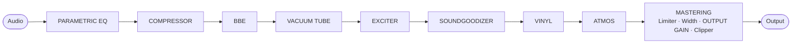
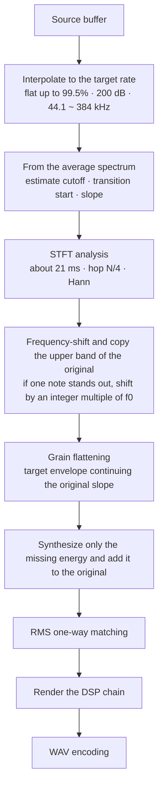

[한국어](README.md) · **English** · [日本語](README.ja.md) · [中文](README.zh.md) · [Français](README.fr.md) · [Español](README.es.md)

# ANALOG SOUL DSP ENGINE

> This is a translation. If it differs from the Korean original ([README.md](README.md)), the Korean original prevails.

> If you have collaborated or contributed, or would like to, please contact me personally. This project is software whose source is open so that anyone can use it for free. For personal, non-commercial purposes it can be used at no cost, and you are also free to modify it and try it out. However, the copyright and ownership belong to the original author, collaborators and contributors, so you may not claim this program as your own or distribute or sell it elsewhere.

**An analog-tone processor that runs in the browser, and a restoration tool that fills in the highs shaved off lossy-compressed audio.**

`v3.1` · single HTML file · no installation · works without an internet connection · audio never leaves your device

Each section from Part 1 to Part 4 is written in four paragraphs. **Motivation** is why the feature or design was needed, **Basis** is the principles, standards and measurements it rests on, **Method** is how it was actually implemented, and **Rationale** is why that method was chosen over others, together with the measured results.

---

## Contents

- [Part 1 · In Plain Words](#part-1)
- [Part 2 · Principles](#part-2)
- [Part 3 · How It Works](#part-3)
- [Part 4 · Algorithms, Equations, Physics and System Design](#part-4)
  - [4.1 Sample-Rate Conversion and the STFT Kernel](#s41) · [4.2 Cutoff and Slope Estimation](#s42) · [4.3 Frequency-Shifted Copying and f0 Sync](#s43) · [4.4 Envelope Extrapolation and Grain](#s44) · [4.5 Level Matching](#s45)
  - [4.6 Nonlinear Transfer Functions](#s46) · [4.7 Aliasing Budget](#s47) · [4.8 Band Splitting](#s48) · [4.9 Dynamics](#s49)
  - [4.10 Physics of Space](#s410) · [4.11 Stereo](#s411) · [4.12 Record Model](#s412) · [4.13 Physics of Hearing](#s413)
  - [4.14 System Design](#s414) · [4.15 Bit Depth](#s415) · [4.16 Issues and Fixes](#s416) · [4.17 Optimization](#s417) · [4.18 Known Limitations](#s418) · [4.19 Key Strengths](#s419)
- [Repository Layout](#repo)
- [Changelog](#changelog)
  - [3.1](#cl-v31) · [3.0](#cl-v30) · [2.4](#cl-v24) · [2.3](#cl-v23) · [2.2](#cl-v22)
- [References](#refs)
- [License](#license)

---

<a id="part-1"></a>

## Part 1 · In Plain Words

### What Is This?

**Motivation.** Sometimes you want to change the feel of a music file. You may want it warm, as if it had passed through old recording gear; spread out, as if you were hearing it in a large concert hall; or with its uneven volume made even. Also, music files downloaded from the internet often have the very high sounds cut off to make the file smaller.

**Basis.** The effects imitate, by calculation, the way real gear and real rooms change sound. What a vacuum tube, a vinyl record and turntable, and the size and walls of a room do to sound has been turned into formulas. The way of filling in the cut-off high sounds, and how strong it is when first switched on, were decided by comparing against the original audio that had not been cut.

**Method.** It is a program that changes the feel of the sound when you put in a music file. It can also read the patterns of the remaining sound and fill in the cut-off top part in a believable way. There is nothing to install. Open a single file in a web browser and it runs right away. The music you put in is not sent anywhere; it is processed only inside your own computer. Even the fonts are inside the file, so the screen looks the same without the internet and nothing is requested from outside.

**Rationale.** So that the sound you chose while listening becomes the file exactly as it is, playback and saving go through the same calculations in the same order. When filling in the cut-off sound, too, the original sound is left as it is and only what is missing is added. Only in a narrow border just below the cut-off point is the original sound lowered a little so that it joins smoothly with the filled-in sound.

### Getting Started

**Motivation.** A first-time user should be able to change the sound and save it to a file right away, without reading the whole manual.

**Basis.** This program was built and tested against the latest desktop Chrome. In other web browsers, some displays or behaviors may differ.

**Method.**

1. Open `analog-soul-dsp.html` in a web browser. Chrome is recommended.
2. Read and agree to the terms of use that appear first when you open it. If you load a music file straight away, that also counts as agreeing.
3. Drag a music file and drop it onto the box at the top of the screen.
4. Press Play (‘재생’) and turn on the switches of the feature cards one at a time, listening to how the sound changes. A card that is on has a border that glows like neon, so you can spot it at a glance.
5. If you like it, choose the fineness and precision in EXPORT at the bottom, and make a new file with the Export (‘내보내기’) button.

For the manuals, start from `index.html`. There are five of them, from easy explanations to in-depth ones.

**Rationale.** Chrome is recommended because some features, such as very fine saving (192 · 384), are supported differently from one web browser to another, and the testing was also done in Chrome. Turning features on and off while listening is recommended because hearing the sound each feature changes on its own makes it easier to pick what you like.

### The Nine Features

**Motivation.** Changing sound is easier to handle when it is split into one job at a time. So one card on the screen is one feature. Even with the same features, the sound changes depending on the order in which they are applied, so you need to be able to see the order and change it.

**Basis.** Each card imitates one kind of processing used in a recording studio. PARAMETRIC EQ calculates an equalizer that raises and lowers sound by pitch, the vacuum tube card a real vacuum tube circuit, VINYL the process of a record being cut and a stylus reading it, and DOLBY ATMOS the way sound bounces off the walls of a room and comes back. The detailed principles are in [Part 2](#part-2) and [Part 3](#part-3).

**Method.** The signal flow map above the cards shows the order the sound passes through. You can change the order by dragging a name on the map or a card, and when the order changes, the sound changes too. While you drag a node on the map (when the map is a single line), the other nodes move aside to open up the spot where it will land, and when the order changes, the map’s nodes and the cards slide to their new places. The HD restoration at the very front and MASTER, the end of production, have fixed places, so they are drawn with dashed borders and cannot be dragged either on the map or as cards.

| Card | What it does |
|---|---|
| **PARAMETRIC EQ** | Picks out only the sound at the pitch you want and makes it louder or softer. You can place up to 20 points and adjust them by dragging while looking at the picture. |
| **COMPRESSOR** | Turns loud sounds down a little and brings up soft sounds, making the whole thing even. |
| **BBE** | Makes speech and the first sound of instruments stand out clearly. |
| **VACUUM TUBE** | Calculates one stage of a vacuum tube amplifier following the real circuit, making the sound warm and thick as if it had passed through that gear. |
| **EXCITER** | Adds sparkle to the high sounds. |
| **SOUNDGOODIZER** | Splits the sound into low, middle and high sounds and makes each of them thicker. |
| **VINYL** | Makes it sound as if a vinyl record were really being played. It imitates even the dust on the record, the scratch that clicks once every turn, the slightly wavering pitch and the high sounds that grow duller toward the inside of the record. |
| **DOLBY ATMOS** | Calculates and lets you hear how sound rings in the room you choose among a studio, a club, a cinema, a concert hall and a stadium. |
| **MASTERING** | The final tidy-up. It shapes four parts, from the low sounds to the high sounds, separately, and stops the sound from getting so loud that it breaks up. |

**Rationale.** The order is not fixed but can be changed by dragging because the order itself changes the sound. However, HD restoration is fixed at the very front, so that MASTER at the end also shapes the filled-in high sounds and keeps the sound from breaking up. MASTER is the final tidy-up of production, so its place is fixed.

**Card Layout**

**Motivation.** When cards of different heights were stacked with no gaps, the order scattered in a zigzag, and you could not tell the processing order just by looking at the boxes.

**Basis.** People scan from left to right and from top to bottom, the way they read text. The scrollbar thickness was decided by a simulation that traded how easy it is to grab against the length of the scrollbar thumb, and the faded text of switched-off cards was set to keep a readable brightness difference (3 : 1 or more).

**Method.** On a wide screen (900 px or more), the cards are the same size (385 px high) and are laid out left → right, top → bottom, so the processing order can be read from their positions alone. The HD restoration card is placed at the very front, as in the flow map, and it is also first in the document, so the order in which the keyboard (Tab) moves and the order in which a screen reader reads are the same as the visible order. A card that is on scrolls inside the card when its content overflows (a 22 px scrollbar on the right), and if you keep scrolling after reaching the end, the page does not follow. When a card gets narrower, the names and value boxes stay as they are and only the slider bars get shorter. The bars are shortest, about 100 px, when three columns have just begun and the card is at its narrowest (360 px), on a card that reserves room for the scrollbar. Cards whose content overflows (VINYL · ATMOS · MASTERING) have an expand button (up and down chevrons) in their header row; press it and only that card grows to the height of its content, so you can see all its controls at once. Press it again to go back to the tile height; the chosen state is remembered in this web browser. A card that is off falls back into the background, where its controls cannot be pressed, and turning the wheel over it scrolls the page. If you start scrolling the page outside a card that is on, the page keeps scrolling even when a card that is on passes under the cursor, until the wheel stops for 0.4 seconds. If you move the mouse in the meantime, this is released at once, and the card you moved onto receives the wheel and clicks. When you drag a card, a dashed empty slot appears in its place and follows the cursor while the other cards move aside, and the dropped card slides from where it was dropped into the empty slot. On a narrow screen, the cards are stacked in a single column.

**Rationale.** When the cards are the same size, position becomes the processing order. Switched-off cards are moved into the background and page scrolling is carried through so that, while scrolling down the page, the scroll does not get caught inside a card and stop when a card passes under the cursor. Cards that overflow always keep room for the scrollbar, whether they are on or off, so the content does not twitch sideways. A wheel scrolled to the end is not passed on to the page because, when it was, the page moved up and the bottom of the card slid under the transport row pinned at the top, so pressing a control at the bottom pressed the transport row instead. This happened especially often with VINYL, whose content is about 2.7 times the height visible in the card. Expanding lengthens only the row that holds that card, and the other cards in the same row keep the tile height, so the processing order read from positions does not change. On narrow cards only the bars are shortened because, if a name or value were cut off, you could not read what was set to what. The HD restoration card is also placed first in the document so that people who use a keyboard or a screen reader go through it in the same order as the screen.

**MACRO % and the Default State**

**Motivation.** Changing a card’s strength by touching several controls separately is tedious, and it is also hard to find values that go well together. The sound when you first open the program should also be just right, not overdone.

**Basis.** The default state was decided by processing 4 uncut original tracks (the middle 20 seconds) with the two methods and comparing them. The MACRO method left the low sounds and the wide, spread-out feel (around +2.2 dB) almost unchanged, while reducing the excessive rise of the high sounds (+4.2 → +2.4 dB) and the drop in volume (−6.2 → −4.9 dB).

**Method.** The MACRO control at the very top of a card moves the card’s main controls together between their weakest position (0 %) and the reference design values (100 %). This works the same way as AUTO % in HD restoration, and the values are rounded to the slider steps. After you touch a control directly, its value stays until you move MACRO again, and the settings file stores MACRO together with the control values. When you first open the program, COMPRESSOR 50 % · BBE 40 % · EXCITER 80 % · SOUNDGOODIZER 65 % · MASTERING CHAIN 95 % are on, and PARAMETRIC EQ · VACUUM TUBE · VINYL RECORD · DOLBY ATMOS are off (MACRO 100 %). The MACRO of PARAMETRIC EQ does not move controls; it sets how much of the boost and cut set for each point is applied (flat at 0 %). At 0 %, the level is unchanged except for MASTERING CHAIN (±0.1 dB). In MASTERING CHAIN the ceiling limiter works regardless of MACRO, so a loud master that has been pushed or clipped up to the ceiling can become 0.2 ~ 0.9 dB quieter. In BBE · SOUNDGOODIZER · MASTERING CHAIN, the phase-correction network and band splitting rotate the phase, so the output is not identical to the original sound down to the sample; to take a card’s effect out completely, turn the card off.

**Rationale.** Because a single control sets the strength, the number of controls to touch to change a card’s strength dropped from 16 to 5.

**Playback Stage**

**Motivation.** When VINYL and ATMOS could only be placed before MASTER, even playback noise such as the crackle of a record was squashed and swollen by MASTER.

**Basis.** A real LP is made by cutting a lacquer from the master audio and pressing records that are played on a turntable, so crackle, pops, surface noise and warp arise after mastering. Atmos, too, draws the space to suit the listening device after the master is finished.

**Method.** After MASTER is the stage where the mastered sound is heard through a playback medium. Only VINYL and ATMOS can be moved after MASTER. Either choose Before MASTER or After MASTER under ‘Processing position’ (‘처리 위치’) below the title bar of these two cards, or drag the card or its node in the flow map past MASTER (in the flow map, Alt+→ also moves it across). The playback stage is shown with teal number tags after the teal ‘Playback’ (‘재생’) boundary in the flow map and below the ‘Playback stage · After MASTER’ (‘재생 단계 · MASTER 뒤’) zone on the card board, and if you drag another card there, ‘Can’t drop here’ (‘놓을 수 없음’) appears. The CEILING guarantee only holds up to MASTER, so sound that has gone through the playback stage can exceed CEILING. Slots and settings files also store the playback-stage order.

**Rationale.** Noise that arises in real playback has to arise after MASTER, as in reality, so that MASTER does not squash or swell it. The ‘Processing position’ buttons sit outside the card body, so they can be pressed even when the card is off.

**Controls of VINYL · VACUUM TUBE · DOLBY ATMOS**

**Motivation.** Records, vacuum tubes and rooms bring a different sound to mind for each person. You reach the sound you want only if you can choose the state of a real object instead of a vague ‘strength’.

**Basis.** The VINYL controls use the units written in real equipment manuals as they are (clicks per second, decibels, millimeters, picofarads and so on). DRIVE and BIAS of VACUUM TUBE are real voltages applied to the vacuum tube, and the rooms of DOLBY ATMOS are matched to the reverberation lengths commonly measured in real rooms of the same kind.

**Method.** The VINYL controls come in three groups: record, turntable and stylus. You set how much dust has settled on the record, whether it is scratched, whether it is warped and how many times it has been played, and you choose how evenly the turntable spins and the shape of the stylus. If you enter the numbers written in each device’s manual as they are, you get the sound of that combination. A click you heard while listening occurs at the same place in the saved file as well.

DRIVE of VACUUM TUBE is the strength of the sound going into the vacuum tube, and BIAS is the state of the vacuum tube when it is at rest. Lowering BIAS makes one side distort first, deepening the warm color; raising it makes the sound cleaner. SPACE of DOLBY ATMOS is the size of the room, DEPTH is how far away the sound comes from, and HEIGHT and OBJECT are the strength of the sound coming back from the ceiling and from the side walls. For SPACE · HEIGHT · OBJECT, the middle (50) is the value of a real room.

**Rationale.** The clicks are made in advance in a fixed order and played in time with the track, so the sound you heard and the saved file are the same. Real units are used so that users can copy the numbers of the gear they own straight in.

**PARAMETRIC EQ**

**Motivation.** In some tracks the low sounds boom, the voice is buried under the instruments, or the high sounds are harsh. Often you need to raise or lower just the sound at that pitch a little, without changing the whole.

**Basis.** This is what the equalizer (EQ) in a recording studio does. When sound is split up by pitch, which pitches are raised or lowered and by how much decides the tone. The curve on the screen is drawn with the same calculation that actually changes the sound, so what you hear is exactly the curve.

**Method.** The card’s picture has numbered points, and each point takes care of one pitch. Dragging a point left or right changes the pitch it handles, and dragging it up or down changes how much it raises or lowers. Turning the wheel over a point makes it handle a narrower or wider area around that pitch. Double-clicking an empty spot creates a point (up to 20), double-clicking a point turns it off for a while, and right-clicking it deletes it. You choose a shape for each point: **Bell** (‘벨’), which swells or digs out just one pitch; **shelf** (‘셸프’), which raises or lowers everything below or above; **cut** (‘컷’), which removes the area below or above; and **Notch** (‘노치’), which digs deeply into just one pitch. Pressing ‘Edit Enlarged’ (‘크게’) opens a large picture and a table of all points so you can also edit them as numbers, and you can play and switch on and off from that window too. During playback, the sound picture before EQ (line) and after EQ (filled area) are shown overlaid. At first it is off, with four flat points that leave the sound unchanged even when it is on. With **Import AutoEQ** (‘AutoEQ 가져오기’) in the large window you can also load an AutoEQ headphone correction file as points, but correction added this way also goes into the saved file. If you want to correct the headphones you are listening on, use ‘Matching Your Listening Device’ below.

**Rationale.** EQ is at the very front of the default order. This is so that booming or low noise you want to remove does not drive the compression and distortion later in the chain first. If you want to shape the sound after compression, just move it after COMP. Points are numbered in the order they were made, so the numbers do not change while points are turned off.

**INPUT GAIN**

**Motivation.** Features that add flavor by distorting the sound react more strongly the louder the incoming sound is. So you need to be able to set the level going into each feature separately.

**Basis.** Gear such as vacuum tubes and compressors distorts more or squashes more as the input gets louder.

**Method.** Every card has **INPUT GAIN** at the very top. It is the level of the sound going into that feature (−24 ~ +24 dB, in 0.1 dB steps, default 0). For features that add flavor by distorting the sound, raising it makes the effect stronger; for features that do not distort, such as PARAMETRIC EQ, only the level changes.

**Rationale.** INPUT GAIN is inserted right before a card only while that card is on. This is so that the value of a card that is off does not change the overall volume.

### Filling In the Cut-Off Highs

**Motivation.** In music files that were made smaller, the very high sounds are cut off. Even if you save them with more fineness, the cut-off part stays empty.

**Basis.** The high end of the remaining sound follows patterns: the slope at which it gets quieter and which notes are ringing. The filling method and the default values were decided by comparing against the uncut original audio, choosing what brings the filled-in sound closer to the original audio.

**Method.** The **HD** and **Ultra · eXtreme HD** sections do this job. When saving, if you choose a fineness higher than the original file (48 · 88.2 · 176.4 · 352.8 for a 44.1 kHz file; 96 · 192 · 384 for a 48 kHz file), the sound is filled in up to that height. In tracks where one instrument or voice stands out, the pitch of the filled-in sound is placed to match the harmonic positions of the original sound. How much is filled in is set with **HF SYNTH**, and how evenly the filled-in sound is spread as it goes higher is set with **SMOOTH**. If HF SYNTH is set to 0, nothing is filled in and only the fineness is raised.

Turning on the **LIVE** switch lets you hear the result before saving. You have to wait a moment when you turn it on. This is because it first scans the whole track to find where it was cut off, and then fills in the whole track once. It is rebuilt when you change a control, or when you choose something in the PRESET panel and close the panel.

**Rationale.** This feature does not recover the original sound that was cut off; it looks at the remaining sound and draws in something believable. So the original sound is left as it is and only what is missing is added, and only in a narrow border just below the cut-off point is the original sound lowered, by up to half, to join it with the filled-in sound. The pitch is matched to the harmonic positions because, if the sound were simply moved up and pasted on, the filled-in sound would stray from the harmonic positions of the original notes. Whether the difference is audible depends on the file, your ears and your gear. The more a file was shrunk, the bigger the difference; a file that was good from the start hardly changes.

### Seeing It in Pictures

**Motivation.** It is hard to judge by ear alone how the sound has changed. In particular, whether the very high sounds were filled in may be hard to hear.

**Basis.** If you split the sound by pitch and draw how loud each pitch is, the cut-off part and the filled-in part become visible.

**Method.** In the upper graphs, the left shows the original sound and the right the changed sound. They show the same moment side by side, so you can see right away what has changed. Clicking a graph switches it to a picture that flows over time, where a brighter color means the sound at that pitch is louder.

The X-AXIS switch above the graphs (Adaptive (‘순응’) · 48 · 96 · 192) lets you fix the horizontal range. When you turn restoration on and off, the graph does not stretch and shrink, so only the newly filled-in part catches your eye.

**Rationale.** The two graphs use the same color scale. If the colors differed, you could not compare the loudness on the left and on the right. When the horizontal range is fixed, sound at the same pitch is always drawn in the same place.

### Matching Your Listening Device

**Motivation.** Every pair of headphones and every speaker plays some pitches louder and others softer. If you adjust while listening with those habits mixed in, you end up trying to fix a resonance that is not in the track, or adding more to the track at pitches that the device has eaten away.

**Basis.** AutoEQ is an open project that, based on published headphone and earphone measurements, provides correction values that match each device’s response to a target curve. Its correction file (ParametricEQ.txt) consists of about ten filters of the same kind as the PARAMETRIC EQ points, plus an amount that lowers the whole (Preamp).

**Method.** Press the **Monitor Correction** (‘모니터 보정’) button on the transport row, choose the ParametricEQ.txt of your headphones in **Import AutoEQ** (‘AutoEQ 가져오기’) or paste its contents, then press **Apply** (‘적용’). The correction turns on immediately and the button shows the headphone name. In the window you can see the correction curve and the filter table, turn it on and off, and adjust Preamp in 0.1 dB steps. If the curve rises above 0 dB, it warns you that loud sounds may clip, so just lower Preamp by the amount it tells you.

**Rationale.** This correction is applied only during playback, just before the fully processed sound goes out to the device. It does not go into saved music files or settings files and is remembered only in this web browser. The habits of headphones are a property of the listening device, not of the track, so putting them in the file would make the sound wrong on other devices or for other people. The changed-sound graph on the screen also shows the sound before correction, that is, the sound that will become the file. Use Import AutoEQ in PARAMETRIC EQ only when you deliberately want to make a file just for those headphones.

### Comparing at the Same Loudness

**Motivation.** The human ear feels that louder sound is better. Tracks that were made loud often get quieter when features are turned on (3 ~ 10 dB with default settings), so when you switch on and off while listening, the off side tends to sound better. To hear what has changed, you need to match the loudness of the two sounds.

**Basis.** Loudness is measured as loudness (LUFS) according to the international standard ITU-R BS.1770. This is the method broadcasters and music services use to match volume; it counts the high sounds, to which the ear is sensitive, a little louder, and leaves quiet gaps out of the count.

**Method.** Pressing **Compare** (‘비교’) on the transport row switches to the reference sound (the button shows a name such as ‘Original’ (‘원음’), with an amber border), and pressing it again returns to the processed sound. The reference sound is at first the original sound with nothing changed, and by pressing **Reference** (‘견줄 소리’) next to it you can switch to a sound with just one active feature removed, such as ‘without SOUNDGOODIZER’ (‘SOUNDGOODIZER 빼고’). Only that feature is taken out and everything else stays the same, so you can hear just what that feature did. The first time you press it and when you choose, it switches after a short delay because it is measuring the loudness. When **Same Loudness** (‘같은 크기’) next to it is on (the default), the reference sound is played matched to the same loudness as the processed sound, and the amount of matching is shown, as in ‘Original −5.6 dB’ · ‘without SG −2.6 dB’. When you change a control or a card, it measures again after a moment.

**Rationale.** Only the reference sound is adjusted and the processed sound is left untouched, so the processed sound always plays at the same loudness as the file to be saved. When the reference sound has to be raised, it is raised only as far as the loudest sound does not clip (‘limit’ (‘한도’) on the button). The two sounds are aligned by the time the processors delay them (about 45 ms for the original sound with default settings; with one feature removed, that feature’s latency), so the beat does not shift when you switch. When one feature is removed, the processing is not run a second time; instead the sound is routed around that feature, so playback does not get heavier. This comparison applies only while listening and does not go into saved music files or settings files.

### Keeping Your Settings

**Motivation.** Once you find settings you like, you should be able to hold on to them for reuse, compare several settings by switching between them, and move them to another computer.

**Basis.** Settings are only the control values, the on/off states, the card order and the EQ points, so they fit in one small text file. The quick slots are kept in the web browser’s storage.

**Method.** Music files and monitor correction are not included; only the settings are.

| Button | What it does |
|---|---|
| **Save Current Settings** (‘화면 설정 저장’) | Makes a file of the settings currently on the screen. Use it to move them to another computer. |
| **Quick Slots 1–4** (‘빠른 슬롯 1~4’) | A short press loads, and a long press (0.6 seconds) stores the current settings. Pressing an empty slot returns to the default state. |
| **Copy** (‘복사’) | After pressing it, press two slots in turn and the first is copied to the second. The first slot stays as it is. |
| **Clear One Slot** (‘한 슬롯 비우기’) | After pressing it, press one slot and only that slot is cleared. |
| **Clear All Slots** (‘모든 슬롯 비우기’) | Pressing it once asks for confirmation, and pressing it again clears everything. |
| **Back Up All Slots** (‘모든 슬롯을 백업’) | Bundles the four slots into one file. |
| **Load** (‘불러오기’) | Tells by itself whether it is a settings file or a backup file and restores it. |

Quick slots stay only in the web browser you are using now. To use them on another computer, save them to a file. If you load settings saved in 3.0, which had no EQ, the EQ returns to its default state (off, four flat points), so the sound is exactly as it was when saved.

When you save, the signal flow map at the top and the cards below blink twice in processing order, to show that the values and the order have been stored. When you load, the nodes of the flow map and the cards slide to their saved positions.

**Rationale.** Leaving out the music file and storing only the settings keeps the file small and easy to move anywhere. An empty slot means ‘No settings’ (‘설정 없음’), so pressing it returns to the default state. Clear All Slots cannot be undone, so it asks once more. Load tells the file types apart by itself, so you do not have to choose what kind of file it is. The blinking follows the processing order to show, step by step, that the order has been saved too.

### Saving to a File

**Motivation.** To listen to the changed sound elsewhere, you need to keep it as a new music file. The fineness and precision you want differ depending on where it will be used.

**Basis.** A music file divides each second into tiny pieces and writes down the loudness of the sound at each one as a number. How finely it is divided (fineness) and how precisely the numbers are written (precision) decide the size of the file.

**Method.** Choose the two settings in EXPORT at the bottom, then press the **Export** (‘내보내기’) button.

| Bar | Choices | Meaning |
|---|---|---|
| **SAMPLE RATE** | 44.1 · 48 · 96 · 192 · 384 | How finely each second is divided and written down. If you choose higher than the original file, the cut-off high sounds are filled in up to that height; if you choose lower, it is reduced while keeping the original sound as much as possible. When you load a file, it is set to the same value as the original file, and the tag (source) (‘원본’) appears under that tick. If there is no matching tick, it is set to the next tick up (the top tick if the original file is higher than the top), and (source) is not shown. If the original file is in the 44.1 family (44.1 · 88.2 · 176.4 · 352.8), the upper three ticks change to 88.2 · 176.4 · 352.8. |
| **BIT DEPTH** | 16 · 24 · 32 | How precisely each value is written down. If the original file is 16-bit or lower, choosing 24 or 32 fills in between the steps. |

Below the button, the order in which processing will happen is shown. The bigger the numbers, the bigger the file. A 1-minute track is about 10 MB at 44.1 and 16, about 33 MB at 96 and 24, about 88 MB at 192 and 32, and about 176 MB at 384 and 32. If you save the same file again with the same settings, you get a file that is identical down to the last byte.

**Rationale.** The value matching the original file is chosen at first so that, if you leave it alone, the file is saved without conversion. For 44.1-family files, the upper ticks are changed to 88.2 · 176.4 · 352.8 because these are exactly twice and four times the rate, which makes the calculation fast. Raising a 44.1 kHz file to 88.2 is 32% faster than raising it to 96, and the difference in sound is smaller than even the smallest unit written in the file. When filling in between the steps of a 16-bit file, the values are kept from leaving the cell where the original value was, so the sound is written more finely without drifting from the original sound.

### Good to Know

**Motivation.** There are a few things that may confuse or surprise you as you use the program. Knowing them in advance can keep you from hearing things wrongly or losing your settings.

**Basis.** They come from the way the human ear is fooled by loudness, from the range of what web browsers support, and from the way this program handles settings.

**Method.**

- **If things seem better just because you turned something on**, it may be because the sound got louder. The human ear always feels that louder sound is better. Conversely, tracks that were already made loud get 3 ~ 10 dB quieter when features are turned on, so the off side may sound better. Keep **Compare** (‘비교’) on the transport row set with **Same Loudness** (‘같은 크기’) on, and compare. To hear what one feature did, remove that feature in **Reference** (‘견줄 소리’) and listen (see ‘Comparing at the Same Loudness’ above).
- **MASTERING does not make the sound louder on its own.** It leaves quiet parts as they are and only squashes loud parts. To make it louder, raise the INPUT GAIN of MASTERING to push into the limiter.
- **If a notice says you cannot save at 192 or 384**, the web browser does not support saving with that much fineness. Use Chrome or choose 96 (88.2 for the 44.1 family).
- **If you try to go to another manual after changing settings**, a confirmation window appears. This is because settings are not saved automatically.
- **The screen colors are chosen at the right end of the top bar.** 'Auto' ('자동') follows the computer’s dark/light setting, while 'Night' ('야간') and 'Day' ('주간') always keep it dark or always bright. Your choice is remembered in this web browser and applies to both the program and the manuals.
- **A saved music file contains only the sound.** It does not record which settings it was made with, so if you want to reuse them later, save the settings as well.

**Rationale.** MASTERING does not raise the level on its own so that there is no hidden automatic boost and users decide for themselves how much louder things get when they turn something on. Going to another manual asks first because leaving before saving loses all the values you changed.

---

<a id="part-2"></a>
## Part 2 · Principles

This part explains the physical and perceptual phenomena each feature relies on. The calculation methods are covered in Part 3 and the equations in Part 4. Each section sets out, in turn, why the program needs this principle (Motivation), which theory and data it relies on (Basis), how the program uses the principle (Method) and why that approach was chosen (Rationale).

### 2.1 Two Ways of Seeing Sound — Time and Frequency

**Motivation.** This program handles sound in two forms: the waveform (time) and the spectrum (frequency). Preserving the sampling frequency of the source, filling in the cut-off highs and choosing the sampling frequency for export all start from the question “how high can this file reach?” To read the two analyzers on the screen, you also need to understand the logarithmic frequency axis and decibels.

**Basis.** Sound is the variation of air pressure over time. A recording file is a sequence of numbers measuring this variation at regular intervals, and the reciprocal of that interval is the **sampling frequency**. 44.1 kHz means it was measured 44,100 times per second. By the sampling theorem, the **Nyquist frequency**, half the sampling frequency, is the highest sound the file can hold. The same sound can also be broken down into frequency components. This is the **spectrum**, which shows how much sound of each pitch is mixed in. The human ear perceives frequency on a logarithmic scale. Going from 100 Hz to 200 Hz and going from 1 kHz to 2 kHz both sound like one octave. Level is measured in **decibels (dB)**. Doubling the amplitude is about +6 dB, and a 10 dB difference sounds roughly twice as loud.

**Method.** The analyzer draws the horizontal axis of the bar spectrum and the vertical axis of the spectrogram logarithmically, from 20 Hz up to the display Nyquist. The 128 bars are evenly spaced on the logarithmic axis, and each bar shows the maximum of the FFT bins in its range. The vertical scale is −100 ~ −30 dB (Section 3.7). When a file is opened, the source sampling frequency is read directly from the file header before the file is handed to the browser’s decoder (Section 3.9). The export sampling frequency is chosen from 44.1 ~ 384 kHz (Section 3.8).

**Rationale.** The graphs are drawn logarithmically because the ear hears logarithmically. On a linear axis, the width taken by one octave doubles with each octave upward, so nearly six octaves, from 20 Hz ~ 1 kHz, would be crowded into the far left edge of the screen. The source sampling frequency is read from the header because the browser’s decoder always converts to the sampling frequency of the playback device. Only by knowing the original Nyquist can the program judge which region was originally empty.

### 2.2 Dynamics — Compression

**Motivation.** If the volume is uneven, the depth of distortion in the saturation stages that follow differs from passage to passage. That is why COMPRESSOR is at the very front of the chain (Section 3.2). The final MASTERING stage also handles the final level and peaks with band compressors and a limiter.

**Basis.** When the sound exceeds the **threshold**, a compressor reduces the excess by dividing it by the **ratio**. At 4:1, a sound 8 dB over the threshold is reduced so that it is only 2 dB over. **Attack** is how quickly it reduces once the threshold is exceeded, and **release** is how quickly it returns to normal after the level drops. The **knee** decides whether compression is applied abruptly or gently near the threshold. Compression reduces the unevenness of the volume. Since the **crest factor**, the difference between the loudest instant and the average, gets smaller, the average volume can be raised within the same maximum level. Raising the whole signal again by the amount compression took away is called **makeup gain**.

**Method.** The compression element is Web Audio’s `DynamicsCompressorNode`. The knee of this element spreads **only upward** from the threshold, so the point where compression starts is higher than with the symmetric knee of hardware by half the knee width. The specification always applies an automatic makeup $`(1/c(1))^{0.6}`$ that raises even signals below the threshold. This program calculates that value with the same formula and cancels it with its reciprocal right after the compressor (6.03 dB at the COMPRESSOR defaults). As a result, the compressor itself does not touch quiet sounds below the threshold, and makeup gain is applied only as much as MAKEUP sets. The output compressor of SOUNDGOODIZER and the four band compressors and limiter of MASTERING are compensated in the same way. The equations and figures are in [4.9](#s49).

**Rationale.** If the automatic makeup were left in place, the sound would get louder just by turning the compressor on, and by an amount that depends on the threshold, knee and ratio. Before compensation, at the COMPRESSOR defaults, a quiet signal got +10.0 dB louder because a hidden 6.03 dB was added to MAKEUP’s 4 dB, and MASTERING raised each band differently by +5.4 ~ +7.1 dB, so the mids stood out by 1.7 dB. After compensation, only the MAKEUP knob adds gain, so the knob has a single meaning, and it becomes easier to compare the sound on and off at the same volume (2.10). The price is that the output at the default settings became about 6 dB quieter than before compensation. Since the compensation relies on the formula in the specification, in environments that implement it differently from this formula it is off by that difference.

### 2.3 Phase and Clarity

**Motivation.** When the onset of a sound blurs, the outline of an instrument sounds smeared. The BBE card handles this outline by changing time relationships. Also, mixing a signal whose phase alone has been rotated with the original sound cancels certain frequencies, so cards that use parallel paths (the old structure of BBE, SOUNDGOODIZER) must avoid this property. The band that decides the clarity of speech and instruments is the target of BBE’s PROCESS and of SOUNDGOODIZER’s presence boost.

**Basis.** A loudspeaker cannot send out sound of all pitches at the same time. Low sounds in particular tend to come out later than high sounds. This phenomenon, in which arrival time differs with frequency, is called **group delay**. The processing that BBE published delays the lows by about 2.5 ms and the mids by about 0.5 ms relative to the highs. The manufacturer describes this as phase correction of the loudspeaker, but since it delays the lows that the loudspeaker has already delayed even further, it is less a correction than a process that makes the attack of the high components arrive first and so brings out the outline of the onset. A filter that changes only the phase and leaves the magnitude unchanged is called an **all-pass filter**. Passing the signal straight through this filter can delay just the low sounds while leaving the magnitude as it is. Conversely, mixing the signal that went through this filter with the original signal makes sound cancel at the frequencies where the phase is opposite, so to change only the timing, the signals must not be mixed. In human speech, the 2 ~ 5 kHz band, where consonants are concentrated, governs **clarity**. The ear canal is a tube closed at one end by the eardrum, so it has a quarter-wavelength resonance (about 3.4 kHz), and this resonance together with reflections from the pinna boosts 2 ~ 5 kHz by 10 ~ 15 dB. This is also the band where the ear is most sensitive on the equal-loudness contour (ISO 226). Raising this band a little makes speech feel as if it comes forward.

**Method.** BBE passes through two all-pass filters (220 Hz Q 0.59, 1850 Hz Q 1.47) **in series**, creating only group delay while leaving the magnitude unchanged. With all three knobs at 0, the response is 0.0 dB across the whole band, and the group delay is 2.58 ms at 50 Hz, 0.61 ms at 500 Hz and 0.03 ms at 5 kHz. After that, PROCESS uses a 3 kHz high shelf (0 ~ +8 dB) to broadly raise the band where consonants and attacks gather, and HI DEF handles the range above it with a 10 kHz high shelf (0 ~ +6 dB). SOUNDGOODIZER raises the presence band with a 2.5 kHz peaking filter (Q 0.7, +AMOUNT×3 dB), and when it adds the processed bands in parallel to the original sound, it applies to the original-sound path the same all-pass as the band sum, so that the phases match ([4.8](#s48)).

**Rationale.** The centers and Q values of the two all-pass filters are a least-squares fit to the target group delay (2.5 ms below 150 Hz, 0.5 ms at 0.4 ~ 1.5 kHz, 0 above 5 kHz). The old structure added the all-pass output to the original sound, so notches formed where the phase was −180°. With a mix ratio of g = 0.6 this is −12 dB, and in practice, at LO CONTOUR 100, 100 ~ 125 Hz and 315 Hz were at −9.3 dB. Now that it has been changed to series, it is flat with the knobs at 0, and LO CONTOUR 100 rises smoothly: +9.7 dB at 31.5 Hz, +7.0 dB at 63 Hz and +3.1 dB at 100 Hz. The hardware varies the amount of high-frequency emphasis with the signal, but here it is a fixed shelf. On vocals, raising PROCESS above +6 dB also raises sibilance.

### 2.4 Nonlinearity and Harmonics

**Motivation.** VACUUM TUBE, EXCITER and SOUNDGOODIZER deliberately distort the sound to add color, and the safety clipper of MASTERING is also nonlinear. Which harmonics arise, and how strongly, is the tone of that card. Distorting in the digital domain can mix in stray sounds at pitches that were not there before, so this must also be controlled.

**Basis.** Distorting a sound creates **harmonics** that were not there before. Distorting a 100 Hz sound produces new components at 200, 300 and 400 Hz. Which harmonics arise, and how strongly, is decided by the way the sound is distorted. A **symmetric** method that presses both sides equally (an odd function with $`f(-x) = -f(x)`$) produces only odd harmonics (3×, 5×…). An **asymmetric** method that presses one side harder also produces even harmonics (2×, 4×…). In the Taylor expansion $`f(x + b) = f(b) + f'(b)\,x + \tfrac12 f''(b)\,x^2 + \cdots`$, the coefficient of the $`x^2`$ term, which creates the 2nd harmonic, is proportional to the curvature $`f''(b)`$ at the operating point. The 2nd harmonic is one octave up, so it blends well with the original sound and sounds thick, while the 3rd harmonic is a fifth above the octave and gives a somewhat rougher color. The reason vacuum tube tone is called warm lies in the even harmonics produced by its asymmetric characteristic. Because of the 3/2 power of the space-charge law and grid current, the curve of a triode is inherently asymmetric (Koren’s triode model). There is a caveat when distorting sound digitally. When newly created harmonics exceed the Nyquist frequency, they do not disappear but are **folded** back down and appear at pitches unrelated to the original sound. This is called **aliasing**. Also, even at the same distortion percentage, the high-order intermodulation produced by a curve whose curvature changes abruptly sounds the most objectionable (Geddes & Lee).

**Method.** VACUUM TUBE obtains its curve by solving the equations of a 12AX7 common-cathode amplifier stage. At the defaults (DRIVE 30, BIAS 50), a 1 kHz −6 dBFS input gives a 2nd harmonic of −33.7 dB and a 3rd harmonic of −67.5 dB. EXCITER sets the positive and negative saturation limits of the $`\tanh`$ curve differently, at +1 and −0.7, and SOUNDGOODIZER creates even harmonics by shifting the operating point by $`b = 0.08\,\mathrm{SAT}`$. Aliasing is reduced in two layers. The curves are applied with 4× oversampling, and EXCITER and the SOUNDGOODIZER high band place a $`\max(1.4\,f_{\mathrm{lo}},\ f_s/3)`$ low-pass only in front of the saturation path, raising the harmonic order at which audible aliasing begins from 7 to 10.5. The DC that the asymmetric curves also produce is blocked by the high-pass after saturation (TUBE 10 Hz, EXCITER FREQ, SOUNDGOODIZER 12 Hz). The curves and measurements are in [4.6](#s46), and the aliasing budget is in [4.7](#s47).

**Rationale.** The vacuum tube curve is solved from the circuit rather than picked by hand because the old curve, contrary to its comment, had the 3rd harmonic 17 dB ahead at the default BIAS. The current model reproduces the physical tendencies as they are: at small signals the 2nd harmonic is 34 dB larger than the 3rd, when pushed hard the 3rd harmonic takes the lead, and at a cold bias the 2nd harmonic gets stronger. The old SOUNDGOODIZER curve was a pure odd function, so the 2nd harmonic reached only −68.6 dB. Multiplying the gain on the negative half-cycle only does not change the curvature at the origin and so produces almost no even harmonics at small signals, which is why shifting the operating point was chosen instead. The aliasing order is independent of the sampling frequency, because the upper limit of the input rises in proportion to the Nyquist. Raising the rate alone does not help; the input band has to be limited to a fraction of the Nyquist. Rendering the whole chain at a high multiple was not used, because render time and memory grow by that multiple, an extra resampling step is added, and it would apply only to export, so the sound you hear and the file would differ. TUBE has no band limit. At MIX 100 the whole signal passes through the curve, so it would become a 16 kHz cutoff that a real amplifier stage does not have.

### 2.5 Working in Separate Bands

**Motivation.** Low sounds and high sounds behave differently, so applying the same processing to both ruins one of them. SOUNDGOODIZER saturates three bands separately, and MASTERING compresses four bands separately. To keep the punch of the lows while preventing the highs from pumping, each band needs different settings.

**Basis.** A **crossover** splits the signal into bands, which are processed separately and then summed again. When the split pieces are summed again as they are, the result must have the same magnitude as the original. A split with this property is called a **complementary** split. If it is not complementary, the sound swells or dips at the split boundaries. A 4th-order Linkwitz–Riley split is made by cascading a 2nd-order Butterworth twice, and the sum of the low and high bands is exactly a 2nd-order all-pass, so the magnitude is 1 at all frequencies.

**Method.** Both cards use 4th-order Linkwitz–Riley filters. SOUNDGOODIZER splits at two crossover points per mode (A 250 Hz / 4 kHz and so on), and MASTERING at 120 Hz / 500 Hz / 5 kHz. When there are two or more crossover points, the structure is built as a tree that multiplies the lower band by the all-pass of the upper crossover point, so that the sum becomes $`AP_a AP_b \cdots`$. The Web Audio specification interprets the Q of `lowpass` and `highpass` in dB, so −3.0103 rather than 0.707 is entered for Butterworth. The derivation and figures are in [4.8](#s48).

**Rationale.** The old SOUNDGOODIZER placed an LPF, BPF and HPF in parallel, so the band sum wobbled between 0.906 and 1.568, and the area around 2 kHz swelled by about +4 dB. Splitting only between adjacent bands creates a −1.22 dB notch at about 411 Hz in MASTERING. Entering 0.707 for Q as it is makes the sum swell by +7.4 dB at the crossover point. With the tree structure now in place, the deviation of the sum calculated with the specification’s coefficients is ±0.0000 dB. The price is phase rotation. The band sum is at −180° at the crossover point, so when the processed bands are added in parallel to the original sound, the same all-pass must also be applied to the original-sound path to avoid cancellation (otherwise −2.3 dB at 250 Hz). The group delay is at most about $`0.543/f_c`$, which is about 4.5 ms at the 120 Hz crossover point of MASTERING and smaller than the discrimination threshold for low-frequency group delay. Bands that contain saturation are not linear, so the flatness of the sum holds only at low levels; in all four modes that response is within ±1.3 dB.

### 2.6 Space — Reflections and Reverberation

**Motivation.** The DOLBY ATMOS card places the sound in a room. The old card used ten fixed reflections and a reverb made from different random numbers each time, so the texture of the reverb changed even with the same settings. To control the space with real quantities such as the size of the room, the absorption of the walls, the distance to the source and the width of the source, the principles of room acoustics are needed.

**Basis.** The sound heard in a room is divided into three parts: the **direct sound**, which comes straight from the source; the **early reflections**, which arrive after bouncing once or twice off the walls and ceiling; and the **late reverberation**, which has bounced countless times and become mixed. The early reflections convey the size and shape of the room, and the late reverberation conveys how the room rings. The time it takes for the reverberation to fall by 60 dB is called **RT60**. A small studio is 0.3 ~ 0.5 seconds, and a concert hall around 2 seconds. The more sound the walls absorb, and the smaller the room, the shorter the reverberation (the reverberation formulas of Sabine and Eyring). Air also absorbs high sounds (ISO 9613-1), so the larger the room, the shorter the reverberation of the high sounds. Moving away from the source weakens the direct sound, but the reverberation stays evenly throughout the room, so beyond a certain distance the reverberation becomes louder than the direct sound. This distance is called the **critical distance**. Early reflections from the side walls send different sounds to the two ears and make the source sound wide (Barron & Marshall, Hidaka and others). Sound coming from above arrives with the region around 8 kHz emphasized because of the pinna, and the ear uses this emphasis as a cue that the sound is coming from above (Blauert’s directional bands). Reflection paths can be calculated with the image-source method, which repeatedly places mirror images of the source reflected in the walls (Allen & Berkley).

**Method.** ATMOS creates the early reflections from image-source reflections in a rectangular room, creates the diffuse reverberation with a frequency-dependent decay that adds air absorption to the Eyring reverberation time, and convolves them. The direct sound is left as the original, dry signal. The early reflections and the late reverberation cross over around the mixing time (Polack, $`\min(\sqrt{V}\ \mathrm{ms},\ 150\ \mathrm{ms})`$) so that their energy sum is 1. The knobs are physical quantities. SPACE is the dimensions of the room, DEPTH the distance between the source and the listener, OBJECT the amount of side-wall reflection, HEIGHT the amount of ceiling and floor reflection plus the 8 kHz emphasis of overhead reflections (up to +8 dB), and REVERB the amount of diffuse reverberation. When first opened (SPACE 60), the reverberation time at 1 kHz is 0.28 s for STUDIO and 2.02 s for CONCERT, and the critical distance ranges from 1.24 m for STUDIO to 26.4 m for STADIUM. The levels of the reflections and the reverberation are matched to the listening distance following Barron’s revised theory. The scene table and the equations are in DOLBY ATMOS in Section 3.4 and in [4.10](#s410).

**Rationale.** When the absorption coefficient exceeds 0.2, the Sabine formula overestimates the reverberation time (by about 28 % at α 0.4), so the Eyring formula is used. The Eyring formula assumes that energy falls to $`1 - \alpha`$ with each reflection, so it rests on the same assumption as the image-source reflections. Reflections are cut off by arrival time rather than by order, so every reflection that arrives before the mixing time is included regardless of its order. The diffuse reverberation is not made by filtering noise with octave-band filters; instead the decay is applied per bin in the frequency domain. This is because there are no overlapping filter skirts, so neighboring bands with longer reverberation do not leak in. The random numbers come from a deterministic generator whose seed is set from the settings, so the same settings always give the same response, and responses are stored per input combination so that the texture of the reverb does not waver when other knobs are turned. The measured reverberation times are mostly within 5 % of the expected values, and the energies of the reflections and the reverberation are 0.4 ~ 0.9 dB lower than Barron’s revised theory. Despite the name, it is a 2-channel room-acoustics model unrelated to object-based multichannel formats.

### 2.7 Stereo Image

**Motivation.** The STEREO control of SOUNDGOODIZER and the width control of MASTERING widen or narrow the sound. VINYL removes left–right differences in the bass at the cutting stage and imitates the left–right crosstalk of a cartridge. All of these rely on viewing left and right as split into mid and side. A listener may hear through a single speaker, such as a smartphone speaker, so we also need to know what survives in mono.

**Basis.** Left and right signals can be re-expressed as **mid (M)** and **side (S)**. Mid is the component present equally in both channels, and side is the difference between them ($`M = (L + R)/2`$, $`S = (L - R)/2`$). Raising the side component widens the sound, and lowering it narrows it. The point to watch is **mono compatibility**. When listening on a single speaker, left and right are summed ($`L' + R' = 2M`$), and the side components then cancel each other and disappear completely. An instrument pushed too far to the sides may become inaudible in mono.

**Method.** Width control is built from one shared block. $`L' = M + wS`$, $`R' = M - wS`$; $`w = 1`$ leaves the signal unchanged and 0 gives mono. The implementation relies on the specification rule that multiple connections into the same input of a `ChannelMergerNode` are summed. SOUNDGOODIZER STEREO ranges over 0 (mono) ~ 2×, about 1.1× at the default of 55. MASTERING's width is 0 ~ 200 (default 110) and sits after the limiter and before OUTPUT GAIN and the safety clipper. VINYL applies a 150 Hz high-pass to the side component only, gathering the bass into the center. The equations are in [4.11](#s411).

**Rationale.** Widening adds side component and pushes the peaks up again, so width is placed before the clipper that guards the ceiling ([4.9](#s49)). The mono sum is $`2M`$ regardless of $`w`$, so any information placed in the side with $`w > 1`$ disappears entirely in mono. Moreover, $`w > 1`$ only raises the side component; it does not **decorrelate** left and right. To lower the interaural correlation (IACC) and widen the apparent source width, frequency-dependent phase rotation or short random delays are more effective, and in this program that role is taken by the side-wall reflections of ATMOS (OBJECT).

### 2.8 Imperfections of Vinyl Records

The sound of a record comes from the physics of how it is made and how it is read. The VINYL card is a physical model that follows this process, and every control is a physical quantity written in real turntable, cartridge and record specification sheets. The real-time engine and the rendering engine build this block with the same function, `buildVinylChain`. The structure and controls are under VINYL in section 3.4, and the equations are in [4.12](#s412).

**Cutting**

**Motivation.** The round "tick" typical of records, the thick surface noise and the bass gathered in the center are all determined at the stage where the groove is cut. To imitate this grain, noise must not be added just anywhere; it must follow the order created by cutting and the playback curve.

**Basis.** A groove records the velocity of the sound. Cut as is, the bass would swing the groove too widely and the treble would be too small and get buried in noise, so the groove is cut with the **RIAA recording curve**, which lowers the bass and raises the treble, and the opposite curve restores it on playback. The time constants of the RIAA playback curve are 3180 µs, 318 µs and 75 µs, and the IEC amendment adds a 20.02 Hz low-frequency cutoff. Noise and dust sounds that arise inside the groove pass only through the playback curve, so their treble is cut and their bass swells, becoming the round "tick" and thick surface noise typical of records. A stereo groove cuts the left and right walls separately; left–right differences in the bass would swing the groove widely up and down and make the stylus jump, so the bass is gathered into the center during cutting (elliptical EQ).

**Method.** The input first passes through the elliptical EQ. The side (L−R) component is filtered by a 150 Hz LR4 high-pass (two 2nd-order Butterworth sections), and the mid (L+R) component is sent through a 2nd-order all-pass with the same phase. Surface noise, crackle, pops, scratches, rumble and warp are all generated in the groove domain and passed through the RIAA playback curve (including IEC), and their target levels are set by actually passing them through the curve and measuring. When white noise passes through the playback curve, 500 Hz ~ 2 kHz is flat, while above that and across 50 ~ 500 Hz it slopes at −6 dB/oct; a short impulse is integrated by the 75 µs pole and turns into a round "tick". The recording curve rises without end in the highs and cannot be realized, so a 50 kHz Neumann pole is added. The level reference is 0 dBFS = groove velocity of 10 cm/s at 1 kHz.

**Rationale.** The shape of the playback curve is easily distorted by the bilinear transform. Transferred directly, 20 kHz at 48 kHz is cut 9 dB more than the standard value, so a correction zero was added and the value that minimizes the maximum error over the audible band was found, reducing the error to 0.274 dB at 44.1 kHz and 0.175 dB at 48 kHz. If the elliptical EQ filters only the side component with a high-pass, its phase rotation misaligns mid and side, and left and right mix even in the mids above the crossover point. With a single 2nd-order high-pass, as before, a sound present only on the left leaked into the right at −8 dB at 300 Hz and −19 dB at 1 kHz. Applying an all-pass with the same phase to the mid leaves only a magnitude difference above the crossover point, cutting the leakage to −30 dB at 300 Hz, −72 dB at 1 kHz and below −110 dB above 3 kHz, and the side component in the lows is reduced by 24 dB per octave, leaving only −38 dB at 50 Hz, −16 dB at 100 Hz and −6 dB at 150 Hz (previously −19 · −8 · −3 dB).

**Groove Speed**

**Motivation.** Even for the same track, the highs and the distortion differ depending on where on the record it is cut and at how many rpm the record turns. The TRACK POS and SPEED controls handle this difference.

**Basis.** The record turns at a constant rotational speed, so the speed of the groove passing under the stylus is proportional to the radius. At 33⅓ rpm, the outer groove of a 12-inch LP moves at about 0.51 m per second and the inner groove at 0.21 m. For a sound of the same pitch, the groove's undulations become denser toward the inside, so **tracing distortion**, where the rounded stylus tip cannot follow the curves, and **scanning loss**, where the undulations are read smeared, both increase. The 2nd harmonic of tracing distortion is proportional to stylus tip radius × velocity amplitude × angular frequency / linear velocity². That is why the last track on a side is at the greatest disadvantage, and why 45 rpm favors sound quality.

**Method.** Assuming a constant groove pitch, the radius is reduced linearly over the track's time from 146 mm at the outside to 60 mm at the inside. A 4-minute track placed at the very start of a side passes through 146 → 130 mm, and one placed at the very end passes through 76 → 60 mm. Scanning loss is made as a 2nd-order low-pass with cutoff $`v/\lambda_e`$, and tracing distortion as the product of the groove velocity and its derivative, $`V\,dV/dt`$. Values that vary with the radius are scheduled as automation curves over the remainder of the track. With an elliptical stylus at wear 0.4, the 2nd harmonic of an 8 kHz −20 dBFS tone is 0.96 % in the outer groove and 5.63 % in the inner groove, and at 45 rpm the same condition falls to 3.1 %.

**Rationale.** For a sine wave, $`V\,dV/dt = \tfrac{A^2\omega}{2}\sin 2\omega t`$, so this product reproduces exactly the same dependencies as tracing distortion. Because of the frequency warping of the bilinear transform, the scanning-loss filter attenuates differently at each sampling frequency even for the same cutoff (10 kHz in the inner groove: −0.43 dB at 48 kHz, −1.94 dB at 192 kHz), so it is pre-warped at 10 kHz, giving the same loss at whatever sampling frequency you export.

**Rotation**

**Motivation.** Much of what makes a record sound like a record is time structure that repeats with every revolution: the slow wavering of pitch, a click at the same spot, the rise and fall of a warped record, and the echo of the preceding groove.

**Basis.** If the record's center hole is even slightly off center, the radius traced by the stylus changes every revolution and the pitch wavers slowly (**wow**). The same offset gives a larger ratio at a smaller radius ($`\Delta f/f = e/r`$), so the pitch wavers more toward the inside. The belt causes slow drift, and the motor causes fast trembling (**flutter**). Other things also repeat every revolution. A radial scratch clicks at the same spot on every revolution, coarse dust spanning several grooves repeats for a few revolutions, and a warped record rises and falls with the rotation period. The imprint pressed by the very next groove remains one revolution later as a faint **echo**.

**Method.** An eccentricity of 0.21 mm gives wow of ±0.14 % in the outer groove and ±0.35 % in the inner groove. Belt drift (0.05 ~ 0.8 Hz) and motor trembling (4 ~ 12 Hz) are mixed at a ratio of 1 : 2 so that the RMS pitch deviation equals the WOW & FLUTTER value, and this is integrated and turned into delay variation of a delay line (center 12 ms). Scratches repeat at the same angle every revolution, and coarse dust repeats once per revolution, 1 ~ 4 times, gradually weakening. Warp is a vertical (L−R) component at the rotation frequency, and the echo is added exactly one revolution later at −54 + 14w dB.

**Rationale.** The materials are generated from random numbers with a fixed seed, and the loop lengths of materials tied to rotation are integer multiples of the rotation period. Each material is started in line with the time position in the track, so the same click occurs at the same spot after pausing, seeking or swapping the chain, and also in both playback and export. Coarse dust is rare, so packing it into a short loop would make the repetition of the same click audible; instead it is built as an event list spanning the whole length of the track, and each event is scheduled individually. Fine dust ranks a fixed stream of events in advance and takes only the share that matches the density, so raising the density leaves the clicks that already occurred as they are and only adds new ones. The cost is that turning VINYL on adds 12 ms of latency, equal to the delay line's center.

**Cartridge**

**Motivation.** A cartridge cannot separate left and right perfectly, and its coil resonates with the amplifier input, changing the grain of the highs. The SEPARATION, AZIMUTH and LOAD CAP controls handle this tone.

**Basis.** The stylus cannot fully isolate the left and right walls, so sound leaks between them (**crosstalk**), and the leakage increases toward the treble. If the stylus tilts to the left or right (azimuth error), it gets worse. In an MM cartridge, the coil inductance and the load capacitance form an RLC resonance.

**Method.** The leakage is tilted with a 5 kHz 1st-order high-pass so that it equals the SEPARATION value exactly at 1 kHz and becomes about 8 dB worse at 10 kHz, and a flat leakage of the azimuth's $`\tan\theta`$ is added. The cartridge resonance is calculated from the circuit equation for a 0.5 H · 600 Ω coil and a 47 kΩ load, and lies at 22.5 kHz with a load capacitance of 100 pF and at 10.4 kHz with 470 pF.

**Rationale.** Transferring the resonance as a biquad low-pass makes the peak 2 dB higher at 48 kHz and cuts 20 kHz by more than 9 dB extra. So the poles are transferred with the matched z-transform to preserve the resonance, and the numerator is fitted to minimize the dB error over the audible band, reducing the maximum error to 0.21 dB at 44.1 kHz and 0.13 dB at 48 kHz. The crosstalk is also multiplied by a normalization factor so that the overall level does not change.

### 2.9 Lossy Compression and the Missing Highs

**Motivation.** Lossy-compressed files such as mp3 and AAC are empty above a certain frequency. HD · Ultra HD · eXtreme HD restoration exists to fill this empty region, and the same processing applies when you choose a sampling frequency higher than the source's in export. To fill it, you first need to know where the spectrum was cut and what slope it had below that point.

**Basis.** mp3 and AAC reduce file size by discarding components that people hardly notice. A quiet sound right next to a loud sound is hidden and cannot be heard, and they exploit this **masking** phenomenon. At low bit rates there is more to discard, so everything above a certain frequency is cut off entirely. In the spectrum this produces a steep **cliff**. Natural sounds weaken gradually as they go higher. The cliff created by encoding is much steeper than that. The **SBR** technology of MPEG-4 records the rough shape of the highs separately during encoding, then on playback copies the lows and shapes them to that outline to bring the highs back. This program creates the highs by looking only at the remaining lows, without any such record. This approach is called **blind bandwidth extension**.

**Method.** The position of the cliff (cutoff) and the slope below it are found from an average spectrum collected evenly across the whole file. The slope is clamped to −24 ~ 0 dB per octave. The original band below the transition start is shifted upward as a whole to cover the empty region, its level is matched to a curve that continues the original slope, and only the energy falling short of the curve is synthesized and added to the original. The original below the transition start does not change by a single sample; only in the transition band just below the cutoff is the original lowered, by up to half, to join the synthesis. The steps are in section 3.5, and the equations in [4.2](#s42) ~ [4.5](#s45).

**Rationale.** Blind extension lacks the envelope information that SBR transmits, so estimating the original slope by least squares and extrapolating it is the next-best option. When shifting, the bin indices are not multiplied by an integer; only the frequencies are shifted. That way the component density matches the source band, and phase errors between frames do not accumulate as amplitude modulation at the hop period ([4.3](#s43)). If the cutoff is 0.95 times the target Nyquist or higher, no restoration is done. This is to avoid covering genuine highs with synthesis when the source is already high-resolution. The remaining limitation is that what is moved up is the sound of the source band. If the instrumentation of the source band differs from that of the real highs, that proportion cannot be restored (HF ratio just before a hi-hat: ground truth −10.6 dB, restored −4.0 dB).

### 2.10 The Loudness Illusion

**Motivation.** Turning a card on usually makes the sound louder, and louder sound simply sounds better. To judge whether the processing has really improved things, this illusion has to be removed. That is why this program removes the compressor's hidden makeup and matches the level after HF restoration.

**Basis.** People perceive even slightly louder sound as better. A difference of just 1 dB tilts the judgment. To compare the effect of processing fairly, loudness must always be matched first. The reference used for matching also matters. The ear's sensitivity differs by frequency, so with the same energy, 2 ~ 5 kHz sounds louder. The broadcast standard **ITU-R BS.1770** measures loudness with **K-weighting**, which reflects this characteristic. K-weighting raises the range above about 2 kHz by close to +4 dB.

**Method.** The automatic makeup of every compressor is canceled so that the gain is 1 below the threshold (2.2). After HF restoration, the RMS is measured per channel and, if it has grown more than 1 % above the source, it is brought back by that amount ([4.5](#s45)). Each card has an INPUT GAIN and MASTERING has an OUTPUT GAIN, so you can match the volume of the on and off states by hand and compare them. The original and processed (wet) analyzers use the same dB range and color scale.

**Rationale.** RMS matching is a one-way correction that only pulls back increases, which prevents a systematic bias toward a louder processed version. However, this measure is unweighted RMS. Bandwidth extension adds energy exactly in the region that K-weighting emphasizes, so if $`\rho`$ is the fraction of added HF energy and $`G`$ the K-weighting gain of that band, the result may still sound louder after matching by roughly $`10\log_{10}(1 + (G - 1)\rho)`$ LU. With $`G = 2.51`$ (+4 dB) and $`\rho = 0.05`$, that is about +0.3 LU. A rigorous listening comparison should be an ABX test with randomized order, after matching to within ±0.1 LU using gated loudness.

### 2.11 The Limits of Hearing

**Motivation.** HF restoration can fill up to 96 · 192 · 384 kHz, but which part of what it fills is actually audible is decided by the listener's ears and the playback equipment. Knowing the size of the effect you can expect lets you choose the settings and the output sampling frequency appropriately.

**Basis.** The highest sound a person can hear goes down with age. Teenagers hear up to nearly 20 kHz, but people in their 50s often drop to around 12 ~ 14 kHz. Playback equipment also has limits: a device running at 48 kHz cannot output anything above 24 kHz, because its Nyquist frequency is 24 kHz.

**Method.** Of what bandwidth extension fills, only the interval $`[\,f_{\mathrm{cut}},\ f_{\mathrm{hearing}}\,]`$ is audible. A listener in their 20s hearing a 128 kbps mp3 (cutoff about 17 kHz) gets an interval 1 ~ 2 kHz wide, while a listener in their 40s hearing 320 kbps (about 20 kHz or more) gets an empty interval and no benefit. LIVE preview rebuilds the audio engine at 96 kHz or 192 kHz, and if the device does not accept that rate, it drops to a possible value and reports this on screen (section 3.6). When the analyzer's fixed horizontal axis (48 · 96 · 192 kHz) is wider than the actual data, a dashed line is drawn at the boundary and the area to its right is shaded dark. The table by age is in [4.13](#s413).

**Rationale.** The effective benefit interval usually lies within the audible band, so that part is delivered even on a 48 kHz device. The 20 ~ 48 kHz filled by 96 kHz restoration and the further 48 ~ 96 kHz filled by 192 kHz are not directly perceived at any age. On the contrary, components above the upper limit of hearing can meet the nonlinearity of amplifier stages and create intermodulation products inside the audible band, so settings that add too many high-order harmonics can backfire. There is a report that ultrasound affects brain activity (Oohashi et al., 2000), but it has not been consistently reproduced in follow-up studies.

---

<a id="part-3"></a>
## Part 3 · How It Works

### 3.1 Two Engines

**Motivation.** This program both plays audio for listening and exports it to a file. In the past the two sides were implemented separately. Playback ignored the card order set by dragging and processed in a fixed order, and export too at one point processed in a fixed order (BBE → TUBE → VINYL → EXCITER → SG → ATMOS → COMP). There were times when effects that were switched off were processed as on in the file. A typo present on one side only once made only the exported file come out darker. The problem was that the sound you heard and the file you saved differed.

**Basis.** Two Web Audio runtime environments are used. `AudioContext` outputs sound to the device and runs in real time, while `OfflineAudioContext` renders the same node graph at maximum speed without a device and returns a buffer. Both follow the same node types and the same specification, so building the same graph with the same function yields the same processing.

**Method.** Inside the program there are two engines that do the same processing.

| | Real-time engine | Rendering engine |
|---|---|---|
| Purpose | Listening during playback | Exporting to a file |
| Built on | `AudioContext` | `OfflineAudioContext` |
| Nodes | Rebuilt when playback starts, and during playback when the order, a card switch or the VINYL speed changes. When only a control changes, the nodes stay and only the values are set | Created anew for every export |
| Value changes | Applied immediately during playback. However, when changing the ATMOS scene or SPACE requires rebuilding the diffuse reverb, the change is applied after the control has been still for 200 ms. PARAMETRIC EQ moves values with a 10 ms time constant, and when the number of bands, a type, a slope or an on state changes, only the filter chain inside EQ is rebuilt and crossfaded over 20 ms | Fixed at creation |
| HF restoration | Plays a buffer restored in advance | Restores before entering the chain |

Each card is built by one shared builder function that returns `{ in, out, set(p) }`, and both engines use the same builder and the same value-reading function. Both engines **read the on-screen card order identically.** The order is decided by one function that splits the cards into those before MASTERING (production) and those after it (playback stage), and both engines share this function. So the sound you hear and the file you save are processed in the same order.

If you change the order or switch cards on and off during playback, only the processing chain is swapped while the audio source node stays, so the playback position is kept and the sound does not cut out. VINYL's noise materials restart from the current playback position. Changing the order in the signal flow map also moves the cards in the same way, so the order the two engines read is always a single one. The cards then glide to their new places with the same spring as when a preset is loaded (§3.10). When the order changes from the flow map or a preset, the chain swap is deferred until after the next frame is drawn, and if the order changes again before the swap, only the last one is swapped in. When you drag and drop a card directly, the swap happens the moment you drop it.



MASTERING is the last stage of production. After it, only VINYL · ATMOS placed in the playback stage can follow. OUTPUT GAIN is applied inside MASTERING just before the ceiling clipper, and when MASTERING is off it is applied at the very end of the chain. The real-time engine has one more stage, monitor correction, after the output and before the device. It is a stage for matching the listening device, so the rendering engine does not have it (§3.11).

**Rationale.** There is only one builder and one order function, so the structure itself prevents the two results from drifting apart because only one engine was fixed. The real-time engine does not rebuild the chain every time a control is turned because of the rebuild cost. Rebuilding the chain during playback takes a little over 0.1 s each time. When this was done immediately on every order change, switching to a preset that differed by four switched-on cards froze the screen for 0.6 s before the cards moved. So the swap is deferred by one frame to let the card movement start first. ATMOS's diffuse reverb takes up to 0.3 s to build in a large room, so during playback it is built only once, after the control stops. A response once built is kept and reused, so returning to the same settings changes the sound instantly.

### 3.2 Rationale for the Default Order

**Motivation.** The cards are connected in series, so the output of an earlier stage becomes the input of the next. Even the same card gives a different final tone depending on where it sits. The default order should give a reasonable result without any adjustment.

**Basis.** It relies on the nature of dynamics, nonlinear and linear processing, and on the order of real production and playback. A nonlinear stage saturates to a different depth depending on the incoming level, and a compressor reacts to every component mixed into its detection signal. The response of a linear stage (EQ) is the same wherever it sits, but the behavior of the compressor and nonlinear stages that receive its output changes with the position. A real LP is played from a disc pressed from a lacquer cut from the master, and spatial rendering takes place in the playback device after mastering is finished.

**Method.** The default order is EQ → COMP → BBE → TUBE → EXCITER → SG → VINYL → ATMOS → MASTER. The broad tonal balance is set first, then the level, then color is added, and texture and space come last.

| Stage | Character | Why it is here |
|---|---|---|
| PARAMETRIC EQ | Linear tone | Placed at the very front so that components to be removed (boominess, low-frequency noise) do not drive the later compressor detection and saturation first. |
| COMPRESSOR | Dynamics | The volume must be evened out first so that the depth of the distortion that follows does not vary from passage to passage. |
| BBE | Phase correction | The correction only makes sense before harmonics are added, while the original phase relationships are still intact. |
| VACUUM TUBE | Nonlinear | Creates the basic harmonic structure. |
| EXCITER | HF nonlinear | Extends the highs, also using the harmonics created by the tube as material. |
| SOUNDGOODIZER | Per-band nonlinear | Balances the result of the previous stages band by band. |
| VINYL | Degradation and noise | Must be laid over the tone after it is complete so that the noise does not swell in later nonlinear stages. |
| ATMOS | Space | If reverb is applied first, the later compression reacts to the reverb tail and pumps as if breathing. |
| MASTERING | Final control | If other processing follows it, the ceiling setting becomes meaningless. |

**Rationale.** Changing the order changes the result as follows. With TUBE before COMP, saturation rounds off the peaks first, lowering the crest factor entering the compressor. At the same threshold the reduction is smaller, and the attack stays firmer. With VINYL at the very front, surface noise and clicks create harmonics in the later saturation stages, spreading the noise into the highs. With ATMOS near the front, reverb mixes into the detection signal of the band compression and causes pumping, where the gain recovers in the reverb tail. Moving EQ after COMP means that bands boosted with EQ are not compressed and simply get louder, and the lows meant to be removed drive the compressor detection first. If you want to shape the tone after compression, that is the right place.

### 3.3 Input Gain

**Motivation.** A nonlinear card sounds different depending on the incoming level. The controls inside a card cannot separately set the level that card receives. Each card needed a control that sets its entry level.

**Basis.** The principle of gain staging. The linear factor is 10^(dB/20), so −6 dB is 0.501× and +6 dB is 1.995×. The operating point of a nonlinear element and the threshold of a compressor are defined relative to the input level, so raising the input works in the same direction as lowering the threshold or raising the drive.

**Method.** A gain of −24 ~ +24 dB (0.1 dB steps, default 0 dB) is inserted just before each card. When the card is off, the gain also drops out of the chain, so switching a card off never changes only the volume. When a card is moved, its input gain moves with it. Changing the value during playback changes only the value, without rebuilding the chain.

| Card | Raising the input gain |
|---|---|
| VACUUM TUBE · EXCITER · SOUNDGOODIZER | Moves the operating point along the curve and deepens the saturation. Practically the same as raising the drive. |
| COMPRESSOR | +3 dB of input produces the same reduction as −3 dB of threshold. The output is that much louder. |
| PARAMETRIC EQ · BBE · ATMOS | Linear processing, so only the volume changes. |
| VINYL | Only the music gets louder while surface noise, clicks and rumble stay the same, so the signal-to-noise ratio changes. Tracing distortion grows in proportion to the square of the signal. |
| MASTERING | The thresholds of the band compressors are fixed, so the input directly determines the compression depth. |

**Rationale.** If the gain of a switched-off card remained in the chain, merely switching the card off would change the volume, making on/off comparison meaningless. So the gain is treated as part of the card and drops out with it. The 0.1 dB step is there to match the volumes of the on and off states to within 0.1 dB and to carry over values written in 0.1 dB, such as AutoEQ's Preamp, as they are (the keyboard ←→ also moves 0.1 dB at a time). MASTERING's input gain is also the control for making the sound louder. Since the hidden automatic makeup of the compressors has all been canceled, a signal that is not being compressed does not get louder, so to make it louder, push the limiter with MASTERING's INPUT GAIN.

### 3.4 Card-by-Card Structure

**Motivation.** To find the sound you want, you need to know what each card processes and in what order, and what each control actually changes. The initial values and the range that MACRO moves also differ from card to card.

**Basis.** Each card is a model of real equipment or a physical phenomenon. The basis for each card is given below. All cards are built from nodes of the Web Audio specification (`DynamicsCompressor`, `BiquadFilter`, `WaveShaper`, `Convolver`, `IIRFilter`), so the behavior the specification defines is also a basis.

**Method.** In the diagrams below, vertical branches are parallel paths and `(+)` is summing. `D` is drive, and `fs` is the sampling frequency. ‘Default’ in the tables is the value when the program is first opened. The MACRO at the top of each card moves the card's main controls together, linearly, between their weakest position (0 %) and the reference design value (100 %), and the values are rounded to the slider steps. Only the MACRO of PARAMETRIC EQ does not move controls; it is a depth that multiplies the bell and shelf gains. Once you touch a control directly, that value stays until MACRO is moved again. Initially COMPRESSOR 50 % · BBE 40 % · EXCITER 80 % · SOUNDGOODIZER 65 % · MASTERING 95 % are on, and PARAMETRIC EQ · VACUUM TUBE · VINYL · ATMOS are off at 100 %. Every compressor is followed by a gain that computes, with the same formula, the automatic makeup the specification applies and undoes it, so a compressor has a gain of exactly 1 below the threshold ([4.9](#s49)). Cards that mix a saturation path with the original signal also put an identity curve with the same oversampling into the original-signal path, to align the delays of the two paths ([4.6](#s46)).

**Rationale.** MACRO exists so that the strength of a card can be changed with a single control. When the default state was decided, the sound of five cards stacked at their reference design values was compared with the sound reduced by MACRO, on 4 ground-truth tracks. The MACRO approach left the low-frequency and width effects (around +2.2 dB) almost intact while reducing the HF exaggeration from +4.2 → +2.4 dB and the loudness loss from −6.2 → −4.9 dB, and the number of controls to touch dropped from 16 to 5. MACRO 0 % does not mean no effect; it is the weakest position of the controls that MACRO moves. Comparing the level of a card switched on alone at 0 % with that of everything switched off (quiet pink noise · loud master pushed to the ceiling · loud clipped master, 48 kHz · 20 seconds), COMPRESSOR · BBE · EXCITER · SOUNDGOODIZER are within ±0.1 dB, and only MASTERING is at −0.01 · −0.18 · −0.91 dB. The band compressors press nothing at ratio 1 (−0.02 dB), but the ceiling limiter always works, and band splitting rotates the phase and raises the peaks of a loud master (+3.4 · +4.5 dB). BBE · SOUNDGOODIZER · MASTERING, which have phase-correction networks or band splitting, are not sample-identical to the original, so to remove their sound completely, switch the card off.

**PARAMETRIC EQ**

**Motivation.** The other cards change the tone with fixed bands and curves, so problems that differ from track to track (resonance at a specific frequency, boomy lows, harsh sibilance, unneeded sub-bass) could not be handled on the spot. An equalizer where the user sets the frequency, width and amount was needed. You must be able to adjust it while seeing how the correction is applied, and the picture and the sound must not differ.

**Basis.** The `BiquadFilter` of the Web Audio specification. The biquad coefficients in the specification follow the formulas of RBJ's Audio EQ Cookbook, and `getFrequencyResponse` computes the frequency response from the same coefficients. Steep cuts are cascades of Butterworth polynomials factored into 2nd-order sections ([4.8](#s48)).

**Method.**

```
Input ─▶ Band 1 ─▶ Band 2 ─▶ … ─▶ Band n ─▶ Output        (n ≤ 20, bands that are off are removed)
          │ Bell · Shelf · Notch · 12 dB/oct cut = 1 biquad
          └ 24 · 36 · 48 dB/oct cut = 2 · 3 · 4 Butterworth 2nd-order stages
```

| Parameter | Range | Default | Used by |
|---|---|---|---|
| Type (‘종류’) | Bell (‘벨’) · Low Shelf (‘로우 셸프’) · High Shelf (‘하이 셸프’) · Low Cut (‘로우 컷’) · High Cut (‘하이 컷’) · Notch (‘노치’) | ① Low Shelf ② Bell ③ Bell ④ High Shelf | — |
| Frequency (‘주파수’) | 20 Hz ~ 20 kHz | 80 Hz · 400 Hz · 2.5 kHz · 10 kHz | All |
| Gain (‘이득’) | ±24 dB | 0 dB | Bell · Shelf |
| Q | 0.1 ~ 18 | Bell 1 | Bell · Notch · 12 dB/oct cut |
| Slope (‘기울기’) | 12 · 24 · 36 · 48 dB/oct | — | Cut |
| MACRO | 0 ~ 100 % | 100 % | Multiplies the bell and shelf gains |

Bands are chained in series in list order, and one band is one biquad (bell `peaking`, shelves `lowshelf` · `highshelf`, notch `notch`, low cut `highpass`, high cut `lowpass`). Cuts of 24 dB/oct and steeper chain 4th-, 6th- and 8th-order Butterworth filters split into 2nd-order stages, and the Q of a 12 dB/oct cut becomes the resonance at the cutoff frequency. By specification, shelves do not use Q. By specification, the Q of `lowpass` · `highpass` is in dB, so a linear Q is converted to $`20\log_{10}Q`$ dB. Bands that are off are removed from the chain, and if no band is on, the input passes through at gain 1. MACRO is a depth that multiplies only the bell and shelf gains, so cuts and notches remain even at 0 %. Initially the card is off with four flat bands in place, so switching it on does not change the sound. Up to 20 bands are allowed, and they are numbered in order of creation. Changing a value during playback glides with a 10 ms time constant, and when the number of bands, a type, a slope or an on state changes, a new filter chain is built and crossfaded over 20 ms. Changing the type to a cut sets Q to the Butterworth value 1/√2 (0.71 in the field), and changing from a cut or shelf to a bell or notch sets it to 1.

The small graph on the card and the large graph in the large editor window (‘크게’) get their response with `getFrequencyResponse` from a `BiquadFilter` of the same type and with the same values as the one that produces the sound, draw the overall curve and the curve of the selected band, and compute them at the sample rate being played. The points sit at (frequency, gain × MACRO), at the height actually heard, and the vertical scale widens from ±12 dB to ±24 dB when a curve or point exceeds 11.5 dB (it stays as it is while dragging). During playback, the spectra before EQ (line) and after EQ (fill) are overlaid. With a transform length of 8192, time smoothing of 0.75 and 1/6-octave averaging, tilted by +3 dB per octave around 1 kHz, pink noise appears flat. Drag a point to change frequency and gain (Shift for 1/5 finer steps), use the wheel over a point to change Q (the slope for steep cuts), double-click an empty area to add a band, double-click a point to switch it on or off, and right-click to delete it. Everything can also be done with the keyboard (←→ frequency by a semitone, ↑↓ gain by 0.5 dB, PgUp · PgDn Q by 10 %, [ ] move between bands, Insert · Delete add · delete, Space on/off, Shift for finer steps). The large editor window has a table of all bands, the EQ power switch and a play button, so you can listen and compare with the window open. **Import AutoEQ** (‘AutoEQ 가져오기’) in the large editor window reads AutoEQ's ParametricEQ.txt (Equalizer APO format), replaces the band list, and puts the file's Preamp into this card's INPUT GAIN. The parsing rules are the same as in §3.11. A correction loaded into the card is inside the processing chain, so it is also included in the exported file.

**Rationale.** The graph is drawn from the response of the same node, so the picture and the sound match. Measuring a render with every type applied at once through its impulse response, the difference from the graph at 36 points over 40 Hz ~ 20 kHz is at most 0.002 dB, and measuring 20 ~ 35 Hz in sine steady state also gives a difference within 0.001 dB (48 kHz; for higher sample rates see [4.18](#s418)). The design values also come out as set. The center of a +6 dB bell is 6.000 dB, the corner of a shelf is half the setting (+4 dB → 2.000 dB), and the cutoff frequency of a cut is at −3.01 dB regardless of the slope ([4.8](#s48)). Bands that are off are removed because even a filter with 0 gain still does the computation. When there are no bands or all are off, the output is sample-identical to the input (measured maximum difference 0), and the four flat default bands also measure a difference of 0 with a noise input. MACRO is a depth because the values differ per band, so there is no ‘reference design value’ as on the other cards. Structure changes are crossfaded because a newly built filter starts its internal state from 0 and clicks. Measured with a 1 kHz sine, the maximum change between samples while bands are added or deleted is the same as usual (0.065). Q is set to 1/√2 when changing to a cut because turning a high-Q bell straight into a cut would create a large resonant peak at the cutoff frequency (+12 dB at Q 4). The points are not renumbered in frequency order so that the numbers do not change while dragging. Why the card sits at the very front is explained in §3.2.

**COMPRESSOR**

**Motivation.** It first reduces volume variation so that the later nonlinear cards do not saturate differently from passage to passage. Earlier versions had a hidden automatic makeup that the compression element applies by specification. At the reference design value, a hidden 6.03 dB was added to the 4 dB of MAKEUP, so even a quiet signal 24 dB below the threshold became +10.0 dB louder. At one point MAKEUP had no effect in playback only, while in export +4 dB was applied after the compressor, producing a file hotter than what was heard.

**Basis.** The `DynamicsCompressor` of the Web Audio specification. It is a feed-forward design, and the specification states that it always multiplies by an automatic makeup (1 / curve(1.0))^0.6, the reciprocal of the compression curve applied to 1.0 raised to the power 0.6. The knee spreads only upward from the threshold, and within it the slope changes from 1 to 1/ratio along an exponential curve.

**Method.**

```
Input ─▶ DynamicsCompressor ─▶ Auto-makeup cancel ─▶ Makeup gain ─▶ Output
```

| Parameter | Range | Default (MACRO 50 %) | MACRO 0 % → 100 % |
|---|---|---|---|
| THRESHOLD | −60 ~ 0 dB | −9 dB | 0 → −18 dB |
| RATIO | 1:1 ~ 20:1 | 2.5:1 | 1:1 → 4:1 |
| ATTACK | 0.1 ~ 200 ms | 10 ms | — |
| RELEASE | 10 ~ 3000 ms | 250 ms | — |
| KNEE | 0 ~ 40 dB | 10 dB | — |
| MAKEUP | 0 ~ +24 dB | +2 dB | 0 → +4 dB |

The automatic makeup is +1.49 dB at the default values and +6.03 dB at the reference design value (−18 dB · knee 10 dB · 4:1). This value is computed with the same formula as in the specification, and its reciprocal is multiplied in directly to remove it, so the gain of a quiet signal is exactly the MAKEUP value. At the reference design value, 1 kHz sine inputs of −42 / −24 / −12 / 0 dBFS give outputs of −38.0 / −20.0 / −9.5 / −6.0 dBFS. The equations are in [4.9](#s49).

The gain reduction bar displays the reduction in dB multiplied by 4 as a percentage, so a full bar means about 25 dB of reduction. During playback, the bar reads the reduction value of the compressor inside the COMPRESSOR block on every screen refresh and draws it.

**Rationale.** Canceling the automatic makeup makes the compressor transparent below the threshold, like hardware, and gain is given only with the MAKEUP knob. The old behavior, unlike a hardware compressor, of the sound getting louder just from switching it on is gone. The knee spreading only upward is the specification's behavior, so it was left as is. Unlike the hardware convention of splitting the knee across both sides of the threshold, the point where compression starts is higher by half the knee for the same number. Both engines use the same builder, `buildCompBlock`, and place the makeup node right after the compressor, so the gain does not diverge between playback and export.

**BBE**

**Motivation.** It sharpens the contours by changing timing relationships rather than loudness. Earlier versions added the all-passed signal to the original. Notches formed at frequencies where the phase was reversed, so LO CONTOUR 100, meant to boost the lows, instead cut 100 ~ 125 Hz and 315 Hz by −9.3 dB. At one point the filter type name for HI DEF was wrong and was ignored, leaving an 8 kHz low-pass, so switching BBE on made the sound muffled.

**Basis.** The processing published by BBE Sound delays the lows by about 2.5 ms and the mids by about 0.5 ms relative to the highs. The manufacturer describes it as a correction of speaker phase distortion, but a woofer's low-frequency roll-off and the crossover are minimum-phase, so speakers already deliver the lows late. Rather than undoing the speaker, this delay is processing that puts the attack of the highs first to make the contours stand out. A filter that only rotates the phase without changing the magnitude is an all-pass, and the group delay of a 2nd-order all-pass starts at τ(0) = 2/(Q·ω₀) and becomes 4Q/ω₀ near ω₀.

**Method.**

```
Input ─▶ All-pass 220 Hz ─▶ All-pass 1850 Hz ─▶ Low shelf 80 Hz ─▶ High shelf 3 kHz ─▶ High shelf 10 kHz ─▶ Output
```

| Element | Value | Default (MACRO 40 %) | MACRO 0 % → 100 % |
|---|---|---|---|
| All-pass 1 | 220 Hz, Q 0.59 | — | — |
| All-pass 2 | 1850 Hz, Q 1.47 | — | — |
| LO CONTOUR | Low shelf 80 Hz, 0 ~ +10 dB | 16 (+1.6 dB) | 0 → 40 (+4.0 dB) |
| PROCESS | High shelf 3 kHz, 0 ~ +8 dB | 24 (+1.9 dB) | 0 → 60 (+4.8 dB) |
| HI DEF | High shelf 10 kHz, 0 ~ +6 dB | 20 (+1.2 dB) | 0 → 50 (+3.0 dB) |

The three knobs are 0 ~ 100, and the shelf gain is proportional to the knob value. The signal passes through the two all-passes **in series**, which delays the lows by about 2.5 ms and the mids by about 0.5 ms relative to the highs. The magnitude is not changed, so with all three knobs at 0 the whole band is at 0.0 dB, and only the group delay changes: 2.58 ms at 50 Hz, 0.61 ms at 500 Hz and 0.03 ms at 5 kHz.

**Rationale.** Adding an all-pass to the original with weight g gives a sum magnitude of |1 + g·e^(jφ)|/(1 + g), which drops to (1 − g)/(1 + g) at the frequency where the phase is −180° (−12 dB at g = 0.6). With two stages such notches appear in two places, so the all-passes are not added but only placed in series. After the change to series, LO CONTOUR 100 boosts smoothly: +9.7 dB at 31.5 Hz, +7.0 dB at 63 Hz and +3.1 dB at 100 Hz. The centers and Qs of the two all-passes are fitted by least squares to the target group delay (2.5 ms below 150 Hz, 0.5 ms at 0.4 ~ 1.5 kHz, 0 above 5 kHz). Hardware varies the amount of HF emphasis with the signal, but Web Audio has no sidechain, so this is not carried over and fixed shelves are used. On vocals, raising PROCESS above +6 dB raises the sibilance with it.

**VACUUM TUBE**

**Motivation.** It adds the saturation and harmonics of a vacuum tube amplifier stage. Earlier versions used a hand-picked curve in which only the negative half-cycle of tanh was multiplied by 1.15, and the cutoffs of the low-frequency bypass path and the saturation path differed, so the two were not complementary. Only the saturation path was delayed by 4 ms, cancelling to −8.0 dB at 250 Hz, and the filters after saturation put 20 kHz at −17 dB.

**Basis.** The Koren (1996) plate current equation of the 12AX7 triode, the plate load line, the grid current that flows at a positive grid, and the Miller input capacitance. Instead of hand-picking a curve, the transfer characteristic and the HF limit are derived from these equations. The operating point at BIAS 50 (plate 200 V, 0.5 mA, gain 51) is a typical amplifier stage using a 12AX7 with a 100 kΩ load.

**Method.**

```
Input ─┬─▶ Miller LPF(f_M) ─▶ 12AX7 curve 4× ─▶ DC block 10 Hz ─▶ ×MIX ─────▶ (+) ─▶ OUT ─▶ Output
       └─▶ Delay align (same 4× delay) ──────────────────────────────▶ ×(1−MIX) ─┘
```

The equations of a common-cathode amplifier stage with a single 12AX7 triode (B+ 250 V, plate load 100 kΩ, source resistance 68 kΩ) are solved. DRIVE is the signal voltage that 0 dBFS applies to the grid, and BIAS is the grid bias. The output is divided by the small-signal gain, so raising DRIVE leaves the level of small signals unchanged and only deepens the saturation. The low-pass created by the Miller input capacitance is placed before the grid, that is, before the curve. Its cutoff is 19.6 ~ 77.5 kHz depending on BIAS (26.0 kHz at BIAS 50). The same oversampling delay is put into the original-signal path, so the two paths are sample-aligned wherever MIX is set. The equations are in [4.6](#s46).

| Parameter | Range | Default (MACRO 100 %) | MACRO 0 % → 100 % | Physical quantity |
|---|---|---|---|---|
| DRIVE | 0 ~ 100 | 30 | 0 → 30 | Grid signal voltage 0.1 · 100^DRIVE V (0.1 ~ 10 V, 0.40 V at 30) |
| BIAS | 0 ~ 100 | 50 | — | Grid bias −3 + 2.5 · BIAS V (−3 ~ −0.5 V, −1.75 V at 50) |
| OUTPUT | −12 ~ +6 dB | 0 dB | — | Output gain |
| MIX | 0 ~ 100 | 50 | 0 → 50 | Proportion of the saturation path |

The card is off initially. At MACRO 0 %, MIX is 0, so the saturation path is not mixed in.

**Rationale.** A physical model gives the knobs the meaning of voltages, and the expected tendencies emerge on their own. At the default values (DRIVE 30 · BIAS 50), the 2nd harmonic of a 1 kHz −6 dBFS sine is 34 dB greater than the 3rd. A cold bias gives a strong 2nd harmonic, a hot bias is clean, and pushing hard clips both sides so that the 3rd leads. The rendered result matches the values calculated from the equations to within 0.1 dB. For the HF limit, only the Miller cutoff that exists in a real amplifier stage was kept. No band-limiting filter is placed before the saturation because at MIX 100 % the entire signal passes through the curve, so it would become a 16 kHz cutoff that a real amplifier stage does not have. In exchange, at extreme settings such as DRIVE 100, the aliasing of a −6 dBFS 12 kHz sine rises to −43 dB ([4.7](#s47)).

**EXCITER**

**Motivation.** It revives HF harmonics weakened through recording and playback, adding brightness and attack clarity. In earlier versions the curve's slope changed by only 5 % even with DRIVE turned all the way up, so the harmonics moved by little more than 1 dB. The band-pass after the saturation cut the upper part of the generated harmonics, and the 4 ms delay of the saturation path created ±3 dB comb ripples at 3 ~ 12 kHz.

**Basis.** This is the method first commercialized by Aphex's Aural Exciter in the 1970s. Harmonics are generated in a high-pass sidechain and mixed in at a low level. Even at the same level, components that follow the original's harmonic structure sound more natural than noise boosted with EQ, and the generated harmonics lie an octave or more above the original, filling the places the original cannot mask.

**Method.**

```
Input ─┬─▶ Delay align ──────────────────────────────────────────────────────────────▶ (+) ─▶ Output
       └─▶ HPF(FREQ) ─▶ LPF(max(1.4·FREQ, fs/3)) ─▶ Saturation 4× ─▶ HPF(FREQ) ─▶ ×0.5·MIX ─┘
```

| Parameter | Range | Default (MACRO 80 %) | MACRO 0 % → 100 % |
|---|---|---|---|
| FREQ | 2 ~ 12 kHz | 6 kHz | — |
| DRIVE | 0 ~ 100 | 32 | 0 → 40 |
| MIX | 0 ~ 100 | 28 | 0 → 35 |

The saturation curve has the form $`f(Du)/D`$, so the linear component of small signals is independent of DRIVE and only the harmonics grow. DRIVE is 0 ~ 24 dB of drive, and the positive and negative saturation limits are set differently, at +1 and −0.7, to produce even harmonics as well. The low-pass before the saturation is applied only to the sidechain to reduce aliasing, and its cutoff is clamped so as not to exceed 0.45·fs. The FREQ high-pass after the saturation keeps the generated harmonics and removes the low-frequency products and DC created by the saturation. At maximum MIX, the amount mixed in is 0.5×.

**Rationale.** After the change to the f(D·u)/D form, DRIVE actually works: the 2nd harmonic of a 7 kHz −12 dBFS sine (FREQ 6 kHz, MIX 100 %) moves by more than 20 dB, to −68.9 / −50.1 / −54.8 dBFS at DRIVE 0 / 50 / 100. After the saturation, a FREQ high-pass is used instead of a band-pass, keeping the upper part of the harmonics. The low-pass before the saturation pushes the order of the harmonics that fold back into the audible band under 4× oversampling from 7 up to 10.5. The harmonics of components above 16 kHz are outside the audible band anyway, so no effect is lost. The shallow dip near FREQ and the little over +1 dB above it are a shape inherent to the sidechain, created by the phase of the two high-pass stages. It works only if the source still has highs, so audio whose highs are completely cut off is handled by HF restoration (§3.5).

**SOUNDGOODIZER**

**Motivation.** It leaves the original intact and mixes in a signal saturated band by band, adding density and presence. Earlier versions used low-pass, band-pass and high-pass filters in parallel, so the band sum fluctuated over 0.906 ~ 1.568. Even in silence it output DC at −42.3 dBFS, and the export path alone had a +7.4 dB peak at each split point. Because of the phase of the band sum, there was also a −2.3 dB cancellation with the original at 250 Hz. At one point STEREO changed only the compressor release, not the width.

**Basis.** Parallel processing (often called New York style) adds the density of the processed signal while preserving the transients of the original. Splitting into bands before saturating prevents intermodulation in which the large energy of the lows governs the saturation of the highs. Band splitting is 4th-order Linkwitz–Riley ([4.8](#s48)). The 2.5 kHz emphasis targets the band where the ear is most sensitive, where the quarter-wave resonance of the ear canal (about 3.4 kHz) and the reflections of the pinna raise 2 ~ 5 kHz by 10 ~ 15 dB.

**Method.**

```
Input ─┬─▶ AP(lo) ─▶ AP(hi) ─▶ Delay align ───────────────────────────────────────────────▶ (+) ─▶ ÷(1+0.3·AMT) ─▶ Peaking 2.5 kHz ─▶ Compression ─▶ M/S width ─▶ Output
       ├─▶ LR-LP(lo) ─▶ AP(hi) ────────────────────────▶ Saturation ─▶ ×0.7·LOW ─┐                        │
       ├─▶ LR-HP(lo) ─▶ LR-LP(hi) ─────────────────────▶ Saturation ─▶ ×0.5·MID ─┼─▶ DC block 12 Hz ─▶ ×0.6·AMT ─┘
       └─▶ LR-HP(lo) ─▶ LR-HP(hi) ─▶ LPF(max(1.4·hi, fs/3)) ─▶ Saturation ─▶ ×0.4·HI ──┘
```

| Mode | Character | Split points lo / hi | Drive (low / mid / high) | SAT low / mid / high · STEREO set by the button |
|---|---|---|---|---|
| A | Warm & Punchy | 250 Hz / 4 kHz | 0.40 / 0.34 / 0.28 | 60 / 50 / 35 · 55 |
| B | Bright & Airy | 180 Hz / 6 kHz | 0.55 / 0.47 / 0.39 | 35 / 45 / 70 · 70 |
| C | Full & Rich | 300 Hz / 3.5 kHz | 0.50 / 0.43 / 0.35 | 75 / 60 / 45 · 45 |
| D | Crispy & Detailed | 200 Hz / 8 kHz | 0.60 / 0.51 / 0.42 | 40 / 65 / 80 · 65 |

| Parameter | Range | Default (MACRO 65 %, mode A) | MACRO 0 % → 100 % |
|---|---|---|---|
| AMOUNT | 0 ~ 100 | 33 | 0 → 50 |
| LOW SAT | 0 ~ 100 | 39 | 0 → 60 |
| MID SAT | 0 ~ 100 | 33 | 0 → 50 |
| HI SAT | 0 ~ 100 | 26 | 0 → 40 |
| STEREO | 0 ~ 100 | 55 | — |

The mode buttons change the split points and the drive, and overwrite the three SAT sliders and the STEREO slider with the values in the table above. The three bands are split as a tree so that their sum is $`AP(lo)\cdot AP(hi)`$. The same all-passes are applied to the original-signal path so that at the split points the original and the band sum do not meet in opposite phase and cancel each other. The saturation curve blends a soft clip with a cubic polynomial, adds an operating-point shift of b = 0.08·SAT, and subtracts f(0) so that an input of 0 gives an output of 0. The peaking filter is at 2.5 kHz, Q 0.7, +3·AMOUNT dB. The output compressor has a threshold of `−10 − 8·AMOUNT dB`, ratio 2:1, attack 3 ms, release 200 ms and knee 6 dB, and its automatic makeup is canceled. Below AMOUNT 25, the compression comes in together with AMOUNT. Reading AMOUNT as 0 ~ 1, with `c = min(1, AMOUNT / 0.25)`, the ratio is `1 + c` and the threshold `c·(−10 − 8·AMOUNT) dB`, so at AMOUNT 0 the ratio is 1 and the threshold 0 dB, and nothing is pressed. STEREO adjusts the M/S width over 0 (mono) ~ 2×; it is unchanged at 50 and about 1.1× at the default of 55. In all four modes the low-level response is within ±1.3 dB, and the peak is the 2.5 kHz emphasis.

**Rationale.** The tree split makes the sum of the three bands an all-pass of magnitude 1, and the same all-pass and the delay alignment on the original-signal path remove the cancellation when adding in parallel. Both saturation functions are odd functions, so mixing them alone gives only odd harmonics; the even harmonics come from the operating-point shift. Of the DC this shift creates, the static part is subtracted in the curve, and the signal-dependent part is blocked by the 12 Hz high-pass right after the three bands are summed, so the output for a silent input is exactly 0. Only the high band gets band limiting before the saturation because for the low and mid bands the crossover already limits the band. The compressor release is fixed at 200 ms, separate from the width control. The compression comes in together with AMOUNT because at AMOUNT 0 the compression should rest along with the saturation and presence. Up to 3.1.6, even at AMOUNT 0 it pressed everything above −10 dBFS at 2 : 1, so a loudly mastered test signal became 2.7 ~ 3.3 dB quieter just from switching the card on. It reaches the design value at AMOUNT 25, so the sound of the default state (AMOUNT 33) does not change.

**VINYL**

**Motivation.** It is not an effect that lays noise over the audio; it follows the process by which a record is cut and read, and produces that sound. In earlier versions the two engines were implemented separately, and the export side's high-shelf name was wrong and was ignored, leaving an 8 kHz low-pass that made export darker than playback. Coarse dust was packed into a short loop, so the same click repeated at fixed intervals, and the noise kept flowing even when playback was paused.

**Basis.** The RIAA recording and playback curves (T1 3180 µs, T2 318 µs, T3 75 µs) with the IEC 20 Hz low-frequency cutoff (7950 µs) on the noise path, the elliptical EQ of cutting, the scanning loss and tracing distortion determined by the stylus radius and linear velocity, and the RLC resonance of an MM cartridge coil (0.5 H · 600 Ω) with its load (47 kΩ). Every control is a physical quantity written in real turntable, cartridge and record specification sheets.

**Method.**

```
Input ─▶ Elliptical EQ (LR4, 150 Hz) ─┬──────────────────────────────────────────▶ (+) groove
                                       ├─▶ Post-echo (1 revolution later) ────────────▶ ┤
                                       └─▶ RIAA recording ─▶ V·dV/dt ─▶ RIAA playback ─▶ HP 1k ─▶ ┤
   Surface noise · crackle · pops · scratch · rumble · warp ─▶ RIAA playback + IEC 20 Hz ─────────▶ ┘
(+) groove ─▶ Scanning loss LP (by radius) ─▶ Cartridge resonance ─▶ Wow/flutter delay ─▶ Frequency-dependent crosstalk ─▶ Output
```

| Group | Parameter | Range · Default | Role in the model |
|---|---|---|---|
| RECORD | SPEED | 33⅓ / 45 rpm · 33⅓ | Linear velocity, rotation period, side length |
| | TRACK POS | 0 ~ 100 % · 30 | Radius range where the track sits |
| | SURFACE S/N | 40 ~ 75 dB · 60 | Surface noise RMS = −S/N dBFS |
| | CRACKLE | 0 ~ 40 /s · 8 | Density of fine-dust clicks |
| | POPS | 0 ~ 120 /min · 10 | Density of coarse-dust clicks, repeated 1 ~ 4 times, once per revolution |
| | SCRATCH | −60 ~ −10 dBFS · None (‘없음’) | Scratch at the same spot every revolution |
| | WARP | 0 ~ 3 mm · 0.5 | Vertical velocity 2π·f_rot·h |
| | ECCENTRICITY | 0 ~ 0.5 mm · 0.10 | Eccentricity wow e/r |
| | PLAYS | 0 ~ 1000 plays · 100 | Wear w = 1 − e^(−n/300) |
| TURNTABLE | WOW & FLUTTER | 0.01 ~ 0.30 % · 0.08 | RMS of belt drift and motor trembling |
| | RUMBLE | −80 ~ −40 dB · −65 | Rumble RMS |
| | ARM RESONANCE | 6 ~ 16 Hz · 10 | Tonearm resonance peaking |
| CARTRIDGE | STYLUS | Conical (‘원뿔’) · Elliptical (‘타원’) · MicroLine (‘마이크로라인’) · Elliptical | Radius 15.2 · 7.6 · 2.8 µm |
| | SEPARATION | 15 ~ 35 dB · 25 | 1 kHz leakage, about +8 dB in the highs |
| | AZIMUTH | 0 ~ 3° · 0.5 | Adds flat leakage of tan θ |
| | LOAD CAP | 100 ~ 470 pF · 200 | MM coil RLC resonance |

Initially the card is off and MACRO is at 100 %. MACRO moves SURFACE S/N 75 → 60 dB, CRACKLE 0 → 8, POPS 0 → 10, WARP 0 → 0.5, ECCENTRICITY 0 → 0.1, PLAYS 0 → 100, WOW & FLUTTER 0.01 → 0.08 % and RUMBLE −80 → −65 dB together. Even at 0 %, surface noise at −75 dBFS, rumble at −80 dB and wow at 0.01 % remain, as do the elliptical EQ, scanning loss and crosstalk.

The level reference is 0 dBFS = groove velocity of 10 cm/s at 1 kHz. Both engines build this block with the same function, `buildVinylChain`, and also read its values with the same function. Values that vary with the radius (scanning-loss cutoff, tracing coefficient, eccentricity wow depth) are scheduled in one go as automation curves over the entire remainder of the track. The materials are generated from random numbers with a fixed seed and started in line with the time position in the track, so the same click occurs at the same spot in playback and in export. The wow/flutter delay line is centered at 12 ms, so switching the card on delays the sound by that much. The equations are in [4.12](#s412).

**Rationale.** Noise and clicks arise inside the groove, so they are passed through the playback curve. White noise passed through the playback curve takes on the shape of surface noise typical of records, and a short impulse becomes a round "tick" as it passes the 75 µs pole. Tracing distortion is made from the product of the groove velocity and its derivative, V·dV/dt. For a sine, this product becomes a 2nd harmonic proportional to level and frequency and inversely proportional to the square of the linear velocity, giving the same dependencies as a real stylus. Pops are rare events, so packing them into a short loop would make the repetition audible; they are therefore scheduled separately across the whole track. Pre-echo would require looking ahead and could not give the same result as real time, so it was left out. The builders were merged into one to prevent only one engine from being wrong and the heard sound and the file from diverging.

**DOLBY ATMOS**

**Motivation.** It adds the sense of space of a sound ringing in a room. Earlier versions used ten fixed reflections unrelated to the room size and a random reverb that was different every time. The reverb differed with every export and also differed from playback. The reverb tail was a dark sound with a first cutoff around 150 Hz, and the direct sound lay inside the early response, so it also passed through the height shelf. OBJECT added a delayed copy of one channel to the original, creating a comb filter.

**Basis.** Image-source reflections of a rectangular room, the Eyring reverberation time, ISO 9613-1 air absorption (20 °C · 50 % relative humidity), mixing time ≈ √V ms (Polack), Barron's revised theory for reflected energy, and the binaural coherence sin(kd)/(kd). Research showing that side-wall reflections lower interaural correlation and make the source sound wider (Barron · Marshall, Hidaka · Beranek · Okano) and the overhead directional bands (Blauert) are also a basis.

**Method.**

```
Input ─┬──────────────────────────────────────────────────────────────▶ (+) ─▶ Output    Direct sound (original as is)
       ├─▶ Early reflections IR (image sources, two sources × two ears) ─▶ ×MIX ───────────────┤
       └─▶ Diffuse reverb IR (frequency-dependent decay, two sources × two ears) ─▶ ×MIX·2·REV·r·e^(−0.02r/T) ─┘
```

Despite the name, it is a **2-channel room acoustics model** unrelated to object-based multichannel formats. The impulse response is calculated from the image-source reflections of a rectangular room and the Eyring reverberation time, and then convolved. A stereo input is treated as two sources on a stage, and a 4-channel response received by two ears is created. The early reflections include every image source arriving within 1.5 times the mixing time, regardless of order; the diffuse reverb is synthesized with the exact decay rate at each frequency; and the two are joined by splitting the energy over the interval of 0.5 ~ 1.5 times the mixing time. The response is always the same for the same settings. The equations and verification are in [4.10](#s410).

| Scene | Dimensions (SPACE 60) | Absorption coefficient | Reverberation time 125 / 1k / 8k Hz | Critical distance |
|---|---|---|---|---|
| STUDIO | 7.6 × 5.4 × 3.2 m | 0.37 | 0.28 / 0.28 / 0.23 s | 1.24 m |
| CLUB | 21.6 × 16.2 × 5.4 m | 0.29 | 0.80 / 0.79 / 0.52 s | 2.77 m |
| CINEMA | 27.0 × 19.4 × 9.7 m | 0.40 | 0.82 / 0.81 / 0.53 s | 4.49 m |
| CONCERT | 43.2 × 27.0 × 19.4 m | 0.29 | 2.10 / 2.02 / 0.87 s | 6.00 m |
| STADIUM | 162 × 119 × 43 m | 0.40 | 4.14 / 3.84 / 1.10 s | 26.4 m |

| Knob | Default (MACRO 100 %) | Physical quantity |
|---|---|---|
| SPACE | 60 | All room dimensions 0.6 ~ 1.4×. The reverberation time and reflection delays change together. |
| DEPTH | 50 | Source-to-listener distance `r = 1 + DEPTH·(0.7·length − 1)` m (length = room length) |
| HEIGHT | 45 | Ceiling and floor reflections 0 ~ 2×, 8 kHz emphasis of overhead reflections 0 ~ +8 dB |
| OBJECT (OBJECT MIX on screen) | 40 | Side-wall reflections 0 ~ 2× — the width of the source |
| REVERB | 35 | Diffuse reverb 0 ~ 2× |
| MIX (DRY/WET on screen) | 60 | Total amount of reflections and reverb. The direct sound is always the original as is |

All knobs are 0 ~ 100. Initially the card is off and the scene is CINEMA. MACRO moves all six knobs from 0 up to the default values above, and at 0 % MIX is 0, so only the direct sound passes. A value of 50 on HEIGHT · OBJECT · REVERB is the room's physical value. The scene table is based on SPACE 60, as when the program is first opened; pressing a scene button also changes SPACE · HEIGHT · DEPTH · REVERB · OBJECT to values set for each scene, so the 1 kHz reverberation time becomes STUDIO (SPACE 25) 0.21 s · CLUB (SPACE 55) 0.76 s · CINEMA (SPACE 75) 0.90 s · CONCERT (SPACE 85) 2.37 s · STADIUM (SPACE 95) 4.73 s.

**Rationale.** In rooms with an absorption coefficient above 0.2, the Sabine formula overestimates the reverberation time (by about 28 % at α 0.4), so the Eyring formula, which assumes the energy is reduced by (1 − α) at each reflection, is used. It shares its assumption with the image-source reflections, so the early reflections and the reverb join smoothly. Building the diffuse reverb by splitting it with band filters would make the filter skirts overlap and let bands with long reverb leak into the highs, so the exact reverberation time and binaural coherence are applied per bin in the frequency domain. The direct sound stays on the original-signal path as is, so no knob changes the original. OBJECT was changed from a delayed copy to the strength of the side-wall reflections so that only the comb pattern of reflections that occurs in a real room remains. The response is generated with a fixed seed and kept per input combination, so turning other knobs does not make the grain of the reverb waver.

**MASTERING**

**Motivation.** At the end of production it handles per-band compression, peak control, stereo width and output gain, and keeps the output samples from exceeding the ceiling. In earlier versions, the hidden automatic makeup of the four bands and the limiter made even quiet passages +5.4 ~ +7.1 dB louder per band, and the mids stood out by 1.7 dB. Splitting only between adjacent bands left a −1.2 dB dip around 411 Hz, and with an impulse train the output overshot up to +2.97 dBFS. OUTPUT GAIN came after the clipper, so raising it by just +3 dB shot the output up to +2.38 dBFS.

**Basis.** Multiband compression prevents pumping, where the large energy of the lows pulls down the gain of the highs. Band splitting uses a 4th-order Linkwitz–Riley tree structure ([4.8](#s48)). The Gibbs phenomenon, in which hard-clipping a waveform and then band-limiting it leaves ripples near the edges that overshoot the original height by about 9 %, is the basis for the ceiling clamp. The measurement method for inter-sample peaks (true peak) is defined by ITU-R BS.1770.

**Method.**

```
Input ─┬─▶ LR-LP(120) ─▶ AP(500) ─▶ AP(5k) ──────▶ Comp 1 ─┐
       ├─▶ LR-HP(120) ─▶ LR-LP(500) ─▶ AP(5k) ───▶ Comp 2 ─┤
       ├─▶ LR-HP(120) ─▶ LR-HP(500) ─▶ LR-LP(5k) ▶ Comp 3 ─┼─▶ (+) ─▶ Limiter ─▶ M/S width ─▶ OUTPUT GAIN ─▶ Safety clipper 4× ─▶ Ceiling clamp ─▶ Output
       └─▶ LR-HP(120) ─▶ LR-HP(500) ─▶ LR-HP(5k) ▶ Comp 4 ─┘
```

| Band | Range | Threshold | Ratio | Attack | Release | Knee |
|---|---|---|---|---|---|---|
| 1 | ~120 Hz | −24 dB | min(LOW, 4) | 30 ms | 80 ms | 10 |
| 2 | 120~500 Hz | −22 dB | LOW | 15 ms | 120 ms | 8 |
| 3 | 500 Hz~5 kHz | −20 dB | MID | 5 ms | 180 ms | 6 |
| 4 | 5 kHz~ | −22 dB | min(HIGH, 3) | 2 ms | 150 ms | 5 |

| Parameter | Range | Default (MACRO 95 %) | MACRO 0 % → 100 % |
|---|---|---|---|
| LOW · MID · HIGH COMP (ratio) | 1 ~ 10 | 2 · 3 · 2 | 1 → 2 · 3 · 2 |
| STEREO WIDTH | 0 ~ 200 | 110 | 100 → 110 |
| CEILING | −6 ~ 0 dB | −0.3 dB | — |
| OUTPUT GAIN | −12 ~ +12 dB | 0 dB | — |

The default of 95 % gives the same values as 100 % because of step rounding. The limiter has threshold = CEILING, ratio 20:1, attack 1 ms, release 50 ms and a hard knee. The automatic makeup of every compressor is canceled, so a quiet signal that is not compressed passes at 0.0 dB across the whole band. At MACRO 0 % (band ratio 1) the band compressors press nothing, but the limiter works regardless of MACRO. Even though the band-split sum has magnitude 1, its phase rotates, so a loud master pushed to the ceiling or clipped gets larger peaks (+3.4 · +4.5 dB on test signals), and the limiter presses them down, making it 0.18 · 0.91 dB quieter. After that come the M/S width, OUTPUT GAIN, a soft clipper and a stage that clamps to the ceiling once more at the original sample rate, so the output samples of MASTERING do not exceed the ceiling. The soft clipper is fully linear below 0.85 times the ceiling and approaches the ceiling asymptotically above that. If VINYL · ATMOS are placed in the playback stage (after MASTERING), their output can exceed the ceiling.

**Rationale.** With three crossover points, splitting only between adjacent bands does not make the sum an all-pass, so a tree is built to make the sum AP(120)·AP(500)·AP(5k). The attack is long in the lows and gets shorter toward the highs. One cycle at 120 Hz is 8.3 ms, so a 30 ms attack corresponds to about 3.6 cycles and reacts only to the envelope without distorting the waveform, while in the highs transients are short, so 2 ms is enough to catch them. Pressing the lows beyond 4:1 kills the punch, and pressing the highs beyond 3:1 makes the gain recovery audible in cymbal decays, so the ratios of bands 1 · 4 are capped. A compressor-based limiter with a ratio of 20:1 leaves 1/20 of the amount above the ceiling, so a clipper is placed at the end. With a 4× oversampled clipper, the downsampling filter brings back the Gibbs overshoot, so the signal is clamped once more at the original sample rate to guarantee the sample maximum. The width is placed after the limiter so that the limiter does not press down again the peaks that grew from widening, and the clipper is placed after the width and the output gain so that raising OUTPUT GAIN or widening still stays below the ceiling. What is guaranteed is the sample maximum only; true peak is not computed separately. Re-encoding with lossy compression can raise the peaks by 0.5 ~ 1.5 dB, so a ceiling of −1.0 dB is recommended for distribution.
### 3.5 High-Frequency Restoration Pipeline

**Motivation.** Lossy compression (MP3, AAC and so on) cuts off everything above roughly 16 kHz to save bits. A vertical cliff is left in the spectrum. Natural sounds only fade gradually toward the high frequencies and never stop dead at one frequency, so the overall impression becomes dull even if the ear does not notice the cliff directly. The lower part of the cut band, 16 ~ 20 kHz, is also a range that is clearly audible, depending on age and the individual. Even when exporting at a high sample rate, interpolation alone leaves the newly created upper band empty. This pipeline fills that empty region in a way that fits the original sound. “Restoration” is a word used for convenience; strictly speaking it is synthesis. It cannot bring back the original signal that was cut away.

**Basis.** It models the spectral band replication of MPEG-4 SBR. SBR goes through four stages (patching, envelope adjustment, noise floor and inverse filtering), and the encoder sends the envelope and the noise floor in the bitstream. That information is not available here (blind), so patching and envelope adjustment are done in the STFT domain, and grain flattening takes the role of inverse filtering. The envelope is drawn as a continuation of the slope of the original spectrum, estimated by least squares. Interpolation follows the Kaiser-window sinc filter design. The shape of the target curve and several constants were tuned with tests that cut a lossless source, restore it and compare the result with the ground truth ([4.4](#s44)).

**Method.** Processing follows the order below.



1. **Interpolation.** The source is raised to the target rate. Because it is computed directly instead of being left to the browser’s converter, the original band stays flat up to 99.5% of Nyquist, and the newly created upper part is empty ([4.1](#s41)).
2. **Estimation.** In each channel, 64 points spread evenly over the whole file are taken and averaged into a spectrum with about 23.4 Hz resolution. From it, the position of the cliff (cutoff), the place where the cliff begins (transition start) and the slope over 0.5 ~ 0.85 times the cutoff are found. If the cutoff is 0.95 times the target Nyquist or higher, that is, if the source already fills the target band, processing stops here ([4.2](#s42)).
3. **Analysis.** Frames of about 21 ms (2048 points at 96 kHz, 4096 points at 192 kHz) are advanced by a quarter at a time and split into frequency components with a Hann window. Stereo is handled as mid (M) and side (S) instead of left and right.
4. **Shift-copy.** The band of the original below the transition start (half the cutoff ~ transition start) is moved upward as a whole to cover the empty region. Neighboring patches overlap at their edges and are joined with power-complementary (cos/sin) weighting. From the fourth patch on, the source window is moved slightly downward, and some patches are flipped in the frequency direction. In frames where one note stands out, the shift amount is set to an integer multiple of that note’s fundamental frequency ($`f_0`$), so that every shifted harmonic lands on the original harmonic grid ([4.3](#s43)).
5. **Envelope.** The grain of the shifted sound is evened out more and more toward the top (SMOOTH), and its level is fitted to a single curve. The curve continues the slope of the original, then above the cutoff falls 30 dB over 1 octave in a cosine S-shape and runs parallel after that. Above the point where the music ends (KNEE 2) it is lowered by another 30 dB over 2 octaves, and the synthesized part is reduced from 70% of Nyquist so that it reaches 0 at Nyquist. Patch boundaries do not show in the level ([4.4](#s44)).
6. **Filling.** Only the shortfall below the curve is synthesized and added to the original. Below the transition start it only adds, so the original components remain intact. In the transition band (transition start ~ cutoff), the original is reduced along a cosine, but never below half amplitude, and the synthesized part is raised by the same amount to join them. Where the codec left a hole in a frame that reaches below the transition start, filling starts from that hole.
7. **Matching.** In each channel, if the RMS has grown by more than 1% over the source, it is brought back to the source RMS. If it has become smaller, it is left as is ([4.5](#s45)).
8. **Render.** The restored buffer is passed through the enabled cards in on-screen order. This is the same order as LIVE, and the MASTERING ceiling applies to the restored highs as well. Only VINYL and ATMOS placed in the playback stage after MASTERING come after it.

**Rationale.** Interpolation is done directly because the specification does not define the quality of the browser’s converter. Implementations that use linear interpolation cut the passband (−3.9 dB at 16 kHz) and leave images above the original Nyquist. A cutoff read from a single frame has a large variance, so the average spectrum of the whole track is used to reduce it. For this reason restoration cannot be done in real time (see 3.6). The earlier method, which pasted the same source band again for every octave, made the level jump and the density change at each boundary, giving cues that made the octaves sound like separate layers. With the current method of fitting a single curve, the standard deviation of the differences between adjacent 1/12-octave bands dropped from 1.05 dB to 0.25 dB (ground truth 0.26 dB) ([4.4](#s44)). $`f_0`$ alignment is a parallel shift that moves the whole band by the same amount, so transient timing and the phase continuity between frames stay intact. Patches are moved and flipped because, when they all used the same source band, the pattern inside the source repeated at every patch interval (autocorrelation of the track-average fine residual grain 0.55 ~ 0.64, original 0.1). Moving from the second patch on gradually worsened transient smearing and harmonic hits, so moving starts from the fourth. The curve is dropped in an S-shape because real recordings fall that way above the cutoff. A nearly straight extension was +10 ~ 20 dB too high at 20 ~ 24 kHz. The attenuation at the Nyquist edge follows a property of the format: real files fall off from about 70% of Nyquist because of the converter filter. Adding only the shortfall keeps the original and the synthesis from overlapping at the same place and thickening the sound. However, adding only in the transition band filled just the missing bins on top of the original energy that MP3 had scattered, so the track average was a little over 1 dB higher than the ground truth. So the original is partly reduced but never removed completely, and half of the momentary intensity that the codec preserved remains. Leaving the holes alone produced, in each frame, a step of ‘filled restoration band above an empty top’ (43% of frames in a real 64 kbps MP3). RMS is brought back only when it has grown, so that the A/B comparison does not lean toward the processed side. Restoration is placed before the chain so that the order is the same as LIVE and the MASTERING ceiling holds after restoration too. Previously, export restored after the chain, and its result differed from LIVE.

### 3.6 LIVE Preview

**Motivation.** This feature lets you listen to the restoration result directly before exporting and check the effect of the restoration controls you have set.

**Basis.** Cutoff estimation must look at the whole file (see 3.5), so real-time processing that streams frame by frame is impossible in principle. The DSP chain, on the other hand, can be processed in real time with Web Audio nodes. So only the restoration is done in advance, and the chain runs in real time as usual.

**Method.** The moment the switch is turned on, the whole track is restored in the same way as export (direct interpolation → restoration) and stored, and that result is played.

- HD LIVE is 96 kHz and Ultra HD LIVE is 192 kHz. For a 44.1 kHz-family source they are 88.2 kHz and 176.4 kHz. The two switches cannot be on at the same time.
- While it is on, the audio engine itself is rebuilt at that sample rate. If the device does not accept that rate, the device default is used instead and ‘device limit’ (‘장치 제한’) is shown on screen. In that case the restoration result is also brought down to that rate directly in advance, so that conversion during playback does not fold the highs back in. The playback position and the play state are kept.
- Only one result, for the mode that is on, is kept. If the combination of mode, SYNTH, SMOOTH, the other restoration controls (AUTO · KNEE · ATTACK · SUSTAIN · WIDTH) and file (name and size) is the same, nothing is recalculated. Turning the switch off or opening a new file discards the stored result, so turning it on again restores from the beginning.
- The restoration controls respond when you let go of them, and restoration is redone only when that mode’s LIVE is on. Nothing is recalculated continuously while you drag.
- Values chosen in the PRESET panel are applied once, with a new restoration, when the panel closes (clicking outside, pressing Esc, or moving to another mode’s panel). While the panel is open and you are picking and mixing options across the tabs, nothing is rebuilt, and nothing is rebuilt if the chosen result has the same values as the current preview. If that mode’s LIVE is on, a note below the panel says ‘The LIVE preview will be rebuilt when you close the window.’ (‘창을 닫으면 LIVE 미리듣기를 다시 만듭니다.’)
- If the controls change again while restoration is being redone (for example, stepping repeatedly with the keyboard), the change is not thrown away: when the run finishes, restoration runs once more with the last values. Restoration reads all control values at once when it starts, so values changed midway are not mixed in.
- The processing order is the same as export. Both are **restoration → chain**. Restoration happens only once, before the chain, so turning a card’s knob does not recalculate the restoration.
- Export always starts fresh from the source, regardless of the LIVE switch. Restoration is never applied twice.

**Rationale.** Restoring the whole track in advance takes preparation time when switching on, but the same algorithm as export can be used as is. When the device rejects the target sample rate, the restoration result is brought down in advance because leaving it to the browser’s conversion during playback can cause folding. The restoration result within the audible band stays the same. The controls respond only on release because one restoration recalculates the whole track, and rebuilding during a drag is to be avoided. The order heard in LIVE must be the same in the file for the sound you heard to become the file as is. Previously, LIVE restored the original first while export restored after the chain, so the two results were not exactly the same. A preset is applied when the panel closes so that the whole track is not restored again every time you pick one option per tab while mixing. Up to 3.1.9 there was no signal to restore again when a preset moved the controls, so the controls showed the new value (choosing Bright (‘밝게’) gives SYNTH 65) while the sound you heard had been made with the old value (50).

### 3.7 Analyzers

**Motivation.** To view the spectra before and after processing side by side and see with your own eyes where lossy compression cut the high frequencies and where restoration filled them.

**Basis.** The browser’s AnalyserNode performs the FFT and the time smoothing, and returns values normalized from the given dB range to 0 ~ 255. The dB grid of the bars and the color scale of the spectrogram refer to the same upper and lower limits, so the two displays always agree.

**Method.** The original (dry) signal is split off just before it enters any card and measured separately; the processed (wet) signal is measured just before the output. Monitor Correction (‘모니터 보정’) (§3.11) is applied after this measuring point, so the processed graph shows the sound that will become the file. Both graphs use the same dB range and color scale, so the same color means the same sound pressure. When LIVE is on, the buffer being played is the restored one, so the restored highs also appear in the original graph. Clicking a graph switches between bars and spectrogram.

| Item | Value |
|---|---|
| Transform length | 2048 (1024 bins) |
| Time smoothing | 0.8 |
| Display range | −100 ~ −30 dB, 10 dB ticks |
| Bars | 128, log-spaced (20 Hz ~ display upper limit), maximum within each range |
| Spectrogram | 2 px per frame, about 8.7 s of history (width 1040 px, at 60 frames per second) |
| Fixed horizontal axis | Adaptive (‘순응’) · 48 · 96 · 192 kHz (the display upper limit is half of that) |

When the fixed range is wider than the actual data, a dotted line is drawn at the boundary and the area to its right is darkened. In the spectrogram, too, the area above the actual Nyquist is painted in the empty color.

The spectrum in the PARAMETRIC EQ graph is measured separately from this analyzer, before and after the EQ card (PARAMETRIC EQ in §3.4).

**Rationale.** The bars use the maximum rather than the average of each range because, with an average, narrow-band peaks are diluted into the neighboring bins and disappear. The bars are grouped into log ranges because bars with linear cells did not line up with the log scale. A time smoothing of 0.8 suppresses abrupt changes between frames and makes the display easier to read, but the momentary peaks of short transients appear smaller. The spectrogram is there because a static spectrum shows only momentary values. Judging a band limit across the whole track needs a time axis. The horizontal axis is fixed because turning LIVE on and off changes the actual Nyquist, so the same component would appear at a different place on screen. With a fixed axis, only the newly filled region stands out. The area beyond the boundary is left empty because stretching the boundary value to fill it would make a signal that does not exist look present.

### 3.8 Export

**Motivation.** To keep the processed result as a file at the desired sample rate and bit depth. Choosing a higher spec than the source fills the empty upper band and the bits; choosing a lower spec brings it down without folding.

**Basis.** It relies on sample-rate conversion according to the sampling theorem (Nyquist frequency) ([4.1](#s41)), TPDF dither, which turns the rounding error of integer PCM into even noise (Lipshitz, Wannamaker and Vanderkooy 1992), bit-depth enhancement using the integer grid of the source ([4.15](#s415)), and the WAV (RIFF) format and the uncompressed (store) zip format.

**Method.** The sampling frequency (44.1 · 48 · 96 · 192 · 384 kHz — for a 44.1 kHz-family source, 44.1 · 48 · 88.2 · 176.4 · 352.8 kHz) and the bit depth are chosen separately. When a file is loaded, the sampling frequency and the bit depth are set to the ticks that match the source, and (source) (‘원본’) appears under the number of that tick. If the source is below the ticks, 44.1 kHz and 16-bit are chosen; if above, the top tick and 32-bit; if between ticks, the next tick up is chosen without the tag. For a lossy source, whose bit depth cannot be known, 16-bit is chosen. For sources without an integer grid, such as 32-bit float WAV or AIFF, the bit depth is read from the file header.

| Compared with the source | Processing |
|---|---|
| Same | No conversion |
| Higher | Upscaling — top-spec interpolation (upsampling) → HF restoration (HD settings if the output sample rate is 96 kHz or below, Ultra HD at 176.4 · 192 kHz, eXtreme HD at 352.8 · 384 kHz) |
| Lower | Downsampling — efficient-spec conversion, no restoration |

| Bit depth | Encoding | Processing |
|---|---|---|
| 16 | Integer PCM | TPDF dither |
| 24 | Integer PCM | Bit-depth enhancement → TPDF dither |
| 32 | Floating point | Bit-depth enhancement |

TPDF dither is added as a ±1 LSB triangular distribution when the dither switch (On by default) is on. Samples already on the grid (digital silence, an untouched integer source) are written as they are, without dither. The overall order is **enhancement → conversion → restoration → chain → encoding**. Conversion uses different specs for raising and lowering ([4.1](#s41)), and restoration is skipped when SYNTH is 0. Bit-depth enhancement is done first, at the source sampling frequency, and only when the source is an integer file of 16 bits or less, it is written at a greater depth and REFINE is not 0 ([4.15](#s415)). The file name records the path taken. With restoration it gets HD, UHD or XHD, as in `_HD48k24bit` · `_UHD192k32bit` · `_XHD384k32bit`; otherwise it gets dsp, as in `_dsp44.1k16bit`.

Two things are checked before starting: whether the browser can render at that sampling frequency, and whether the expected size (length × sample rate × channels × bytes per sample) stays under about 1.8 GB. If it is larger, export does not start and a notice is shown.

Monitor Correction is not in the rendering engine, so it is not included in the exported file (§3.11).

In a normal browser the result is saved directly as a `.wav` file. In embedded environments where file saving is restricted and wav is not among the allowed formats, it is wrapped in an uncompressed zip. Since nothing is compressed, unzipping gives back the original file as is.

**Rationale.** Offering 88.2 · 176.4 · 352.8 kHz ticks for a 44.1 kHz-family source lets that source find its own tick and go out without conversion, and raising a 44.1 kHz source to 88.2 kHz is 32% faster than raising it to 96 kHz. The sound-quality difference between the two families lies below the rounding floor of the file format. Raising uses the top spec because interpolation is the step that carries the source over as is, so cost is not a concern; for lowering, the efficient spec is enough. Dither turns the rounding error into even noise unrelated to the signal instead of distortion that follows the signal, so fading tails do not break up roughly. Bit-depth enhancement is done first because the integer grid of the source survives intact only at the source sample rate. The sample rate is tested before rendering to prevent a problem in which, in browsers that reject 192 kHz, an unhandled exception blocked every export after it. The size is estimated in advance because files of that size exceed the browser’s limit. The file is wrapped in zip because the save function of the publishing environment allows zip but not wav among its extensions.

### 3.9 Reading the Source Sample Rate

**Motivation.** The browser’s decoder always converts to the rate of the audio context used for decoding. Then the ‘source’ sample rate in export does not behave as its name says, and a high-resolution source drops to the device rate (e.g. 48 kHz).

**Basis.** It follows where the specification of each container (RIFF/WAVE, FLAC `STREAMINFO`, the Vorbis identification header, the MPEG audio frame header and the box structure of the ISO base media file format) writes the sampling frequency.

**Method.** To keep the source rate, its value must be known before decoding, so the file header is read directly and decoding is done with a context at that rate.

| Format | Where it is read |
|---|---|
| WAV | Find the `fmt ` chunk, then its sampling-frequency field |
| FLAC | 20-bit field of the `STREAMINFO` block |
| OGG Vorbis | 32-bit field of the identification header packet |
| MP3 | Version and index combination in the first frame header, after skipping the ID3v2 tag |
| MP4 · M4A · AAC | Follow `moov → trak → mdia → minf → stbl → stsd` to the 16.16 fixed-point field of the AudioSampleEntry |

In MP4 the same value is often also written in the timescale of `mdhd`, but in SBR-family AAC it is sometimes written as half the output rate. So `stsd` is checked first, and `mdhd` is used only when that fails. If reading fails or the value is outside 8 ~ 768 kHz, decoding uses the device default. If decoding at the source rate fails, it is retried at the device default. AIFF is not in the table, so it is decoded at the device default.

**Rationale.** `stsd` is checked first because, in the SBR family mentioned above, `mdhd` can give a wrong value. The upper limit is 768 kHz because Chromium accepts rates up to that. When the upper limit was 192 kHz, 352.8 and 384 kHz sources turned into 48 kHz the moment they were loaded.

### 3.10 Presets

All screen settings are serialized into a single JSON. The audio is not included. Settings are saved to and loaded from a file (`.json`), and four Quick Slots (‘빠른 슬롯’) kept in the browser are available (a short press loads, a 0.6-second long press saves).

#### What Is Stored

**Motivation.** To bring back carefully tuned settings exactly as they were later, and to use the same settings on other tracks.

**Basis.** It relies on the fact that the whole screen state lives in the input elements (sliders, checkboxes), the document order of the cards and the selected mode and scene buttons. Only the band list of PARAMETRIC EQ is not held in input elements and is stored separately.

**Method.** It stores 85 sliders, 13 checkboxes, the card order, the SOUNDGOODIZER mode, the ATMOS scene and the PARAMETRIC EQ band list (`peq`: for each band, type, frequency, gain, Q, slope and on/off). The EQ edit fields have no name (id), so they do not get mixed into the slider and checkbox lists. All sliders and checkboxes on screen are stored, so the restoration controls, the export sample rate and bit depth, the analyzer’s horizontal axis and the LIVE switches are included too. Monitor Correction (‘모니터 보정’) is not stored (§3.11).

**Rationale.** Since no audio is stored, the file is a little over 3 KB (about 5.5 KB when all 20 EQ bands are used), and the same settings can be used as is on another track.

#### Order of Application

**Motivation.** Some values overwrite others, so applying them in an arbitrary order would not give back the saved values.

**Basis.** Scene and mode buttons overwrite their sub-sliders with their own defaults the moment they are pressed. LIVE restores the whole track again the moment it is switched on (see 3.6).

**Method.** Values are applied in this order: ATMOS scene → SOUNDGOODIZER mode → EQ bands → sliders → toggles → card order → LIVE switch. For settings from 3.0, which had no EQ, the EQ is put back to its default state (Off, four flat bands, MACRO 100 %, INPUT GAIN 0), and because the saved card order has no EQ, the EQ card is placed first. When the card order is applied, the high-resolution restoration panel always stays in the first position, and only VINYL and ATMOS are kept after MASTERING.

**Rationale.** Scenes and modes must be applied first so that the saved slider values go in on top of them. LIVE must be engaged only once, after every other value is in place, so that restoration is not repeated. Settings from 3.0 have their EQ put back to the default state because if the EQ, which did not exist then, stayed on, the sound would differ from what it was when saved.

#### Empty Slots

**Motivation.** An empty slot stands for the No settings (‘설정 없음’) state. Pressing it returns every value to its default.

**Basis.** The initial value of each input written in the HTML (`defaultValue` · `defaultChecked`) is taken as the default.

**Method.** The state right after the page loads is kept as the default, and that is what gets applied. Sliders and checkboxes use the `defaultValue`·`defaultChecked` written in the HTML as their reference, and the EQ returns to four flat bands.

**Rationale.** So that the values written in the document stay the reference even if app initialization has touched them.

#### Detecting What Is Loaded

**Motivation.** To load preset files and slot backup files with the same button, without making the user choose the type.

**Basis.** Every saved file records its type in the `format` field.

**Method.** If the file’s `format` field is `asde-preset`, it is applied to the current values; if it is `asde-slots`, the slots are restored. Dragging a file onto the panel works the same way. The old names (`uhd…`) in settings saved before 3.0.27 are read as the new names (`uxhd…`).

**Rationale.** The second restoration module was renamed to Ultra · eXtreme HD, so the old names must be carried over for earlier settings to come back as they were.

#### Slot Edit Mode

**Motivation.** Normally a slot button loads when pressed and saves when held. To copy or clear, a target has to be chosen with the same buttons.

**Basis.** A mode scheme that gives each button only one meaning at a time.

**Method.** Copy (‘복사’) (press the source slot, then the target slot) and Clear One Slot (‘한 슬롯 비우기’) cannot be on at the same time. While a mode is on, the slots’ normal action is suspended, and the mode is canceled with the same button or `Esc`. If you choose an empty slot as the copy source or try to clear a slot that is already empty, the mode stays on and asks you to choose again. Clear All Slots (‘모든 슬롯 비우기’) runs only if pressed once more within 6 seconds.

**Rationale.** The normal action must be suspended during a mode so that a press meant to choose a target does not turn into a load or an overwrite. Clearing all slots cannot be undone, so it asks for confirmation once more.

#### Save Indicator

**Motivation.** To show right on screen whether the save succeeded and what was stored.

**Basis.** The preset code must run without the interface layer, so the app core only sends events and the interface layer takes care of the drawing.

**Method.** When a save succeeds, through a file save or a long press on a slot, an `asde:preset-saved` event is sent. The interface layer receives it and flashes the flow map nodes and the card interiors twice over 640 ms, 38 ms apart, in processing order (HD restoration → chain → MASTERING). The color is each processor’s cap color.

**Rationale.** Because the flashes follow the processing order, their sequence shows that the order was stored as well.

#### Load Motion

**Motivation.** Loading a preset changes the card order. If the cards teleport, it is easy to lose track of what went where.

**Basis.** It uses the FLIP technique, which measures positions before and after the change and animates only the difference, and the closed-form solution of a damped oscillator (spring) with mass 1.

**Method.** `asde:preset-apply-start` and `asde:preset-apply-end` are sent synchronously right before and right after applying. The interface layer measures the card positions relative to the card board just before, redraws the flow map immediately after, and moves the cards and the flow map nodes with FLIP. The trajectory is a transform keyframe set sampled at 120 Hz from the closed-form solution of a damped oscillator with mass 1 (response 0.38 s, damping ratio 0.86, overshoot about 0.5 %), so it runs on the compositor, and it ends when the envelope of the wobble falls within 0.25 px (0.15 ~ 1 s). For an 800 px move it takes about 0.2 s to reach 90 %, about 0.3 s to reach 99 % and about 0.6 s to stop. Loading again mid-motion takes the current position and velocity as the initial conditions. If the operating system’s reduce-motion setting is on, the cards are not moved, and the save indicator also flashes only once, faintly.

**Rationale.** A spring with a damping ratio around 0.86 makes a resting card set off briskly without delay, slow down smoothly before the target, and overshoot only very slightly before stopping. Positions are measured relative to the card board so that only the movement of the cards relative to each other remains, even when content above grows or shrinks and pushes the whole card board. Animating only transforms keeps the motion on the compositor, and sampling at 120 Hz keeps it smooth on high-refresh-rate screens. Because the velocity is carried over, a moving card does not stop and start again.

#### Flow Map Motion

**Motivation.** When the order changes (dragging a node, Alt+←/→, dragging a card, a preset), the flow map changes to the new order too. As with the cards, it must show what moved from where to where.

**Basis.** It uses the same FLIP technique and the same spring keyframes as the cards.

**Method.** The flow map creates new nodes every time it redraws. So the positions of the cells (wire + node) are measured right before and right after drawing, paired by each node’s `data-mod`, and the cells whose position changed are moved with the same spring keyframes as the cards. Redrawing mid-motion carries over the current velocity. While a node is being dragged (when the map is a single row), the other cells are pushed sideways by the difference between where the cells would sit in the new order and where they are now (0.3 s transition), clearing the spot where the node will land. A cell’s width does not depend on the order (the wires share the leftover width equally), so this position is the same as the position after the drop (measured difference within 0.2 px). The landing spot is decided from the layout positions before pushing, so it does not jitter with the motion. With several rows the line wrapping can change, so nothing is pushed and only the marker line is used. A dropped node starts from where it was dropped (the pointer).

**Rationale.** Because the nodes are created anew, they must be paired by `data-mod` rather than by the elements themselves to link the old and new positions. The empty spot shows where the node will land, so the marker line is hidden while dragging. Because the decision is made from the layout positions, dropping in the same place gives the same order.

#### Chain Rebuild

**Motivation.** Rebuilding the chain during playback (`hotswapDSP`) takes a little over 0.1 s each time. Doing it at every module switch or order change meant that, with a preset differing in four on/off states, the screen froze for 0.6 seconds before the cards moved.

**Basis.** If the heavy work is done after the browser has drawn the next frame, the card motion is handed to the compositor first and the screen does not freeze.

**Method.** Requests made while applying are collected and run only once, after the next frame has been drawn, and if another load comes in meanwhile, only the last one runs. The card order is left untouched if the result is the same as the current one.

**Rationale.** Reattaching the cards in the same order only rebuilds the chain needlessly during playback. When reordering in the flow map, deferring the swap until after the first frame brought the first frame forward from 102 ~ 142 ms to 23 ~ 34 ms.

### 3.11 Monitor Correction

**Motivation.** The frequency response of a listening device (headphones, speakers) is not flat. If you adjust the controls while listening through those bumps, the track changes in the direction that compensates for the device’s bumps. Putting AutoEQ correction values into the PARAMETRIC EQ card makes what you hear right, but the correction also goes into the file, so it sounds wrong on other devices. A correction stage was needed that is separate from the processing chain and applies only to playback.

**Basis.** The ParametricEQ.txt that AutoEQ produces uses the configuration format of Equalizer APO. It consists of one `Preamp: -6.2 dB` line and one line per filter giving type, frequency, gain and Q, such as `Filter 1: ON PK Fc 105 Hz Gain -2.7 dB Q 0.70`. PK, LSC and HSC are the peaking, low shelf and high shelf biquads of the RBJ cookbook, so they can be carried over to the same `BiquadFilter` as PARAMETRIC EQ.

**Method.**

```
… ─▶ MASTERING ─▶ (playback stage) ─▶ output gain ─▶ processed analyzer ─▶ Preamp ─▶ filter 1 … n ─▶ device
                                                                           └─ Monitor Correction (playback only) ─┘
```

| Item | Value |
|---|---|
| Position | After the output of the real-time engine, before the device (after the processed analyzer). Not present in the rendering engine |
| Filters | Up to 20 bands built with the same builder as PARAMETRIC EQ (`buildPEQBlock`), depth 100 % |
| Preamp | −24 ~ +24 dB, in 0.1 dB steps |
| Off (‘꺼짐’) | Preamp gain exactly 1, no bands — samples pass through unchanged |
| Changes during playback | Preamp moves with a 10 ms time constant and is set to the exact value after 0.1 s; when the number, type or on/off state of the bands changes, a 20 ms crossfade |
| Storage | This browser’s storage (`asde.monitor.v1`) — not stored in presets or slots |

Files are read by the following rules. The same applies to Import AutoEQ (‘AutoEQ 가져오기’) in PARAMETRIC EQ (§3.4).

| Line in the file | How it is read |
|---|---|
| `Preamp: x dB` | Preamp (0 dB if absent). When imported into the EQ card, the card’s INPUT GAIN |
| `PK` · `PEQ` · `Modal` | Bell (‘벨’) |
| `LSC` · `LS`, `HSC` · `HS` | Low Shelf / High Shelf |
| `NO` | Notch (Q 10 if absent) |
| `HP` · `HPQ`, `LP` · `LPQ` | Low Cut / High Cut, 12 dB/oct (Q 1/√2 if absent) |
| `BW Oct b` | $`Q = \sqrt{2^b}\,/\,(2^b - 1)`$ (1 octave → √2) |
| `OFF` | Added as a band that is off |
| Other types (`BP` etc.) | Skipped, with a notice |
| `GraphicEQ:` | Not read (a different format that draws a curve with hundreds of points) |

Out-of-range values are clamped to the ranges of PARAMETRIC EQ (20 Hz ~ 20 kHz, ±24 dB, Q 0.1 ~ 18), filters beyond 20 are dropped, and what was changed is noted in the preview line. Decimal commas, comments (`#`) and unnumbered `Filter:` lines are also read. The file is read with FileReader on this computer only, and what remains of the file name after removing ` ParametricEQ` and `.txt` is used as the correction name. The curve in the window shows the actual correction, Preamp and bands combined, drawn with the same `getFrequencyResponse` as the sound at the sample rate currently playing. If the highest point of the curve exceeds 0.1 dB, a notice suggests lowering Preamp by that amount.

**Rationale.** Placing the correction after the analyzer makes the processed spectrum on screen and the exported file refer to the same sound. Since the rendering engine has no such stage, two files exported with the correction on and off are identical down to the byte (a chain with only PARAMETRIC EQ on), and the monitor correction function is never called even while exporting with every card on. When it is off, the output equals the input sample for sample (maximum measured difference 0); when it is on, the difference between the rendered sound and the curve is within 0.0006 dB (48 kHz, 12 points from 50 Hz ~ 16 kHz). Even when it is switched on and off or Preamp is changed while a 1 kHz sine is playing, the maximum change between samples stays the same as usual (0.065), so there are no clicks, and from 0.1 s after switching off, the sound is identical down to the sample to sound that never had it on. When playback starts, Preamp is set immediately so that the opening does not come out loud without Preamp. Shelves have a slope fixed by the specification (S = 1, equivalent to Q 1/√2), which differs slightly from AutoEQ’s shelf Q of 0.70, but the difference is 0.029 dB for a ±6 dB shelf and 0.045 dB at ±10 dB ([4.18](#s418)). It is not stored in presets because the correction belongs to the device, not to a track or a setting; if it followed a settings file to another computer, it would be the wrong correction. For the same reason, changing only Monitor Correction does not count as a settings change, so no confirmation is asked when going to another document. A notice appears when the curve exceeds 0 dB because the MASTERING ceiling ends before the correction, so whatever the correction adds may be clipped at the device.

### 3.12 Compare, Reference and Same Loudness

**Motivation.** Turning on the processing chain makes loudly mastered tracks quieter. This is because no MAKEUP is added for the amount that the bus compression of SOUNDGOODIZER and the band compression and limiter of MASTERING pull down (default settings on a test signal: −5.6 and −7.0 dB). When you listen while switching on and off, the bias that makes the louder side sound better tilts the Compare (‘비교’) result toward the original. You could match by hand with INPUT GAIN, but that changes the sound of the processing chain. If you switch a card’s power on and off to hear what that one card does, then on top of the same bias, the beat is also shifted by that card’s latency (2 ~ 21 ms with default settings — COMPRESSOR, SOUNDGOODIZER and MASTERING each include the 6 ms that the compressor looks ahead).

**Basis.** The integrated loudness of ITU-R BS.1770-4: K-weighting (shelf + high-pass), 400 ms blocks with 75 % overlap, and gates at −70 LUFS absolute and −10 LU relative. At sample rates other than 48 kHz, the analog prototype from which the coefficients in the specification’s tables were derived is bilinear-transformed to that sample rate.

**Method.**

```
Original:
input gain ─▶ processing chain … ─▶ output gain ─▶ processed analyzer ─▶ × processed gain ─┐
    └─▶ delay (chain latency) ─▶ × original gain ─────────────────────────────────────────(+)─▶ monitor correction ─▶ device

Without card X:
… ─▶ before X ─▶ [X's INPUT GAIN ─▶ X] ─▶ × pass gain ─┐
        └─▶ delay (latency of X) ─▶ × bypass gain ────(+)─▶ following cards … ─▶ output gain ─▶ processed analyzer ─▶ × processed gain ─▶ monitor correction ─▶ device
```

| Item | Value |
|---|---|
| Position | Real-time engine only. Original — after the processed analyzer, before Monitor Correction / without a card — around that card. Not present in the rendering engine |
| Reference (‘견줄 소리’) | Original (‘원음’), or one enabled card removed (listed in processing order). When chosen, the chain is reconnected and measured, then playback switches to that sound. If the chosen card is turned off, it goes back to Original / Processed (‘처리본’) |
| Switching | Original — the processed and original gains crossfade linearly over 30 ms / without a card — the pass, bypass and processed gains crossfade over 30 ms between (1, 0, 1) and (0, 1, $`g`$) |
| Original | The chain input (after input gain; the restored sound if LIVE restoration is on), delayed by the measured chain latency |
| Bypass path | Splits off before the INPUT GAIN of the chosen card, is delayed by that card’s latency and merges with the card output. On the processed side the sum is $`1\cdot x + 0\cdot y = x`$, so it is identical to the card output down to the sample. No second chain is run |
| Without MASTER | When MASTER is off, export applies OUTPUT GAIN at the end of the chain, after the playback stage (VINYL · ATMOS) — to match that position, it is multiplied into the processed gain as well |
| Same Loudness (‘같은 크기’) | Reference gain $`g = 10^{(L_B - L_A)/20}`$; the processed side always has gain 1 and passes. When the reference must be raised, only as far as its peaks stay at or below −0.1 dBFS (for the original over the whole track, for the sound with a card removed over the measurement window; ‘limit’ (‘한도’)) |
| Measurement window | From 2 s before to 8 s after the playback position (10 s; near the end of the track, moved earlier). The 2 s before that are rendered along with it and discarded, so the measurement covers the part after compressors and reverb have settled |
| Render | Processed — the same functions as export (`buildOfflineChain` · `getParams`), at the source sample rate / sound with a card removed — the same values with only that card switched off. If the track, values and order are the same and the window lies around the playback position (within 15 s of its center), the processed render is reused |
| Latency | Cross-correlation of the channel sums of the two sounds over the middle 2 s of the measurement window — coarse by summing 8 samples at a time, then fine within ±8 samples at the original sample rate (up to 0.25 s). Chain latency between the original and processed sounds; card latency between the sound with the card removed and the processed sound |
| Analyzer | When comparing against the original, the processed sound as is; when listening to the sound with a card removed, that sound (before loudness matching) |
| Re-measure | On the first press · when a reference is chosen (switched after measuring) · when settings change and 1.2 s of quiet follow · when the playback position moves more than 15 s from the center of the measured window. Nothing is measured if it is never pressed |
| New track · saving | A new track goes back to Processed / Original and discards the measured values. Not stored in settings files or slots |

**Rationale.** The processed gain is kept at 1 so that the processed sound you hear is always the same as the file that will be exported. Running the real-time graph through OfflineAudioContext shows that the processed path is identical to the export chain down to the sample (maximum difference 0), and that the original path equals, within float rounding (3.6 × 10⁻⁸), the original multiplied by the matching gain and delayed by the chain latency. Continuously changing the original gain to follow the loudness of short windows would amount to compressing the original, so matching uses a single integrated-loudness value for the measurement window. The area around the playback position is measured rather than the whole track because compression acts differently in quiet and loud passages, so the difference at the spot you are listening to is the right one for the comparison; the render is also shorter (12 s with default settings in about 1.5 s in this test environment). There is a limit when raising the original because clipping at the device would defeat the purpose of matching loudness. The matching amounts measured on test signals are −5.6 dB for a loud master pushed to the ceiling, −7.0 dB for a clipped loud master and +0.6 dB for quiet pink noise, and the chain latency is 2,184 samples (48 kHz, 45.5 ms). For the loudness calculation, a 997 Hz −20 dBFS sine gives −20.000 LUFS at 48 kHz (per the specification), and −19.997 and −20.017 LUFS at 44.1 and 96 kHz because of the response difference of the bilinear-transformed K filter. Since the original and processed sounds are measured at the same sample rate, this makes no difference to the matching.

The comparison with a card removed (3.1.9) puts a bypass path around that card instead of running a second copy of the chain. Running two copies would double the computation, and the compressor states of the two copies would drift apart and have to settle again at every switch. With the bypass path, the following cards receive the sound without that card directly, so as long as the following cards are time-invariant, it is equal to an export with only that card turned off, delayed by the card latency. Running the real-time graph through OfflineAudioContext shows that the processed path is identical to the export chain down to the sample even with the bypass path connected (maximum difference 0), and that the card-removed path matches an export with only that card off, multiplied by the matching gain and delayed by the card latency, with residuals of COMPRESSOR −46.8 · BBE −42.9 · EXCITER −53.4 · SOUNDGOODIZER −42.8 · MASTERING CHAIN −150.3 dB. Residuals remain for cards that are followed by a compressor because Chromium’s DynamicsCompressor computes its gain in blocks of 32 samples, so it does not produce sample-identical output for delays that are not multiples of 32 (residual measured alone −41 ~ −49 dB; 0 after the start for multiples of 32). In the chain as well, from 0.5 s after the start, COMPRESSOR and EXCITER, whose card latency is a multiple of 32, give −97.0 and −94.2 dB, while BBE and SOUNDGOODIZER, whose latency is not, give −43.1 and −45.3 dB. The card latency is measured directly by cross-correlating the two renders (the sound with the card removed and the processed sound). Computing it as the difference of the two latencies via the original makes it wobble by ±8 samples for cards that change the phase. The card latencies measured with default settings are COMPRESSOR 288 · BBE 108 · EXCITER 192 · SOUNDGOODIZER 569 · MASTERING CHAIN 996 samples (48 kHz, 6.0 · 2.3 · 4.0 · 11.9 · 20.8 ms); after alignment, the cross-correlation lag between the sound with the card removed and the processed sound is 0 ~ 4 samples, and the loudness difference is within 0.005 LU. With all nine cards on and each one removed in turn, the processed path still equals export (maximum difference 0), but removing a card that sits before VINYL RECORD raises the residual to −15 ~ −29 dB. This is because VINYL adds groove noise (surface noise, crackle, pops, scratches) and warp in step with the track’s time, so if only the music is delayed by that card’s latency, it is offset from these sounds by that much (their level and character are the same). The measured matching amounts are without COMPRESSOR +0.14 · without BBE +0.37 · without EXCITER +0.01 · without SOUNDGOODIZER −2.59 · without MASTERING CHAIN −2.75 dB (original −5.60 dB) — the share that makes a loudly mastered track quieter belongs to SOUNDGOODIZER and MASTERING CHAIN. Choosing a card for the first time takes about 2.7 s because there are two renders; switching to another card takes about 1.6 ~ 2.0 s because the processed render is reused; switching to the original takes about 0.25 s with no render (48 kHz loud master, during playback, in this test environment).

---

<a id="part-4"></a>
## Part 4 · Algorithms, Equations, Physics and System Design

Notation: $`x[n]`$ original signal, $`f_s`$ sampling frequency, $`N`$ frame length, $`R`$ hop, $`\Delta f = f_s/N`$ bin spacing, $`X_m[k]`$ spectrum of frame $`m`$. Uppercase parameters are values normalized to $`[0,1]`$.

<a id="s41"></a>

### 4.1 Sample-Rate Conversion and the STFT Kernel

**Sample-Rate Conversion**

**Motivation.** Bandwidth extension takes place on the signal after it has been raised to the target sample rate. So the raising method sets the upper bound for every result that follows. If the conversion is left to the browser’s playback node, the quality is unknown, because the specification does not define it. In environments implemented with linear interpolation, the response becomes $`\mathrm{sinc}^2(f/f_{s,\mathrm{in}})`$, so 5 · 10 · 16 kHz of a 44.1 kHz source are cut by −0.37 · −1.50 · −3.94 dB, and above the original Nyquist, images of −12 ~ −25 dB relative to the top octave remain. With extension off these images go out as they are; with it on, the cut upper band becomes the source band of the extension. The own interpolation of the previous version also had a passband that ended at 0.45 times the lower sample rate (19.85 kHz for 44.1 kHz), so the source’s 20 ~ 22 kHz went into restoration already cut (−7.1 dB at 21 kHz) and was filled in with synthesized sound.

**Basis.** It uses polyphase sample-rate conversion, Kaiser-window sinc filters and the design formulas of Kaiser (1974). If the ratio of the output to the input sample rate is written as the reduced fraction $`L/M`$ (320/147 for 44.1 → 96 kHz), the fractional part of the input position takes exactly $`L`$ values. The weights are a sinc with a Kaiser window applied.

$$
h(d) = 2f_c\,\mathrm{sinc}(2f_c d)\,\frac{I_0\!\left(\beta\sqrt{1-(d/D)^2}\right)}{I_0(\beta)},\qquad |d| < D
$$

$`d = u - i`$ is the distance in input samples, $`f_c`$ is the midpoint between the passband and stopband edges divided by the input sample rate, and $`D`$ is the half-length. Once the stopband attenuation $`A`$ and the transition width $`\Delta`$ (in cycles per input sample) are chosen, Kaiser’s design formulas determine the rest.

$$
\beta = 0.1102\,(A - 8.7),\qquad 2D \approx \frac{A - 7.95}{14.36\,\Delta}
$$

**Method.** Output sample $`n`$ is placed at input position $`u = nM/L`$. The input position is tracked with integers instead of being accumulated in floating point, so position error does not build up even in long files. The conversion takes one of two paths depending on its direction. Raising is interpolation that carries the source over as is, so it uses the highest spec without regard to cost; lowering puts efficiency first while preserving the source as much as possible.

| Item | Raising (interpolation) | Lowering |
|---|---|---|
| Passband | Flat up to 99.5% of the input Nyquist (21.94 kHz for 44.1 kHz) | Flat up to 98% of the output Nyquist (21.61 kHz for 44.1 kHz) |
| Stopband | 200 dB from the input Nyquist ($`\beta = 21.08`$) | 180 dB from the output Nyquist ($`\beta = 18.88`$) |
| Sharp filtering | Once, at twice the input sample rate (10,701 taps for a 44.1 kHz source) | Once, at the sample rate after the halving stages (less than 4 times the output) (2,610 taps at 96 kHz for 96 → 44.1 kHz; at 48 kHz for 48 → 44.1 kHz; at 96 kHz for 384 → 44.1 kHz) |
| Stages before and after | A short polyphase stage to reach the target (no such stage if the target is exactly twice the input) | If the input is 4 times the target or more, short halving stages first, and a short polyphase stage at the end (if the remaining sample rate is exactly twice the output, no end stage: filter, then drop every other sample) |
| Phase | Linear phase, all $`L`$ phases computed exactly ($`L \le 8192`$; all common sample rates are 2560 or below) | Same |

Sharp filtering is applied by overlap-save FFT convolution. Blocks are at least 4 times the filter length, so at least 3/4 of the output is usable, and all computation is in double precision. The delay $`(L_h - 1)/2`$ of the odd-length symmetric filter is removed so that the output lines up in time with the input.

Short polyphase stages need few taps because the images are far away (28 taps for 44.1 → 96 kHz, 24 taps for 96 → 44.1 kHz, and 148 taps for 48 → 44.1 kHz, whose sample rates are close). The end stage that reaches the target places its cutoff (−6 dB point) at the stage’s input Nyquist and the start of its stopband at the stage’s input sample rate minus the upper limit of the content. Halving stages block only the components that would fold into the output band, so the start of their stopband is placed at the stage’s output sample rate minus the output Nyquist. For each phase, the weights are divided by their sum so that the DC gain is exactly 1. The weight tables are kept in double precision. The buffers between stages are also double precision, so rounding happens only once, at the end, and short polyphase stages copy the input block by block with margins instead of copying the whole input.

**Rationale.** The 200 dB for raising is set deeper than the rounding of float32 storage, and the 180 dB for lowering is at the level of the 28-bit precision of SoX VHQ. The sharp filter for raising has 10,701 taps, so multiplying per sample would take more than 5,000 operations per output sample. The cost of overlap-save FFT convolution is almost independent of the number of taps. The first image of a short polyphase stage must fall inside the stopband because, if an image falls in the transition band, it gets mixed into the normalization that sets the DC gain of each phase to 1, and the passband gain is thrown off. When the weight tables were float32, coefficient rounding formed a fixed pattern and left not noise but tone-like clustered components around −166 dBc. When the buffers between stages were float32, 192 → 48 kHz aliasing was −149.7 dBc; after the switch to double precision it became −158.1 dBc, the same as SoX.

The same input was converted with libsoxr (the SoX resampler) and measured side by side. Response is relative to 1 kHz, image and aliasing are the maximum of the components that should go out of band, and residual is the largest component left after subtracting a 997 Hz sine. Amplitudes were obtained by least-squares sine fits at the known frequencies, so that losses from the measurement window are not mixed in.

| Raising | This program | SoX VHQ (28-bit · 95%) | SoX best (33-bit · 99.5%) |
|---|---|---|---|
| 44.1 → 96, response at 21.5 kHz | 0.0000 dB | −6.10 dB | −0.0056 dB |
| 44.1 → 96, response at 21.9 kHz | 0.0000 dB | −71.4 dB | −0.0075 dB |
| 44.1 → 96, max image | −166.8 dBc | −168.7 dBc | −166.6 dBc |
| 44.1 → 384, max image | −170.8 dBc | −172.0 dBc | −168.8 dBc |
| 44.1 → 96, max 997 Hz residual | −180.5 dBc | −180.7 dBc | −180.4 dBc |

| Lowering | This program | SoX VHQ (28-bit · 95%) | SoX (28-bit · 98%) |
|---|---|---|---|
| 96 → 44.1, response at 21.6 kHz | 0.0000 dB | −13.5 dB | −0.0042 dB |
| 96 → 44.1, max aliasing | −164.8 dBc | −164.8 dBc | −164.8 dBc |
| 48 → 44.1, max aliasing | −159.4 dBc | −159.4 dBc | −159.4 dBc |
| 384 → 44.1, max aliasing | −168.7 dBc | −170.6 dBc | −170.6 dBc |
| 192 → 48, max aliasing | −158.1 dBc | −158.1 dBc | −158.1 dBc |
| 96 → 44.1, max 997 Hz residual | −179.7 dBc | −180.0 dBc | −179.6 dBc |

In both directions the passband is wider and flatter than SoX’s, and images, aliasing and residuals lie far below the rounding floor of float32 storage (around −150 dBc), matching SoX within 2 dB. Thanks to the block-by-block copying, memory use and speed are the same as with float32 intermediate buffers (±7%). In every conversion the time-alignment error is 0 samples. Processing 10 s of mono takes 0.29 ~ 0.45 s for raising and 0.27 ~ 0.48 s for lowering (Node). In real Chromium, bringing a 96 kHz 24-bit file down to 44.1 kHz gives 0.00 dB at 1 kHz and −171.2 dBc at the place where a 30 kHz sine would fold (14.1 kHz).

**STFT Kernel**

**Motivation.** Bandwidth extension moves the spectrum frame by frame, adjusts its level and then turns it back into a time signal. This analysis and synthesis kernel must not blur the original sound and must leave no seams after the conversion back.

**Basis.** The short-time Fourier transform (STFT), overlap-add and the perfect reconstruction condition (COLA). The same window is applied in both analysis and synthesis, so the effective window is $`w^2`$. Perfect reconstruction requires the overlapped sum of $`w^2`$ to be constant.

**Lemma — COLA of Hann².** With $`w[n] = \tfrac12 - \tfrac12\cos(2\pi n/N)`$ and $`R = N/4`$, in the interior

$$
w^2[n] = \frac38 - \frac12\cos\frac{2\pi n}{N} + \frac18\cos\frac{4\pi n}{N}
$$

holds, and the four terms shifted by $`R = N/4`$ are evenly distributed at 90° intervals in the first cosine and at 180° intervals in the second, so each sums to 0. Therefore

$$
\sum_m w^2[n - mR] = 4 \cdot \frac38 = \frac32 .
$$

**Method.**

| Item | Value | 96 kHz | 192 kHz |
|---|---|---|---|
| Frame length N | about 21 ms | 2048 | 4096 |
| Hop R | N/4 | 512 (5.3 ms) | 1024 (5.3 ms) |
| Bin spacing Δf | fs/N | 46.9 Hz | 46.9 Hz |
| Window | Hann | main-lobe width 4Δf | highest side lobe −31.5 dB |

The frame length is the power-of-two number of points closest to 0.0213 s. Frames start at $`m = -3`$, that is, at $`-3R`$, so every sample of the file is covered by four frames, and dividing by the constant $`3/2`$ is exact at the beginning and the end as well. Only the contribution $`h`$ built in each frame is converted back; the original $`x`$ itself never goes through the transform. $`h`$ holds both the synthesized highs and the amount by which the original is partly reduced in the transition band (the partial crossfade of 4.4).

$$
h[n] = \frac{2}{3}\sum_m w[n - mR]\;\mathcal{F}^{-1}\{Y_m\}[n - mR],\qquad y = x + h
$$

The synthesized part is accumulated in a ring buffer of length $`N + R`$ and added to the original from the section that has become final after one hop. The next frame reads from after that point, so samples already added do not get mixed into the analysis of the original. The real FFT puts the even and odd samples into the real and imaginary parts of an $`N/2`$-point complex FFT and unpacks them in post-processing, halving the computation (Sorensen et al., 1987). The difference from a directly computed DFT is $`10^{-11}`$ or less.

Only cutoff detection uses a separate transform with 23.4 Hz resolution (4096 points at 96 kHz, 8192 points at 192 kHz). The window is the same Hann.

**Rationale.** Because the frame length is set in time rather than in number of samples, the time and frequency resolution are the same at 96 and 192 kHz. About 21 ms is a compromise that follows a hi-hat’s attack within one or two hops while separating the partials of the source band within the main-lobe width (187.5 Hz). Compared with the auditory filter bandwidth at 16 kHz (ERB about 1.75 kHz), 46.9 Hz bins are fine enough. The hop is set to $`N/4`$ because the overlapped sum of Hann² is then exactly constant and the phase rotations between frames in 4.3 are only $`1, i, -1, -i`$, so there is no rounding error. Since there is no synthesis buffer as long as the file, about 230 MB per channel is saved for 5 minutes at 192 kHz. The cutoff detection transform is set separately to 23.4 Hz to find the position of the cliff twice as finely as the extension kernel. The Hann window was chosen here for its side-lobe behavior. Its highest side lobe of −31.5 dB and decay of −18 dB/oct keep the −30 dB decision of the next section from being buried in leakage. With a rectangular window (−13 dB, −6 dB/oct), the region below the cliff would have been filled by leakage.

**44.1 kHz-Family Ticks**

**Motivation.** If 88.2 · 176.4 · 352.8 kHz sources are mapped to the 96 · 192 · 384 kHz ticks, no tick matches the source’s sample rate, so the default setting always goes through conversion.

**Basis.** Sample rates that are integer multiples of 44.1 kHz have integer ratios between them, which simplifies the conversion stages. The basis is a measurement that raised the same 44.1 kHz input in both families and compared the results.

**Method.** For a source at an integer multiple of 44.1 kHz, the 96 · 192 · 384 kHz ticks become 88.2 · 176.4 · 352.8 kHz. In this family the extension kernel uses 2048 · 4096 · 8192 points (about 23.2 ms, hop 5.8 ms, bin spacing 43.1 Hz), and cutoff detection has 21.5 Hz resolution. HD, Ultra HD and eXtreme HD are chosen by the output sample rate (96 kHz or below · 176.4 · 192 kHz · 352.8 · 384 kHz), so bringing a 352.8 kHz source down to 176.4 kHz is downsampling without restoration, regardless of the band.

**Rationale.** It is not for sound quality but so that 88.2 · 176.4 · 352.8 kHz sources find their own ticks and go out without conversion by default. Raising the same 44.1 kHz input in both families and comparing them shows a difference far below the rounding floor of the file format.

| 44.1 → | Response at 21.9 kHz | Max image | Max 997 Hz residual / total | 60 s processing |
|---|---|---|---|---|
| 88.2 / 96 | 0.0000 / 0.0000 dB | −171.1 / −166.8 dBc | −181.0 / −151.9 · −180.5 / −150.7 dBc | 539 / 793 ms |
| 176.4 / 192 | 0.0000 / 0.0000 dB | −169.7 / −168.9 dBc | −181.8 / −151.3 · −181.3 / −150.7 dBc | 1,017 / 1,028 ms |
| 352.8 / 384 | 0.0000 / 0.0000 dB | −171.2 / −170.8 dBc | −181.7 / −151.0 · −181.5 / −150.7 dBc | 1,361 / 1,530 ms |

88.2 kHz is exactly twice the rate, so the last polyphase stage is dropped and it is 32% faster.

<a id="s42"></a>

### 4.2 Cutoff and Slope Estimation

**Motivation.** What to fill, and how much, depends on where the source was cut off (the cutoff $`c`$), on the slope at which the highs come down before the cut, and on where the encoder began to trim the highs (the transition start $`f_{lo}`$). If these three values are wrong, real highs get covered with synthesis, or a gap or ledge appears at the seam.

**Basis.** An encoder's band limit shows up as a cliff in the average spectrum. A single-frame periodogram has high variance, so Bartlett averaging is used to reduce it. The 1 ~ 4 kHz reference band is where the equal-loudness contour shows the highest sensitivity and where perceptual encoders allocate bits first, so it is a reference point that survives encoding in any genre. The slope is modeled as a straight line on a log-frequency axis (dB per octave).

**Method.**

**Average spectrum.** For each channel, 64 points spread evenly across the whole file are picked, and the magnitudes and powers of all channels are averaged together (Bartlett averaging). The magnitude average is used to detect the cutoff, and the power average to fit the slope.

$$
\bar A[k] = \frac{1}{M}\sum_{m=1}^{M} \left| X_m[k] \right|,\qquad
\bar P[k] = \frac{1}{M}\sum_{m=1}^{M} \left| X_m[k] \right|^2
$$

**Smoothing and dB.** After a 9-tap moving average, $`D[k] = 20\log_{10}\max(\bar A_9[k],\ 10^{-12})`$. Because this is the log of an arithmetic mean rather than a mean of logs, it is weighted toward high-energy frames, which makes it less likely to be fooled by quiet passages.

**Reference level.** $`D_{\mathrm{ref}}`$ = the average over 1 ~ 4 kHz.

**Search.** The upper limit is 0.995 times the lower of the source Nyquist and the target Nyquist. Stepping down from the upper limit 6 bins at a time, the first place where the 12-bin average exceeds $`D_{\mathrm{ref}} - 30\,\mathrm{dB}`$ (the top end of those 12 bins) is taken as the cutoff $`c`$. If the 12-bin average 12 bins above the cutoff is not at least 15 dB lower than just below the cutoff, it is judged not to be a cliff, and the search is redone for a point where the difference between adjacent 12-bin averages exceeds 20 dB. The result is limited to at least 0.05 times $`N/2`$ and at most the upper limit. If the cutoff is at 0.95 times the target Nyquist or higher, there is judged to be no band to fill, and no restoration is done.

| Threshold | Amplitude ratio | Meaning |
|---|---|---|
| −30 dB | 1/31.6 | Whether real signal is present |
| −15 dB | 1/5.6 | Cliff verification |
| −20 dB | 1/10 | Sharp-drop criterion for the re-search |
| −1.5 dB | 1/1.19 | Transition start (relative to the fitted line) |

**Slope.** $`[0.5c,\ 0.85c]`$ is divided into 1/12-octave bands, the average power per bin is computed in dB for each band, and a straight line is fitted by least squares against $`x = \log_2(f/c)`$.

$$
L(x) = L_c + \alpha x,\qquad \alpha \in [-24,\ 0]\ \mathrm{dB/oct}
$$

**Transition start.** Moving down from the cutoff, the first place where the average power (±1% width) comes within −1.5 dB of the fitted line is set as the transition start $`f_{lo}`$ (limited to $`[0.8c,\ c]`$). This is where the encoder's low-pass transition band begins, together with the region where the top band that comes and goes from frame to frame (sfb21 in MP3) pulls the average down. Below this point the original signal is trusted as it is; from this point up, the missing energy is filled in.

**Rationale.** The search has an upper limit because everything above it is a region the source never had in the first place. The 0.95 rule is there so that real highs are not covered with synthesis when the source is already high-resolution. The slope is fitted over grouped bands to weight evenly along the log-frequency axis. Fitting bin by bin would let the upper part, which has more bins, dominate the slope. Rising slopes are clamped to 0. Even if the highs of the original signal rise, there is no basis for assuming they keep rising into the ultrasonic range. With the transition-start criterion at −3 dB, the search stopped in the middle of the region where the top band flickers, leaving a gap of a little over 0.5 kHz in frames whose very top was empty (frames more than 10 dB emptier than the ground truth: 40.8% → 9.4% at −1.5 dB). This estimate assumes that the band limit is the same throughout the track. Frames cut lower are handled by the hole filling in 4.3.

<a id="s43"></a>

### 4.3 Frequency-Shifted Copying and f0 Sync

**Source Band and Patches (Single-Sideband Shift-Copy)**

**Motivation.** Filling above the cut requires material with the same grain as the original signal. The earlier method moved the source band by multiplying the bin number by $`k`$, but this caused amplitude modulation at the hop period in the extended band, made the components sparser with every octave climbed so that the grain differed from layer to layer, and smeared highs ahead of transients.

**Basis.** Single-sideband (SSB) modulation shifts a band in parallel as a whole, leaving the envelope and time structure intact. In the STFT domain this is expressed exactly as a bin shift plus a phase rotation between frames.

**Proposition 1 — Shift and phase rotation.** Frame $`m`$ sees $`x[mR + n]`$. Raising the positive-frequency bins by $`s`$ cells and filling the negative frequencies with the conjugate is the same as multiplying the analytic signal of the windowed frame by $`e^{\,i2\pi sn/N}`$ and taking the real part. For the concatenated frames to form a single modulation $`e^{\,i2\pi s(mR+n)/N}`$ over the whole time axis, each frame must additionally be multiplied by $`e^{\,i2\pi smR/N}`$, and with $`R = N/4`$ this factor becomes

$$
e^{\,i2\pi smR/N} = e^{\,i\pi sm/2} = i^{\,sm}
$$

That is, the result is the same as **single-sideband (SSB) modulation** that shifts the source band by $`s\Delta f`$. Because the only multipliers are $`1, i, -1, -i`$, there is no rounding error either (during f0 sync, the accumulated rotation described below is used).

**Proposition 2 — Density preservation.** The shift does not change the bin spacing, so the component density of the extended band is the same as that of the source band.

**Method.** The source band is $`[c/2,\ f_{lo}]`$, below the transition start (bins $`k_A`$ ~ $`k_B`$, width $`W`$). Since $`f_{lo} \ge 0.8c`$, the width is 0.68 ~ 1 octave. Patch $`p`$ shifts the entire source band up by $`s_p`$ bins.

$$
s_1 = k_{lo} - v - k_A,\qquad s_{p+1} = s_p + W - v,\qquad v = \max\!\big(8,\ \mathrm{round}(W/4)\big)
$$

The first patch starts $`v`$ bins below the transition start, and neighboring patches overlap by $`v`$ bins. The overlaps are joined with the power-complementary weights $`\cos(\pi t/2)`$ and $`\sin(\pi t/2)`$.

$$
P_m[k] = \sum_p w_p(k)\; X_m[k - s_p]\; i^{\,s_p m}
$$

For a 16 kHz cutoff, the source band 8.0 ~ 15.9 kHz is shifted in steps of 5.9 kHz, giving 6 patches at 96 kHz and 14 at 192 kHz, with neighboring patches overlapping by about 2 kHz each. From the fourth patch on, the source window is shifted slightly, and some patches are flipped (see the patch repetition pattern below).

**Rationale.** The bins that make up the main lobe of a partial are moved together, so the shape of the main lobe, that is, where the partial lies between bins, is preserved exactly. Multiplying the bin number by $`k`$, as the earlier method did, puts neighboring bins $`k`$ cells apart and ties the carrier to the bin center, and the difference from the partial's actual frequency accumulates as an inter-frame phase error of up to $`k\pi/4`$ per hop. At $`k \ge 4`$ this became amplitude modulation at the hop period (+16 ~ +23 dB → −1.8 ~ +2.0 dB with shift-copy, while the ground-truth signal itself shows +1 ~ +7.5 dB). Multiplying the bin number by $`k`$ also fills only one bin in every $`k`$ in the target region, so the density halves with every octave climbed and the grain differs from layer to layer. In terms of spectral flatness, the earlier method's −6.7 dB at 35 kHz and −18.1 dB at 70 kHz become −0.8 dB with shift-copy (ground truth −0.1 dB). Patch overlaps are joined power-complementarily because the two patches come from different source bins and are almost uncorrelated, so what adds up is power, not amplitude. Amplitude-complementary weights would leave a dip of about −3 dB at the center of the crossover. Because the time structure of the source band is carried over as it is, transients land in place. High-frequency energy smeared 12 ~ 1 ms ahead of a click went from −14.9 dB with the earlier method (−12.3 dB at 192 kHz) to −37.8 dB.

**Inharmonicity and f0-Synchronized Shift**

**Motivation.** A shifted partial $`f + s\Delta f`$ falls off the harmonic grid unless the shift is an integer multiple of the fundamental. In a test with a single 220 Hz note cut at 16 kHz, shifting alone put 0% of the extended-band energy on the harmonic grid (±10 Hz).

**Basis.** At 16 kHz, several partials fall within one auditory filter bandwidth (ERB about 1.75 kHz), so what conveys pitch in this band is the period of the temporal envelope rather than the individual positions, and single-sideband modulation preserves that period. Still, if the positions can be matched as well, so much the better. If the shift is set to an integer multiple of $`f_0`$, then $`k f_0 + n f_0 = (k + n) f_0`$, and the shifted harmonics land on the grid.

**Method.** In frames where a single note stands out, each patch's shift is set to an integer multiple of that note's $`f_0`$.

$$
\Delta_p = \mathrm{round}\!\left(\frac{s_p\,\Delta f}{f_0}\right) f_0,\qquad k f_0 + \Delta_p = (k + n_p)\,f_0
$$

Since $`\Delta_p`$ becomes a fractional number of bins, the rotation is accumulated per patch as $`\theta_p(m) = \theta_p(m-1) + \tfrac{\pi}{2}\,\Delta_p/\Delta f`$. While no alignment is applied, the increment is an integer, so this equals $`i^{\,s_p m}`$. Alignment is applied only when $`f_0 \le v\Delta f/2`$, so that the overlap between neighboring patches does not shrink below half.

$`f_0`$ is found in each frame from the tonal peaks of the source band. A tonal peak is a peak that stands out at least 6 dB above the troughs on either side (kept down to 3 dB if it was already a tonal peak) and whose instantaneous frequency stays within 0.5 bin of the previous frame for 3 or more frames. The instantaneous frequency is the phase difference from the previous frame, corrected by subtracting the expected advance per hop, $`\pi k/2`$. When a single note stands out, neighboring tonal peaks are neighboring harmonics, so the median of their spacings (values greater than 2 bins) is taken as the candidate and refined by least squares, $`f_0 = \sum F_i k_i / \sum k_i^2`$. It is accepted only when there are 6 or more peaks and at least 70% of them lie on integer multiples (±0.1); if detection is lost, the previous value is held for 8 frames (about 43 ms). Frames in which several notes are mixed and cannot be explained by a single $`f_0`$ use the original shift.

| 44.1 kHz (16 kHz cutoff) → 96 kHz, HF SYNTH 60 · SMOOTH 40 | Shift only | f0 sync |
|---|---|---|
| Single note 220 Hz — on the harmonic grid (±10 Hz) | 0% | 100% |
| Single note — harmonic numbers filled, 16.5 ~ 24 kHz · 24 ~ 40 kHz | 0/35 · 0/72 | 34/35 · 72/72 |
| Two notes 220 · 277.18 Hz — on the grid ±10 Hz · ±20 Hz | 26.1% · 45.3% | 32.2% · 49.8% |
| Fill energy difference (harmonic · noise · mixed) | Baseline | −0.1 · 0.0 · 0.0 dB (vs. the 3.0.24 version with f0 sync turned off: single note −0.27 dB, multiple notes + noise −0.02 dB) |
| 1/3-octave neighbor-difference fluctuation · maximum bend | 0.14 · 0.27 dB | 0.14 · 0.28 dB |
| Pre-smear of the restored part produced by a click (5 ~ 40 ms) | −31.8 dB | −31.2 dB |

Processing time increases by about 40% (4-second mono, 0.42 → 0.58 s).

**Rationale.** The shifted harmonics land on the grid and their spacing stays exactly $`f_0`$, so both the density and the envelope period are preserved. The shift is still the same for the whole patch, so the properties of Proposition 1 (timing within a frame, phase continuity between frames) also remain. The 8-frame hold keeps the position from jumping back and forth even when transients disturb the detection. If the shift wavered, the extension of background notes would move around and look like smearing.

**Rejected alternative — integer-multiple transposition.** Another way to align harmonics is to multiply the frequency of each peak by $`T`$ (Laroche–Dolson 1999; the harmonic transposition of MPEG USAC eSBR). Grid hits for a single note were 100%, but new harmonics were filled only at every $`T`$-th position (with the improved version, 17/35 at 16.5 ~ 24 kHz and 30/72 at 24 ~ 40 kHz), so the spacing and the envelope period grew $`T`$ times, and because each peak was moved by a different amount, timing within the frame broke and transients smeared. Even with an added fix that bridged tonal peaks by prediction across transient frames, the click-only pre-smear was −28.7 dB, worse than f0 sync under the same conditions (−31.2 dB), and the sparse grain remained. Since it would effectively undo the density preservation of Proposition 2, it was not adopted.

**Seams with Real Codec Audio**

**Motivation.** Smooth test signals make it easy to draw the slope through, so seam defects do not show. With real MP3 and AAC audio, the seam between the original signal and the filled highs dipped by 1 ~ 3 dB.

**Basis.** Thirty seconds of music (kick, snare, hi-hat, bass, chords, melody) were compressed with real codecs, upscaled to 96 kHz in real Chromium, and the dips and peaks of the seam region (transition start ~ 1.15 times the cutoff), relative to a trend line fitted on either side of the seam, were measured in 1/24-octave bands (default settings; this Chromium cannot read AAC, so the same file was decoded to WAV and loaded).

**Method.** When counting the energy the original signal already has, the averaging window is kept from crossing the cutoff, and below the cutoff it is narrowed to ±2 bins. The transition band is joined with a partial crossfade that lowers the original signal to half and raises the synthesis (4.4 Adding Only What Is Missing).

| Real codec audio → 96 kHz (transition band) | Track-average dip / peak, 3.0.18 → now | 1-second block dip, median · worst 5%, 3.0.18 → now | Per-frame step, top 5%, 3.0.20 → now |
|---|---|---|---|
| MP3 128 kbps (16.45 ~ 16.73 kHz) | −1.2 / +0.0 → +0.0 / +0.3 dB | −1.0 · −2.0 → −0.2 · −0.8 dB | +9.9 → +4.8 dB |
| AAC 96 kbps (15.77 ~ 16.73 kHz) | −2.8 / +0.1 → −0.1 / +0.4 dB | −1.3 · −2.0 → −0.2 · −0.9 dB | +5.5 → +5.5 dB |
| MP3 64 kbps (10.52 ~ 11.25 kHz) | −2.7 / −0.1 → −0.8 / +1.3 dB | −2.3 · −4.3 → −1.0 · −2.4 dB | +42.6 → +8.8 dB |

**Rationale.** The previous version under-filled in two places. It multiplied the shortfall by a raised-cosine weight $`r`$ spanning the whole transition band, so the middle reached only $`(1-r)\langle|X|^2\rangle + rT^2`$ and fell short of the target; and it averaged the power of the original signal over a wide window (around ±330 Hz), so the window straddled the cutoff and the steep slope at the top of the transition, and the original signal was overestimated. What remains at 64 kbps is the unevenness of the fill, which transplants the original signal (±1.6 dB even outside the seam), and a small bias that comes from filling only the shortfall, frame by frame, in the lower part of the transition, where the original signal is still at its proper level.

**Per-Frame Steps**

**Motivation.** Even when the track average is flat, steps can appear frame by frame. MP3 empties the entire very top below the cutoff in about 6% (128 kbps) to one third (64 kbps) of frames. The previous version fixed the fill start at the transition start of the whole track, so it treated these holes as original signal, and in each such frame a full restoration band sat on top of the empty top, creating horizontal boundaries in the spectrogram.

**Basis.** For each frame, straight trends were fitted on either side of the seam, and the difference between how far the area just above the cutoff (the restoration side) and the area just below the transition start (the original side) deviated from the trend was measured (43 ms frames).

**Method.** If the codec has emptied an entire hole below the cutoff in a frame, that frame is filled starting from the hole. Moving down below the transition start, 4 or more consecutive bins at least 30 dB below the target are treated as a hole. The search goes down no lower than 75% of the cutoff, and never below the point the first patch reaches. In a frame with a hole, the transition band is empty too, so it is filled completely, without weighting. Bins that hold original signal have no shortfall, so nothing is added to them.

**Rationale.** The top 5% of per-frame steps fell from +42.6 → +8.8 dB at MP3 64 kbps and from +9.9 → +4.8 dB at 128 kbps (table above). What remains are frames that bend downward (−2 ~ −8 dB in the bottom 5%). The restoration level is set by continuing the slope of the octave below the cutoff, so in frames where the very top of the original is stronger than that, as with transients, the restoration side attaches one step lower.

**Patch Repetition Pattern**

**Motivation.** If every patch uses the same source band, the pattern within the source band repeats at every patch spacing (about 6 kHz). The autocorrelation of the track-average fine residual grain was 0.46 ~ 0.64 (original signal: around 0.1).

**Basis.** Even if the source window is flipped along the frequency axis, using conjugation and rotation together preserves the timing of transients. Different irrational sequences never repeat together. MP3 128k was upscaled in real Chromium, and the frequency-direction autocorrelation of the fine residual grain (the track-average spectrum minus its broad trend) was measured.

**Method.** Some patches flip the source window along the frequency axis (mirror), and from the fourth patch on, the source window is shifted down slightly (within ⅙ of the source width). A flipped patch places the conjugate of source bin $`c-k`$ at target bin $`k`$ and rotates by $`c`$ per frame. For transients, the conjugation and the rotation cancel, so they land at the same time, and if $`c`$ is set to an integer multiple of f0, the flipped harmonics also land on the grid. Which patches to flip is decided by a $`\sqrt2-1`$ sequence and the shift amount by a golden-ratio sequence, so that the two sequences never repeat together; the first patch is left as is so that the seam does not change.

| Result | Repetition at patch spacing (maximum fine-grain autocorrelation, 2 ~ 40 kHz spacing), 3.0.21 → now |
|---|---|
| 44.1 → 176.4 / 352.8 kHz | 0.46 / 0.55 → 0.10 / 0.12 |
| 48 → 192 / 384 kHz | 0.51 / 0.64 → 0.08 / 0.13 |

**Rationale.** Shifting alone stalled at around 0.3. The pattern keeps its shape and only changes position, so among nearly twenty patches, some pairs land in similar positions again. Widening the shift to ⅓, ½ or ⅔ of the source width moved the source band down and worsened click smearing and continuity, and mirroring alone gave 0.26 · 0.29 (with only two mirror states, about half of the pairs share the same pattern). A ⅙ shift from the second patch on (3.0.22) brought the repetition pattern within the target, but the two-note harmonic hit rate at ±20 Hz worsened slightly from 49.8 → 47.2% and the click-only pre-smear from −31.2 → −31.0 dB. Reducing the shift to ⅑ or 1/12 changed the whole combination of patch placements and made things even worse (±20 Hz 40.7 · 39.1%, smear −29.8 · −30.3 dB), whereas starting the shift from the fourth patch, far from the seam, made everything better than 3.0.21.

| Conditions to keep (synthetic signal, 16 kHz cutoff → 96 kHz) | 3.0.21 | Shift from the second (3.0.22) | Shift from the fourth (now) |
|---|---|---|---|
| Single-note harmonic hits ±10 / ±20 Hz | 100 / 100% | 100 / 100% | 100 / 100% |
| Two-note harmonic hits ±10 / ±20 Hz | 32.2 / 49.8% | 37.0 / 47.2% | 32.5 / 53.2% |
| 1/3-octave continuity fluctuation / maximum bend | 0.14 / 0.28 dB | 0.13 / 0.26 dB | 0.12 / 0.24 dB |
| Click-only pre-smear | −31.2 dB | −31.0 dB | −32.0 dB |

The seam moves up and down within ±0.1 dB of 3.0.21 (MP3 64 kbps per-frame step median and top 5% +0.1 dB and track-average peak +0.01 dB, slightly larger; dip and 1-second block median slightly smaller). The first patch and the transition band are the same as in 3.0.21; the difference comes from the upper patches in the band at 1.5 ~ 1.8 times the cutoff, which the measurement trend line spans. Click smearing is the ratio ahead (5 ~ 40 ms) / behind (0 ~ 20 ms) of only the restored part produced by the click, excluding the restored part of the background sound.

**Ground-Truth Test**

**Motivation.** Metrics without a ground truth cannot, on their own, tell how close the filled highs are to the original sound.

**Basis.** Forty seconds of a lossless source (FLAC 96 kHz · 24-bit, produced at 48 kHz) served as the ground truth. It was downsampled to 44.1 kHz (SoX), compressed to MP3 128k (cutoff 16.2 kHz), MP3 96k (15.2 kHz) and AAC 128k (17.3 kHz), raised to 96 kHz through only the app's interpolation and restoration, and the result was compared with the source (no DSP chain).

**Method.** Synthesized highs cannot have the same waveform, so they are judged on the magnitude spectrum. LSD is the root mean square of the dB difference between the result and the ground truth from the cutoff ~ 22 kHz in each 43 ms frame. The perceptual approximation error divides the area around the seam into auditory-filter-width (ERB) bands and compares the loudness (energy^0.23) with the ground truth in each 10 ms frame (track-average timbre error + envelope error).

| 3.0.23 → 3.0.24 | MP3 128k | MP3 96k | AAC 128k |
|---|---|---|---|
| LSD (cutoff ~ 22 kHz) | 16.5 → 11.0 dB | 15.9 → 11.6 dB | 14.9 → 11.0 dB |
| 20 ~ 22 kHz level bias | +13.4 → +1.7 dB | +14.5 → −0.1 dB | +10.2 → +3.1 dB |
| Transition-band level bias | +2.6 → −0.3 dB | +2.5 → +0.1 dB | +1.6 → −0.8 dB |
| Level bias 1 kHz above the cutoff | +2.8 → −0.1 dB | +3.0 → +0.7 dB | +2.3 → −0.1 dB |
| Seam step error (vs. the ground truth's step, bias) | +3.4 → +2.3 dB | +1.2 → +2.0 dB | +5.7 → +4.5 dB |
| Perceptual approximation error | 78.2 → 33.8% | 63.4 → 27.6% | 84.4 → 38.2% |

The test on real audio was broadened with three more codecs.

| Additional codecs (3.0.23 → 3.0.24) | Cutoff · transition start | LSD | Bias: transition · 1 kHz above cutoff · 20 ~ 22 kHz (3.0.24) | Perceptual approximation error |
|---|---|---|---|---|
| MP3 VBR (LAME -V 6) | 15.9 · 13.4 kHz | 15.8 → 11.9 dB | +0.5 · +0.6 · +1.9 dB | 81.6 → 35.4% |
| Ogg Vorbis (-q 2) | 16.6 · 15.7 kHz | 16.7 → 12.2 dB | +0.7 · +1.5 · +4.1 dB | 80.4 → 43.3% |
| Opus 32 kbps | 20.0 kHz (no transition) | 15.0 → 13.7 dB | — · +6.8 · +7.5 dB | 80.8 → 70.7% |

The restoration buffer of the LIVE preview goes through the same sample-rate conversion and restoration as the export and is identical sample for sample (real Chromium, maximum difference 0 at HD 88.2 kHz and Ultra HD 176.4 kHz). The differences are the bit-depth enhancement (½ LSB or less) and the DSP chain, which only the export goes through, and the playback conversion used when the device rejects the target sample rate.

**Rationale.** The previous target curve (an almost straight extension line with a curvature of 3 dB/oct²) predicted well when the highs grew louder or softer (16 ~ 20 kHz temporal correlation 0.84 ~ 0.88, unchanged now), but it could not follow this recording steepening from −20 dB to −45 dB per octave above 16 kHz, so it overfilled 20 ~ 24 kHz by 10 ~ 20 dB. The new curve (4.4) follows that shape (it drops, then flattens), and its starting slope is 0, so there is no cliff at the seam. Using an inverted cycloid as it is drops vertically at the cutoff and gave a 16.5 ~ 24 kHz error of 3.7 dB; the cosine S-curve gave 1.0 dB.

Adding alone does not make the transition band flat. The original energy (0.87 · 0.89 of the ground truth) plus the required fill (ground truth − original per bin, 0.37 · 0.38) already exceeds 1 (MP3 128k · 96k). Because MP3 scatters energy while quantizing this band, some bins are above the ground truth and some are empty, so even filling exactly only the bins that fall short leaves the track average +0.9 ~ 1.0 dB high. Widening the averaging width for the original, temporal smoothing and a soft shortfall reduced this by only 0.1 ~ 0.3 dB. A crossfade (lowering the original with a roll-off filter and raising the synthesis with a fade) brought the track average to within ±0.8 dB of the ground truth, but it replaced the instantaneous intensity the codec had preserved with synthesis and increased the per-frame seam step error by 0.5 ~ 1.6 dB. The perceptual approximation error was the same within 1 percentage point for add-only, partial crossfade and crossfade (the partial crossfade marginally lowest), so the partial crossfade, which lowers the original signal only to half, was chosen. The largest perceptual approximation error is not at the seam but in the 1 ~ 2 auditory filter bands above the cutoff (17 ~ 22 kHz, 46 ~ 71%): this is the share due to the 10 ms envelope of the synthesized highs deviating from the ground truth.

Opus has a high cutoff of 20 kHz, so the improvement is small. This recording already falls steeply from 16 kHz, but the S-curve only starts falling at the cutoff, and with no transition band the local slope correction does not engage. This is because the natural roll-off of music is tied to absolute frequency, not to the codec cutoff.

The conditions to keep are single-note f0 sync at 100%, two-note harmonic hits at ±10 / ±20 Hz of 32.5 / 53.2 → 51.6 / 60.0%, click-only pre-smear of −32.0 → −34.1 dB (−34.7 dB before the partial crossfade) and a patch repetition pattern of 0.08 ~ 0.13. The no-ground-truth metric that draws straight trend lines on either side of the seam, and the continuity metric that looks at 17 ~ 40 kHz as three 1/3-octave bands, now read the designed curvature as a defect, since the target curve is curved, so decisions were made with the ground-truth metrics.

**Steps Near the Cutoff**

**Motivation.** Steps were visible in the analyzer bars near the cutoff (16 ~ 20 kHz for a 44.1 kHz source). They were most pronounced with PRESET Max (‘최대’), and also appeared with the default values and other presets, in all of HD · Ultra · eXtreme HD.

**Basis.** The app's analyzer was emulated exactly (2048-point Blackman window, smoothing 0.8, 128 bars, each bar taking the maximum of its range), the bars were drawn every 0.25 s, and places where the drop was more than 3.3 dB larger than the usual drop in the band below and the following bars were flatter than usual were counted as steps. Steps also present at the same place in the original-signal bars, and drops caused by bars hitting the floor (−100 dB), were excluded (restoration-only steps). As in the app, the whole file was analyzed once, and four sections of two tracks in MP3 and AAC at 320 kbps were measured at the app's sample rates (88.2 · 176.4 · 352.8 kHz). The ground truth was 84 cases in which decodes of the same two tracks (with music up to 19.5 kHz) were re-encoded with MP3, AAC and Vorbis at several bit rates.

**Method.** There were three causes.

1. The 16 ~ 20 kHz roll-off of the test tracks was in the original signal itself. The grain of this band (spectral flatness 0.45 ~ 0.54) matched the band below, only 0.1 ~ 1.5 % of bins had been discarded by the codec (18 ~ 47 % when re-encoded at low bit rates), and re-encoding at 320 kbps did not trim it. The original signal below the transition start is not changed, so this drop remains.
2. The target curve came down just below the cutoff with the steep local slope of the original signal, but above the cutoff it started over from the global slope. So the slope suddenly became gentler at the cutoff, and a flat tread formed behind the steep top of the original signal. Now the region above the cutoff takes over the local slope difference and releases it over 1 octave, and the first S-curve is made shallower by the same amount, so the total attenuation above it is the same as before ($`J`$ in [4.4](#s44)).
3. The nearly flat line above SYNTH 50 bent to −3 dB per octave all at once at the cutoff. In tracks where the top of the original signal was as steep as −31 ~ −39 dB per octave, a flat tread formed right after the drop. Now the flat line starts at the cutoff with the same slope as the S-curve branch and relaxes over 1 octave, and it never becomes brighter than the old flat line ($`F`$ in [4.4](#s44)).

| 3.1.10 → 3.1.11 | Subtle (‘은은’) | Default (‘기본’) | Bright (‘밝게’) | Rich (‘풍부’) | Max |
|---|---|---|---|---|---|
| Restoration-only steps (two tracks, four sections, app sample rates) | 3.1 → 1.8 % | 4.6 → 3.0 % | 9.1 → 4.2 % | 6.5 → 3.4 % | 19.8 → 11.5 % |

| Ground truth, 84 cases | Default 3.1.10 → 3.1.11 | Max 3.1.10 → 3.1.11 |
|---|---|---|
| Bias 1 kHz above the cutoff · from there up to 19.5 kHz (mean absolute value) | 2.64 · 2.69 → 2.61 · 2.60 dB | 2.74 · 4.74 → 2.62 · 3.77 dB |
| LSD · steps absent from the ground truth | 6.06 dB · 5.9 % → 6.02 dB · 5.9 % | 7.36 dB · 9.2 % → 6.74 dB · 7.3 % |

**Rationale.** Raising the original signal up to the trend line would remove the original's drop, but it would change sound that was really there, so this was not done. The join is not applied to files whose cutoff is below 16 kHz and is fully applied at 17 kHz (proportionally in between). For files cut just above the 16 kHz region where the natural roll-off of music begins, the join made the already dark region above the cutoff even darker (applied without weighting, the group with cutoffs below 16 kHz went from 2.27 → 2.40 dB in [c, c+1 kHz)). Since this gate was added, no group among the 84 ground-truth cases has become worse than before, and below a 16 kHz cutoff the output is identical down to the sample. Releasing the flat line over a narrow 0.5 octave created a new step just above the cutoff (whole-track analysis events: 25 before → 46), and at 1 octave it returned to the old level (23). The far upper level is recovered with an end slope of 0, but bounded so as not to exceed the old flat line — without the bound, raising a bright track to 352.8 kHz made everything above 60 kHz +1.7 ~ +4.4 dB brighter than before, raising the output peaks, and the RMS restoration step then lowered even the original band. A mechanism that lowers the target curve by measuring the original level at the top of the transition band was also tested but not included. When the app analyzes the whole file, it does not engage on the test tracks, yet it engaged when the delay before decoding differed by just a few hundred samples; at the boundary where it switched on and off, the transition-band output jumped by up to 0.9 dB; and on sources that had passed through a gentle pre-low-pass filter, it made the region above the cutoff 2 dB darker than the ground truth. A mechanism that matches each frame's starting level to the top of the original was also left out, because it moved the step to the seam or broke SYNTH monotonicity.

**AUTO Rules and Cross-Validation of the Manipulated Variables**

**Motivation.** Tracks differ in the character of their highs, so no single default fits every track.

**Basis.** With four lossless sources (ref5 and three digital releases: a bright hip-hop track, a dark ballad OST and a wide ballad) as ground truth, every combination of the manipulated variables was measured. For each track, 40 seconds were compressed to MP3 128k and restored, and the result was evaluated with the ground-truth score J = RMS of the band level bias (dB) + LSD (dB) + 3 × the relative error of the 17 ~ 20 kHz swells and fades. The perceptual approximation metric was left out of the decision because it is biased toward improving as the level is lowered. For the grid, SMOOTH 9 × ATTACK 3 × SUSTAIN 3 were actually restored, and SYNTH 21 × KNEE 7 were applied as level changes through the target-curve formula, for 11,907 combinations per track.

**Method.** Only rules that brought improvements on two or more tracks were accepted. Dark tracks whose lower-band slope is −14.8 dB/oct or less get ATTACK −3 dB, and tracks whose local slope at the very top is gentler than −21.9 dB/oct get KNEE set to the cutoff + 0.5 kHz. Both rules are applied in proportion to the AUTO percentage. SMOOTH splits grain smoothing by frame: it is not applied at the moment of a hit, and frames with a clear tone (frames where the spectral flatness of the original band is low) use a separately set strength. The three variables (SMOOTH for sustained frames, the moment of a hit, frames with a clear tone) were validated by rotating through the tracks, and the combination that improved all four tracks while keeping the synthetic tests within the range of past versions was set as AUTO 100%.

| AUTO | Change in J for the four tracks (vs. 0%) | Sum | Two-note hits ±10 / ±20 Hz | Click-only pre-smear |
|---|---|---|---|---|
| 0% (3.0.25) | 0 · 0 · 0 · 0 | 0 | 51.6 / 60.0% | −34.1 dB |
| 50% | −0.04 · −0.39 · −1.13 · −1.78 | −3.35 | 50.5 / 58.6% | −34.5 dB |
| **75% (default)** | −0.09 · −0.72 · −1.24 · −2.54 | −4.58 | 50.1 / 58.1% | −33.9 dB |
| 100% | −0.13 · −1.02 · −0.95 · −2.92 | −5.02 | 49.8 / 57.6% | −33.4 dB |

**Rationale.** The per-track optima were clear (J improved by 0.7 ~ 5.0 per track), but a formula predicting per-track values from lower-band cues did worse than the default when tested by leaving out one track at a time (mean 3.1 vs. 2.1 dB), so it was not used. For SYNTH there was no rule split by a principled cue (a rule split by stereo width was judged to be coincidence and discarded). SMOOTH improved all four tracks the harder it was applied (the ground truth's highs have a more even grain), but at the cost of worse click pre-smear (−34.1 → −29.7 dB) and two-note harmonic hits (51.6 → 49.0%). Tracking down the cause showed that evening out the magnitudes in the frame at the moment of a hit spreads the energy of the instantaneous sound across the whole frame, and that in frames with a clear tone it shaved off the harmonic peaks. That is why it is split by frame. At every percentage, all four tracks improve, and at 75% the click is at the same level as in 3.0.25. Single-note f0 sync (±10 / ±20 Hz 100%) and the filled harmonic numbers are unchanged.

<a id="s44"></a>

### 4.4 Envelope Extrapolation and Grain

**Target Envelope**

**Motivation.** If the magnitude of the shifted material keeps the shape of the source band, the patch boundaries show up in the level. The magnitude to fill should be set by a single curve that continues the slope the original signal traced below the cutoff. Also, a straight continuation overfilled 20 ~ 24 kHz by 10 ~ 20 dB compared with real recordings (4.3 Ground-Truth Test).

**Basis.** The global slope and the transition start from 4.2, and the actual shape of the highs measured with a lossless source as ground truth (steepening above the cutoff, then flattening). The shape of the curve is a cosine S-curve, which plots a cycloid's height against its rolling angle.

**Method.** In each frame, the slope $`\alpha_m`$ is refitted over the source band $`[0.5c,\ \min(0.85c,\ f_{lo})]`$, but it is pulled toward the global value and smoothed over time.

$$
\alpha' = \mathrm{clip}\!\big(\alpha + 0.5\,\mathrm{clip}(\alpha_m - \alpha,\ \pm 6),\ [-24,\ 0]\big),\qquad
\bar\alpha_m = a\,\bar\alpha_{m-1} + (1-a)\,\alpha',\quad a = e^{-R/(0.05 f_s)}
$$

The frame's level is the least-squares intercept $`L_m = \bar y - \bar\alpha_m \bar x`$ with the slope fixed at $`\bar\alpha_m`$ ($`\bar x`$ and $`\bar y`$ are the mean position and mean level of the fitted bands). The target is a curve that starts from this line, follows the actual bend of the original signal in the transition band, and above the cutoff falls along a cosine S-curve and then runs parallel.

$$
T_m^2(f) = g^2 \cdot 10^{\left(L_m + \bar\alpha_m x + e(x) + J(x) - (D - c_J)\,S(x)\right)/10},\qquad x = \log_2\frac{f}{c},\qquad S(x) = \tfrac12\Big(1-\cos\big(\pi \min(1,\,\max(0,x)/W)\big)\Big)
$$

$$
e(x) = \begin{cases} 0 & x < x_\ell \\ o + \Delta\alpha\,\big(\min(x,0) - x_\ell\big) & x \ge x_\ell \end{cases},\qquad x_\ell = \log_2\frac{\ell}{c},\qquad D = 30\ \mathrm{dB},\ W = 1\ \mathrm{oct}
$$

$$
J(x) = \frac{s_J}{3}\Big(1 - \big(1 - \min(1,\,x^{+})\big)^3\Big),\qquad s_J = \Delta\alpha \cdot \mathrm{clip}\Big(\frac{c - 16\ \mathrm{kHz}}{1\ \mathrm{kHz}}\Big),\qquad c_J = \min\Big(D,\ -\frac{s_J}{3}\Big),\qquad x^{+} = \max(0, x)
$$

$`S`$ has a starting slope of 0, so at the cutoff it continues the original slope as it is; it is steepest in the middle and flattens out at the bottom. $`J`$ takes over, above the cutoff, the local slope difference $`\Delta\alpha`$ of the transition band below the cutoff and releases it to 0 over 1 octave. The first S-curve is made shallower by that amount ($`c_J`$), so the total attenuation 1 octave up remains $`D`$. It is not applied when the cutoff is below 16 kHz and is fully applied from 17 kHz (4.3 Steps Near the Cutoff). $`e(x)`$ is the transition-band correction. If the track-average local slope just below the transition start $`\ell`$ (0.8ℓ ~ ℓ) is steeper than the extension line, the curve comes down more steeply by that difference $`\Delta\alpha`$ (the local slope is clamped at −48 dB per octave; if it is gentler, $`\Delta\alpha = 0`$), and it starts lowered by the amount $`o`$ (0 ~ −3 dB) by which the original signal lies below the extension line at the transition start.

| Above the cutoff | 0.25 octave | 0.5 octave | 1 octave or more |
|---|---|---|---|
| S-curve attenuation $`D\,S(x)`$ | −4.4 dB | −15.0 dB | −30 dB |

The controls add a few things on top of this formula. Raising KNEE above the cutoff pushes the start of $`S`$ to $`x_0 = \log_2(\mathrm{KNEE}/c)`$. From the end of the music (KNEE 2), a further 30 dB is taken off over 2 octaves with the same cosine shape, and near Nyquist an edge attenuation is multiplied in (below). ATTACK · SUSTAIN are added to that frame's $`L_m`$.

SYNTH sets the shape and amount of this curve. Below 50 it lowers the whole curve while keeping its shape ($`g = 0.5 + \mathrm{SYNTH}`$); above 50 it moves the curve above the cutoff linearly in dB toward the flat line $`F`$, reaching $`F`$ at 100. $`F`$ starts at the cutoff with the same slope $`\bar\alpha_m`$ as the S-curve branch and relaxes to flat over 1 octave; it never becomes brighter than the old flat line (−3 dB per octave) and never goes below the S-curve branch.

$$
F(x) = \max\Big(E_S(x),\ \min\big(\bar\alpha_m\,(x^{+} - R(x)),\ -3\,x^{+}\big)\Big),\qquad R(x) = \int_0^{x^{+}} \tfrac12\big(1 - \cos(\pi \min(1, t))\big)\,dt
$$

$`E_S(x)`$ is the S-curve branch above the cutoff ($`\bar\alpha_m x + J(x) - (D - c_J)S(x)`$). Once fully relaxed, the flat line runs $`|\bar\alpha_m|/2`$ below the cutoff level (−8 dB if the track's slope is −16 dB per octave). Far up, where the old −3 dB/oct line drops below that, it follows the old line. At SYNTH 0, restoration is skipped and only sample-rate conversion is done.

| SYNTH | 0 | 1 | 25 | 50 (default) | 75 | 100 |
|---|---|---|---|---|---|---|
| Target | Interpolation only | Curve −5.8 dB | Curve −2.5 dB | Curve as is | Midway between the curve and the flat line | Flat line (relaxed over 1 octave, at or below the old −3 dB/oct line) |

**Rationale.** A slope refitted per frame rests on only about nine bands, so its variance is large. Clipping the difference from the global value to ±6 dB/oct and applying only half of it reduces the variance of the deviation to 1/4, and 50 ms exponential smoothing (about 9 hops) filters out the remaining fluctuation. So in bright moments the extension brightens too, but fitting errors from short frames do not shake the envelope. The cost is a bias that follows the slope of genuinely bright moments only halfway. The level is found as the intercept with the slope fixed, so it follows the frame's magnitude as it is. The cosine S-curve has a starting slope of 0, so there is no cliff at the seam, and it is closer to the ground truth (1.0 dB) than the raw cycloid, which drops vertically at the cutoff (16.5 ~ 24 kHz error 3.7 dB). $`D`$ and $`W`$ are provisional values fitted with a lossless source as ground truth (4.3 Ground-Truth Test). A straight extension line inflated the transition band by 1 ~ 2 dB over the ground truth, so the transition-band correction $`e(x)`$ was added. The join $`J`$ and the starting slope of the flat line $`F`$ were added to remove the step that appeared when the slope of the target curve suddenly became gentler at the cutoff (4.3 Steps Near the Cutoff).

**Controls and AUTO**

**Motivation.** Even with defaults fitted to the ground truth, the amount of highs, where they bend, the punch and the width need to be adjustable separately, depending on the track, the listening environment and taste.

**Basis.** The controls connect directly to the parameters of the target curve and of grain smoothing. The AUTO rules come from the cross-validation of the manipulated variables in 4.3.

**Method.** The HD and Ultra · eXtreme HD modules have the following controls (KNEE 2 only on Ultra · eXtreme HD).

| Control | Range · default | What it does |
|---|---|---|
| AUTO | 0 ~ 100% · 75% | Applies the rules set by analyzing the original signal when a file is opened to ATTACK · KNEE in proportion to this percentage, places SMOOTH between 10 (0%) and 50 (100%), and moves the grain-smoothing strength for frames with a clear tone from 0.1 to 0.25. 0% is the default behavior of 3.0.25 (not smoothing the grain at the moment of a hit always applies, whatever the percentage) |
| HF · UHF SYNTH | 0 ~ 100 · 50 | The shape and amount of the target curve, as in the table above |
| SMOOTH | 0 ~ 100 · set by AUTO (40 at 75%) | How much the grain is evened out toward the top |
| KNEE | AUTO · 12 ~ 24 kHz | Where the first S-curve starts to bend. AUTO is the cutoff, and it is never set below the cutoff (the restoration would start lower than the original signal and leave a ledge at the seam) |
| KNEE 2 | AUTO · 24 ~ 64 kHz | Where the music ends. AUTO is where the target curve falls 42 dB below the cutoff (limited to 24 ~ 48 kHz), and it is higher for brighter originals. From there a further 30 dB is taken off gently over 2 octaves |
| ATTACK · SUSTAIN | −6 ~ +6 dB · 0 | Adjust only the moment of a hit and the ringing that fades away after it in the restored highs. They act only when the level is more than 6 dB above the background, and an extended tail never exceeds a line 1 dB below the hit height with ATTACK applied |
| WIDTH | 0 ~ 150% · AUTO (100%) | Stereo width of the restored highs (see below) |

**Rationale.** KNEE 2 exists because in real recordings the music ends somewhere in 15 ~ 48 kHz, and above that there is only noise. ATTACK · SUSTAIN act only when the level is more than 6 dB above the background so that small fluctuations are left as they are. Why the AUTO rules were set as rules that held on two or more tracks, rather than as a formula predicting per-track optima, is explained in 4.3.

**Edge Attenuation and Mid/Side Restoration**

**Motivation.** Filling the synthesized part all the way up to Nyquist does not match the shape of real high-resolution files. Synthesizing the left and right channels of stereo separately makes the two synthesized parts dissimilar, so the restored highs spread about 10 dB wider than the ground truth (at 17 ~ 20 kHz, side/mid +3.0 dB versus the ground truth's −7.5 · −10.8 dB).

**Basis.** Real files start to fall off at around 70% of Nyquist because of converter filters and reach the floor at the end (75% for a 96 kHz source, 68% for a 384 kHz source). Stereo width shows in the ratio of the mid (M) and side (S) components. Joint stereo in MP3 and AAC reduces the side component of the highs.

**Method.** For any output, the fill ends at that output's own Nyquist. The synthesized part's amplitude is reduced with a cosine from 70% of Nyquist so that it reaches 0 at Nyquist (the original signal is left as is; always applied, regardless of SYNTH). Stereo is restored as mid and side instead of left and right. The side synthesized part is built by continuing the highs of the original side component, so its width follows the original moment by moment, and the share that joint stereo reduced is compensated by +6 dB (WIDTH is that multiplier, with 100% as AUTO). This multiplier is not applied to the crossfade component that lowers the original signal in the transition band.

**Rationale.** Edge attenuation is a property of the format, so it applies regardless of settings. The +6 dB compensation of the side synthesized part brought the mean width error over the four tracks from 1.7 dB down to 0.8 dB.

**Presets**

**Motivation.** With several controls, it is hard to choose the desired direction in one go. At the same time, the values AUTO fitted to each track must stay in effect.

**Basis.** The Baseline (‘기준’) tab is the AUTO percentage validated against the ground truth; the other tabs are taste presets aligned with the directions in which the controls change the sound.

**Method.** Pressing the PRESET button on either restoration module opens a panel divided into tabs (Baseline, Brightness (‘밝기’), Texture (‘질감’), Space (‘공간’), Genre (‘음악 종류’); the Ultra · eXtreme HD modules add Ultra-High (‘초고역’)). One option can be chosen per tab and combined. The Baseline tab sets AUTO % (Natural (‘자연’) 75%, Accurate (‘정확’) 100%, Keep Original Grain (‘원음 결 보존’) 0%), and the other tabs set how far to move from the values AUTO set for the track (e.g. Bright (‘밝게’) = SYNTH +15 · KNEE +1 kHz, Hip-Hop / Electronic (‘힙합 · 전자음’) = SYNTH +10 · KNEE +1 kHz · ATTACK +2 · SUSTAIN −1 dB). So when a file is opened, the chosen preset is applied again on top of the values AUTO fitted to the track, and moving a slider directly changes the summary to 'Custom' ('사용자 조정'). If LIVE is on, closing the panel runs the restoration once more with the chosen values (see 3.6).

**Rationale.** Presets are offsets rather than fixed values so that each track's AUTO stays in effect. Only the Baseline tab has been validated against the ground truth.

**Grain Flattening (SMOOTH)**

**Motivation.** The shifted material brings along the tonal peaks of the source band, so the higher it goes, the more the peaks stand out compared with the highs of real instruments. In frames where several notes are mixed and f0 sync does not engage, inharmonicity also remains.

**Basis.** In the highs of real instruments, noise components increasingly dominate over harmonics as frequency rises. Applying an exponent only to the fine structure of the magnitude and dividing again by the local average power changes only the contrast, without changing the level.

**Method.** An exponent is applied to the fine structure $`F = |P|/\sqrt{\langle |P|^2\rangle}`$ of the shifted spectrum, flattening the peaks more and more toward the top. $`\langle\cdot\rangle`$ is a moving average of ±4.5% width around the center frequency.

$$
G = F^{\gamma},\qquad \gamma(x) = \frac{1}{1 + 12\,\mathrm{SMOOTH}\cdot\max(0,\,x)},\qquad \hat G = \frac{G}{\sqrt{\langle G^2\rangle}}
$$

The local average power of $`\hat G`$ is exactly 1, so the level is set by $`T`$ alone. At the cutoff $`\gamma = 1`$, so the grain continues from the original signal, and toward the top the tonal peaks spread out evenly, like noise. The phase is left as it is, so the time structure does not change.

The exponent is blended per frame. With $`a`$ the degree of a hit (ATTACK detector) and $`t`$ the degree of tonal clarity (1 if the spectral flatness of the source band is 0.15 or less, 0 if it is 0.45 or more), $`\gamma = (1-a)\big((1-t)\,\gamma_S + t\,\gamma_L\big) + a\cdot 1`$. $`\gamma_S`$ is the value from the formula above with the SMOOTH setting, and $`\gamma_L`$ is the same formula with the strength set by AUTO (0.1 at 0% ~ 0.25 at 100%). The grain is not smoothed at the moment of a hit.

| SMOOTH (22.6 · 32 · 48 · 96 kHz when $`c`$ = 16 kHz) | $`x = 0.5`$ | 1 | 1.58 | 2.58 |
|---|---|---|---|---|
| 0 | 1 | 1 | 1 | 1 |
| 10 (AUTO 0%) | 0.62 | 0.45 | 0.34 | 0.24 |
| 40 (AUTO 75%, default) | 0.29 | 0.17 | 0.12 | 0.07 |
| 50 (AUTO 100%) | 0.25 | 0.14 | 0.10 | 0.06 |
| 100 | 0.14 | 0.08 | 0.05 | 0.03 |

**Rationale.** Only an exponent is applied and the level is matched again, so SMOOTH does not move power and changes only the contrast between peaks and troughs. The scale of the grain-smoothing strength was quadrupled when AUTO was introduced (coefficient 3 → 12 in the earlier formula; slider 50 = former 200). This is because, in the four-track ground-truth test, results improved the harder SMOOTH was applied. Why the moment of a hit and frames with a clear tone are handled separately is explained under the AUTO rules in 4.3.

**Adding Only What Is Missing**

**Motivation.** Simply adding synthesis on top of the original signal overlaps with the energy the original already has and makes the sound thicker. Conversely, in the transition band, where the codec trimmed the highs, the energy scattered by the original meant that adding alone left the track average a little over 1 dB above the ground truth.

**Basis.** The synthesized part $`H`$ is uncorrelated with the original $`X`$ in the same bin, so $`E|X + H|^2 = |X|^2 + E|H|^2`$. Setting $`E|H|^2 = T^2 - \langle|X|^2\rangle`$ makes the sum exactly $`T^2`$ wherever the original falls short of the target, and adds nothing wherever the original is at or above the target. The method for the transition band was chosen in the 4.3 ground-truth test.

**Method.** First, the energy the original signal already has is counted. The original power $`\langle S_m\rangle`$ is averaged without crossing the cutoff, and below the cutoff it is counted over a narrowed ±2 bins. The original signal below the transition start is left as is. The transition band $`[\ell,\ c)`$ is a partial crossfade: the original is lowered with a cosine to half (−6 dB) (roll-off filter), and the synthesis is raised to the target by $`1 - w_o^2`$ (fade). Above the cutoff, the whole shortfall is filled.

$$
D_m^2(k) = \begin{cases} \big(1 - w_o^2(k)\big)\,T_m^2(k), & \ell \le f_k < c \\ \max\!\big(0,\ T_m^2(k) - \langle S_m\rangle(k)\big), & f_k \ge c \end{cases},\qquad
w_o(k) = \max\!\Big(\tfrac12,\ \cos\frac{\pi\,(k - k_\ell)}{2\,(k_c - k_\ell)}\Big)
$$

$$
Y_m(k) = D_m(k)\,\hat G(k)\,\frac{P_m(k)}{|P_m(k)|} - \big(1 - w_o(k)\big)\,X_m(k)
$$

The second term exists only in the transition band, $`\ell \le f_k < c`$. $`S_m = |X_m|^2`$ is the power of the original signal. If the codec has emptied an entire hole below the cutoff in a frame (4.3 Per-Frame Steps), that frame is filled from the start of the hole with the second line, $`\max(0,\ T^2 - \langle S\rangle)`$, and the original is not lowered. The original below the transition start is left as is, and in frames where the transition band and the top band are empty, only what is empty gets filled. The original and the synthesis never pile up in the same place and thicken the sound.

**Rationale.** The previous version multiplied the transition-band shortfall by a raised-cosine weight, so the middle fell short of the target, and the wide average straddled the cutoff and the steep slope and overestimated the original (4.3 Seams with Real Codec Audio). The partial crossfade never removes the original entirely, so it keeps half of the instantaneous intensity the codec preserved. A full crossfade matches the track average but increased the per-frame seam step error by 0.5 ~ 1.6 dB. In the ground-truth test, the transition-band bias went from +1.6 ~ +2.6 dB to −0.8 ~ +0.1 dB.

Synthetic music at 192 kHz with a known ground truth (strings, brass, bass, hi-hat, room noise) was downsampled to 44.1 kHz, cut at 16 kHz, restored and compared with the earlier method.

| 96 kHz, 16 kHz cutoff | Ground truth | Earlier method | Current |
|---|---|---|---|
| Standard deviation of differences between adjacent 1/12-octave bands | 0.26 dB | 1.05 dB | 0.25 dB |
| Maximum jump | 0.6 dB | 4.2 dB | 0.5 dB |
| Change in the original-signal region, 12 ~ 14.4 kHz | — | −4.9 dB | 0.00 dB |
| Spectral flatness at 35 kHz | −0.1 dB | −6.7 dB | −0.8 dB |
| Mean error of the extended band vs. the ground truth | — | 11.8 dB | 0.7 dB |

Across eight conditions, including cutoffs of 11 and 19.5 kHz, 192 kHz, and a source whose top band flickers from frame to frame, the standard deviation is 0.22 ~ 0.29 dB (ground truth 0.14 ~ 0.27 dB, earlier 0.68 ~ 1.61 dB) and the maximum jump is 0.5 ~ 1.0 dB (earlier 2.2 ~ 7.0 dB). In the flickering source, the share of frames with an empty top band whose 16 ~ 16.6 kHz region is more than 10 dB emptier than the ground truth was 96.5 % before and is 9.4 % now.

<a id="s45"></a>

### 4.5 Level Matching

**Motivation.** Filling in the highs makes the signal louder. When the processed version is compared with the source, there is a bias toward hearing the louder one as better, so if it is left louder, the A/B comparison tilts toward the processed version.

**Basis.** A simple measure that matches the signal's energy (RMS) to the source. Its limitation is assessed with ITU-R BS.1770 K-weighted loudness. K-weighting emphasizes the range above about 2 kHz by close to +4 dB.

**Method.** After restoration, each channel's RMS is compared with the source, and the level is brought back down only when it has grown by more than 1%.

$$
\mathrm{RMS}_{\mathrm{out}} > 1.01\,\mathrm{RMS}_{\mathrm{in}}
\ \Rightarrow\
y \leftarrow y\cdot\frac{\mathrm{RMS}_{\mathrm{in}}}{\mathrm{RMS}_{\mathrm{out}}}
$$

This is a one-way correction that only undoes increases. Because restoration runs before the DSP chain, peaks are handled by the MASTERING ceiling at the end of the chain, and the restoration stage does not clip any samples on its own.

**Rationale.** Because the correction is one-way, it prevents the A/B bias in which the processed version is systematically louder. However, this measure is **unweighted RMS**. Bandwidth extension adds energy in exactly the range that K-weighting emphasizes, so even after matching unweighted RMS a small difference in weighted loudness remains. Let $`\rho = \Delta E/E_{\mathrm{tot}}`$ be the share of the added high-frequency energy in the total energy, and $`G`$ (an energy ratio) the K-weighting gain of that band; then the loudness difference left after unweighted matching is approximately

$$
\Delta L \approx 10\log_{10}\!\big(1 + (G - 1)\rho\big)\ \mathrm{LU}
$$

A K-weighting of +4 dB is $`G = 10^{0.4} \approx 2.51`$ as an energy ratio, so at $`\rho = 0.05`$, $`\Delta L \approx 10\log_{10}(1 + 1.51 \times 0.05) \approx +0.32`$, that is, about +0.3 LU. This means the processed version can still sound slightly louder after matching, and part of the impression of improvement when SYNTH is raised may be this loudness increase. A rigorous listening comparison should match gated loudness to within ±0.1 LU and then use ABX with randomized order. The current RMS matching does not meet this requirement.

<a id="s46"></a>

### 4.6 Nonlinear Transfer Functions

#### Vacuum Tube — 12AX7 Triode

**Motivation.** In earlier versions, VACUUM TUBE used a $`\tanh`$ curve with only the negative half-cycle multiplied by 1.15. The lows were routed around it through a 120 ~ 200 Hz low-pass and summed with the saturation path (100 ~ 180 Hz high-pass), but the two filters had different cutoffs and were not complementary, and only the saturation path was 4 ms late, so the sum cancelled to −8.0 dB at 250 Hz. Because of the filters after the saturation, 20 kHz was also at −17 dB. The knobs were not physical quantities either, so it was unclear what DRIVE and BIAS corresponded to in a real amplifier stage.

**Basis.** The triode plate-current equation uses Koren's (1996) SPICE model and its 12AX7 coefficients. Because space charge limits the flow, the plate current is proportional to the 3/2 power of the effective voltage (Child–Langmuir law). The plate voltage is set by the load line, and the high-frequency limit in front of the grid by the Miller effect (Miller, 1920): the small capacitance $`C_{gp}`$ between grid and plate appears at the input multiplied by the gain of the stage.

**Method.** Instead of choosing a curve by hand, the triode plate-current equation (Koren) and the circuit are solved.

$$
E_1 = \frac{V_p}{k_p}\ln\!\left(1 + \exp\!\left(k_p\left(\frac{1}{\mu} + \frac{V_g}{\sqrt{k_{vb} + V_p^2}}\right)\right)\right),\qquad
I_p = \frac{2\,E_1^{\,x}}{k_{g1}}\quad(E_1 > 0)
$$

For the 12AX7, $`\mu = 100`$, $`x = 1.4`$, $`k_{g1} = 1060`$, $`k_p = 600`$, $`k_{vb} = 300`$. The plate voltage is obtained by solving the load line $`V_p = B^{+} - I_p(V_g, V_p)\,R_p`$ ($`B^{+} = 250`$ V, $`R_p = 100`$ kΩ) by bisection (50 iterations). When the grid goes positive, the grid current $`K_g V_g^{1.5}`$ ($`K_g = 0.5`$ mA/V^1.5) drops a voltage across the source resistance $`R_s = 68`$ kΩ, giving $`V_s = V_g + R_s K_g V_g^{1.5}`$. This equation is also inverted by bisection to find $`V_g`$ from $`V_s`$. Because of the 3/2 power of the space-charge law and the grid current, the curve is inherently asymmetric.

The knobs map to $`V_b = -3 + 2.5\,\mathrm{BIAS}`$ V and $`V_d = 0.1\cdot 100^{\mathrm{DRIVE}}`$ V (BIAS · DRIVE run from 0 ~ 1, i.e. −3 ~ −0.5 V and 0.1 ~ 10 V), and the output is the change relative to the operating point divided by the small-signal gain $`A`$.

$$
y(x) = \frac{V_q - V_p\big(V_b + V_d\,x\big)}{A\,V_d},\qquad A = -\frac{dV_p}{dV_g}\bigg|_{V_b}
$$

This undoes the inversion, passes through 0 at input 0, and has unity small-signal gain. The Miller input capacitance in front of the grid forms a low-pass of

$$
f_M = \frac{1}{2\pi R_s\big(C_{gk} + (1 + A)\,C_{gp}\big)},\qquad C_{gk} = 1.6\ \mathrm{pF},\ C_{gp} = 1.7\ \mathrm{pF}
$$

which is placed before the curve. Because this cutoff can lie above Nyquist, the pole of a one-pole filter is chosen so that it matches the analog magnitude exactly at DC and at $`\min(f_M, 0.35 f_s)`$. When BIAS changes, $`f_M`$ moves along with $`A`$, so the filter is rebuilt and swapped in. After the saturation sits a 10 Hz high-pass acting as the coupling capacitor (see [DC](#s46)), and the result is mixed with the dry-signal path by MIX.

| BIAS | Grid | Plate Voltage | Plate Current | Gain A | Miller Cutoff |
|---|---|---|---|---|---|
| 0 | −3.00 V | 243.4 V | 0.066 mA | 15.8 | 77.5 kHz |
| 50 | −1.75 V | 200.3 V | 0.497 mA | 51.0 | 26.0 kHz |
| 100 | −0.50 V | 123.9 V | 1.261 mA | 68.3 | 19.6 kHz |

**Rationale.** Dividing the output by $`A\,V_d`$ means that raising DRIVE leaves the level of small signals unchanged and only deepens the saturation. The several shelf and peak filters of earlier versions were dropped, and only the Miller cutoff, the real high-frequency limit of an amplifier stage, was kept. The Miller cutoff is around 26 kHz, which is above Nyquist at 48 kHz, so a pre-warped bilinear transform cannot be used. A one-pole filter whose magnitude is matched at two points was therefore chosen; at 48 kHz it stays within 0.3 dB of the analog response up to 16 kHz. The operating point at BIAS 50 (plate 200 V, 0.5 mA, gain 51) matches a typical stage using a 12AX7 with a 100 kΩ load. Because DRIVE and BIAS are now voltages, presets saved in earlier versions sound different even with the same knob values.

To confirm that the model stays intact through 4× oversampling and curve sampling, it was rendered with a 1 kHz tone at −6 dBFS and MIX 100 (relative to the fundamental). The rendered results agree with values computed directly from the equations to within 0.1 dB.

| DRIVE / BIAS | 2nd Harmonic | 3rd Harmonic | Fundamental Gain |
|---|---|---|---|
| 30 / 50 (default) | −33.7 dB | −67.5 dB | 0.0 dB |
| 50 / 50 | −25.6 dB | −51.4 dB | −0.1 dB |
| 100 / 50 | −18.8 dB | −11.8 dB | −7.6 dB |
| 50 / 0 | −13.6 dB | −38.1 dB | +0.3 dB |
| 50 / 100 | −38.0 dB | −54.5 dB | −0.1 dB |

All the physically expected trends appear. For small signals the 2nd harmonic is 34 dB above the 3rd, and when driven hard both sides clip and the 3rd harmonic takes the lead. A cold bias sits close to the point where the current cuts off, so the 2nd harmonic is strong; a hot bias uses the straight part of the curve and stays clean.

#### EXCITER Curve

**Motivation.** In earlier versions the curve was $`\tanh(3x\,(1 + 0.05\,\mathrm{DRIVE}))`$, so even with DRIVE turned all the way up the slope changed by 5 %, and the harmonics moved by little more than 1 dB. DRIVE effectively did nothing.

**Basis.** This is the approach commercialized by the Aphex Aural Exciter in the 1970s: harmonics are generated in a high-pass sidechain and mixed in at a low level. An odd-function curve produces only odd harmonics, so to obtain even harmonics the symmetry is broken by giving the positive and negative sides different saturation limits (see [Symmetry and Harmonics](#s46)).

**Method.** $`D = 10^{1.2\,\mathrm{DRIVE}}`$ (0 ~ 24 dB),

$$
y = \frac{f(D\,u)}{D},\qquad
f(u) = \begin{cases} \tanh u, & u \ge 0\\[2pt] 0.7\tanh(u/0.7), & u < 0 \end{cases}
$$

The positive half-cycle saturates at +1 and the negative half-cycle at −0.7. Before the curve sit a FREQ high-pass and a band limit dedicated to the saturation path ([4.7](#s47)); after it, another FREQ high-pass keeps only the harmonics above FREQ, and the result is added to the dry signal at half the MIX amount.

**Rationale.** Both sides have a slope of 1 at the origin, so the linear component of small signals is independent of DRIVE and only the harmonics grow. At 7 kHz −12 dBFS, FREQ 6 kHz and MIX 100, DRIVE 0 / 50 / 100 gives a 2nd harmonic of −68.9 / −50.1 / −54.8 dBFS and a 3rd harmonic of −65.7 / −45.4 / −41.3 dBFS, a movement of more than 20 dB compared with earlier versions. Driven very hard, the waveform approaches an asymmetric square wave, which is a symmetric square wave plus DC, so the even harmonics decrease again. The 2nd harmonic is largest around DRIVE 75. The filter after the saturation is a FREQ high-pass instead of the earlier band-pass (1.5·FREQ, Q 0.8), because the band-pass cut off the upper part of the generated harmonics and mixed in the fundamental with its phase rotated.

#### SOUNDGOODIZER Curve — Symmetry and Harmonics

**Motivation.** Merely mixing two odd-function terms, or applying gain only to the negative half-cycle, produces almost no even harmonics for small signals. To control the amount of even harmonics per band with SAT, another way of breaking the symmetry is needed.

**Basis.** An odd function, $`f(-x) = -f(x)`$, has only odd-order terms in its Chebyshev expansion and so produces only odd harmonics. What produces even harmonics is **shifting the operating point**.

$$
f(x + b) = f(b) + f'(b)\,x + \tfrac12 f''(b)\,x^2 + \cdots
$$

The $`x^2`$ term produces the 2nd harmonic and DC, and its coefficient is proportional to $`f''(b)`$. For an odd function $`f''(0) = 0`$, so **with zero bias the 2nd harmonic is also zero**. Applying gain only to the negative half-cycle does not change the curvature at the origin and so produces almost no even harmonics for small signals.

**Method.** $`\kappa = 1 + 2.5\,\mathrm{SAT}`$, $`d = 1 + 1.5\,\mathrm{DRIVE}`$, $`b = 0.08\,\mathrm{SAT}`$, $`u = (x + b)d`$,

$$
f(x) = \mathrm{clamp}\!\left[\left(1 - 0.3\,\mathrm{SAT}\right)\frac{u}{1 + \kappa|u|}
  + 0.3\,\mathrm{SAT}\left(u - \frac{u^3}{3\kappa}\right),\ -1,\ 1\right],\qquad
y(x) = f(x) - f(0)
$$

Both terms above are odd functions, so mixing them alone produces no even harmonics; $`b`$ shifts the operating point and breaks the symmetry. With the operating point shifted, $`f(b) \ne 0`$ even at input 0, so $`f(0)`$ is subtracted from the curve to remove the static DC. DRIVE is the mode's drive amount; the mid band uses 0.85 times it and the high band 0.7 times.

| SOUNDGOODIZER, DRIVE 0.4, amplitude 0.7 | 2nd Harmonic | 3rd Harmonic | 4th Harmonic |
|---|---|---|---|
| SAT 0.2 | −37.8 dB | −17.2 dB | −44.4 dB |
| SAT 0.6 | −28.8 dB | −17.8 dB | −35.2 dB |
| SAT 1.0 | −26.7 dB | −20.4 dB | −33.5 dB |

**Rationale.** Shifting the operating point directly creates curvature $`f''(b)`$ at the origin, so even harmonics appear even for small signals, and their amount grows with SAT (table above). The cubic polynomial component has a constant third derivative and zero derivatives above that, so the order of the harmonics it produces is limited. The dynamic DC that the operating-point shift also produces ($`\tfrac12 f''(b)\,A^2/2`$) varies with the signal level and cannot be removed by the curve, so it is handled by the high-pass after the saturation (see [DC](#s46)).

#### Curve Sampling

**Motivation.** In earlier versions the EXCITER and SOUNDGOODIZER curves had a grid offset by half a step, so input 0 fell between two samples. Because the curve did not pass through the origin, even symmetric curves produced a little DC and some even harmonics. In addition, `WaveShaper` clamps input outside ±1 to the curve's end values, so a signal above 0 dBFS is clipped regardless of the curve.

**Basis.** The Web Audio specification maps input $`x`$ to the curve index $`v = \tfrac{N-1}{2}(x + 1)`$ and interpolates linearly.

**Method.** Following the mapping in the specification, sample $`i`$ is placed at input $`2i/(N-1) - 1`$. The curve has 4097 points. TUBE and EXCITER, which can exceed 0 dBFS, scale their input down to 1/8 and build the curve over the range ±8 (+18 dBFS). The computation inside the curve uses the original level, so no correction is needed on the output side. The SOUNDGOODIZER curve is designed to saturate at ±1, so it is built over ±1 without range scaling.

**Rationale.** Building it with $`2i/N - 1`$ offsets the grid by half a step, so the curve does not pass through the origin, and even symmetric curves produce a little DC and some even harmonics. Dividing by $`N - 1`$ puts input 0 exactly on the middle sample of the curve. 4097 is odd, so there is a middle sample.

#### Oversampling Delay

**Motivation.** The 4× oversampled saturation path is 4 ms late while the dry-signal path is not, so mixing the two formed a comb filter. In earlier versions TUBE cancelled to −8.0 dB around 250 Hz, and EXCITER had ±3 dB ripple across 3 ~ 12 kHz.

**Basis.** The up- and downsampling filters of oversampling introduce delay, and the specification leaves the amount to the implementation. Reproducing Chromium's filters (Blackman-windowed sinc, 128 taps up, 256-tap half-band down) gives 128 samples at 2× and 192 samples at 4× (2.67 ms and 4 ms at 48 kHz). When the saturation path is added in parallel with the dry signal, this delay forms a comb filter.

$$
H(f) = 1 + g\,e^{-j2\pi f\tau},\qquad f_{\mathrm{notch}} = \frac{2k+1}{2\tau}
$$

**Method.** An **identity curve with the same oversampling** is placed in the dry-signal path. To stay within the curve range of ±1, the signal is scaled down to 1/8 before it and multiplied by 8 after it. TUBE · EXCITER · SOUNDGOODIZER all use this delay twin.

**Rationale.** Matching the delay by entering a number breaks when implementations differ in delay. Passing both paths through the same filter makes the delays equal regardless of the implementation. With TUBE at MIX 50, an impulse produces a peak at a single place, 192 samples. This means the two paths are aligned to the sample.

#### DC

**Motivation.** An asymmetric curve produces DC along with even harmonics. DC eats into the headroom on one side only and pushes the limiter's operating point, causing asymmetric clipping. Earlier versions had no high-pass after the saturation, so DC leaked through to the output (SOUNDGOODIZER −26 dB, TUBE −30 dB), and even after that, the SOUNDGOODIZER mid and high saturators had no DC blocking after them, so silent input produced −42.3 dBFS of DC.

**Basis.** The $`x^2`$ term of the operating-point shift produces DC along with the 2nd harmonic ([Symmetry and Harmonics](#s46)). DC splits into a part at input 0 (static DC) and a part that varies with the signal level (dynamic DC).

**Method.** The part at input 0 (static DC) is removed by defining the curve so that it passes through the origin, and the signal-dependent part is blocked by a high-pass after the saturation.

| Module | Static DC (input 0) | Dynamic DC (signal-dependent) |
|---|---|---|
| TUBE | Output defined as the change relative to the operating point, $`V_q - V_p`$ | 10 Hz high-pass after the saturation (coupling capacitor) |
| EXCITER | Curve passes through the origin | FREQ high-pass after the saturation |
| SOUNDGOODIZER | $`f(0)`$ subtracted from the curve | A single 12 Hz high-pass on the bus that sums the three bands |

**Rationale.** A high-pass placed only **before** the saturation cannot block the DC that the saturation creates. Earlier versions assumed the crossover's high-pass also did this job, but that filter sat before the saturation. SOUNDGOODIZER does not place one per band; it blocks DC once on the summed bus. With silent input, the output of all three modules is exactly 0.

#### Intermodulation and Perception

**Motivation.** Matching only the harmonic distortion when choosing a curve does not tell whether it sounds good. Harmonic distortion correlates poorly with how unpleasant a nonlinearity is perceived to be.

**Basis.** At the same distortion figure, preference varies widely with the higher-order derivative behavior of the curve. Gentle compression dominated by low-order even harmonics is preferred, and high-order intermodulation from curves whose curvature changes abruptly is disliked the most (Geddes & Lee).

**Method.** The three curves are examined by this criterion. The triode curve is smooth apart from the cutoff and grid-current regions, and the $`\tanh`$ of EXCITER is infinitely differentiable. The cubic polynomial component of SOUNDGOODIZER has a constant third derivative.

**Rationale.** Smooth curves fare well by this criterion. For small signals, the triode curve's 2nd harmonic is tens of dB above its 3rd, close to the preferred shape dominated by low-order even harmonics. The cubic polynomial component of SOUNDGOODIZER has zero derivatives above the third, so the order of the harmonics it produces is limited.

<a id="s47"></a>

### 4.7 Aliasing Budget

**Motivation.** Saturation creates high-order harmonics that were not in the input, and those above Nyquist fold back into the audible band as non-harmonic components (aliasing). The specification allows oversampling up to 4×, so it is necessary to know from where, within that, the folding becomes audible in order to decide where to place the band limit.

**Basis.** 4× oversampling applies the curve at an internal rate of $`4f_s`$, with an internal Nyquist of $`2f_s`$, and then downsamples. A component $`f`$ above the internal Nyquist folds to $`4f_s - f`$, so the condition for it to survive downsampling is

$$
4f_s - f < \frac{f_s}{2}\ \Longleftrightarrow\ f > 3.5\,f_s .
$$

If the input is limited to at most $`f_c`$, the harmonic order at which audible aliasing begins is

$$
n^{*} = \frac{3.5\,f_s}{f_c}.
$$

Because the upper limit of the input rises in proportion to Nyquist, this value is **independent of the sampling frequency**. Without a limit, $`f_c = f_s/2`$ gives $`n^{*} = 7`$; with an $`f_s/3`$ low-pass before the saturation, $`n^{*} = 10.5`$. Raising the rate alone does not help; the input band has to be confined to a fraction of Nyquist.

**Method.** EXCITER and the SOUNDGOODIZER high band place a 2nd-order Butterworth low-pass at $`\min\!\big(0.45\,f_s,\ \max(1.4\,f_{\mathrm{lo}},\ f_s/3)\big)`$ on the saturation path only. $`f_{\mathrm{lo}}`$ is EXCITER's FREQ, or the split point of the SOUNDGOODIZER high band. The SOUNDGOODIZER low and mid bands have none of their own, because the crossover already confines the band. The dry-signal path is left untouched. TUBE does not use this filter; the physically present Miller input capacitance ([4.6](#s46)) acts as a low-pass in front of the curve.

Sines at frequencies that do not coincide with any harmonic or its folded position were fed in, and the power of the non-harmonic components within the audible band was measured relative to the fundamental (48 kHz).

| Setting | 5 kHz, −6 dBFS | 12 kHz, −6 dBFS | 16 kHz, −12 dBFS |
|---|---|---|---|
| TUBE DRIVE 60, MIX 100 | −126 dB | −125 dB | −120 dB |
| TUBE DRIVE 100, MIX 100 | −53 dB | −43 dB | −49 dB |
| EXCITER DRIVE 100, MIX 100 | −101 dB | −55 dB | −63 dB |
| SOUNDGOODIZER D, AMOUNT·SAT 100 | −82 dB | −53 dB | −59 dB |

**Rationale.** The low-pass sits on the saturation path only because the harmonics of components above 16 kHz all lie outside the audible band anyway, so the effect loses nothing. TUBE gets no band limit, because at MIX 100 the entire signal passes through the curve, and the limit would become a 16 kHz cutoff that a real amplifier stage does not have. The worst values in the table above come from feeding a loud sine in the highs with the drive turned all the way up. TUBE DRIVE 100 is hard clipping that pushes the grid with 10 V, so the high-order harmonics are large. In real music, components at 12 ~ 16 kHz are 30 ~ 40 dB below the mids, so the folded products at the same settings are roughly −70 ~ −90 dBFS, and at TUBE DRIVE 60 or below they are close to the measurement limit.

Rendering the whole chain at a multiple of the target rate and then downsampling pushes $`n^{*}`$ up by that multiple. This was once added to export, reverted in the next build and not adopted.

| Internal Render | Onset Order (band-limited path) | Render Time | Peak Memory (5-min stereo 48 kHz) |
|---|---|---|---|
| 1× (current) | 10.5 | baseline | 220 MB |
| 2× | 21 | 2× | 439 MB |
| 4× | 42 | 4× | 879 MB |

- Render time and memory grow by the multiple, and the higher the output sampling frequency, the less headroom there is. Chromium's offline rendering limit is 768 kHz, so for 384 kHz output 2× is the maximum.
- Resampling goes from once to twice, newly introducing passband ripple and ringing before and after transients.
- Because it applies only to export, what you hear and the saved file drift apart again along the same axis.

<a id="s48"></a>

### 4.8 Band Splitting — 4th-Order Linkwitz–Riley

#### LR4 Filter Pair

**Motivation.** In earlier versions SOUNDGOODIZER placed LPF · BPF · HPF in parallel, so the band sum wavered between 0.906 ~ 1.568 (in mode A), and the region around 2 kHz was swollen by about +4 dB. When bands are split and then summed again, an unprocessed signal has to come back as it was.

**Basis.** A 4th-order Linkwitz–Riley filter: two cascaded 2nd-order Butterworth sections ($`Q = 1/\sqrt2`$). With $`s = j\omega/\omega_c`$ and $`D(s) = s^2 + \sqrt2\,s + 1`$,

$$
H_{LP} = \frac{1}{D^2},\qquad H_{HP} = \frac{s^4}{D^2}.
$$

The sum of the two paths is

$$
H_{LP} + H_{HP} = \frac{1 + s^4}{D^2}
= \frac{(s^2 + \sqrt2 s + 1)(s^2 - \sqrt2 s + 1)}{(s^2 + \sqrt2 s + 1)^2}
= \frac{s^2 - \sqrt2\,s + 1}{s^2 + \sqrt2\,s + 1}
$$

which is exactly a **2nd-order all-pass**.

**Method.** SOUNDGOODIZER and MASTERING build the filter pair the same way, by connecting two 2nd-order Butterworth biquads in series.

**Rationale.** The magnitude of the sum is 1 at every frequency; only the phase rotates from 0° to −360°. Numerically checked values at $`f/f_c`$ = 0.25, 0.5, 1, 2, 4 are a magnitude of 1.000000 and phases of −41.3°, −86.6°, −180.0°, +86.6°, +41.3° (the last two are −273.4° and −318.7° wrapped into ±180°). The price is group delay. With $`u = (\omega/\omega_c)^2`$,

$$
\tau(\omega) = \frac{2\sqrt2}{\omega_c}\cdot\frac{1 + u}{1 + u^2},
$$

with a maximum of $`\tau_{\max} \approx 0.543/f_c`$ at $`u = \sqrt2 - 1`$. At MASTERING's 120 Hz split point this is about 4.5 ms, smaller than the detection threshold for low-frequency group delay (tens of ms).

#### Q Units in the Spec

**Motivation.** Entering 0.707, meant as Butterworth, as is put a peak in every low-pass and high-pass filter. The band sums of MASTERING and SOUNDGOODIZER swelled by up to +7.4 dB at the crossover points. The rendering engine's SOUNDGOODIZER filter pair took the filter type as a variable, so it was missed in the first fix, and for a time a +7.4 dB peak at every split point remained only in exported files.

**Basis.** The derivation above assumes a linear $`Q = 1/\sqrt{2}`$. The Web Audio specification **interprets Q in dB** for `lowpass` and `highpass`.

$$
\alpha = \frac{\sin\omega_0}{2\cdot 10^{Q/20}}
$$

**Method.** For Butterworth, $`Q = 20\log_{10}(1/\sqrt{2}) = -3.0103`$ is entered (`Q_BUTTER` in the code). For a critically damped low-pass, $`20\log_{10}0.5 = -6.0206`$ is entered in the same way. `peaking`, `allpass` and `bandpass` use a linear Q, so these two types are the only exceptions.

**Rationale.** Entering 0.707 as is gives a linear 1.085, which puts a +1.74 dB peak in each section, and the LR4 sum swells by +7.4 dB at the split point. A simulation with linear Q does not reveal this defect, so the coefficients are checked by computing them with the formula in the specification. Since both engines began building filters with a single builder, it can no longer happen that only one of them is wrong.

#### Three or More Crossover Points

**Motivation.** When the four MASTERING bands were split only between adjacent bands, there was a −1.2 dB dip around 411 Hz.

**Basis.** If crossover points $`a < b < c`$ are split only between adjacent bands ($`LP_a + HP_a LP_b + HP_b LP_c + HP_c`$), the sum is not an all-pass, and at 120 / 500 / 5000 Hz a −1.22 dB dip appears at about 411 Hz (48 kHz).

**Method.** It is built as a tree: the lower bands get the all-pass of the crossover points above them, and the higher bands get the high-pass of the points below.

$$
LP_a AP_b AP_c + HP_a LP_b AP_c + HP_a HP_b LP_c + HP_a HP_b HP_c = AP_a AP_b AP_c
$$

Here $`AP_x = LP_x + HP_x`$. The all-pass is built as an `allpass` with a linear Q of $`1/\sqrt2`$.

**Rationale.** The sum of the tree structure has a magnitude of exactly 1. RBJ's `allpass` uses the same pre-warping as the low-pass and high-pass, so it also matches exactly in the digital domain, and the deviation of the sum computed with the specification's coefficients is ±0.0000 dB at 44.1, 48 and 192 kHz alike.

#### Phase of the Parallel Sum

**Motivation.** Even after the oversampling delay was matched, SOUNDGOODIZER still had a −2.3 dB dip at 250 Hz.

**Basis.** Even when the band sum has a magnitude of 1, its phase is rotated, reaching −180° at the split point. When processed bands are added in parallel to the dry signal, as in SOUNDGOODIZER, the dry signal and the band sum meet in opposite phase at the split point and cancel.

**Method.** The same $`AP(lo)\cdot AP(hi)`$ is applied to the dry-signal path. The three SOUNDGOODIZER bands are low = $`LP^2(lo)\,AP(hi)`$, mid = $`HP^2(lo)\,LP^2(hi)`$ and high = $`HP^2(lo)\,HP^2(hi)`$, and the dry-signal path passes through the two all-passes and the delay twin ([4.6](#s46)).

**Rationale.** The phases of the two paths become equal, so at low levels the band sum adds to the dry signal in phase, and the response merely tilts gently by the per-band gains. Bands with saturation are not linear, so the flatness of the sum holds only at low levels, where the response is within ±1.3 dB in all four modes. That peak is the intended 2.5 kHz presence boost. In the earlier parallel LPF + BPF + HPF arrangement, the sum of the linear terms wavered between 0.906 ~ 1.568 (in mode A), and the region around 2 kHz was swollen by about +4 dB.

#### Parametric EQ Biquads

**Motivation.** The bands of PARAMETRIC EQ must sound exactly as set. The center gain of a Bell (‘벨’), the corner of a shelf, and the cutoff frequency and slope of a cut must match the numbers on screen, and raising a cut's slope must not swell the region around the cutoff frequency or move the cutoff frequency.

**Basis.** The specification's biquad sets its coefficients with the RBJ formulas. A bell (`peaking`) has $`A = 10^{G/40}`$ and $`\alpha = \sin\omega_0/(2Q)`$, so its center gain is exactly $`G`$ dB; a shelf uses the shelf formula with slope S = 1, so its gain at the corner $`f_0`$ is $`G/2`$ dB. The poles of an $`n`$th-order Butterworth filter lie evenly on the unit circle in the left half-plane, and each conjugate pole pair becomes a 2nd-order factor $`s^2 + s/Q_k + 1`$.

$$
Q_k = \frac{1}{2\sin\dfrac{(2k-1)\pi}{2n}},\qquad k = 1,\dots,\frac{n}{2}
$$

**Method.** For each slope, the following stages are connected in series.

| Slope | Order | Per-Stage Q |
|---|---|---|
| 12 dB/oct | 2 | User Q (switching to a cut sets 1/√2 ≈ 0.707, Butterworth) |
| 24 dB/oct | 4 | 0.541 · 1.307 |
| 36 dB/oct | 6 | 0.518 · 0.707 · 1.932 |
| 48 dB/oct | 8 | 0.510 · 0.601 · 0.900 · 2.563 |

The Q of `highpass` and `lowpass` is in dB under the specification, so $`20\log_{10}Q_k`$ is entered for each stage (for the same reason as in ‘Q Units in the Spec’ above). `peaking` and `notch` use the linear Q as is. The MACRO depth $`d`$ (0 ~ 1) enters only bells and shelves, as $`G \to dG`$. The bands are in series, so the overall response is the product of the per-stage responses, and the graph is drawn the same way: the same list of stages is loaded into nodes of the same types and their `getFrequencyResponse` results are multiplied.

**Rationale.** A Butterworth cascade has the flattest passband, and its magnitude at the cutoff frequency is $`1/\sqrt2`$ (−3.01 dB) regardless of order, so changing only the slope does not move the position of the cut. The values measured from the impulse response at 48 kHz are as follows.

| Band | Measured |
|---|---|
| Bell +6 dB · 1 kHz · Q 1.41 | Center 6.000 dB |
| Bell −9 dB · 250 Hz · Q 4 | Center −9.000 dB |
| Low Shelf (‘로우 셸프’) +4 dB · 100 Hz | Corner 2.000 dB, 20 Hz 4.00 dB |
| High Shelf (‘하이 셸프’) −6 dB · 8 kHz | Corner −3.000 dB |
| Notch (‘노치’) 3 kHz · Q 8 | Center −119 dB, 1 kHz −0.009 dB |
| Low Cut (‘로우 컷’) 200 Hz · 12 / 24 / 36 / 48 dB/oct (12 with Q 1/√2) | Cutoff frequency −3.01 dB; one octave below −12.3 / −24.1 / −36.1 / −48.2 dB |
| 12 dB/oct Low Cut · Q 4 | Cutoff frequency +12.04 dB ($`20\log_{10}4`$) |

Q is left adjustable only for the 12 dB/oct cut because, with a single 2nd-order stage, Q is simply the resonance at the cutoff frequency and has its uses, whereas changing the per-stage Q of a steep cut would make it no longer Butterworth, losing the cutoff frequency and the flatness of the passband.

<a id="s49"></a>

### 4.9 Dynamics

#### Static Curve

**Motivation.** Reading the control's knee (KNEE) value as it is meant on a hardware compressor leads to a wrong guess about where compression starts.

**Basis.** COMPRESSOR, the SOUNDGOODIZER bus compressor, and MASTERING's 4-band compressor and limiter are all Web Audio `DynamicsCompressorNode`s, whose processing algorithm is defined by the specification. Conversion between dB and linear is $`g = 10^{\,\mathrm{dB}/20}`$: −6 dB → 0.501, +6 dB → 1.995.

**Method.** The knee of the Web Audio compressor spreads $`K`$ dB **upward only** from the threshold $`T`$. Below the threshold the signal is unchanged; in the knee region the curve is the exponential $`y = T_{\mathrm{lin}} + (1 - e^{-k(x - T_{\mathrm{lin}})})/k`$; above it, a straight line of slope $`1/R`$. $`k`$ is found with 15 iterations of geometric bisection so that the slope at the top of the knee is $`1/R`$.

**Rationale.** The curve is set by the specification and cannot be changed. Unlike the symmetric hardware knee $`[T - K/2,\ T + K/2]`$, compression starts $`K/2`$ higher for the same number. Cancelling the automatic makeup gain (below) is also accurate only if this exact curve is recomputed.

#### Automatic Makeup Gain

**Motivation.** Merely switching this node on makes even the quiet parts louder. Earlier versions were designed without knowing this: in COMPRESSOR a hidden 6.03 dB was added to the MAKEUP of 4 dB, so quiet signals became +10.0 dB louder, and the limiter overshot the ceiling by 0.17 dB, shifting the burden onto the clipper.

**Basis.** The specification always multiplies the output by the reciprocal of the curve's value at 1.0, raised to the power 0.6.

$$
\mathrm{makeup} = \left(\frac{1}{c(1)}\right)^{0.6}
$$

Quiet signals below the threshold are also boosted by this amount, and the amount depends on threshold, knee and ratio.

**Method.** The app computes this reciprocal with the same formula and multiplies it in right after each compressor to cancel it, so every compressor has unity gain below the threshold, and makeup gain comes from MAKEUP alone.

| Compressor (Setting) | Threshold · Knee · Ratio | Cancelled Automatic Makeup |
|---|---|---|
| COMPRESSOR (default state, MACRO 50 %) | −9 · 10 · 2.5 | 1.49 dB |
| COMPRESSOR (MACRO 100 %) | −18 · 10 · 4 | 6.03 dB |
| MASTERING band 1 / 2 / 3 / 4 (default values) | −24·10·2 / −22·8·2 / −20·6·3 / −22·5·2 | 5.68 / 5.43 / 6.93 / 5.90 dB |
| SOUNDGOODIZER bus (AMOUNT 33 default state / 50 / 100) | −12.6·6·2 / −14·6·2 / −18·6·2 | 2.94 / 3.35 / 4.55 dB |
| MASTERING limiter (ceiling −0.3) | −0.3 · 0 · 20 | 0.17 dB |

**Rationale.** On a hardware compressor the user sets the makeup gain. In multiband compression, where each band has different settings, the differences in this hidden gain amount to a tilt in the tone. Without cancellation, MASTERING would boost quiet signals by a different +5.4 ~ +7.1 dB in each band, making the mids stand out by 1.7 dB. After cancellation, COMPRESSOR equals the specification's curve plus MAKEUP at every input level. On the other hand, the cancellation relies on the specification's formula, so in an environment that implements it differently it is off by that difference. With the hidden gain removed, the default output is lower than in earlier versions by that amount; to make it louder, drive the limiter with MASTERING's INPUT GAIN.

#### Lower Bound on the Attack Time Constant

**Motivation.** If the attack of a multiband compressor is set too short, the waveform of the lower bands is deformed and heard as distortion. A limit must be set for how short the attack may be in each band.

**Basis.** If the gain $`g(t)`$ changes with time constant $`\tau`$, the spectrum of $`y = g\,x`$ spreads by $`\pm 1/(2\pi\tau)`$. When these sidebands reach inside the band's lowest frequency $`f_{\mathrm{lo}}`$, the waveform itself is deformed.

$$
\frac{1}{2\pi\tau} < f_{\mathrm{lo}}\ \Longleftrightarrow\ \tau > \frac{1}{2\pi f_{\mathrm{lo}}}
$$

**Method.** The attacks of the four MASTERING bands are set above this lower bound.

| Band | f_lo | τ Lower Bound | Setting | Margin |
|---|---|---|---|---|
| 1 | ~20 Hz | 8.0 ms | 30 ms | 3.8× |
| 2 | 120 Hz | 1.33 ms | 15 ms | 11× |
| 3 | 500 Hz | 0.32 ms | 5 ms | 16× |
| 4 | 5 kHz | 0.03 ms | 2 ms | 63× |

Bands 1 and 4 have ratio caps (4:1 and 3:1).

**Rationale.** Band 1 has the smallest margin not because the design is tight, but because this constraint is genuinely binding in the lows. Shorter than 30 ms, the waveform of the kick drum's fundamental starts to deform. The ratio caps prevent loss of punch in the lows and pumping in the highs.

#### Safety Clipper

**Motivation.** `DynamicsCompressor` has no sidechain input, and with a ratio of 20:1, 1/20 of the overshoot above the ceiling remains. The limiter alone cannot hold the ceiling. In earlier versions an impulse train overshot up to +2.97 dBFS, and because OUTPUT GAIN came after the clipper, raising it by just +3 dB with a ceiling of −0.3 dB sent the output soaring to +2.38 dBFS.

**Basis.** The low-pass filter used to lower the sample rate re-creates peaks as it restores the corners of a clipped waveform (Gibbs phenomenon, about 9 % for a band-limited square wave). The peaks that a playback device creates between samples (true peak) are a separate measurement defined by ITU-R BS.1770.

**Method.** A static curve normalized to the ceiling is placed at the final stage. $`c = 10^{\,\mathrm{CEIL}/20}`$, $`t = 0.85`$,

$$
|y| =
\begin{cases}
|x|, & |x| \le t\\[2pt]
t + (1-t)\tanh\!\left(\dfrac{|x| - t}{1 - t}\right), & |x| > t
\end{cases}
$$

The curve is fed $`x/c`$, and the result is multiplied by $`c`$ again. The curve approaches 1 asymptotically and is applied with 4× oversampling to reduce the harmonics that clipping creates. After that, the signal is clamped once more to $`\pm c`$ at the original sample rate. The order is limiter → M/S width → OUTPUT GAIN → clipper, at the very end of the chain.

| Worst Case (ceiling −0.3 dBFS) | Without Clamp | After Clamp |
|---|---|---|
| 100 Hz square wave 0 dBFS, OUTPUT +12 dB | +0.32 dBFS | −0.30 dBFS |
| Impulse train +12 dBFS, OUTPUT +12 dB | +2.97 dBFS | −0.30 dBFS |
| 40 Hz sine −6 dBFS, INPUT +24 dB | −0.62 dBFS | −0.62 dBFS |

**Rationale.** Below 85 % of the ceiling the curve is fully linear, so ordinary signals are not colored, and the soft knee above that produces fewer high-order harmonics than hard clipping. However, the curve never exceeding 1 does not mean the output stays below the ceiling. The overshoot revived by the downsampling filter is caught by the final clamp at the original sample rate; the overshoot is small and rare, so the aliasing this clamp creates is negligible. What is guaranteed is the **sample** maximum. Peaks that the playback device's reconstruction filter creates between samples (true peak) are not computed separately. It is placed **after** M/S width and OUTPUT GAIN, at the very end of the chain, because widening adds side content and raising the output gain makes the whole signal louder, so the peaks rise again.

| OUTPUT GAIN | Output Peak with It After the Clipper | Output Peak with It Before the Clipper |
|---|---|---|
| −6 dB | −6.62 dBFS | −6.30 dBFS |
| 0 dB | −0.62 dBFS | −0.62 dBFS |
| +3 dB | +2.38 dBFS (above ceiling) | −0.62 dBFS |
| +12 dB | +11.38 dBFS (above ceiling) | −0.62 dBFS |

This is for a ceiling of −0.3 dB, with the limiter output pressed all the way to the ceiling. A signal that just touches the ceiling comes out at −0.62 dBFS because the curve only approaches 1 asymptotically and never reaches it ($`0.85 + 0.15\tanh 1 = 0.964`$, −0.32 dB).

<a id="s410"></a>

### 4.10 Physics of Space

ATMOS computes how a source sounds in a rectangular (shoebox) room. The direct sound is left as the original, dry signal; early reflections and diffuse reverberation are built separately and added.

#### Image-Source Reflections

**Motivation.** In earlier versions the early reflections were ten fixed delays unrelated to room size, and the direct sound sat inside the early response, so it also passed through the height shelf. Changing the room did not make the timing and strength of the reflections follow the room.

**Basis.** Placing repeated mirror images of the source reflected in the walls turns the reflection paths into straight lines (Allen & Berkley). Sound arriving from above reaches the ear with the region around 8 kHz emphasized by the pinna, and sound with this band emphasized is perceived as coming from above (Blauert's directional bands).

**Method.** The images along the $`x`$ axis are

$$
x_n = nL + \begin{cases} x_s, & n\ \text{even}\\ L - x_s, & n\ \text{odd}\end{cases}
$$

and likewise for $`y`$ and $`z`$. The reflection order is $`|n_x| + |n_y| + |n_z|`$, and the amplitude of one reflection is

$$
a = \frac{1}{\sqrt2}\,\beta^{\,\mathrm{order}}\,\frac{r_0}{d}\,e^{-m(d - r_0)/2}\,\sqrt{1 - w(t)},\qquad \beta = \sqrt{1 - \alpha},\quad t = \frac{d - r_0}{c}
$$

Here $`r_0`$ is the direct-sound distance to the center of the head, $`m`$ is the air absorption coefficient at 1 kHz, and $`1/\sqrt2`$ is the share from splitting the stereo input into two sources. Four responses are built, from the two sources to the two ears (true stereo). The cut is made by **arrival time** rather than by order: every reflection arriving within 1.5 times the mixing time is included regardless of its order. Side-wall reflections are multiplied by OBJECT and ceiling and floor reflections by HEIGHT, from 0 to 2×, and reflections arriving from overhead get the region around 8 kHz raised by up to +8 dB depending on HEIGHT.

**Rationale.** Because the reflections are computed from the room geometry, changing the room size and distance changes the timing and strength of the reflections with them. Cutting by arrival time includes every reflection that arrives before the mixing time regardless of order, and the diffuse reverberation takes over after that. Each of the two sources emits half of the input power, so the reflection energy does not double for a mono signal. The direct sound is not put in the response but left in the dry-signal path, so it does not pass through the height emphasis.

#### Reverberation Time

**Motivation.** In earlier versions the reverb tail was noise filtered by three 1st-order low-passes (coefficients 0.98, 0.95 and 0.90), giving a dark tail whose first cutoff was about 150 Hz at 48 kHz, and that cutoff moved with the sampling frequency.

**Basis.** The assumption that energy is multiplied by $`1 - \alpha`$ at each reflection is the same as in the Eyring formula. When the absorption coefficient exceeds 0.2, the Sabine formula overestimates the reverberation time (by about 28 % at α 0.4). Air absorption follows ISO 9613-1.

**Method.** The Eyring formula is used with air absorption added.

$$
T(f) = \frac{0.161\,V}{-S\ln(1 - \alpha) + 4\,m(f)\,V}
$$

$`m(f)`$ is the air absorption at 20 °C and 50 % relative humidity (ISO 9613-1), interpolated log-log between octave-band values. Below 125 Hz the first value is used, and above 8 kHz it is extended as $`f^2`$. Each scene has a mean absorption coefficient α, and SPACE scales every dimension of the room by 0.6 ~ 1.4×.

**Rationale.** It rests on the same assumption as the image-source reflections, so the early reflections and the reverberation mesh within one model. α was chosen so that at the default SPACE (1.08×) the Eyring reverberation time takes the typical value for such a room (recording studio 0.28 s, club and cinema 0.8 s, concert hall 2.0 s, indoor arena 3.8 s, at 1 kHz). Air absorption grows roughly with the square of frequency, so the larger the room, the shorter the high-frequency reverberation.

#### Distance and Reverberation Level

**Motivation.** As a source moves away, the direct sound weakens, but the reverberation remains evenly spread across the whole room. For DEPTH to change the direct-to-reverberant ratio physically, the strength of the reverberation as a function of distance must be known.

**Basis.** At the critical distance $`r_c = \sqrt{0.161\,V/(16\pi T)}`$, the direct sound and the reverberation have equal energy. The ratio of reflected to direct energy at listening distance $`r`$ follows Barron's revised theory.

$$
\frac{E_{\mathrm{refl}}}{E_{\mathrm{direct}}} = \left(\frac{r}{r_c}\right)^2 e^{-0.04\,r/T}
$$

The mixing time $`t_{\mathrm{mix}} = \min(\sqrt{V}\ \mathrm{ms},\ 150\ \mathrm{ms})`$ is Polack's approximation.

**Method.** DEPTH sets the distance $`r = 1 + \mathrm{DEPTH}\cdot(0.7L - 1)`$ m. From the arrival of the direct sound, the reflected energy density decays as $`\varepsilon(t) = E\,k\,e^{-kt}`$, $`k = 13.82/T`$, and the late reverberation takes the share of it given by the crossfade weight $`w(t)`$. $`w`$ is a raised cosine rising from 0 to 1 over 0.5 ~ 1.5 times $`t_{\mathrm{mix}}`$; the early reflections take energy $`1 - w`$ and the late reverberation $`w`$, so they sum to 1. The late response is built for 1 m, and the distance-dependent strength $`r\,e^{-0.02\,r/T}`$ (amplitude) is applied as a gain.

**Rationale.** Early reflections and diffuse reverberation are mutually unrelated signals, so energy, not amplitude, has to be split for the sum to be 1. Making the late response depend only on the room and its size means that turning DEPTH changes only a gain, without rebuilding the response.

#### Synthesizing the Diffuse Reverberation

**Motivation.** In earlier versions the late reverberation was generated with `Math.random()`, so the reverb differed on every export and also differed from playback. Accurate reverberation times per band and the correlation between the two ears were also needed.

**Basis.** The interaural coherence of a diffuse field is $`\gamma(f) = \sin(kd)/(kd)`$ ($`d = 0.18`$ m, Cook et al.): nearly identical at low frequencies and increasingly unrelated toward high frequencies.

**Method.** A decay is applied to each bin in the frequency domain (frame 1024, hop 256, Hann synthesis window).

$$
X(f, t) \propto e^{-\delta(f)\,t}\,N,\qquad \delta(f) = \frac{6.91}{T(f)}
$$

The two ear signals are built to have this coherence as

$$
L = a N_1 + b N_2,\qquad R = a N_1 - b N_2,\qquad a^2 = \frac{1+\gamma}{2},\ b^2 = \frac{1-\gamma}{2}
$$

(with $`\gamma`$ set to 0 wherever it would be negative). Both real signals are produced by a single complex inverse transform. The random numbers come from a deterministic generator whose seed is derived from the settings, so the same settings always give the same response.

**Rationale.** Unlike filtering noise with octave-band filters, the filter skirts do not overlap, so a neighboring band with a longer reverb does not leak in. The results were checked against theory. Reverberation times measured by Schroeder backward integration of the STFT band energy are mostly within 5 % of the expected octave-band integrals, and in the lows, where there are few bins, they vary by up to 10 %. Interaural coherence at 125 / 500 / 1000 Hz is 0.96 / 0.54 / 0.04 (theory 0.97 / 0.60 / 0.00). The reflection + reverberation energy is 0.4 ~ 0.9 dB lower than Barron's revised theory, because the geometric early reflections differ from the smooth density of the statistical theory. The table below shows the reflection + reverberation to direct energy measured with a mono impulse at SPACE 60 (1.08×), with MIX · REVERB · OBJECT · HEIGHT at their physical values.

| Scene · DEPTH | r | Rendered | Barron Revised Theory |
|---|---|---|---|
| STUDIO 20 | 1.9 m | 1.7 dB | 2.4 dB |
| CINEMA 70 | 13.5 m | 6.1 dB | 6.7 dB |
| CONCERT 50 | 15.6 m | 6.2 dB | 7.0 dB |
| STADIUM 30 | 34.7 m | −0.1 dB | 0.8 dB |

#### Side-Wall Reflections and Source Width

**Motivation.** In the previous version, OBJECT added a copy of the right channel delayed by 1 ~ 5 ms to the dry signal, creating a comb filter within the same channel (with τ = 3 ms, the first notch is at 167 Hz and the spacing is 333 Hz).

**Basis.** The lower the interaural cross-correlation of the first 80 ms, IACC<sub>E</sub>, the wider the source sounds (Hidaka et al.). Side-wall reflections reach the two ears at different times and with different strengths, which lowers the IACC (Barron & Marshall).

**Method.** OBJECT scales the strength of the side-wall reflections ($`n_y \ne 0`$) among the image-source reflections by 0 ~ 2 times. 50 % is the room’s physical value.

**Rationale.** When the IACC is lowered through reflections, the only comb filtering left is that of the reflections that occur in a real room. IACC<sub>E</sub>, measured by feeding an impulse into the left input only, is 0.40 / 0.27 / 0.20 at OBJECT 0 / 50 / 100.

<a id="s411"></a>

### 4.11 Stereo

#### M/S Width

**Motivation.** MASTER STEREO WIDTH and SOUNDGOODIZER STEREO handle the stereo width. In the previous version, MASTER STEREO WIDTH had only a slider and a value and no processing, and SOUNDGOODIZER’s STEREO changed only the compressor release, not the width.

**Basis.** M/S decomposition, which splits the left and right signals into mid (M) and side (S) components.

$$
M = \frac{L + R}{2},\quad S = \frac{L - R}{2},\qquad
L' = M + wS,\quad R' = M - wS
$$

**Method.** A channel splitter and gain nodes produce $`M`$ and $`S`$, and $`+wS`$ and $`-wS`$ are added to the respective channels. The implementation relies on the rule that multiple connections arriving at the same input of a `ChannelMergerNode` are summed. With $`w = 0`$ the result is mono; with $`w = 2`$ the side component is doubled.

**Rationale.** With $`w = 1`$, $`L' = L`$ and $`R' = R`$, so it is the identity. The limits are also clear. When summed to mono,

$$
L' + R' = 2M
$$

so $`S`$ disappears completely, and everything placed on the side with $`w > 1`$ disappears in mono. Moreover, $`w > 1`$ only boosts the side component; it does not **decorrelate** it. To lower the interaural correlation (IACC) and widen the apparent source width (ASW), frequency-dependent phase rotation or short random delays are more effective.

#### Channel Crosstalk

**Motivation.** In record playback, sound from one channel leaks into the other, and the amount grows toward the high frequencies. VINYL must take the separation and azimuth straight from a cartridge spec sheet and produce this crosstalk.

**Basis.** A cartridge’s separation worsens at high frequencies, and when the stylus tilts sideways (azimuth error $`\theta`$) it worsens further by a flat $`\tan\theta`$.

**Method.** With the 1 kHz separation SEP giving $`L_1 = 10^{-\mathrm{SEP}/20}`$, and the 5 kHz first-order high-pass written as $`H_1(f)`$,

$$
\ell(f) = L_1\big(a + b\,H_1(f)\big) + \tan\theta,\qquad n = \frac{1}{1 + aL_1 + \tan\theta}
$$

$$
L' = n\big(L + \ell * R\big),\qquad R' = n\big(R + \ell * L\big)
$$

The flat component and the high-pass component are added to the opposite channel separately, so $`\ell`$ is a complex sum. The coefficients $`a, b`$ are therefore solved from the complex response of the digital high-pass actually used at that sample rate. The conditions are $`|a + b\,H_1(1\ \mathrm{kHz})| = 1`$ and $`|a + b\,H_1(10\ \mathrm{kHz})| = 2.5`$; they reduce to the positive root of a quadratic in $`r = b/a`$ and are computed only once per sample rate. At 48 kHz, $`a = 0.874`$ and $`b = 1.832`$; across 44.1 ~ 384 kHz, $`a`$ is 0.858 ~ 0.877 and $`b`$ is 1.819 ~ 1.904. $`n`$ lowers the direct sound by the amount of the flat leakage, so a mono signal in the low frequencies keeps its level.

**Rationale.** The leakage must equal the separation exactly at 1 kHz so that the number from a cartridge spec sheet can be entered as is. Setting it to 2.5 times (+7.96 dB) at 10 kHz is a design value that represents how much the separation worsens at high frequencies. The old coefficients 0.579 and 2.149 were set on the assumption that the magnitudes of the two components simply add, so the actual leakage, which adds with its phase, was about 2.3 dB below $`L_1`$ at 1 kHz (a separation of 35 dB came out as 37.3 dB). Solving with the phase included, the 1 kHz leakage equals $`L_1`$ within 0.01 dB at 44.1, 48, 96 and 192 kHz alike, and at 10 kHz it is 7.96 dB above the 1 kHz value. The leakage at 10 and 20 kHz is within 0.2 dB of the old values. The table below shows the leakage (relative to the direct sound) measured at 48 kHz by rendering a left-only sine through the actual crosstalk node.

| Separation · azimuth | 1 kHz | 10 kHz | 20 kHz |
|---|---|---|---|
| 35 dB · 0° | −35.0 dB | −27.0 dB | −26.4 dB |
| 25 dB · 0.5° | −23.8 dB | −16.5 dB | −15.9 dB |
| 15 dB · 3° | −12.8 dB | −6.1 dB | −5.5 dB |

<a id="s412"></a>

### 4.12 Record Model

VINYL is not an effect that lays noise on top of the audio but a model that follows the physical process from cutting to playback. Noise and clicks are all treated as arising inside the groove and are passed through the RIAA playback curve, and the losses and distortion of the stage where the stylus reads the groove change over time according to where on the side the track runs. The level reference is 0 dBFS = a groove velocity of 10 cm/s at 1 kHz.

#### RIAA Curve

**Motivation.** For the noise that arises inside the groove and the distortion between recording and playback to sound like a real record, they must pass through the RIAA recording and playback curves exactly. However, the digital RIAA curve cut 20 kHz by an extra 9 dB at 48 kHz.

**Basis.** The playback curve is

$$
H_P(s) = \frac{1 + sT_2}{(1 + sT_1)(1 + sT_3)},\qquad
T_1 = 3180\,\mu\mathrm{s},\ T_2 = 318\,\mu\mathrm{s},\ T_3 = 75\,\mu\mathrm{s}
$$

and the noise path additionally gets the low-frequency cutoff of the IEC amendment, $`sT_4/(1 + sT_4)`$, $`T_4 = 7950\,\mu\mathrm{s}`$ (20.02 Hz). The recording curve $`H_R = 1/H_P`$ rises without bound at high frequencies and cannot be realized, so a Neumann pole $`T_5 = 3.18\,\mu\mathrm{s}`$ (50 kHz) is attached.

**Method.** The denominator of $`H_P`$ is one order higher than the numerator, so the bilinear transform places a zero at $`z = -1`$, and at 48 kHz, 20 kHz is cut 9 dB more than the standard value of −19.6 dB. A correction factor $`(1 + sT_z)`$ is added to the numerator to match the orders, and the $`T_z`$ that minimizes the maximum error over 20 Hz ~ min(20 kHz, 0.45 $`f_s`$) is found by golden-section search on a log axis. The curve is normalized to 0 dB at 1 kHz.

| Sampling frequency | 44.1 kHz | 48 kHz | 96 kHz | 192 kHz |
|---|---|---|---|---|
| Maximum error in the audible band | 0.274 dB | 0.175 dB | 0.006 dB | 0.002 dB |

**Rationale.** With the correction zero in place, the forced zero at Nyquist disappears. The error curve is unimodal in $`T_z`$, so the golden-section search converges. As the table shows, the error in the audible band is below 0.2 dB even at 48 kHz.

#### Groove Geometry

**Motivation.** A record’s high-frequency loss and distortion differ greatly between when the stylus is in the outer grooves and when it is in the inner grooves. Only by following where on the side the track sits can the model reproduce the way the same track sounds different at its beginning and its end.

**Basis.** For a 12-inch LP, the outer groove is $`R_o = 146`$ mm, the inner groove $`R_i = 60`$ mm, and the maximum length of one side is $`S`$ (22 minutes at 33⅓ rpm, 15 minutes at 45 rpm). If the groove pitch is constant, the radius decreases linearly with the number of revolutions, that is, with time.

**Method.** For a track length $`T`$ and TRACK POS $`p`$,

$$
s(t) = p\left(1 - \frac{T}{S}\right) + \frac{t}{S},\qquad
r(t) = R_o - (R_o - R_i)\,s(t),\qquad
v(t) = 2\pi\,r(t)\,\frac{\mathrm{rpm}}{60}
$$

(if $`T \ge S`$, the track spans the whole side). A 4-minute track placed at the very start of the side passes from 146 → 130 mm; placed at the very end, from 76 → 60 mm. The three values that change with the radius (the scanning-loss cutoff, the tracing coefficient and the eccentricity wow depth) are scheduled as 96-point curves over the remaining span.

**Rationale.** Because the start point is set from the track length and TRACK POS, the same track has small losses and distortion when placed at the start of the side and large ones when placed at the end. Scheduling the three values once as curves over the whole remaining span lets them change along the track’s time without feeding in values continuously during playback.

#### Scanning Loss

**Motivation.** When the recorded wavelength $`\lambda = v/f`$ approaches the stylus contact width, the high frequencies drop. The cut must be larger the farther inward the groove is and the more worn the stylus is. However, once ported to a biquad, the attenuation differed between sampling frequencies even for the same $`f_c`$ (10 kHz in the inner groove was −0.43 dB at 48 kHz and −1.94 dB at 192 kHz).

**Basis.** The analog cutoff is set from the effective scanning wavelength.

$$
f_c = \frac{v(t)}{\lambda_e},\qquad \lambda_e = 10.7\,\mu\mathrm{m}\cdot\frac{r_s}{7.6\,\mu\mathrm{m}}\,(1 + 1.5\,w)
$$

**Method.** It is approximated by a critically damped second-order low-pass (the cutoff is not lowered below 800 Hz). To avoid the biquad’s bilinear frequency warping, it is prewarped to match the analog response at the reference frequency $`f_r = \min(10\,\mathrm{kHz},\ 0.4f_s)`$.

$$
f_{c,d} = \frac{f_s}{\pi}\arctan\!\left(\tan\frac{\pi f_r}{f_s}\cdot\frac{f_c}{f_r}\right)
$$

| 10 kHz loss, Elliptical (‘타원형’) | w 0 | w 0.4 | w 1 |
|---|---|---|---|
| Outer groove | −0.37 dB | | |
| Inner groove | −2.01 dB | −4.44 dB | −8.40 dB |

**Rationale.** After the change, the 10 kHz loss is the same to two decimal places at all four rates. The loss is the same whether you listen at 48 kHz or export at 192 kHz. Because $`\arctan`$ never exceeds $`\pi/2`$, the result never goes above Nyquist either.

#### Tracing Distortion

**Motivation.** A rounded stylus tip cannot follow the groove’s curves exactly and produces second harmonics. This distortion, which grows in the inner grooves and in the sibilance band, is the known inner-groove distortion of records.

**Basis.** The maximum curvature of a groove displacement $`a\sin(2\pi x/\lambda)`$ is $`a(2\pi/\lambda)^2`$, and substituting the velocity amplitude $`V = a\omega`$ and $`\lambda = v/f`$ gives $`V\omega/v^2`$. The second harmonic produced because a stylus tip of radius $`r_s`$ cannot follow this curvature is

$$
D_2 \propto \frac{r_s\,V\,\omega}{v^2}.
$$

**Method.** For a sine wave,

$$
V\,\frac{dV}{dt} = A\sin\omega t \cdot A\omega\cos\omega t = \frac{A^2\omega}{2}\sin 2\omega t
$$

so the product of the groove velocity and its derivative produces exactly the same dependence. The product is applied to the groove velocity after the recording curve, brought back with the playback curve, and then a 1 kHz high-pass removes the low-frequency envelope products. The coefficient is $`K(t) = 0.006\,(r_s/7.6\,\mu\mathrm{m})\,(v_{\mathrm{ref}}/v(t))^2\,(1 + 2w)`$, with $`v_{\mathrm{ref}} = 0.51`$ m/s (the linear velocity of the outer groove at 33⅓ rpm). $`r_s`$ is the stylus tip radius (Conical (‘원뿔형’) 15.2, Elliptical 7.6, MicroLine (‘마이크로라인’) 2.8 µm), and $`w`$ is the degree of wear. Signals fed into an `AudioParam` are summed to mono, so the channels are split before multiplying.

| Second harmonic, Elliptical, w 0.4 | Outer groove | Inner groove |
|---|---|---|
| 1 kHz −10 dBFS | 0.12 % | 0.69 % |
| 4 kHz −10 dBFS | 0.76 % | 4.49 % |
| 8 kHz −20 dBFS | 0.96 % | 5.63 % |

**Rationale.** Only when applied to the groove velocity after the recording curve does it become the distortion of a real groove, with its emphasized high frequencies. The table gives sample-level simulation values (48 kHz, 12-inch 33⅓). Since the distortion is proportional to level and frequency and inversely proportional to the square of the linear velocity, at 45 rpm the inner-groove 8 kHz −20 dBFS condition drops to 3.1 %. The safety curve after the multiplication is not oversampled, because the product is a small signal that contributes no aliasing, and oversampling only added 2.67 ms of latency.

#### Wear

**Motivation.** A record that has been played many times has more noise, fewer high frequencies and more distortion. A single play count moves all of these changes together.

**Basis.** At play count $`n`$, the degree of wear is

$$
w = 1 - e^{-n/300}
$$

The time constant of 300 plays is a model assumption that depends on the stylus condition and the tracking force.

**Method.** It is 0.28 at 100 plays, 0.63 at 300 plays and 0.96 at 1000 plays. $`w`$ enters the scanning wavelength ($`1 + 1.5w`$), the tracing coefficient ($`1 + 2w`$), the surface noise (+12w dB) and the post-echo (+14w dB).

**Rationale.** Being an exponential saturation, it rises quickly over the first few hundred plays and then approaches 1. The time constant of 300 plays is a model assumption, not a measured value, so it may differ from real equipment with a different stylus and tracking force.

#### Speed Fluctuation

**Motivation.** A record’s center hole is slightly off center (eccentricity), and the belt and motor also make the speed fluctuate. This fluctuation makes the pitch waver.

**Basis.** The speed variation caused by the eccentricity $`e`$ (ECCENTRICITY) is inversely proportional to the radius and independent of the rotation speed.

$$
\frac{\Delta f}{f}(t) = \frac{e}{r(t)},\qquad A(t) = \frac{e/r(t)}{2\pi f_{\mathrm{rot}}}
$$

**Method.** $`A(t)`$ is the delay amplitude. With $`e = 0.21`$ mm, it is ±0.14 % in the outer groove and ±0.35 % in the inner groove. The belt drift (0.05 ~ 0.8 Hz) and the motor jitter (4 ~ 12 Hz) are mixed at a 1 : 2 ratio so that the RMS pitch deviation equals the WOW & FLUTTER value, and are integrated with $`\tau(t) = -\int p\,dt`$ to turn them into a delay change. The center of the delay line is 12 ms.

**Rationale.** Integrating the pitch deviation into a delay allows a spec sheet’s % WRMS value to be used as is. The measured RMS is 0.0997 % for a target of 0.1 %, and at 0.30 % the maximum delay deviation is 2.5 ms. The delay line is placed after the cartridge so that everything read from the groove (music, noise and clicks) goes through the same fluctuation.

#### Cartridge

**Motivation.** An MM cartridge gets a peak and a cutoff in the high frequencies depending on the load capacitance of the phono input. Once ported to a biquad, this resonance went off (at 48 kHz, 20 kHz was off by more than 9 dB).

**Basis.** In an MM cartridge, the coil inductance resonates with the load capacitance. With a 0.5 H · 600 Ω coil and the standard 47 kΩ load,

$$
H(s) = \frac{1}{LC\,s^2 + (L/R_L + R_c C)\,s + 1 + R_c/R_L}
$$

| Load capacitance | Resonance | 10 kHz | 15 kHz | 20 kHz |
|---|---|---|---|---|
| 100 pF | 22.5 kHz | −0.4 dB | −1.2 dB | −2.6 dB |
| 200 pF | 15.9 kHz | +0.9 dB | −0.1 dB | −3.2 dB |
| 300 pF | 13.0 kHz | +2.0 dB | −0.5 dB | −5.6 dB |
| 470 pF | 10.4 kHz | +3.3 dB | −3.4 dB | −9.6 dB |

**Method.** The poles are mapped with the matched z-transform $`z = e^{sT}`$, and the three numerator coefficients are fitted with Nelder–Mead to minimize the sum of squared dB errors over 100 Hz ~ min(20 kHz, 0.45 $`f_s`$). IIR coefficients cannot be changed after creation, so the filter is rebuilt and swapped in only when the load capacitance changes.

**Rationale.** Ported to a biquad low-pass, the peak is 2 dB too high at 48 kHz and 20 kHz is cut more than 9 dB further. The correction-zero technique used for RIAA also left a 2 dB error on a second-order system with a resonance. The matched z-transform preserves the resonance frequency and damping without warping. The maximum error above 1 kHz is 0.21 dB at 44.1 kHz, 0.13 dB at 48 kHz and 0.00 dB at 192 kHz.

#### Sounds Inside the Groove

**Motivation.** Surface noise and clicks arise inside the groove and pass through the playback curve. Simply laying the noise on after the playback curve does not produce the noise color typical of records or the rounded “tock” sound.

**Basis.** When white noise passes through the playback curve, it becomes the surface-noise spectrum typical of records: flat from 500 Hz ~ 2 kHz and sloping at −6 dB/oct above that and over 50 ~ 500 Hz. A short impulse is integrated as it passes the 75 µs pole and turns into a rounded “tock”.

**Method.** Everything is generated in the groove domain and passed through the RIAA playback curve (including the IEC cutoff). The target levels are set by measuring the material after actually passing it through the playback curve once it has been generated.

| Material | Generation | Target after the playback curve |
|---|---|---|
| Surface noise | white noise with an L/R correlation of 0.2 | RMS = −S/N + 12w dBFS |
| Crackle | rank-selected from a fixed stream of 40 per second, Pareto α 1.6, width 20 ~ 60 µs | median −40 dBFS |
| Pop | rank-selected from a fixed stream of 120 per minute, an event list for the whole track with each event scheduled individually, α 1.3, width 150 ~ 600 µs, 1 ~ 4 times per revolution | median −28 dBFS |
| Scratch | same angle every revolution, double pulse 0.3 ms apart | SCRATCH value |
| Rumble | 3 ~ 28 Hz, vertical (L−R) dominant, tonearm resonance +8 dB | RMS = RUMBLE value (excluding the resonance) |
| Warp | sinusoid at the rotation frequency, vertical (L−R) | 2π·f_rot·h / 10 cm/s, −40 dBFS at 1 mm |
| Post-echo | the dry signal delayed by one revolution | −54 + 14w dB |

**Rationale.** Because the levels are set by actually measuring the material after it has been generated, the target levels stay the same even though the playback curve differs slightly between sampling frequencies. For warp, a height of 1 mm is −29.1 dB in the groove domain and becomes −40 dBFS after the playback curve and the IEC low-frequency cutoff. Surface noise needs millions of samples, and since the sound of broadband noise is set by its spectrum rather than its distribution, uniform random numbers with variance 1 are used.

#### Determinism

**Motivation.** The positions of the clicks must not differ between what you heard and the exported file, and the dust layout must not change every time the density control is turned. After a pause, a seek or a chain swap, the same sound must occur at the same position.

**Basis.** A deterministic random number generator with a fixed seed always produces the same sequence from the same seed. Phenomena tied to the rotation (dust spread across several grooves, scratches, warp, eccentricity and speed fluctuation) repeat every rotation period.

**Method.** For crackle, each event in a fixed event stream of 40 per second is given a rank in advance, and only the share set by the density is kept. Pops are made as an event list for the full length of the track and each is scheduled individually. The material is generated with seeded random numbers, and the time, size and width of each click are set in seconds and then drawn at each sampling frequency. The loop length of material tied to the rotation is an integer multiple of the rotation period. When playback starts, each source starts at an offset of $`t_0 \bmod L`$ for the track time $`t_0`$. The material is generated only once per combination of sampling frequency and rotation speed, and the two most recent combinations are kept.

**Rationale.** Because selection is by rank, raising the density leaves the clicks already present unchanged and only adds new ones. Pops are rare, so if they were placed in a short loop the repetition of the same click would be audible; that is why they are made as a list for the whole track. Because the clicks are defined in seconds, they occur at the same positions with the same size whether you listen at 48 kHz or export at 192 kHz, and because the loop length is an integer multiple of the rotation period, the period is kept even across loop boundaries. Because each source starts at the track-time offset, the same sound occurs at the same position after a pause, a seek or a chain swap.

<a id="s413"></a>

### 4.13 Physics of Hearing

**Upper Limit of Hearing.**

**Motivation.** Only by knowing how much of the band that HF restoration fills is actually audible can we say on which files this feature is useful and on which it is meaningless.

**Basis.** The upper limit of human hearing falls with age. Even for young people with good hearing, the limit is usually 18 ~ 20 kHz.

| Age group | Approximate upper limit |
|---|---|
| Late teens | 17 ~ 20 kHz |
| 30s | 15 ~ 17 kHz |
| 50s | 12 ~ 14 kHz |

**Method.** The program does not ask for the listener’s age. Instead, it fills the range above the cutoff up to the Nyquist frequency of the target sample rate, and states the audible share separately as the effective benefit range below.

**Rationale.** Since the audible upper limit differs from listener to listener even for the same file, the audible benefit is described as a range rather than promised as a single number. The section ‘Is it really audible?’ in the Technical Guide (‘기술 설명서’) is organized on the same basis.

**Effective Benefit Range.**

**Motivation.** The only place where bandwidth extension makes an audible difference is between the point where the source was cut off and the listener’s upper limit of hearing. If this range is empty, restoration brings no audible benefit.

**Basis.** The cutoff of lossy compression and the upper limits of hearing in the table above. A 128 kbps mp3 is cut off at about 17 kHz with the LAME default settings, and a 320 kbps one at about 20 kHz or higher.

**Method.** The range of audible benefit is only

$$
[\ f_{\mathrm{cut}},\ \ f_{\mathrm{hearing}}\ ]
$$

When a listener in their 20s hears a 128 kbps mp3 (cut off at about 17 kHz with the LAME default settings), a range 1 ~ 2 kHz wide appears; when a listener in their 40s hears a 320 kbps file (about 20 kHz or higher), the range is empty and there is no benefit. Of the range filled by 96 kHz restoration, 20 ~ 48 kHz, the additional 48 ~ 96 kHz filled by 192 kHz, and the additional 96 ~ 192 kHz filled by 384 kHz are not directly perceived at any age.

**Rationale.** The lower the bit rate of the source, the lower the cutoff and the wider the range; the better the source, the narrower the range. That is why the documentation states that this feature is worthwhile for a 128 kbps mp3, subtle for 320 kbps, and meaningless for a lossless source.

**Critical Bands.**

**Motivation.** If the frequency resolution of the restoration kernel is coarser than the width the ear can distinguish, the grain of the synthesized highs becomes audible. It must be confirmed that the resolution is sufficient in the band the kernel handles.

**Basis.** The Moore–Glasberg equivalent rectangular bandwidth $`\mathrm{ERB}_N = 24.7\,(4.37F + 1)`$ Hz ($`F`$ in kHz).

**Method.** The bandwidth at 16 kHz is about 1752 Hz. The restoration kernel’s frame is about 21 ms, so the bin spacing is 46.9 Hz at 48 · 96 · 192 · 384 kHz and 43.1 Hz at 88.2 · 176.4 · 352.8 kHz. A spacing of 46.9 Hz samples this band with 37 bins.

**Rationale.** In the high frequencies that restoration handles, this resolution is ample. Conversely, the ERB at 1 kHz (133 Hz) is only 3 bins, so using this kernel for low-frequency processing would require a multi-resolution transform. Restoration handles only the high frequencies, so a single resolution is enough.

**Fusion and Segregation.**

**Motivation.** Whether the synthesized partials **fuse** with the original sound into one sound or **segregate** into a separate layer determines the result. If they segregate, the highs sound like a separate sound laid on top of the original sound.

**Basis.** Bregman’s auditory scene analysis. Common onset, common amplitude modulation, continuity of the spectral envelope and harmonicity are the cues for fusion.

**Method.** Common onset and common amplitude modulation are strongly satisfied because the time envelope of the source band is carried over as is. **Continuity of the spectral envelope** is structurally guaranteed because a target curve that continues the original slope is applied. The target curve is an S-shaped curve that starts with zero slope at the cutoff, so there is no cliff at the seam, and in the ground-truth test the level bias 1 kHz above the cutoff is −0.1 ~ +0.7 dB ([4.3](#s43), [4.4](#s44)). Harmonicity is conditional. The shifted partials depart from integer multiples, but the auditory filters in this band take in several partials together and convey pitch through the period of the envelope, and a single-sideband shift preserves that period. In frames where one note stands out, the shift amount is aligned to an integer multiple of $`f_0`$ ([4.3](#s43)). So that sparse tonal peaks do not stand out metallically up high, SMOOTH lowers the tonality progressively toward the top ([4.4](#s44)).

**Rationale.** Of the four cues, three can be secured by construction, but harmonicity cannot be matched when several notes are mixed. So the positions are aligned only when they can be, and the remaining inharmonicity is left as a matter of individual positions, which matter less in this band. The limitations are in [4.18](#s418).

**Indirect Effects of Ultrasonic Content.**

**Motivation.** We must examine whether filling an inaudible band has no effect at all on the sound, or whether it can do harm.

**Basis.** The nonlinearity of amplifier stages and intermodulation. There is a report that ultrasound affects brain activity (Oohashi et al., 2000), but it has not been consistently reproduced in follow-up studies.

**Method.** Components above the upper limit of hearing can meet the nonlinearity of an amplifier stage and create intermodulation products inside the audible band. This is distortion, not improvement. Restoration fades the synthesized component with a cosine from 70% of the output Nyquist so that it reaches 0 at Nyquist, and Ultra · eXtreme HD lowers the range above the music’s end (KNEE 2) by a further 30 dB over 2 octaves ([4.4](#s44)).

**Rationale.** Intermodulation is the physical reason why settings that add too many high-order harmonics can backfire. That is why the ultra-high frequencies are made to close off at the top like the converter filter of a real file, and to reduce the load on the playback equipment you can use the Gear Protection (‘기기 보호’) preset, which lowers KNEE 2.

<a id="s414"></a>

### 4.14 System Design

**Preset Format.**

**Motivation.** To keep settings without rebuilding them, move them to another computer and switch back and forth between two settings, a file format that holds the settings and quick slots (‘빠른 슬롯’) inside the browser are needed.

**Basis.** Every control on screen is a slider or checkbox with a unique id, and the card order is the DOM order of the card board. This is carried over into JSON as is.

**Method.**

```json
{
  "format": "asde-preset",
  "version": 1,
  "savedAt": "2026-09-28T12:00:00.000Z",
  "sliders": { "compThr": "-18", "tubeDrive": "30" },
  "toggles": { "compOn": true, "hdLiveOn": false },
  "order": ["mod-hd", "mod-peq", "mod-comp", "mod-bbe", "mod-tube", "mod-exciter", "mod-sg", "mod-vinyl", "mod-atmos", "mod-master"],
  "sgMode": "A",
  "atmosScene": "cinema"
}
```

| Field | Content |
|---|---|
| `format` | `asde-preset` for a single setting, `asde-slots` for a slot bundle |
| `sliders` | slider id → value (string) |
| `toggles` | checkbox id → on or off |
| `order` | the arrangement order of card ids. The HD restoration card (`mod-hd`) is always in the first position, and only playback-stage cards (VINYL · ATMOS) are placed after MASTER. Files saved up to 3.1.4 have `mod-hd` at the end, and it is moved to the front on load |
| `slots` | in a slot bundle, `"1"`~`"4"` → a settings object or `null` |

The audio is not included. The quick slots are in browser storage under `asde.preset.slot.1` ~ `.4`. Load (‘불러오기’) reads the `format` field: if it is a settings file, it is applied to the current values; if it is a slot bundle, only the slots are restored. The order of application is scene/mode → sliders → toggles → card order → LIVE. Values saved under old names (`uhd…`) are carried over to the new names (`uxhd…`) on load.

**Rationale.** The scene and mode buttons overwrite the sliders under them, so they are applied first, and LIVE restores the whole track again, so it is engaged only once, at the end. If the order is the same as now, neither the cards nor the chain are touched. Every access to browser storage is wrapped in exception handling, so even where storage is blocked the app does not stop and only shows a notice. Files of a different format and files that are not JSON are rejected with different messages.

**WAV Encoding.**

**Motivation.** The processed sound must be written losslessly to a file at the chosen bit depth. If the scaling used when writing integers does not match the decoder, samples change even with settings identical to the source.

**Basis.** The standard RIFF/WAVE header and format codes (1 PCM, 3 IEEE float), and the division convention Chrome uses when decoding integers.

**Method.**

| Bits | Format code | Conversion |
|---|---|---|
| 16 · 24 | 1 (PCM) | negative values $`\times 2^{b-1}`$, positive values $`\times (2^{b-1}-1)`$, then TPDF dither is added and the result rounded. 24-bit is 3-byte little-endian |
| 32 | 3 (IEEE float) | written as is |

The 44-byte standard header is followed by the samples with the channels interleaved. The channel arrays are fetched only once, outside the sample loop. The scaling and dither are covered in [4.15](#s415).

**Rationale.** Only when the scaling is the exact inverse of the decoder’s division is the output bit-identical to the source when all cards are off and the same depth is written. Requesting the channel arrays for every sample meant about 92 million calls for a 4-minute stereo track at 192 kHz, and the app appeared to freeze ([4.16](#s416)).

**Graph Lifecycle.**

**Motivation.** When the card order or on/off state is changed during playback, the processing graph must be rewired. If the internal wiring of a composite block is cut at that point, or an audio source node that was not stopped is left behind, the sound disappears or noise keeps flowing.

**Basis.** In Web Audio, `disconnect()` cuts only that node’s output connections. An `AudioBufferSourceNode` cannot be restarted once started, and it does not stop when disconnected.

**Method.** The real-time engine leaves the audio source node as it is and builds a new processing graph to swap in. When rewiring, composite blocks (M/S width, the record model, LR filter pairs) cut only their outgoing outputs, preserving their internal wiring. Incoming connections are handled by the `disconnect()` of the preceding node. The record model’s material is an `AudioBufferSourceNode`, so it is stopped explicitly on all three paths (stop, pause and chain swap), and restarted in the new chain at the same time position in the track.

**Rationale.** Cutting the internal connections too broke the blocks, and the sound disappeared after the chain was rebuilt. When the record material was not stopped, surface noise was heard even while paused, and wow oscillators piled up with every playback, increasing CPU use ([4.16](#s416)).

**Numerics.**

**Motivation.** Processing a long track over millions of frames accumulates rounding errors, and filters at very low normalized frequencies become sensitive to coefficient errors. The original sound must not be blurred by the processing.

**Basis.** The significant digits of double precision (about $`10^{-16}`$), the pole sensitivity of direct-form IIR structures, and the floating-point property that exponentially decaying signals enter the denormal range.

**Method.** Restoration overlap-adds only the synthesized component in double precision and adds each segment, once it is final after one hop, to the original sound once. Only four frames are summed per sample, so the accumulated error is on the order of $`10^{-16}`$, and the original sound does not go through the transform, so its original values are not blurred. The resampler’s per-phase weight tables are stored in double precision and the sums are also accumulated in double precision, and the buffers between stages are double precision as well, so rounding happens only once, at the end. At 192 kHz, a 120 Hz crossover has a normalized frequency $`f_c/f_s = 6.25\times10^{-4}`$, so the poles of a direct-form structure cluster near $`z = 1`$ and the coefficient sensitivity grows. Reverb tails and compressor envelopes approach 0 exponentially and enter the denormal range.

**Rationale.** Storing the weight tables in float32 left clustered residual components of around −166 dBc from coefficient rounding. For the crossover, the browser implementation uses double precision internally, so the practical risk is low, but when porting to another environment, state-variable or lattice structures are worth considering. Denormals also need explicit handling when porting.

**Analyzer Quantization.**

**Motivation.** To read differences on screen, one needs to know how finely the colors and bars of the spectrum and spectrogram represent actual dB.

**Basis.** The byte output of the Web Audio analyzer normalizes the range `minDecibels` ~ `maxDecibels` to 0 ~ 255.

**Method.** The range is −100 ~ −30 dB, and these 70 dB are divided into 256 levels (255 steps), so the display resolution is about 0.27 dB. The two panels, Original (‘원음’) and processed (wet) (‘적용본’), use the same range and the same 256-level color table.

**Rationale.** Only when the two panels have the same range and colors does the same color mean the same dB, so that a side-by-side comparison holds. Because the range is stated explicitly, the colors and legend match the actual values.

<a id="s415"></a>

### 4.15 Bit Depth

**Motivation.** Even when a 16-bit source is saved as 24 or 32 bits, the source’s rounding noise remains as it is. This noise is raised along with the quiet passages as it passes through the compressor makeup gain and limiter in the chain. Conversely, when writing integers, the newly introduced rounding error can roughly break up fading tails.

**Basis.** The grid of an integer source, consistent reconstruction (Thao & Vetterli 1994), the decision-directed Wiener filter (Ephraim & Malah 1984), noise estimation of the minimum-statistics family (Martin 2001), noise shaping (Wannamaker 1992) and TPDF dither (Lipshitz, Wannamaker & Vanderkooy 1992).

**Method.** The source’s grid is detected, and only when an integer source of 16 bits or less is written at a greater depth is the rounding noise reduced within the cell where the original value lay. Noise-shaped sources are identified separately and filtered with a noise level that differs by frequency. When writing integers, dither is added, and the scaling inverts the decoder’s division. The subsections below give the implementation step by step.

**Rationale.** The grid exists only in the source, so the enhancement is done before sample-rate conversion, at the source sample rate. Clamping so that values do not leave their cells keeps the guarantee that the source is not harmed.

**Grid Detection.**

**Motivation.** Enhancement and bit pushing require knowing how many bits of integer the source was. Applied to a lossy-compressed or float source, they would be processing without a basis.

**Basis.** For a $`b`$-bit integer source, every sample is of the form $`k/S`$ even after decoding. The divisor $`S`$ differs by decoder. Chrome divides negative values by $`2^{b-1}`$ and positive values by $`2^{b-1}-1`$ so that −1.0 and +1.0 match both ends of the integer range, and some decoders divide both signs by $`2^{b-1}`$.

**Method.** The two candidates are tested separately for each sign. About 400,000 samples are scanned evenly, and if, for each sign, 99.9% of the nonzero samples fall within 0.005 LSB of one grid, that depth is assumed. Depths are checked in the order 8, 16 and 24 bits. Near-silent files with fewer than 500 samples of either sign are not judged.

**Rationale.** Values divided by $`2^{b-1}-1`$ are not represented exactly in float32, so a tolerance is allowed, and for 24 bits only $`2^{23}`$ is checked, because at that depth the precision of float32 equals the grid spacing. Lossy-compressed and float sources have no grid, so they are not enhanced.

**Consistent Reconstruction.**

**Motivation.** The original values lost to rounding cannot be recovered, but a more plausible value can be chosen within the range where the original value must have been. Estimates that contradict the source must not be allowed.

**Basis.** For a source rounded without dither, the sample $`q`$ is the original value $`x`$ rounded to the nearest grid point, so $`x`$ lay inside the cell $`C_q = [\,q-\Delta/2,\ q+\Delta/2\,]`$. For a TPDF-dithered source, $`x`$ can deviate by up to ±1.5 LSB, so this cell is a conservative approximation. An estimate that does not contradict the cell is called a consistent estimate (Thao & Vetterli 1994).

**Method.** The enhancement looks for a more plausible value inside this cell.

1. The signal is moved into the STFT domain (window 2048, hop 512, √Hann). Treating the rounding error as white noise with variance $`\sigma^2=\Delta^2/12`$, the noise power per bin is $`P_n = \sigma^2 \sum_n w_n^2 = \sigma^2 N/2`$.
2. A Wiener gain is applied using the a posteriori SNR $`\gamma_k = |Y_k|^2/P_n`$ and the decision-directed a priori SNR (Ephraim & Malah 1984). The gain is not lowered below 0.1.
3. If the overlap-added $`\hat x`$ leaves its cell, it is pulled back to the cell edge. The result never deviates from the source by more than ½ LSB. The half-width of the cell follows the decoder’s division for each sign ($`1/2S_+`$, $`1/2S_-`$).
4. The result is mixed in by REFINE $`r`$. The cell is convex, so the mixed value is also inside the cell. Digital silence, where zeros continue for more than 64 samples, stays at 0.

```math
\xi_k(t) = \alpha\, G_k(t-1)^2\, \gamma_k(t-1) + (1-\alpha)\max\bigl(\gamma_k(t)-1,\ 0\bigr),\qquad G_k(t) = \max\!\Bigl(\frac{\xi_k(t)}{1+\xi_k(t)},\ 0.1\Bigr),\qquad \alpha = 0.98
```

```math
\tilde x = \min\bigl(\max(\hat x,\ q-\Delta/2),\ q+\Delta/2\bigr),\qquad y = q + r\,(\tilde x - q)
```

**Rationale.** Because the a priori SNR is smoothed over time, there is no musical noise switching on and off bin by bin. Pulling values back to the cell edge keeps the result from contradicting the source. This process runs only once, because more iterations increase the error on dense sources without dither (see the measurements below).

**Noise-Shaped Sources.**

**Motivation.** Commercial audio is often made 16-bit with noise-shaped dither. In such sources the error leaves the ±½ LSB cell by several LSB and the flat-noise assumption is also wrong, so enhancement under the flat assumption had almost no effect (0.04 dB).

**Basis.** Error feedback $`q_n = \mathrm{round}(s_n - \sum_j F_j e_{n-j} + d_n)`$ pushes the rounding noise toward the high frequencies in the shape $`|1 - F(e^{i\omega})|^2`$ (Wannamaker 1992). The music comes and goes, but the rounding noise is always present, so the floor of the quiet moments takes the shape of the noise (minimum-statistics family, Martin 2001).

**Method.** Such sources are identified, and a noise level that differs by frequency is used.

1. The per-frame spectra of all channels are smoothed over 7 bins and stored, and the 10th percentile $`L_k`$ is found for each bin. With a factor measured on white noise, $`\hat P_k = L_k / 0.4915`$. Digital-silence frames are excluded.
2. The source is classified as noise-shaped only when the 15 ~ 19.5 kHz floor meets all three conditions. Height: at least 10 times and at most 4000 times (+36 dB) the flat rounding level $`P_\text{flat} = (\Delta^2/12)\,N/2`$. Shape: at least 3 times both the 3 ~ 5 kHz floor and the 8 ~ 11 kHz floor. Evenness: when the energy of this band is summed per frame, the 2nd-percentile frame is at least 0.794 times (−1 dB) the 10th-percentile frame.
3. Above 8 kHz, $`\hat P_k`$ is smoothed once more and used; below it, it is clamped with $`\min(\hat P_k, P_\text{flat})`$.
4. The a posteriori SNR of the Wiener gain is changed to $`|Y_k|^2/P_k`$, and the cell is widened to $`[\,q - K\Delta,\ q + K\Delta\,]`$. $`K`$ is 3 times (rounded up) the standard deviation of the estimated shaping noise, $`\sigma = \sqrt{\tfrac{2}{N^2}\big(P_0 + P_{N/2} + 2\sum_k P_k\big)}\,/\,\Delta`$, and never exceeds 16 LSB (−66 dBFS) in any case. The progress window reports this width.

**Rationale.** The assumption that the floor is always noise breaks down for music whose highs never rest. In tracks with continuous hi-hats, rides and cymbals, music remains in the high frequencies even in quiet moments, and treating that floor as noise strips out the music (up to 3.1.9: on a synthetic hi-hat track, the error against the true values grew by up to 34.8 dB and samples moved up to 16 LSB from the source). That is why step 2 checks three things to see whether the floor looks like shaping noise. Shaping noise rises steeply into the top octave (+5.3 ~ +39.0 dB relative to 8 ~ 11 kHz), whereas the floor of cymbals and hi-hats is flat at the top (+0.3 ~ +2.1 dB). Dither noise always has the same level, so the 2nd- and 10th-percentile frames stay within 0.6 dB of each other, whereas the tails of fading sounds open a gap between them. The upper bound is 5 dB above the strongest known curve (SoX high-shibata, +31 dB). Shaping only lowers the noise in the low frequencies, so the clamp in step 3 prevents the low frequencies, where music is always present, from being mistaken for noise. The per-frame spectra are used only for the estimate and released before the enhancement, so the peak memory does not grow. Flat sources do not trigger the detection, so they are processed exactly as before, and the ½ LSB guarantee also stays as it was.

**Measurements.**

**Motivation.** We need numbers for how close the enhancement actually gets to the original values, and on which sources the gain is large and on which it is small.

**Basis.** Signals with known true values were made 16-bit, and how close the enhanced result gets to the true values was measured as error energy (REFINE 100; the figures in parentheses are the bits gained).

**Method.**

| Source \ how the 16-bit version was made | No dither | TPDF | Lipshitz 5th-order shaping | F-weighted 9th-order shaping | Improved E-weighted 9th-order shaping |
|---|---|---|---|---|---|
| Sparse music (four instruments, −20 → −100 dBFS) | 6.8 dB (1.1) | 6.3 dB (1.0) | 18.7 dB (3.1) | 19.2 dB (3.2) | 18.3 dB (3.0) |
| Same music + recording noise −110 dBFS | 6.2 dB (1.0) | 5.8 dB (1.0) | 18.2 dB (3.0) | 18.9 dB (3.1) | 18.2 dB (3.0) |
| Quiet sustained tone −60 dBFS | 10.4 dB (1.7) | 6.4 dB (1.1) | 19.5 dB (3.2) | 19.7 dB (3.3) | 18.6 dB (3.1) |
| Dense music (harmonic tones + 40% pink noise) | 0.4 dB (0.1) | 1.3 dB (0.2) | 2.4 dB (0.4) | 3.3 dB (0.5) | 4.3 dB (0.7) |
| Cell width $`K`$ when shaped (estimated σ) | ½ LSB | ½ LSB | 7 LSB (2.0) | 13 LSB (4.2) | 16 LSB (7.1) |

In actual Chromium, exporting an F-weighted noise-shaped 16-bit WAV as 24-bit lowers the error floor by 19.2 dB, from −77.9 to −97.1 dBFS, and the maximum deviation from the source is exactly 13 LSB. The previous version achieved 0.04 dB on noise-shaped sources. Enhancing a 4-minute stereo track takes about 6 seconds in Chrome, and less than twice that when shaping detection is added.

**Detection Test (3.1.10).** 15 synthetic signals with known true values were made 16-bit in 16 ways (no dither, TPDF, tilted TPDF, eight SoX shaping curves, high-pass of order 1 ~ 3, and two hearing-threshold curves), and 450 cases were measured at 44.1 · 48 kHz (20-second stereo, REFINE 100; at 48 kHz the two SoX curves that exist only for 44.1 kHz were left out). The figures are error reductions; negative values mean the result moved away from the true values.

| Source | 3.1.9 | 3.1.10 |
|---|---|---|
| 7 pieces of music with constant highs (three hi-hat tracks, a ride, two mixed tracks, high-frequency noise above 10 kHz at −66 dBFS), 210 cases | all shaped (K=16) · −34.8 ~ +2.7 dB · 16 LSB from the source | all flat · −0.06 ~ +0.40 dB · within ½ LSB |
| Resting hi-hat (1 second of playing, 1 second of rest) without dither | shaped (K=16) · −33.5 dB | flat · +0.15 dB |
| Noise-shaped sources (sparse music, quiet tone, recording noise at −110 and −90 dBFS, pink noise at −85 dBFS, resting hi-hat), 119 cases | shaped | detection, K and error reduction unchanged |
| Weakest first-order high-pass shaping (K=3) | shaped · +2.8 ~ +18.0 dB | flat · +1.1 ~ +2.8 dB |
| Weak curves over recording noise at −90 dBFS (modified E-weighted, second-order) | shaped (K=5) · +3.6 ~ +3.7 dB | flat · +0.3 ~ +0.4 dB |
| Constant noise only above 10 kHz at −78 dBFS | shaped (K=13 ~ 16) · −22.2 ~ +7.6 dB | unchanged (cannot be told apart) |

The music floor and shaping noise are told apart by three figures. The rise relative to 8 ~ 11 kHz is +5.3 ~ +39.0 dB for noise-shaped sources and +0.3 ~ +2.1 dB for music; the evenness is −0.27 ~ −0.57 dB and −0.53 ~ −2.03 dB (−10.4 ~ −11.5 dB when the resting hi-hat is made without dither); and the height of the floor is +13.3 ~ +32.0 dB and +34.4 ~ +73.9 dB. The revised detection only reduces the number of sources treated as noise-shaped, so flat sources are processed exactly as before.

**Rationale.** What decides the gain is the density of the spectrum. Music components that overlap the noise in the same bins at a similar level cannot be separated from the noise, so the gain shrinks the more components there are covering a wide band. In a dense source rounded without dither, the error is already spread evenly within the cell, so an estimate that moves arbitrarily within the cell can actually increase the error by 3 dB ($`\Delta^2/12 \to \Delta^2/6`$). More iterations make this case worse, so the process runs only once. Dequantization that exploits sparsity (Brauer et al. 2016, Záviška et al. 2021) repeats the transform dozens of times or more, which is too heavy for processing a whole track in the browser. Where this amount matters is after the gain stages of the chain. The rounding noise of a 16-bit source is raised along with the quiet passages as it passes through the compressor makeup gain and limiter, so reducing it before the chain lowers the noise floor of a 24- or 32-bit output by that much.

**Dither.**

**Motivation.** If integers are written with plain rounding, the error becomes distortion that follows the signal, and fading tails break up roughly.

**Basis.** Triangular-distribution (TPDF) dither makes the first and second moments of the total error independent of the signal (Lipshitz, Wannamaker & Vanderkooy 1992).

**Method.** When writing integers, TPDF dither $`d = u_1 - u_2`$ ($`u_i \sim U[0,1)`$, in LSB units) is added before rounding. The rounding error becomes even noise with variance $`\Delta^2/4`$. It is not added to samples that are already on the grid (within 0.005 LSB of the output grid, digital silence, an untouched integer source). The random numbers come from xorshift32 with a fixed seed, and two are drawn in the same way even for samples that get no dither, so the random numbers each sample uses are fixed by its position. No dither is added to 32-bit float. It can be turned off with DITHER (on by default).

**Rationale.** In exchange for adding white noise of around −96 dBFS to a 16-bit output, fading tails do not break up roughly. Not touching samples on the grid preserves output that is bit-identical to the source, and the fixed seed means the same input gives the same file. If the random numbers were skipped for samples on the grid, one tiny difference early on would shift the dither of every sample after it and change the whole file, so every sample uses the same number of random numbers ([4.16](#s416)).

**Integer Scaling.**

**Motivation.** Using the same scale as for positive samples (32767) for negative samples shifted negative samples beyond −6 dBFS by 1 LSB toward 0 (0.23% of the samples in the test track). When 16 bits were widened to 24 bits, only positive values were multiplied by 256.0078, so the two signs also got slightly different gains.

**Basis.** The division Chrome uses when reading integers (negative values $`2^{b-1}`$, positive values $`2^{b-1}-1`$), and the source’s actual scale found by grid detection.

**Method.** Negative values are multiplied by $`2^{b-1}`$ and positive values by $`2^{b-1}-1`$. If a grid was detected in the source and the output is written at the same or a greater depth, the detected scale is multiplied by $`2^{b-b_0}`$. When 16 bits are widened to 24 bits, the result is the integer multiplied by exactly 256, and only the values filled in by the enhancement fall in between. Whether a sample is on the grid is judged in the source’s units.

**Rationale.** Because the decoder’s division is inverted exactly, writing at the same bit depth as the source with all cards off gives output bit-identical to the source integers (100% measured). Grid membership is judged in the source’s units because the float32 rounding error of $`k/32767`$ grows to as much as 0.4 LSB in 24-bit units.

<a id="s416"></a>

### 4.16 Issues and Fixes

**Motivation.** Defects such as playback differing from the saved file, knobs that do not respond, peaks exceeding the ceiling or layers forming in the restored highs directly damage what you hear.

**Basis.** Defects were found in three ways: while reading the implementation code to write the documentation (version 2.3), in a verification that re-measured every effect with an offline renderer following the Web Audio specification (2.4.31), and in tests that used a lossless source as ground truth (version 3.0).

**Method.** For each item, the table below gives the symptom (Motivation), the cause and its evidence (Basis), the fix (Method), and the reason that fix was chosen or the measured result (Rationale). Per-build details are in the [Changelog](#changelog).

**Rationale.** Several defects came from the playback engine and the rendering engine implementing the same processing separately (MAKEUP, the VINYL high shelf, the Q of the SOUNDGOODIZER filter pairs). So the fix is usually to make both engines use the same block builder and the same value-reading function.

| Motivation (symptom) | Basis (cause and evidence) | Method (fix) | Rationale (reason chosen, result) |
|---|---|---|---|
| What you heard differs from the saved file | Drag order applied only to export; playback used a fixed order | Both engines read the on-screen order | What you hear becomes the file exactly. Now both engines use the same function to split the card order into before MASTER (production) and after it (playback stage) |
| SMOOTH has no effect | Passed to the restoration function but never used | Connected to the restoration’s smoothing strength (now the grain-flattening exponent, [4.4](#s44)) | Grain flattening sets the local mean power to 1, so the target curve alone sets the level and only the grain changes |
| STEREO WIDTH · VINYL WOBBLE · CROSSTALK do not respond (knobs before v2.3) | Values exist but are not in the signal path | Implemented as M/S width, variable-delay modulation and cross-channel summing | Wow follows the 33⅓ rpm rotation period (0.556 Hz) and flutter 4.2 Hz, the periods of real equipment, and crosstalk uses summing compensation so the overall level does not change. The record side is now a physical model in spec-sheet units ([4.12](#s412)) |
| SOUNDGOODIZER STEREO does not change the width | It only adjusted the release of the output compressor | Replaced with true M/S width; release fixed at 200 ms | Name and behavior now match (0 mono, 50 as the source, 100 side component ×2) |
| Amplitude flutter in the synthesized highs | When transposing, the source phase was copied as is, breaking consistency between frames | Multiply the phase by the order | It was a remedy meant to align the phase advance between frames. This method still left hop-period flutter at $`k \ge 4`$ and was later replaced by single-sideband shifting (see ‘Restored band flutters at the hop period’ below) |
| SOUNDGOODIZER has no even harmonics | Both terms are odd functions, so no even harmonics arise (2nd harmonic −68.6 dB, contrary to the intent stated in the comment) | Introduced an operating-point shift (−28.9 dB) | Shifting the curve’s input by $`b = 0.08 \times \mathrm{sat}`$ creates asymmetry and produces even harmonics. At sat 0.6 the 2nd order is at −28.9 dB |
| DC component in the output | No high-pass after the asymmetric saturation, and the master’s low band is a low-pass, so DC reaches the output unchanged (SOUNDGOODIZER −26 dB, TUBE −30 dB) | 12 Hz high-pass right after the saturation | A 2nd-order high-pass blocks DC down to −274 dB. TUBE now blocks it at 10 Hz like a coupling capacitor |
| Bulge around 2 kHz | LPF+BPF+HPF in parallel, sum 0.906 ~ 1.568 | 4th-order Linkwitz–Riley, sum 1.000 | An LR4 low-pass/high-pass pair sums to an all-pass, so the magnitude is flat ([4.8](#s48)) |
| Harsh noise when the drive is raised | Saturation harmonics exceed Nyquist and fold back | 4× oversampling + band-limiting before saturation, starting order 7 → 10.5 | Band-limiting to 1/3 of the sample rate raises the order at which folding begins to 10.5, independent of the sample rate. Rendering the whole export at a multiple of the rate applied only to the standard 16-bit output and doubled the resampling passes, so it was reverted ([4.7](#s47)) |
| Reverb computation is heavy | The early and late parts convolved the same response twice | Split into different responses; early response about 0.1 s (at the time) | The shorter early response reduced the computation. Now early reflections and diffuse reverberation are split at the mixing time ([4.10](#s410)) |
| Peaks exceed the ceiling | The limiter ratio is 20:1, so 1/20 of the excess remains | Final-stage safety clipper | Fully linear below 85% of the ceiling, and asymptotic to the ceiling above it. Placed after the stereo width control, so peaks do not rise again when the width is increased |
| Raising OUTPUT GAIN exceeds the ceiling | The output gain was applied after the clipper (+2.4 dBFS at +3 dB) | Moved in front of the clipper (below the ceiling even at +12 dB) | The last stage guarding the ceiling must always come at the very end |
| MAKEUP has no effect during playback | The real-time engine wrote MAKEUP to the final output node, and the master block immediately overwrote the same node. In export, a default +4 dB was applied after the compressor, so the two results differed | A makeup node placed right after the compressor makes both engines match | A full cross-check of which node each of the 60 controls writes to in both engines confirmed that no node has two controls overlapping |
| Resuming after a pause plays from the beginning | The play function called the stop function at its start, and the stop function reset the play position to 0. Seeking on the progress bar and switching LIVE use the same path, so all of them returned to the start | Save the position before stopping and restore it | All three paths go through the play function, so fixing that one place is enough |
| Seeking on the progress bar during playback looks as if playback stopped | Seeking stops the previous source and restarts with a new one, but the previous source’s `ended` arrived late and asynchronously and was treated as the end of the new playback. Sound keeps playing from the new position, but the button shows ▶ PLAY, the time stops, and pressing it again plays from the start of the track | Accept `ended` only from the source currently playing | A problem that remained after the fix in the row above (2.4.29). A test plays a 4-second track, seeks to the middle and checks that it is still playing 0.4 s later (2.40 s) (3.1.8) |
| Surface noise heard even while paused | Pause stopped only the audio track and left the noise sources running. A buffer source keeps running even when disconnected | Stop all record materials on stop, pause and chain replacement | The materials restart at the same time position in the track, so a click you heard lands in the same place in the file |
| Turning on BBE makes the sound duller instead, and HI DEF does not respond | The filter type was written as `'highShelf'`. Web Audio accepts only lowercase `'highshelf'` and silently ignores invalid values, so the filter stayed at its default, an 8 kHz low-pass. Both engines were wrong in the same way, so comparing them did not reveal it | Corrected to lowercase. ATMOS HEIGHT had the same typo | Enumeration values in the specification are case-sensitive, and invalid values are ignored without an error. If both engines are wrong in the same way, comparing the two engines does not reveal it |
| VINYL export is darker than playback | The two engines were implemented separately, and the export-side high shelf had the same typo, applying an 8 kHz low-pass | Both engines use the same builder and the same value-reading function | With a single implementation, one side can never be wrong on its own |
| Turning on MASTERING or SOUNDGOODIZER bulges certain bands | The Web Audio specification interprets the Q of `lowpass` and `highpass` in dB, but 0.707, meant for Butterworth, was passed as is. It became a linear 1.085, putting the LR4 sum at +7.4 dB at the split point | Corrected to Q = −3.0103 dB at 36 low-pass and high-pass sites | $`20\log_{10}(1/\sqrt2) = -3.0103`$ dB is the Butterworth Q written in the specification’s unit |
| −1.2 dB dip in the MASTERING sum | Three crossover points, but only adjacent bands were split (around 411 Hz) | Tree structure with all-pass compensation, sum ±0.0000 dB | The four bands sum flat only if every band goes through the same phase rotation ([4.8](#s48)) |
| Only the reverb tail of ATMOS is heard during playback | The value-update path fed a single late response, built without the distinguishing argument, into both the early and the late convolver | Feed different responses, and reuse them when the inputs are the same | Direct sound and early reflections come back, and the reverb is not rebuilt when other knobs are turned |
| CPU usage grows with each playback | Wow oscillators created at each playback never stopped and piled up | Clean them up on stop | The real-time chain is rebuilt at each playback, so every source that was started must be stopped in the stop path |
| Sound disappears after the chain is rebuilt | Even the internal wiring of composite blocks was disconnected | Disconnect only the outputs | `disconnect()` cuts only output connections, and incoming connections are cut by the preceding node, so disconnecting only the outputs removes a block from the chain ([4.14](#s414)) |
| Export blocked for good after a 192 kHz failure | Creating an unused context sat outside the exception handling, so the lock was never released | Wrap everything in exception handling and add a pre-check | The target sample rate is first tested with a small context; if it is not supported, the user is told before starting, and exports whose expected size exceeds 1.8 GB are blocked |
| 192 kHz encoding so slow it seems frozen | The channel arrays were requested anew for every sample (about 92 million times for 4 minutes of stereo) | Fetch the channel arrays once, outside the loop | Only computation remains inside the sample loop |
| Saving a large file is silently cancelled | The temporary URL was revoked before saving started | Attach the link to the document and delay the revocation | Revocation is postponed by 60 seconds, so even large files have time to start saving |
| The source rate is lost | The decoder converts to the device rate | Read the container header directly and decode at that rate | `decodeAudioData` converts to the context’s sample rate, so the source stays intact only when it is decoded in a context created at the source rate |
| 352.8 · 384 kHz sources become 48 kHz the moment they are loaded | When the sample rate in the file header exceeded 192 kHz, decoding used the device’s default sample rate instead of the source sample rate | Raise the upper limit to 768 kHz, and retry with the default if it fails | Chromium accepts up to 768 kHz |
| Some values are wrong after loading a preset | Scene and mode buttons overwrote the sliders | Apply scenes and modes first, sliders last | The saved slider values must win over the scene preset values for the settings to come back exactly as saved |
| Loading a preset during playback freezes the screen before it responds (0.6 s for a preset differing in four on/off states) | The chain was rebuilt for every module whose power state changed, even if the order stayed the same. Each rebuild takes a little over 0.1 s | Collect the requests and rebuild only once, after the next frame; skip if the order is the same | 0.61 s dropped to 32 ms, and for presets with the same order, 144 ms dropped to 28 ms. The card movement shows on screen first |
| Reordering in the flow map during playback takes effect only after a pause of a little over 0.1 s | The chain was replaced on the spot | Deferred until after the next frame is drawn; with consecutive changes, only the last one is applied | The first frame came forward from 102 ~ 142 ms to 23 ~ 34 ms |
| Navigating the documentation lands at a midway position | The browser’s automatic scroll restoration, and smooth scrolling cancelling the jump | Turn off automatic restoration and scroll instantly only at the moment of the jump | Smooth scrolling runs as an animation and gets cancelled during loading, so instant scrolling is used only at the moment of the jump |
| Turning on a compressor makes even quiet parts louder | The compression node’s automatic makeup (COMPRESSOR +6.03 dB, MASTERING +5.4 ~ +7.1 dB per band) | Multiply by the reciprocal computed with the same formula to cancel it | The specification’s makeup formula is computed exactly and undone, so the compressor has unity gain below the threshold and only the MAKEUP knob adds gain. The default output is about 6 dB quieter than before |
| The ceiling is exceeded even after the safety clipper | The downsampling filter, reconstructing the waveform clipped at 4× the sample rate, produces Gibbs overshoot (up to +2.97 dBFS) | Clamp to the ceiling once more at the original sample rate | A band-limiting filter cannot avoid overshoot at clipped corners, so the sample maximum is guaranteed only by clamping at the sample rate that follows the overshoot |
| BBE LO CONTOUR cuts the lows | The all-pass output was added to the dry signal, cancelling at frequencies where the phase is opposite (100 Hz −9.3 dB) | All-pass in series; the lows via a shelf | An all-pass used only in series does not change the magnitude, so the response is flat at knob 0 |
| Turning on VACUUM TUBE leaves a hole at 250 Hz | Only the saturation path had the oversampling delay (4 ms), so it cancelled against the low-frequency bypass path (−8.0 dB). The shelving gave −17 dB at 20 kHz | 12AX7 circuit model; the same delay on the dry path | The specification leaves the amount of oversampling delay to the implementation, so an identity curve with the same oversampling is put on the dry path, which matches the delay regardless of the implementation. At default settings the response is within ±1 dB across the whole band |
| EXCITER highs are bumpy | The same delay forms a comb with the dry signal (3 ~ 12 kHz ±3 dB) | Delay alignment; the band-pass after saturation replaced by a high-pass | The same delay alignment as TUBE |
| EXCITER DRIVE barely responds | The curve slope changed by at most 5 % (harmonics a little over 1 dB) | 0 ~ 24 dB drive | Together with asymmetric saturation, the harmonics move by more than 20 dB |
| SOUNDGOODIZER split points bulge only in exported files | The Q of the rendering engine’s filter pairs stayed at a linear 0.707 (+7.4 dB) | Both engines use the same builder | The Q correction had gone into only one engine, so the implementations were merged into one |
| DC output even on silence | No DC blocking after the SOUNDGOODIZER mid/high saturation (−42.3 dBFS), and the curve grid was offset by half a cell | Subtract f(0) from the curve, add a 12 Hz high-pass on the summing bus, correct the grid | The specification maps the curve index as $`(N-1)/2\cdot(x+1)`$, so sample $`i`$ must be placed at $`2i/(N-1)-1`$ for an input of 0 to land on the curve’s origin |
| ATMOS reverb differs on every export | The late reverberation was generated with `Math.random()` | Deterministic generator with a fixed seed | The same settings always give the same response, so playback and file match, and so do two exports |
| ATMOS OBJECT creates a comb filter | A delayed copy of the right channel was added to the dry signal. Within the same channel this becomes $`1 + g\,e^{-j2\pi f\tau}`$ | Control the source width with the strength of the side-wall reflections | A source sounds wider the lower the interaural cross-correlation (IACC), and in real rooms what lowers it is early reflections arriving from the sides (Hidaka et al.) |
| Stair-like layers in HD restoration | Each octave repeated the same octave below the cutoff at 1/k (maximum jump 4.2 dB), and with the bin indices multiplied by k, the component density halved every octave | Frequency-shifted copy of the upper band of the original sound; the envelope fitted to a single curve continuing the original slope (jump 0.5 dB) | Shifting does not change the bin spacing, so the component density is preserved ([4.3](#s43)) |
| Upsampling cuts the highs and leaves images | Left to the conversion of the browser’s playback node (with a linear-interpolation implementation, 16 kHz −3.9 dB, −16 dB above 22 kHz) | A Kaiser-windowed sinc polyphase conversion computed directly (±0.0002 dB, images below −114 dB) | The specification does not define the conversion quality of the playback node. It has since been raised further with separate specs for the two directions (see ‘Interpolation cuts the source’s 20 ~ 22 kHz’ below, [4.1](#s41)) |
| The original sound below the cutoff is cut | In the 25% range below the cutoff, the original sound was swapped out for the synthesized sound (12 ~ 14.4 kHz −4.9 dB) | Leave the original sound untouched and add only the missing energy | Below the transition start not a single sample of the original sound changes, and original and synthesis do not overlap and thicken (change at 12 ~ 14.4 kHz: 0.00 dB) |
| Restored band flutters at the hop period | Carriers tied to bin centers and the k-fold phase advance drift apart at k ≥ 4 (+20 dB) | Single-sideband shifting and a per-frame i^(s·m) phase rotation | With a hop of N/4 the frame rotation is only $`1, i, -1, -i`$, so there is no rounding error either ([4.3](#s43)) |
| HD file exceeds the ceiling and clips at ±0.99 | Restoration after the chain (MASTERING) | Restoration before the chain — the same order as LIVE | What you hear becomes the file exactly, and the MASTERING ceiling holds even after the restoration |
| Real highs of high-resolution sources covered by synthesis | The upper limit of the cutoff search was fixed at 1/4 of the target rate | Search up to the source Nyquist; skip if there is no band to fill | For highs already present in the source, the source is the ground truth |
| “Rendering error” (‘렌더링 오류’) appears after every save | The completion message computed the size from a local variable of another function | Compute it from the encoded bytes; show completion only when the file was actually saved | The completion message no longer overwrites the cancel or failure messages |
| LIVE highs can fold back when the device rejects 96 kHz | Conversion of buffers with a different sample rate was left to the playback node | Bring the restoration result down to the device rate directly and play it | With the same sample-rate conversion as export, the restoration in the audible band stays the same and no highs fold back |
| Interpolation cuts the source’s 20 ~ 22 kHz and leaves images at −112 dBc | A single spec: passband 0.45 × the lower sample rate, 100 dB (21 kHz −7.1 dB) | Two specs, up 99.5% · 200 dB and down 98% · 180 dB; sharp filtering by FFT | Upsampling is the stage that carries the source, so cost is not a concern there; downsampling puts efficiency first. Images are below −166 dBc, and compared with SoX on the same input, the passband is wider and the rejection is the same within 4 dB ([4.1](#s41)) |
| Residual components of the polyphase stage cluster at −166 dBc | The weight table was stored as float32 | Double-precision weight table | Rounding of float32 coefficients turns into residual components clustered like tones |
| Shifted harmonics fall off the original harmonic grid (single note 0%) | The shift amount was unrelated to the fundamental | When one note stands out, the shift is an integer multiple of f0 (100%) | It locks only when there are 6 or more note peaks and at least 70% of them lie on integer multiples of f0, and it holds for 8 frames, so the position does not jump back and forth when transients disturb the decision ([4.3](#s43)) |
| Bit-depth enhancement has no effect on noise-shaped dither sources (0.04 dB) | Flat-noise assumption, ±½ LSB cells | Noise-shape estimation, per-frequency noise level, ±3σ cells, up to 16 LSB (19 dB) | Flat sources do not trigger the detection, so they are processed bit-identically to before ([4.15](#s415)) |
| Writing at 16 or 24 bits shifts negative samples by 1 LSB (0.23% of samples) | Negative values used the same scale (32767) as positive ones. Widening 16 bits to 24 bits scaled only the positive values by 256.0078 | Negative $`2^{b-1}`$, positive $`2^{b-1}-1`$; if there is a source grid, $`2^{b-b_0}`$ times that scale | The scale matches Chrome’s decoding, so with all cards off and writing at the same depth, the output is bit-identical to the source ([4.15](#s415)) |
| The seam dips with real codec audio (MP3, AAC −1.2 ~ −2.8 dB) | The transition weight rose slowly up to the cutoff, and the averaging window for the original sound spanned the cutoff and the steep slope, overestimating the original sound | The weight rises in the first quarter; averaging stays inside the cutoff, over the transition band ±2 bins (−0.0 ~ −0.2 dB) | Codecs cut the transition band by tens of dB within a few bins, so a wide window overestimates the original sound. 64 kbps MP3 went from −2.6 to −1.5 dB |
| Restored highs spread wider left-right than the ground truth (side/mid +3.0 vs −7.5 dB) | Left and right were synthesized separately, so the two synthesized parts did not resemble each other | Restore as mid and side, side +6 dB (mean width error 1.7 → 0.8 dB) | The side synthesis continues the highs of the original side component, so its width follows the original sound, and +6 dB compensates for joint stereo having reduced the side component in the highs |
| High-frequency grain less even than the ground truth (optimal SMOOTH at the end value 100) | Grain-smoothing strength 3, the same across the whole frame | Strength 12, not applied at attacks, tonal frames handled separately (AUTO sets 0.1 ~ 0.25) | Flattening the magnitude at an attack smeared the transient across the whole frame, and in tonal frames the harmonic peaks were shaved off. All four tracks moved closer to the ground truth, with click smearing at the same level |
| Ultra-high frequencies extend straight to the output Nyquist | No edge handling | From 70% of Nyquist down to 0 at the edge | Follows the shape of real files, which fall off from around 70% of Nyquist because of converter filters. It is a property of the format, so it always applies, regardless of SYNTH |
| Loading an unreadable format shows only the browser’s English error message | The error was displayed as is | Explain the reason (AAC, ALAC, 64-bit float WAV and so on), the alternatives, and that the previous file is still loaded | The alternatives are 16- or 24-bit WAV or FLAC, and Chrome or Edge |
| Highs filled louder than reality (20 ~ 24 kHz +10 ~ 20 dB against the ground truth) | A nearly straight extension line + 3 dB/oct² curvature. It could not follow recordings steepening above 16 kHz to −20 to −45 dB per octave | Cosine S-curve roll-off, 30 dB over 1 octave (+0 ~ +3 dB) | The starting slope is 0, so there is no cliff at the seam. An inverted cycloid used as is drops vertically at the cutoff, with a 16.5 ~ 24 kHz error of 3.7 dB; the cosine S-curve gave 1.0 dB |
| The transition band bulges above the ground truth (+1.6 ~ +2.6 dB) | Straight extension line, add-only. Filling only the missing bins on top of the original energy scattered by the codec made the track average high | Local slope, starting level, partial crossfade (±0.8 dB) | A full crossfade replaced instantaneous levels preserved by the codec with synthesis and increased the per-frame seam error, and the perceptual approximation error of the three methods was within 1 percentage point, so a partial crossfade, which lowers the original sound only to half, was chosen |
| The fine residual grain of the restored band repeats at every patch spacing (about 6 kHz) (autocorrelation 0.55 ~ 0.64) | All patches came from the same source band | Flip some patches along the frequency axis and slide the source window slightly (0.08 ~ 0.13) | Sliding alone stalled at around 0.3. Sliding starts from the fourth patch, far from the seam, so two-note harmonic hits and click smearing do not get worse |
| Steps where the top of the source is empty in a frame (MP3 64 kbps, top 5% +42.6 dB) | The fill start was fixed at the transition start of the whole track | Find the hole in each frame and fill from there (+8.8 dB) | A run of more than 4 bins at least 30 dB below the target counts as a hole, and filling goes down to 75% of the cutoff. Bins that contain original sound have nothing missing and stay as they are |
| Step near the cutoff (analyzer bars; restoration-only step 19.8 % at Max (‘최대’)) | The target curve, which came down at the local slope below the cutoff, restarted at the global slope above it; the flat line of Max bent at the cutoff to −3 dB/oct all at once | Above the cutoff, the local-slope difference is carried over and eased out over 1 octave (weight 0 → 1 as the cutoff goes 16 → 17 kHz); the flat line starts at the same slope as the S-curve branch, eases out over 1 octave and does not exceed the old line | Restoration-only step: Default (‘기본’) 4.6 → 3.0 %, Max 19.8 → 11.5 %; no group among the 84 ground-truth cases got worse. Drops in the original sound itself remain, because the original sound is preserved |
| Rounding between downsampling stages leaves a −150 dBc line | Intermediate buffer in float32, whole input copied | Double-precision intermediate buffer, per-block margins (−158 dBc, the same as SoX) | Rounding is reduced to a single final pass, with memory and speed unchanged (±7%) |
| Exporting with the same settings gives slightly different samples on each run (9 variants from 9 runs with the same settings; default cards up to 4.76 × 10⁻⁴, all cards 5.81 × 10⁻⁴) | When three or more connections converge on one node input, Chromium changes the order in which it sums them on each run. Float addition is not associative, so the last digit differs, and the difference grows through the compressors downstream (especially MASTERING). Affected: the three SOUNDGOODIZER bands; the VINYL groove signal, groove noise, channel crosstalk and wow delay time; ATMOS direct sound + reflections; the four MASTERING bands | Three or more are paired through unity-gain junctions and summed in a fixed order. Connections into an AudioParam with a nonzero value are bundled into one. Overlapping pops are put on separate lines | With two connections, $`a+b=b+a`$, so the order does not matter. Even with all cards on and the page freshly reopened between exports, 32-bit float and 16-bit files are identical down to the byte. Only the summation order changed, so the difference from the previous version is the same size as the differences between runs of the previous version |
| Writing at 16 bits, a single-sample difference changes about 22 % of the file bytes | Dither random numbers were skipped at on-grid samples. If one sample left the grid, the dither of every later sample shifted by one step | Draw two random numbers even at on-grid samples, and just do not use them | Changing one sample changes only that sample (previous version 42,212 bytes → 1 byte). The dither’s properties (zero mean, rounding-error variance $`\Delta^2/4`$) are unchanged |
| Choosing an HD restoration preset leaves the LIVE preview unchanged (the control shows SYNTH 65, but the sound was made with 50) | The only signal that rebuilt LIVE was releasing a control, and presets did not send it. Requests arriving during restoration were discarded, and control values were read after a wait | When the panel closes or switches to another mode’s panel, restore once more if values changed; requests made during restoration run after it finishes, with the last values; control values are read all at once at the start | The whole track is not restored over and over while options are mixed tab by tab. If the values are unchanged, nothing is rebuilt, so playback is not interrupted |
| Music with constant highs mistaken for a noise-shaped dither source (in a synthesized hi-hat track, the error against the true value grew by up to 34.8 dB, shifting samples up to 16 LSB from the source) | Detection looked only at the height of the 15 ~ 19.5 kHz floor and the 3 ~ 5 kHz contrast. With nonstop hi-hats, rides and cymbals, the high-frequency floor is music even in quiet moments | Added the upper end of the floor (+36 dB), the rise in 8 ~ 11 kHz contrast (3×) and evenness (2nd and 10th percentile frames within 1 dB) | Out of 450 synthetic signals (44.1 · 48 kHz), all 210 music cases with constant highs came back as flat (−0.06 ~ +0.40 dB, within ½ LSB). For noise-shaped sources, detection, K and results are unchanged |

<a id="s417"></a>

### 4.17 Optimization

**Motivation.** The program decodes, restores and renders an entire track in a single browser tab, and plays it in real time. If the computation is heavy or memory overflows, the screen freezes or saving fails.

**Basis.** Measured bottlenecks (number of draw calls, number of function calls in the encoder, material generation time, buffer size) and standard signal-processing techniques (real FFT, overlap-save convolution, polyphase resampling, ring buffers).

**Method.** For each item, the table below gives what was reduced and the basis for it.

**Rationale.** Only optimizations that do not change the sound are used: not repeating a computation whose result is the same (caching), doing the same computation with fewer operations (FFT, precomputation), or handing control back during computation.

| Item | Motivation | Basis | Method | Rationale |
|---|---|---|---|---|
| **Spectrogram** | Drawing the bars as rectangles on every frame needed about 300 draw calls | The color is determined solely by analyzer values normalized to 0 ~ 255 | 11 control points are pre-baked into a 256-step color table, and one column is written at once with `ImageData`. Scrolling redraws the canvas onto itself with `copy` compositing | Drawing per frame dropped to 2 image writes. `copy` compositing keeps alpha from accumulating |
| **Seamless switching** | Restarting the audio when the order or power state changes during playback interrupts playback | The audio source node and the processing graph are connected separately | When the order or power state changes, the source node stays as it is and only the processing graph is replaced | The play position is kept, and the replacement is deferred until after the next frame, so the screen responds first ([4.16](#s416)) |
| **LIVE result cache** | LIVE restores the whole track the moment it is switched on, so it takes a long time | The same input with the same controls gives the same result | Restoration results are cached by the combination of mode, control values and file, so the same combination is not computed again | Switching on again with the same combination is instant |
| **Restoration responsiveness** | If the screen freezes while a long track is processed, you cannot tell how it is progressing | The browser draws the screen only when a script hands control back | Restoration hands back control every 64 frames, and the resampler’s polyphase stage every 130,000-odd samples (2¹⁷), and shows the progress | The screen does not freeze even while a long track is processed |
| **Kernel precomputation** | Recomputing the same coefficients for every sample is wasteful | Resampler phases, FFT twiddle factors and CRC values do not depend on the input | The resampler’s per-phase weight tables, the FFT twiddle factors and the CRC-32 table are built once, outside the loop | Only multiplications and additions remain in the inner loop |
| **Real FFT and stage splitting** | Sample-rate conversion and the STFT account for most of the computation | An N-point real transform can be computed with an N/2-point complex FFT. For long filters, FFT convolution costs almost the same regardless of the number of taps | N-point real transforms are computed with an N/2-point complex FFT. Sharp filtering is applied once by overlap-save FFT convolution; when upsampling, the filtering happens at twice the sample rate and a short polyphase stage then reaches the target; when downsampling with an input 4× the target or more, halving stages reduce it first | The real FFT halves the operations. Short polyphase stages are used only in stages where the images lie far away, which reduces the taps ([4.1](#s41)) |
| **Restoration memory** | Collecting the synthesized part in a buffer as long as the file runs out of memory for long tracks at 192 kHz | Once a hop has passed, no more frames will be added to that segment | The synthesized part is collected in a ring buffer of length N + R and added to the original sound segment by segment as each is finalized | Saves about 230 MB per channel for 5 minutes at 192 kHz |
| **Record material reuse** | The real-time engine rebuilds the chain at every play, pause and toggle, so generating the materials each time would stall each time | An `AudioBuffer` is not tied to a context and can be used in another context at the same rate. For broadband noise, the spectrum, not the distribution, determines the sound | Surface noise, dust, scratch, rumble and speed-wobble buffers are built once per combination of sampling frequency and rotation speed, and the two most recent combinations are kept. Surface noise uses uniform random numbers of variance 1 instead of normal ones | The first generation takes about 0.2 s at 48 kHz, reuse 0.01 ms. 192 kHz materials are tens of MB, so only two combinations are kept. Surface noise needs millions of samples, so uniform random numbers are enough |
| **Cartridge filter reuse** | The matched z-transform and the numerator coefficient fitting are iterative and heavy | The result depends only on the sampling frequency and the load capacitance | The matched z-transform and the Nelder–Mead fit are computed once per combination of sampling frequency and load capacitance and kept. Crackle buffers are also kept for the four most recent densities | Turning a knob does not repeat the same computation |
| **Space response reuse** | Generating a large room’s late response takes up to 0.3 s | Early reflections depend only on scene, SPACE, HEIGHT, DEPTH and OBJECT, and late reverberation only on scene and SPACE | ATMOS early responses are cached by the combination of sampling frequency, scene, SPACE, HEIGHT, DEPTH and OBJECT, and late responses by sampling frequency, scene and SPACE. During playback, a new late response is built once, after the slider has been still for 0.2 s | Turning knobs on other cards does not rebuild the reverb, and the same settings give the same response, so the grain of the reverb does not waver |
| **Memory peak** | 192 kHz 32-bit rendering uses a lot of memory | Only buffers with no remaining references are reclaimed | When rendering ends, the references to the resample buffers are dropped so they can be reclaimed, and per-channel working arrays are released as soon as that channel is done. If the expected file size exceeds 1.8 GB, the render is blocked before it starts | Memory is returned after rendering, and renders beyond the browser’s limits are never started |
| **Encoder** | Requesting the channel arrays for every sample means about 92 million calls for 4 minutes of 192 kHz stereo | The channel arrays do not change during encoding | The channel arrays are fetched once and reused in the sample loop | 192 kHz encoding no longer slows to the point of seeming frozen |
| **EQ graph** | Computing the response curve and the spectrum on every frame is needlessly heavy | The curve changes only when band values change, the spectrum only during playback | Drawn only when something has changed, and on every frame only while playing with EQ on and the graph visible on screen. When the large editor window is open, the hidden card graph rests. The response filters reuse nodes built once, and the 1/6-octave average is obtained for each point with a single subtraction from a cumulative sum of power | The cumulative sum is built once per analyzer per frame (4096 bins), and the bins are not summed again for each point |
| **Save path** | The published page’s save function does not include wav among its allowed extensions | An uncompressed (store) zip entry can be built from a header and CRC-32 alone | An uncompressed zip is assembled directly, with no compression library: only headers, CRC-32 and MS-DOS dates. When opened as a local file, it saves directly as `.wav` | It works as a single file with no external library, and unzipping gives the original unchanged |

<a id="s418"></a>

### 4.18 Known Limitations

**Motivation.** You need to know what works and what does not to choose settings and trust the results. Hidden limitations lead to wrong comparisons and expectations.

**Basis.** Values measured with synthetic signals and ground-truth tracks, the assumptions the models make, and the parts the browser specification leaves to the implementation.

**Method.** For each item, the table below gives why the limitation arises, the measurement or assumption behind it, the current behavior and workaround, and why it was left as is.

**Rationale.** The defects that could be fixed were fixed in [4.16](#s416). What remains here was not fixed, or cannot be fixed, because of cost, consistency with real-time playback or missing information.

| Limitation | Motivation | Basis | Method | Rationale |
|---|---|---|---|---|
| **Saturation aliasing** | Oversampling goes only up to 4×, so some saturation harmonics fold back | With extreme settings such as TUBE DRIVE 100 and a loud high-frequency sine, up to −43 dB relative to the fundamental is measured. With music it is roughly −70 ~ −90 dBFS, and at DRIVE 60 or below it is close to the measurement limit | Band-limiting before saturation raises the order at which folding begins to 10.5 | The reasons and the cost are in [4.7](#s47) |
| **Limits of blind extension** | What is carried up is the sound of the source band, so when the instrument mix of the source band differs from that of the real highs, that ratio cannot be recovered | The high-frequency ratio just before a hi-hat was −10.6 dB in the ground truth and −4.0 dB in the restoration, a result that simply followed the −3.8 dB of the source band | Follow the envelope of the source band and match the level to the target curve | Unlike SBR, there is no envelope or noise-floor information recorded by the encoder |
| **The AUTO rule is one fitted on two of four tracks** | For tracks close to the threshold, the decision can waver | ref5’s local slope is −23.4 in the source analysis and −28.5 dB/oct in the 96 kHz analysis, 1.5 dB away from the threshold of −21.9 | AUTO 75% gives up 1.5 percentage points of two-note harmonic hits, so for tracks centered on pure tones, lower AUTO | Formulas that predict per-track values did worse than the default when tested by leaving one track out at a time, so only rules that improve all of two or more tracks were used ([4.3](#s43)) |
| **Sources with a high cutoff near 20 kHz get slightly bright highs** | Music’s natural roll-off starts at an absolute frequency (around 16 kHz for this recording), but the S-curve starts at the cutoff | With Opus 32 kbps (cutoff 20 kHz), 20 ~ 22 kHz was a little over +7 dB above the ground truth | There is no transition band, so the local-slope correction does not apply. Lowering SYNTH reduces it | The target curve must be drawn relative to the cutoff so that there is no cliff at the seam |
| **The movement of the synthesized highs has a prediction limit** | Differences from the ground truth remain in movement over 0.1 s or longer | The temporal correlation between the synthesized highs and the ground truth (0.84 ~ 0.88) already equals that of the lower band (0.85), which is the best predictor of the ground truth | The remaining difference (20 ~ 24% in the perceptual approximation) is the share of the highs erased by the codec that cannot be inferred from the lower band | A correction matching per-frame levels to the instantaneous level of the lower band was tested, but it did not reduce the envelope error, so it was not included |
| **The roll-off curve is a provisional value set from one track** | 30 dB over 1 octave was fitted with one lossless source (produced at 48 kHz) as ground truth | For recordings whose highs extend further it may be drawn lower than reality, and for those that bend earlier, higher | Raising HF SYNTH shifts it toward flat. The transition band lowers the original sound to half, so half of the instantaneous level preserved by the codec is replaced by synthesis | It is kept as a provisional value fitted to the one track of the ground-truth test, and roll-off that differs per track is adjusted with SYNTH |
| **The original sound’s own roll-off can look like a step** | Music naturally steepens from around 16 kHz, and restoration does not change the original sound below the transition start | In two test tracks (320 kbps), the 16 ~ 20 kHz drops all belonged to the original sound, judged by grain, by the bins the codec discarded and by re-encoding | Compared with the original sound in the analyzer, the same drop appears in the same place. At moments when the top of the original sound is very steep, two or three bars just above the cutoff stay flat even at Max (‘최대’) (e.g. original 91, then 88 · 90 · 88; 3.1.10 gave 90 · 96 · 98) | Raising the original sound to the trend line would change sound that was there originally. A mechanism that matches the starting level per frame moved the step or broke the monotonicity of SYNTH, so it was not included |
| **The ultra-highs at Max and Bright (‘밝게’) are lower than in 3.1.10** | The flat line now starts at the cutoff with the slope of the original sound and eases out over 1 octave, so it runs lower by the amount eased | Whole-track analysis of the test tracks: Max 20 ~ 25 kHz −1.8 ~ −1.9 dB, above 28 kHz −4.3 ~ −4.7 dB (Ultra HD); at the HD sample rate, above 28 kHz −5.6 dB; in a single 1/24-octave band, −5.9 dB around 32 kHz. Bright: −1.9 · −3.7 dB | The audible band below 20 kHz is unchanged. Just above the cutoff, raising KNEE makes it brighter | Easing out over a narrower span created a new step just above the cutoff. The ground truth only reaches 19.5 kHz, so levels above 20 kHz have no ground-truth basis |
| **The seam blend uses values set from two tracks** | The 16 → 17 kHz cutoff gate and the 1-octave width were chosen with the 84 ground-truth cases of two test tracks | Even the default changes above the cutoff (test tracks: in the 1/3 octave at 25 kHz, Warak −3.4 dB · QWER −1.2 dB; at 20 kHz, −0.4 · −0.2 dB) | The first drop just above the cutoff becomes a ramp instead of a flat tread and deepens (median seam drop −2.2 → −3.0 dB). At Max with a 48 kHz source raised to HD (96 kHz), step events just above the cutoff increased (Warak, 6 sections: 9 → 22) | There is no ground truth for other tracks, so this is an in-sample evaluation |
| **With several notes mixed, the harmonic grid cannot be matched** | The shift amount is set to an integer multiple of $`f_0`$ only when one note stands out, so in frames with several notes mixed, the shifted partials are inharmonic | In a two-note test, 50.1% on the grid (±10 Hz) (AUTO 75%) | In files with a low cutoff below 8 kHz, this can sound like a metallic coloration. Raising SMOOTH reduces it | What is heard in this band is the periodicity of the envelope rather than the individual positions, so it is unlikely to be a problem ([4.13](#s413)) |
| **A single cutoff is estimated** for the whole track | Some VBR files change their bandwidth greatly from section to section | Only what is missing is filled, so the original sound and the synthesis do not overlap | Holes below the cutoff are found per frame and filled down to 75% of the cutoff | Frames cut off even lower stay empty below that point |
| **Level matching is not K-weighted** | Even after matching, the processed version may sound slightly louder | The K-weighting of BS.1770 emphasizes the highs, where bandwidth extension adds energy | For a rigorous comparison, match with gated loudness and then run an ABX test | See [4.5](#s45) |
| **ATMOS assumes a rectangular room with uniform absorption** | There are no different materials per wall, no furniture or audience and no scattering; only air absorption varies with frequency | Reflection + reverb energy is 0.4 ~ 0.9 dB below Barron’s revised theory | Computed with image-source reflections, Eyring reverberation and air absorption (ISO 9613-1) | It is a model that computes reflections and reverb from room size, absorption coefficient and listening distance alone, so the knobs are physical quantities ([4.10](#s410)) |
| **Compressor cancellation relies on the specification’s makeup formula** | In environments that implement it differently from this formula, the gain of quiet signals is off by that difference | The automatic makeup formula of the Web Audio specification | Multiply by the reciprocal computed with the same formula (including the 15-iteration knee coefficient search) | There is no way to read the compression node’s internal gain directly |
| **The ceiling is a sample maximum** | Peaks between samples (true peak) are not guaranteed | Samples are clamped to the ceiling at the original sample rate | For files that will be re-encoded with lossy compression, a ceiling of about −1 dB is safer. If VINYL · ATMOS are placed after MASTER (playback stage), that sound can exceed CEILING | The CEILING guarantee extends only to the MASTER output |
| **The oversampling delay varies by environment** | The specification leaves the amount of WaveShaper oversampling delay to the implementation (Chromium 4×: 192 samples) | The dry path is passed through the same oversampling to align the two paths | The sound does not depend on the environment, but turning on TUBE · EXCITER · SOUNDGOODIZER delays the whole chain by a few ms, and that amount can vary by environment | The method aligns the paths without assuming the delay amount, so no comb filtering arises in any implementation |
| **High end of the scanning loss** | The 10 kHz attenuation is matched regardless of the sampling frequency, but at 44.1 · 48 kHz the region around 15 kHz is close to Nyquist | The high-frequency loss filter is pre-warped to give the same attenuation at each sample rate | At 44.1 · 48 kHz, the region around 15 kHz is cut 2 ~ 5 dB more than the target | The frequency warping of the bilinear transform can match the analog response at only one reference frequency, and that reference was set to 10 kHz ($`0.4 f_s`$ at low sample rates) |
| **Record pre-echo** is not included | The imprint of the adjacent groove is heard one revolution **ahead**, so it would require looking ahead | Real-time playback cannot see future samples | Only post-echo exists | Because it could not give the same result as real-time playback |
| **The wear time constant of 300 plays** and **the cartridge coil values (0.5 H, 600 Ω)** | Real equipment differs by stylus condition, tracking force and cartridge model | Model assumptions using typical values | Wear $`= 1 - e^{-\text{count}/300}`$; MM cartridge coil 0.5 H, 600 Ω; load resistance 47 kΩ | The play count is set with a knob, and the time constant and coil values are fixed as model constants. The knobs follow the parameters and units written on spec sheets |
| **The track is assumed to lie within one side** | The lengths of the preceding and following tracks on a real album are not taken into account | The radius trajectory is set by the track length and TRACK POS | TRACK POS selects where the track sits | The only track the program knows is the current one |
| **VINYL adds 12 ms of latency** | The variable delay line that produces wow is late by its center value | The delay line’s center value of 12 ms | Turning it on delays the whole chain by 12 ms | The delay must swing back and forth for the pitch to rise and fall, so a center value is needed |
| **M/S width is not decorrelation** | At a width of 1.3× or more, mono compatibility should be checked | Summing to mono removes the side component completely, so all information added by widening disappears in mono | Only multiplies the side component by a factor | See [4.11](#s411) |
| **At very low bit rates, a ripple of about ±1.5 dB remains at the seam** | It comes from the grain of the shifted original sound, and from a bias caused by filling only what is missing per frame in the lower part of the transition, where the original sound is still at its full level | With 64 kbps MP3, the track-average dip is −0.8 dB and the peak +1.3 dB (3.0.21, a metric without ground truth); per frame, in transient frames where the top of the original sound is strong, the restored part joins up to −8 dB lower | With 128 kbps MP3 and 96 kbps AAC, it is within 0.4 dB on the track average | See [4.3](#s43) |
| **The amount of bit-depth enhancement depends on the content** | Musical components that overlap the same bin at a level similar to the noise cannot be separated from the noise | About 1 bit for sparse music (about 3 bits for noise-shaped sources), but 0.1 ~ 0.7 bits for dense music covering a wide band | The shaping detection uses the floor in quiet moments, so noise that is constantly and evenly present only above 10 kHz (such as synthesized high-frequency noise) cannot be told apart from shaping noise and is treated as shaping. Even then the change stays within ±16 LSB (in a 16-bit file made with flat dither from −78 dBFS high-frequency noise, K=13, the error against the true value grew by 17.4 ~ 22.2 dB). The weakest, first-order shaping (K=3) is treated as flat | It does not apply to lossy-compressed sources, which have no grid. See [4.15](#s415) |
| **At high sample rates, the EQ graph and the sound differ very slightly in the deep lows** | For filters with low poles (Low Cut (‘로우 컷’), low Bell (‘벨’), shelf), the sound rendered by the browser at 20 ~ 30 Hz differs slightly from the theoretical response (the graph), and the difference grows with the sample rate | Measured in sine steady state, 44.1 · 48 kHz stay within 0.002 dB across the whole 20 Hz ~ 20 kHz range, and at 20 ~ 30 Hz of a 30 Hz 48 dB/oct Low Cut the difference is at most 0.013 dB at 96 kHz and at most 0.055 dB at 192 kHz. Above 40 Hz it is within 0.004 dB even at 192 kHz. Measured with impulse responses, this range comes out larger (about 0.05 dB at 48 kHz), but that difference is absent in steady state, so it is attributed to arithmetic noise accumulated in the long low-frequency tail | The graph is drawn with `getFrequencyResponse`, which matches the theoretical coefficients | The computation happens inside the browser, so it cannot be fixed. Even the largest differences lie on slopes that are already heavily attenuated |
| **The shelf Q of AutoEQ is approximated** | By specification, Web Audio shelves do not use Q; their slope is fixed at S = 1 (equivalent to Q 1/√2) | Shelves in AutoEQ files have Q 0.70. Comparing the two responses with the RBJ formulas gives differences of at most 0.015 dB for ±3 dB shelves, 0.029 dB at ±6 dB and 0.045 dB at ±10 dB | Shelves are applied with S = 1, and the user is told that they are approximated when Q differs from 1/√2 by more than 0.02 or when a 6 dB shelf (`LS 6dB`) appears | Shelves with other slopes can only be built with a filter that takes its coefficients directly (IIRFilter), and that filter cannot glide its values smoothly during playback |
| **The GraphicEQ format of AutoEQ is not read** | GraphicEQ is a format that draws a curve with hundreds of frequency/gain points | A series of 20 biquad bands cannot match it point by point | Only ParametricEQ.txt is read; loading GraphicEQ produces a notice saying so | Converting it by approximation cannot guarantee how far the result differs from the original curve |
| **The embedded fonts contain only the characters used** | Embedding a font in a file makes the file larger by that much, so the Korean font (Noto Sans KR) cannot be embedded whole (about 6 MB per weight) | The characters used on the seven pages are 958 Hangul syllables, 181 other symbols and ASCII. Keeping only these makes one weight of Noto Sans KR a little over 74 KB and one weight of Barlow a little over 17 KB | WOFF2 subsets with only the characters used are embedded in each HTML file (program 605 KB → 1.05 MB, about 0.5 MB more per documentation page). Other characters (e.g. rare Hangul in the names of loaded files) are drawn with the fonts installed on the computer | Sharing one font file across pages would make the total smaller, but the program is a single HTML file and must look the same even when that file is moved on its own, so the fonts are embedded in every file |
| **The 192 · 384 kHz path** depends on browser support | The browser sets the upper sample-rate limit for offline rendering | Chromium accepts offline rendering up to 768 kHz | The target sample rate is first tested with a small context; if it is not supported, the user is told before starting | Telling the user before starting means a failed render never blocks export ([4.16](#s416)) |
| **Unknown containers** | The source rate cannot be read | The formats whose header is read directly are WAV, FLAC, OGG, MP3 and MP4 | Decoded at the device default | Headers that cannot be read are not guessed |

<a id="s419"></a>

### 4.19 Key Strengths

**Motivation.** This gathers in one place how this program differs from other approaches and why its results can be trusted.

**Basis.** Each item rests on the implementation and measurements in the earlier sections. The last column of the table points to the relevant section.

**Method.** For each item in the table below, we record why it was needed, its basis, its implementation and why that approach was chosen.

**Rationale.** Each claim is stated together with its implementation and measurement, so users can check it themselves in the documentation and the program.

| Strength | Motivation | Basis | Method | Rationale |
|---|---|---|---|---|
| **A single file** | If installation, an account, a server or build tools are needed, there is a hurdle to clear before you can use it | Decoding, processing and encoding work with Web Audio and the File API alone | The whole program is one HTML file. The fonts are also embedded in the file, reduced to the characters actually used, so even offline everything down to the screen works the same and nothing is requested from outside | It even assembles zip files itself without a compression library, so there are no external dependencies ([4.17](#s417)) |
| **Your audio never leaves your device** | The audio is the user’s property | Everything from decoding to saving is handled with browser APIs | Everything from decoding to saving happens inside the browser, and the audio is never sent to a server. Presets do not contain audio either | There is no server to process it, so there is nowhere to send it |
| **What you hear is what gets saved** | If playback and the file differ, previewing loses its meaning | The same function gives the same result | The playback engine and the rendering engine use the same ordering rules and the same effect blocks. Restoration also happens at the front of the chain on both paths | This is because of the mismatches that arose when the two engines were implemented separately ([4.16](#s416)). Only Monitor Correction (§3.11) is deliberately applied to playback alone, to cancel out the response curve of the listening device |
| **Same settings, same file** | If the result differs from run to run, you cannot compare two files or recreate the same file | Float addition changes the last digit depending on the order, and the browser does not sum the connections gathered at one input in a fixed order | Every summing junction has at most two connections, so there is no summation order, and the dither random numbers are tied to the sample position. Exporting the same source with the same settings gives byte-identical files no matter how many times you do it | The noise and reverberation used in processing also come from random numbers with a fixed seed, so the sound you heard, the file and a re-exported file are all the same ([4.16](#s416)) |
| **Keeps the source rate** | Browser decoders convert to the device sample rate | The source sample rate is written in the container header | It reads the headers of WAV · FLAC · OGG · MP3 · MP4 directly and decodes at that rate (up to 768 kHz) | No sample-rate conversion is applied unless you save at a rate lower than the source |
| **Does no harm to the source** | With processing turned off, the result must not differ from the source | The integer scale factor matches the division in decoding, and the enhancement is projected into the cell | With all cards off and written at the same bit depth as the source, the output is bit-identical to the source, and bit-depth enhancement never moves more than ½ LSB from the source (for a noise-shaped source, 3σ of the original noise, at most 16 LSB) | See [4.15](#s415) |
| **Comparison is fair** | If the processed version is louder, it creates the illusion that it sounds better | The loudness illusion ([4.5](#s45)) | The original and the processed (wet) signal are shown side by side on the same scale and the same color map, and restoration takes back only the energy it added | Because the correction is one-way and only takes back increases, it prevents a systematic bias toward a louder processed version |
| **Restoration preserves the original band** | Changing sound that was already there while filling in the highs is a loss | Two-branch sample-rate conversion and synthesis that adds only what is missing ([4.1](#s41), [4.4](#s44)) | Interpolation carries the original band up to 99.5% of Nyquist within 0.0001 dB (image suppression on a par with SoX’s best setting), and high-frequency restoration leaves the original sound below the transition start untouched and adds only the missing energy (only in the transition band just below the cutoff is the original lowered, by up to half, to make the join) | The change in the original band at 12 ~ 14.4 kHz is 0.00 dB |
| **Filled-in harmonics land in place** | If shifted harmonics drift off the grid, they can sound metallic | f0-synchronized shift ([4.3](#s43)) | When one note stands out, the shifted harmonics all land on integer multiples of the original harmonics, with none missing | In a single-note test, the on-grid ratio went from 0% to 100% |
| **Records are set with real specifications** | Abstract 0 ~ 100 knobs make it hard to imitate the gear you want | The parameters and units written in turntable, cartridge and record spec sheets | You enter the numbers from equipment manuals as they are, such as wow and flutter in %, rumble in dB, separation in dB and load capacitance in pF | You can check the knob numbers directly against a real device’s manual ([4.12](#s412)) |
| **Records are built from physics, not imitation** | Overlaying noise does not follow the process by which a record changes the sound | The RIAA curves of cutting and playback, groove radius and scanning loss, the rotation period | There are the RIAA recording and playback curves, loss and distortion that depend on groove radius, and dust and scratches that repeat with every rotation, and a click heard at one point lands at the same point in the file | This is because the material is generated from random numbers with a fixed seed and played back in step with the track’s time position |
| **The EQ sounds as drawn** | If the picture and the sound differ, adjusting by eye is pointless | `getFrequencyResponse` of the same node | The graph is drawn from the response of a filter of the same type and the same values as the one that makes the sound, and during playback the spectra before and after the EQ are overlaid | At 44.1 · 48 kHz, the difference between the sound and the graph is within 0.002 dB across the whole 20 Hz ~ 20 kHz range (§3.4) |
| **Never exceeds the ceiling** | If the output exceeds the ceiling, it is clipped in the playback device or in the next encoding | Measured Gibbs overshoot of the 4× sample-rate clipper (+2.97 dBFS) | At the very end of MASTERING, after the soft clipper, there is a ceiling clamp at the original sample rate, so even if you raise OUTPUT GAIN, no MASTER output sample goes above CEILING | The guarantee covers the MASTER output only. If VINYL · ATMOS are placed after MASTER, their sound can exceed CEILING ([4.18](#s418)) |
| **No hidden gain** | If merely turning a module on makes the sound louder, comparisons are skewed | The automatic makeup formula in the Web Audio specification | The automatic makeup that the compressor element applies by specification is canceled, so the loudness change when you switch a module on or off is exactly what you set | Only the MAKEUP knob adds gain |
| **Tubes and rooms are computed from physics** | Arbitrary curves and fixed reflections cannot explain the relationship between a knob and the sound | The Koren triode equation, image-source reflections, Eyring reverberation | VACUUM TUBE solves the equations and circuit of a 12AX7 triode, and DOLBY ATMOS solves image-source reflections and Eyring reverberation. The knobs are physical quantities such as grid voltage, room size and distance | Because the knob values are physical quantities, the result can be traced through physics ([4.6](#s46), [4.10](#s410)) |
| **Settings are never lost** | Carefully made settings must not vanish when the tab is closed | File saving and browser storage | There are file saving, quick slots, bulk backup and a confirmation before leaving | Even where storage is blocked, the file route remains ([4.14](#s414)) |
| **Coefficients are public** | If you do not know what processing is done, you cannot verify the result | Constants in the code and measurements | Filter cutoffs, Q, time constants, curves and thresholds are all written in the documentation and confirmed by measurement | The Specification and the Developer Treatise contain the same values |
| **Limits are stated in numbers** | Claiming that something inaudible is audible leads users to wrong judgments | Physics of hearing ([4.13](#s413)) and ground-truth tests | It does not hide what is audible and what is not, or how large the residual error is | The limits are collected in [4.18](#s418) |

---

<a id="repo"></a>

## Repository Layout

| File | Contents |
|---|---|
| `analog-soul-dsp.html` | The program itself |
| `index.html` | Documentation index. The five documents, cross-references by topic and the per-version revision history |
| `analog-soul-manual.html` | Official Manual. A reference for every card and feature |
| `analog-soul-plain.html` | Plain-Language Guide. Every feature, without technical terms |
| `analog-soul-guide.html` | Technical Guide (self-study guide). Parameter ranges and the reasons for choosing them, settings for each situation |
| `analog-soul-engineering.html` | Signal-Processing Specification. Block diagrams, coefficient tables, measurements |
| `analog-soul-internals.html` | Developer Treatise. Implementation code, derivations and proofs |
| `README.md` | This document. Plain words, principles, how it works, algorithms and the changelog |
| `CNAME` | Custom domain setting for web publishing |

The documents link to each other by file name within the same folder, so if you download the whole repository you can move between all of them from `index.html` even without an internet connection. Each file has its fonts embedded (WOFF2 reduced to the characters used), so the program and the documents request nothing from outside when opened.

**Supported environment.** It was developed and tested on the assumption that it runs smoothly in the latest desktop Google Chrome. It behaves the same in Edge and other Chromium-based browsers; in other browsers some display details (e.g. the thickness of the scrollbars inside cards) or behavior may differ. 192 · 384 kHz rendering may not be supported in some browsers, in which case a notice is shown before starting.

**Current version.** v3.1. The per-version revision notes are in the revision history of `index.html`, and the detailed changes in each build are in the [Changelog](#changelog) below.

---

<a id="changelog"></a>

## Changelog

This records what changed in each build. The newest build comes first.

- The **number** is `version.build`. Builds are counted from 0 within each version.
- The **date** is in Korea Standard Time (KST).
- The **per-version summary** is in the revision history of `index.html`, and the summary for users is in the revision notes of the Official Manual. Here, in finer detail, we record what changed in each individual build.
- Entries are divided into **Added** (new features), **Changed** (behavior or appearance differs), **Fixed** (defects corrected), **Removed** and **Docs**. **Notes** records cases where earlier settings or the sound change.
- A change that was reverted in the next build is still recorded as it was in its own build, and is recorded again in the build that reverted it.

| Version | Builds | Period | Summary |
|---|---|---|---|
| [3.1](#cl-v31) | 3.1.0 ~ 3.1.14 (15 builds) | 2026-10-11 ~ 2026-10-25 | Parametric EQ (20 bands · graph · spectrum · large editor window · presets), Import AutoEQ · Monitor Correction, INPUT GAIN in 0.1 dB steps, card expand · bottom handle for overflowing cards, embedded fonts (no external requests), same settings give the same file, document order of the HD cards · value fields in narrow tiles, Korean font in fixed-width fields, SOUNDGOODIZER compression at AMOUNT 0 · MACRO 0 % measurements, Compare to Original · Same Loudness, comparing with one card removed · consistent terminology, restoration presets reflected in LIVE · shaping detection, power-on effect · neon glow · value-bar glide · button ripple · tab icon, steps near the cutoff in HF restoration, card dragging, README in six languages |
| [3.0](#cl-v30) | 3.0.0 ~ 3.0.36 (37 builds) | 2026-09-28 ~ 2026-10-11 | Recording-console interface, signal flow map, night and day consoles, unified documentation screens, card motion, export format · bit depth · 384kHz · f0 sync · noise-shaped source · seam · source display · per-frame seam · patch-pattern correction · ground-truth test and new target curve · broader verification · AUTO and restoration controls · naming system and restoration presets · card tiles and scrolling · playback stage · MACRO and default state · flow map motion · TeX equations in the Treatise · explanation cleanup · VINYL channel leakage · elliptical EQ phase |
| [2.4](#cl-v24) | 2.4.0 ~ 2.4.32 (33 builds) | 2026-09-14 ~ 2026-09-28 | Presets and quick slots, physical rebuild of the effects, VINYL record model, HD restoration redesign, README |
| [2.3](#cl-v23) | 2.3.0 ~ 2.3.29 (30 builds) | 2026-03-06 ~ 2026-09-14 | A/B analyzer, LIVE preview, INPUT GAIN, matching order in the two engines, the five documents and the Index |
| [2.2](#cl-v22) | — | — | Initial release |

<a id="cl-v31"></a>

### 3.1

This version adds the PARAMETRIC EQ card. You can place up to 20 bands and edit them by dragging on the graph, and during playback the spectra before and after the EQ are overlaid. The graph is drawn from the response of the same filters that make the sound, so it sounds as drawn. It also adds Monitor Correction, which reads AutoEQ correction files to flatten the headphones you listen with, in playback only. There is also Compare, which lets you hear the processed version against the original sound or against the sound with one card removed, at the same loudness.

#### 3.1.14 — 2026-10-25

**Changed**

- The ‘ULTRA HD’ label is now written ‘Ultra HD’. This applies everywhere: the app screen (restoration module title, LIVE switch description, status line and export-path note), all six documents, the README in all six languages and earlier changelog entries. The shortened form ‘ULTRA · eXtreme HD’ is now ‘Ultra · eXtreme HD’ as well. Behaviour and sound are unchanged.

#### 3.1.13 — 2026-10-21

**Added**

- The README is now published in six languages — Korean (README.md), English (README.en.md), 日本語 (README.ja.md), 中文 in simplified characters (README.zh.md), Français (README.fr.md) and Español (README.es.md). All six files have the same language selector line at the top so you can move between them, and everything has been translated, including the body text, tables, equations and the changelog. Links within the document use the same anchors, so they go to the same section in every language.
- Korean names on the app screen (such as the PRESET names) are given after the translation with the original name in parentheses, so you can match them against the screen. Where a translation and the Korean original differ, the Korean original prevails.

**Changed**

- The release bundle grows from 8 to 13 files (the five translated editions of the README are added).

**Fixed**

- Fixed two typos in the Korean original found during translation: in the 3.0.20 entry, ‘HD · ULTRA · eXtreme HD · eXtreme HD’ now reads ‘HD · Ultra HD · eXtreme HD’ (README and Index), and in the value-bar sentence of the 3.1.11 Notes, ‘끄기’ (turning off) now reads ‘끌기’ (dragging).

#### 3.1.12 — 2026-10-21

**Fixed**

- Fixed dragging a card onto a neighboring card’s position not working well. The drop position was split into the left and right halves of the card under the cursor, so dropping on the near half of a neighboring card (the left half of a right-hand neighbor, the right half of a left-hand neighbor) put the card back where it was. With each tile a little over 400 px wide, you had to drag past half of the neighboring card for it to move.
- Now, entering over a card that comes after the current position moves the card after it, and entering over a card that comes before moves it before that card. Dropping anywhere on a neighboring card swaps the two, and dropping on a card two places away moves it after that card. As before, the left half of the MASTER card means just before it, and the right half means the very front of the playback stage.
- A card that has changed places stays under the cursor while it slides on its spring, so it is not checked again until the cursor leaves it. Otherwise the position indicator flickered back and forth (up to 59 times during 1.2 s with the cursor held still).
- Measured values (1280 px tiles, COMPRESSOR dropped at 20 · 45 · 55 · 80 % of the neighboring card): 3.1.11 returned to the original position in four of the eight positions, while 3.1.12 moves in all eight, with 0 changes of the position indicator. Test orig/dnd_swap_test.js (included in final.sh — 3 failures on 3.1.11).

#### 3.1.11 — 2026-10-14

**Added**

- The cards’ power switches and the lights in the signal flow map now light up like light bulbs. While pressed, the center dot of the unlit light flickers irregularly (one cycle 0.44 s, repeating until release), and at the moment of release the dot swells white and settles back while two shock-wave rings, a light bloom and ten sparks spread out (0.3 ~ 0.56 s). The sound still switches on and off at the moment the switch changes (the moment of release), as before; while pressed, the sound stays as it is.
- Effects that are on have a border that glows like neon. On the night screen this is a thin border of the processor color mixed with 30% white plus a glow in the processor color (outer 1 px ring · 12 px · 30 px, inner 12 px); on the day screen, where a white tube and a dark bloom look murky on the light background, it is drawn as a processor-color border with a faint glow. Flow map nodes work the same way (outer 1 px ring · 10 px, inner 6 px), and the HD restoration card glows while LIVE is applied to playback. The glow does not move, so the screen is not redrawn while it is on. The card’s inner glow is drawn on the card’s top layer so the header background does not cover it.
- At the moment of release, the neon spreads out from the light. On a card, the neon border spreads from the switch around the card (0.57 s), and a faint ripple of light passes over the card along its leading edge. On a node, the lit background and the neon spread out from the light (0.35 s). The leading edge is drawn with a soft-edged round mask so no hard arc remains in the glow, and it advances at an almost even speed, slowing at the end. Cards and nodes switch on and off together at the same moment, whichever one you press.
- When switching off, the light lingers briefly like a cooling filament before going dark (0.3 s), and the neon fades over 0.25 s. The dimmed body of an off card also brightens and dims over 0.3 s when it is switched on and off.
- Pressing a value bar without dragging makes the handle glide to the pressed point. It starts slowly, speeds up and stops as if braking (cubic-bezier(.65, 0, .25, 1)), and the time taken is 0.24 ~ 0.6 s depending on the fraction of the bar traveled (240 + 360 × √fraction ms). While it moves, input events are sent as if the handle were being dragged, so the sound follows, and the controls moved by MACRO · AUTO travel along the same curve. change fires once at the end, so the HD restoration controls restore again only once, after the move is complete. If you keep pressing and drag, the browser’s own behavior takes over from that point; pressing only the handle does not move it; and the keyboard arrows change the value one step at a time immediately. Pressing another point on the same bar during the move continues from the current position toward it, and pressing elsewhere or pressing a key puts it straight at the end position. The tick switch for the export format is unchanged.
- When a button changes several controls at once (HD · Ultra HD restoration PRESET, SOUNDGOODIZER mode, ATMOS scene, loading a slot or a file, Reset (‘초기화’)), the changed bars travel with the same motion. The values and the sound change at the moment the button is pressed; only the handle and the fill are drawn gliding from the previous position. So if the chain is rebuilt, LIVE is restored or an export is made during that time, the final values are used, the HD restoration PRESET does not switch to ‘Custom’ (‘사용자 조정’), and saved control values are not overwritten by MACRO.
- When you press buttons such as Save, Load, the slots, Copy, Play and Export, or the SOUNDGOODIZER mode and ATMOS scene buttons, a small light splashes at the pressed point as if a water drop fell, the surface brightens, and three circular waves spread out and then die away inside the button (0.9 s). The ripple uses a faint version of the button’s text color, is drawn above the background and below the text, and is clipped to the button shape so it does not spill outside. Pressed from the keyboard, it spreads from the center; disabled buttons do not ripple.
- Added a tab icon (favicon). The program and the six documents use the same icon. It is a gauge needle drawn in lines of a single color without fill (scale arc · needle · pivot), drawn in black on light screens and in white on dark screens according to the computer’s display setting. The icon is embedded in the file as a data: URL, so there are no external requests (confirmed by opening the seven files over local HTTP: the only requests received were for the documents themselves).

**Changed**

- The border of a card that is on changed from a line mixed with 42% of the processor color to neon, and the border of a lit flow map node changed from a processor-color line to neon. Playback-stage nodes keep their teal border and glow teal as well; playback-stage cards keep the teal line along the top (3 px) and add neon. While a flow map node is being dragged, the drag shadow is used and the neon is paused.
- Above HF SYNTH 50 (PRESET Bright (‘밝게’) · Max (‘최대’) · Rich (‘풍부’) and so on), the flat line now starts at the cutoff with the original slope and relaxes over 1 octave, so the ultra-high frequencies are lower by the amount of that relaxation. On the test tracks (whole-track analysis), Max is −1.8 ~ −1.9 dB at 20 ~ 25 kHz, −4.3 ~ −4.7 dB (Ultra HD) · −5.6 dB (HD) above 28 kHz, and −5.9 dB around 32 kHz for a single 1/24-octave band; Bright is −1.9 · −3.7 dB. The audible band below 20 kHz is unchanged. It never gets brighter than the old flat line (−3 dB per octave).
- With the default (SYNTH 50) as well, files whose cutoff is above 16 kHz are slightly lower above the cutoff. On the test tracks, the 1/3-octave band at 25 kHz is Warak −3.4 · QWER −1.2 dB, and at 20 kHz −0.4 · −0.2 dB. Files whose cutoff is below 16 kHz are sample-identical to 3.1.10.

**Fixed**

- Reduced the step that appeared in the analyzer bars near the cutoff (16 ~ 20 kHz for a 44.1 kHz source) in high-frequency restoration (HD · Ultra · eXtreme HD). There were two causes. The target curve came down just below the cutoff along the steep local slope of the original, but above the cutoff it restarted from the global slope, so a flat tread formed behind the steep top of the original. And above HF SYNTH 50, the nearly flat line bent all at once to −3 dB per octave at the cutoff, so at Max a flat tread formed right after the drop.
- Above the cutoff, the local slope difference of the transition band is carried over and relaxed over 1 octave, and the first S-curve is made shallower by the same amount, so the total attenuation above it (30 dB) is unchanged. This is not applied when the cutoff is below 16 kHz and is fully applied from 17 kHz (because for files cut just above 16 kHz, where the natural roll-off of music begins, it made the already dark region above the cutoff even darker). The same join was added to the end-of-music calculation (AUTO KNEE 2).
- The flat line starts at the cutoff with the same slope as the S-curve branch and relaxes to flat over 1 octave; it never gets brighter than the old flat line (−3 dB per octave) and never goes below the S-curve branch. So raising SYNTH never makes anything darker, and the preset order (Subtle < Default < Bright ≤ Max) holds right up to just above the cutoff.
- Measured values (3.1.10 → 3.1.11, whole-file analysis as in the app, two tracks, four segments, 88.2 · 176.4 · 352.8 kHz): restoration-only steps Subtle 3.1 → 1.8 · Default 4.6 → 3.0 · Bright 9.1 → 4.2 · Rich 6.5 → 3.4 · Max 19.8 → 11.5 %, with 0 cells getting worse. Seam step at the cutoff for Max 3.6 → 1.3 %. 84 ground-truth cases (the same two tracks re-encoded with several codecs and bit rates): Default LSD 6.06 → 6.02 dB, Max LSD 7.36 → 6.74 dB · bias from 1 kHz above the cutoff to 19.5 kHz 4.74 → 3.77 dB, with no group getting worse. The original band (below the transition start) is unchanged (difference below −150 dB).

**Notes**

- If you move outside the switch or the light while pressing, the flickering stops, and it resumes when you come back while still pressing. Releasing outside does not change the switch. With the keyboard, it flickers while Space is held and switches on when released; moving away with Tab while holding cancels it. For a switch changed without a press, such as with Enter in the flow map, the light on the pressed side flickers once (0.27 s) and then the card and the node switch on together. A switch that is on stays as it is while pressed and switches off at the moment of release.
- Switches changed by the program, as when loading settings, and switches under the computer’s reduce-motion setting change instantly without the effect (the neon stays). With the reduce-motion setting, value bars also move instantly, and the button ripple does not spread but glows faintly once.
- Cards are drawn with clipped corners (overflow: hidden), so the glow of elements inside a card cannot extend beyond its border; therefore, only while the neon is spreading, a layer with the same position and size as the card is overlaid on the card board. When the spread is finished, the card takes over its own neon and the layer is removed in the same frame, so there is no frame where the glow doubles up or goes missing (0 in a 70-frame recording, for both cards and nodes). The layer lines up exactly with the card border (0 px offset in the tile and stacked layouts and on collapsed cards).
- The flow map is redrawn every time a switch changes, so the node effect records its start time and spark pattern and continues them from the same point on the newly drawn node. Even if the map is redrawn because another card was changed mid-effect, the spread and the sparks are not cut off. The effect state is kept in a data-ign attribute rather than a class, so the overflow measurement, which watches the card classes, does not rerun because of the effect.
- Measured spread times (screen frame recording, from the moment of release): card 575 ms · node 351 ms (set values 0.57 · 0.35 s).
- Measured values for the value bar (COMPRESSOR MACRO 50 → 20 %, 30 % of the bar): 409 ms to complete the move; progress speed 0.0012 in the first 20 %, 0.0118 in the middle and 0.0015 /ms in the last 20 % (the middle about 10 times the start); almost unchanged 40 ms after the press; input 17 times · change once. The final value is the same as when the browser moves it directly (MACRO 20 · THRESHOLD −3.5 dB), and the values after dragging, pressing again or pressing elsewhere are also the same as a direct move. SOUNDGOODIZER mode D changes HI SAT 26 → 80 at the moment it is pressed and only the handle glides from 72.4 px back, with input sent 0 times; the HD restoration PRESET ‘Subtle’ (‘은은하게’) applies HF 35 immediately, and the summary remains ‘Natural · Subtle’ (‘자연 · 은은하게’).
- At the same moment as on the user’s screen (Max, after the original’s top bar 91), the first restoration bars dropped from 90 · 96 · 98 to 88 · 90 · 88, but at moments when the top of the original is very steep, two or three bars remain flat. The cause is not the level but the difference in slope (top of the original about −40 dB per octave, start of the restoration −13 ~ −16 dB). A mechanism that matches the starting level to the top of the original in each frame was not included, because it moved the step to the seam or broke the monotonicity of SYNTH.
- On the two test tracks (MP3 · AAC 320 kbps), the roll-off at 16 ~ 20 kHz is in the original itself (its grain is the same as in the band below, the codec discarded 0.1 ~ 1.5 % of the bins, and re-encoding at 320 kbps does not cut it). The original sound is not altered, so this drop shows as it is in the analyzer.
- The first drop just above the cutoff became a ramp instead of a flat tread and got deeper (median seam drop −2.2 → −3.0 dB). At Max with a 48 kHz source raised to HD (96 kHz), the step events just above the cutoff increased from 9 to 22 across six Warak segments (total steps 145 → 94).
- The ground truth only goes up to 19.5 kHz, so level changes above 20 kHz have no ground-truth basis; the gate of the join (16 → 17 kHz) and its width were chosen with the ground truth of the two tracks. A mechanism that measures the original level at the top of the transition band to lower the target curve was not included, because it switched on and off with even slight differences in the latency before decoding, at that boundary the transition-band output jumped by up to 0.9 dB, and it made gently pre-low-passed sources 2 dB darker.

**Docs**

- README Part 1 (Getting Started), Official Manual (STEP 02 · turning modules on/off · value bars · buttons · signal flow map · revision notes), Plain Language (Turn on just one device · What the devices look like), self-study guide (processing chain), Index (three lines for 3.1.11 · signal flow map · day console)
- README 4.3 (Steps near the cutoff — new section) · 4.4 (target-curve join J · flat line F · SYNTH table) · 4.16 (one issue line) · 4.18 (three lines of known limitations), Developer Treatise §3 (target-curve formula · code quotes · cutoff join and flat line), Signal-Processing Specification (target-curve formula and SYNTH table — the old notation −1.5x² · HD default 60 updated to match the current code), Official Manual revision notes, Index (one line on the 3.1.11 steps)

#### 3.1.10 — 2026-10-14

**Fixed**

- Fixed values chosen in the PRESET panel of HD · Ultra · eXtreme HD restoration not being reflected in the LIVE preview. A preset moves the controls but did not send the signal to restore again (the one emitted when a control is released), so the controls showed the new value (SYNTH 65 when Bright (‘밝게’) is chosen) while the sound you heard had been made with the previous value (50). Now, when the panel is closed (by clicking outside or pressing Esc, and also when moving to another mode’s panel), restoration runs once more if the chosen result differs from the current preview. While the panel is open and you pick and combine options on each tab, nothing is rebuilt, and nothing is rebuilt if the values are the same, so playback is not interrupted. If that mode’s LIVE is on, a note below the panel says ‘The LIVE preview will be rebuilt when you close the window.’
- Fixed requests that arrived during re-restoration being discarded. When you moved a control repeatedly with the keyboard, restoration used only the first value and the last value was not reflected. Now the last request is kept, and if the mode or the values have changed by the time the current run finishes, restoration runs again.
- Fixed a problem where a result made with values changed in the meantime could be stored under the name of the previous values, because the key for storing LIVE restoration results was computed before the 30 ms wait while the restoration controls were read after waiting for resampling. The controls used for restoration are now read all at once before the first wait, and the key is also computed right before rendering.
- Fixed bit-depth enhancement mistaking music with constant high-frequency content, such as hi-hats, rides and cymbals, for a noise-shaped dithered source. The detection only checked whether the 15 ~ 19.5 kHz floor in quiet moments was at least 10 times the flat-rounding level and at least 3 times the 3 ~ 5 kHz floor, but in music whose highs never rest, that floor is the music, so it passed these conditions. The music was then treated as noise and removed: on a synthetic hi-hat track, the error against the true value grew by up to 34.8 dB, and samples were moved up to 16 LSB from the source.
- Three conditions were added to the detection. The floor must be no higher than 4000 times (+36 dB) the flat-rounding level (5 dB above SoX high-shibata at +31 dB, the strongest known curve). The floor must rise steeply in the top octave, to at least 3 times the 8 ~ 11 kHz floor (shaped noise +5.3 ~ +39.0 dB; the floor of hi-hats, rides and cymbals +0.3 ~ +2.1 dB). When that band’s energy is summed per frame, the frame at the 2nd percentile must be at least 0.794 times (−1 dB) the frame at the 10th percentile (constant dither noise −0.27 ~ −0.57 dB, decaying tails of sounds −0.53 ~ −2.03 dB).

**Notes**

- We measured 450 cases at 44.1 · 48 kHz (20 s stereo, REFINE 100), making 15 synthetic signals with known true values in 16 ways of producing 16-bit audio (no dither · TPDF · tilted TPDF · eight SoX 14.4.2 shaping curves · 1st- to 3rd-order high-pass · two hearing-threshold curves). The 210 cases from 7 kinds of music with constant highs (three hi-hats · ride · two mixed tracks · high-frequency noise above 10 kHz at −66 dBFS) were all detected as shaped (K=16) in 3.1.9, with an error reduction of −34.8 ~ +2.7 dB; now all are treated as flat, at −0.06 ~ +0.40 dB, within ½ LSB of the source. A source made without dither from a hi-hat that plays for 1 s and rests for 1 s also went from −33.5 dB to +0.15 dB.
- For noise-shaped sources (sparse music · quiet notes · recording noise at −110 · −90 dBFS · pink noise at −85 dBFS · resting hi-hat), the 119 cases detected as shaped are unchanged, down to the detection, K and the error reduction. The measurement table in README 4.15 is also unchanged.
- The trade-off is that the weakest shaping, 1st-order high-pass (K=3), rises only +3.3 ~ +3.7 dB in the top octave, so it is treated as flat (error reduction +2.8 ~ +18.0 → +1.1 ~ +2.8 dB). The same applies to the weak curves (modified E-weighting · 2nd-order) in sources where −90 dBFS recording noise covers 3 ~ 11 kHz (+3.6 ~ +3.7 → +0.3 ~ +0.4 dB). Neither of them harms the source.
- Noise spread evenly and constantly only above 10 kHz has the same height, shape and evenness as shaped noise and cannot be told apart from it. A 16-bit file made with flat dither from −78 dBFS high-frequency noise is still detected as shaped (K=13), and its error against the true value grows by 17.4 ~ 22.2 dB (within ±16 LSB). The known limitation in README 4.18 was revised with this case. The previously described ‘rare track whose highs are constantly loud while the mids are quiet’ is no longer detected as shaped.
- Confirmed with actual exports (all cards off, source sample rate, 24bit · 32bit float). Of six 16-bit sources, the two flat sources and the two shaped sources (F-weighted K=13 · Lipshitz K=7) are byte-identical to 3.1.9, and for the two hi-hat sources (TPDF · Lipshitz) the maximum movement from the source dropped from 16 LSB to 0.500 LSB.
- Exported files from float sources are byte-identical to 3.1.9 (two test signals × 7 configurations, 14 files).

**Docs**

- README Part 1 (LIVE) · 3.6 (LIVE preview — PRESET · pending requests) · 4.4 (restoration presets) · 4.15 (noise-shaped source detection · detection test) · 4.16 (two issue lines) · 4.18 (known limitations), Official Manual (LIVE preview · restoration PRESET · bit-depth enhancement · revision notes), Plain Language (Listening in advance · PRESET), self-study guide (LIVE mode · PRESET · bit-depth enhancement), Signal-Processing Specification (noise-shaped source detection formula · detection test · known limitations · LIVE storage key), Developer Treatise §9 (when LIVE restoration is rebuilt) · §19 (noise-shaped sources — detection · code quotes · verification), Index (two lines for 3.1.10)
- In the Signal-Processing Specification, the single syllable ‘뺄’ was missing from the embedded font, so it was drawn in a different font on each computer; it was rewritten as ‘빼면’ (in a sentence added in 3.1.9). The text of this version uses only characters present in the embedded font.

#### 3.1.9 — 2026-10-13

**Added**

- Added a **Reference** (‘견줄 소리’) button to the transport row. As the sound to compare against, you can choose, instead of the original sound, the processed version with just one active card removed. Pressing it lists the original and the active cards in processing order, and choosing ‘without SOUNDGOODIZER’ removes only SOUNDGOODIZER while the other cards stay as they are, so you can compare just what that card does. When you choose, loudness and latency are measured and then it switches to that sound right away (the button shows ‘Measuring…’ (‘재는 중’)).
- The sound with a card removed is produced not by running a second copy of the chain but by a bypass placed around that card within the same chain. The bypass splits off before the card’s INPUT GAIN, is delayed by the card’s latency, and crossfades with the card output at the junction over 30 ms. The following cards receive the sound without that card as it is. Card latency is measured by cross-correlating a render with only that card off against the processed render (default state at 48 kHz — COMPRESSOR 288 · BBE 108 · EXCITER 192 · SOUNDGOODIZER 569 · MASTERING CHAIN 996 samples).
- Same Loudness (‘같은 크기’) also matches the card-removed sound to the integrated loudness of the processed version (ITU-R BS.1770-4). It renders the measurement segment once more with only that card off, measures it, and shows the applied amount like ‘without SG −2.6 dB’. When the level must be raised, it is raised only as far as the peak of the measurement segment stays at or below −0.1 dBFS. When MASTERING CHAIN is removed, OUTPUT GAIN is multiplied into the processed-version gain so that it applies at the end of the chain (after the playback stage), as in export (with ATMOS after MASTER and OUTPUT GAIN at −3 dB, the path with MASTER removed has a residual of −135.1 dB against the export).

**Changed**

- Renamed the Compare to Original (‘원음 비교’) button on the transport row to **Compare** (‘비교’). It switches between the processed version and the reference, and while you listen to the reference, the button shows what you are hearing, such as ‘Original’ (‘원음’) or ‘without SG’. The Same Loudness button and the way of switching are unchanged.
- The processed render is reused. If it is the same track, with the same settings and the same card order, and the measured segment is still around the playback position (within 15 s of its center), the loudness and latency of the processed version are reused, so changing only the reference needs one render (none for the original). The waits measured while playing a loud 48 kHz master are about 2.7 s when choosing a card for the first time, about 1.6 ~ 2.0 s when switching to another card, and about 0.25 s when switching to the original.
- Turning off the chosen card returns the reference to the original, and you hear the processed version (the sound with an off card removed is the same as the processed version). Opening a new track returns to the processed version, with the original as the reference.
- Unified the terminology as upscaling (interpolation + restoration), upsample (the interpolation step) and downsampling. The processing-path note under the export button now uses the same words as the documentation — ‘Upscaling — highest-quality interpolation’ → ‘Upscaling — highest-spec interpolation’, ‘Downsampling (flat up to 98%)’ → ‘Downsampling — efficient-spec conversion (flat up to 98%)’. The header comment of the HD restoration code, which called the whole process ‘HD Upsample’, was corrected to ‘HD upscaling: upsample (interpolation) → FFT-based spectral-extension restoration’.
- The 16 occurrences of ‘upsample’ in the 3.1.8 release (README 4 · Index 2 · Official Manual 3 · Signal-Processing Specification 2 · Developer Treatise 3 · app comments 2) all refer to the interpolation step — the Kaiser-windowed sinc polyphase interpolation of HF restoration and the 4× upsampling inside oversampling — and were left as they are. Plain Language and the self-study guide contain none.

**Notes**

- The processed path is sample-identical to the export chain even with the bypasses connected. Running the real-time graph through OfflineAudioContext, the maximum difference is 0 in every case: removing the five cards that are on by default one at a time, turning all nine cards on and removing them one at a time, and removing with ATMOS after MASTER and OUTPUT GAIN at −3 dB (with pass gain 1 and bypass gain 0, the sum in IEEE 754 is 1 · x + 0 · y = x).
- The card-removed path matches an export with only that card off, multiplied by the matching gain and delayed by the card latency, with residuals of COMPRESSOR −46.8 · BBE −42.9 · EXCITER −53.4 · SOUNDGOODIZER −42.8 · MASTERING CHAIN −150.3 dB (loud 48 kHz master, 20 s). A residual remains for cards followed by a compressor because Chromium DynamicsCompressor computes its gain in blocks of 32 samples, so a delay that is not a multiple of 32 does not give sample-identical output. After the first 0.5 s, COMPRESSOR · EXCITER, whose card latency is a multiple of 32, give −97.0 · −94.2 dB, while BBE · SOUNDGOODIZER, whose latency is not, give −43.1 · −45.3 dB (a single compressor measured alone gives −49 · −41 · −41 dB at L = 1 · 8 · 264 samples, and 0 after the start when L is a multiple of 32).
- The card-removed sound and the processed version match in timing (cross-correlation lag 0 ~ 4 samples) and in loudness (loudness difference within 0.005 LU). Without latency compensation, the processed version would lag by that card’s latency. For cards that change phase, the latency varies by a few samples depending on the sound in the measured segment (MASTERING CHAIN 996 · 986 samples, within 0.2 ms).
- While you listen to the card-removed sound, the spectrum analyzer also shows that sound (because it is switched inside the chain, before Same Loudness matching). When comparing with the original, it shows the processed version as before.
- With VINYL RECORD placed later and a card before it removed, the music is delayed by that card’s latency, but VINYL’s groove noise (surface noise · crackle · pop · scratch) and warp are added in step with the track time, so they are offset from the export (with only that card off) by that amount. With all nine cards on, the path with a card before VINYL removed has a residual of −15 ~ −29 dB, and the level and character of the noise and warp are the same.
- Matching amounts of the card-removed sound measured on a loud 48 kHz master (default state): without COMPRESSOR +0.14 · without BBE +0.37 · without EXCITER +0.01 · without SOUNDGOODIZER −2.59 · without MASTERING CHAIN −2.75 dB (original −5.60 dB). The share that makes a loudly mastered track quieter comes from SOUNDGOODIZER and MASTERING CHAIN.
- Exported files are byte-identical to 3.1.8 (two test signals × 7 configurations, 14 files).

**Docs**

- Updated README Part 1 (Comparing at the Same Loudness · Good to Know) · 3.12 (Compare, Reference and Same Loudness), Official Manual (contents · monitoring tools · exclusions from presets · revision notes), Plain Language (chapter 3 · chapter 8 · If something goes wrong), the self-study guide, the Signal-Processing Specification, Developer Treatise §8 (the sound with one card removed) and the Index.

#### 3.1.8 — 2026-10-13

**Added**

- Added **Compare to Original** (‘원음 비교’) and **Same Loudness** (‘같은 크기’) buttons to the transport row. Pressing Compare to Original crossfades over 30 ms to the original sound, which has not passed through the processing chain, and pressing it again returns to the processed version. The original is delayed by the latency of the processing chain (about 45 ms in the default state), so the timing does not shift when switching. While you listen to the original, the button changes to an amber border and ‘Original’ (‘원음’).
- Same Loudness (on by default) matches the original to the integrated loudness of the processed version (ITU-R BS.1770-4 — K-weighting, 400 ms blocks · 75 % overlap, absolute −70 LUFS · relative −10 LU gates). It renders from 2 s before to 8 s after the playback position with the same function as export (also rendering and discarding the 2 s before that), measures the loudness of the original and the processed version and the chain latency, and shows the applied amount on the button like ‘Original −5.6 dB’. The processed version is left as it is, so the processed version you hear is always the same as the sound that will be exported. When the original must be raised, it is raised only as far as the peak of the whole track stays at or below −0.1 dBFS, and ‘limit’ (‘한도’) is added.
- The first press switches after measuring (the button shows ‘Measuring…’ (‘재는 중’), about 1.5 s in this test environment). After that, it measures again when controls, cards or the order have changed and 1.2 s have passed without further changes, or when the playback position moves more than 15 s from the center of the measured segment. If you never press it, nothing is measured, and opening a new track returns to the processed version. It applies to playback only and is not included in exports, settings files or slots.

**Fixed**

- Fixed a problem where, if you pressed the progress bar during playback to move the position, the sound kept playing from the new position but the app considered itself stopped. The button returned to ▶ PLAY, the time stopped, and pressing it again played the track from the beginning. The end notification (`ended`) of the previous source, stopped during the move, arrived late, after the new playback had started, and the new playback was treated as finished. Now only the end of the source currently playing is accepted. This problem had remained since the fix in 2.4.29 that keeps the playback position.

**Notes**

- Same Loudness matching amounts measured on test signals (default state): loud master pushed to the ceiling, original −5.6 dB (original −8.52 · processed −14.12 LUFS); clipped loud master −7.0 dB; quiet pink noise +0.6 dB. The chain latency is 2,184 samples (48 kHz, 45.5 ms).
- Measured by running the real-time graph through OfflineAudioContext. The original path equals the original multiplied by the matching gain and delayed by the chain latency, within float rounding (maximum difference 3.6 × 10⁻⁸), and the processed path is sample-identical to the export chain (maximum difference 0).
- The loudness calculation gives −20.000 LUFS for a 997 Hz −20 dBFS sine at 48 kHz, as in the specification. At 44.1 · 96 kHz it gives −19.997 · −20.017 LUFS because of differences in the response of the bilinear-transformed K filter, but since the original and the processed version are measured at the same sample rate, this makes no difference to the matching. The gate agrees with the values computed down to the boundary blocks (−23.033 · −23.064 LUFS) on signals that join −23 dBFS with −80 · −40 dBFS segments.
- Exported files are byte-identical to 3.1.7 (two test signals × 7 configurations, 14 files).
- The cause of the loudness drop given in the 3.0.30 changelog (‘mainly that MAKEUP is small relative to how hard COMPRESSOR pushes’) did not agree with the 3.1.7 measurements. In the default state, COMPRESSOR actually makes a loud master 0.4 ~ 0.6 dB louder, and the drop comes from SOUNDGOODIZER (alone −4.2 · −4.8 dB) and MASTERING CHAIN (alone −4.0 · −4.5 dB) (two test signals, README 3.12).
- To hear one card’s effect at the same loudness, turn on only that card and use Compare to Original. Comparing by switching a card’s power on and off still does not match loudness. When Compare to Original shows ‘Original’, you are listening to the unprocessed sound, so turning controls does not change the sound.

**Docs**

- Added to README Part 1 (Comparing with the original at the same loudness · Good to Know) · 3.12 (Compare to Original · Same Loudness) · 4.16 (progress bar), the Official Manual (contents · monitoring tools · exclusions from presets · revision notes), Plain Language (chapter 3 · chapter 8 · If something goes wrong), the self-study guide, the Signal-Processing Specification, Developer Treatise §8 and the Index. Also corrected the order in the Official Manual revision notes, where the 3.1.7 line came before 3.1.6.

#### 3.1.7 — 2026-10-13

**Fixed**

- Fixed SOUNDGOODIZER’s output compressor pressing down everything above −10 dBFS at 2 : 1 even at AMOUNT 0, so that simply turning it on at MACRO 0 % (AMOUNT · the three SATs at 0) made loudly mastered tracks quieter (−2.72 · −3.33 dB on the test signals). Saturation and presence rest at AMOUNT 0, yet the compression was always working. Compression now comes in together with AMOUNT. Reading AMOUNT as 0 ~ 1, with c = min(1, AMOUNT / 0.25), the ratio is 1 + c and the threshold is c·(−10 − 8·AMOUNT) dB, so at AMOUNT 0 the ratio is 1 · threshold 0 dB and nothing is compressed, and from AMOUNT 25 (MACRO 50 %) up it is the same as before.
- Re-measured the level changes at MACRO 0 % given in the documentation (BBE · SOUNDGOODIZER · MASTERING CHAIN −2.1 · −5.4 · −4.9 dB). Those values were the matching gain by which the original is multiplied after time alignment, so when the phase rotates they come out lower even if the level is unchanged. Measured the same way (least squares), even BBE, whose level change is 0.00 dB, comes out at −2.8 ~ −6.4 dB. They were re-measured from the energy excluding the first and last 0.5 s, and the figures and explanations in the Signal-Processing Specification and the README were changed.

**Notes**

- Level change of each card turned on alone at MACRO 0 % (quiet pink noise · loud master pushed to the ceiling · clipped loud master, 48 kHz · 20 s · 32bit float): COMPRESSOR 0.00 · 0.00 · 0.00, BBE 0.00 · 0.00 · 0.00, EXCITER −0.01 · 0.00 · −0.01, SOUNDGOODIZER +0.08 · +0.04 · +0.07 (3.1.6: +0.05 · −2.72 · −3.33), MASTERING CHAIN −0.01 · −0.18 · −0.91 dB.
- The +0.04 ~ +0.08 dB remaining in SOUNDGOODIZER is STEREO 55 (width 1.1×). STEREO is a control that MACRO does not move, so it still applies at 0 %; set to 50, it gives 0.00 dB.
- MASTERING CHAIN’s band compressors compress nothing at ratio 1 (−0.02 dB). The ceiling limiter works regardless of MACRO, and the sum of the band split, although its magnitude is 1, rotates the phase and raises the peaks of masters pushed to the ceiling or clipped (+3.4 · +4.5 dB), so the limiter pulls them down by that amount. It does not work on quiet signals.
- BBE · SOUNDGOODIZER keep their phase-correction network (all-pass) even at 0 %, so the peak shape changes while the level stays the same (peaks +3.0 ~ +4.8 dB on a loud master). If MASTERING CHAIN follows, its limiter pulls this down. To remove the effect on the sound entirely, turn the card off.
- In the default state (SOUNDGOODIZER MACRO 65 %, AMOUNT 33) and at AMOUNT 25 or higher, the sound is unchanged. Of the 36 32bit float files exported from all three test signals with everything off · the default state · each card alone at its default MACRO · each card alone at MACRO 0 %, only the three at SOUNDGOODIZER 0 % changed, and the rest are byte-identical to 3.1.6. Where SOUNDGOODIZER MACRO is set below 50 % (AMOUNT 1 ~ 24), the compression is weaker than before.

**Docs**

- Added this fix to the Signal-Processing Specification (MACRO % measurements at 0 % as a table · SOUNDGOODIZER output compression · MASTERING limiter), the Developer Treatise (§6 automatic makeup table · §12 BBE · §15 SOUNDGOODIZER code quotes and explanation · §18 MASTERING), README Part 1 (MACRO % and the default state) · 3.4 (the MACRO description in the card specifications · SOUNDGOODIZER · MASTERING), the Official Manual (revision notes · SOUNDGOODIZER AMOUNT) and the Index.

#### 3.1.6 — 2026-10-13

**Fixed**

- Fixed a problem where Hangul in the monospace-font cells of the Signal-Processing Specification, the Developer Treatise and the Index (table value cells, equation lines, code comments, block diagrams) and inside the Developer Treatise equations (MathML) was drawn not with the Noto Sans KR embedded in the file but with a font that differed from computer to computer. The monospace font list (JetBrains Mono · IBM Plex Mono · system monospace) and the math font list (the computer’s math fonts) contained no font with Hangul, so the Hangul alone fell back to that computer’s default Korean font. This had been the case since before the fonts were embedded in the file in 3.1.3 (the 3.0.30 documents left in the repository have the same lists). Noto Sans KR has been added after the Latin fonts in both lists (the same position as in the body font list).
- Elements containing Hangul whose font list lacked Noto Sans KR went from 192 in the Signal-Processing Specification, 197 in the Developer Treatise (6 equations) and 1 in the Index to 0 on every page. In this test environment, Hangul drawn with the computer’s font went from 1,540 characters in the Specification, 2,798 in the Treatise and 6 in the Index to 0. The symbol ‘∝’ in the same cells (one in the Specification) is now also drawn with the embedded Noto Sans KR.
- Noto Sans KR has also been added to the rule sets that list only ‘JetBrains Mono, monospace’ (the Index, and the tags and control names in the Official Manual). Those cells currently contain no Hangul, so the display is unchanged.

**Notes**

- Because the Hangul font changed, line breaks and line heights in the Signal-Processing Specification and the Developer Treatise changed slightly. In this test environment the documents became shorter by 84 · 19 px at 1280 px and by 147 · 122 px at 390 px (the previous Korean font differed from computer to computer, so the amount of change differs too). Neither has horizontal overflow, and the layout and the program of the other four documents are unchanged.
- Characters found in none of the four embedded fonts (the superscript minus ⁻ and so on) and the math symbols in equations are drawn with the computer’s fonts as before.

**Docs**

- Added this fix to the Official Manual revision notes and the Index.

#### 3.1.5 — 2026-10-13

**Changed**

- The first entry of the card order (`order`) stored in settings files and slots is now the HD restoration card (`mod-hd`) (exactly the document order of the card board). In files saved up to 3.1.4, `mod-hd` is at the end, but it is moved to the front when they are loaded, and if the order is the same as the current one, the cards are not reattached. When a file saved in 3.1.5 is loaded in 3.1.4, the HD card is placed in that version’s position (the end) and the rest of the order is unchanged.

**Fixed**

- Fixed a problem where the value cells of VINYL · ATMOS · MASTERING were clipped on the right when the 3-column layout had just started and the card width was 360 ~ 371 px (1,175 ~ 1,209 px in a window with a 15 px page scrollbar) (in MASTERING at 1,180 px: 95 % → 95, 0.0 → 0, 2:1 → 2, −0.3 → −0). A card whose content overflows reserves 22 px for the scrollbar, but the slider bar did not shrink below the range input’s default width of 129 px, so the control rows exceeded the content width of the card body by up to 28 px, and of that, up to 12 px beyond the inner padding (16 px) was clipped. The tile bars can now become shorter than that (the same method as the HD card), so the name and value cells stay as they are and only the bar shrinks. The shortest bar is 101 px, on a card that reserves the scrollbar space at a card width of 360 px.
- For the same reason, places where the row ends were not clipped but did extend into the body’s inner padding were fixed as well. At 1,175 ~ 1,191 px every row of the other six effect cards (PARAMETRIC EQ · COMP · BBE · TUBE · EXCITER · SOUNDGOODIZER) also extended into the padding, and at 1,210 px and above 33 rows of VINYL · ATMOS · MASTERING did (16 px at 1,210 px; 1.2 px at 1,280 px and above, where the card width is widest at 387 px). All rows now fit inside the padding at 85 widths across 900 ~ 2,560 px. As a result, the bars of the three cards on wide screens also became 1.5 px shorter (129 → 127.5 px).
- Fixed a problem where the HD restoration card appeared at the front of the card board only through CSS (order) while sitting at the very end in the document, so moving with Tab went through PARAMETRIC EQ onward and reached the HD card last, and screen readers also read the HD card last (WCAG 2.4.3 Focus Order). The HD card is now first in the document as well, so the visual order, the Tab order and the reading order are the same: HD → EQ → COMP → … → MASTER. The tidy-up after dragging a card, after moving a card with the flow map or the processing position buttons, and after loading settings also puts the HD card first, and leaves it alone if it is already first. Previously, every tidy-up detached the HD card and reattached it, which released any keyboard focus inside it.
- Fixed pressing and dragging the HD restoration card’s header row starting a drag, which made the card disappear and showed a placeholder, and then put it back in its place on drop. It now cannot be dragged, like MASTER.
- Fixed the superscripts ⁵ · ⁸ (10⁻⁵ · 10⁻⁸) in the table in §10 of the Developer Treatise being drawn with another font on the computer because they were missing from the embedded font. When the table was added in 3.1.4, the list of characters to include in the font was not rebuilt. The embedded fonts now contain the 958 Hangul syllables, 181 other symbols and ASCII used on the seven pages, and the character counts written in each file’s font comment are also counted from this list. The superscript minus (⁻) is in none of the four embedded fonts, so it is drawn with the computer’s font as before.

**Notes**

- The screen layout, the processing order and the exported sound are unchanged. The HD card is outside the processing chain, so the function that reads the processing order skips it, and 32bit float files exported with the same settings as in 3.1.4 are identical down to the sample (default cards · all cards · SOUNDGOODIZER · VINYL · ATMOS · MASTERING combinations). The positions of the cards, the playback stage label and the 21 flow map nodes are also the same as in 3.1.4 at six widths across 390 ~ 1,920 px.

**Docs**

- Added this fix to README Part 1 (The Nine Features, card layout), 4.14 (settings file example, description of `order`), 4.18 (character count of the embedded fonts), the Official Manual revision notes and the Index. `mod-peq`, which has existed since 3.1.0, was missing from the settings file example in 4.14 and has been added.

#### 3.1.4 — 2026-10-11

**Fixed**

- Fixed a problem where exports with the same settings differed slightly in their samples from run to run. When three or more connections converge on one node input, Chromium changes the order in which it sums them on every render, and float addition is not associative, so (a+b)+c and (a+c)+b differ in the last digit. Such junctions existed in SOUNDGOODIZER (three bands), VINYL (four groove signals, five groove noises, two crosstalk channels), ATMOS (direct sound + early reflections + late reverberation) and MASTERING (four bands), and the delay time (AudioParam) of the VINYL wow added two connections to its center value. Exporting the same settings 9 times (3 pages × 3 times, 32bit float) gave 9 different results with the default cards, spreading by up to 4.76 × 10⁻⁴ (about −66 dBFS), and by up to 5.81 × 10⁻⁴ with all cards. Three or more inputs are now paired up through gain-1 junctions and summed in a fixed order (with two, a+b = b+a, so there is no order), and connections into an AudioParam with a non-zero value are combined into one before being fed in. In the same test, every configuration gives 1 result.
- VINYL’s pops have one source per event, so when three or more overlap and sound together the same problem occurs (gathering five overlapping pops into one input and rendering 10 times gives 10 different results). The pops are distributed in time order across K lanes, and the lanes are summed in pairs. If pop i + 2K starts after pop i ends, three can never sound together in one lane, so K is the smallest power of two that satisfies this over the track’s event list. It is almost always 1, so the pops are connected directly as before, with no lanes.
- Fixed the random numbers of the 16 · 24bit dither going out of step at samples on the grid. Random numbers were skipped at samples that lie on the grid and therefore get no dither, so a single tiny difference earlier shifted the dither of every sample after it (changing one sample in 1 second of 48 kHz stereo changed 42,212 of the 192,000 bytes of a 16bit file). Two random numbers are now drawn for every sample and simply not used for samples on the grid, so only that sample’s 1 byte changes.

**Notes**

- With the same source and the same settings, the file is now identical down to the byte no matter how many times it is exported (verified with all cards on, reopening the page each time, with 32bit float and 16bit dithered files).
- The sound is unchanged. Only the summation order changed, so the difference from 3.1.3 is the same size as the run-to-run difference within 3.1.3 (default cards: max 4.75 × 10⁻⁴; 3.1.3 against itself: 4.76 × 10⁻⁴), and with only PARAMETRIC EQ · COMP · BBE · TUBE · EXCITER on, which have no junctions, the output is identical to 3.1.3 down to the sample.
- Files exported at 16 · 24bit with dither on have a different dither noise pattern from 3.1.3’s files. Its level and properties (mean 0, rounding error variance Δ²/4) are the same.

**Docs**

- Added to README Part 1 (Saving to a File), 4.15 (dither), 4.16 (exports with the same settings differing from run to run; dither misalignment spreading through the whole 16bit file), 4.19 (same settings give the same file), Developer Treatise §10 (summation order at junctions), §16 (pop lanes) and §19 (encoder), the Signal-Processing Specification and the self-study guide (dither), the Official Manual revision notes and the Index.
- The export jitter recorded in 3.1.1 (default card combination: max 6.65 × 10⁻⁶) was the value with MASTER off. In the default state with MASTER on, the small differences arising earlier grew as they passed through the MASTERING compressors, reaching 4.76 × 10⁻⁴.

#### 3.1.3 — 2026-10-11

**Changed**

- The fonts are now embedded in the files. Barlow · Barlow Condensed · Noto Sans KR (and JetBrains Mono for the documents), previously downloaded from Google Fonts, were reduced to WOFF2 files containing only the characters used on the seven pages (957 Hangul syllables, 179 other symbols and ASCII) and embedded as data: URLs in each HTML file’s @font-face. Hinting, OpenType features (tnum, which equalizes digit widths, and so on) and the name tables are unchanged. The program and the documents now make no external requests when opened (previously one Google Fonts request per page), and the display is the same without an internet connection.

**Notes**

- The files are larger. The program grew from 605 KB → 1.05 MB, and each document page by about 0.5 MB (a little over 74 KB per Noto Sans KR weight, a little over 17 KB per Barlow weight).
- Characters not in the embedded fonts (e.g. rare Hangul in the name of a loaded file) are drawn with the fonts on the computer.
- The fonts are governed not by this program’s license but by the SIL Open Font License 1.1. The copyright notices and the full license text are placed in each HTML file’s font comment and in the fonts’ name tables.

**Docs**

- Added font embedding to README Part 1 (What Is This?, card layout), 4.18 (the embedded fonts contain only the characters used), 4.19 (a single file), Repository Layout, License (fonts), the Official Manual (offline operation, revision notes) and the Index.
- Corrected the current version in the README’s Repository Layout, which had been left at v3.0, to v3.1.
- The card height figures recorded in 3.1.2 were measured with fallback fonts because this test environment could not download Google Fonts (certificate error). They have been re-measured with the embedded fonts. Before the fix (3.1.1), scrolling further after reaching the end moved the page up by 605 ~ 785 px, leaving 6 ~ 7 bottom controls per card off screen or under the transport row (previously given as 594 ~ 774 px and 5 ~ 7), and the expanded VINYL is 861 px at window widths of 1280 px and above (846 px at 920 ~ 1100 px; previously given as 876 px). The cards whose header row gains a line because of the expand button are VINYL (1280 px and above, visible height inside the card 292 → 277 px), ATMOS (around 1000 px, 292 → 277 px) and MASTERING (900 ~ 920 px, 336 → 315 px), and ATMOS is unchanged at 1280 px and above (previously given as ATMOS at 1280 px and above and VINYL at around 920 px). VINYL’s content is about 2.7 times the height visible inside the card (previously given as about 2.8 times).
- The EQ band buttons’ ‘up to 9 on one row’ also holds with the embedded fonts at window widths of 1280 px and above. On narrower wide screens (900 ~ 1280 px) the cards are wider and fit up to 10 ~ 13 on one row, so the window width is now stated in the manual and the self-study guide.

#### 3.1.2 — 2026-10-11

**Added**

- Card expand: on wide screens, cards whose content overflows (VINYL · ATMOS · MASTERING) get an expand button (up/down chevrons) in their header row. Pressing it expands only that card to its content height (VINYL on a 1440 px screen: 385 → 876 px), so everything can be seen without scrolling to reach the controls; pressing it again returns the card to tile height. The other cards in the same row keep the tile height, so the processing order, which is read from positions, does not change. The expanded state is kept in this browser (`asde.ui.grown`). The button is hidden on collapsed cards and on narrow screens (single-column stacking, where the cards already have their content height).

**Changed**

- Card subtitles now wrap between words (keep-all). Because the expand button made the header row narrower, the subtitle moves to the next line for ATMOS on screens of 1280 px and above and for VINYL at around 920 px, reducing the height visible inside the card by 18 px (261 → 243) and 14 px (292 → 278) respectively (everything is visible when expanded). The header rows of the other cards are unchanged.

**Fixed**

- The problem where, after scrolling the body of an overflowing card (VINYL · ATMOS · MASTERING) to the end, further wheel scrolling moved the page up with it, pushing the bottom of the card under the navigation bar and the transport row fixed at the top, so that pressing a bottom control pressed the transport row instead. The body of an overflowing card that is on no longer passes the wheel on to the page when it reaches the end (overscroll-behavior: contain). At 1280×720 · 1440×900 · 1920×1080, scrolling further after reaching the end moves the page by 0 px, and every control of the three cards can be pressed. Previously the page moved up by 594 ~ 774 px, leaving 5 ~ 7 bottom controls off screen or under the transport row. The wheel over cards that do not overflow still scrolls the page.
- The problem where, for 0.4 seconds right after scrolling the page, cards that are on did not accept the wheel or presses, so moving straight onto a card while scrolling and scrolling there scrolled the page, and pressing a control did nothing. This is now released immediately when the mouse moves more than 6 px. While you keep scrolling with the hand held still, the behavior is unchanged, so the page keeps scrolling even when a card that is on passes under the cursor.

**Docs**

- Added card expand and these fixes to the card layout in README Part 1, the Official Manual (card expand, revision notes), the self-study guide (how to read the screen, the anatomy of a module), Plain Language (a look around the screen, if something goes wrong) and the Index.

#### 3.1.1 — 2026-10-11

**Added**

- Monitor Correction: a window opened with the ‘Monitor Correction’ (‘모니터 보정’) button on the transport row. It reads AutoEQ’s ParametricEQ.txt and evens out the response of the headphones or speakers you listen with. It is applied only during playback, after the output of the real-time engine and before the device (after the processed analyzer), and it is not included in exported files, settings files or slots. On (‘켜짐’), Name (‘이름’), Preamp (−24 ~ +24 dB, in 0.1 dB steps) and the filters are kept in this browser’s storage (`asde.monitor.v1`).
- Monitor Correction window: it has the correction curve combining Preamp and the filters (the same getFrequencyResponse as the sound, at the sample rate in use for playback), a filter table, a power switch, a name field and Clear (‘비우기’) (press once more within 3 seconds). If the peak of the curve exceeds 0.1 dB, it tells you to lower Preamp by that amount. The button on the transport row shows the on state and the correction name.
- Import AutoEQ (‘AutoEQ 가져오기’) window: it reads a ParametricEQ.txt (Equalizer APO format) via Choose File (‘파일 고르기’), drag and drop or paste, previews the number of filters, the types, Preamp and what was converted, and then applies it. It reads PK · PEQ · Modal (Bell), LSC · LS · HSC · HS (shelf), NO (Notch), HP · HPQ · LP · LPQ (12 dB/oct cut), BW Oct (converted to Q) and OFF (disabled band); other types are skipped, and GraphicEQ is not accepted. Out-of-range values are clamped to the limits, and filters beyond 20 are discarded. The file is read only on this computer.
- ‘Import AutoEQ’ in the PARAMETRIC EQ large editor window: it replaces the band list with the file’s filters and puts Preamp into the card’s INPUT GAIN. The window and the status line note that a correction put into the card is also included in exported files.

**Changed**

- Changed INPUT GAIN on every card from 0.5 dB steps to 0.1 dB steps (the keyboard ←→ also moves by 0.1 dB). This is to match the loudness of the on and off states to within 0.1 dB, and to carry over values written in 0.1 dB, such as AutoEQ’s Preamp, as they are. Previously saved values are read as they are.

**Notes**

- Monitor correction applies only to playback, so when it is on, what you hear and the exported file deliberately differ. Import into the EQ card only when making a file meant for your own headphones.
- AutoEQ’s shelves (Q 0.70) are applied as this program’s shelves (S = 1 by specification, equivalent to Q 1/√2). The difference between the two responses is 0.029 dB for a ±6 dB shelf and 0.045 dB at ±10 dB.
- Measured values: monitor correction, when off, is identical to the input sample for sample (maximum difference 0), and when on, the difference between the rendered sound and the curve is within 0.0006 dB (48 kHz, 12 points from 50 Hz ~ 16 kHz). While turning it on and off and changing Preamp during playback, the maximum sample-to-sample change of a 1 kHz sine is the same as usual (0.065). Two files exported with correction on and with it off are identical down to the byte (a chain with only PARAMETRIC EQ on), and the monitor correction function is never called while exporting with all cards on.

**Docs**

- Added monitor correction and Import AutoEQ to README Part 1 (PARAMETRIC EQ, INPUT GAIN, the new section ‘Matching Your Listening Device’, Keeping Your Settings), 3.1 · 3.3 · 3.4 · 3.7 · 3.8 · 3.10, the new section 3.11 Monitor Correction, 4.18 (shelf Q approximation, GraphicEQ) and 4.19, and changed the INPUT GAIN step to 0.1 dB. The 0.5 dB written in the changelog of version 2.3 is left as it was in that version.
- Added monitor correction and Import AutoEQ to the Official Manual, Plain Language, the self-study guide and the Signal-Processing Specification, and added the 3.1.1 record and cross-reference rows to the Index.
- Adding chapter 8 ‘Listening Matched to Your Headphones’ to Plain Language pushed each later chapter number back by one (Saving to a File, chapter 9 ~ Glossary, chapter 12).
- The heading of the monitoring tools section of the Official Manual read ‘3 visualization tools’, but the section contains nine tool cards, so it was fixed by dropping the number and adding monitor correction.

#### 3.1.0 — 2026-10-11

**Added**

- PARAMETRIC EQ card: up to 20 bands, each with its type (Bell (‘벨’), Low Shelf (‘로우 셸프’), High Shelf (‘하이 셸프’), Low Cut (‘로우 컷’), High Cut (‘하이 컷’), Notch (‘노치’)), frequency (20 Hz ~ 20 kHz), gain (±24 dB), Q (0.1 ~ 18) and cut slope (12 · 24 · 36 · 48 dB/oct). One band is one Web Audio biquad filter, and cuts of 24 dB/oct or more chain 2 ~ 4 second-order Butterworth stages. Bands that are off drop out of the chain, and if no band is on, the samples pass through unchanged.
- The EQ’s MACRO is a depth multiplied into the Bell and shelf gains (flat at 0 %; cuts and notches unchanged). INPUT GAIN is the same as on the other cards. The card starts off, with four flat bands in place (80 Hz Low Shelf · 400 Hz Bell · 2.5 kHz Bell · 10 kHz High Shelf).
- EQ graph: the small graph on the card and the large graph in the large editor window draw the overall response curve and the curve of the selected band. The curves are obtained with getFrequencyResponse from filters of the same type and with the same values as those producing the sound, calculated at the sample rate in use for playback. The vertical scale is ±12 dB and widens to ±24 dB when a curve or point exceeds 11.5 dB (unchanged while the EQ is being turned off).
- During playback, the spectra before (line) and after (filled area) the EQ are drawn overlaid. Transform length 8192, 1/6-octave averaging and a tilt of +3 dB per octave referenced to 1 kHz, so pink noise looks flat. They are redrawn only when the graph is visible on screen and the EQ is on and playing.
- Graph controls: drag a point for frequency and gain (Shift for 1/5 finer control), use the wheel over a point for Q (slope for steep cuts), double-click an empty spot to add a Bell, double-click a point to turn it on or off, and right-click to delete. Keyboard: ←→ frequency (a semitone, Shift 1/48 octave), ↑↓ gain (0.5 dB, Shift 0.1 dB), PgUp · PgDn Q (10 %, Shift 2 %), [ ] move between bands, Home · End first · last band, Insert add, Delete delete, Space on/off, Enter large editor window.
- Large editor window (the ‘Enlarge’ (‘크게’) button): edit all bands in a table. It has the EQ power switch and a play button, so you can listen and compare with the window open, and ‘Reset to Defaults’ (‘처음 상태로’) reverts only when pressed again within 3 seconds. Esc or clicking outside closes it, and focus returns to where it was before the window opened (usually the ‘Enlarge’ button).
- Number fields: while typing, only in-range values are applied immediately (so that a frequency of ‘1’ → ‘10’ → ‘100’ does not briefly reach the sound), and when you finish, out-of-range values are clamped to the limits. ↑↓ use the same steps as the graph keyboard.
- Presets (settings files, slots) also store the EQ band list (`peq`).

**Changed**

- EQ is placed at the very front of the default processing order (EQ → COMP → BBE → TUBE → EXCITER → SG → VINYL → ATMOS → MASTER). On wide screens the card board becomes 3 × 3 tiles.
- Changing EQ values during playback glides with a 10 ms time constant, and when the number of bands, a type, a slope or an on state changes, a new filter series is built and crossfaded in over 20 ms. Even while bands are being added or deleted, the maximum sample-to-sample change of a 1 kHz sine is the same as usual (0.065).
- Changing the type to a cut sets Q to the Butterworth value 1/√2 (0.71 in the field), and changing from a cut or shelf to a Bell or Notch sets it to 1. This is to keep a large resonant peak from appearing at the cutoff frequency when a high-Q Bell is changed to a cut.
- The fallback orders of the two engines, used only when there is no card board on screen, differed from each other (the rendering engine used the old fixed order BBE → TUBE → VINYL → EXCITER → SG → ATMOS → COMP); both have been aligned to the default order. On screen the card board order is always read, so the sound does not change.
- On wide screens, cards also re-measure overflow (22 px scrollbar space) when the height of their content changes. With 10 or more EQ bands, the band buttons take two rows and the card scrolls internally.
- Changed the version label in the header to v3.1.

**Fixed**

- The text under the ✕ Reset (‘초기화’) button read ‘Reset file and settings’ (‘파일 및 설정 초기화’), but this button only stops playback, clears the loaded file, the LIVE preview and the analyzer display, and returns INPUT GAIN to 0; it leaves the other controls, the card switches and the order as they are. The text has been changed to ‘Reset file · INPUT GAIN’ (‘파일 · INPUT GAIN 되돌리기’). To return every value to the default state, press an empty SLOT.

**Notes**

- Settings files and slots saved in 3.0 contain no EQ. When they are loaded, the EQ is returned to its default state (off · four flat bands · MACRO 100 % · INPUT GAIN 0), so the sound is exactly as it was when saved. EQ is not in their card order, so the EQ card is placed first.
- The difference between the rendered sound and the graph is within 0.002 dB over the whole 20 Hz ~ 20 kHz range at 44.1 · 48 kHz (impulse response with all types applied at once: max 0.002 dB at 36 points; 20 ~ 35 Hz sine in steady state: 0.001 dB). At higher sample rates it widens slightly at 20 ~ 30 Hz for filters with low poles: for a 30 Hz 48 dB/oct Low Cut, max 0.013 dB at 96 kHz and max 0.055 dB at 192 kHz.

**Docs**

- Added EQ to README Part 1 (The Nine Features, PARAMETRIC EQ, Keeping Your Settings) · 3.1 · 3.2 · 3.3 · 3.4 (PARAMETRIC EQ) · 3.7 · 3.10 · 4.8 (the parametric EQ’s biquads) · 4.17 · 4.18 · 4.19, and changed the version label to 3.1.
- Corrected the settings file size in README 3.10 to the measured value. It was given as ‘just over 1 KB’, but it was already 2.4 KB in 3.0.36 and is now just over 3 KB (about 5.5 KB with 20 EQ bands).
- Added the EQ card to the Official Manual, Plain Language, the self-study guide and the Signal-Processing Specification, and added the 3.1 version and record rows to the Index.
- The Official Manual makes EQ MODULE 01 and shifts the later module numbers and part numbers by one. The version badge is green for v3.1 and amber for v3.0.
- In Plain Language’s DOLBY ATMOS and MASTER descriptions, `\1\n` had been printed literally since 3.0.30 and one sentence was missing from each; they were restored from the earlier version’s original text (‘The stadium is the widest and the recording studio the narrowest. Press them and you can hear the difference right away.’, ‘Keeps the sound from going above a set level.’).
- Corrected the description in Plain Language and the Official Manual, ‘the Reset button returns everything to the default state · resets all settings’, to match the actual behavior. ✕ Reset only reverts the file, INPUT GAIN and LIVE; it is an empty SLOT that returns every value to the default state.

<a id="cl-v30"></a>

### 3.0

The version that redesigned the screen in the style of a recording console. It enlarges the text, draws the night and day consoles following the computer’s dark and light setting, and adds a signal flow map for viewing and changing the processing order. When a preset is saved, the cards blink in processing order, and when one is loaded or the order is changed, the cards slide to their new positions. The document set was also brought into line with the same console look.

#### 3.0.36 — 2026-10-11

**Changed**

- The slope of the elliptical EQ goes from 12 dB to 24 dB per octave, so the lows become mono more decisively. The remaining side component is −38 dB at 50 Hz, −16 dB at 100 Hz and −6 dB at 150 Hz (previously −19 · −8 · −3 dB). The point where the side component is at −3 dB has moved up from 150 Hz to about 187 Hz.
- The all-pass that the mid component passes through does not change the magnitude; it only rotates the phase of the lows (group delay about 3 ms around 150 Hz).

**Fixed**

- Left–right mixing in VINYL’s elliptical EQ: the elliptical EQ, which removes left–right differences in the lows at the cutting stage, filtered only the side (L−R) component with a second-order 150 Hz high-pass, and its phase rotation mixed left and right even in the mids above the crossover point (sound present only on the left leaked to the right at −8 dB at 300 Hz, −19 dB at 1 kHz and −41 dB at 10 kHz). This, rather than the cartridge separation (SEPARATION), was what determined the left–right separation in the mids. The side component now goes through a 150 Hz LR4 high-pass (two second-order Butterworths) and the mid component through a second-order all-pass with the same phase, which aligns the phase of the two components. Leakage measured by feeding sines into the actual VINYL chain is −30 dB at 300 Hz, −72 dB at 1 kHz and below −110 dB above 3 kHz.

**Docs**

- Updated the elliptical EQ descriptions in README 2.8 · 3.4 and the Signal-Processing Specification to the new structure and measured values, and added a record row to the Index.

#### 3.0.35 — 2026-10-10

**Fixed**

- VINYL channel leakage coefficients: the flat leakage and the 5 kHz high-pass leakage are added separately to the opposite channel and combine with their phases, but the coefficients (0.579 · 2.149) had been set on the assumption that the two magnitudes simply add. As a result, the 1 kHz leakage was about 2.3 dB smaller than SEPARATION (35 dB came out as 37.3 dB). The coefficients are now solved from the complex response of the high-pass actually used at that sample rate (0.874 · 1.832 at 48 kHz), so the 1 kHz leakage matches SEPARATION to within 0.01 dB and 10 kHz is 7.96 dB (2.5 times) larger than that. Verified at 44.1 · 48 · 96 · 192 kHz by rendering a left-only sine through the actual crosstalk node. The 10 · 20 kHz leakage is the same as before to within 0.2 dB, and the variation with sample rate shrank from 0.2 dB to 0.03 dB.

**Notes**

- At the same SEPARATION, left–right mixing around 1 kHz increases by about 2.3 dB. With previously saved settings, the stereo in the mids may sound slightly narrower.

**Docs**

- Updated the leakage equations and tables in README 4.11 and the Signal-Processing Specification to the new coefficients and measured values, and added a record row to the Index.

#### 3.0.34 — 2026-10-04

**Docs**

- Revised the notice at the top of the README to match the license. Instead of ‘open source’ and ‘completely free’, it now states that this is source-available software that may be used and modified at no cost for personal, non-commercial purposes, and that copyright and ownership belong to the original author, collaborators and contributors, so it may not be claimed as one’s own, distributed or sold.

#### 3.0.33 — 2026-10-03

**Fixed**

- Fixed export ignoring the HF restoration controls (KNEE · KNEE 2 · ATTACK · SUSTAIN · WIDTH, and the grain smoothing of strongly tonal frames set by AUTO). The control values that should have been passed to the restoration function were mistakenly passed as arguments to another function that builds the progress text, so exported files were restored with the default values and differed from what was heard with LIVE. LIVE and export now restore with the same control values.
- Fixed restoration controls loaded with a preset (settings file, slot) while LIVE was on not being reflected in the preview. If the LIVE switch stayed the same, there was no signal to rebuild. It now checks once more after loading and rebuilds only when the restoration controls or the file have changed.
- Fixed COMPRESSOR’s gain reduction bar always staying at 0. After the compressor was moved inside the COMPRESSOR block, the bar was still reading the old location.
- Example of the loudness residual in the Developer Treatise: taking the K-weighting gain G (+4 dB) as an energy ratio 10^0.4 ≈ 2.51, ΔE/E_tot = 0.05 gives 10·log₁₀(1 + 1.51 × 0.05) = +0.32 LU, but it was written as ‘about +0.5 LU’. It now states that G is an energy ratio and, together with the calculation, has been corrected to ‘about +0.3 LU’ (as an amplitude ratio it is +0.13 LU, and applying the amplitude ratio to energy twice gives +1.0 LU, so neither was 0.5).
- Aligned the HF restoration equations in the Developer Treatise with the current code: the coefficient of the grain smoothing exponent γ 3 → 12, the partial crossfade in the transition band (the original sound is lowered by a factor of w_o = max(½, cos …) and the synthesis is (1 − w_o²)T²), removal of the description of the weight r(k), which no longer has any effect, the hole criterion ‘more than 4 bins’ → ‘4 bins or more’, and the source band width ‘a little over one octave’ → ‘0.68 ~ 1 octave’.

**Docs**

- Rewrote README Parts 1 ~ 4 so that every section has four paragraphs (Motivation, Basis, Method and Rationale). Where a section has several processors or items, each one gets the four paragraphs, or a table gets the same four columns. Only reasons and grounds found in code comments, the changelog or the documentation were written down.
- Checked every description in the README against the code and fixed what did not match. The main ones: the export ticks for 44.1 kHz files (88.2 · 176.4 · 352.8); the terms of use appear every time the app is opened; COMPRESSOR’s initial values (MACRO 50 %: −9 dB · 2.5 : 1 · +2 dB, hidden MAKEUP 1.49 dB — the earlier −18 · 4 : 1 were the MACRO 100 % values); the grain smoothing γ table (coefficient 12); HF restoration lowers the original sound by up to half in the transition band (the earlier statement ‘not a single sample of the original sound changes’ applies only below the transition start); the reading range 8 ~ 768 kHz; the inputs stored in a preset (83 sliders · 12 checkboxes); the real-time engine rebuilds the graph on playback start and on order, switch and speed changes; the resampler weight table is double precision; VINYL channel leakage adds the flat leakage and the HF leakage with their phases, so it is about 2.2 dB lower than L1 at 1 kHz (table changed to the code’s actual values); the CEILING guarantee extends to the MASTER output.
- Added a collaboration and contribution contact notice and a free-use notice at the top of the README.
- Aligned the grain smoothing γ equation and table in the Signal-Processing Specification (coefficient 3 → 12, default SMOOTH 40 at AUTO 75 % in both modules) and the VINYL channel leakage table (values combined with their phases) with the current code.

#### 3.0.32 — 2026-10-02

**Changed**

- Rewrote the Developer Treatise’s 30 equation boxes (21 in the body · 9 summary boxes) in TeX and converted them to MathML with KaTeX 0.16 (MathML output) when building the document. The output has no scripts and no external fonts, and the browser draws fractions, radicals, sub- and superscripts and case splits with the computer’s math font (Cambria Math on Windows, STIX Two Math on macOS). The original TeX remains in each equation’s annotation (application/x-tex), so it can be copied and reused.
- Names (load line, output and so on) and remarks inside the equation boxes stay as text; only the equations were changed to math typesetting. The name and equation columns are aligned on a grid, and the brackets and particles attached to an equation wrap together with it. Wide equations scroll horizontally inside the box as before.
- Notation cleanup: the A of the triode output is written ‘at (V_g = V_b)’ instead of with a vertical-bar subscript, and the image source’s ‘n even ? … : …’ is written as a case split. Chrome’s MathML does not follow column alignment, so equations continuing over two lines (compressor output · band sum) were split into separate lines, with the space before the equals sign left blank to align them.
- Developer Treatise 251 → 351 KB.

**Fixed**

- Square-wave Gibbs overshoot equation: (1/π)∫₀^π sin t / t dt · 2 − 1 gives 0.179, twice the 0.0895 written next to it (‘about 9 %’ in the text). Corrected to (1/π)Si(π) − 1/2 ≈ 0.0895 relative to a unit step (Si(π) = 1.85194, numerical integration). In decibels this is 20·log₁₀(1.0895) = +0.74 dB, so ‘about +0.75 dB’ was corrected to ‘about +0.74 dB’.

**Notes**

- On computers without a math font (some Linux), equations are drawn with fallback fonts, and the shapes and spacing of the symbols may be rough.

**Docs**

- Added a record row to the Index.

#### 3.0.31 — 2026-10-02

**Changed**

- The signal flow map now moves with the same spring as the cards. Previously, when the order changed, the flow map was redrawn on the spot and the nodes switched to the new order without moving. Now the positions just before and just after drawing are measured, and nodes whose positions changed slide from their old positions to their new ones (response 0.38 s · damping ratio 0.86, the same curve as the cards). This works the same for node dragging, Alt+← / →, the processing position buttons, card dragging and preset loading, and if the order changes again during the motion, the current velocity is carried over.
- While a node is being dragged (when the flow map is on one line), the other nodes move aside to open the spot where it will land (0.3 s transition). Because the empty spot shows where it will land, the amber indicator line is hidden, and so are the wires of the dragged node. The positions the nodes move aside to are the same as their positions after the drop (measured difference within 0.2 px). On drop, the dragged node enters its new position from where it was dropped (the pointer), and canceling with Esc returns it, together with the nodes that moved aside, to their original places.
- On a flow map that wraps over several lines, the line breaks can change, so the nodes do not move aside during dragging, and the indicator line shows the spot as before. The spring after the drop is the same.
- The landing spot is determined from the layout positions before moving aside (not from the on-screen positions of the moving nodes). The criteria are the same as before, so dropping in the same place gives the same order.
- With the computer’s reduce-motion setting, nodes switch directly to their new positions without the move-aside transition or the spring.

**Docs**

- Updated the flow map descriptions ('the flow map changes instantly') in the README, manual, self-study guide, Plain Language and Index to the new motion, added a record row to the Index, and added the implementation of the flow map motion to the presets part of the README.

#### 3.0.30 — 2026-10-02

**Added**

- MACRO %: every card has a MACRO control at the top. It moves the card’s main controls together between their weakest position (0 %) and their reference design value (100 %) (the same method as the high-resolution restoration’s AUTO %), and the values are rounded to the slider steps. After a control is touched directly, its value stays until MACRO is moved again. The screen settings file saves MACRO together with the control values, and older files without MACRO load as they are.

**Changed**

- Default state: COMPRESSOR 50 % · BBE 40 % · EXCITER 80 % · SOUNDGOODIZER 65 % · MASTERING CHAIN 95 % start on, and VACUUM TUBE · VINYL RECORD · DOLBY ATMOS start off (MACRO 100 %). Resetting the screen settings also returns to this state.
- Basis for the default state: the method that reads the numbers as processing order and the method that reads them as MACRO were compared by processing 4 ground-truth tracks (middle 20 seconds). With the order method, the difference from the current order was 0.35 dB or less on every metric, so the numbers had almost no effect on the sound. The MACRO method kept the low-frequency and width effects (around +2.2 dB) almost intact while reducing the high-frequency exaggeration (+4.2 → +2.4 dB) and the loudness loss (−6.2 → −4.9 dB), and the number of controls to touch to change a card’s strength also dropped from 16 to 5.
- Card tile height 350 → 385 px: raised by one MACRO row, so the cards whose content overflows are, as before, the three VINYL · ATMOS · MASTER.

**Notes**

- MACRO 0 % does not mean no effect. Comparing a card turned on alone at 0 % with everything off, COMPRESSOR · EXCITER are effectively transparent (residual −50 · −60 dB), but in BBE · SOUNDGOODIZER · MASTERING CHAIN the card structure itself changes the level (−2.1 · −5.4 · −4.9 dB) and the tone. To remove the effect entirely, turn the card off.
- With the effects on, loudly mastered tracks become 3 ~ 10 dB quieter (mainly because MAKEUP is small compared with how much COMPRESSOR pushes down). When comparing on and off, keep in mind that the off side sounds louder.

**Docs**

- Documented MACRO and the default state in the README, manual, Technical Guide, Plain Language and Index, and revised the manual’s core philosophy to fit the new default state. The Technical Guide gained a per-card MACRO table, the 0 % measurements and the results of comparing the two methods.

#### 3.0.29 — 2026-10-01

**Added**

- Playback stage (after MASTER): VINYL and DOLBY ATMOS can be moved after MASTER. A real LP is a disc pressed from a lacquer cut from the master audio and played on a turntable, so crackle, pops, surface noise and warp arise after mastering, and Atmos spatial rendering also happens on the listening device after the master is finished. When these two cards could only be placed before MASTER, even the playback noise went through band compression and the limiter and got squashed and inflated.
- How to move them: the ‘Processing position’ (‘처리 위치’) buttons (Before MASTER · After MASTER) under the title row of the two cards, card dragging, flow map node dragging, and Alt+← / → in the flow map. The ‘Processing position’ strip is outside the card body, so it can be pressed even when the card is off, and it collapses together with the card.
- Indicators: the teal ‘Playback’ (‘재생’) boundary after MASTER in the flow map, the ‘Playback stage · After MASTER’ (‘재생 단계 · MASTER 뒤’) zone title on the card board (a dashed hint when empty), and the teal number badges and node borders of playback-stage cards. Dragging any other card into the playback stage turns the zone and the boundary red to signal ‘Can’t drop here’ (‘놓을 수 없음’), and the position does not change.

**Changed**

- Processing order: real time and export use the same function to split the card order into before MASTER (production) and after it (playback stage), so the order of what you hear and of the exported file never diverge. The progress text during export also shows MASTER at its actual position.
- Slots and settings files save and restore the playback-stage order as well. Settings saved earlier have MASTER at the end, so they still match.
- The CEILING guarantee extends to the MASTER output. Sound that has gone through the playback stage can exceed CEILING.
- Tests (real Chromium): rendering the same input with VINYL on, before and after MASTER, gives outputs differing by up to 4.3 × 10⁻², and with it off they are the same, at the level of render jitter (2.4 × 10⁻⁷). Accepting and refusing card and node drags, Alt moves, slot save and restore, collapsing, the mobile layout and the contrast check on 10 screens all passed.

**Docs**

- Changed ‘MASTER is always last’ in the README, manual, Technical Guide, Plain Language, Specification, internals document and Index to ‘the last stage of production, followed by the playback stage (VINYL · ATMOS)’, and described the playback stage.

#### 3.0.28 — 2026-10-01

**Added**

- Supported environment: added a statement to article 6 of the usage notice and to the README and documents that development and testing were done against the latest desktop Google Chrome.

**Changed**

- Effect card layout: on wide screens (900 px and above), cards of equal size (height 350 px) are placed left → right, top → bottom. The previous method of packing cards of different heights without gaps scattered the order in a zigzag, so the processing order could not be told from the positions alone. The high-resolution restoration card is placed first, as in the flow map. Narrow screens keep single-column stacking.
- Cards that are on scroll inside the card when their content overflows (a 22 px scrollbar on the right, no arrows — the thickness was chosen by a simulation trading off grab time against slider bar length). Overflowing cards always reserve the scrollbar space whether on or off, so the content does not jump when they are turned on and off.
- Cards that are off recede into the background with their body inert, so their controls cannot be pressed, and rolling the wheel over them scrolls the page. Turning on, dragging and collapsing from the title row still work. The dimming was set so that inactive text still has a contrast of 3 : 1 or more.
- Continued page scrolling: if wheel scrolling starts outside a card that is on, the page keeps scrolling until the wheel pauses for 0.4 seconds, even when a card that is on passes under the cursor.
- Dragging a card leaves a dashed placeholder in its spot that follows the cursor, and the other cards move aside with the same spring as the flow map. A dropped card slides from where it was dropped into the placeholder, and canceling returns it to its original place. With the reduce-motion setting, it moves immediately.

**Docs**

- Documented the card layout, in-card scrolling, cards that are off, continued scrolling, the drag-and-move motion and the supported environment in the README, manual, Technical Guide, Plain Language and Index.

#### 3.0.27 — 2026-09-30

**Added**

- HF restoration presets: pressing the PRESET button of either restoration module opens a panel divided into tabs (Baseline (‘기준’), Brightness (‘밝기’), Texture (‘질감’), Space (‘공간’) and Genre (‘음악 종류’), plus Ultra-High (‘초고역’) for Ultra · eXtreme HD). One option per tab can be picked and combined; Baseline sets AUTO %, and the others set how far to move from the values AUTO has set for the track. Moving a slider directly changes the summary to Custom (‘사용자 조정’). Only the Baseline tab has been validated against ground truth; the rest are taste presets.

**Changed**

- Naming scheme: the output tiers are divided into HD (88.2 · 96kHz) · Ultra HD (176.4 · 192kHz) · eXtreme HD (352.8 · 384kHz). The second restoration module became Ultra · eXtreme HD RESTORE; the export summary reads HD · Ultra HD · eXtreme HD restoration depending on the output sample rate, and the file name tags _HD · _UHD · _XHD are appended (e.g. _UHD176.4k16bit, _XHD352.8k16bit).
- Along with the labels on screen and in the documents, the identifiers (uhd… → uxhd…) and comments in the source were also changed. The setting name of the end-of-music roll-off applied to every output was corrected from uhdRoll to endRoll. Old names in previously saved settings (slots, settings files) carry over to the new names on loading.

**Docs**

- Changed every tier label in the README, Index, manual, Technical Guide, Plain Language and Specification to the new naming scheme (places referring only to 176.4 · 192kHz, and the LIVE labels for playback up to 192kHz, use Ultra HD), and added the preset description. Paragraphs in the Technical Guide written around the old export buttons, which no longer exist, were rewritten for the current method, and the code quotes in the Treatise were re-extracted with the changed identifiers.

#### 3.0.26 — 2026-09-30

**Added**

- AUTO %: each HD · Ultra · eXtreme HD module has an AUTO control (default 75%). When a file is opened, it analyzes the original sound, sets SMOOTH · ATTACK · KNEE to suit the track, and adjusts the grain smoothing strength for strongly tonal frames. The rules were made by measuring every combination on four lossless source tracks and keeping only those that improved everything on two or more tracks (low-frequency slope −14.8 dB/oct or below → ATTACK −3 dB; topmost local slope above −21.9 dB/oct → KNEE cutoff + 0.5 kHz). 0% is the default behavior of 3.0.25.
- Added the KNEE (first knee, 12 ~ 24kHz) · KNEE 2 (end of music, Ultra · eXtreme HD, 24 ~ 64kHz) · ATTACK · SUSTAIN (±6 dB) · WIDTH (0 ~ 150%) controls. ATTACK · SUSTAIN adjust only the moment of the hit and the decaying ring in the restored highs, and leave the body as it is.

**Changed**

- From the end of music (KNEE 2 AUTO: where the target curve falls 42 dB below the cutoff, 24 ~ 48kHz), a further 30 dB is gently cut over 2 octaves, and the synthesized component is reduced with a cosine from 70% of Nyquist for each output so that it reaches 0 at Nyquist (the same shape as the converter filter of a real file).
- Stereo is restored as mid and side. Synthesizing left and right separately spread the restored highs about 10 dB wider than the ground truth (17 ~ 20kHz side/mid +3.0 vs −7.5 dB). The synthesized side component is multiplied by +6 dB as a joint-stereo correction (mean width error over the four tracks 1.7 → 0.8 dB).
- Raised SMOOTH’s grain smoothing strength from 3 to 12 (slider 50 = the former 200); it is not applied to the transients split frame by frame, and for strongly tonal frames (frames with low spectral flatness in the original band) the strength set by AUTO is used. The default SMOOTH is 40 at AUTO 75%.
- Against the ground truth (four lossless source tracks, AUTO 75% vs 3.0.25): total score J −4.58, with all four tracks closer to the ground truth; click-only smearing −33.9 dB (3.0.25: −34.1 dB); single-note f0 sync kept at 100%.

**Docs**

- Revised the README’s control table, SMOOTH equation, 4.3 (AUTO rules and cross-validation of the manipulated variables), 4.16 and 4.18, the control descriptions in the manual, Technical Guide and Plain Language, Specification 03, Treatise §3 (new mechanisms, code quotes) and the Index. Corrected the HF SYNTH default stated in the Technical Guide (60) to 50.
- Values that got worse are recorded as well. At AUTO 75%, the two-note harmonic hit rates went from 51.6 / 60.0% to 50.1 / 58.1%, and click-only smearing got 0.2 dB worse. Lowering AUTO returns to the previous values.

#### 3.0.25 — 2026-09-29

**Added**

- When a format the browser cannot read is loaded, the status bar now gives the reason (AAC and ALAC on some Chromium builds, 64-bit float WAV and so on), the alternatives (WAV 16 or 24-bit or FLAC; Chrome or Edge) and the fact that the previous file is still loaded. Previously only the browser’s English error message was shown.

**Docs**

- Extended the ground-truth test to MP3 VBR (−V 6), Ogg Vorbis (−q 2) and Opus 32k (LSD 3.0.23 → 3.0.24: 15.8 → 11.9, 16.7 → 12.2, 15.0 → 13.7 dB). In Opus, whose cutoff is as high as 20kHz, the natural roll-off already begins below the cutoff, so 20 ~ 22kHz comes out a little more than +7 dB above the ground truth; this is recorded under the limitations.
- Confirmed in real Chromium that the LIVE preview’s restoration buffer goes through the same sample-rate conversion and restoration as export and is identical sample for sample (HD 88.2, Ultra HD 176.4kHz, maximum difference 0). The remaining differences are bit-depth enhancement and the DSP chain, which only export goes through, and the playback conversion used when the device rejects the target sample rate.
- Re-measured the remaining restoration figures: filled harmonic numbers for a single note 35/35 and 72/72; fill-energy difference between the versions with f0 sync on and off −0.27 dB for a single note and −0.02 dB for several notes; click-only smearing of the discarded alternative (peak-wise integer-multiple transposition, after refinement) −28.7 dB (f0 sync measured at the same time: −31.2 dB). Replaced the −16.6 and −30.5 dB figures written under the old definition.
- Tested a correction that matches the per-frame level of the synthesized highs to the instantaneous intensity of the band just below the transition start, but it did not reduce the envelope error, so it was not included. The time correlation between the synthesized highs and the ground truth (0.84 ~ 0.88) is already equal to the correlation of the lower band (0.85), which predicts the ground truth best, so the remaining difference in temporal movement is recorded in README 4.18 as a limit on predicting highs that the codec erased.
- Updated README 4.3, 4.16 and 4.18, Specification 03, Treatise §3, the manual, the troubleshooting sections of the Technical Guide and Plain Language, and the Index.

#### 3.0.24 — 2026-09-29

**Added**

- Ground-truth test: built a test that takes 40 seconds of a lossless source (FLAC 96kHz, 24-bit), brings it down to 44.1kHz, encodes it as MP3 128k, MP3 96k and AAC 128k, and compares the result after interpolation and restoration alone directly with the source. It looks at LSD, per-band level bias, the seam step error relative to the ground truth’s step, and the error of an ERB-band perceptual approximation (mean timbre and envelope difference of 10 ms loudness).

**Changed**

- Changed the HF target curve from the extension of the original’s slope to a curve that falls 30 dB below it over one octave in a cosine S-shape and then runs parallel to it (the shape of a cycloid’s height plotted against the rolling angle, starting slope 0). The previous target curve (straight extension line + curvature 3 dB/oct²) overfilled 20 ~ 24kHz by 10 ~ 20 dB compared with the ground truth. LSD 14.9 ~ 16.5 → 11.0 ~ 11.6 dB, perceptual approximation error 63 ~ 84% → 28 ~ 38%.
- Changed the meaning of HF SYNTH and UHF SYNTH. 50 is this curve (both controls default to 50; HD changed from 60); above 50 the curve moves toward a nearly flat line of −3 dB per octave and is nearly flat at 100; below 50 the whole curve is lowered with its shape kept.
- The transition-band target curve now follows the original’s actual knee, using the local slope just below the transition start and the difference in starting level, and the blend became a partial crossfade that lowers the original with a cosine down to half while raising the synthesis by 1 − w². Transition-band bias against the ground truth +1.6 ~ +2.6 → −0.8 ~ +0.1 dB; 1kHz above the cutoff +2.3 ~ +3.0 → −0.1 ~ +0.7 dB.
- Updated the guidance text in the restoration module to match the new curve.

**Docs**

- Updated the README’s target-curve description (equation, S-shaped roll-off table, SYNTH table), 3.5, 4.3 (ground-truth test), 4.16 and 4.18; Specification 03 (target curve, ground-truth test, limitations); Treatise §3 (target-curve description, equations, code quotations); the SYNTH descriptions and recommended values in the manual, the Technical Guide and Plain Language; and the Index.
- Also recorded the values that got worse. The bias of the seam step error relative to the ground truth’s step grew by 0.5 ~ 1.6 dB compared with add-only (a trade-off against track-average flatness; the difference in perceptual approximation error is within 1%p), and click-only smearing went from −34.7 before the partial crossfade to −34.1 dB (3.0.23 had −32.0 dB).

#### 3.0.23 — 2026-09-29

**Fixed**

- Fixed 3.0.22’s source-window shift making the conditions it had to preserve slightly worse. Shifting from the second patch onward lowered the source band, so two-note harmonic hits within ±20 Hz went 49.8 → 47.2% and click-only pre-smearing −31.2 → −31.0 dB. Reducing the shift width to ⅑ or 1/12 changed the combination in which the patches land altogether and made things worse; shifting from the fourth patch, far from the seam, made every figure better than in 3.0.21 (two notes 32.5 / 53.2%, continuity 0.14 → 0.12 dB, smearing −31.2 → −32.0 dB, single note 100%).
- The repeating patterns are within target: 0.10 and 0.12 at 176.4 and 352.8kHz, 0.08 and 0.13 at 192 and 384kHz. The seam moves up and down within ±0.1 dB of 3.0.21 (MP3 64kbps per-frame step median and top 5% +0.1 dB and track-average peak +0.01 dB, slightly larger; dip and 1-second block median slightly smaller). The first patch and the transition band are the same as in 3.0.21.

**Docs**

- Corrected statements that did not match the measurements: the 3.0.22 docs said the seam was unchanged (README, Specification, Changelog) and that continuity, click smearing and the seam were unchanged or slightly better (Index). Added a table comparing shifting from the second patch and shifting from the fourth patch side by side with 3.0.21 to README 4.3 and Specification 03. Also updated the code quotations and text of Treatise §3 and the operating principles in the manual and the Technical Guide.

#### 3.0.22 — 2026-09-29

**Changed**

- Removed the repetition of the restored band’s fine residual grain at every patch interval (about 6kHz). Every patch moved the same source band, so the pattern inside the source band was stamped layer upon layer (autocorrelation 0.55 ~ 0.64). Now some patches flip the source window in the frequency direction (target bin k takes the conjugate of source bin c − k, rotated by c every frame), and each patch shifts its source window downward within ⅙ of the source-band width. The patches to flip are chosen with √2 − 1 and the shift amounts with a golden-ratio sequence; the first patch is left as it is, so the seam does not change.
- In real Chromium, the autocorrelation of an upscaled MP3 128k went 0.46 · 0.55 → 0.09 · 0.10 at 176.4 · 352.8kHz and 0.51 · 0.64 → 0.09 · 0.14 at 192 · 384kHz. Single-note f0 sync 100%, 1/3-octave continuity 0.14 → 0.13 dB, click-only pre-smearing −31.2 → −31.0 dB, seam unchanged.

**Docs**

- The click pre-smearing of −34.9 → −33.8 dB (parallel shift → f0 sync) recorded in 3.0.17 cannot now be reproduced with any version, so it was corrected by stating the definition: click-only pre-smearing, with the restored part of the background sound subtracted, −31.8 → −31.2 dB. Measured the same way, 3.0.16 through 3.0.21 all come out at about −31 dB, which also confirms that transients did not get worse in the meantime.
- Updated README 4.3 (repeating pattern of the patches) and 4.16, the new subsection on the repeating pattern of the patches in Specification 03, Treatise §3 (description of mirrored patches and code quotation, two patch quotations), the operating principles in the manual and the Technical Guide, and the Index.

#### 3.0.21 — 2026-09-29

**Fixed**

- Fixed a per-frame step at the seam where the band from the source meets the restored band. MP3 often empties the whole top region just below the cutoff in a frame (about 6% of frames at 128kbps, about a third at 64kbps), but the fill start was fixed at the transition start of the whole track, so those holes stayed as the original while only the restored band right above them was filled, which drew horizontal boundaries in the spectrogram.
- Now, in each frame, the search goes down from the transition start, and a run of more than 4 bins that are 30 dB or more below the target is treated as a hole; from there (down to 75% of the cutoff) everything is filled, without weighting. Bins that contain the original are not short of anything and stay as they are.
- The top 5% of the per-frame step at the seam relative to the trend on either side (restored side − original side) fell from +9.9 → +4.8 dB for MP3 128kbps and +42.6 → +8.8 dB for 64kbps. Track-average dip / peak are +0.0 / +0.3 dB at 128kbps, −0.1 / +0.4 dB for AAC 96kbps and −0.8 / +1.3 dB at 64kbps.

**Docs**

- Updated README 3.5, 4.3 (tables of track-average, 1-second block and per-frame steps, and the per-frame step), 4.16 and 4.18 (narrowed the VBR limitation to frames cut lower than 75% of the cutoff), the seam in Specification 03, Treatise §3 (premise of Proposition 3.5, quotation of the hole-detection code), the operating principles in the manual and the Technical Guide, and the Index.

#### 3.0.20 — 2026-09-29

**Added**

- On the export ticks, (source) (‘원본’) is shown below the number of the position that matches the source, and that position is selected by default. This applies to both the sample rate and the bit depth. If the source is below the ticks, 44.1kHz and 16-bit are selected; if it is above them, the top tick and 32-bit; if it falls between ticks, the next tick up, with no tag.
- For a source at an integer multiple of 44.1kHz (44.1 · 88.2 · 176.4 · 352.8), the sample-rate ticks change to 44.1 · 48 · 88.2 · 176.4 · 352.8. 88.2, 176.4 and 352.8kHz sources find their own tick and are exported without conversion by default, and raising a 44.1kHz source to 88.2kHz is 32% faster than to 96kHz. The difference in sound quality is below the file format’s rounding floor.
- For sources with no integer grid, such as 32-bit float WAV and AIFF, the bit depth is read from the file header.

**Changed**

- HD · Ultra HD · eXtreme HD are now told apart by the output sample rate. 96kHz and below uses the HD setting, 176.4 and 192kHz the Ultra HD setting, and 352.8 and 384kHz the eXtreme HD setting; when exporting below the source rate, only downsampling is done, without restoration, whatever the band. Changed the restoration module’s labels to HD 48 ~ 96kHz and Ultra HD 176.4 ~ 384kHz.
- The LIVE preview sample rate follows the source’s family: 88.2 and 176.4kHz for a source in the 44.1 family, 96 and 192kHz otherwise.
- The (source) tag on the ticks sits on a second line below the number, so it does not overlap neighboring text even in the end positions.

**Fixed**

- Fixed 352.8 and 384kHz sources turning into 48kHz the moment they were loaded: when the sample rate in the file header was above 192kHz, the file was decoded at the device’s default sample rate instead of the source sample rate. Raised the upper limit to 768kHz; if that fails, decoding is retried with the default value as before.

**Docs**

- Updated the descriptions of the sample-rate ticks, the HD classification and the source tag in README 3.8, 4.1 (ticks for the 44.1 family and a table comparing the two families) and the saving table in Part 1, the manual (STEP 04 · 05, MODULE 09, SECTION 11), the Technical Guide (05 · 07), Plain Language and the Index.

#### 3.0.19 — 2026-09-29

**Fixed**

- Fixed a dip in the seam between the original and the filled highs when upscaling audio encoded with a real codec. The shortfall in the transition band was multiplied by a raised-cosine weight spanning the whole band, so the middle fell short of the target; and the original’s power was averaged over a wide window (around ±330 Hz) that straddled the cutoff and the steep slope at the top of the transition, so the original was overestimated.
- The weight now rises 0 → 1 over the first quarter of the transition band, and above that the whole shortfall is filled. The average of the original no longer crosses the cutoff, and inside the transition band it is narrowed to ±2 bins.
- Upscaling 30 seconds of music to 96kHz in real Chromium, the track-average dip measured against the trend lines on either side of the seam went −1.2 → −0.2 dB for MP3 128kbps, −2.8 → −0.0 dB for AAC 96kbps and −2.6 → −1.5 dB for MP3 64kbps. Peaks are within +0.8 dB.

**Docs**

- Updated README 3.5, 4.3 (seam measurement table for audio from real codecs), 4.16 and 4.18, the new subsection on the seam in Specification 03, and Proposition 3.5 and the code quotation in Treatise §3.

#### 3.0.18 — 2026-09-29

**Added**

- Support for shaped-dither sources: if a 16bit source was made with noise-shaping dither, the noise shape is estimated by collecting, for each bin, the floor at quiet moments in the per-frame spectra of the whole file, and filtering is applied with a different strength at each frequency. On an F-weighted noise-shaped source, the error reduction went from 0.04 dB to 19.2 dB (3.2 bits) (real Chromium, −77.9 → −97.1 dBFS).
- On a noise-shaped source, the deviation from the source is limited to 3 times the estimated shaping-noise σ, and to no more than 16 LSB in any case, and the progress window shows that width (F-weighted: 13 LSB). Flat sources are not caught by the detection, so they are processed bit-identically to before, and the ½ LSB guarantee still holds.

**Changed**

- Changed the buffers between the sample-rate conversion stages to double precision, and the polyphase stage now copies the input block by block with margins instead of copying all of it. Memory and speed are unchanged (±7%); rounding now happens only once, at the end, so the residual is 1 ~ 4 dB lower, and 192 → 48kHz aliasing went from −149.7 to −158.1 dBc, the same as SoX.
- The export’s sample-rate notice now describes upscaling (interpolation + restoration) and downsampling separately.

**Docs**

- Added noise-shaped-source support to README 4.15, together with a measurement table extended by the character of the source and by how its 16 bits were made. Corrected the statement of the rounding-cell premise, which is exact only for undithered sources, and updated 4.1, 4.16, 4.18 and 4.19 and the References (Martin 2001, Wannamaker 1992).
- Added a noise-shaped-source subsection to Specification 07 and noise-shaped sources with a code quotation to Treatise §19, and replaced the bit-depth descriptions and tables in the manual, the Technical Guide, Plain Language and the Index with the new measurements. Added the upscaling and downsampling labels to README 3.8 and the manual table.

#### 3.0.17 — 2026-09-29

**Added**

- 384kHz sample rate and a five-position switch: SAMPLE RATE now has five positions, 44.1 · 48 · 96 · 192 · 384. When a file is loaded, it is set to the value that matches the source (or the next value up if there is none), and the notice beside it tells which of the following happens: same as the source, interpolation and restoration, or efficient conversion.
- At any sample rate above the source, the highs are filled up to the target Nyquist. 96kHz and below uses the HD setting, 192kHz the Ultra HD setting and 384kHz the eXtreme HD setting; at 384kHz the highs are filled up to 192kHz.
- f0-synced shift in HF restoration: at moments when a single note stands out, the amount by which the original’s upper band is shifted is set to an integer multiple of that note’s fundamental frequency, so the shifted harmonics all land on the original harmonic grid. In the single-note test, the share on the grid went from 0% to 100% and the filled harmonic numbers from 0/35 and 0/72 to 34/35 and 72/72, while transient pre-smearing (−34.9 → −33.8 dB), fill energy (within 0.1 dB) and continuity stay as before.

**Changed**

- Split sample-rate conversion into two paths. Going up (interpolation) filters without regard to cost, flat to 99.5% of the input Nyquist with 200 dB; going down puts efficiency first, flat to 98% of the output Nyquist with 180 dB. The sharp filter is applied only once, by FFT convolution, and if the input is 4 or more times the target, it is first reduced with short half-band stages.
- Comparing the same input with SoX (libsoxr) confirmed that the passband is wider and flatter than SoX VHQ (95%) and SoX’s best setting (0.0000 dB up to 21.9kHz at 44.1 → 96kHz), and that image, aliasing and residual suppression match SoX to within 4 dB (−160 ~ −180 dBc).
- Changed the polyphase stage’s weight table to double precision. Rounding of the float32 coefficients left clustered components at around −166 dBc.
- Changed the labels of the high-resolution restoration module to HD 48 · 96kHz and Ultra · eXtreme HD 192 · 384kHz.

**Fixed**

- Fixed the passband of the upsampling interpolation ending at 0.45 times the lower sample rate (19.85kHz for 44.1kHz), which passed the source’s 20 ~ 22kHz on to restoration already cut (21kHz −7.1 dB), where it was filled with synthesized sound. Images also dropped from −112 dBc to below −166 dBc.

**Docs**

- Rewrote README 4.1 as Sample-Rate Conversion and the STFT Kernel (two-path specification, SoX comparison), and added the measurements of the f0-synced shift and the discarded alternative (peak-wise integer-multiple transposition) to 4.3. Also updated Part 1, 3.5, 3.8, 4.16 ~ 4.19 and the References.
- Corrected the multiple-rate render argument in README 4.7 and Specification 08, which gave the browser’s offline render limit as 192kHz. Chromium accepts up to 768kHz.
- Brought the manual (new subsection on harmonic alignment in MODULE 09, SECTION 11 table), Plain Language, the Technical Guide (sample-rate conversion in 07 — two paths), the Specification (03 sample-rate conversion and f0 sync, 08 limitations), the Treatise (§2 sample-rate conversion, §3 inharmonicity and f0 sync, code quotations) and the Index into line with the new behavior.

#### 3.0.16 — 2026-09-28

**Added**

- Export format selection: instead of the three buttons WAV · HD · Ultra HD, the sample rate (source · 48 · 96 · 192) and the bit depth (16 · 24 · 32) are chosen separately with tick switches like the spectrum’s X-AXIS, and a single export button saves the file. The switches can also be moved with the keyboard arrow keys.
- The button text shows the selected format, and below it the processing path (e.g. bit-depth enhancement → 96kHz conversion → HD restoration → DSP processing → 24bit (dither)). Next to the two switches, what changes from the source is shown.
- A sample rate of 48kHz can be selected. If the source is higher, it is lowered; only the sample rate changes, with no restoration.
- Bit-depth enhancement: when a 16bit integer source is written at 24 or 32bit, only the rounding noise is reduced, without leaving the cell where the original value was (±½ LSB). On signals whose true values are known, the error dropped by 1.4 dB for music (2.7 dB in fade-out sections) and by about 7 dB for a quiet sine. The strength is set with REFINE in the BIT DEPTH column of the high-resolution restoration module (default 100).
- When writing integers, TPDF dither is added before rounding. It is not added to samples that are already on the grid, and the same input gives the same file. It can be turned off with DITHER in the BIT DEPTH column (default on).
- When a file is loaded, the source’s integer grid is detected and the bit depth (e.g. 16bit) is shown in the file information. For lossy-compressed sources it is not shown and no enhancement is done.

**Changed**

- Separated the bit depth from the sample rate. Previously HD was tied to 24bit and Ultra HD to 32bit; now they can be combined freely, such as 96kHz 16bit or the source sample rate at 24bit.
- Split the badges of the high-resolution restoration module into 96kHz · 192kHz · 24 · 32bit, and placed a BIT DEPTH column next to the HD · Ultra · eXtreme HD columns. A wide screen shows three columns, which flow into two and then one as the screen narrows.
- The file name suffix reflects the path taken: _HD96k24bit or _UHD192k32bit when restoration is applied, otherwise something like _dsp44.1k16bit.
- The sample rate, bit depth, REFINE and DITHER are saved in presets as well.
- Matched the link colors of the documentation nav bar to the app. In all seven files, home is amber, the other documents are gray and the current document is in bright text.

**Fixed**

- Fixed negative samples beyond −6 dBFS being off by 1 LSB toward 0 when written as 16 or 24bit integers, because negative samples used the same scale factor (32767) as positive ones (0.23% of the samples in the test audio). The scale factor now matches Chrome’s decoding, so with all modules off and the same depth as the source, the output is bit-identical to the source.
- Fixed only positive samples being multiplied by 256.0078 when a 16bit source was written at 24bit, which applied a different tiny gain to the two signs. It is now exactly 256.

**Docs**

- Added a new README section 4.15 Bit Depth (grid detection, consistent reconstruction, measurements, dither, integer scale factors) and moved the following sections to 4.16 ~ 4.19. Updated Saving to a File in Part 1, 3.8 Export, 4.7, the WAV encoding in 4.14, Known Limitations and Key Strengths, and added five entries to the References.
- Updated the manual’s STEP 04 · 05, MODULE 09 (bit-depth enhancement subsection), SECTION 11 Export (sample rate, bit depth and file size table), usage tips and revision notes for the new scheme.
- Rewrote Saving to a File in Plain Language (fineness and precision), 07 Export in the Technical Guide (bit-depth enhancement, integer conversion and dither), 07 Bit Depth and Output in the Specification (specification limits moved to 08) and §19 Bit Depth in the Treatise (references moved to §20).
- Added new entries to the topic map and the v3.0 revision history of the Index.

#### 3.0.15 — 2026-09-28

**Added**

- Choosing the screen colors: the screen colors are chosen with Auto (‘자동’) · Night (‘야간’) · Day (‘주간’) at the right of the top nav bar. Auto follows the computer’s dark/light setting; Night and Day stay fixed regardless of that setting.
- The chosen value is remembered in this browser and applied to the app and all documents alike, and other open windows follow it immediately. The saved value is applied before the page is drawn, so a different color never flashes briefly.

**Docs**

- Described how to choose it in the manual’s screen-color guide and revision notes, the Technical Guide’s 'Reading the Screen', Plain Language’s 'Looking Around the Screen' and README Part 1 'Good to Know'.

#### 3.0.14 — 2026-09-28

**Added**

- If Esc is pressed while a node is being dragged in the signal flow map, or the window loses focus, or the context menu opens, the drag is canceled and the node returns to its place.

**Changed**

- The browser’s text selection and default drag no longer interfere when a node is pressed with the mouse.

**Fixed**

- Fixed the drag never ending when the button-release signal was missed while a node was being dragged, so that the node kept following the pointer after release and the flow map was not redrawn. While dragging, movement and release are now listened for on the whole window, and if the button turns out to be already released, the drag ends at the last position.
- Fixed the node stopping short when the pointer left it after the node’s pointer capture had been released. It now keeps following even outside the node.
- Fixed two nodes being dragged together when another node was pressed while a drag was still active. Only one node is dragged at a time.

**Docs**

- Described canceling with Esc while dragging in the manual’s controls table and in 'Changing the Order' in the Technical Guide and Plain Language.

#### 3.0.13 — 2026-09-28

**Changed**

- In the signal flow map, the MASTER node is now also drawn with a dashed border, like the HD restoration node. Everything whose position is fixed, including Original (‘원음’) and Output at both ends, is dashed; nodes that can be dragged are solid. On and off are shown by the light and the background.

**Docs**

- Described the meaning of the dashed border in the manual’s controls table and revision notes, in 'Changing the Order' in the Technical Guide and Plain Language, and in README Part 1.
- Corrected the part of the 'Text Contrast' entry in the Index revision history that said a switched-off HD node is shown with "a dashed border and a gray dot" to "an empty background and a gray dot". The dashed line means a fixed position, not off.

#### 3.0.12 — 2026-09-28

**Docs**

- Moved the per-build changelog from a separate file into the README’s 'Changelog' and removed `CHANGELOG.md`.
- Updated the README’s contents and current-version notice, the repository layout table, and the notes in the Index revision history and the Official Manual revision notes to match.

#### 3.0.11 — 2026-09-28

**Docs**

- Added the per-build changelog file `CHANGELOG.md`. It records the 75 builds from 2.3.0 up to this build, numbered `version.build`.
- Added notes on `CHANGELOG.md` to the opening and the v3.0 table of the Index revision history, the opening and the [Docs] row of the Official Manual revision notes, and the README’s current-version notice and repository layout table.

#### 3.0.10 — 2026-09-28

**Changed**

- Raised the version label to v3.0. Everything from 3.0.0, which switched to the recording-console screen, is treated as the new version. The app header, the Index cover and footer, the Official Manual cover and footer, and the README now read v3.0.

**Docs**

- Added 'v3.0 — current version' to the Index revision history and the manual’s revision notes, and moved the entries from after the screen redesign out of v2.4. Only the entries and descriptions from before the redesign remain in v2.4.
- Split the part about the console styling off the 'Common Top Toolbar' entry and moved it to v3.0’s 'Console-Style Top Toolbar'.
- Split the version badges in the manual body into three colors: v3.0 green, v2.4 purple and v2.3 blue. The 10 features from after the screen redesign carry the v3.0 badge.
- Fixed the Index’s manual card still reading 'ENTRY · v2.3', and removed the version label from the manual’s 'Actual Screen' description.

#### 3.0.9 — 2026-09-28

**Added**

- When a node in the signal flow map is dragged, or the order is changed with Alt+←/→, the cards below move to their new places with the same spring as when a preset is loaded. The flow map changes the moment the node is dropped. With the reduce-motion setting, the cards simply switch places at once.

**Changed**

- If the code that changed the order has already drawn the flow map, the same content is not drawn again in the next frame. Loading a preset got faster by the same amount.

**Fixed**

- Fixed an order change made in the flow map during playback appearing only after the screen had frozen until the chain swap (just over 0.1 seconds each time) finished. The swap is now deferred until after the first frame is drawn, which brought the first frame forward from 102~142 ms to 23~34 ms, and if the order is changed again before the swap, only the last change is swapped in.

**Docs**

- Added the card movement to the manual’s controls table and workflow STEP 03, to 'Changing the Order' in Plain Language and the Technical Guide, and to README Parts 1 and 3.

#### 3.0.8 — 2026-09-28

**Added**

- Preset save indication: when you save with Save Current Settings (‘화면 설정 저장’) or a long press on a slot, the nodes of the signal flow map and the cards blink twice, each in its own color, in processing order (HD restoration → chain → MASTERING). It is a 640 ms sequence of blinks at 38 ms intervals, and collapsed cards blink too.
- Load movement: when a preset is loaded, the flow map switches to the saved order the moment you press, and the cards slide to their saved places. The spring has a 0.38-second response and a damping ratio of 0.86, so it starts without delay; for an 800 px move it reaches 90% in about 0.2 seconds, 99% in about 0.3 seconds and stops in about 0.6 seconds. Files, slots and empty slots (defaults) all behave the same.
- If a preset is loaded again while the cards are moving, they do not stop and restart; they take over their current position and velocity and turn toward the new place.
- If the operating system’s reduce-motion setting is on, the cards are put in their new places at once, and the save indication blinks faintly once, with no sequence.

**Fixed**

- Fixed the screen freezing before it responded when a preset was loaded during playback, because the chain was rebuilt for every module whose on/off state changed, and even when the order was the same. Loading a preset that differs in four on/off states took 0.61 seconds and now takes 32 ms. Rebuild requests are collected and carried out once, after the first frame is drawn.
- Loading a preset with the same order touches neither the cards nor the chain (during playback 144 ms → 28 ms).

**Notes**

- The module order has been saved in presets and restored from them since 2.4.11. From this build on, the restoration is visible as the cards moving.

**Docs**

- Added a 'When Saving and Loading' table and a note on reduce motion to section 10 of the manual, and described the behavior and figures in README Part 3 §3.10.

#### 3.0.7 — 2026-09-28

**Fixed**

- Matched the Index to the manual where its notice boxes had no inner padding so the text touched the bar, its section dividers were drawn as the browser’s default 3D lines, and its footer had no top rule or left-right layout.
- Tightened the letter spacing of the Korean subtitle on the Index cover.
- The old neon glow and black blurred shadow on the manual’s actual-screen frame looked like smudges in light mode, so they were replaced with the console card shadow.

**Docs**

- Replaced the 'Actual Screen' in the Official Manual with a screenshot of the app running, taken on a real computer (JPEG 126 KB). It now shows the real Barlow font.

#### 3.0.6 — 2026-09-28

**Changed**

- Moved the Developer Treatise to the console screen as well. Section numbers are number badges, and propositions and lemmas are boxes with a blue bar; the app and the six documents now use the same screen and the same nav bar.
- Restyled the 43 code quotations as instrument windows. The header strip follows the mode, and the code is on a dark screen in both modes. The syntax colors are the same in both modes and have a contrast of at least 7:1 against the background.

**Fixed**

- Reduced the contrast failures in the Treatise (302 of 2,787 places in dark mode, 77 in light mode) to 0. The smallest text went from 10 px to 12.5 px.
- Fixed long lines being cut off because the equation and block-diagram panels in the Treatise and the Specification were narrower than the body text. Panels that have to be scrolled sideways went from 12 → 1 in the Treatise and 15 → 2 in the Specification.

#### 3.0.5 — 2026-09-28

**Changed**

- Moved the Index, the Official Manual, Plain Language, the Technical Guide and the Specification to the same console screen as the app. They are drawn as the night or day console according to the computer’s setting, either one can be forced with the `data-theme` attribute, and they use the same fonts (including Noto Sans KR for Korean), front-panel cards, section titles, number badges and pill tags as the app.
- Gave the cards that describe modules the same processor colors as in the app. Panels that stand for a screen, such as code, equations and block diagrams, are dark in both modes.
- Restyled the top nav bar in the same console style as the app. It follows both modes, and screen readers do not read the '/' separator. The same `data-theme` rule was added to the app.
- Brought the Index’s body width in line with the manual, and reduced the cover that filled the whole window to a wordmark.

**Fixed**

- Reduced the contrast failures in the five documents to 0 in both modes and at both widths. Before the change, 177 of 515 places in the Index, about 290 in the manual, about 180 in the Specification and 10 in light mode in the Technical Guide fell short of 4.5:1.
- Enlarged small text of 7.7~9.6 px to 12 px or more (except subscripts and superscripts in equations).
- Fixed the whole page of the Index (89 px) and the manual (57 px) being pushed sideways at phone width.

**Removed**

- Removed the manual’s particle background, cursor trail, cards flying in, scanline flicker, floating section numbers and progress bar. All content is visible from the start, and the background drawing that ran without ever stopping is gone.

**Docs**

- Replaced the manual’s 'Actual Screen' with the current screen.

#### 3.0.4 — 2026-09-28

**Added**

- Day console: if the computer is in light mode, the app is drawn as the bright day console; in dark mode, as the night console. It follows only the operating system setting, so changing the setting while the app is open is followed without reloading.
- Instrument windows such as the spectrum, curves and meters stay dark in both modes, like real gear. Amber is split into a text tone (deeper) and a surface tone (brighter), and on a bright background a faint ring is drawn instead of the glow of a light. The license, progress and leave-confirmation windows and the license-declined screen also follow the mode.

**Fixed**

- Fixed contrast failures that also existed in the night console (frequency-axis ticks at 2.6:1, numbers of switched-off nodes, guidance text, error red, HD badges and so on). All 360 text places on the main screen and in the four windows in both modes are at 4.5:1 or more.
- Replaced the old teal hard-coded into the ATMOS 3D SPATIAL badge with the ATMOS processor color.

**Docs**

- Added a note on the screen colors to the manual’s 'Monitoring Tools', the Technical Guide’s 'Reading the Screen' and Plain Language’s 'Looking Around the Screen'.

#### 3.0.3 — 2026-09-28

**Docs**

- Recorded the screen work of 3.0.0~3.0.2 in the Index revision history (9 entries) and the manual’s revision notes (4 rows).
- Added the signal flow map, card numbers and collapsing to the manual’s STEP 02·03 and the processing chain table, and corrected the old sentence "the dB numbers repeat four times across".
- Brought the Technical Guide’s 'Reading the Screen', 'Changing the Order' and spectrum ticks, and Plain Language’s 'Looking Around the Screen' and 'Changing the Order', in line with the current screen.
- Added the signal flow map to README Part 1 'The Eight Features' and section 3.1.

#### 3.0.2 — 2026-09-28

**Changed**

- The signal flow map measures the actual width and chooses one of: a single row, a compact single row with smaller margins and text, or several rows. No reference width is set in advance, so it fits even if the font changes. With several rows, the size is not reduced, and a wire that bends down from the row above is drawn at the start of each row.
- On touch screens the compact stage is skipped, and the press area of the lights was enlarged from 24 px to 32×34 px.
- When dragging across several rows, the drop position is determined by 'the number of nodes before the pointer in reading order'. When dropping at the end of a row, the marker appears after the last node of that row; the position marker floats without pushing the layout and is drawn above the node being dragged.

**Fixed**

- Fixed the order changing even when a node was dropped back in its own place in the multi-row layout.

#### 3.0.1 — 2026-09-28

**Added**

- Signal flow map: above the processing chain, it shows Original (‘원음’) → HD restoration → processors → MASTER → Output (‘출력’) in one row. Dragging a node changes the order, pressing a light turns it on or off, and pressing a name moves to that card, which flashes once. With the keyboard, Alt+←/→ moves a node one position at a time, and during playback a signal flows along the wires.
- A processing-order number before each card name, collapsing cards and Collapse All (kept after reloading), and stacking next to long cards without gaps.
- The slider groove fills with the processor color up to the value. Values that cross 0, such as INPUT GAIN, fill from 0.
- The transport row stays pinned to the top of the screen while scrolling (it stays in place at widths of 640 px or less).

**Changed**

- Redesigned the screen as a 'night console' in the style of a recording-console channel strip. Blue-gray front panel with ivory engraving, values in amber like a VU meter, and one cap color per processor, used the same way in the card header, the flow map node and the slider fill. The scanlines and fluorescent glow were removed.
- Consolidated the four mixed fonts into the single Barlow · Barlow Condensed family, and enlarged the text by one more step to suit the narrow font (12~15 px).
- Put the spectrum’s dB numbers only on the left, every 20 dB, so they do not hide the bars. The grid lines stay every 10 dB.
- Changed the English instructions in the file drop area to Korean sentences such as "Drop a music file here" (‘음악 파일을 여기에 놓으세요’).

**Fixed**

- Fixed the power switches not taking keyboard focus, so they could be turned on only with the mouse. Move to them with Tab and turn them on and off with Space.

#### 3.0.0 — 2026-09-28

**Changed**

- Enlarged the text on screen. Text that was mostly 8~10.4 px (the smallest 7.7 px) was moved, according to its role, to four sizes of 11 · 12 · 13 · 14 px, so no text is smaller than 11 px. Each size is defined by a single variable.
- To fit the larger text, label and value cells were widened to the longest text, the app’s maximum width was increased from 1100 → 1240 px and the minimum card width from 320 → 360 px. If a card name is long, the subtitle moves down to the next line, and on narrow screens the two HD cells are stacked vertically.

**Fixed**

- Fixed tick labels inside the spectrum canvas looking stretched or squashed sideways to fit the screen width. They are now drawn in screen pixels.
- Fixed the last two ticks overlapping on the enlarged frequency axis (at least 40 px from the end tick).

<a id="cl-v24"></a>

### 2.4

The version that created the way to keep settings and load them again. Every effect was re-verified against physical models and measurements and corrected, the high-resolution restoration was rebuilt as a frequency-shift method that continues without layers, and the navigation structure and leave protection of the documentation set were reorganized as well.

#### 2.4.32 — 2026-09-28

**Changed**

- Rebuilt HD · Ultra · eXtreme HD restoration as a frequency-shift method. The old method copied the octave below the cut point to the 2 · 4 · 8 … times positions at 1/k strength; the new one shifts only the frequency of the original’s upper band (single-sideband shift) to continue it and matches it to a curve that continues the original’s slope, which removed the step layers that formed at every octave (maximum jump 4.2 dB → 0.5 dB).
- Upsampling is no longer left to the conversion in the browser’s playback node but computed directly with a Kaiser-window sinc polyphase conversion. Passband ±0.0002 dB, images −100 dB or lower (previously it was linear interpolation, so 14.4 kHz was cut by −3.2 dB and −16.5 dB images remained above 22 kHz).
- Export also processes in the same 'restoration → chain' order as LIVE. What you heard becomes the file as it is, and MASTERING’s ceiling is also kept through to after restoration.

**Fixed**

- The original in the 25% range below the cut point being replaced with synthesized sound, cutting 12~14.4 kHz by −4.9 dB.
- The transposition that multiplied bin numbers by k getting its phase misaligned between frames at k ≥ 4, so the restored band trembled at the hop period.
- HD files exceeding the ceiling because of restoration after the chain and being clipped at ±0.99.
- The upper limit of the cutoff search being fixed at 1/4 of the target sample rate, so the real highs of a source that was already high-resolution could be covered over with synthesis.
- When the device rejected 96·192 kHz, the conversion of the restoration buffer was left to the playback node and the highs folded back. The app now lowers it to 48 kHz itself for playback.
- The file was saved, yet a "Rendering error" appeared every time and also hid the save-canceled message. Completion is now shown only when the file was saved.

**Notes**

- The meaning of SYNTH has changed. 50 is exactly the extension of the original’s slope, 60 is +0.8 dB and 100 is +3.5 dB. SYNTH values in saved presets sound different from before.

**Docs**

- Updated README sections 3.5·3.6 and 4.1~4.5, Developer Treatise §2·§3 (accuracy of the polyphase phases, single-sideband shift, the mechanism of the old method’s phase error, power-complementary crossfade), Specification chapter 03, and the operating principles and recommended values in the manual, the Technical Guide and Plain Language for the new method.
- Corrected the wrong item "the original sample rate is not preserved" in the Technical Guide’s list of limitations.

#### 2.4.31 — 2026-09-28

**Changed**

- Measured and re-verified every effect with an offline renderer that follows the Web Audio specification, and corrected them with physical models and measurements. Playback and export use the same block builder for every module.
- COMPRESSOR: the hidden automatic makeup gain (+6.03 dB) in the specification, which raises even signals below the threshold, is computed with the same formula and canceled out. Now only the MAKEUP knob adds gain.
- BBE: the structure added an all-pass filter to the original, which created notches at frequencies where the phase was opposite (100 Hz −9.3 dB at LO CONTOUR 100). It was changed to phase alignment that delays the original in series, and it is flat with the knobs at 0.
- VACUUM TUBE: the transfer curve is computed from the Koren equations of the 12AX7 triode, the load line, grid current and the Miller input capacitance. DRIVE is the grid signal voltage (0.1~10 V) and BIAS the grid bias (−3 ~ −0.5 V).
- EXCITER: the harmonics used to move only a little over 1 dB even with DRIVE turned all the way up; with 0~24 dB of drive and asymmetric saturation, they now move by more than 20 dB.
- SOUNDGOODIZER: blocked the DC (−42.3 dBFS) that came out in silence, and changed the band splitting to a tree structure with an all-pass on the original. Also fixed a leftover crossover Q in the export path that put a +7.4 dB peak only in the file.
- DOLBY ATMOS: replaced the ten fixed reflections and the random reverb that differed every time with a physical model of the room: image-source reflections, Eyring reverberation and air absorption (ISO 9613-1), and an energy-complementary crossfade; the same settings always give the same response.
- MASTERING: canceled the hidden automatic makeup gain of the four bands and the limiter (+5.4~+7.1 dB per band), and added one more clamp at the original sample rate, so the sample peak never exceeds the ceiling (−0.3 dB) for any input. Previously an impulse train went over it by as much as +2.97 dBFS.
- The 4× oversampled saturation path was 4 ms late while the dry path was not, so mixing the two made a comb filter. The same delay was added to the dry path to align them.
- Generating the late ATMOS response for a large room takes up to 0.3 seconds, so during playback it is generated once, after the slider stops.

**Fixed**

- The TUBE card’s THD figure and waveform drawing were computed separately from an old curve that no longer existed, and the harmonics were measured only as sine components, so the 2nd harmonic was not counted. They are now computed from the same curve as the sound (default 2.06%).
- Removed the ×0.95 (−0.445 dB) attenuation left over in MASTERING band 1.

**Notes**

- With the hidden automatic makeup gain removed, the output at default settings is about 6 dB quieter than before. To make it louder, drive the limiter with MASTERING’s INPUT GAIN.
- TUBE’s DRIVE and BIAS are now voltages, so saved presets sound different from before.
- The ceiling guarantee covers the sample peak only; peaks between samples (true peak) are not guaranteed. At extreme settings such as TUBE DRIVE 100, aliasing of up to −43 dB relative to the fundamental remains.

**Docs**

- Reorganized the Developer Treatise into 19 chapters, with a section per effect in §11~§18 (description, physical world, equations, original code, measured verification, corrections). The 227 lines of code quotations match the original code, and there are 34 references.
- Updated the knob meanings and loudness descriptions in the module sections of the Specification, the README, the manual, the Technical Guide and Plain Language, and unified the description of BBE’s principle, which differed between documents, as 'processing that brings the highs forward to make the contours stand out'.

#### 2.4.30 — 2026-09-28

**Changed**

- Replaced VINYL’s controls with 16 parameters, using exactly the parameters and units found on real turntable, cartridge and record spec sheets: RECORD (speed, track position %, surface noise S/N dB, crackle /s, pops /min, scratches dBFS, warp mm, eccentricity mm, play count), TURNTABLE (wow and flutter % WRMS, rumble dB, tonearm resonance Hz) and CARTRIDGE (stylus shape, channel separation dB, azimuth °, load capacitance pF).
- Digitized the RLC resonance of the cartridge coil and load capacitance with the matched z-transform. A biquad was off by more than 9 dB at 20 kHz at 48 kHz; the error within the audible band is now within 0.21 dB.
- Coarse dust is scheduled as an event list for the whole track instead of a short loop, so the same click does not repeat at regular intervals.

**Fixed**

- Web Audio interprets the Q of low-pass and high-pass filters in dB, but 0.707, meant as Butterworth, was passed in as it was, so every filter had a peak. The band sums of MASTERING and SOUNDGOODIZER swelled by up to +7.4 dB at the crossover points; 36 places were corrected.
- The MASTERING 4-band split divided only adjacent bands from each other, leaving a −1.2 dB notch around 411 Hz; it was changed to a tree structure with all-pass compensation, making the sum flat.

**Notes**

- Because the controls changed, VINYL values in previously saved presets are not loaded.
- With the swelling at the crossover points gone, the sound with MASTERING and SOUNDGOODIZER on differs from before.

#### 2.4.29 — 2026-09-28

**Changed**

- Rebuilt VINYL as a physical model that follows how a record is cut and read: the elliptical EQ and RIAA recording curve of cutting; the RIAA playback curve that filters dust, scratches, rumble and warp arising in the groove; high-frequency loss, tracing distortion and eccentricity wow that grow with the radius; defects that repeat every revolution and echo from the next groove; and channel crosstalk that leaks more in the highs.
- Added the new knobs SCRATCH, TRACK POS and SPEED (33⅓ / 45 rpm).
- The record’s material is generated from random numbers with a fixed seed and played back according to the time position in the track, so a click heard during playback occurs at the same place in the exported file.
- The digital RIAA curve, which cut 20 kHz by 9 dB more at 48 kHz, was brought to an error of 0.18 dB within the audible band by optimizing a correction zero, and the high-frequency loss filter was pre-warped so that the attenuation is the same at every sample rate.

**Fixed**

- Resuming after pause, seeking with the progress bar and switching LIVE all going back to the start of the track.
- Pause stopping only the audio while the record noise kept flowing.
- The filter type of BBE HI DEF and ATMOS HEIGHT being written as 'highShelf', so it was ignored and remained an 8 kHz low-pass. Turning BBE on actually made the sound duller, and HI DEF had no effect.
- The export path of the old VINYL also being darker than playback because of the same typo.

**Notes**

- Because the meaning of the knobs changed, previously saved presets make VINYL sound different. Turning VINYL on adds 12 ms of latency.

#### 2.4.28 — 2026-09-28

**Changed**

- ATMOS responses are kept per combination of inputs, so they are not regenerated when another knob is turned. The grain of the reverb does not waver.
- Cross-checked, for all 60 controls, which node each one writes to in the two engines, confirming that there is no place where two controls write to the same node.

**Fixed**

- OUTPUT GAIN sat after the safety clipper, so raising it by just +3 dB with a −0.3 dB ceiling sent the output soaring to +2.38 dBFS. It was moved before the clipper and is held below the ceiling even at +12 dB.
- During playback COMPRESSOR’s MAKEUP had no effect, while in export a default +4 dB was applied after the compressor, so the file was made from a hotter signal than what was heard. A makeup node placed right after the compressor brought the two engines into line.
- During playback ATMOS put the same late-reverb response into both the early and late parts, so the direct sound and early reflections were missing and only the reverb tail was heard, doubled.

**Docs**

- Corrected the pink-noise generation method in the Specification, which was wrongly described as the Voss-McCartney method, to Paul Kellet’s IIR method.
- Removed the output-gain item from Known Limitations in the README, and added to the issues table and the optimization items.

#### 2.4.27 — 2026-09-28

**Docs**

- Added README.md. Part 1 is in plain words without jargon, Part 2 covers principles, Part 3 how it works, and Part 4 algorithms and equations, physics, system design, issues and fixes, optimization, limitations and key strengths; equations appear only in Part 4.
- Automatic anchors for Korean headings were unstable, so the contents were given explicit anchors, and the license clauses and trademark notice were added.

#### 2.4.26 — 2026-09-14

**Changed**

- Removed the substitution of the published address in links between documents and wrote all 151 of them as relative paths within the same folder. They link exactly as written in the HTML, without scripts.
- The Index’s local-use notice, which used to be shown by a script, is now text that is always visible.

#### 2.4.25 — 2026-09-14

**Changed**

- Reversed the approach: links between documents are now written with file names (`analog-soul-manual.html#preset` and so on) rather than the published address, and are changed to the published address only in the published copy. Files link to each other locally even when scripts do not run.

#### 2.4.24 — 2026-09-14

**Docs**

- Also replaced the manual’s 'Implemented in v2.3' wording with badges, and gave every v2.4 feature a badge (25 for v2.4, 12 for v2.3).
- Split the badge colors by version: v2.4, the current version at the time, is green and v2.3 is blue, and a legend was added at the top of the revision notes.

#### 2.4.23 — 2026-09-14

**Docs**

- Replaced the 8 instances of the 'Added in v2.4' wording in the manual with version badges, and added a rule that gives a badge at the very start of a sentence a right margin.

#### 2.4.22 — 2026-09-14

**Docs**

- Added v2.4 guidance to eight places in the manual (Usage, Input, Processing Chain, Monitoring, SOUNDGOODIZER, DOLBY ATMOS, HD restoration, Export): how to use the slots, the fact that a preset does not contain the audio, the restore order that applies scenes and modes first, why LIVE is engaged last, and so on.
- Added two cards to the usage tips (putting two settings into slots and listening to them alternately; saving your settings before export).

#### 2.4.21 — 2026-09-14

**Changed**

- Raised the version label to v2.4 (program header, Index, manual).

**Docs**

- Split the revision history in the Index into v2.4, v2.3 and v2.2 initial release.
- Added a new section ‘SECTION 10 Presets — Keeping Settings’ to the manual and shifted the numbers of the sections after it (Export 11, Usage Tips 12).
- Added a Presets row to the cross-reference table in the Index, bringing it to 24 topics; all 151 deep links are valid.

#### 2.4.20 — 2026-09-14

**Changed**

- Renamed the ‘⬇ Save Single Slot Only’ (‘단일 슬롯만 저장’) button to ‘⬇ Save Current Settings’ (‘화면 설정 저장’). The behavior is unchanged.

#### 2.4.19 — 2026-09-14

**Changed**

- Reverted the slot-selection mode of the previous build. ‘⬇ Save Single Slot Only’ exports the current on-screen settings as one file, and ‘⬇ Back Up All Slots’ (‘모든 슬롯을 백업’) bundles the four slots into one file.

#### 2.4.18 — 2026-09-14

**Changed**

- Renamed the save buttons to ‘⬇ Save Single Slot Only’ and ‘⬇ Back Up All Slots’, and turned single-slot saving into a selection mode that picks one slot and exports it as a numbered file. The behavior was reverted in the next build.

#### 2.4.17 — 2026-09-14

**Added**

- Added a result line inside the preset panel. Because the status bar sits below EXPORT, the results of preset actions were off-screen. All 39 messages now also appear on this line, with success, warning and error distinguished by color.

**Changed**

- Extended the hold time of the ‘Really clear?’ (‘정말 지울까요?’) confirmation from 4 seconds to 6 seconds.

**Fixed**

- When all slots were empty, ‘Clear All Slots’ (‘모든 슬롯 비우기’) seemed to do nothing at all. The button now briefly changes to ‘Empty’ (‘비어 있음’).

#### 2.4.16 — 2026-09-14

**Added**

- Clear One Slot (한 슬롯 비우기): press the button and then choose a slot, and only that slot is cleared.
- Renamed ‘Clear’ (‘비우기’) to ‘Clear All Slots’ and, because the action cannot be undone, added a two-step confirmation. The first press changes it to ‘Really clear?’, and it runs only if pressed again within the time limit.

**Changed**

- Copy and clear modes are never on at the same time. While a mode is active, loading and saving of slots are paused; press the button again or Esc to cancel.

#### 2.4.15 — 2026-09-14

**Added**

- Slot copy: press Copy (복사), then press the source slot and the target slot in turn, and the content is copied. The mode and the source are shown in color, and if the target had content, the result line notes that it was overwritten. Choosing an empty slot or the same slot keeps the mode so you can choose again.

#### 2.4.14 — 2026-09-14

**Added**

- Pressing an empty slot returns every value to its default. The state right after the page loads is taken as the baseline, and sliders and checkboxes are overwritten with the defaults in the markup, so the initial state is restored exactly. The loaded audio stays.

#### 2.4.13 — 2026-09-14

**Added**

- A file dragged and dropped onto the preset panel goes through the same path. When a drag hovers over the panel, the border color shows where to drop it.

**Changed**

- Merged Load (불러오기) into a single action. It reads the file’s `format` field: a settings file is applied to the current values, and a slot backup restores the slots. A file that does not come from this program and a file that is not JSON each get a different message.

#### 2.4.12 — 2026-09-14

**Added**

- Slot batch backup: exports the four slots bundled into one file and restores them. Empty slots are recorded as `null`, so even their positions are restored, and restoring changes only the slots without touching the current on-screen settings. The number of slots in use is shown, and when all are empty the backup button is disabled.

#### 2.4.11 — 2026-09-14

**Added**

- Presets: added a PRESET panel above EXPORT. Settings are saved to and loaded from `.json` files, and four Quick Slots kept in the browser are available (a short press loads, a 0.6-second long press overwrites, slots with content are green).
- A preset holds 50 sliders, 10 toggles, the module order, the SOUNDGOODIZER mode and the ATMOS scene, but not the audio (a little over 1 KB).
- The apply order is scene/mode → sliders → toggles → module order → LIVE. Scene and mode buttons overwrite their sub-sliders, so they are applied first; LIVE re-restores the whole track, so it is engaged only once, at the end. During playback only the chain is replaced, so playback is not interrupted.
- All storage access is wrapped in exception handling, so in environments where storage is blocked the program does not stop and only shows a notice. Files in a different format are rejected.

#### 2.4.10 — 2026-09-14

**Added**

- Leave confirmation: after values have been changed, trying to go to another document via the top navigation bar opens a confirmation dialog. It shows where you were going and offers ‘Stay’ (‘머무르기’) and ‘Leave’ (‘나가기’); clicking the backdrop or pressing Esc closes it. A change in module order also counts as a change, and Reset returns to the unchanged state. Reloading and closing the tab are handled by the browser’s default warning.

#### 2.4.9 — 2026-09-14

**Added**

- Clicking the document you are currently viewing in the navigation bar scrolls to the top.

**Fixed**

- Switching documents still did not go to the top. Because of the smooth scrolling set on the documents, the jump was handled as an animation and was canceled during loading. Now instant scrolling is used only at the moment of navigation, it is repeated at several points during loading, and every scrolling element, which differs from browser to browser, is moved.

#### 2.4.8 — 2026-09-14

**Fixed**

- Switching documents dropped you at the middle position you had been viewing before, because of the browser’s automatic scroll restoration. Automatic restoration is turned off, a page starts at the top when there is no hash, and restoration from the back-forward cache is handled too.
- Jumping to an anchor hid the target under the navigation bar, so its first line was not visible (scroll-margin-top 46 px).

#### 2.4.7 — 2026-09-14

**Changed**

- Reverted the previous build’s two-branch navigation bar and cover change. The left side of the navigation bar is again just ‘◂ Index’.
- Renamed ‘Program’ in the navigation bar to ‘Launch the Main Application’ (‘메인 어플리케이션 실행하기’).

**Docs**

- Kept the revision history in the Index in its original two-column format and increased the entries from 9 to 36.

#### 2.4.6 — 2026-09-14

**Changed**

- Split the left side of the navigation bar into two branches, ‘Index / Update Log’, and expanded the history section of the Index into an Update Log (22 entries) with four categories: New, Implementation, Fix and Improvement. Reverted in the next build.

#### 2.4.5 — 2026-09-14

**Changed**

- Unified the top navigation bar, which had come in two kinds depending on the document, into one. It uses a fixed palette independent of the document theme, so it looks the same in every document; it marks the current document and sits above every element except the license window. It is hidden when printing.

**Fixed**

- The left-hand contents of the Technical Guide, Specification and Treatise slid under the navigation bar. The rail’s position and height are now offset by the height of the navigation bar.

#### 2.4.4 — 2026-09-14

**Added**

- Added the top navigation bar to the program as well. Previously there was no link from the program out to the documents.

**Fixed**

- The index existed in two copies, `analog-soul-index.html` and `index.html`, so you landed in a different file depending on the path you came in by. They were merged into `index.html` alone.

#### 2.4.3 — 2026-09-14

**Added**

- Local entry point `index.html`: put the files in one folder and open it, and you can move between all of them. When it is opened locally, links written as published addresses are automatically switched to the file names in the same folder (anchors kept), and a notice says that in this environment export saves directly as `.wav`.

#### 2.4.2 — 2026-09-14

**Fixed**

- Corrected the version label in the program header, which had remained at v2.2, to v2.3.

#### 2.4.1 — 2026-09-14

**Docs**

- Removed the document entry hub and the scope notice from the Official Manual and returned it to its original form. The v2.3 revision notes were moved into one section of the manual (RELEASE NOTES), placed at the very top of the contents.
- Rebuilt the Index in the same design language as the manual (fonts, color tokens, cover, section titles, tables, boxes, footer). The program launch card was placed at the top, and the Index was widened to five documents including the Official Manual and a 6-column cross-reference table (23 topics, 111 deep links).
- Unified the navigation bar of the six documents as ‘Index / Program / Official Manual / Plain Language / Technical Guide / Specification / Treatise’.

#### 2.4.0 — 2026-09-14

**Docs**

- Filled in the body of the Official Manual to match the v2.3 features: the A/B side-by-side spectra, spectrogram and X-AXIS card in the Monitoring section, an INPUT GAIN subsection in the Processing Chain section, LIVE and SMOOTH subsections in the HD section, the newly implemented parameters and the final-stage clipper in the VINYL and MASTER sections, source sample rate preservation in the Input section, and the difference in save paths in the Export section.
- Replaced the manual’s scope notice with the v2.3 revision notes and added v2.3 badges to the new features. Removed every v2.2 label from the body.

<a id="cl-v23"></a>

### 2.3

This version added the original/processed (wet) A/B analyzer and spectrogram, HD · Ultra HD LIVE preview and per-module INPUT GAIN, and made playback and export follow the same order and apply the same processing. Defects found while reading the implementation code during the writing of the five documents and the Index were also fixed in this version.

#### 2.3.29 — 2026-09-14

**Added**

- Export now works on the page published online too. The save function of the hosting environment does not include wav among its allowed extensions, so the WAV is wrapped in an uncompressed ZIP for delivery (CRC-32 and the MS-DOS date are written directly; unzipping gives the original file unchanged). When the program is opened as a local file, it saves directly as `.wav`, as before.
- Each error, such as a refused save, an exceeded size limit or too many requests, has its own status bar message.

**Docs**

- Replaced the incorrect notice at the top of the Index (that export cannot be used on the published page) with a link that launches the program, and added a launch card to the manual hub.

#### 2.3.28 — 2026-09-14

**Docs**

- Placed a document entry hub (document cards, an Index banner, the top navigation bar) at the top of the Official Manual, and added a scope notice pointing out features the manual lacked at the time (LIVE, INPUT GAIN, spectrogram, X-AXIS). In 2.4.1 the hub was removed and the entry point returned to the Index.

#### 2.3.27 — 2026-09-14

**Docs**

- Added the Index (file name at the time: `analog-soul-index.html`). It contained the document cards with their prerequisite knowledge levels, four reading paths by purpose, a cross-reference table linking 22 topics to the relevant sections of four documents (90 deep links), and nine defects found and fixed while writing the documents.
- Added a navigation bar at the top of each document leading to the Index and the other documents.

#### 2.3.26 — 2026-09-14

**Fixed**

- SOUNDGOODIZER’s saturation curve was a pure odd function, so it produced no even harmonics (2nd at −68.6 dB, contrary to the code comment). An operating-point shift b = 0.08 × sat was added, so at sat 0.6 the 2nd harmonic is −28.9 dB.
- The DC created by asymmetric saturation leaked all the way to the output (SOUNDGOODIZER −26 dB, TUBE −30 dB). The path after saturation had no high-pass filter, and the MASTERING low band is a low-pass, so the DC reached the output unchanged. A 2nd-order 12 Hz high-pass right after both saturation stages now blocks it to −274 dB.

**Docs**

- Corrected the TUBE code comment “mostly 2nd harmonic” to the measured behavior (at the default BIAS 50 the 3rd harmonic dominates by 17 dB; even harmonics are controlled by BIAS), and updated three documents with the measured values. The “unverified claim” mark in the Treatise was replaced by a proposition and a measurement table.

#### 2.3.25 — 2026-09-14

**Docs**

- Added the Developer Treatise (12 chapters, 23 code blocks, 11 equations, 10 theorems and propositions). The 96 lines of quoted code were automatically checked against the actual implementation.
- It covers, among other things, a COLA proof for hop = N/4, a justification of the phase-multiplication mapping, the result that inharmonicity does not depend on the harmonic order, the limits of bandwidth extension seen through Bregman’s auditory scene analysis cues, and the point that unweighted RMS matching leaves a K-weighting loudness difference; it has 15 references.

#### 2.3.24 — 2026-09-14

**Changed**

- Reverted the previous build’s oversampled render, because it applied only to standard 16-bit output, which needs the benefit least (HD, UHD and XHD cannot use a multiple because of the browser’s upper limit), it increased resampling to two passes and so introduced ringing, and it made real-time playback and export diverge again on the same axis.

**Docs**

- Added a ‘Residual Aliasing Estimate’ section to the Specification. It gives the onset order of 10.5, folded-back products at about −80 dBFS, a table of measured residual level, render time and memory for 1×, 2× and 4× oversampling, and the reasons it was not adopted.

#### 2.3.23 — 2026-09-14

**Changed**

- Added an oversampled render to export: 4× for 90 seconds or less, 2× for anything longer, and 1× automatically when memory runs short. Reverted in the next build.

#### 2.3.22 — 2026-09-14

**Added**

- Reading the source sample rate of M4A/AAC. The parser walks the MP4 boxes and reads the sample rate in stsd first, and uses mdhd only when that fails (for the SBR family, mdhd sometimes records half the output rate).

**Changed**

- Added a band limit at 1/3 of the sample rate right before the saturation in TUBE, EXCITER and the SOUNDGOODIZER high band, raising the harmonic order at which aliasing begins from the 7th to the 10.5th. This relationship does not depend on the sample rate.

**Fixed**

- The OGG sample-rate search loop missed the last candidate position.

#### 2.3.21 — 2026-09-14

**Fixed**

- With WOBBLE set to 0, playback and export were offset by 6 ms. Export now always inserts the wow block too, so they match.

**Removed**

- Deleted unused data fields: loQ and hiQ in the SOUNDGOODIZER presets (no longer needed after the band-splitting change) and roomSize in the ATMOS scenes (never read even once).

#### 2.3.20 — 2026-09-14

**Added**

- Added a brickwall safety clipper at the very end of the chain. Below 85% of the ceiling it is fully linear, and above that it approaches the ceiling asymptotically. It sits after the stereo width control, so widening the image does not push the peaks back up.
- Source sample rate preservation. Decoding used to resample to the device rate; now the WAV, FLAC, OGG and MP3 headers are read directly and the file is decoded at that sample rate. WAV export now keeps the source sample rate unchanged.

**Changed**

- Changed SOUNDGOODIZER’s band splitting to a complementary 4th-order Linkwitz-Riley configuration. With LPF, BPF and HPF in parallel, the band sum used to waver over 0.906~1.568; it is now 1.000 across the whole band.
- Raised the oversampling of the six waveshapers used for saturation from 2× to 4×.

**Fixed**

- Rebuilding the chain also disconnected the internal wiring of composite blocks, which broke the blocks. Now only the outputs leaving a block are disconnected.
- The wow and flutter oscillators created anew on every playback were never stopped and kept piling up.

#### 2.3.19 — 2026-09-14

**Added**

- Implemented MASTER STEREO WIDTH. It had only a slider and a value, with no processing. The signal is split into M/S and the side is multiplied by the width factor; it sits after the limiter.
- Implemented VINYL WOBBLE. A variable delay centered on 6 ms is modulated by wow at 0.556 Hz (the rotation period at 33⅓ rpm) and flutter at 4.2 Hz; the maximum pitch deviation is ±0.31%.
- Implemented VINYL CROSSTALK. Cross-summing the channels leaks at most −9.1 dB, and a summing compensation keeps the overall level unchanged.

**Changed**

- SOUNDGOODIZER’s STEREO had been changing only the compressor release instead of the stereo width; it is now a real M/S width control (0 mono, 50 as in the source, 100 side ×2). The release is fixed at 200 ms.
- ATMOS convolved the same response twice, for early reflections and late reverberation; the two now use different responses. The early response became shorter, which also reduced computation.
- Added the three new processes symmetrically to both engines so that playback and export use the same shared blocks.

**Fixed**

- The harmonic transfer of high-resolution restoration copied the source phase as is, which broke the consistency between frames. The phase is now also multiplied by the harmonic order.

#### 2.3.18 — 2026-09-13

**Docs**

- Rewrote the technical reference document as the Signal-Processing Specification. Implementation details (node names, code, memory, encoding, browser compatibility) were taken out, and a signal-processing block diagram, tables of filter types, cutoff frequencies, Q and time constants, the transfer functions, the acoustic basis of the values and a chapter on the limits of hearing were added. 11 key figures were checked against the code.

#### 2.3.17 — 2026-09-13

**Docs**

- Added a technical reference document (`analog-soul-engineering.html`). Using only figures taken from the code, it set out per-module signal diagrams, filter coefficient tables, the equations of bandwidth extension from the STFT setup through OLA normalization, and the computational cost.
- Chapter 7 recorded the unimplemented parameters (MASTER STEREO WIDTH, VINYL WOBBLE and CROSSTALK), SOUNDGOODIZER STEREO whose behavior did not match its name, the missing phase in the harmonic transfer and ATMOS’s double convolution. These were fixed in 2.3.19.

#### 2.3.16 — 2026-09-13

**Docs**

- Restored the module names in the Plain-Language Guide to exactly what appears on screen (COMPRESSOR, BBE SONIC MAXIMIZER, VACUUM TUBE …) and added their meaning as a one-line subtitle. The setting examples also use the on-screen names.

#### 2.3.15 — 2026-09-13

**Docs**

- Rewrote the Plain-Language Guide in polite language for adult readers (`analog-soul-plain.html`). Technical terms are explained through analogies, only the numbers that are really needed remain, and high-resolution restoration is the largest chapter. Calling the modules by Korean names was reverted in the next build.

#### 2.3.14 — 2026-09-13

**Docs**

- Added the first version of the Plain-Language Guide, written at a child’s level. It was rewritten for adult readers in the next build.

#### 2.3.13 — 2026-09-13

**Added**

- Changing the order during playback replaces only the processing chain while keeping the playback position.

**Changed**

- Renamed the AIR MIX label of Ultra · eXtreme HD to SMOOTH. It actually controls the same smoothing parameter.

**Fixed**

- Playback (the real-time engine) ignored the order changed by dragging and processed in a fixed order, so the processing order of what you heard differed from that of the exported file. Both engines now read the card order on screen, and INPUT GAIN moves along with its module. MASTERING is always last.
- SMOOTH was only passed to the restoration function and never used. It now controls the radius (1~4) and the application ratio of a Gaussian kernel. At 0 smoothing is skipped, and at 100 the 9-tap kernel is applied in full.

**Docs**

- Removed the two limitations from the Technical Guide (SMOOTH ineffective, order mismatch) and added a table of kernel radius and application ratio for each SMOOTH value.

#### 2.3.12 — 2026-09-13

**Docs**

- Added the Technical Guide (`analog-soul-guide.html`). Its 11 chapters carry beginner, intermediate and advanced marks so that reading them in order works as self-study, and all of chapter 5 (8 sections) is about HD · Ultra · eXtreme HD restoration. It covers the 8 steps of the restoration algorithm, the differences between HD and Ultra · eXtreme HD, how LIVE works, a summary on whether the result is actually audible, and a spectrogram verification procedure.
- Recorded two defects found while writing it (SMOOTH did not work; playback and export used different module orders) as limitations. These were fixed in 2.3.13.

#### 2.3.11 — 2026-09-13

**Added**

- Added INPUT GAIN (−24 ~ +24 dB, 0.5 dB steps, default 0) as the first line under the title of all eight modules. It is inserted right before its module only while that module is on, so the gain of a switched-off module does not change the level, and during playback only the value changes, without rebuilding the chain. Reset returns it to 0 dB.

#### 2.3.10 — 2026-09-13

**Added**

- A 4-position spectrum X-AXIS switch (Adaptive · 48 · 96 · 192). The upper limit of the axis is fixed at the Nyquist frequency of that sample rate, so the same frequency stays in the same place whether LIVE is turned on or off.
- When the fixed range is wider than the actual data, a dashed line is drawn at the boundary, the area to its right is shaded dark, and “Actual data up to …kHz” is shown.

**Fixed**

- With a wide fixed range, the spectrogram painted the ultra-high frequencies that have no data with the topmost value. That region is now drawn as silence.

#### 2.3.9 — 2026-09-13

**Changed**

- The grid lines and the spectrogram’s frequency lines also use the same ticks, and the spectrogram history is cleared when the sample rate changes.

**Fixed**

- The frequency ticks were labeled at a fixed 20 Hz ~ 20 kHz and evenly spaced, so they did not match the actual graph (log axis, up to the Nyquist frequency of the device sample rate). The ticks are now computed from the actual Nyquist frequency and placed on log coordinates (48 kHz 24k, HD LIVE 48k, Ultra HD LIVE 96k), and the end tick is emphasized. Ticks are at least 80 px apart.

#### 2.3.8 — 2026-09-13

**Added**

- Before rendering, the target sample rate is tested with a small context and a notice is shown if it is not supported, and if the expected file size exceeds 1.8 GB the export is blocked before it starts. When rendering finishes, the references to the resampling buffers are dropped to give the memory back.

**Fixed**

- After a failed 192 kHz export, no export responded any more. An unused render context was created outside the exception handling, so the lock was never released. It was removed, and the whole export is now wrapped in exception handling.
- WAV encoding requested the channel array for every sample, about 92 million calls for a 4-minute stereo track at 192 kHz. It is now fetched only once, outside the loop.
- Saving a large file was silently canceled. The temporary address was revoked before saving began. The link is now attached to the document before it is clicked, and the revocation is delayed by 60 seconds.

#### 2.3.7 — 2026-09-13

**Added**

- Added 10 dB ticks from −30 ~ −100 dB on the vertical axis of the bar spectrum and repeated the numbers at four horizontal positions. Multiples of 20 dB are darker, and the labels are outlined so they stay readable over the bars.

#### 2.3.6 — 2026-09-13

**Changed**

- Changed the spectrogram to rainbow colors based on sound pressure (black → navy → teal → green → yellow → red → white, a 256-step table). The left and right panels use the same colors, so the same color means the same dB.
- Set the analyzer’s dB range explicitly to −100 ~ −30 dB so that the colors and the legend match the actual values, and added a dB legend below the canvas. Each column is drawn in one pass, which cut the draw calls per frame from 300 to 2.

#### 2.3.5 — 2026-09-13

**Added**

- LIVE preview for HD · Ultra · eXtreme HD RESTORE. It plays the restoration result before export. The moment it is turned on, it restores the whole track once and plays that buffer, rebuilding it only when a parameter changes. The two are never on at the same time; the audio device is reopened at 96 or 192 kHz, and if the device refuses, the default is used instead and ‘device limit’ (‘장치 제한’) is shown. The playback position and state are kept.

**Notes**

- LIVE restores the original signal first and then passes it through the chain, while export at the time restored after the chain, so the two results were not exactly the same. In 2.4.32 export was also aligned to restoration → chain.

#### 2.3.4 — 2026-09-13

**Added**

- Clicking the spectrum graph switches between the bar spectrum and the spectrogram. The two panels switch together so that the original and processed signals are compared on the same basis; at a width of 1040 px about 8~9 seconds of history are kept, and the history remains even when playback is stopped.

#### 2.3.3 — 2026-09-13

**Added**

- A/B side-by-side spectra: below the file information and above the transport row, the original (ORIGINAL) and processed (PROCESSED) signals are drawn side by side. The original signal is tapped just before it enters any module and is not sent out as sound.
- Added a slowly falling peak-hold line for each bar and a readout of the frequency with the most energy and its dB. Below a width of 900 px the panels stack vertically.

**Changed**

- Increased the spectrum canvas height from 90 px to 150 px.

**Fixed**

- The bars used linear frequency bins while the grid used log ticks, so the ticks and the bar positions did not line up. The 128 bars are now grouped into log-frequency ranges.

#### 2.3.2 — 2026-03-06

**Changed**

- Reduced the log in the export progress window to 4.5 lines and made the last line fade out gradually through a gradient.

#### 2.3.1 — 2026-03-06

**Changed**

- Changed the default module order to COMP → BBE → TUBE → EXCITER → SG → VINYL → ATMOS → MASTER. The level is set first, then color is added, and texture and space come last.

#### 2.3.0 — 2026-03-06

**Changed**

- The stage messages in the export progress window now appear in the actual processing order of the effects that are on.

**Fixed**

- Effects that had been switched off were still processed as on in the exported file. Export now reads the on/off state and removes switched-off modules from the chain completely.
- Export ignored the card order on screen and processed in a fixed order (BBE → TUBE → VINYL → EXCITER → SG → ATMOS → COMP). It now processes in the order on the card board, and MASTERING is always last.

<a id="cl-v22"></a>

### 2.2 — Initial Release

The version with eight processing modules (COMPRESSOR, BBE SONIC MAXIMIZER, VACUUM TUBE, EXCITER, SOUNDGOODIZER, VINYL RECORD, DOLBY ATMOS, MASTERING CHAIN), HD · Ultra · eXtreme HD restoration export, a processing order changed by dragging the cards, a basic spectrum display and the Official Manual. It predates build numbering, so there is no detailed history. The defects fixed in 2.3 and later were present in this version.

---

<a id="refs"></a>

## References

- Allen, J. B. (1977). Short-term spectral analysis, synthesis, and modification by discrete Fourier transform. *IEEE Trans. ASSP*, 25(3).
- Griffin, D. & Lim, J. (1984). Signal estimation from modified short-time Fourier transform. *IEEE Trans. ASSP*, 32(2).
- Laroche, J. & Dolson, M. (1999). Improved phase vocoder time-scale modification of audio. *IEEE Trans. Speech and Audio Processing*, 7(3).
- Dietz, M., Liljeryd, L., Kjörling, K. & Kunz, O. (2002). Spectral Band Replication, a novel approach in audio coding. *AES 112th Convention*.
- Laroche, J. & Dolson, M. (1999). New phase-vocoder techniques for real-time pitch shifting, chorusing, harmonizing, and other exotic audio modifications. *JAES*, 47(11).
- Larsen, E. & Aarts, R. M. (2004). *Audio Bandwidth Extension: Application of Psychoacoustics, Signal Processing and Loudspeaker Design*. Wiley.
- Kaiser, J. F. (1974). Nonrecursive digital filter design using the I0-sinh window function. *Proc. IEEE ISCAS*.
- Martin, R. (2001). Noise power spectral density estimation based on optimal smoothing and minimum statistics. *IEEE Trans. Speech and Audio Processing*, 9(5).
- Wannamaker, R. A. (1992). Psychoacoustically optimal noise shaping. *JAES*, 40(7/8).
- ISO/IEC 23003-3:2012. *Information technology — MPEG audio technologies — Part 3: Unified speech and audio coding*.
- *SoX — Sound eXchange* · *libsoxr (the SoX Resampler library)*.
- Thao, N. T. & Vetterli, M. (1994). Deterministic analysis of oversampled A/D conversion and decoding improvement based on consistent estimates. *IEEE Trans. Signal Processing*, 42(3).
- Ephraim, Y. & Malah, D. (1984). Speech enhancement using a minimum mean-square error short-time spectral amplitude estimator. *IEEE Trans. ASSP*, 32(6).
- Lipshitz, S. P., Wannamaker, R. A. & Vanderkooy, J. (1992). Quantization and dither: A theoretical survey. *JAES*, 40(5).
- Brauer, C., Gerkmann, T. & Lorenz, D. (2016). Sparse reconstruction of quantized speech signals. *ICASSP 2016*.
- Záviška, P., Rajmic, P. & Mokrý, O. (2021). Audio dequantization using (co)sparse (non)convex methods. *ICASSP 2021*.
- Crochiere, R. E. & Rabiner, L. R. (1983). *Multirate Digital Signal Processing*. Prentice-Hall.
- Sorensen, H. V., Jones, D. L., Heideman, M. T. & Burrus, C. S. (1987). Real-valued fast Fourier transform algorithms. *IEEE Trans. ASSP*, 35(6).
- Moore, B. C. J. & Glasberg, B. R. (1990). Derivation of auditory filter shapes from notched-noise data. *Hearing Research*, 47.
- Zwicker, E. & Fastl, H. (1999). *Psychoacoustics: Facts and Models*. Springer.
- Bregman, A. S. (1990). *Auditory Scene Analysis*. MIT Press.
- Blauert, J. (1997). *Spatial Hearing*. MIT Press.
- Linkwitz, S. H. (1976). Active crossover networks for noncoincident drivers. *JAES*, 24(1).
- Schroeder, M. R. (1962). Natural sounding artificial reverberation. *JAES*, 10(3).
- Polack, J.-D. (1993). Playing billiards in the concert hall. *Applied Acoustics*, 38.
- Geddes, E. R. & Lee, L. W. (2003). Auditory perception of nonlinear distortion. *AES 115th Convention*.
- ITU-R BS.1770-4 (2015). Algorithms to measure audio programme loudness and true-peak audio level.
- Borland, D. & Taylor, R. M. (2007). Rainbow color map (still) considered harmful. *IEEE CG&A*, 27(2).
- Oohashi, T. et al. (2000). Inaudible high-frequency sounds affect brain activity. *J. Neurophysiology*, 83.
- Lewis, W. D. & Hunt, F. V. (1941). A theory of tracing distortion in sound reproduction from phonograph records. *JASA*, 12.
- IEC 60098 (1987). Analogue audio disk records and reproducing equipment.
- Langmuir, I. (1913). The effect of space charge and residual gases on thermionic currents in high vacuum. *Physical Review*, 2(6).
- Miller, J. M. (1920). Dependence of the input impedance of a three-electrode vacuum tube upon the load in the plate circuit. *Scientific Papers of the Bureau of Standards*, 15(351).
- Koren, N. (1996). Improved vacuum-tube models for SPICE simulations. *Glass Audio*, issue 5, 1996.
- Giannoulis, D., Massberg, M. & Reiss, J. D. (2012). Digital dynamic range compressor design — A tutorial and analysis. *JAES*, 60(6).
- W3C (2021). *Web Audio API* (Recommendation).
- ISO 226 (2003). Acoustics — Normal equal-loudness-level contours.
- Sabine, W. C. (1922). *Collected Papers on Acoustics*. Harvard University Press.
- Eyring, C. F. (1930). Reverberation time in "dead" rooms. *JASA*, 1(2).
- Allen, J. B. & Berkley, D. A. (1979). Image method for efficiently simulating small-room acoustics. *JASA*, 65(4).
- ISO 9613-1 (1993). Acoustics — Attenuation of sound during propagation outdoors — Part 1: Calculation of the absorption of sound by the atmosphere.
- Cook, R. K., Waterhouse, R. V., Berendt, R. D., Edelman, S. & Thompson, M. C. (1955). Measurement of correlation coefficients in reverberant sound fields. *JASA*, 27(6).
- Schroeder, M. R. (1965). New method of measuring reverberation time. *JASA*, 37(3).
- Barron, M. & Marshall, A. H. (1981). Spatial impression due to early lateral reflections in concert halls. *J. Sound and Vibration*, 77(2).
- Barron, M. & Lee, L.-J. (1988). Energy relations in concert auditoriums. I. *JASA*, 84(2).
- Hidaka, T., Beranek, L. L. & Okano, T. (1995). Interaural cross-correlation, lateral fraction, and low- and high-frequency sound levels as measures of acoustical quality in concert halls. *JASA*, 98(2).
- Kuttruff, H. (2009). *Room Acoustics* (5th ed.). Spon Press.
- Hewitt, E. & Hewitt, R. E. (1979). The Gibbs–Wilbraham phenomenon: An episode in Fourier analysis. *Archive for History of Exact Sciences*, 21(2).

---

<a id="license"></a>

## License

Copyright (c) 2026 Velvitty(연이). All Rights Reserved.

1. **Personal and non-commercial use only.** You may view and run it only for personal study, education and non-commercial research.
2. **No redistribution.** Distributing, sublicensing or selling this software and its source code is prohibited. All distribution rights belong to the original author.
3. **No redistribution of modified versions.** Modification for personal study is allowed, but you may not distribute the modified code to others.
4. **No commercial use.** Any commercial use without the original author’s written permission is prohibited.

The full text is in the header comment of `analog-soul-dsp.html` and in the agreement window shown when the program is first run.

**Fonts.** The fonts embedded in the program and the documents, Barlow · Barlow Condensed(Copyright 2017 The Barlow Project Authors), Noto Sans KR((c) 2014-2021 Adobe, with Reserved Font Name 'Source') and JetBrains Mono(Copyright 2020 The JetBrains Mono Project Authors), belong to their respective copyright holders and are governed not by the license above but by the [SIL Open Font License 1.1](https://openfontlicense.org). They are subset fonts that keep only the characters in use, and the copyright notices and the full license text are kept as they are in the font comments and font name tables of each HTML file.

**Trademarks.** Dolby Atmos is a trademark or product name of Dolby Laboratories, BBE and Sonic Maximizer of BBE Sound, and Soundgoodizer of Image-Line. The card names in this program are only labels that indicate the nature of the processing; they have no relationship with those companies and do not implement the algorithms of those products.
