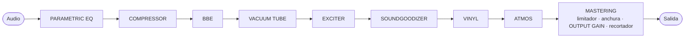
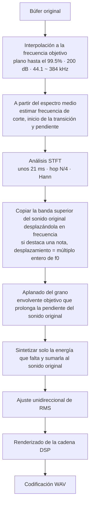

[한국어](README.md) · [English](README.en.md) · [日本語](README.ja.md) · [中文](README.zh.md) · [Français](README.fr.md) · **Español**

# ANALOG SOUL DSP ENGINE

> Esta es una traducción. Si difiere del original en coreano ([README.md](README.md)), prevalece el original en coreano.

> Quienes hayan colaborado o contribuido, o deseen hacerlo, pueden ponerse en contacto conmigo personalmente. Este proyecto es software de código abierto que cualquiera puede usar gratuitamente. Para fines personales y no comerciales puede usarse sin coste, y también se es libre de modificarlo para uso propio. No obstante, los derechos de autor y la propiedad pertenecen al autor original, a los colaboradores y a los contribuidores, por lo que no se puede reivindicar este programa como propio ni distribuirlo o venderlo en otros lugares.

**Un procesador de timbre analógico que funciona en el navegador y una herramienta de restauración que rellena los agudos recortados del audio comprimido con pérdida.**

`v3.1` · un único archivo HTML · sin instalación · funciona sin conexión a internet · el audio no sale del dispositivo

De la Parte 1 a la Parte 4, cada sección se escribe en cuatro párrafos. **Motivación** es la razón por la que hacía falta esa función o ese diseño; **Fundamentos**, los principios, normas y mediciones en que se basa; **Implementación**, el método realmente implementado; y **Justificación**, la razón por la que se eligió ese método en lugar de otros, junto con los resultados medidos.

---

## Índice

- [Parte 1 · En palabras sencillas](#part-1)
- [Parte 2 · Principios](#part-2)
- [Parte 3 · Funcionamiento](#part-3)
- [Parte 4 · Algoritmos y ecuaciones, física, diseño del sistema](#part-4)
  - [4.1 Conversión de frecuencia de muestreo y núcleo STFT](#s41) · [4.2 Estimación del corte y de la pendiente](#s42) · [4.3 Copia por desplazamiento de frecuencia y sincronía con f0](#s43) · [4.4 Extrapolación de la envolvente y grano](#s44) · [4.5 Ajuste de nivel](#s45)
  - [4.6 Funciones de transferencia no lineales](#s46) · [4.7 Presupuesto de aliasing](#s47) · [4.8 División en bandas](#s48) · [4.9 Dinámica](#s49)
  - [4.10 Física del espacio](#s410) · [4.11 Estéreo](#s411) · [4.12 Modelo del disco](#s412) · [4.13 Física de la audición](#s413)
  - [4.14 Diseño del sistema](#s414) · [4.15 Profundidad de bits](#s415) · [4.16 Problemas y soluciones](#s416) · [4.17 Optimización](#s417) · [4.18 Limitaciones conocidas](#s418) · [4.19 Puntos fuertes](#s419)
- [Estructura del repositorio](#repo)
- [Registro de cambios](#changelog)
  - [3.1](#cl-v31) · [3.0](#cl-v30) · [2.4](#cl-v24) · [2.3](#cl-v23) · [2.2](#cl-v22)
- [Referencias](#refs)
- [Licencia](#license)

---

<a id="part-1"></a>

## Parte 1 · En palabras sencillas

### ¿Qué es esto?

**Motivación.** A veces se quiere cambiar el carácter de un archivo de música: hacerlo cálido, como si hubiera pasado por equipos de grabación antiguos; hacer que se expanda, como si se escuchara en una gran sala de conciertos; o igualar un volumen irregular. Además, los archivos de música descargados de internet a menudo tienen recortados los sonidos muy agudos para reducir su tamaño.

**Fundamentos.** Los efectos imitan mediante cálculo la forma en que los equipos reales y las salas reales cambian el sonido. Lo que una válvula de vacío, un disco de vinilo y un giradiscos, o el tamaño y las paredes de una sala le hacen al sonido se ha trasladado a fórmulas. El método para rellenar los sonidos agudos recortados y la intensidad con que se activa al principio se decidieron comparando con el audio original sin recortar.

**Implementación.** Es un programa que cambia el carácter del sonido al cargar en él un archivo de música. También tiene una función que lee las regularidades del sonido que queda y rellena de forma verosímil la parte superior recortada. No hay nada que instalar: basta con abrir un único archivo en el navegador web y funciona de inmediato. La música cargada no se envía a ningún sitio; se procesa solo dentro de su propio ordenador. Incluso las fuentes están dentro del archivo, de modo que la pantalla se ve igual sin internet y no se solicita nada al exterior.

**Justificación.** Para que el sonido elegido mientras se escucha se convierta tal cual en el archivo, la reproducción y el guardado pasan por los mismos cálculos en el mismo orden. Al rellenar el sonido recortado, el sonido original también se deja intacto y solo se añade lo que falta. Únicamente en una estrecha franja justo por debajo del punto de corte se reduce un poco el sonido original para unirlo suavemente con el sonido añadido.

### Primeros pasos

**Motivación.** Quien lo usa por primera vez debe poder cambiar el sonido y guardarlo en un archivo de inmediato, sin leer toda la documentación.

**Fundamentos.** Este programa se ha creado y probado tomando como referencia la versión más reciente de Chrome para escritorio. En otros navegadores web, algunas visualizaciones o comportamientos pueden ser distintos.

**Implementación.**

1. Abrir `analog-soul-dsp.html` en el navegador web. Se recomienda Chrome.
2. Leer y aceptar las condiciones de uso (‘사용 약관’) que aparecen primero al abrirlo. Si se carga directamente un archivo de música, también se considera que se han aceptado.
3. Arrastrar un archivo de música y soltarlo en el cuadro de la parte superior de la pantalla.
4. Pulsar Reproducir (‘재생’) y activar uno a uno los interruptores de las tarjetas de funciones para escuchar cómo cambia el sonido. Las tarjetas activadas tienen un borde que brilla como un neón y se reconocen de un vistazo.
5. Si el resultado le gusta, elegir la densidad y la precisión en EXPORT, en la parte inferior, y crear un archivo nuevo con el botón Exportar (‘내보내기’).

Para la documentación, basta con empezar por `index.html`. Hay cinco documentos, desde la explicación más sencilla hasta la más profunda.

**Justificación.** Se recomienda Chrome porque algunas funciones, como el guardado muy denso (192 · 384), tienen un soporte distinto en cada navegador web, y porque las pruebas se hicieron en Chrome. Se recomienda activar y desactivar las funciones mientras se escucha porque es más fácil decidir qué gusta cuando se escucha por separado el cambio que produce cada función.

### Las nueve funciones

**Motivación.** Cambiar el sonido es más fácil de manejar si se divide en pasos de uno en uno. Por eso, cada tarjeta de la pantalla es una función. Como una misma función suena distinta según el orden en que se aplique, el orden debe poder verse y cambiarse.

**Fundamentos.** Cada tarjeta imita un procesamiento que se usa en un estudio de grabación. PARAMETRIC EQ calcula un ecualizador que sube o baja el sonido por alturas; la tarjeta de válvula, un circuito real de válvula de vacío; VINYL, el proceso en que se corta el disco y la aguja lo lee; y DOLBY ATMOS, la forma en que el sonido choca con las paredes de una sala y vuelve. Los principios detallados están en la [Parte 2](#part-2) y la [Parte 3](#part-3).

**Implementación.** El mapa del flujo de señal, encima de las tarjetas, muestra el orden en que pasa el sonido. Se puede cambiar el orden arrastrando los nombres del mapa o las tarjetas, y al cambiar el orden cambia también el sonido. Mientras se arrastra un nodo en el mapa (cuando el mapa ocupa una sola fila), los demás nodos se apartan para dejar libre el lugar donde se soltará, y cuando cambia el orden, los nodos del mapa y las tarjetas se deslizan a sus nuevas posiciones. La restauración HD, al principio, y MASTER, el final de la producción, tienen posiciones fijas: se dibujan con un borde punteado y no se pueden arrastrar ni en el mapa ni en las tarjetas.

| Tarjeta | Función |
|---|---|
| **PARAMETRIC EQ** | Sube o baja solo el sonido de las alturas que se elijan. Se pueden marcar hasta 20 puntos y ajustarlos arrastrándolos mientras se mira el gráfico. |
| **COMPRESSOR** | Reduce un poco los sonidos fuertes y realza los débiles para igualar el conjunto. |
| **BBE** | Hace más nítidos la voz hablada y el primer golpe de los instrumentos. |
| **VACUUM TUBE** | Calcula una etapa de amplificador de válvulas según su circuito real, para que el sonido sea cálido y denso, como si hubiera pasado por ese equipo. |
| **EXCITER** | Añade brillo a los sonidos agudos. |
| **SOUNDGOODIZER** | Separa los sonidos graves, los medios y los agudos y engrosa cada uno por separado. |
| **VINYL** | Hace que suene como si se reprodujera realmente un disco de vinilo. Imita incluso el polvo sobre el disco, el clic de un arañazo en cada vuelta, la afinación que oscila ligeramente y los sonidos agudos que se vuelven más apagados hacia el interior del disco. |
| **DOLBY ATMOS** | Calcula y reproduce cómo resuena el sonido en la sala elegida entre estudio de grabación, club, cine, sala de conciertos y estadio. |
| **MASTERING** | Es el acabado final. Pule por separado cuatro partes, de los sonidos graves a los agudos, y evita que el sonido suba tanto que llegue a romperse. |

**Justificación.** El orden no se fija, sino que se cambia arrastrando, porque el propio orden cambia el sonido. No obstante, la restauración HD se fija al principio para que MASTER pula al final también los sonidos agudos añadidos y evite que el sonido se rompa. MASTER es el acabado final de la producción, así que su posición es fija.

**Disposición de las tarjetas**

**Motivación.** Al apilar sin huecos tarjetas de distintas alturas, el orden quedaba disperso en zigzag y no se podía saber el orden de procesamiento solo mirando las cajas.

**Fundamentos.** Las personas recorren la pantalla de izquierda a derecha y de arriba abajo, como cuando leen un texto. El grosor de la barra de desplazamiento se decidió con una simulación que sopesaba la facilidad para agarrarla frente a la longitud del cursor de la barra, y el texto atenuado de las tarjetas desactivadas se ajustó para mantener una diferencia de luminosidad legible (3 : 1 o más).

**Implementación.** En pantallas anchas (900 px o más), las tarjetas se colocan con el mismo tamaño (altura de 385 px) en orden de izquierda → derecha y de arriba → abajo, de modo que el orden de procesamiento se lee solo con su posición. La tarjeta de restauración de alta resolución se coloca al principio, igual que en el mapa del flujo, y también es la primera dentro del documento, de modo que el orden de navegación con el teclado (Tab) y el orden de lectura de un lector de pantalla coinciden con el orden visible. Cuando el contenido de una tarjeta activada no cabe, se desplaza dentro de la tarjeta (barra de desplazamiento de 22 px a la derecha), y si se sigue girando la rueda después de llegar al final, la página no la sigue. Cuando las tarjetas se estrechan, las columnas del nombre y del valor se mantienen y solo se acortan las barras de los deslizadores. Las barras son más cortas, unos 100 px, en una tarjeta que reserva el espacio de la barra de desplazamiento cuando las tarjetas son más estrechas (360 px), justo al empezar la disposición en 3 columnas. En la cabecera de las tarjetas cuyo contenido desborda (VINYL · ATMOS · MASTERING) hay un botón de ampliar (chevrons arriba y abajo); al pulsarlo, solo esa tarjeta se alarga hasta la altura de su contenido y se pueden ver todos los controles de una vez. Al pulsarlo de nuevo vuelve a la altura del mosaico, y el estado elegido se recuerda en este navegador web. Las tarjetas desactivadas pasan a un segundo plano en el que no se pueden pulsar los controles, y si se gira la rueda sobre ellas, se desplaza la página. Si se empieza a desplazar la página fuera de una tarjeta activada, la página sigue desplazándose aunque una tarjeta activada pase bajo el cursor, hasta que la rueda se detenga 0.4 segundos. Si entretanto se mueve el ratón, esto se libera de inmediato y la tarjeta a la que se ha pasado recibe la rueda y los clics. Al arrastrar una tarjeta, aparece en su lugar un hueco punteado que sigue al cursor y las demás tarjetas se apartan; la tarjeta soltada se desliza desde donde se soltó hasta el hueco. En pantallas estrechas, las tarjetas se apilan en una sola columna.

**Justificación.** Si se colocan con el mismo tamaño, la posición se convierte directamente en el orden de procesamiento. Las tarjetas desactivadas pasan a un segundo plano y el desplazamiento de la página continúa para que, al bajar por la página, el desplazamiento no se quede atrapado dentro de una tarjeta y se corte cuando esta pase bajo el cursor. Las tarjetas que desbordan reservan siempre el espacio de la barra de desplazamiento, estén activadas o desactivadas, para que el contenido no dé un respingo lateral. La rueda que ha llegado al final no se pasa a la página porque, al pasarla, la página subía, la parte inferior de la tarjeta quedaba bajo la barra de transporte fijada arriba y, al pulsar un control de la parte inferior, se pulsaba la barra de transporte. En VINYL, cuyo contenido mide unas 2.7 veces la altura visible dentro de la tarjeta, esto ocurría con especial frecuencia. Al ampliar, solo se alarga la fila que contiene esa tarjeta y las demás tarjetas de la misma fila mantienen la altura del mosaico, así que el orden de procesamiento leído por la posición no cambia. En las tarjetas estrechas solo se acortan las barras porque, si se cortaran el nombre o el valor, no se podría leer qué se ha ajustado ni a cuánto. La tarjeta de restauración de alta resolución se coloca también la primera en el documento para que quienes la manejan con el teclado o con un lector de pantalla la recorran en el mismo orden que la pantalla.

**MACRO % y estado inicial**

**Motivación.** Tocar por separado varios controles para cambiar la intensidad de una tarjeta es engorroso, y además es difícil ajustar valores que encajen entre sí. El sonido al abrir el programa por primera vez también debe ser adecuado, sin excesos.

**Fundamentos.** El estado inicial se decidió procesando con los dos métodos 4 canciones de audio original sin recortar (los 20 segundos centrales) y comparando los resultados. El método MACRO mantuvo casi intactos los sonidos graves y la sensación de amplitud (alrededor de +2.2 dB), y redujo la subida excesiva de los sonidos agudos (+4.2 → +2.4 dB) y la bajada de volumen (−6.2 → −4.9 dB).

**Implementación.** El control MACRO, en lo alto de la tarjeta, mueve a la vez los controles principales de esa tarjeta entre la posición más suave (0 %) y el valor de diseño de referencia (100 %). Funciona igual que el AUTO % de la restauración de alta resolución, y los valores se redondean a las marcas del deslizador. Después de tocar un control directamente, ese valor se mantiene hasta que se vuelva a mover MACRO, y el archivo de ajustes guarda juntos MACRO y los valores de los controles. Al abrir por primera vez están activados COMPRESSOR 50 % · BBE 40 % · EXCITER 80 % · SOUNDGOODIZER 65 % · MASTERING CHAIN 95 %, y desactivados PARAMETRIC EQ · VACUUM TUBE · VINYL RECORD · DOLBY ATMOS (MACRO 100 %). El MACRO de PARAMETRIC EQ no mueve controles, sino que determina en qué medida se aplica la subida o bajada fijada para cada punto (con 0 %, plano). Con 0 %, el nivel no cambia, salvo en MASTERING CHAIN (±0.1 dB). En MASTERING CHAIN, el limitador de techo actúa con independencia de MACRO, de modo que en masters fuertes ya comprimidos o recortados hasta el techo el nivel puede bajar 0.2 ~ 0.9 dB. En BBE · SOUNDGOODIZER · MASTERING CHAIN, la red de corrección de fase y la división en bandas giran la fase, por lo que el resultado no es idéntico muestra a muestra al sonido original; para quitar el efecto por completo, hay que desactivar la tarjeta.

**Justificación.** Al fijar la intensidad con un solo control, los controles que hay que tocar para cambiar la intensidad de una tarjeta pasaron de 16 a 5.

**Etapa de reproducción**

**Motivación.** Cuando VINYL y ATMOS solo podían colocarse antes de MASTER, incluso el ruido de reproducción, como el crepitar del disco, era comprimido e inflado por MASTER.

**Fundamentos.** Un LP real se reproduce en un giradiscos a partir de un disco prensado tras cortar la laca con el máster, por lo que el crepitar, los saltos, el ruido de superficie y el alabeo se producen después de la masterización. Atmos también traza el espacio según el dispositivo de escucha una vez terminado el máster.

**Implementación.** Después de MASTER está la etapa en la que el sonido ya masterizado se escucha a través de un medio de reproducción. Solo VINYL y ATMOS pueden moverse detrás de MASTER. En Posición de procesamiento (‘처리 위치’), bajo la barra de título de ambas tarjetas, se elige Antes o Después de MASTER (‘MASTER 앞 · 뒤’), o se arrastra la tarjeta o el nodo del mapa del flujo detrás de MASTER (en el mapa del flujo también se puede pasar con Alt+→). La etapa de reproducción se indica con etiquetas numeradas de color verde azulado detrás del límite verde azulado ‘Reproducción’ (‘재생’) del mapa del flujo y bajo la zona ‘Etapa de reproducción · Después de MASTER’ (‘재생 단계 · MASTER 뒤’) del área de tarjetas; si se arrastra allí otra tarjeta, aparece ‘No se puede soltar aquí’ (‘놓을 수 없음’). La garantía de CEILING llega hasta MASTER, por lo que el sonido que pasa por la etapa de reproducción puede superar CEILING. Las ranuras y los archivos de ajustes también guardan el orden de la etapa de reproducción.

**Justificación.** El ruido que se produce al reproducir debe generarse después de MASTER, como en la realidad, para que MASTER no lo comprima ni lo infle. El botón de Posición de procesamiento está fuera del cuerpo de la tarjeta, así que se puede pulsar aunque la tarjeta esté desactivada.

**Controles de VINYL · VACUUM TUBE · DOLBY ATMOS**

**Motivación.** Cada persona imagina un sonido distinto para un disco, una válvula o una sala. Para llegar al sonido deseado hay que poder elegir el estado de un objeto real en lugar de una vaga ‘intensidad’.

**Fundamentos.** Los controles de VINYL usan tal cual las unidades que figuran en los manuales de los equipos reales (clics por segundo, decibelios, milímetros, picofaradios, etc.). DRIVE y BIAS de VACUUM TUBE son tensiones reales aplicadas a la válvula, y las salas de DOLBY ATMOS se ajustaron a las duraciones de reverberación que suelen medirse en salas reales del mismo tipo.

**Implementación.** Los controles de VINYL forman tres grupos: disco, giradiscos y aguja. Se fija cuánto polvo hay sobre el disco, si está rayado, si está alabeado y cuántas veces se ha reproducido, y se elige con qué regularidad gira el giradiscos y la forma de la aguja. Si se introducen tal cual los números de los manuales de cada equipo, se obtiene el sonido de esa combinación. Los clics que se oyen al escuchar suenan en la misma posición en el archivo guardado.

DRIVE de VACUUM TUBE es la intensidad del sonido que entra en la válvula, y BIAS es el estado de la válvula en reposo. Al bajar BIAS, un lado se distorsiona antes y el color cálido se intensifica; al subirlo, el sonido se vuelve más limpio. En DOLBY ATMOS, SPACE es el tamaño de la sala; DEPTH, la distancia desde la que suena el sonido; y HEIGHT y OBJECT, la intensidad del sonido que vuelve del techo y de las paredes laterales. En SPACE · HEIGHT · OBJECT, el centro (50) corresponde a los valores de una sala real.

**Justificación.** Los clics se generan de antemano en un orden fijo y se emiten sincronizados con el tiempo de la canción, así que el sonido escuchado y el archivo guardado son iguales. Se usan unidades reales para que los usuarios puedan trasladar tal cual los números de sus propios equipos.

**PARAMETRIC EQ**

**Motivación.** En algunas canciones los sonidos graves retumban, la voz queda tapada por los instrumentos o los sonidos agudos resultan estridentes. A menudo hace falta subir o bajar un poco solo el sonido de esa altura, sin cambiar el conjunto.

**Fundamentos.** Es lo que hace el ecualizador (EQ) de un estudio de grabación. Si se divide el sonido por alturas, cuánto se sube o se baja cada altura determina el timbre. La curva de la pantalla se dibuja con el mismo cálculo que realmente cambia el sonido, así que se oye exactamente como la curva.

**Implementación.** En el gráfico de la tarjeta hay puntos numerados, y cada punto se encarga de una altura. Al arrastrar un punto a izquierda o derecha cambia la altura de la que se encarga, y al arrastrarlo arriba o abajo cambia la cantidad que sube o baja. Al girar la rueda sobre un punto, se actúa de forma más estrecha o más amplia alrededor de esa altura. Al hacer doble clic en un espacio vacío se crea un punto (hasta 20); al hacer doble clic en un punto, se desactiva temporalmente; y al pulsarlo con el botón derecho, se elimina. Para cada punto se elige una forma: **Campana** (‘벨’), que realza o ahonda una sola altura; **Shelf** (‘셸프’), que sube o baja toda la parte inferior o superior; **Corte** (‘컷’), que elimina la parte inferior o superior; y **Notch** (‘노치’), un rechazo de banda que ahonda profundamente una sola altura. Al pulsar ‘Editar en grande’ (‘크게’) se abren un gráfico grande y una tabla de todos los puntos, donde también se pueden ajustar con números, y en esa ventana también se puede reproducir y activar o desactivar. Durante la reproducción se superponen la imagen del sonido antes de pasar por el EQ (línea) y después de pasar por él (área). Al principio está desactivado, con cuatro puntos planos que no cambian el sonido aunque se active. Con **Importar AutoEQ** (‘AutoEQ 가져오기’) de la ventana grande también se puede cargar como puntos un archivo de corrección de auriculares de AutoEQ, pero la corrección introducida así también entra en el archivo guardado. Si lo que se quiere es corregir los auriculares con los que se escucha, use ‘Ajustar al dispositivo de escucha’, más abajo.

**Justificación.** El EQ está al principio del orden inicial para que el retumbe o el ruido grave que se va a eliminar no active antes la compresión y la distorsión posteriores. Si se quiere retocar el sonido ya comprimido, basta con moverlo detrás de COMP. Los puntos se numeran por orden de creación, así que los números no cambian mientras están desactivados.

**INPUT GAIN**

**Motivación.** Las funciones que dan carácter distorsionando el sonido reaccionan con más intensidad cuanto más fuerte es el sonido que entra. Por eso debe poder fijarse por separado el nivel que entra en cada función.

**Fundamentos.** Equipos como las válvulas de vacío o los compresores distorsionan más o comprimen más cuando la entrada es mayor.

**Implementación.** Cada tarjeta tiene arriba del todo **INPUT GAIN**. Es el nivel del sonido que entra en esa función (−24 ~ +24 dB, en pasos de 0.1 dB, predeterminado 0). En las funciones que dan carácter distorsionando el sonido, subirlo intensifica el efecto; en las que no distorsionan, como PARAMETRIC EQ, solo cambia el volumen.

**Justificación.** INPUT GAIN solo se inserta justo antes de su tarjeta cuando la tarjeta está activada, para que el valor de una tarjeta desactivada no cambie el volumen total.

### Rellenar los agudos recortados

**Motivación.** Los archivos de música reducidos de tamaño tienen recortados los sonidos muy agudos. Aunque se guarden con más densidad, la zona recortada sigue vacía.

**Fundamentos.** La parte aguda del sonido que queda sigue regularidades: con qué pendiente disminuye y qué notas suenan. El método de relleno y los valores predeterminados se decidieron comparando con el audio original sin recortar, en la dirección en que el sonido añadido se acercaba más al audio original.

**Implementación.** Las secciones **HD** y **Ultra · eXtreme HD** se encargan de esto. Si al guardar se elige una densidad mayor que la del archivo original (48 · 88.2 · 176.4 · 352.8 para un archivo de 44.1 kHz; 96 · 192 · 384 para un archivo de 48 kHz), se rellena hasta esa altura. En canciones en las que destaca un instrumento o una voz, la afinación del sonido añadido se coloca en las posiciones de los armónicos del sonido original. La cantidad de relleno se fija con **HF SYNTH**, y con **SMOOTH**, la uniformidad con que se extiende el sonido añadido a medida que se sube. Con HF SYNTH a 0, no se rellena y solo se aumenta la densidad.

Al activar el interruptor **LIVE** se puede escuchar el resultado antes de guardar. Al activarlo hay que esperar un momento, porque primero se recorre toda la canción para encontrar dónde está recortada y se rellena toda la canción una vez. Se vuelve a generar al cambiar un control, o al elegir una opción en el panel PRESET y cerrar el panel.

**Justificación.** Esta función no recupera el sonido original recortado, sino que dibuja de forma verosímil el sonido que falta a partir de lo que queda. Por eso, el sonido original se deja intacto y solo se añade lo que falta; únicamente en una estrecha franja justo por debajo del punto de corte se reduce el sonido original hasta la mitad para unirlo con el sonido añadido. La afinación se ajusta a las posiciones de los armónicos porque, si solo se trasladara y pegara, el sonido añadido se saldría de las posiciones de los armónicos de la nota original. Que la diferencia se oiga o no depende del archivo, del oído y del equipo. Cuanto más se haya reducido el tamaño del archivo, mayor es la diferencia; un archivo que ya era bueno desde el principio apenas cambia.

### Verlo en imágenes

**Motivación.** Es difícil juzgar solo de oído cómo ha cambiado el sonido. En particular, puede que no se oiga bien si se han rellenado los sonidos muy agudos.

**Fundamentos.** Si se divide el sonido por alturas y se dibuja cuán fuerte es cada altura, la zona recortada y la zona rellenada se ven a simple vista.

**Implementación.** En el gráfico superior, la izquierda es el sonido original y la derecha, el sonido modificado. Como muestran el mismo instante lado a lado, se ve enseguida qué ha cambiado. Al pulsar el gráfico se cambia a una imagen que avanza en el tiempo; cuanto más claro es el color, más fuerte es el sonido de esa altura.

Con el interruptor X-AXIS situado encima del gráfico (Adaptativo (‘순응’) · 48 · 96 · 192) se puede fijar el rango horizontal. Al activar y desactivar la restauración, el gráfico no se estira ni se encoge, así que solo salta a la vista la parte recién rellenada.

**Justificación.** Los dos gráficos usan la misma escala de colores, porque si los colores fueran distintos no se podría comparar la intensidad de la izquierda y la de la derecha. Si se fija el rango horizontal, el sonido de una misma altura se dibuja siempre en el mismo lugar.

### Ajustar al dispositivo de escucha

**Motivación.** Cada auricular y cada altavoz reproduce algunas alturas más fuertes y otras más débiles. Si se ajusta escuchando con ese sesgo mezclado, se acaba intentando corregir resonancias que no están en la canción o añadiendo a la canción las alturas que el dispositivo se ha comido.

**Fundamentos.** AutoEQ es un proyecto abierto que, a partir de mediciones publicadas de auriculares de diadema e intraurales, ofrece para cada dispositivo valores de corrección que ajustan su respuesta a una curva objetivo. Su archivo de corrección (ParametricEQ.txt) consta de unos diez filtros del mismo tipo que los puntos de PARAMETRIC EQ y de una cantidad que baja el conjunto (Preamp).

**Implementación.** Se pulsa el botón **Corrección de escucha** (‘모니터 보정’) de la barra de transporte, se elige en **Importar AutoEQ** (‘AutoEQ 가져오기’) el ParametricEQ.txt de los auriculares que se usan, o se pega su contenido, y se pulsa **Aplicar** (‘적용’). La corrección se activa de inmediato y el nombre de los auriculares aparece en el botón. En la ventana se pueden ver la curva de corrección y la tabla de filtros, activarla y desactivarla, y ajustar Preamp en pasos de 0.1 dB. Si la curva sube por encima de 0 dB, se avisa de que el sonido puede recortarse en los pasajes fuertes, así que basta con bajar Preamp en la cantidad indicada.

**Justificación.** Esta corrección se aplica solo durante la reproducción, justo antes de que el sonido, con todo el procesamiento terminado, salga hacia el dispositivo. No entra en los archivos de música guardados ni en los archivos de ajustes, y solo se recuerda en este navegador web. El sesgo de los auriculares no es una propiedad de la canción, sino del dispositivo de escucha, así que, si se metiera en el archivo, sonaría mal en otros dispositivos o para otras personas. El gráfico del sonido modificado en pantalla también muestra el sonido anterior a la corrección, es decir, el sonido que se convertirá en el archivo. Use Importar AutoEQ de PARAMETRIC EQ solo cuando quiera crear a propósito un archivo exclusivo para esos auriculares.

### Comparar al mismo volumen

**Motivación.** El oído humano percibe como mejor el sonido más fuerte. Las canciones producidas a mucho volumen a menudo se vuelven más débiles al activar las funciones (3 ~ 10 dB con los ajustes predeterminados), así que, al escuchar activando y desactivando, el lado desactivado tiende a sonar mejor. Para oír qué ha cambiado, hay que igualar el volumen de los dos sonidos.

**Fundamentos.** El volumen del sonido se mide con la sonoridad (LUFS) de la norma internacional ITU-R BS.1770. Es el método que usan la radiodifusión y los servicios de música para igualar el volumen: cuenta un poco más fuertes los sonidos agudos, a los que el oído es sensible, y excluye los silencios.

**Implementación.** Al pulsar **Comparar** (‘비교’) en la barra de transporte se pasa al sonido de referencia (el botón muestra un nombre como ‘Original’ (‘원음’), con borde ámbar), y al pulsarlo de nuevo se vuelve a la versión procesada (‘처리본’). Al principio, la referencia es el sonido original sin ningún cambio; con **Referencia** (‘견줄 소리’), al lado, se puede cambiar por el sonido al que se quita una sola función activada, como ‘sin SOUNDGOODIZER’ (‘SOUNDGOODIZER 빼고’). Solo se quita esa función y el resto queda igual, así que se puede oír únicamente lo que hace esa función. La primera vez que se pulsa y al elegir, el cambio se produce tras un momento porque se mide el volumen. Si **Mismo volumen** (‘같은 크기’), al lado, está activado (estado inicial), la referencia se reproduce ajustada al mismo volumen que la versión procesada, y la cantidad ajustada se muestra como ‘Original −5.6 dB’ (‘원음 −5.6 dB’) o ‘sin SG −2.6 dB’ (‘SG 빼고 −2.6 dB’). Al cambiar un control o una tarjeta, se vuelve a medir tras un momento.

**Justificación.** Como no se toca la versión procesada y solo se ajusta la referencia, la versión procesada se oye siempre al mismo volumen que el archivo que se guardará. Cuando hay que subir la referencia, solo se sube hasta donde el sonido más fuerte no se recorte (el botón muestra ‘límite’ (‘한도’)). Los dos sonidos se alinean según el tiempo que retrasan los dispositivos de procesamiento (para el sonido original, unos 45 ms con los ajustes predeterminados; al quitar una función, la latencia de esa función), de modo que el ritmo no se desplaza al cambiar. Al quitar una función, no se ejecuta una segunda copia del procesamiento, sino que el sonido se desvía alrededor de esa función, así que la reproducción no se vuelve más pesada. Esta comparación solo se aplica al escuchar y no entra en los archivos de música guardados ni en los archivos de ajustes.

### Guardar los ajustes

**Motivación.** Cuando se encuentra un ajuste que gusta, debe poder conservarse para reutilizarlo, compararse alternando entre varios ajustes y trasladarse también a otro ordenador.

**Fundamentos.** Los ajustes son solo los valores de los controles y el estado de activación, el orden de las tarjetas y los puntos del EQ, así que caben en un pequeño archivo de texto. Las ranuras rápidas se guardan en el almacenamiento del navegador web.

**Implementación.** No se incluyen el archivo de música ni la corrección de escucha; solo los ajustes.

| Botón | Función |
|---|---|
| **Guardar los ajustes actuales** (‘화면 설정 저장’) | Crea un archivo con los ajustes actuales de la pantalla. Sirve para llevarlos a otro ordenador. |
| **Ranuras rápidas 1~4** (‘빠른 슬롯 1~4’) | Una pulsación corta las carga, y una pulsación larga (0.6 segundos) guarda en ellas los ajustes actuales. Al pulsar una ranura vacía se vuelve al estado inicial. |
| **Copiar** (‘복사’) | Tras pulsarlo, al pulsar dos ranuras sucesivamente, la primera se copia en la segunda. La primera ranura se conserva. |
| **Vaciar una ranura** (‘한 슬롯 비우기’) | Tras pulsarlo, al pulsar una ranura se borra solo esa. |
| **Vaciar todas las ranuras** (‘모든 슬롯 비우기’) | Al pulsarlo una vez pide confirmación, y al pulsarlo de nuevo lo borra todo. |
| **Copia de seguridad de todas las ranuras** (‘모든 슬롯을 백업’) | Reúne las cuatro ranuras en un solo archivo. |
| **Cargar** (‘불러오기’) | Distingue por sí mismo si se trata de un archivo de ajustes o de un archivo de copia de seguridad y lo restaura. |

Las ranuras rápidas solo se conservan en el navegador web que se está usando. Para usarlas en otro ordenador, conviene guardarlas en un archivo. Si se carga un ajuste guardado en la 3.0, que no tenía EQ, el EQ vuelve al estado inicial (desactivado, cuatro puntos planos) y suena igual que cuando se guardó.

Al guardar, el mapa del flujo de señal de arriba y las tarjetas de abajo parpadean dos veces en orden de procesamiento para indicar que se han guardado los valores y el orden. Al cargar, los nodos del mapa del flujo y las tarjetas se deslizan a las posiciones guardadas.

**Justificación.** Como solo se guardan los ajustes, sin el archivo de música, el archivo es pequeño y fácil de llevar a cualquier sitio. Una ranura vacía significa ‘Sin ajustes’ (‘설정 없음’), así que al pulsarla se vuelve al estado inicial. Vaciar todas las ranuras no se puede deshacer, por lo que se pregunta una vez más. Cargar distingue por sí mismo el tipo de archivo, así que no hace falta indicar qué archivo es. El parpadeo sigue el orden de procesamiento para mostrar paso a paso que también se ha guardado el orden.

### Guardar en un archivo

**Motivación.** Para escuchar el sonido modificado en otros sitios hay que guardarlo como un archivo de música nuevo. La densidad y la precisión deseadas dependen del uso.

**Fundamentos.** Un archivo de música divide cada segundo en trozos muy pequeños y anota en cada uno el nivel del sonido como un número. Lo finamente que se divide (densidad) y lo precisamente que se anota el número (precisión) determinan el tamaño del archivo.

**Implementación.** En EXPORT, en la parte inferior, se eligen dos cosas y se pulsa el botón **Exportar** (‘내보내기’).

| Barra | Opciones | Significado |
|---|---|---|
| **SAMPLE RATE** | 44.1 · 48 · 96 · 192 · 384 | Lo densamente que se divide cada segundo al anotarlo. Si se elige un valor mayor que el del archivo original, los sonidos agudos recortados se rellenan hasta esa altura; si se elige uno menor, se reduce conservando al máximo el sonido original. Al cargar un archivo, se ajusta al mismo valor que el archivo original y bajo esa marca aparece (original) (‘원본’). Si no hay una marca igual, se ajusta a la marca inmediatamente superior (a la más alta, si el archivo original supera la más alta) y no aparece (original). Si el archivo original es de la familia de 44.1 (44.1 · 88.2 · 176.4 · 352.8), las tres marcas superiores pasan a ser 88.2 · 176.4 · 352.8. |
| **BIT DEPTH** | 16 · 24 · 32 | Lo precisamente que se anota cada valor. Si el archivo original es de 16 bits o menos, al elegir 24 o 32 se rellena el espacio entre los escalones. |

Debajo del botón se muestra en qué orden se procesa. Cuanto mayores son los números, más grande es el archivo. Una canción de 1 minuto ocupa unos 10 MB con 44.1 y 16, unos 33 MB con 96 y 24, unos 88 MB con 192 y 32, y unos 176 MB con 384 y 32. Si se vuelve a guardar el mismo archivo con los mismos ajustes, se obtiene un archivo idéntico hasta el último byte.

**Justificación.** Al principio se elige el mismo valor que el del archivo original para que, si no se toca, se guarde sin conversión. En los archivos de la familia de 44.1, las marcas superiores pasan a 88.2 · 176.4 · 352.8 porque son exactamente el doble y el cuádruple, y el cálculo es más rápido. Subir un archivo de 44.1 kHz a 88.2 es un 32% más rápido que a 96, y la diferencia de sonido es menor incluso que la unidad más pequeña que se anota en el archivo. Al rellenar entre los escalones de un archivo de 16 bits, no se sale de la celda en la que estaba el valor original, de modo que se anota con más precisión sin apartarse del sonido original.

### Conviene saber

**Motivación.** Al usarlo, hay algunas cosas que pueden confundir o sorprender. Saberlas de antemano evita escuchar mal o perder los ajustes.

**Fundamentos.** Provienen de la tendencia del oído humano a dejarse engañar por el volumen, del alcance de lo que admite el navegador web y de la forma en que este programa maneja los ajustes.

**Implementación.**

- **Si parece que el sonido mejora con solo activar algo,** puede deberse a que se ha vuelto más fuerte. El oído humano percibe siempre como mejor el sonido que se ha vuelto más fuerte. Al contrario, las canciones ya producidas a mucho volumen se vuelven 3 ~ 10 dB más débiles al activar las funciones, y el lado desactivado puede sonar mejor. Conviene dejar **Comparar** (‘비교’), en la barra de transporte, con **Mismo volumen** (‘같은 크기’) activado y comparar así. Para oír lo que hace una sola función, se quita esa función en **Referencia** (‘견줄 소리’) y se escucha (véase ‘Comparar al mismo volumen’, más arriba).
- **MASTERING no sube el volumen automáticamente.** Deja intactas las partes tranquilas y solo comprime las fuertes. Para obtener más volumen, hay que subir INPUT GAIN de MASTERING y empujar el limitador.
- **Si aparece un aviso de que no se puede guardar a 192 o 384,** el navegador web no admite un guardado tan denso. Conviene usar Chrome o elegir 96 (88.2 en la familia de 44.1).
- **Si se intenta ir a otro documento después de cambiar los ajustes,** aparece una ventana de confirmación, porque los ajustes no se guardan automáticamente.
- **El color de la pantalla se elige a la derecha de la barra superior.** 'Automático' ('자동') sigue el ajuste oscuro o claro del ordenador, y 'Noche' ('야간') y 'Día' ('주간') lo mantienen siempre oscuro y siempre claro, respectivamente. La elección se recuerda en este navegador web y se aplica tanto al programa como a la documentación.
- **El archivo de música guardado solo contiene el sonido.** No queda constancia de los ajustes con que se creó, así que, para reutilizarlos más tarde, conviene guardar también los ajustes.

**Justificación.** MASTERING no sube el volumen automáticamente para eliminar subidas automáticas ocultas y que sea el usuario quien decida directamente cuánto sube el volumen al activar cada cosa. Se pregunta al ir a otro documento porque, si se sale antes de guardar, se pierden todos los valores cambiados.

---

<a id="part-2"></a>
## Parte 2 · Principios

Esta parte explica los fenómenos físicos y perceptivos en que se apoya cada función. El método de cálculo se trata en la Parte 3 y las ecuaciones, en la Parte 4. En cada sección se indica, por orden, por qué el programa necesita ese principio (Motivación), en qué teorías y datos se apoya (Fundamentos), cómo usa el programa ese principio (Implementación) y por qué se eligió ese método (Justificación).

### 2.1 Dos maneras de ver el sonido — tiempo y frecuencia

**Motivación.** Este programa trata el sonido de dos maneras: como forma de onda (tiempo) y como espectro (frecuencia). Conservar la frecuencia de muestreo del original, rellenar los agudos recortados y elegir la frecuencia de muestreo de exportación parten todos de la pregunta "¿hasta dónde puede contener este archivo?". Para leer los dos analizadores de la pantalla también hay que conocer el eje de frecuencias logarítmico y los decibelios.

**Fundamentos.** El sonido es la variación de la presión del aire en el tiempo. Un archivo de grabación es una secuencia de números que mide esta variación a intervalos regulares, y el inverso de ese intervalo es la **frecuencia de muestreo**. 44.1 kHz significa que se midió 44,100 veces por segundo. Según el teorema de muestreo, la **frecuencia de Nyquist**, la mitad de la frecuencia de muestreo, es el sonido más agudo que puede contener ese archivo. El mismo sonido también puede verse descompuesto en componentes de frecuencia: es el **espectro**, que muestra cuánto sonido de cada altura hay mezclado. El oído humano percibe la frecuencia en escala logarítmica: pasar de 100 Hz a 200 Hz y pasar de 1 kHz a 2 kHz se oyen igualmente como una octava. El nivel se mide en **decibelios (dB)**. Si la amplitud se duplica, son unos +6 dB, y una diferencia de 10 dB se oye aproximadamente el doble de fuerte.

**Implementación.** Los analizadores dibujan en escala logarítmica, desde 20 Hz hasta la Nyquist de visualización, el eje horizontal del espectro de barras y el eje vertical del espectrograma. Las 128 barras se reparten de forma uniforme sobre el eje logarítmico, y cada barra muestra el máximo de los bins FFT de su intervalo. La escala vertical es de −100 ~ −30 dB (sección 3.7). Al abrir un archivo, la frecuencia de muestreo de origen se lee directamente del encabezado del archivo antes de pasarlo al decodificador del navegador (sección 3.9). La frecuencia de muestreo de exportación se elige entre 44.1 ~ 384 kHz (sección 3.8).

**Justificación.** El gráfico se dibuja en escala logarítmica porque el oído escucha de forma logarítmica. Con un eje lineal, el ancho que ocupa una octava se duplica a medida que se sube, y cerca de seis octavas, las de 20 Hz ~ 1 kHz, se amontonan en el extremo izquierdo de la pantalla. La frecuencia de muestreo de origen se lee del encabezado porque el decodificador del navegador siempre la convierte a la frecuencia de muestreo del dispositivo de reproducción. Solo conociendo la Nyquist original se puede juzgar qué zona estaba vacía desde el principio.

### 2.2 Dinámica — compresión

**Motivación.** Si el volumen es irregular, la profundidad de la distorsión en las etapas de saturación posteriores varía de un pasaje a otro. Por eso COMPRESSOR está al principio de la cadena (sección 3.2). Al final, MASTERING también controla el nivel final y los picos con compresores por bandas y un limitador.

**Fundamentos.** Cuando el sonido supera el **umbral**, el compresor reduce el exceso dividiéndolo por el **ratio**. Con 4:1, un sonido que supera el umbral en 8 dB se reduce hasta superarlo solo en 2 dB. El **ataque** es la rapidez con que reduce tras superarlo, y la **liberación**, la rapidez con que vuelve a la normalidad después de bajar. El **codo (knee)** determina si la compresión se aplica de forma brusca o suave cerca del umbral. La compresión reduce la irregularidad del volumen. Como disminuye el **factor de cresta**, la diferencia entre el instante más fuerte y la media, se puede subir el volumen medio dentro del mismo nivel máximo. Volver a subir el conjunto en la medida en que la compresión lo redujo se denomina **ganancia de compensación** (makeup).

**Implementación.** El elemento de compresión es el `DynamicsCompressorNode` de Web Audio. El codo de este elemento se extiende **solo hacia arriba** desde el umbral, por lo que el punto donde empieza la compresión está más alto que con el codo simétrico del hardware, en la mitad del ancho del codo. La especificación aplica siempre una ganancia de compensación automática $`(1/c(1))^{0.6}`$, que sube incluso las señales por debajo del umbral. Este programa calcula ese valor con la misma fórmula y lo anula con su inverso justo después del compresor (6.03 dB con los valores predeterminados de COMPRESSOR). Así, el compresor en sí no toca los sonidos tranquilos por debajo del umbral, y la ganancia de compensación se aplica solo en la cantidad fijada con MAKEUP. El compresor de salida de SOUNDGOODIZER y los compresores de cuatro bandas y el limitador de MASTERING se anulan de la misma manera. Las fórmulas y los valores están en [4.9](#s49).

**Justificación.** Si se deja la ganancia de compensación automática, el sonido sube con solo activar el compresor, y la cantidad varía según el umbral, el codo y el ratio. Antes de la anulación, con los valores predeterminados de COMPRESSOR, una señal tranquila subía +10.0 dB porque a MAKEUP de 4 dB se sumaban 6.03 dB ocultos, y MASTERING subía cada banda de forma distinta, +5.4 ~ +7.1 dB, con lo que los medios sobresalían 1.7 dB. Tras la anulación, solo el control MAKEUP aporta ganancia, de modo que el significado del control queda definido de forma única, y es más fácil comparar el sonido activado y el desactivado al mismo volumen (2.10). A cambio, la salida con los ajustes predeterminados es unos 6 dB más baja que antes de la anulación. La anulación se basa en la fórmula de la especificación, así que en entornos que la implementen de otra forma se desvía en esa diferencia.

### 2.3 Fase y claridad

**Motivación.** Si el inicio del sonido se difumina, el contorno de los instrumentos se oye emborronado. La tarjeta BBE trabaja este contorno cambiando las relaciones temporales. Además, si se mezcla con el sonido original una señal a la que solo se ha girado la fase, se cancelan ciertas frecuencias, por lo que las tarjetas que usan rutas paralelas (la estructura antigua de BBE, SOUNDGOODIZER) deben esquivar esta propiedad. La banda que determina la nitidez de la voz y los instrumentos es el objetivo de PROCESS de BBE y del realce de presencia de SOUNDGOODIZER.

**Fundamentos.** Los altavoces no pueden emitir simultáneamente los sonidos de todas las alturas. En particular, los graves tienden a salir más tarde que los agudos. Este fenómeno, en el que el tiempo de llegada depende de la frecuencia, se llama **retardo de grupo**. El procesamiento publicado por BBE retrasa los graves unos 2.5 ms y los medios unos 0.5 ms respecto a los agudos. El fabricante lo describe como una corrección de fase del altavoz, pero, como va en la dirección de retrasar aún más los graves que el altavoz ya retrasa, más que deshacer el retardo es un procesamiento que hace llegar antes el ataque de los componentes agudos y resalta el contorno del inicio del sonido. Un filtro que solo cambia la fase y deja intacta la magnitud se llama **filtro paso todo** (all-pass). Si la señal pasa tal cual por este filtro, se pueden retrasar solo los graves sin tocar la magnitud. Por el contrario, si se mezcla la señal que ha pasado por este filtro con la señal original, el sonido se cancela en las frecuencias en que la fase queda invertida, así que, para cambiar solo el tiempo, no hay que mezclar. En la voz humana, la banda de 2 ~ 5 kHz, donde se concentran las consonantes, determina la **claridad**. El conducto auditivo es un tubo cerrado por un extremo por el tímpano, por lo que tiene una resonancia de cuarto de onda (unos 3.4 kHz), y esta resonancia y las reflexiones del pabellón auricular elevan 2 ~ 5 kHz en 10 ~ 15 dB. En la curva isofónica (ISO 226), la banda en la que el oído es más sensible también es esta. Si se sube un poco esta banda, se tiene la sensación de que la voz se adelanta.

**Implementación.** BBE pasa **en serie** por dos paso todo (220 Hz Q 0.59, 1850 Hz Q 1.47) y genera solo retardo de grupo, dejando intacta la magnitud. Con los tres controles a 0, la respuesta es de 0.0 dB en toda la banda, y el retardo de grupo es de 2.58 ms a 50 Hz, 0.61 ms a 500 Hz y 0.03 ms a 5 kHz. A continuación, PROCESS sube de forma amplia, con un shelf de agudos de 3 kHz (0 ~ +8 dB), la banda donde se concentran las consonantes y los ataques, y HI DEF se encarga de lo que queda por encima con un shelf de agudos de 10 kHz (0 ~ +6 dB). SOUNDGOODIZER sube la banda de presencia con un filtro de campana (peaking) de 2.5 kHz (Q 0.7, +AMOUNT×3 dB) y, al sumar en paralelo las bandas procesadas al sonido original, aplica también a la ruta del sonido original el mismo paso todo que la suma de bandas para alinear la fase ([4.8](#s48)).

**Justificación.** Las frecuencias centrales y las Q de los dos paso todo son valores ajustados por mínimos cuadrados al retardo de grupo objetivo (2.5 ms por debajo de 150 Hz, 0.5 ms en 0.4 ~ 1.5 kHz, 0 por encima de 5 kHz). La estructura antigua sumaba la salida del paso todo al sonido original, por lo que se formaban valles donde la fase era de −180°. Con una proporción de mezcla g = 0.6, el valle es de −12 dB, y en la práctica, con LO CONTOUR 100, 100 ~ 125 Hz y 315 Hz quedaban a −9.3 dB. Ahora, en serie, la respuesta es plana con los controles a 0, y LO CONTOUR 100 sube suavemente: +9.7 dB a 31.5 Hz, +7.0 dB a 63 Hz y +3.1 dB a 100 Hz. El hardware varía la cantidad de realce de agudos según la señal, pero aquí es un shelf fijo. En voces, si se sube PROCESS más de +6 dB, también suben las sibilantes.

### 2.4 No linealidad y armónicos

**Motivación.** VACUUM TUBE, EXCITER y SOUNDGOODIZER distorsionan el sonido a propósito para darle color, y el recortador de seguridad de MASTERING también es no lineal. Qué armónicos se generan y en qué cantidad es precisamente el timbre de cada tarjeta. Al distorsionar en digital se pueden colar sonidos de alturas extrañas que no existían, y esto también hay que controlarlo.

**Fundamentos.** Al distorsionar un sonido aparecen **armónicos** que no existían. Si se distorsiona un sonido de 100 Hz, aparecen nuevos componentes de 200, 300 y 400 Hz. Qué armónicos se generan y en qué cantidad depende de la forma de distorsionar. El método **simétrico**, que comprime por igual ambos lados (una función impar, $`f(-x) = -f(x)`$), solo genera armónicos impares (el 3.º, el 5.º…). El método **asimétrico**, que comprime más un lado, genera también armónicos pares (el 2.º, el 4.º…). En el desarrollo de Taylor $`f(x + b) = f(b) + f'(b)\,x + \tfrac12 f''(b)\,x^2 + \cdots`$, el coeficiente del término $`x^2`$, que genera el 2.º armónico, es proporcional a la curvatura del punto de funcionamiento, $`f''(b)`$. El 2.º armónico está una octava por encima, así que se mezcla bien con el sonido original y suena grueso; el 3.º armónico está una quinta por encima de la octava y da un color algo más áspero. La razón de que al timbre de válvula se le llame cálido está en los armónicos pares que genera su característica asimétrica. En el triodo, la curva es intrínsecamente asimétrica por la potencia 3/2 de la ley de carga espacial y por la corriente de rejilla (modelo de triodo de Koren). Al distorsionar el sonido en digital hay algo que tener en cuenta. Si un armónico nuevo supera la frecuencia de Nyquist, no desaparece, sino que se **pliega** hacia abajo y aparece en una altura que no tiene nada que ver con el sonido original. Esto se llama **aliasing**. Además, a igual tasa de distorsión, la intermodulación de orden alto que generan las curvas cuya curvatura cambia bruscamente es la que suena más molesta (Geddes & Lee).

**Implementación.** VACUUM TUBE obtiene la curva resolviendo mediante ecuaciones una etapa amplificadora 12AX7 de cátodo común. Con los valores predeterminados (DRIVE 30, BIAS 50), al introducir 1 kHz a −6 dBFS, el 2.º armónico queda en −33.7 dB y el 3.º, en −67.5 dB. EXCITER usa límites de saturación positivo y negativo distintos para la curva $`\tanh`$, +1 y −0.7, y SOUNDGOODIZER desplaza el punto de funcionamiento en $`b = 0.08\,\mathrm{SAT}`$ para generar armónicos pares. El aliasing se reduce en dos capas. La curva se aplica con un sobremuestreo (oversampling) de 4 veces, y en EXCITER y en la banda de agudos de SOUNDGOODIZER se coloca un paso bajo $`\max(1.4\,f_{\mathrm{lo}},\ f_s/3)`$ solo antes de la ruta de saturación, con lo que el orden del armónico en el que empieza el aliasing audible sube de 7 a 10.5. La corriente continua que generan además las curvas asimétricas la bloquea un paso alto situado después de la saturación (TUBE 10 Hz, EXCITER FREQ, SOUNDGOODIZER 12 Hz). Las curvas y las mediciones están en [4.6](#s46), y el presupuesto de aliasing, en [4.7](#s47).

**Justificación.** La curva de la válvula se resuelve a partir del circuito en lugar de elegirse a mano porque la curva antigua, al contrario de lo que decía su comentario, tenía con el BIAS predeterminado el 3.º armónico 17 dB por delante. El modelo actual reproduce tal cual las tendencias físicas: con señales pequeñas, el 2.º armónico es 34 dB mayor que el 3.º; al empujarlo con fuerza, el 3.º armónico pasa delante; y con una polarización fría, el 2.º armónico se refuerza. La curva antigua de SOUNDGOODIZER era una función impar pura, así que el 2.º armónico se quedaba en −68.6 dB. El método de multiplicar la ganancia solo en el semiciclo negativo no cambia la curvatura en el origen y apenas genera armónicos pares con señales pequeñas, por lo que se optó por desplazar el punto de funcionamiento. El orden de aliasing no depende de la frecuencia de muestreo, porque el límite superior de la entrada sube junto con la Nyquist, en proporción a ella. Subir la frecuencia de muestreo por sí solo no mejora nada; hay que limitar la banda de entrada a una fracción de la Nyquist. No se usó el método de renderizar toda la cadena a un múltiplo alto, porque el tiempo de renderizado y la memoria aumentan en ese múltiplo, se añade un remuestreo más y, al aplicarse solo a la exportación, el sonido escuchado y el archivo serían distintos. En TUBE no se aplica limitación de banda: con MIX 100 toda la señal pasa por la curva, así que se convertiría en un corte a 16 kHz que no existe en una etapa amplificadora real.

### 2.5 Procesar por bandas

**Motivación.** Los graves y los agudos tienen caracteres distintos, y si se les aplica el mismo procesamiento, uno de los dos se estropea. SOUNDGOODIZER satura por separado tres bandas, y MASTERING comprime por separado cuatro bandas. Para conservar la pegada de los graves sin que los agudos bombeen, hacen falta ajustes distintos para cada banda.

**Fundamentos.** Con un **crossover** se dividen las bandas, se procesan por separado y se vuelven a juntar. Al volver a juntar tal cual los trozos divididos, el resultado debe tener la misma magnitud que el original. Una división con esta propiedad se llama división **complementaria**. Si no es complementaria, el sonido se hincha o se hunde en los límites de la división. La división Linkwitz–Riley de 4.º orden se construye encadenando dos Butterworth de 2.º orden, y la suma de graves y agudos es exactamente un paso todo de 2.º orden, con magnitud 1 en todas las frecuencias.

**Implementación.** Ambas tarjetas usan filtros Linkwitz–Riley de 4.º orden. SOUNDGOODIZER divide en dos puntos de división por modo (A 250 Hz / 4 kHz, etc.), y MASTERING, en 120 Hz / 500 Hz / 5 kHz. Cuando hay dos o más puntos de división, se monta una estructura en árbol que multiplica la banda del lado grave por el paso todo del punto de división superior, de modo que la suma sea $`AP_a AP_b \cdots`$. La especificación de Web Audio interpreta la Q de `lowpass`·`highpass` en dB, así que para Butterworth se introduce −3.0103 y no 0.707. La deducción y los valores están en [4.8](#s48).

**Justificación.** El SOUNDGOODIZER antiguo tenía LPF·BPF·HPF en paralelo, por lo que la suma de bandas oscilaba entre 0.906 ~ 1.568 y la zona de 2 kHz se hinchaba unos +4 dB. Si solo se dividen entre sí las bandas adyacentes, en MASTERING aparece un valle de −1.22 dB en torno a 411 Hz. Si se introduce tal cual 0.707 como Q, la suma se hincha +7.4 dB en el punto de cruce. Ahora, con la estructura en árbol, la desviación de la suma calculada con los coeficientes de la especificación es de ±0.0000 dB. El precio es la rotación de fase. La suma de bandas está a −180° en el punto de división, así que, al sumar en paralelo las bandas procesadas al sonido original, hay que aplicar también el mismo paso todo a la ruta del sonido original para que no se cancelen (si no, −2.3 dB a 250 Hz). El retardo de grupo es como máximo de unos $`0.543/f_c`$, es decir, unos 4.5 ms en el punto de división de 120 Hz de MASTERING, menos que el umbral de discriminación del retardo de grupo en graves. Las bandas con saturación no son lineales, así que la planitud de la suma solo se cumple a niveles bajos, y en los cuatro modos esa respuesta queda dentro de ±1.3 dB.

### 2.6 Espacio — reflexiones y reverberación

**Motivación.** La tarjeta DOLBY ATMOS coloca el sonido dentro de una sala. La tarjeta antigua usaba diez reflexiones fijas y una reverberación aleatoria distinta cada vez, así que el grano de la reverberación cambiaba incluso con los mismos ajustes. Para controlar el espacio con magnitudes reales, como el tamaño de la sala, la absorción de las paredes, la distancia a la fuente o la anchura de la fuente, hacen falta los principios de la acústica de salas.

**Fundamentos.** El sonido que se oye dentro de una sala se divide en tres partes: el **sonido directo**, que llega directamente desde la fuente; las **primeras reflexiones**, que llegan tras chocar una o dos veces con las paredes y el techo; y la **reverberación tardía**, mezclada tras innumerables choques. Las primeras reflexiones informan del tamaño y la forma de la sala, y la reverberación tardía, de su resonancia. El tiempo que tarda la reverberación en bajar 60 dB se llama **RT60**. En un estudio de grabación pequeño es de 0.3 ~ 0.5 segundos, y en una sala de conciertos, de alrededor de 2 segundos. Cuanto más sonido absorben las paredes y cuanto más pequeña es la sala, más corta es la reverberación (fórmulas de reverberación de Sabine y de Eyring). El aire también absorbe los sonidos agudos (ISO 9613-1), así que, cuanto más grande es la sala, más corta es la reverberación de los agudos. Al alejarse de la fuente, el sonido directo se debilita, pero la reverberación permanece uniforme en toda la sala, de modo que a partir de cierta distancia la reverberación supera al sonido directo. Esta distancia se llama **distancia crítica**. Las primeras reflexiones que llegan de las paredes laterales envían sonidos distintos a los dos oídos y hacen que la fuente se oiga más ancha (Barron & Marshall, Hidaka y otros). El sonido que llega desde arriba entra con la zona de 8 kHz realzada por el pabellón auricular, y el oído usa este realce como indicio de que el sonido viene de arriba (bandas direccionales de Blauert). Las trayectorias de reflexión pueden calcularse con el método de la fuente imagen, que coloca repetidamente las imágenes especulares de la fuente reflejadas en las paredes (Allen & Berkley).

**Implementación.** ATMOS genera las primeras reflexiones con reflexiones de fuente imagen en una sala ortoédrica, genera la reverberación difusa con una atenuación por frecuencia que suma la absorción del aire al tiempo de reverberación de Eyring, y aplica convolución. El sonido directo se deja como el sonido original. Las primeras reflexiones y la reverberación tardía se cruzan alrededor del tiempo de mezcla (Polack, $`\min(\sqrt{V}\ \mathrm{ms},\ 150\ \mathrm{ms})`$) de modo que la suma de energías sea 1. Los controles son magnitudes físicas: SPACE son las dimensiones de la sala; DEPTH, la distancia entre la fuente y el oyente; OBJECT, la cantidad de reflexiones de las paredes laterales; HEIGHT, la cantidad de reflexiones del techo y el suelo y el realce de 8 kHz de las reflexiones procedentes de arriba (máximo +8 dB); y REVERB, la cantidad de reverberación difusa. Al abrir por primera vez (SPACE 60), el tiempo de reverberación a 1 kHz es de 0.28 s en STUDIO y de 2.02 s en CONCERT, y la distancia crítica va de STUDIO 1.24 m ~ STADIUM 26.4 m. El nivel de las reflexiones y de la reverberación se ajusta a la distancia de escucha según la teoría revisada de Barron. La tabla de escenas y las fórmulas están en DOLBY ATMOS de la sección 3.4 y en [4.10](#s410).

**Justificación.** Cuando el coeficiente de absorción supera 0.2, la fórmula de Sabine sobreestima el tiempo de reverberación (alrededor de un 28 % con α 0.4), por lo que se usa la fórmula de Eyring. La fórmula de Eyring supone que la energía se reduce a $`1 - \alpha`$ en cada reflexión, la misma suposición en la que se basan las reflexiones de fuente imagen. Las reflexiones se truncan por instante de llegada, no por orden, de modo que todas las reflexiones que llegan antes del tiempo de mezcla se incluyen con independencia de su orden. La reverberación difusa no se obtiene filtrando ruido con filtros de banda de octava, sino aplicando la atenuación bin a bin en el dominio de la frecuencia, porque así las faldas de los filtros no se solapan y no se cuelan las bandas vecinas de reverberación más larga. Los números aleatorios proceden de un generador determinista cuya semilla se fija a partir de los ajustes, así que los mismos ajustes dan siempre la misma respuesta, y las respuestas se guardan por combinación de entradas para que el grano de la reverberación no oscile al girar otros controles. Los tiempos de reverberación medidos están en su mayoría dentro de un 5 % de los valores esperados, y la energía de las reflexiones y de la reverberación es 0.4 ~ 0.9 dB menor que según la teoría revisada de Barron. A pesar del nombre, es un modelo de acústica de salas de 2 canales que no tiene relación con los formatos multicanal basados en objetos.

### 2.7 Imagen estéreo

**Motivación.** STEREO de SOUNDGOODIZER y el control de anchura de MASTERING ensanchan o estrechan el sonido. VINYL elimina en la etapa de corte la diferencia entre izquierda y derecha en los graves e imita la diafonía entre canales de la cápsula. Todo ello se apoya en la idea de descomponer izquierda y derecha en medio y lateral. Como el oyente puede escuchar con un solo altavoz, como el de un smartphone, también hay que saber qué queda en mono.

**Fundamentos.** Las señales izquierda y derecha pueden expresarse como **medio (M)** y **lateral (S)**. El medio es la componente idéntica en ambos lados; el lateral, la diferencia entre ambos ($`M = (L + R)/2`$, $`S = (L - R)/2`$). Al aumentar la componente lateral el sonido se ensancha, y al reducirla se estrecha. Hay que tener cuidado con la **compatibilidad mono**. Cuando se escucha con un solo altavoz, izquierda y derecha se suman ($`L' + R' = 2M`$), y entonces la componente lateral se cancela y desaparece por completo. Un instrumento empujado demasiado hacia los lados puede no oírse en mono.

**Implementación.** El control de anchura se construye con un único bloque compartido. $`L' = M + wS`$, $`R' = M - wS`$; con $`w = 1`$ queda igual que el original, y con 0 es mono. La implementación se basa en la regla según la cual varias conexiones que llegan a la misma entrada de un `ChannelMergerNode` se suman. SOUNDGOODIZER STEREO va de 0 (mono) ~ 2 veces, y con el valor predeterminado 55 da unas 1.1 veces. La anchura de MASTERING va de 0 ~ 200 (predeterminado 110) y se sitúa después del limitador y antes de OUTPUT GAIN y del recortador de seguridad. VINYL aplica un paso alto de 150 Hz solo a la componente lateral para reunir los graves en el medio. Las ecuaciones están en [4.11](#s411).

**Justificación.** Al ensanchar se suma componente lateral y los picos vuelven a subir, por lo que se coloca antes del recortador que protege el techo ([4.9](#s49)). La suma mono es $`2M`$ independientemente de $`w`$, así que la información que se añade al lateral con $`w > 1`$ desaparece por completo en mono. Además, $`w > 1`$ solo amplifica la componente lateral; no **decorrela** izquierda y derecha. Para reducir la correlación interaural (IACC) y ensanchar la anchura aparente de la fuente son más eficaces una rotación de fase dependiente de la frecuencia o retardos aleatorios cortos; en este programa ese papel lo cumplen las reflexiones de las paredes laterales de ATMOS (OBJECT).

### 2.8 Defectos del disco de vinilo

El sonido del disco proviene de la física de los procesos de fabricación y de lectura. La tarjeta VINYL es un modelo físico que sigue esos procesos, y todos sus controles son magnitudes físicas que figuran en las especificaciones reales de giradiscos, cápsulas y discos. El motor en tiempo real y el motor de renderizado construyen este bloque con la misma función `buildVinylChain`. La estructura y los controles están en VINYL de la sección 3.4, y las ecuaciones en [4.12](#s412).

**Corte**

**Motivación.** El "toc" redondeado típico del disco, el ruido de superficie denso y los graves concentrados en el centro se determinan en la etapa en que se graba el surco. Para imitar este grano no basta con añadir ruido en cualquier punto: hay que seguir el orden que crean el corte y la curva de reproducción.

**Fundamentos.** El surco es un registro de la velocidad del sonido. Si se grabara tal cual, los graves harían oscilar demasiado el surco y los agudos serían tan pequeños que quedarían enterrados en el ruido; por eso se graba con la **curva de grabación RIAA**, que reduce los graves y realza los agudos, y al reproducir se deshace con la curva inversa. Las constantes de tiempo de la curva de reproducción RIAA son 3180 µs, 318 µs y 75 µs, y la enmienda IEC añade un corte de graves en 20.02 Hz. El ruido y el sonido del polvo que se generan dentro del surco solo pasan por la curva de reproducción, así que pierden agudos y se les hinchan los graves, y se convierten en el "toc" redondeado y el ruido de superficie denso típicos del disco. El surco estéreo graba por separado las paredes izquierda y derecha; como la diferencia entre canales en los graves hace oscilar mucho el surco en vertical y la aguja salta, al cortar se reúnen los graves en el centro (EQ elíptico).

**Implementación.** La entrada pasa primero por el EQ elíptico. La componente lateral (L−R) se filtra con un paso alto LR4 de 150 Hz (dos Butterworth de 2.º orden), y la componente media (L+R) se envía por un paso todo de 2.º orden con la misma fase. El ruido de superficie, el crackle, los pops, los arañazos, el rumble y el alabeo se generan todos en el dominio del surco y se pasan por la curva de reproducción RIAA (con IEC); el nivel objetivo se ajusta midiéndolo después de pasarlo realmente por la curva. Cuando un ruido blanco pasa por la curva de reproducción, 500 Hz ~ 2 kHz queda plano, y por encima de eso y en 50 ~ 500 Hz cae con −6 dB/oct; un impulso corto se integra al pasar por el polo de 75 µs y se convierte en un "toc" redondeado. La curva de grabación sube sin fin en los agudos y no es realizable, por lo que se le añade un polo de Neumann en 50 kHz. La referencia de nivel es 0 dBFS = velocidad del surco de 10 cm/s a 1 kHz.

**Justificación.** El grano de la curva de reproducción se deforma fácilmente con la transformación bilineal. Trasladada tal cual, a 48 kHz los 20 kHz se atenúan 9 dB más que el valor de la norma; por eso se añade un cero de corrección y se busca el valor que minimiza el error máximo en la banda audible, con lo que se reduce a 0.274 dB a 44.1 kHz y 0.175 dB a 48 kHz. En el EQ elíptico, si solo se filtra la componente lateral con un paso alto, su rotación de fase desalinea medio y lateral, y los canales se mezclan incluso en los medios por encima del punto de cruce. Con un único paso alto de 2.º orden, como antes, un sonido presente solo en la izquierda se filtraba a la derecha con −8 dB a 300 Hz y −19 dB a 1 kHz. Al aplicar al medio un paso todo de la misma fase, por encima del punto de cruce solo queda la diferencia de magnitud, y la fuga baja a −30 dB a 300 Hz, −72 dB a 1 kHz y por debajo de −110 dB por encima de 3 kHz; la componente lateral de los graves se atenúa 24 dB por octava y solo quedan −38 dB a 50 Hz, −16 dB a 100 Hz y −6 dB a 150 Hz (antes −19 · −8 · −3 dB).

**Velocidad del surco**

**Motivación.** Aun con la misma canción, los agudos y la distorsión cambian según en qué parte del disco esté grabada y a cuántas rpm gire. Los controles TRACK POS y SPEED tratan esta diferencia.

**Fundamentos.** Como el disco gira a un número de revoluciones constante, la velocidad del surco que pasa bajo la aguja es proporcional al radio. A 33⅓ rpm, el surco exterior de un LP de 12 pulgadas avanza unos 0.51 m por segundo, y el interior 0.21 m. Para un sonido de la misma frecuencia, en el interior las ondulaciones del surco son más apretadas, y aumentan la **distorsión de trazado**, porque la punta redonda de la aguja no puede seguir las curvas, y la **pérdida de barrido**, porque lee las ondulaciones emborronadas. El 2.º armónico de la distorsión de trazado es proporcional a radio de la punta de la aguja × amplitud de velocidad × frecuencia angular / velocidad lineal². Por eso la última canción de una cara es la más desfavorecida, y 45 rpm es ventajoso para la calidad de sonido.

**Implementación.** Se supone un paso de surco constante y el radio se reduce linealmente con el tiempo de la canción, de 146 mm en el exterior a 60 mm en el interior. Una canción de 4 minutos al principio de la cara recorre 146 → 130 mm, y al final de la cara, 76 → 60 mm. La pérdida de barrido se crea con un paso bajo de 2.º orden con frecuencia de corte $`v/\lambda_e`$, y la distorsión de trazado con el producto de la velocidad del surco por su derivada, $`V\,dV/dt`$. Los valores que varían con el radio se programan como curvas de automatización sobre el resto de la canción. Con aguja elíptica y desgaste 0.4, el 2.º armónico de un tono de 8 kHz a −20 dBFS es del 0.96 % en el surco exterior y del 5.63 % en el interior; a 45 rpm, en las mismas condiciones, baja al 3.1 %.

**Justificación.** Para una sinusoide, $`V\,dV/dt = \tfrac{A^2\omega}{2}\sin 2\omega t`$, por lo que este producto reproduce exactamente la misma dependencia que la distorsión de trazado. En el filtro de pérdida de barrido, la deformación de frecuencias de la transformación bilineal hace que, con la misma frecuencia de corte, la atenuación varíe según la frecuencia de muestreo (10 kHz en el surco interior: −0.43 dB a 48 kHz, −1.94 dB a 192 kHz); por eso se predeforma (prewarping) con referencia a 10 kHz, para que la pérdida sea la misma sea cual sea la frecuencia de muestreo de exportación.

**Rotación**

**Motivación.** Buena parte de lo que hace que un disco suene a disco es una estructura temporal que se repite en cada vuelta: la lenta oscilación de la afinación, el clic en el mismo punto, la subida y bajada de un disco alabeado y el eco del surco anterior.

**Fundamentos.** Si el agujero del disco se desvía aunque sea un poco del centro, el radio que recorre la aguja cambia en cada vuelta y la afinación oscila lentamente (**wow**). Con el mismo descentramiento, la proporción crece cuanto menor es el radio ($`\Delta f/f = e/r`$), así que oscila más en el interior. La correa produce una deriva lenta, y el motor una vibración rápida (**flutter**). Hay más cosas que se repiten en cada vuelta. Un arañazo radial hace clic en el mismo punto en cada giro, una partícula de polvo grande que abarca varios surcos se repite durante varias vueltas, y un disco alabeado sube y baja con el periodo de rotación. La marca que deja el surco inmediatamente siguiente queda como un **eco** tenue una vuelta después.

**Implementación.** Un descentramiento de 0.21 mm da un wow de ±0.14 % en el surco exterior y de ±0.35 % en el interior. La deriva de la correa (0.05 ~ 0.8 Hz) y la vibración del motor (4 ~ 12 Hz) se mezclan en proporción 1 : 2 de modo que el RMS de la desviación de afinación sea el valor de WOW & FLUTTER; esto se integra y se convierte en la variación de retardo de una línea de retardo (centro 12 ms). Los arañazos se repiten en el mismo ángulo en cada giro, y el polvo grande se repite 1 ~ 4 veces, una por vuelta, cada vez más débil. El alabeo es una componente vertical (L−R) a la frecuencia de rotación, y el eco se suma exactamente una rotación después con −54 + 14w dB.

**Justificación.** Los materiales se generan con números aleatorios de semilla fija, y la longitud de bucle de los materiales ligados a la rotación es un múltiplo entero del periodo de rotación. Cada material arranca alineado con la posición temporal de la canción, así que después de una pausa, una búsqueda o un cambio de cadena, y también en la reproducción y en la exportación, el mismo clic suena en el mismo punto. El polvo grande es escaso, y si se guardara en un bucle corto se oiría cómo se repite el mismo clic; por eso se crea como una lista de eventos que cubre toda la duración de la canción y se programan uno a uno. Para el polvo fino se ordena por rango un flujo fijo de eventos y solo se toma la fracción que corresponde a la densidad, de modo que al subir la densidad los clics que ya sonaban siguen igual y solo se añaden otros nuevos. Como contrapartida, al activar VINYL se produce un retardo de 12 ms, el del centro de la línea de retardo.

**Cápsula**

**Motivación.** La cápsula no separa perfectamente izquierda y derecha, y la bobina resuena con la entrada del amplificador, lo que cambia el grano de los agudos. Los controles SEPARATION · AZIMUTH · LOAD CAP tratan este timbre.

**Fundamentos.** La aguja no separa perfectamente las paredes izquierda y derecha, y el sonido se filtra de un canal a otro (**diafonía**), cada vez más hacia los agudos. Si la aguja se inclina lateralmente (error de azimut), empeora. En una cápsula MM, la inductancia de la bobina y la capacidad de carga forman una resonancia RLC.

**Implementación.** La fuga se inclina con un paso alto de 1.er orden en 5 kHz para que a 1 kHz sea exactamente igual al valor de SEPARATION y a 10 kHz sea unos 8 dB peor, y se añade una fuga plana igual a $`\tan\theta`$ del azimut. La resonancia de la cápsula se calcula con la ecuación del circuito, con bobina de 0.5 H · 600 Ω y carga de 47 kΩ, y se sitúa en 22.5 kHz con una capacidad de carga de 100 pF y en 10.4 kHz con 470 pF.

**Justificación.** Si la resonancia se traslada como paso bajo biquad, a 48 kHz el pico queda 2 dB más alto y los 20 kHz se atenúan más de 9 dB de más. Por eso los polos se trasladan con la transformada z adaptada (matched z) para conservar la resonancia, y el numerador se ajusta para que el error en dB en la banda audible sea mínimo, con lo que el error máximo se reduce a 0.21 dB a 44.1 kHz y 0.13 dB a 48 kHz. La diafonía se multiplica además por un factor de normalización para que el nivel global no cambie.

### 2.9 Compresión con pérdida y agudos perdidos

**Motivación.** Los archivos comprimidos con pérdida, como mp3 o AAC, están vacíos por encima de cierta frecuencia. La restauración HD · Ultra HD · eXtreme HD existe para rellenar ese hueco, y cuando en la exportación se elige una frecuencia de muestreo mayor que la del original también se pasa por el mismo procesamiento. Para rellenar hay que saber primero dónde se cortó y qué pendiente había por debajo.

**Fundamentos.** mp3 y AAC reducen el tamaño descartando componentes que cuesta percibir. Un sonido débil justo al lado de uno fuerte queda tapado y no se oye; aprovechan este fenómeno de **enmascaramiento**. Con una tasa de bits baja hay más que descartar, y directamente se recorta en bloque todo lo que está por encima de cierta frecuencia. En el espectro aparece un **precipicio** abrupto. Los sonidos naturales se debilitan suavemente a medida que suben. El precipicio que crea la codificación es mucho más abrupto. La técnica **SBR** de MPEG-4 registra aparte, al codificar, la forma aproximada de los agudos y, al reproducir, copia los graves y los moldea según esa forma para recuperar los agudos. Este programa crea los agudos sin ese registro, mirando solo los graves que quedan. Este enfoque se llama **extensión de banda ciega**.

**Implementación.** A partir de un espectro medio recogido de forma uniforme en todo el archivo, se localizan la posición del precipicio (frecuencia de corte) y la pendiente por debajo de él. La pendiente se limita a −24 ~ 0 dB por octava. La banda del sonido original por debajo del inicio de la transición se desplaza en bloque hacia arriba para cubrir el hueco, se ajusta su magnitud a la curva que prolonga la pendiente del original y solo se sintetiza la energía que falta respecto a esa curva, que se suma al sonido original. El sonido original por debajo del inicio de la transición no cambia ni una muestra; solo en la banda de transición, justo por debajo de la frecuencia de corte, se baja el original hasta la mitad para unirlo con la síntesis. Las etapas están en la sección 3.5, y las ecuaciones en [4.2](#s42) ~ [4.5](#s45).

**Justificación.** La extensión ciega no dispone de la información de envolvente que transporta SBR, así que estimar la pendiente del original por mínimos cuadrados y extrapolarla es la mejor alternativa disponible. Al desplazar no se multiplican los números de bin por un entero; solo se desplaza la frecuencia. Así la densidad de componentes es la misma que en la banda fuente, y los errores de fase entre tramas no se acumulan como una modulación de amplitud con el periodo del salto (hop) ([4.3](#s43)). Si la frecuencia de corte es 0.95 veces la frecuencia de Nyquist objetivo o más, no se restaura, para no cubrir con síntesis unos agudos reales cuando el original ya es de alta resolución. La limitación que queda es que lo que se traslada es el sonido de la banda fuente. Si la instrumentación de la banda fuente y la de los agudos reales son distintas, esa proporción no se recupera (proporción de agudos justo antes de un hi-hat: referencia real −10.6 dB, restauración −4.0 dB).

### 2.10 La ilusión del volumen

**Motivación.** Al activar una tarjeta, el sonido suele subir de volumen, y un sonido más fuerte simplemente parece mejor. Para juzgar si el procesamiento ha mejorado de verdad hay que eliminar esta ilusión. Por eso este programa elimina la ganancia de compensación oculta de los compresores y ajusta el nivel después de la restauración de agudos.

**Fundamentos.** Las personas perciben como mejor un sonido aunque solo sea un poco más fuerte. Basta 1 dB de diferencia para inclinar el juicio. Para comparar con justicia el efecto de un procesamiento, siempre hay que igualar antes el volumen. También importa el criterio con el que se iguala. El oído tiene distinta sensibilidad según la frecuencia, y con la misma energía 2 ~ 5 kHz suena más fuerte. La norma de radiodifusión **ITU-R BS.1770** mide el volumen con la **ponderación K**, que refleja esta característica. La ponderación K eleva cerca de +4 dB lo que está por encima de unos 2 kHz.

**Implementación.** Se cancela la ganancia de compensación automática de todos los compresores para que la ganancia sea 1 por debajo del umbral (2.2). Después de la restauración de agudos se mide el RMS de cada canal y, si ha subido más de un 1 % respecto al original, se deshace esa diferencia ([4.5](#s45)). Cada tarjeta tiene INPUT GAIN y MASTERING tiene OUTPUT GAIN, de modo que se puede igualar a mano el volumen con la tarjeta activada y desactivada para compararlas. Los analizadores del sonido original y de la versión procesada usan el mismo rango de dB y la misma escala de color.

**Justificación.** El ajuste RMS es una corrección unidireccional que solo deshace los aumentos, y así evita el sesgo de que la versión procesada salga sistemáticamente más fuerte. Sin embargo, esta medida es un RMS sin ponderar. La extensión de banda añade energía justo en la zona que realza la ponderación K, de modo que, si $`\rho`$ es la proporción de energía de agudos añadida y $`G`$ la ganancia de la ponderación K en esa banda, incluso después del ajuste puede sonar aproximadamente $`10\log_{10}(1 + (G - 1)\rho)`$ LU más fuerte. Con $`G = 2.51`$ (+4 dB) y $`\rho = 0.05`$, son unos +0.3 LU. Para una comparación de escucha rigurosa, lo correcto es igualar con sonoridad con compuerta (gated loudness) dentro de ±0.1 LU y después hacer un ABX con el orden aleatorizado.

### 2.11 Los límites de la audición

**Motivación.** La restauración de agudos puede rellenar hasta 96 · 192 · 384 kHz, pero qué parte de lo rellenado se oye realmente lo deciden el oído del oyente y el equipo de reproducción. Hay que conocer la magnitud del efecto que cabe esperar para elegir adecuadamente los ajustes y la frecuencia de muestreo de salida.

**Fundamentos.** El sonido más agudo que una persona puede oír baja con la edad. En la adolescencia se oye hasta cerca de 20 kHz, pero a los cincuenta años a menudo baja hasta unos 12 ~ 14 kHz. El equipo de reproducción también tiene límites: un dispositivo que funciona a 48 kHz no puede emitir nada por encima de 24 kHz, porque su frecuencia de Nyquist es 24 kHz.

**Implementación.** De lo que rellena la extensión de banda, la parte audible es solo el intervalo $`[\,f_{\mathrm{cut}},\ f_{\mathrm{hearing}}\,]`$. Si alguien de veintitantos años escucha un mp3 de 128 kbps (corte en unos 17 kHz), aparece un intervalo de 1 ~ 2 kHz de ancho; si alguien de cuarentaitantos años escucha uno de 320 kbps (unos 20 kHz o más), el intervalo queda vacío y no hay beneficio. La preescucha LIVE vuelve a crear el motor de audio a 96 kHz o 192 kHz y, si el dispositivo no lo acepta, baja a un valor posible y lo indica en pantalla (sección 3.6). Si el eje horizontal fijo del analizador (48 · 96 · 192 kHz) es más ancho que los datos reales, se traza una línea discontinua en el límite y se oscurece la zona a su derecha. La tabla por edades está en [4.13](#s413).

**Justificación.** El intervalo de beneficio efectivo suele estar dentro de la banda audible, así que esa parte se transmite incluso con un dispositivo de 48 kHz. Los 20 ~ 48 kHz que rellena la restauración a 96 kHz y los 48 ~ 96 kHz que añade la de 192 kHz no se perciben directamente a ninguna edad. Al contrario, las componentes por encima del límite superior de audición pueden encontrarse con la no linealidad de las etapas de amplificación y crear productos de intermodulación dentro de la banda audible, de modo que los ajustes que añaden demasiados armónicos de orden alto pueden ser contraproducentes. Hay un informe según el cual los ultrasonidos influyen en la actividad cerebral (Oohashi et al., 2000), pero los estudios posteriores no lo han reproducido de forma consistente.

---

<a id="part-3"></a>
## Parte 3 · Funcionamiento

### 3.1 Dos motores

**Motivación.** Este programa hace dos cosas a la vez: escuchar mientras reproduce y exportar a un archivo. Antes, las dos partes estaban implementadas por separado. La reproducción ignoraba el orden de las tarjetas cambiado al arrastrarlas y procesaba en un orden fijo, y la exportación también procesó durante un tiempo en un orden fijo (BBE → TUBE → VINYL → EXCITER → SG → ATMOS → COMP). Hubo casos en que un efecto desactivado se procesaba como activado en el archivo. También ocurrió que, por un error tipográfico que solo estaba en un lado, únicamente el archivo exportado salía más apagado. El problema era que el sonido escuchado y el archivo guardado fueran distintos.

**Fundamentos.** Se usan los dos entornos de ejecución de Web Audio. `AudioContext` emite sonido por el dispositivo y funciona en tiempo real; `OfflineAudioContext` renderiza el mismo grafo de nodos sin dispositivo, a la máxima velocidad, y devuelve un búfer. Los dos entornos siguen los mismos tipos de nodo y la misma especificación, así que si se construye el mismo grafo con la misma función, el procesamiento es el mismo.

**Implementación.** Dentro del programa hay dos motores que hacen el mismo procesamiento.

| | Motor en tiempo real | Motor de renderizado |
|---|---|---|
| Uso | Escuchar mientras se reproduce | Exportar a un archivo |
| Base | `AudioContext` | `OfflineAudioContext` |
| Nodos | Se montan de nuevo al empezar la reproducción y, durante la reproducción, cuando cambian el orden, el interruptor de una tarjeta o las revoluciones de VINYL. Si solo cambian los controles, los nodos se mantienen y solo se introducen los valores | Se crean de nuevo en cada exportación |
| Cambio de valores | Se aplica de inmediato durante la reproducción. Pero cuando al cambiar la escena o SPACE de ATMOS hay que crear de nuevo la reverberación difusa, se aplica cuando el control lleva 200 ms quieto. PARAMETRIC EQ lleva los valores con una constante de tiempo de 10 ms y, si cambian el número de bandas, el tipo, la pendiente o el encendido, solo crea de nuevo la serie de filtros dentro del EQ y hace un fundido cruzado de 20 ms | Fijos al crearse |
| Restauración de agudos | Reproduce un búfer restaurado de antemano | Restaura antes de entrar en la cadena |

Cada tarjeta se construye con una única función constructora compartida que devuelve `{ in, out, set(p) }`, y los dos motores usan el mismo constructor y la misma función de lectura de valores. Los dos motores **leen exactamente igual el orden de las tarjetas en pantalla.** El orden lo decide una sola función que divide las tarjetas entre antes de MASTERING (producción) y después (etapa de reproducción), y los dos motores la comparten. Por eso el sonido escuchado y el archivo guardado se procesan en el mismo orden.

Si durante la reproducción se cambia el orden o se activa o desactiva una tarjeta, el nodo de la fuente de audio se mantiene y solo se sustituye la cadena de procesamiento, así que la posición de reproducción se conserva y no hay cortes. Los materiales de ruido de VINYL vuelven a empezar desde la posición de reproducción actual. Aunque se cambie el orden en el mapa del flujo de señal, el mapa mueve las tarjetas de la misma manera, así que el orden que leen los dos motores es siempre uno solo. En ese caso, las tarjetas van a su nuevo lugar con el mismo muelle que al cargar un preajuste (§3.10). Cuando el orden cambia desde el mapa del flujo o desde un preajuste, la sustitución de la cadena se aplaza hasta después de dibujar el siguiente fotograma, y si se vuelve a cambiar antes de la sustitución, solo se aplica el último cambio. Cuando se arrastra y suelta directamente una tarjeta, la sustitución se hace en cuanto se suelta.



MASTERING es la última etapa de la producción. Después solo pueden venir VINYL · ATMOS colocados en la etapa de reproducción. OUTPUT GAIN se aplica dentro de MASTERING justo antes del recortador del techo, y si MASTERING está desactivado, se aplica al final de la cadena. En el motor en tiempo real se añade además la corrección de escucha (‘모니터 보정’) después de la salida y antes del dispositivo. Como es una etapa que se ajusta al dispositivo de escucha, el motor de renderizado no la tiene (§3.11).

**Justificación.** Para impedir por diseño que se corrija solo un motor y los dos resultados diverjan, hay un único constructor y una única función de orden. El motor en tiempo real no rehace la cadena cada vez que se gira un control por el coste de la reconstrucción. Reconstruir la cadena durante la reproducción tarda algo más de 0.1 s cada vez. Cuando se hacía de inmediato en cada cambio de orden, al pasar a otro preajuste con cuatro tarjetas activadas la pantalla se congelaba 0.6 s antes de que las tarjetas se movieran. Por eso la sustitución se aplaza un fotograma para que el movimiento de las tarjetas empiece primero. La reverberación difusa de ATMOS tarda hasta 0.3 s en crearse en una sala grande, así que durante la reproducción se crea una sola vez, cuando el control se detiene. La respuesta creada se guarda y se reutiliza, de modo que al volver a los mismos ajustes el cambio es inmediato.

### 3.2 Fundamento del orden predeterminado

**Motivación.** Las tarjetas están conectadas en serie, así que la salida de una etapa es la entrada de la siguiente. La misma tarjeta da un timbre final distinto según dónde esté colocada. El orden inicial debe ser uno que dé un resultado razonable sin tocar nada.

**Fundamentos.** Se basa en la naturaleza del procesamiento dinámico, no lineal y lineal, y en el orden de los procesos reales de producción y reproducción. En las etapas no lineales la profundidad de la saturación depende del nivel de entrada, y el compresor reacciona a todas las componentes mezcladas en la señal de detección. La respuesta de una etapa lineal (EQ) es la misma esté donde esté, pero el comportamiento del compresor y de las etapas no lineales que reciben su salida cambia según la posición. En un LP real, con el máster se corta una laca y se reproduce el disco prensado a partir de ella, y el renderizado espacial ocurre en el dispositivo de reproducción, una vez terminado el máster.

**Implementación.** El orden inicial es EQ → COMP → BBE → TUBE → EXCITER → SG → VINYL → ATMOS → MASTER. Primero se ajusta el equilibrio tonal general, después se iguala el nivel, luego se da color, y la textura y el espacio van al final.

| Etapa | Carácter | Por qué está en esta posición |
|---|---|---|
| PARAMETRIC EQ | Timbre lineal | Se ajusta al principio para que las componentes que se quieren quitar (retumbe, ruido de graves) no muevan antes la detección del compresor y la saturación posteriores. |
| COMPRESSOR | Dinámica | Hay que igualar antes el volumen para que la profundidad de la distorsión posterior no varíe de un pasaje a otro. |
| BBE | Corrección de fase | Solo tiene sentido corregir antes de que se añadan armónicos, mientras las relaciones de fase originales siguen intactas. |
| VACUUM TUBE | No lineal | Crea la estructura armónica básica. |
| EXCITER | No lineal de agudos | Amplía los agudos usando como material incluso los armónicos creados por la válvula. |
| SOUNDGOODIZER | No lineal por bandas | Equilibra por bandas el resultado de las etapas anteriores. |
| VINYL | Degradación y ruido | Hay que añadirlo cuando el timbre ya está terminado para que el ruido no se hinche en las etapas no lineales posteriores. |
| ATMOS | Espacio | Si la reverberación se aplica antes, la compresión posterior reacciona a la cola de reverberación y ondula como si respirara. |
| MASTERING | Control final | Si después hubiera otro procesamiento, el ajuste del techo no tendría sentido. |

**Justificación.** Si se cambia el orden, el resultado cambia así. Si TUBE va antes de COMP, la saturación redondea primero los picos y baja el factor de cresta que entra al compresor. Con el mismo umbral, la reducción es menor y el ataque se conserva más firme. Si VINYL va al principio, el ruido de superficie y los clics crean armónicos en las etapas de saturación posteriores y el ruido se extiende a los agudos. Si ATMOS va hacia el principio, la reverberación se mezcla en la señal de detección de la compresión por bandas y aparece un bombeo (pumping) en el que la ganancia se recupera durante la cola de reverberación. Si EQ se pasa detrás de COMP, las bandas realzadas con el EQ no se comprimen y suben tal cual, y los graves que se querían quitar mueven antes la detección del compresor. Para retocar el timbre después de comprimir, esa es la posición correcta.

### 3.3 Ganancia de entrada

**Motivación.** Las tarjetas no lineales suenan distinto según el nivel de entrada. Con solo los controles de dentro de la tarjeta no se puede fijar por separado el nivel que recibe esa tarjeta. Hacía falta en cada tarjeta un control que fijara el nivel de entrada.

**Fundamentos.** Es el principio de la estructura de ganancia (gain staging). El factor lineal es 10^(dB/20), así que −6 dB es 0.501 y +6 dB es 1.995 veces. El punto de funcionamiento de un elemento no lineal y el umbral de un compresor se definen respecto al nivel de entrada, de modo que subir la entrada actúa en el mismo sentido que bajar el umbral o subir el drive.

**Implementación.** Justo antes de entrar en cada tarjeta se intercala una ganancia de −24 ~ +24 dB (pasos de 0.1 dB, inicial 0 dB). Si la tarjeta está desactivada, la ganancia también sale de la cadena, así que nunca ocurre que al apagar el interruptor solo cambie el volumen. Si se mueve una tarjeta, su ganancia de entrada se mueve con ella. Si se cambia el valor durante la reproducción, la cadena no se rehace: solo cambia el valor.

| Tarjeta | Al subir la ganancia de entrada |
|---|---|
| VACUUM TUBE · EXCITER · SOUNDGOODIZER | El punto de funcionamiento se desplaza sobre la curva y la saturación se hace más profunda. En la práctica es lo mismo que subir el drive. |
| COMPRESSOR | +3 dB de entrada producen la misma reducción que −3 dB de umbral. La salida es más fuerte en esa misma medida. |
| PARAMETRIC EQ · BBE · ATMOS | Al ser procesamiento lineal, solo cambia el volumen. |
| VINYL | Solo sube la música; el ruido de superficie, los clics y el rumble siguen igual, así que cambia la relación señal/ruido. La distorsión de trazado crece en proporción al cuadrado de la señal. |
| MASTERING | El umbral de los compresores por bandas es fijo, así que la entrada determina directamente la profundidad de la compresión. |

**Justificación.** Si la ganancia de una tarjeta desactivada se quedara en la cadena, solo con apagar la tarjeta cambiaría el volumen, y comparar activando y desactivando perdería sentido. Por eso la ganancia se trata como parte de la tarjeta y sale con ella. El paso de 0.1 dB sirve para igualar hasta 0.1 dB el volumen con la tarjeta activada y desactivada, y para trasladar tal cual valores escritos en pasos de 0.1 dB, como el Preamp de AutoEQ (con el teclado, ←→ también avanza de 0.1 dB en 0.1 dB). La ganancia de entrada de MASTERING es también el control para subir el volumen. Desde que se cancela toda la ganancia de compensación automática oculta de los compresores, una señal que no se comprime no sube de volumen, así que para que suene más fuerte se empuja el limitador con INPUT GAIN de MASTERING.

### 3.4 Estructura de cada tarjeta

**Motivación.** Para encontrar el sonido deseado hay que saber qué procesa cada tarjeta y en qué orden, y qué cambia realmente cada control. Los valores al abrir por primera vez y el rango que mueve MACRO también difieren de una tarjeta a otra.

**Fundamentos.** Cada tarjeta es un modelo de un equipo real o de un fenómeno físico. Los fundamentos se indican más abajo, tarjeta por tarjeta. Todas las tarjetas se construyen con nodos de la especificación Web Audio (`DynamicsCompressor`, `BiquadFilter`, `WaveShaper`, `Convolver`, `IIRFilter`), así que el comportamiento que fija la especificación también es un fundamento.

**Implementación.** En los diagramas siguientes, las ramas verticales son caminos paralelos y `(+)` es una suma. `D` es el drive y `fs` la frecuencia de muestreo. En las tablas, ‘Inicial’ es el valor al abrir el programa por primera vez. MACRO, en la parte superior de cada tarjeta, mueve juntos y de forma lineal los controles principales de esa tarjeta entre su posición más débil (0 %) y el valor de diseño de referencia (100 %), y redondea los valores a las divisiones del deslizador. Solo el MACRO de PARAMETRIC EQ no mueve controles: es una profundidad que multiplica la ganancia de las bandas Campana (‘벨’) y shelf. Después de tocar directamente un control, ese valor se mantiene hasta que se vuelve a mover MACRO. Al principio están activadas COMPRESSOR 50 % · BBE 40 % · EXCITER 80 % · SOUNDGOODIZER 65 % · MASTERING 95 %, y PARAMETRIC EQ · VACUUM TUBE · VINYL · ATMOS están desactivadas al 100 %. Detrás de todos los compresores hay una ganancia que calcula con la misma fórmula la ganancia de compensación automática que aplica la especificación y la deshace, de modo que el compresor tiene una ganancia exactamente de 1 por debajo del umbral ([4.9](#s49)). Las tarjetas que mezclan el camino de saturación con el sonido original ponen también en el camino del original la curva identidad con el mismo sobremuestreo (oversampling), para igualar la latencia de los dos caminos ([4.6](#s46)).

**Justificación.** MACRO existe para poder cambiar la intensidad de la tarjeta con un solo control. Al definir el estado inicial se compararon, con 4 pistas de referencia real, el sonido de cinco tarjetas apiladas en sus valores de diseño de referencia y el sonido reducido con MACRO. El método MACRO conservó casi intacto el efecto en graves y anchura (del orden de +2.2 dB), mientras reducía la exageración de los agudos de +4.2 → +2.4 dB y la pérdida de sonoridad de −6.2 → −4.9 dB, y los controles que hay que tocar pasaron de 16 a 5. MACRO 0 % no significa sin efecto, sino la posición más débil de los controles que mueve MACRO. Al comparar el nivel de una tarjeta activada sola al 0 % con el sonido con todo desactivado (ruido rosa suave, máster fuerte presionado hasta el techo y máster fuerte recortado; 48 kHz, 20 segundos), COMPRESSOR · BBE · EXCITER · SOUNDGOODIZER quedan dentro de ±0.1 dB, y solo MASTERING da −0.01 · −0.18 · −0.91 dB. Esto se debe a que los compresores por bandas no presionan nada con ratio 1 (−0.02 dB), pero el limitador del techo siempre actúa, y la división en bandas gira la fase y aumenta los picos del máster fuerte (+3.4 · +4.5 dB). BBE · SOUNDGOODIZER · MASTERING, que tienen una red de corrección de fase o una división en bandas, no son idénticos al original muestra a muestra, así que para quitar el efecto por completo hay que desactivar la tarjeta.

**PARAMETRIC EQ**

**Motivación.** Las demás tarjetas cambian el timbre con bandas y curvas fijas, así que no podían tratar en el momento los problemas propios de cada canción (resonancia en una frecuencia concreta, graves retumbantes, sibilancias agresivas, subgraves innecesarios). Hacía falta un ecualizador en el que el usuario fijara la frecuencia, la anchura y la cantidad. Debe poder ajustarse viendo cómo actúa la corrección, y la imagen y el sonido no deben diferir.

**Fundamentos.** Es el `BiquadFilter` de la especificación Web Audio. Los coeficientes biquad de la especificación siguen las fórmulas del Audio EQ Cookbook de RBJ, y `getFrequencyResponse` calcula la respuesta en frecuencia con los mismos coeficientes. Los cortes abruptos son conjuntos de secciones de 2.º orden en que se factoriza el polinomio Butterworth ([4.8](#s48)).

**Implementación.**

```
entrada ─▶ banda 1 ─▶ banda 2 ─▶ … ─▶ banda n ─▶ salida        (n ≤ 20, las bandas desactivadas se quitan)
          │ Campana · shelf · Notch · corte 12 dB/oct = 1 biquad
          └ corte 24 · 36 · 48 dB/oct = 2 · 3 · 4 etapas Butterworth de 2.º orden
```

| Parámetro | Rango | Inicial | Tipos que lo usan |
|---|---|---|---|
| Tipo (‘종류’) | Campana · Shelf de graves (‘로우 셸프’) · Shelf de agudos (‘하이 셸프’) · Corte de graves (‘로우 컷’) · Corte de agudos (‘하이 컷’) · Notch (rechazo de banda) (‘노치’) | ① Shelf de graves ② Campana ③ Campana ④ Shelf de agudos | — |
| Frecuencia (‘주파수’) | 20 Hz ~ 20 kHz | 80 Hz · 400 Hz · 2.5 kHz · 10 kHz | Todos |
| Ganancia (‘이득’) | ±24 dB | 0 dB | Campana · shelf |
| Q | 0.1 ~ 18 | Campana 1 | Campana · Notch · corte 12 dB/oct |
| Pendiente (‘기울기’) | 12 · 24 · 36 · 48 dB/oct | — | Corte |
| MACRO | 0 ~ 100 % | 100 % | Multiplica la ganancia de Campana · shelf |

Las bandas se conectan en serie en el orden de la lista, y cada banda es un biquad (Campana `peaking`, shelf `lowshelf` · `highshelf`, Notch `notch`, Corte de graves `highpass`, Corte de agudos `lowpass`). Los cortes de 24 dB/oct o más conectan filtros Butterworth de 4.º, 6.º y 8.º orden divididos en etapas de 2.º orden, y la Q de un corte de 12 dB/oct se convierte en la resonancia en la frecuencia de corte. Según la especificación, los shelf no usan Q. La Q de `lowpass` · `highpass` está en dB según la especificación, así que la Q lineal se convierte a $`20\log_{10}Q`$ dB. Las bandas desactivadas salen de la cadena, y si no hay ninguna banda activada, la entrada sale tal cual con ganancia 1. MACRO es una profundidad que solo multiplica la ganancia de Campana y shelf, así que incluso al 0 % los cortes y el Notch se mantienen. Al principio la tarjeta está desactivada con cuatro bandas planas, así que activarla no cambia el sonido. Se admiten hasta 20 bandas, y su número es el orden de creación. Si se cambia un valor durante la reproducción, se desplaza con una constante de tiempo de 10 ms, y si cambian el número de bandas, el tipo, la pendiente o el encendido, se crea una nueva serie de filtros y se pasa a ella con un fundido cruzado de 20 ms. Si se cambia el tipo a corte, la Q se pone en el valor Butterworth 1/√2 (0.71 en la casilla), y si se cambia de corte o shelf a Campana o Notch, se pone en 1.

El gráfico pequeño de la tarjeta y el gráfico grande de la ventana de edición grande (‘크게’) obtienen la respuesta con `getFrequencyResponse` de un `BiquadFilter` del mismo tipo y con los mismos valores que el que produce el sonido, dibujan la curva total y la de la banda seleccionada, y se calculan con la frecuencia de muestreo de la reproducción en curso. Los puntos se colocan en (frecuencia, ganancia × MACRO), a la altura que realmente se oye, y la escala vertical, de ±12 dB, se amplía a ±24 dB si la curva o un punto superan 11.5 dB (mientras se arrastra, no cambia). Durante la reproducción se superponen los espectros antes del EQ (línea) y después (área). Con una longitud de transformada de 8192, un suavizado temporal de 0.75 y un promedio por 1/6 de octava, se aplica una inclinación de +3 dB por octava referida a 1 kHz para que el ruido rosa se vea plano. Arrastrando un punto se cambian la frecuencia y la ganancia (con Shift, en pasos de 1/5, más finos); con la rueda sobre un punto, la Q (en los cortes abruptos, la pendiente); con doble clic en un espacio vacío se añade una banda, con doble clic en un punto se activa o desactiva, y con el botón derecho se borra. Todo se puede hacer también con el teclado (←→ frecuencia un semitono, ↑↓ ganancia 0.5 dB, PgUp · PgDn Q 10 %, [ ] cambiar de banda, Insert · Delete añadir · eliminar, Espacio activar o desactivar, Shift más fino). La ventana de edición grande tiene una tabla con todas las bandas, el interruptor de encendido del EQ y el botón de reproducción, de modo que se puede escuchar y comparar con la ventana abierta. **Importar AutoEQ** (‘AutoEQ 가져오기’), en la ventana de edición grande, lee el ParametricEQ.txt de AutoEQ (formato Equalizer APO), sustituye la lista de bandas e introduce el Preamp del archivo como INPUT GAIN de esta tarjeta. Las reglas de lectura son las mismas que en §3.11. La corrección introducida en la tarjeta está dentro de la cadena de procesamiento, así que también se incluye en el archivo exportado.

**Justificación.** El gráfico se dibuja con la respuesta del mismo nodo, así que la imagen y el sonido coinciden. Si se mide como respuesta al impulso un renderizado con todos los tipos aplicados a la vez, la diferencia con el gráfico en 36 puntos de 40 Hz ~ 20 kHz es como máximo de 0.002 dB, y medida en régimen sinusoidal estacionario en 20 ~ 35 Hz queda dentro de 0.001 dB (48 kHz; para frecuencias de muestreo altas, [4.18](#s418)). Los valores de diseño también salen tal cual. El centro de una Campana de +6 dB da 6.000 dB, el borde de un shelf, la mitad del ajuste (+4 dB → 2.000 dB), y la frecuencia de corte de un corte, −3.01 dB independientemente de la pendiente ([4.8](#s48)). Las bandas desactivadas se quitan porque incluso un filtro con ganancia 0 hace cálculos. Si no hay bandas o están todas desactivadas, la salida es igual a la entrada muestra a muestra (diferencia máxima medida: 0), y las cuatro bandas planas iniciales también dan una diferencia de 0 medida con ruido a la entrada. MACRO es una profundidad porque cada banda tiene un valor distinto y no existe un ‘valor de diseño de referencia’ como en las demás tarjetas. Cuando cambia la estructura se hace un fundido cruzado porque, al crear un filtro nuevo, su estado interno empieza en 0 y suena un clic. Medido con un seno de 1 kHz, incluso mientras se añaden o borran bandas el cambio máximo entre muestras es el mismo que de costumbre (0.065). La Q se pone en 1/√2 al cambiar a corte porque, si una Campana de Q alta se convierte tal cual en corte, aparece un gran pico de resonancia en la frecuencia de corte (+12 dB con Q 4). Los números de los puntos no se reordenan por frecuencia para que no cambien mientras se arrastra. La razón de ponerlo al principio está en §3.2.

**COMPRESSOR**

**Motivación.** Reduce primero las variaciones de volumen para que las tarjetas no lineales posteriores no saturen de forma distinta en cada pasaje. En la versión anterior había oculta una ganancia de compensación automática que el elemento de compresión aplica por norma. En el valor de diseño de referencia se sumaban 6.03 dB ocultos al MAKEUP de 4 dB, y hasta una señal suave 24 dB por debajo del umbral subía +10.0 dB. Durante un tiempo, MAKEUP no actuaba en la reproducción, mientras que en la exportación se aplicaban +4 dB después del compresor y salía un archivo más caliente que lo que se había escuchado.

**Fundamentos.** Es el `DynamicsCompressor` de la especificación Web Audio. Es de tipo prealimentado (feed-forward), y la especificación establece que siempre se multiplica por una ganancia de compensación automática (1 / curva(1.0))^0.6, es decir, el inverso del valor de la curva de compresión aplicada a 1.0, elevado a 0.6. El codo se extiende solo hacia arriba desde el umbral, y en ese tramo la pendiente cambia de 1 a 1/ratio siguiendo una curva exponencial.

**Implementación.**

```
entrada ─▶ DynamicsCompressor ─▶ cancelación de la compensación automática ─▶ ganancia de compensación ─▶ salida
```

| Parámetro | Rango | Inicial (MACRO 50 %) | MACRO 0 % → 100 % |
|---|---|---|---|
| THRESHOLD | −60 ~ 0 dB | −9 dB | 0 → −18 dB |
| RATIO | 1:1 ~ 20:1 | 2.5:1 | 1:1 → 4:1 |
| ATTACK | 0.1 ~ 200 ms | 10 ms | — |
| RELEASE | 10 ~ 3000 ms | 250 ms | — |
| KNEE | 0 ~ 40 dB | 10 dB | — |
| MAKEUP | 0 ~ +24 dB | +2 dB | 0 → +4 dB |

La ganancia de compensación automática es de +1.49 dB con los valores iniciales y de +6.03 dB con el valor de diseño de referencia (−18 dB · codo 10 dB · 4:1). Este valor se calcula con la misma fórmula que la especificación y se elimina multiplicando directamente por su inverso, de modo que la ganancia de una señal suave es exactamente el valor de MAKEUP. Con el valor de diseño de referencia, para una entrada sinusoidal de 1 kHz de −42 / −24 / −12 / 0 dBFS la salida es de −38.0 / −20.0 / −9.5 / −6.0 dBFS. Las ecuaciones están en [4.9](#s49).

La barra de reducción de ganancia muestra un porcentaje igual a la reducción en dB multiplicada por 4, así que la barra llena corresponde a unos 25 dB de reducción. La barra se dibuja leyendo en cada fotograma de pantalla, durante la reproducción, el valor de reducción del compresor que hay dentro del bloque COMPRESSOR.

**Justificación.** Al cancelar la ganancia de compensación automática, el compresor es transparente por debajo del umbral, como el hardware, y la ganancia solo la da el control MAKEUP. Desaparece lo que ocurría antes, cuando, a diferencia de un compresor de hardware, el sonido subía con solo activarlo. Que el codo se extienda solo hacia arriba es el comportamiento de la especificación, y se ha dejado tal cual. A diferencia de la convención del hardware, que reparte el codo a ambos lados del umbral, con el mismo número la compresión empieza la mitad del codo más arriba. Los dos motores usan el mismo constructor `buildCompBlock` y el nodo de compensación va justo después del compresor, así que la ganancia de la reproducción y la de la exportación no divergen.

**BBE**

**Motivación.** Más que la magnitud del sonido, cambia sus relaciones temporales para definir mejor el contorno. La versión anterior sumaba al sonido original la señal pasada por un paso todo. En las frecuencias con fase opuesta aparecían valles, y LO CONTOUR 100, que debía realzar los graves, en realidad atenuaba −9.3 dB en 100 ~ 125 Hz y 315 Hz. Durante un tiempo, el nombre del tipo de filtro de HI DEF era incorrecto y se ignoraba, de modo que quedaba un paso bajo de 8 kHz y, al activar BBE, el sonido se volvía apagado.

**Fundamentos.** El procesamiento publicado por la empresa BBE consiste en retrasar los graves unos 2.5 ms y los medios unos 0.5 ms respecto a los agudos. El fabricante lo describe como una corrección de la distorsión de fase del altavoz, pero el corte de graves del woofer y el crossover son de fase mínima, así que el altavoz ya emite los graves con retraso. Este retardo, más que deshacer lo que hace el altavoz, es un procesamiento que adelanta el ataque de los agudos para resaltar el contorno. El filtro que solo gira la fase sin cambiar la magnitud es el paso todo, y el retardo de grupo de un paso todo de 2.º orden parte de τ(0) = 2/(Q·ω₀) y llega a 4Q/ω₀ cerca de ω₀.

**Implementación.**

```
entrada ─▶ paso todo 220 Hz ─▶ paso todo 1850 Hz ─▶ shelf de graves 80 Hz ─▶ shelf de agudos 3 kHz ─▶ shelf de agudos 10 kHz ─▶ salida
```

| Elemento | Valor | Inicial (MACRO 40 %) | MACRO 0 % → 100 % |
|---|---|---|---|
| Paso todo 1 | 220 Hz, Q 0.59 | — | — |
| Paso todo 2 | 1850 Hz, Q 1.47 | — | — |
| LO CONTOUR | Shelf de graves 80 Hz, 0 ~ +10 dB | 16 (+1.6 dB) | 0 → 40 (+4.0 dB) |
| PROCESS | Shelf de agudos 3 kHz, 0 ~ +8 dB | 24 (+1.9 dB) | 0 → 60 (+4.8 dB) |
| HI DEF | Shelf de agudos 10 kHz, 0 ~ +6 dB | 20 (+1.2 dB) | 0 → 50 (+3.0 dB) |

Los tres controles van de 0 ~ 100, y la ganancia del shelf es proporcional al valor del control. Pasando **en serie** por los dos pasos todo, los graves se retrasan unos 2.5 ms y los medios unos 0.5 ms respecto a los agudos. Como no cambia la magnitud, con los tres controles a 0 la respuesta es de 0.0 dB en toda la banda, y solo cambia el retardo de grupo: 2.58 ms a 50 Hz, 0.61 ms a 500 Hz y 0.03 ms a 5 kHz.

**Justificación.** Si se suma al original un paso todo multiplicado por g, la magnitud de la suma es |1 + g·e^(jφ)|/(1 + g), que cae a (1 − g)/(1 + g) en la frecuencia en que la fase es −180° (−12 dB con g = 0.6). Con dos etapas aparecen dos valles así, por lo que no se suman: solo se ponen en serie. Desde el cambio a serie, LO CONTOUR 100 realza de forma suave con +9.7 dB a 31.5 Hz, +7.0 dB a 63 Hz y +3.1 dB a 100 Hz. Los centros y las Q de los dos pasos todo son valores ajustados por mínimos cuadrados a un retardo de grupo objetivo (2.5 ms por debajo de 150 Hz, 0.5 ms en 0.4 ~ 1.5 kHz, 0 por encima de 5 kHz). El hardware varía la cantidad de realce de agudos según la señal, pero en Web Audio, que no tiene sidechain, eso no se traslada y se deja como un shelf fijo. En voces, si se sube PROCESS más de +6 dB, las sibilancias también suben.

**VACUUM TUBE**

**Motivación.** Añade la saturación y los armónicos de una etapa amplificadora de válvula de vacío. La versión anterior usaba una curva elegida a mano que multiplicaba por 1.15 solo el semiciclo negativo de tanh, y la frecuencia de corte del camino de derivación de graves y la del camino de saturación eran distintas, así que no eran complementarios. Solo el camino de saturación iba 4 ms retrasado, lo que producía una cancelación de −8.0 dB a 250 Hz, y por los filtros posteriores a la saturación los 20 kHz quedaban a −17 dB.

**Fundamentos.** La ecuación de corriente de placa de Koren (1996) para el triodo 12AX7, la recta de carga de placa, la corriente de rejilla que circula con la rejilla en positivo y la capacidad de entrada de Miller. En lugar de elegir la curva a mano, de estas ecuaciones se obtienen la característica de transferencia y el límite de agudos. El punto de funcionamiento de BIAS 50 (placa 200 V, 0.5 mA, ganancia 51) es el de una etapa amplificadora típica que usa la 12AX7 con una carga de 100 kΩ.

**Implementación.**

```
entrada ─┬─▶ LPF de Miller (f_M) ─▶ curva 12AX7 4× ─▶ bloqueo de DC 10 Hz ─▶ ×MIX ─────▶ (+) ─▶ OUT ─▶ salida
         └─▶ alineación de retardo (mismo retardo 4×) ───────────────────────────▶ ×(1−MIX) ─┘
```

Se resuelve con ecuaciones una etapa amplificadora de cátodo común con un solo triodo 12AX7 (B+ 250 V, carga de placa 100 kΩ, resistencia de fuente 68 kΩ). DRIVE es la tensión de señal que 0 dBFS aplica a la rejilla, y BIAS, la polarización de rejilla. Como la salida se divide por la ganancia de pequeña señal, al subir DRIVE la magnitud de las señales pequeñas no cambia y solo se hace más profunda la saturación. El paso bajo que crea la capacidad de entrada de Miller se coloca antes de la rejilla, es decir, antes de la curva. Su frecuencia de corte va de 19.6 ~ 77.5 kHz según BIAS (26.0 kHz con BIAS 50). En el camino del original se pone el mismo retardo de sobremuestreo, de modo que, esté donde esté MIX, los dos caminos coinciden muestra a muestra. Las ecuaciones están en [4.6](#s46).

| Parámetro | Rango | Inicial (MACRO 100 %) | MACRO 0 % → 100 % | Magnitud física |
|---|---|---|---|---|
| DRIVE | 0 ~ 100 | 30 | 0 → 30 | Tensión de señal de rejilla 0.1 · 100^DRIVE V (0.1 ~ 10 V, 0.40 V con 30) |
| BIAS | 0 ~ 100 | 50 | — | Polarización de rejilla −3 + 2.5 · BIAS V (−3 ~ −0.5 V, −1.75 V con 50) |
| OUTPUT | −12 ~ +6 dB | 0 dB | — | Ganancia de salida |
| MIX | 0 ~ 100 | 50 | 0 → 50 | Proporción del camino de saturación |

Al principio la tarjeta está desactivada. Con MACRO 0 %, MIX es 0 y el camino de saturación no se mezcla.

**Justificación.** Con un modelo físico, los controles tienen el sentido de una tensión y las tendencias esperadas salen por sí solas. Con los valores iniciales (DRIVE 30 · BIAS 50), el 2.º armónico de un seno de 1 kHz a −6 dBFS es 34 dB mayor que el 3.º. Con una polarización fría predomina el 2.º, con una polarización caliente el sonido es limpio, y si se empuja fuerte se recortan ambos lados y pasa a dominar el 3.º. El resultado del renderizado coincide dentro de 0.1 dB con los valores calculados con las ecuaciones. Como límite de agudos solo se ha dejado el corte de Miller, que existe en una etapa amplificadora real. No se pone un filtro limitador de banda antes de la saturación porque con MIX 100 % toda la señal pasa por la curva, y sería un corte de 16 kHz que no existe en una etapa amplificadora real. A cambio, en ajustes extremos como DRIVE 100, el aliasing de un seno de 12 kHz a −6 dBFS sube hasta −43 dB ([4.7](#s47)).

**EXCITER**

**Motivación.** Recupera los armónicos agudos debilitados por la grabación y la reproducción, y añade brillo y nitidez al ataque. En la versión anterior, la curva solo cambiaba su pendiente un 5 % aunque se girara DRIVE al máximo, y los armónicos se movían poco más de 1 dB. El paso banda posterior a la saturación recortaba la parte alta de los armónicos creados, y el retardo de 4 ms del camino de saturación producía una ondulación en peine de ±3 dB en 3 ~ 12 kHz.

**Fundamentos.** Es el método que comercializó por primera vez el Aural Exciter de Aphex en los años setenta. Se crean armónicos en una sidechain con paso alto y se mezclan a nivel bajo. Al mismo nivel, una componente que sigue la estructura armónica del original suena más natural que un ruido realzado con EQ, y los armónicos creados están una octava o más por encima del original, de modo que rellenan zonas que el original no enmascara.

**Implementación.**

```
entrada ─┬─▶ alineación de retardo ───────────────────────────────────────────────────────▶ (+) ─▶ salida
         └─▶ HPF(FREQ) ─▶ LPF(max(1.4·FREQ, fs/3)) ─▶ saturación 4× ─▶ HPF(FREQ) ─▶ ×0.5·MIX ─┘
```

| Parámetro | Rango | Inicial (MACRO 80 %) | MACRO 0 % → 100 % |
|---|---|---|---|
| FREQ | 2 ~ 12 kHz | 6 kHz | — |
| DRIVE | 0 ~ 100 | 32 | 0 → 40 |
| MIX | 0 ~ 100 | 28 | 0 → 35 |

La curva de saturación tiene la forma $`f(Du)/D`$, así que la componente lineal de las señales pequeñas no depende de DRIVE y solo crecen los armónicos. DRIVE corresponde a una excitación de 0 ~ 24 dB, y los límites de saturación positivo y negativo son distintos, +1 y −0.7, para crear también armónicos pares. El paso bajo anterior a la saturación solo actúa en la sidechain y reduce el aliasing; su frecuencia de corte se limita para que no supere 0.45·fs. El paso alto FREQ posterior a la saturación conserva los armónicos creados y quita los productos graves y la componente continua que genera la saturación. Con MIX al máximo, la cantidad que se mezcla es 0.5 veces.

**Justificación.** Desde el cambio a la forma f(D·u)/D, DRIVE actúa de verdad, y el 2.º armónico de un seno de 7 kHz a −12 dBFS (FREQ 6 kHz, MIX 100 %) se mueve más de 20 dB: −68.9 / −50.1 / −54.8 dBFS con DRIVE 0 / 50 / 100. Después de la saturación se usa el paso alto FREQ en lugar de un paso banda para conservar la parte alta de los armónicos. El paso bajo anterior a la saturación lleva de 7 a 10.5 el orden de los armónicos que se pliegan a la banda audible con un sobremuestreo de 4 veces. Los armónicos de las componentes por encima de 16 kHz quedan de todos modos fuera de la banda audible, así que no se pierde efecto. El valle leve cerca de FREQ y el poco más de +1 dB que hay por encima son la forma propia de la sidechain, creada por la fase de las dos etapas de paso alto. Solo funciona si quedan agudos en el original, así que el audio con los agudos totalmente recortados le corresponde a la restauración de agudos (§3.5).

**SOUNDGOODIZER**

**Motivación.** Deja intacto el sonido original y le mezcla una señal saturada por bandas para añadir densidad y presencia. La versión anterior usaba en paralelo pasos bajo, banda y alto, y la suma de las bandas oscilaba entre 0.906 ~ 1.568. Incluso en silencio salía una componente continua de −42.3 dBFS, y solo en el camino de exportación había un pico de +7.4 dB en cada punto de división. Por la fase de la suma de bandas también había una cancelación de −2.3 dB con el original a 250 Hz. Durante un tiempo, STEREO no cambiaba la anchura, sino solo la liberación del compresor.

**Fundamentos.** El procesamiento en paralelo (a menudo llamado «estilo Nueva York») conserva los transitorios del original y añade la densidad de la señal procesada. Saturar por bandas evita la intermodulación en la que la gran energía de los graves domina la saturación de los agudos. La división en bandas es Linkwitz–Riley de 4.º orden ([4.8](#s48)). El realce de 2.5 kHz apunta a la banda en la que el oído es más sensible, donde la resonancia de cuarto de onda del conducto auditivo (unos 3.4 kHz) y las reflexiones del pabellón auricular elevan 10 ~ 15 dB los 2 ~ 5 kHz.

**Implementación.**

```
entrada ─┬─▶ AP(lo) ─▶ AP(hi) ─▶ alineación de retardo ─────────────────────────────────▶ (+) ─▶ ÷(1+0.3·AMT) ─▶ peaking 2.5 kHz ─▶ compresión ─▶ anchura M/S ─▶ salida
         ├─▶ LR-LP(lo) ─▶ AP(hi) ────────────────────────▶ saturación ─▶ ×0.7·LOW ─┐                        │
         ├─▶ LR-HP(lo) ─▶ LR-LP(hi) ─────────────────────▶ saturación ─▶ ×0.5·MID ─┼─▶ bloqueo de DC 12 Hz ─▶ ×0.6·AMT ─┘
         └─▶ LR-HP(lo) ─▶ LR-HP(hi) ─▶ LPF(max(1.4·hi, fs/3)) ─▶ saturación ─▶ ×0.4·HI ──┘
```

| Modo | Carácter | Puntos de división lo / hi | Drive (graves / medios / agudos) | SAT graves / medios / agudos · STEREO que fija el botón |
|---|---|---|---|---|
| A | Warm & Punchy | 250 Hz / 4 kHz | 0.40 / 0.34 / 0.28 | 60 / 50 / 35 · 55 |
| B | Bright & Airy | 180 Hz / 6 kHz | 0.55 / 0.47 / 0.39 | 35 / 45 / 70 · 70 |
| C | Full & Rich | 300 Hz / 3.5 kHz | 0.50 / 0.43 / 0.35 | 75 / 60 / 45 · 45 |
| D | Crispy & Detailed | 200 Hz / 8 kHz | 0.60 / 0.51 / 0.42 | 40 / 65 / 80 · 65 |

| Parámetro | Rango | Inicial (MACRO 65 %, modo A) | MACRO 0 % → 100 % |
|---|---|---|---|
| AMOUNT | 0 ~ 100 | 33 | 0 → 50 |
| LOW SAT | 0 ~ 100 | 39 | 0 → 60 |
| MID SAT | 0 ~ 100 | 33 | 0 → 50 |
| HI SAT | 0 ~ 100 | 26 | 0 → 40 |
| STEREO | 0 ~ 100 | 55 | — |

Los botones de modo cambian los puntos de división y el drive, y sobrescriben los deslizadores de los tres SAT y de STEREO con los valores de la tabla anterior. Las tres bandas se dividen en árbol, de modo que su suma es $`AP(lo)\cdot AP(hi)`$. Se aplica el mismo paso todo al camino del original para que, en los puntos de división, el original y la suma de bandas no se encuentren en fase opuesta y se anulen. La curva de saturación mezcla un recorte suave (soft clip) y un polinomio de 3.er grado, añade un desplazamiento del punto de funcionamiento b = 0.08·SAT y resta f(0) para que la salida con entrada 0 sea 0. El filtro de pico (peaking) es de 2.5 kHz, Q 0.7, +3·AMOUNT dB. El compresor de salida tiene umbral `−10 − 8·AMOUNT dB`, ratio 2:1, ataque 3 ms, liberación 200 ms y codo 6 dB, y su ganancia de compensación automática se cancela. Por debajo de AMOUNT 25, la compresión entra junto con AMOUNT. Leyendo AMOUNT como 0 ~ 1, con `c = min(1, AMOUNT / 0.25)` el ratio es `1 + c` y el umbral `c·(−10 − 8·AMOUNT) dB`, así que con AMOUNT 0 queda ratio 1 · umbral 0 dB y no se presiona nada. STEREO ajusta la anchura M/S de 0 (mono) ~ 2 veces: con 50 es el original, y con el valor inicial 55, unas 1.1 veces. En los cuatro modos, la respuesta a nivel bajo está dentro de ±1.3 dB, y el pico es el realce de 2.5 kHz.

**Justificación.** La división en árbol hace que la suma de las tres bandas sea un paso todo de magnitud 1, y el mismo paso todo y la alineación de retardo en el camino del original eliminan la cancelación al sumar en paralelo. Las dos funciones de saturación son impares, así que mezclarlas solo produce armónicos impares; los armónicos pares los crea el desplazamiento del punto de funcionamiento. De la componente continua que crea el desplazamiento, la parte estática se resta en la curva, y la parte que varía con la señal la bloquea un paso alto de 12 Hz justo después de sumar las tres bandas, de modo que con una entrada en silencio la salida es exactamente 0. Solo la banda de agudos tiene limitación de banda antes de la saturación porque en graves y medios el crossover ya limita la banda. La liberación del compresor se fija en 200 ms y se separa del control de anchura. La compresión entra junto con AMOUNT porque, con AMOUNT 0, además de la saturación y la presencia también debe descansar la compresión. Hasta la 3.1.6, incluso con AMOUNT 0 se presionaba 2 : 1 por encima de −10 dBFS, y una señal de prueba masterizada fuerte bajaba 2.7 ~ 3.3 dB con solo activar la tarjeta. Como alcanza el valor de diseño en AMOUNT 25, el sonido del estado inicial (AMOUNT 33) no cambia.

**VINYL**

**Motivación.** No es un efecto que pone ruido encima del audio, sino que sigue el proceso por el que el disco se graba y se lee, y produce ese sonido. En la versión anterior, los dos motores estaban implementados por separado, y el nombre del shelf de agudos del lado de la exportación era incorrecto y se ignoraba, de modo que se aplicaba un paso bajo de 8 kHz y sonaba más apagado que en la reproducción. El polvo grande se guardaba en un bucle corto y el mismo clic se repetía a intervalos regulares, y el ruido seguía sonando aunque se pusiera en pausa.

**Fundamentos.** Las curvas de grabación y reproducción RIAA (T1 3180 µs, T2 318 µs, T3 75 µs) y el corte de graves IEC de 20 Hz (7950 µs) en el camino del ruido, el EQ elíptico del corte, la pérdida de barrido y la distorsión de trazado que determinan el radio de la aguja y la velocidad lineal, y la resonancia RLC de la bobina de una cápsula MM (0.5 H · 600 Ω) con la carga (47 kΩ). Todos los controles son magnitudes físicas que figuran en las especificaciones reales de giradiscos, cápsulas y discos.

**Implementación.**

```
entrada ─▶ EQ elíptico (LR4, 150 Hz) ─┬──────────────────────────────────────────▶ (+) surco
                                       ├─▶ eco posterior (1 rotación después) ─────────────▶ ┤
                                       └─▶ grabación RIAA ─▶ V·dV/dt ─▶ reproducción RIAA ─▶ HP 1k ─▶ ┤
   ruido de superficie · crackle · pop · arañazo · rumble · alabeo ─▶ reproducción RIAA + IEC 20 Hz ─▶ ┘
(+) surco ─▶ LP de pérdida de barrido (según el radio) ─▶ resonancia de la cápsula ─▶ retardo wow·flutter ─▶ diafonía dependiente de la frecuencia ─▶ salida
```

| Grupo | Parámetro | Rango · inicial | Efecto en el modelo |
|---|---|---|---|
| RECORD (disco) | SPEED | 33⅓ / 45 rpm · 33⅓ | Velocidad lineal, periodo de rotación, duración de la cara |
| | TRACK POS | 0 ~ 100 % · 30 | Tramo de radios en el que está la canción |
| | SURFACE S/N | 40 ~ 75 dB · 60 | RMS del ruido de superficie = −S/N dBFS |
| | CRACKLE | 0 ~ 40 /s · 8 | Densidad de clics de polvo fino |
| | POPS | 0 ~ 120 /min · 10 | Densidad de clics de polvo grande, repetidos 1 ~ 4 veces, una por rotación |
| | SCRATCH | −60 ~ −10 dBFS · ninguno | Arañazo en el mismo punto en cada rotación |
| | WARP | 0 ~ 3 mm · 0.5 | Velocidad vertical 2π·f_rot·h |
| | ECCENTRICITY | 0 ~ 0.5 mm · 0.10 | Wow por excentricidad e/r |
| | PLAYS | 0 ~ 1000 veces · 100 | Desgaste w = 1 − e^(−n/300) |
| TURNTABLE (giradiscos) | WOW & FLUTTER | 0.01 ~ 0.30 % · 0.08 | RMS de la deriva de la correa y la vibración del motor |
| | RUMBLE | −80 ~ −40 dB · −65 | RMS del rumble |
| | ARM RESONANCE | 6 ~ 16 Hz · 10 | Pico de resonancia del brazo |
| CARTRIDGE (cápsula) | STYLUS | Cónica (‘원뿔’) · Elíptica (‘타원’) · MicroLine (‘마이크로라인’) · Elíptica | Radio 15.2 · 7.6 · 2.8 µm |
| | SEPARATION | 15 ~ 35 dB · 25 | Fuga a 1 kHz, unos +8 dB en agudos |
| | AZIMUTH | 0 ~ 3° · 0.5 | Añade una fuga plana igual a tan θ |
| | LOAD CAP | 100 ~ 470 pF · 200 | Resonancia RLC de la bobina MM |

Al principio la tarjeta está desactivada y MACRO está al 100 %. MACRO mueve juntos SURFACE S/N 75 → 60 dB, CRACKLE 0 → 8, POPS 0 → 10, WARP 0 → 0.5, ECCENTRICITY 0 → 0.1, PLAYS 0 → 100, WOW & FLUTTER 0.01 → 0.08 % y RUMBLE −80 → −65 dB. Incluso al 0 % se mantienen el ruido de superficie de −75 dBFS, el rumble de −80 dB y el wow de 0.01 %, además del EQ elíptico, la pérdida de barrido y la diafonía.

La referencia de nivel es 0 dBFS = velocidad del surco de 10 cm/s a 1 kHz. Los dos motores construyen este bloque con la misma función `buildVinylChain`, y también leen los valores con la misma función. Los valores que varían con el radio (frecuencia de corte de la pérdida de barrido, coeficiente de trazado, profundidad del wow por excentricidad) se programan de una vez como curvas de automatización sobre todo el resto de la canción. Los materiales se generan con números aleatorios de semilla fija y arrancan alineados con la posición temporal de la canción, de modo que en la reproducción y en la exportación suena el mismo clic en el mismo punto. El centro de la línea de retardo de wow y flutter está en 12 ms, así que al activar la tarjeta el sonido se retrasa esa cantidad. Las ecuaciones están en [4.12](#s412).

**Justificación.** El ruido y los clics se generan dentro del surco, así que se hacen pasar por la curva de reproducción. Cuando un ruido blanco pasa por la curva de reproducción adquiere la forma del ruido de superficie típico del disco, y un impulso corto se convierte en un "toc" redondeado al pasar por el polo de 75 µs. La distorsión de trazado se crea con el producto de la velocidad del surco por su derivada, V·dV/dt. Para una sinusoide, este producto se convierte en un 2.º armónico proporcional al nivel y a la frecuencia e inversamente proporcional al cuadrado de la velocidad lineal, con la misma dependencia que una aguja real. Los pops son eventos poco frecuentes y, si se guardaran en un bucle corto, se oiría la repetición, así que se programan por separado a lo largo de toda la canción. El eco anticipado (pre-eco) no se ha incluido porque exige mirar hacia delante y no puede dar el mismo resultado que en tiempo real. El constructor se unificó para evitar que un error en un solo motor haga divergir el sonido escuchado y el archivo.

**DOLBY ATMOS**

**Motivación.** Añade la sensación espacial de un audio que resuena dentro de una sala. La versión anterior usaba diez reflexiones fijas, independientes del tamaño de la sala, y una reverberación aleatoria distinta cada vez. La reverberación cambiaba en cada exportación y también era distinta de la de la reproducción. La cola de reverberación sonaba oscura, con un primer corte en unos 150 Hz, y el sonido directo estaba dentro de la respuesta temprana, por lo que también pasaba por el shelf de altura. OBJECT sumaba al original una copia retrasada de un canal y creaba un filtro de peine.

**Fundamentos.** Las reflexiones por fuente imagen (image source) en una sala con forma de paralelepípedo, el tiempo de reverberación de Eyring, la absorción del aire según ISO 9613-1 (20 °C · 50 % de humedad relativa), el tiempo de mezcla ≈ √V ms (Polack), la teoría revisada de Barron para la energía reflejada y la coherencia interaural sin(kd)/(kd). También son fundamentos los estudios según los cuales las reflexiones de las paredes laterales reducen la correlación interaural y hacen que la fuente se oiga más ancha (Barron · Marshall, Hidaka · Beranek · Okano) y las bandas direccionales de encima de la cabeza (Blauert).

**Implementación.**

```
entrada ─┬──────────────────────────────────────────────────────────────▶ (+) ─▶ salida    sonido directo (original sin cambios)
         ├─▶ IR de primeras reflexiones (fuente imagen, dos fuentes × dos oídos) ─▶ ×MIX ───────────────┤
         └─▶ IR de reverberación difusa (decaimiento por frecuencia, dos fuentes × dos oídos) ─▶ ×MIX·2·REV·r·e^(−0.02r/T) ─┘
```

A pesar del nombre, es un **modelo acústico de sala de 2 canales** que no tiene relación con los formatos multicanal basados en objetos. Se calcula la respuesta al impulso con las reflexiones por fuente imagen en una sala con forma de paralelepípedo y el tiempo de reverberación de Eyring, y se aplica por convolución. Una entrada estéreo se trata como dos fuentes sobre el escenario y se crea una respuesta de 4 canales recibida por los dos oídos. Las primeras reflexiones incluyen todas las fuentes imagen que llegan hasta 1.5 veces el tiempo de mezcla, sea cual sea su orden; la reverberación difusa se sintetiza con la tasa de decaimiento exacta de cada frecuencia, y ambas se unen repartiéndose la energía en el intervalo de 0.5 ~ 1.5 veces el tiempo de mezcla. Con los mismos ajustes, la respuesta es siempre la misma. Las ecuaciones y la verificación están en [4.10](#s410).

| Escena | Dimensiones (SPACE 60) | Coeficiente de absorción | Tiempo de reverberación 125 / 1k / 8k Hz | Distancia crítica |
|---|---|---|---|---|
| STUDIO | 7.6 × 5.4 × 3.2 m | 0.37 | 0.28 / 0.28 / 0.23 s | 1.24 m |
| CLUB | 21.6 × 16.2 × 5.4 m | 0.29 | 0.80 / 0.79 / 0.52 s | 2.77 m |
| CINEMA | 27.0 × 19.4 × 9.7 m | 0.40 | 0.82 / 0.81 / 0.53 s | 4.49 m |
| CONCERT | 43.2 × 27.0 × 19.4 m | 0.29 | 2.10 / 2.02 / 0.87 s | 6.00 m |
| STADIUM | 162 × 119 × 43 m | 0.40 | 4.14 / 3.84 / 1.10 s | 26.4 m |

| Control | Inicial (MACRO 100 %) | Magnitud física |
|---|---|---|
| SPACE | 60 | Todas las dimensiones de la sala, de 0.6 ~ 1.4 veces. El tiempo de reverberación y los retardos de las reflexiones cambian a la vez. |
| DEPTH | 50 | Distancia entre la fuente y el oyente `r = 1 + DEPTH·(0.7·longitud − 1)` m |
| HEIGHT | 45 | Reflexiones del techo y del suelo de 0 ~ 2 veces, realce de 8 kHz de las reflexiones de encima de la cabeza de 0 ~ +8 dB |
| OBJECT (en pantalla, OBJECT MIX) | 40 | Reflexiones de las paredes laterales de 0 ~ 2 veces — anchura de la fuente |
| REVERB | 35 | Reverberación difusa de 0 ~ 2 veces |
| MIX (en pantalla, DRY/WET) | 60 | Cantidad total de reflexiones y reverberación. El sonido directo es siempre el original sin cambios |

Todos los controles van de 0 ~ 100. Al principio la tarjeta está desactivada y la escena es CINEMA. MACRO mueve los seis controles desde 0 hasta los valores iniciales de arriba, y al 0 % MIX es 0 y solo pasa el sonido directo. El 50 de HEIGHT · OBJECT · REVERB es el valor físico de la sala. La tabla de escenas se basa en SPACE 60, el valor al abrir por primera vez; al pulsar un botón de escena, SPACE · HEIGHT · DEPTH · REVERB · OBJECT también cambian a los valores fijados para cada escena, y el tiempo de reverberación a 1 kHz pasa a ser STUDIO (SPACE 25) 0.21 s · CLUB (SPACE 55) 0.76 s · CINEMA (SPACE 75) 0.90 s · CONCERT (SPACE 85) 2.37 s · STADIUM (SPACE 95) 4.73 s.

**Justificación.** En salas con un coeficiente de absorción superior a 0.2, la fórmula de Sabine sobrestima el tiempo de reverberación (alrededor de un 28 % con α 0.4), así que se usa la fórmula de Eyring, que supone que la energía disminuye en (1 − α) en cada reflexión. Es la misma hipótesis que la de las reflexiones por fuente imagen, de modo que las primeras reflexiones y la reverberación se unen con suavidad. Si la reverberación difusa se crea dividiéndola con filtros de banda, las faldas de los filtros se solapan y las bandas con reverberación larga se filtran hacia los agudos; por eso, en el dominio de la frecuencia, se aplican a cada bin el tiempo de reverberación exacto y la coherencia interaural. El sonido directo se deja tal cual en el camino del original, de modo que ningún control modifica el original. OBJECT pasó de ser una copia retrasada a ser la intensidad de las reflexiones de las paredes laterales para dejar solo el peine de reflexiones que se produce en una sala real. Las respuestas se crean con una semilla fija y se guardan por combinación de entradas, así que aunque se giren otros controles, el grano de la reverberación no oscila.

**MASTERING**

**Motivación.** Al final de la producción se ocupa de la compresión por bandas, el control de picos, la anchura estéreo y la ganancia de salida, y hace que las muestras de salida no superen el techo. En la versión anterior, por la ganancia de compensación automática oculta de las cuatro bandas y del limitador, incluso los pasajes suaves subían +5.4 ~ +7.1 dB en cada banda y los medios destacaban 1.7 dB. Al dividir solo entre bandas adyacentes había un valle de −1.2 dB cerca de 411 Hz, y con un tren de impulsos la salida se pasaba hasta +2.97 dBFS. Como OUTPUT GAIN estaba detrás del recortador, con subirlo solo +3 dB se disparaba hasta +2.38 dBFS.

**Fundamentos.** La compresión multibanda evita el bombeo en el que la gran energía de los graves arrastra hacia abajo la ganancia de los agudos. La división en bandas es una estructura en árbol Linkwitz–Riley de 4.º orden ([4.8](#s48)). El fundamento de la fijación al techo es el fenómeno de Gibbs: si una forma de onda se recorta bruscamente y luego se limita en banda, cerca de las aristas queda una oscilación que supera en un 9 % aproximadamente la altura original. El método de medida de los picos entre muestras (true peak) lo define ITU-R BS.1770.

**Implementación.**

```
entrada ─┬─▶ LR-LP(120) ─▶ AP(500) ─▶ AP(5k) ──────▶ compresión 1 ─┐
         ├─▶ LR-HP(120) ─▶ LR-LP(500) ─▶ AP(5k) ───▶ compresión 2 ─┤
         ├─▶ LR-HP(120) ─▶ LR-HP(500) ─▶ LR-LP(5k) ▶ compresión 3 ─┼─▶ (+) ─▶ limitador ─▶ anchura M/S ─▶ OUTPUT GAIN ─▶ recortador de seguridad 4× ─▶ fijación al techo ─▶ salida
         └─▶ LR-HP(120) ─▶ LR-HP(500) ─▶ LR-HP(5k) ▶ compresión 4 ─┘
```

| Banda | Rango | Umbral | Ratio | Ataque | Liberación | Codo |
|---|---|---|---|---|---|---|
| 1 | ~120 Hz | −24 dB | min(LOW, 4) | 30 ms | 80 ms | 10 |
| 2 | 120~500 Hz | −22 dB | LOW | 15 ms | 120 ms | 8 |
| 3 | 500 Hz~5 kHz | −20 dB | MID | 5 ms | 180 ms | 6 |
| 4 | 5 kHz~ | −22 dB | min(HIGH, 3) | 2 ms | 150 ms | 5 |

| Parámetro | Rango | Inicial (MACRO 95 %) | MACRO 0 % → 100 % |
|---|---|---|---|
| LOW · MID · HIGH COMP (ratio) | 1 ~ 10 | 2 · 3 · 2 | 1 → 2 · 3 · 2 |
| STEREO WIDTH | 0 ~ 200 | 110 | 100 → 110 |
| CEILING | −6 ~ 0 dB | −0.3 dB | — |
| OUTPUT GAIN | −12 ~ +12 dB | 0 dB | — |

El valor inicial de 95 % da los mismos valores que el 100 % por el redondeo a las divisiones. El limitador tiene umbral = CEILING, ratio 20:1, ataque 1 ms, liberación 50 ms y codo duro. Como se cancela la ganancia de compensación automática de todos los compresores, una señal suave que no se comprime pasa con 0.0 dB en toda la banda. Con MACRO 0 % (ratio de banda 1), los compresores por bandas no presionan nada, pero el limitador actúa sea cual sea el valor de MACRO. Aunque la suma de la división en bandas tenga magnitud 1, la fase gira, así que en un máster fuerte presionado hasta el techo o recortado los picos aumentan (+3.4 · +4.5 dB en las señales de prueba) y el limitador los presiona, con lo que el nivel baja 0.18 · 0.91 dB. Después vienen la anchura M/S y OUTPUT GAIN, el recortador suave y una etapa que vuelve a fijar al techo a la frecuencia de muestreo original, así que las muestras de salida de MASTERING no superan el techo. El recortador suave es totalmente lineal por debajo de 0.85 veces el techo, y por encima se acerca asintóticamente al techo. Si VINYL · ATMOS se colocan en la etapa de reproducción (después de MASTERING), su salida puede superar el techo.

**Justificación.** Con tres puntos de cruce, dividir solo entre bandas adyacentes no hace que la suma sea un paso todo, así que se monta en árbol para que la suma sea AP(120)·AP(500)·AP(5k). El ataque es largo en los graves y más corto cuanto más agudo. Un periodo de 120 Hz dura 8.3 ms, así que un ataque de 30 ms equivale a unos 3.6 periodos y reacciona solo a la envolvente sin deformar la forma de onda; en los agudos los transitorios son cortos y basta con 2 ms para captarlos. Si los graves se presionan más de 4:1 desaparece la pegada, y si los agudos se presionan más de 3:1 se oye la recuperación de ganancia durante la caída de los platillos; por eso el ratio de las bandas 1 · 4 tiene un límite superior. Un limitador basado en un compresor tiene ratio 20:1, así que queda 1/20 de lo que supera el techo; por eso al final hay un recortador. En un recortador con sobremuestreo de 4 veces, el filtro de submuestreo hace reaparecer el exceso de Gibbs, así que se vuelve a fijar al techo a la frecuencia de muestreo original para garantizar el valor máximo de las muestras. La anchura va después del limitador para que este no vuelva a presionar los picos que crecen al ensanchar, y el recortador va después de la anchura y de la ganancia de salida para que, aunque se suba OUTPUT GAIN o se ensanche la imagen, todo quede fijado por debajo del techo. Lo que se garantiza llega solo hasta el valor máximo de las muestras; el true peak no se calcula aparte. Al recodificar con compresión con pérdida, los picos pueden subir 0.5 ~ 1.5 dB, por lo que para distribución se recomienda un techo de −1.0 dB.
### 3.5 Cadena de restauración de agudos

**Motivación.** La compresión con pérdida (MP3, AAC, etc.) recorta lo que queda por encima de unos 16 kHz para ahorrar bits. En el espectro queda un precipicio vertical. Los sonidos naturales solo se van apagando poco a poco hacia los agudos y no se cortan de golpe en una frecuencia, así que, aunque el oído no perciba directamente el precipicio, la impresión general resulta apagada. La parte inferior de la banda recortada, 16 ~ 20 kHz, es además un rango que, según la edad y la persona, se oye perfectamente. Aunque se exporte a una frecuencia de muestreo alta, si solo se interpola, la banda superior recién creada queda vacía. Esta cadena rellena esa zona vacía de forma acorde con el sonido original. «Restauración» es un término de conveniencia; en rigor se trata de síntesis. No recupera la señal original que se recortó.

**Fundamentos.** Imita la replicación de banda de MPEG-4 SBR. SBR pasa por cuatro etapas: parcheo, ajuste de la envolvente, suelo de ruido y filtrado inverso; la envolvente y el suelo de ruido los envía el codificador dentro del flujo de bits. Aquí no se dispone de esa información (ciega), así que el parcheo y el ajuste de la envolvente se hacen en el dominio STFT y el papel del filtrado inverso lo asume el aplanado del grano. La envolvente se traza prolongando la pendiente del espectro del sonido original, estimada por mínimos cuadrados. La interpolación sigue el diseño de filtro sinc con ventana Kaiser. La forma de la curva objetivo y varias constantes se ajustaron con pruebas en las que se recorta una fuente sin pérdida, se restaura y se compara con la referencia real ([4.4](#s44)).

**Implementación.** El procesamiento sigue el orden siguiente.



1. **Interpolación.** El original se eleva a la frecuencia objetivo. Como el cálculo se hace directamente en lugar de dejarlo al convertidor del navegador, la banda original permanece plana hasta el 99.5% de Nyquist y la parte superior recién creada queda vacía ([4.1](#s41)).
2. **Estimación.** En cada canal se eligen 64 puntos repartidos uniformemente por todo el archivo y, en el espectro promediado con una resolución de unos 23.4 Hz, se buscan la posición del precipicio (frecuencia de corte), el lugar donde empieza el precipicio (inicio de la transición) y la pendiente del tramo de 0.5 ~ 0.85 veces la frecuencia de corte. Si la frecuencia de corte es 0.95 veces el Nyquist objetivo o más, es decir, si el original ya llena la banda objetivo, el proceso se detiene aquí ([4.2](#s42)).
3. **Análisis.** Se descompone en componentes de frecuencia con ventana Hann, desplazando tramas de unos 21 ms (2048 puntos a 96 kHz, 4096 puntos a 192 kHz) un cuarto cada vez. El estéreo se procesa convertido a medio (M) y lateral (S) en lugar de izquierda y derecha.
4. **Copia desplazada.** La banda del sonido original por debajo del inicio de la transición (de la mitad de la frecuencia de corte al inicio de la transición) se traslada entera hacia arriba para cubrir la zona vacía. Los parches trasladados se solapan por los bordes y se unen con una ponderación complementaria en potencia (cos/sin). A partir del cuarto parche, la ventana de la banda fuente se desplaza poco a poco hacia abajo, y algunos parches se colocan invertidos en el eje de frecuencia. En las tramas en las que destaca una nota, la cantidad de desplazamiento se ajusta a un múltiplo entero de la frecuencia fundamental ($`f_0`$) de esa nota, de modo que todos los armónicos trasladados caigan, sin excepción, sobre la rejilla armónica original ([4.3](#s43)).
5. **Envolvente.** El grano del sonido trasladado se va igualando hacia arriba (SMOOTH) y su nivel se ajusta a una sola curva. La curva prolonga la pendiente del sonido original y, por encima de la frecuencia de corte, cae 30 dB a lo largo de 1 octava con una S coseno y luego sigue en paralelo. Por encima del punto donde termina la música (KNEE 2) se reduce otros 30 dB a lo largo de 2 octavas, y la parte sintetizada se atenúa a partir del 70% de Nyquist hasta llegar a 0 en Nyquist. Los límites entre parches no se notan en el nivel ([4.4](#s44)).
6. **Complemento.** Solo se sintetiza lo que falta respecto a la curva y se suma al sonido original. Por debajo del inicio de la transición solo se suma, así que los componentes del sonido original quedan intactos. En la banda de transición (inicio de la transición ~ frecuencia de corte), el sonido original se atenúa con un coseno, pero sin bajar de la mitad de la amplitud, y la parte sintetizada se sube en la misma medida para unirlos. Si el códec dejó vacío en una trama un agujero que llega por debajo del inicio de la transición, el relleno empieza desde ese agujero.
7. **Ajuste.** Si en un canal el RMS ha aumentado más de un 1% respecto al original, se devuelve al RMS del original. Si ha disminuido, se deja como está ([4.5](#s45)).
8. **Renderizado.** El búfer restaurado pasa por las tarjetas activadas en el orden de la pantalla. Es el mismo orden que en LIVE, y el techo de MASTERING se aplica incluyendo también los agudos restaurados. Solo VINYL · ATMOS, colocados en la etapa de reproducción después de MASTERING, van detrás.

**Justificación.** La interpolación se hace directamente porque la especificación no fija la calidad del convertidor del navegador. Una implementación con interpolación lineal recorta la banda de paso (−3.9 dB a 16 kHz) y deja imágenes espectrales por encima del Nyquist original. La frecuencia de corte tiene mucha varianza si se mira una sola trama, por lo que se reduce la varianza con el espectro medio de toda la canción. Por eso la restauración no puede hacerse en tiempo real (véase 3.6). El método anterior, que pegaba repetidamente la misma banda fuente en cada octava, producía saltos de nivel y cambios de densidad en cada límite, lo que daba pistas para que las octavas sonaran como capas separadas. Con el método actual, que se ajusta a una sola curva, la desviación típica de la diferencia entre bandas adyacentes de 1/12 de octava bajó de 1.05 dB a 0.25 dB (referencia real: 0.26 dB) ([4.4](#s44)). El ajuste a $`f_0`$ es un desplazamiento paralelo que mueve toda la banda la misma cantidad, así que el instante de los transitorios y la continuidad de fase entre tramas se conservan. Los parches se desplazan e invierten porque, cuando todos usaban la misma banda fuente, el patrón interno de la fuente se repetía a cada intervalo de parche (autocorrelación del grano residual medio de la canción 0.55 ~ 0.64; sonido original 0.1). Si se desplaza desde el segundo parche, el emborronamiento de los transitorios y el acierto armónico empeoran un poco, por eso se desplaza a partir del cuarto. La curva cae en forma de S porque las grabaciones reales caen así por encima de la frecuencia de corte. Una prolongación casi recta resultaba excesiva en +10 ~ 20 dB entre 20 ~ 24 kHz. La atenuación en el borde de Nyquist sigue una propiedad del formato: los archivos reales caen a partir de aproximadamente el 70% de Nyquist por el filtro del convertidor. Si solo se suma lo que falta, el sonido original y la síntesis no se superponen en el mismo lugar y el sonido no se engrosa. Sin embargo, si en la banda de transición solo se sumaba, únicamente se rellenaban los bins que faltaban sobre la energía original que MP3 había dispersado, y la media de la canción quedaba algo más de 1 dB por encima de la referencia real. Por eso el sonido original se atenúa en parte, pero sin eliminarlo del todo, para conservar la mitad de la intensidad instantánea que el códec había mantenido. Si se dejaban los agujeros tal cual, en cada trama aparecía el escalón de 'una banda restaurada llena sobre una parte superior vacía' (en un MP3 real de 64 kbps, en el 43% de las tramas). El RMS se devuelve solo cuando ha aumentado para que la comparación A/B no se incline hacia la versión procesada. La restauración se coloca delante de la cadena para que el orden sea el mismo que en LIVE y el techo de MASTERING se respete también después de la restauración. Antes, la exportación restauraba después de la cadena y el resultado difería del de LIVE.

### 3.6 Preescucha LIVE

**Motivación.** Esta función sirve para escuchar directamente el resultado de la restauración antes de exportar y comprobar el efecto de los controles de restauración elegidos.

**Fundamentos.** Como la estimación de la frecuencia de corte necesita ver todo el archivo (véase 3.5), un procesamiento en tiempo real que haga fluir la señal trama a trama es imposible por principio. En cambio, la cadena DSP sí puede procesarse en tiempo real con nodos de Web Audio. Por eso solo la restauración se hace por adelantado y la cadena se aplica en tiempo real, como siempre.

**Implementación.** En el momento de activar el interruptor, se restaura toda la canción con el mismo método que la exportación (interpolación directa → restauración), se guarda el resultado y se reproduce ese resultado.

- HD LIVE usa 96 kHz y Ultra HD LIVE, 192 kHz. Con un original de la familia 44.1, son 88.2 kHz y 176.4 kHz. Los dos interruptores no pueden estar activados a la vez.
- Mientras está activado, el propio motor de audio se recrea con esa frecuencia de muestreo. Si el dispositivo no acepta esa velocidad, se usa en su lugar el valor predeterminado del dispositivo y en pantalla aparece 'límite del dispositivo' (‘장치 제한’). En ese caso el resultado de la restauración también se baja directamente a esa velocidad, para que la conversión durante la reproducción no pliegue los agudos hacia dentro. La posición y el estado de reproducción se mantienen.
- Solo se guarda un resultado: el del modo activado. Si la combinación de modo, SYNTH, SMOOTH, los demás controles de restauración (AUTO · KNEE · ATTACK · SUSTAIN · WIDTH) y archivo (nombre y tamaño) es la misma, no se vuelve a calcular. Al desactivar el interruptor o abrir un archivo nuevo se descarta el resultado guardado, así que al volver a activarlo la restauración empieza desde cero.
- Los controles de restauración reaccionan al soltarlos y solo vuelven a restaurar cuando el LIVE de ese modo está activado. No se recalcula continuamente mientras se arrastra.
- Los valores elegidos en el panel PRESET se aplican una sola vez, volviendo a restaurar, al cerrar el panel (también al pulsar fuera, con Esc o al pasar al panel de otro modo). Mientras el panel está abierto y se combinan opciones en cada pestaña no se rehace, y tampoco se rehace si el resultado elegido tiene los mismos valores que la preescucha actual. Si el LIVE de ese modo está activado, debajo del panel se avisa: ‘Al cerrar la ventana se rehará la preescucha LIVE.’ (‘창을 닫으면 LIVE 미리듣기를 다시 만듭니다.’).
- Si los controles vuelven a cambiar durante una nueva restauración (por ejemplo, al moverlos seguidos con el teclado), el cambio no se descarta: al terminar se restaura una vez más con el último valor. La restauración lee todos los valores de los controles a la vez al empezar, así que no se mezclan valores cambiados a mitad del proceso.
- El orden de procesamiento es el mismo que en la exportación. En ambos casos es **restauración → cadena**. La restauración se hace una sola vez delante de la cadena, así que girar los mandos de las tarjetas no hace recalcular la restauración.
- La exportación, independientemente del interruptor LIVE, siempre empieza de nuevo desde el original. La restauración no se aplica dos veces.

**Justificación.** Restaurar toda la canción por adelantado exige un tiempo de preparación al activar la función, pero permite usar tal cual el mismo algoritmo que la exportación. Cuando el dispositivo rechaza la frecuencia de muestreo objetivo, el resultado de la restauración se baja por adelantado porque, si se deja la conversión al navegador durante la reproducción, puede producirse plegado. El resultado de la restauración dentro de la banda audible no cambia. Los controles reaccionan solo al soltarlos porque cada restauración recalcula toda la canción, y así se evita rehacerla durante el arrastre. Para que lo escuchado se convierta tal cual en el archivo, el orden escuchado en LIVE debe ser también el del archivo. Antes, LIVE restauraba primero el sonido original y la exportación restauraba después de la cadena, de modo que los dos resultados no eran exactamente iguales. Los preajustes se aplican al cerrar el panel para no volver a restaurar toda la canción cada vez que se elige una opción mientras se combinan pestaña por pestaña. Hasta 3.1.9, cuando un preajuste movía los controles no había señal para volver a restaurar, así que los controles mostraban el valor nuevo (al elegir Brillante (‘밝게’), SYNTH 65) mientras que lo que sonaba se había generado con el valor anterior (50).

### 3.7 Analizadores

**Motivación.** Sirve para ver lado a lado el espectro antes y después del procesamiento y comprobar a simple vista dónde recortó los agudos la compresión con pérdida y dónde rellenó la restauración.

**Fundamentos.** El AnalyserNode del navegador realiza la FFT y el suavizado temporal, y devuelve el rango de dB indicado normalizado a 0 ~ 255. La rejilla de dB de las barras y la escala de colores del espectrograma toman como referencia los mismos límites superior e inferior, así que ambas vistas coinciden siempre.

**Implementación.** La señal original se deriva justo antes de entrar en todas las tarjetas y se mide aparte; la versión procesada se mide justo antes de la salida. La corrección de escucha (§3.11) se aplica después de este punto de medida, así que la gráfica de la versión procesada muestra el sonido que irá al archivo. Las dos gráficas usan el mismo rango de dB y la misma escala de colores, de modo que el mismo color indica la misma presión sonora. Con LIVE activado, el búfer que se reproduce es el restaurado, así que los agudos restaurados también aparecen en la gráfica del sonido original. Al pulsar la gráfica se alterna entre barras y espectrograma.

| Elemento | Valor |
|---|---|
| Longitud de la transformada | 2048 (1024 bins) |
| Suavizado temporal | 0.8 |
| Rango mostrado | −100 ~ −30 dB, divisiones de 10 dB |
| Barras | 128 con espaciado logarítmico (20 Hz ~ límite superior mostrado), máximo dentro de cada tramo |
| Espectrograma | 2 px por trama, unos 8.7 s de historial (ancho de 1040 px, a 60 tramas por segundo) |
| Eje horizontal fijo | Adaptativo (‘순응’) · 48 · 96 · 192 kHz (el límite superior mostrado es la mitad) |

Si el rango fijo es más amplio que los datos reales, se traza una línea discontinua en el límite y la parte derecha se cubre con un sombreado oscuro. En el espectrograma, la zona por encima del Nyquist real también se pinta con el color de vacío.

El espectro de la gráfica de PARAMETRIC EQ se mide aparte de este analizador, antes y después de la tarjeta EQ (PARAMETRIC EQ en §3.4).

**Justificación.** Las barras usan el máximo y no la media del tramo porque, con la media, los picos de banda estrecha se diluyen en los bins vecinos y desaparecen. Las barras se agrupan en tramos logarítmicos porque las barras de celdas lineales no encajaban con la escala logarítmica. El suavizado temporal de 0.8 atenúa los cambios bruscos entre tramas y facilita la lectura, pero los picos instantáneos de los transitorios cortos se ven más pequeños. Hay un espectrograma porque el espectro estático solo muestra valores instantáneos. Para juzgar una limitación de banda a lo largo de toda la canción hace falta un eje temporal. El eje horizontal se fija porque, al activar y desactivar LIVE, el Nyquist real cambia y el mismo componente aparece en otro lugar de la pantalla. Con el eje fijo, solo se distingue la zona recién rellenada. Más allá del límite se deja vacío porque, si se rellenara estirando el valor del límite, parecería que existe una señal que no existe.

### 3.8 Exportación

**Motivación.** Sirve para guardar el resultado del procesamiento como archivo con la frecuencia de muestreo y la profundidad de bits deseadas. Si se elige un formato superior al del original, se rellenan la banda superior vacía y los bits; si se elige uno inferior, se baja sin plegado.

**Fundamentos.** Se apoya en la conversión de frecuencia de muestreo según el teorema de muestreo (frecuencia de Nyquist) ([4.1](#s41)), en el dither TPDF, que convierte el error de redondeo del PCM entero en un ruido uniforme (Lipshitz · Wannamaker · Vanderkooy 1992), en la mejora de la profundidad de bits que aprovecha la rejilla entera del original ([4.15](#s415)), y en el formato WAV (RIFF) y el formato zip sin compresión (store).

**Implementación.** La frecuencia de muestreo (44.1 · 48 · 96 · 192 · 384 kHz — con un original de la familia 44.1, 44.1 · 48 · 88.2 · 176.4 · 352.8 kHz) y la profundidad de bits se eligen por separado. Al cargar un archivo, la frecuencia de muestreo y la profundidad de bits se sitúan en la marca igual a la del original, y bajo la cifra de esa marca aparece (original) (‘원본’). Si el original está por debajo de las marcas, se elige 44.1 kHz · 16 bits; si está por encima, la marca más alta · 32 bits; si está entre dos marcas, la marca inmediatamente superior, sin indicación. Para originales con compresión con pérdida, cuya profundidad de bits no se conoce, se eligen 16 bits. En originales sin rejilla entera, como WAV · AIFF de 32 bits en coma flotante, la profundidad de bits se lee del encabezado del archivo.

| Respecto al original | Procesamiento |
|---|---|
| Igual | Sin conversión |
| Superior | Upscaling — interpolación de máxima calidad (sobremuestreo (upsampling)) → restauración de agudos (ajustes HD si la frecuencia de muestreo de salida es de 96 kHz o menos, Ultra HD si es de 176.4 · 192 kHz, eXtreme HD si es de 352.8 · 384 kHz) |
| Inferior | Submuestreo (downsampling) — conversión de calidad eficiente, sin restauración |

| Profundidad de bits | Codificación | Procesamiento |
|---|---|---|
| 16 | PCM entero | dither TPDF |
| 24 | PCM entero | mejora de la profundidad de bits → dither TPDF |
| 32 | coma flotante | mejora de la profundidad de bits |

El dither TPDF se suma con una distribución triangular de ±1 LSB cuando el interruptor de dither (activado por defecto) está activado. Las muestras que ya están sobre la rejilla (silencio digital, original entero sin tocar) se escriben tal cual, sin dither. El orden completo es **mejora → conversión → restauración → cadena → codificación**. La conversión usa calidades distintas al subir y al bajar ([4.1](#s41)), y la restauración se omite si SYNTH es 0. La mejora de la profundidad de bits se hace primero, a la frecuencia de muestreo del original, y solo cuando el original es un archivo entero de 16 bits o menos, se escribe con mayor profundidad y REFINE no es 0 ([4.15](#s415)). Al nombre del archivo se añade la ruta seguida. Si pasó por la restauración se añade HD · UHD · XHD, como en `_HD48k24bit` · `_UHD192k32bit` · `_XHD384k32bit`; si no, se añade dsp, como en `_dsp44.1k16bit`.

Antes de empezar se comprueban dos cosas: si el navegador puede renderizar a esa frecuencia de muestreo y si el tamaño previsto (duración × frecuencia de muestreo × canales × bytes por muestra) no supera unos 1.8 GB. Si lo supera, no se inicia y se muestra un aviso.

La corrección de escucha no está en el motor de renderizado, así que no se incluye en el archivo exportado (§3.11).

En un navegador normal se guarda directamente como archivo `.wav`. En entornos incrustados donde el guardado de archivos está restringido y wav no figura entre los formatos permitidos, se entrega envuelto en un zip sin compresión. Como no se comprime, al descomprimirlo se obtiene el archivo tal cual.

**Justificación.** Si se ofrecen marcas de 88.2 · 176.4 · 352.8 kHz para originales de la familia 44.1, ese original encuentra su propia marca y sale sin conversión, y subir un original de 44.1 kHz a 88.2 kHz es un 32% más rápido que a 96 kHz. La diferencia de calidad entre las dos familias está por debajo del suelo de redondeo del formato de archivo. Al subir se usa la máxima calidad porque la interpolación es la etapa que traslada el original tal cual, por lo que no se escatima en coste; al bajar basta con la calidad eficiente. El dither hace que el error de redondeo sea un ruido uniforme sin relación con la señal, en lugar de una distorsión que sigue a la señal, de modo que las colas que se desvanecen no se rompen de forma áspera. La mejora de la profundidad de bits se hace al principio porque la rejilla entera del original solo se conserva intacta a la frecuencia de muestreo del original. La frecuencia de muestreo se prueba antes del renderizado para evitar el problema por el que, en navegadores que rechazan 192 kHz, la excepción no se gestionaba y todas las exportaciones posteriores quedaban bloqueadas. El tamaño se calcula por adelantado porque ese tamaño supera el límite del navegador. Se envuelve en zip porque la función de guardado del entorno de publicación no admite la extensión wav, pero sí zip.

### 3.9 Lectura de la frecuencia de muestreo de origen

**Motivación.** El decodificador del navegador siempre convierte a la frecuencia del contexto de audio que se usa para decodificar. Así, la frecuencia de muestreo 'original' (‘원본’) de la exportación no funciona como indica su nombre, y los originales de alta resolución bajan a la frecuencia del dispositivo (p. ej., 48 kHz).

**Fundamentos.** Se sigue dónde anota la frecuencia de muestreo la especificación de cada contenedor (RIFF/WAVE, FLAC `STREAMINFO`, encabezado de identificación de Vorbis, encabezado de trama de audio MPEG, estructura de cajas del formato de archivo multimedia base ISO).

**Implementación.** Para respetar la frecuencia del original hay que conocer ese valor antes de decodificar, así que se lee directamente el encabezado del archivo y se decodifica con un contexto a esa frecuencia.

| Formato | Dónde se lee |
|---|---|
| WAV | Se busca el fragmento `fmt ` y se lee el campo de frecuencia de muestreo |
| FLAC | Campo de 20 bits del bloque `STREAMINFO` |
| OGG Vorbis | Campo de 32 bits del paquete del encabezado de identificación |
| MP3 | Combinación de versión e índice del encabezado de la primera trama, tras saltar la etiqueta ID3v2 |
| MP4 · M4A · AAC | Se sigue `moov → trak → mdia → minf → stbl → stsd` hasta el campo en coma fija 16.16 de AudioSampleEntry |

En MP4, la escala de tiempo de `mdhd` suele contener el mismo valor, pero en AAC de la familia SBR a veces figura la mitad de la frecuencia de salida. Por eso se consulta primero `stsd` y solo se usa `mdhd` si eso falla. Si la lectura falla o el valor sale del rango 8 ~ 768 kHz, se decodifica con el valor predeterminado del dispositivo. Si falla la decodificación a la frecuencia del original, también se reintenta con el valor predeterminado del dispositivo. AIFF no está en la tabla y se decodifica con el valor predeterminado del dispositivo.

**Justificación.** Se consulta primero `stsd` porque, en la familia SBR mencionada arriba, `mdhd` puede dar un valor erróneo. El límite superior es 768 kHz porque Chromium acepta frecuencias hasta ese valor. Cuando el límite superior era 192 kHz, los originales de 352.8 · 384 kHz pasaban a 48 kHz en el momento de cargarlos.

### 3.10 Preajustes

Todos los ajustes de la pantalla se serializan en un único JSON. El audio no se incluye. Se guardan y cargan como archivo (`.json`), y además hay cuatro ranuras rápidas que se conservan en el navegador (una pulsación corta carga; una pulsación larga de 0.6 s guarda).

#### Qué se incluye

**Motivación.** Sirve para recuperar más adelante, tal cual, unos ajustes conseguidos con esfuerzo y para usar los mismos ajustes en otras canciones.

**Fundamentos.** Se basa en que todo el estado de la pantalla está en los elementos de entrada (deslizadores y casillas de verificación), en el orden de las tarjetas en el documento y en los botones de modo y escena seleccionados. Solo la lista de bandas de PARAMETRIC EQ no es un elemento de entrada y se incluye aparte.

**Implementación.** Se incluyen 85 deslizadores, 13 casillas de verificación, el orden de las tarjetas, el modo de SOUNDGOODIZER, la escena de ATMOS y la lista de bandas de PARAMETRIC EQ (`peq`: para cada banda, tipo, frecuencia, ganancia, Q, pendiente y activado). Los campos de edición del EQ no tienen nombre (id), así que no se mezclan con la lista de deslizadores y casillas. Como se incluyen todos los deslizadores y casillas de la pantalla, también entran los controles de restauración, la frecuencia de muestreo y la profundidad de bits de exportación, el eje horizontal del analizador y los interruptores LIVE. La corrección de escucha no se incluye (§3.11).

**Justificación.** Como no se incluye el audio, el archivo ocupa algo más de 3 KB (unos 5.5 KB si se usan las 20 bandas de EQ) y los mismos ajustes pueden usarse tal cual en otra canción.

#### Orden de aplicación

**Motivación.** Algunos valores sobrescriben otros, así que si se introducen en cualquier orden los valores guardados no vuelven tal cual.

**Fundamentos.** Los botones de escena y de modo sobrescriben, en el momento de pulsarlos, sus deslizadores subordinados con sus propios valores predeterminados. LIVE vuelve a restaurar toda la canción en el momento de activarse (véase 3.6).

**Implementación.** Se introducen en este orden: escena de ATMOS → modo de SOUNDGOODIZER → bandas de EQ → deslizadores → conmutadores → orden de las tarjetas → interruptor LIVE. Si son ajustes de la versión 3.0, que no tenía EQ, el EQ se devuelve al estado inicial (desactivado, cuatro bandas planas, MACRO 100 %, INPUT GAIN 0), y como el orden de tarjetas guardado no contiene el EQ, la tarjeta EQ se coloca al principio. Al introducir el orden de las tarjetas, el panel de restauración de alta resolución se coloca siempre en la primera posición, y detrás de MASTERING solo se dejan VINYL · ATMOS.

**Justificación.** La escena y el modo deben aplicarse primero para que los valores guardados de los deslizadores se escriban encima. LIVE debe aplicarse una sola vez, cuando todos los demás valores ya están en su sitio, para no repetir la restauración. En los ajustes de 3.0 el EQ se devuelve al estado inicial porque, si el EQ, que entonces no existía, quedara activado, sonaría distinto de cuando se guardó.

#### Ranuras vacías

**Motivación.** Una ranura vacía significa el estado Sin ajustes (‘설정 없음’). Al pulsarla, todos los valores vuelven a los predeterminados.

**Fundamentos.** Se toman como valores predeterminados los valores iniciales de cada entrada escritos en el HTML (`defaultValue` · `defaultChecked`).

**Implementación.** El estado inmediatamente posterior a la carga de la página se guarda como predeterminado y es lo que se aplica. Los deslizadores y las casillas toman como referencia `defaultValue`·`defaultChecked` escritos en el HTML, y el EQ vuelve a cuatro bandas planas.

**Justificación.** Así, aunque la inicialización de la aplicación haya modificado algún valor, la referencia son los valores escritos en el documento.

#### Detección al cargar

**Motivación.** Se trata de cargar los archivos de preajuste y los archivos de copia de seguridad de ranuras con el mismo botón, sin que el usuario tenga que elegir el tipo.

**Fundamentos.** Cada archivo guardado anota su tipo en el campo `format`.

**Implementación.** Si el campo `format` del archivo es `asde-preset`, se aplica a los valores actuales; si es `asde-slots`, se restauran las ranuras. Lo mismo ocurre si se arrastra el archivo al panel. Los nombres antiguos (`uhd…`) de ajustes guardados antes de 3.0.27 se leen como los nombres nuevos (`uxhd…`).

**Justificación.** Como el nombre del segundo módulo de restauración cambió a Ultra · eXtreme HD, los nombres antiguos deben leerse como los nuevos para que los ajustes anteriores vuelvan tal cual.

#### Modo de edición de ranuras

**Motivación.** Normalmente, un botón de ranura carga al pulsarlo y guarda al mantenerlo pulsado. Para copiar o vaciar hay que elegir el destino con esos mismos botones.

**Fundamentos.** Es un sistema de modos que da a cada botón un solo significado a la vez.

**Implementación.** Copiar (‘복사’) (se pulsa la ranura de origen → la ranura de destino) y Vaciar una ranura (‘한 슬롯 비우기’) no pueden estar activos a la vez. Durante el modo se detiene el comportamiento normal de las ranuras, y se cancela con el mismo botón o con `Esc`. Si se elige una ranura vacía como origen de la copia o se intenta vaciar una ranura que ya está vacía, el modo se mantiene y se pide elegir de nuevo. Vaciar todas las ranuras (‘모든 슬롯 비우기’) solo se ejecuta si se pulsa otra vez en un plazo de 6 segundos.

**Justificación.** Hay que detener el comportamiento normal durante el modo para que la pulsación que elige el destino no se convierta en una carga o en una sobrescritura. Vaciar todas las ranuras no se puede deshacer, por eso se pide una confirmación más.

#### Indicación de guardado

**Motivación.** Se trata de mostrar en pantalla, de inmediato, si se ha guardado y qué se ha incluido.

**Fundamentos.** El código de preajustes debe funcionar incluso sin la capa de interfaz, así que el núcleo de la aplicación solo envía eventos y el dibujo lo asume la capa de interfaz.

**Implementación.** Cuando el guardado tiene éxito, ya sea en archivo o con una pulsación larga en una ranura, se envía el evento `asde:preset-saved`. La capa de interfaz lo recibe y hace parpadear dos veces, durante 640 ms y con 38 ms de intervalo, los nodos del mapa del flujo y el interior de las tarjetas en el orden de procesamiento (restauración HD → cadena → MASTERING). El color es el color de la tapa de cada procesador.

**Justificación.** Al parpadear en el orden de procesamiento, la secuencia del parpadeo deja ver que también se ha guardado el orden.

#### Movimiento al cargar

**Motivación.** Al cargar un preajuste cambia el orden de las tarjetas. Si las tarjetas se teletransportan, es fácil perder de vista qué ha ido a dónde.

**Fundamentos.** Se usan la técnica FLIP, que mide las posiciones antes y después del cambio y anima solo la diferencia, y la solución cerrada de una oscilación amortiguada (muelle) de masa 1.

**Implementación.** Justo antes y justo después de aplicar se envían de forma síncrona `asde:preset-apply-start` y `asde:preset-apply-end`. La capa de interfaz mide justo antes las posiciones de las tarjetas respecto al área de tarjetas, justo después vuelve a dibujar de inmediato el mapa del flujo y desplaza las tarjetas y los nodos del mapa del flujo con FLIP. La trayectoria es la solución cerrada de una oscilación amortiguada de masa 1 (respuesta 0.38 s, razón de amortiguamiento 0.86, sobreoscilación de aprox. 0.5 %) grabada a 120 Hz en fotogramas clave de transformación, de modo que se mueve en el compositor, y termina cuando la envolvente de la oscilación queda dentro de 0.25 px (0.15 ~ 1 s). Para un desplazamiento de 800 px se tarda unos 0.2 s en llegar al 90 %, unos 0.3 s al 99 % y unos 0.6 s en detenerse. Si se vuelve a cargar a mitad del movimiento, la posición y la velocidad actuales se toman como condiciones iniciales. Si está activado el ajuste de reducir movimiento del sistema operativo, no se desplazan, y la indicación de guardado también se hace una sola vez y de forma tenue.

**Justificación.** Un muelle con una razón de amortiguamiento en torno a 0.86 hace que la tarjeta parada arranque con energía y sin espera, frene suavemente antes del objetivo, se pase muy poco y se detenga. Se mide respecto al área de tarjetas para que, aunque el contenido de arriba crezca o se reduzca y desplace toda el área de tarjetas, solo quede el movimiento entre tarjetas. Si solo se anima la transformación, se ejecuta en el compositor, y al grabarla a 120 Hz también es fluida en pantallas de alta frecuencia de refresco. Al heredar la velocidad, una tarjeta que se estaba moviendo no se detiene para volver a arrancar.

#### Movimiento del mapa del flujo

**Motivación.** Cuando cambia el orden (arrastrando nodos, con Alt+←/→, arrastrando tarjetas o con un preajuste), el mapa del flujo también pasa al nuevo orden. Igual que con las tarjetas, debe verse qué ha ido de dónde a dónde.

**Fundamentos.** Se usan la misma técnica FLIP y los mismos fotogramas clave de muelle que en las tarjetas.

**Implementación.** El mapa del flujo crea los nodos de nuevo cada vez que se vuelve a dibujar. Por eso, justo antes y justo después de dibujar se miden las posiciones de las celdas (conector + nodo), se emparejan por el `data-mod` del nodo y las celdas que cambiaron de posición se desplazan con los mismos fotogramas clave de muelle que las tarjetas. Si se vuelve a dibujar a mitad del movimiento, se hereda la velocidad actual. Mientras se arrastra un nodo (cuando hay una sola fila), las demás celdas se empujan hacia un lado (transición de 0.3 s) en la diferencia entre la posición que tendrían con el nuevo orden y su posición actual, dejando libre el sitio donde se soltará. El ancho de las celdas no depende del orden (el ancho sobrante lo reparten los conectores a partes iguales), así que esa posición es la misma que la que tendrán tras soltar (diferencia medida inferior a 0.2 px). El sitio donde se soltará se determina con las posiciones de la disposición anterior al empuje, así que el movimiento no lo hace oscilar. Si hay varias filas, el salto de línea puede cambiar, así que no se empuja y solo se usa la línea indicadora. El nodo soltado parte del lugar donde se soltó (el puntero).

**Justificación.** Como los nodos se crean de nuevo, hay que emparejarlos por `data-mod` y no por el propio elemento para poder unir la posición antigua con la nueva. El hueco libre ya muestra dónde se soltará, así que durante el arrastre se oculta la línea indicadora. Como la decisión se toma con las posiciones de la disposición, soltar en el mismo sitio da el mismo orden.

#### Reconstrucción de la cadena

**Motivación.** Reconstruir la cadena durante la reproducción (`hotswapDSP`) tarda algo más de 0.1 s cada vez. Si se hacía en cada cambio de interruptor o de orden de módulos, con un preajuste que difería en cuatro estados de activación la pantalla se congelaba 0.6 s antes de que las tarjetas se movieran.

**Fundamentos.** Si el trabajo pesado se hace después de que el navegador dibuje el siguiente fotograma, el movimiento de las tarjetas pasa antes al compositor y la pantalla no se congela.

**Implementación.** Las peticiones hechas durante la aplicación se acumulan y se ejecutan una sola vez después de dibujar el siguiente fotograma; si entretanto se vuelve a cargar, solo se ejecuta la última. El orden de las tarjetas no se toca si el resultado es igual al actual.

**Justificación.** Volver a colocar las tarjetas en el mismo orden solo reconstruye la cadena innecesariamente durante la reproducción. Al aplazar el intercambio hasta después del primer fotograma cuando se cambia el orden en el mapa del flujo, el primer fotograma se adelantó de 102 ~ 142 ms a 23 ~ 34 ms.

### 3.11 Corrección de escucha

**Motivación.** La respuesta en frecuencia del dispositivo de escucha (auriculares, altavoces) no es plana. Si se ajustan los controles escuchando con esas irregularidades, la canción se modifica para compensar las irregularidades del dispositivo. Si se introducen los valores de corrección de AutoEQ en la tarjeta PARAMETRIC EQ, lo que se oye es correcto, pero la corrección también entra en el archivo y en otros dispositivos suena mal. Hacía falta una etapa de corrección separada de la cadena de procesamiento que solo actuara en la reproducción.

**Fundamentos.** El ParametricEQ.txt que genera AutoEQ es el formato de configuración de Equalizer APO. Consta de una línea `Preamp: -6.2 dB` y, para cada filtro, una línea con tipo, frecuencia, ganancia y Q, como `Filter 1: ON PK Fc 105 Hz Gain -2.7 dB Q 0.70`. PK · LSC · HSC son los biquad peaking · low shelf · high shelf del RBJ cookbook, así que pueden trasladarse al mismo `BiquadFilter` que PARAMETRIC EQ.

**Implementación.**

```
… ─▶ MASTERING ─▶ (etapa de reproducción) ─▶ ganancia de salida ─▶ analizador de la versión procesada ─▶ Preamp ─▶ filtro 1 … n ─▶ dispositivo
                                                                                                         └─ corrección de escucha (solo reproducción) ─┘
```

| Elemento | Valor |
|---|---|
| Posición | Después de la salida del motor en tiempo real · antes del dispositivo (después del analizador de la versión procesada). No existe en el motor de renderizado |
| Filtros | Hasta 20 bandas creadas con el mismo constructor que PARAMETRIC EQ (`buildPEQBlock`), profundidad 100 % |
| Preamp | −24 ~ +24 dB, en pasos de 0.1 dB |
| Desactivado (‘꺼짐’) | Ganancia de Preamp exactamente 1, sin bandas — las muestras salen intactas |
| Cambios durante la reproducción | Preamp se mueve con una constante de tiempo de 10 ms y tiene el valor exacto a los 0.1 s; si cambian el número de bandas, su tipo o su activación, fundido cruzado de 20 ms |
| Almacenamiento | Almacenamiento de este navegador (`asde.monitor.v1`) — no se incluye en preajustes ni en ranuras |

El archivo se lee con las reglas siguientes. Importar AutoEQ (‘AutoEQ 가져오기’) de PARAMETRIC EQ (§3.4) sigue las mismas reglas.

| Línea del archivo | Cómo se lee |
|---|---|
| `Preamp: x dB` | Preamp (0 dB si no existe). Al importarlo a la tarjeta EQ, INPUT GAIN de la tarjeta |
| `PK` · `PEQ` · `Modal` | Campana (‘벨’) |
| `LSC` · `LS`, `HSC` · `HS` | Shelf de graves · Shelf de agudos (‘로우 · 하이 셸프’) |
| `NO` | Notch (rechazo de banda) (‘노치’) (Q 10 si no se indica) |
| `HP` · `HPQ`, `LP` · `LPQ` | Corte de graves · Corte de agudos (‘로우 · 하이 컷’) de 12 dB/oct (Q 1/√2 si no se indica) |
| `BW Oct b` | $`Q = \sqrt{2^b}\,/\,(2^b - 1)`$ (1 octava → √2) |
| `OFF` | Se introduce como banda desactivada |
| Otros tipos (`BP`, etc.) | Se omiten y se avisa |
| `GraphicEQ:` | No se lee (es otro formato, que dibuja la curva con cientos de puntos) |

Los valores fuera de rango se ajustan al rango de PARAMETRIC EQ (20 Hz ~ 20 kHz, ±24 dB, Q 0.1 ~ 18), los filtros que pasan de 20 se descartan y los cambios se anotan en la línea de vista previa. También se leen la coma decimal, los comentarios (`#`) y `Filter:` sin número. El archivo se lee con FileReader solo dentro de este ordenador, y como nombre de la corrección se usa el nombre del archivo sin ` ParametricEQ` ni `.txt`. La curva de la ventana dibuja la corrección real, que combina Preamp y las bandas, con el mismo `getFrequencyResponse` que el sonido y a la frecuencia de muestreo en reproducción. Si el punto más alto de la curva supera 0.1 dB, se avisa de que hay que bajar Preamp en esa cantidad.

**Justificación.** La corrección se coloca después del analizador para que el espectro de la versión procesada en pantalla y el archivo exportado se refieran al mismo sonido. Como esta etapa no existe en el motor de renderizado, dos archivos exportados con la corrección activada y desactivada son idénticos hasta el último byte (cadena con solo PARAMETRIC EQ activado), y durante una exportación con todas las tarjetas activadas la función de corrección de escucha no se llama ni una vez. Desactivada, la salida es igual a la entrada muestra a muestra (diferencia máxima medida 0); activada, la diferencia entre el sonido renderizado y la curva es inferior a 0.0006 dB (48 kHz, 12 puntos entre 50 Hz ~ 16 kHz). Al activarla, desactivarla y cambiar Preamp con un seno de 1 kHz sonando, la variación máxima entre muestras es la misma que la habitual (0.065), así que no hay clics, y a partir de 0.1 s después de desactivarla el sonido es idéntico, muestra a muestra, al de no haberla activado nunca. Al empezar la reproducción, Preamp se fija de inmediato para que el comienzo no salga fuerte sin Preamp. Los shelf tienen, según la especificación, una pendiente fija (S = 1, equivalente a Q 1/√2), lo que difiere un poco del Q 0.70 de los shelf de AutoEQ, pero la diferencia es de 0.029 dB en un shelf de ±6 dB y de 0.045 dB en uno de ±10 dB ([4.18](#s418)). No se incluye en los preajustes porque la corrección es un valor ligado al dispositivo, no a la canción ni a los ajustes, y si acompañara al archivo de ajustes al llevarlo a otro ordenador, la corrección sería errónea. Por la misma razón, cambiar solo la corrección de escucha no cuenta como cambio de ajustes, y no se pide confirmación al ir a otro documento. Se avisa cuando la curva supera 0 dB porque el techo de MASTERING termina antes de la corrección, y el dispositivo podría recortar lo que la corrección haya subido.

### 3.12 Comparar, Referencia y Mismo volumen

**Motivación.** Al activar la cadena de procesamiento, las canciones masterizadas con mucho volumen se vuelven más bajas. Esto se debe a que no se añade MAKEUP en la medida en que reducen el nivel la compresión de bus de SOUNDGOODIZER y la compresión por bandas y el limitador de MASTERING (con señales de prueba y en el estado inicial, −5.6 · −7.0 dB). Al escuchar activando y desactivando, el sesgo por el que lo más fuerte suena mejor inclina la comparación hacia el sonido original. Se puede igualar a mano con INPUT GAIN, pero entonces cambia el sonido de la cadena de procesamiento. Si se activa y desactiva el interruptor de una tarjeta para oír lo que hace, al mismo sesgo se suma que el ritmo se desplaza en la latencia de esa tarjeta (en el estado inicial 2 ~ 21 ms — COMPRESSOR · SOUNDGOODIZER · MASTERING incluyen cada uno los 6 ms de anticipación del compresor).

**Fundamentos.** La sonoridad (loudness) integrada de ITU-R BS.1770-4: ponderación K (shelf + paso alto), bloques de 400 ms con un 75 % de solapamiento, y compuertas absoluta de −70 LUFS y relativa de −10 LU. Para frecuencias de muestreo distintas de 48 kHz, el prototipo analógico del que salen los coeficientes de la tabla de la especificación se convierte a esa frecuencia de muestreo con la transformación bilineal.

**Implementación.**

```
Original:
ganancia de entrada ─▶ cadena de procesamiento … ─▶ ganancia de salida ─▶ analizador de la versión procesada ─▶ × ganancia de la versión procesada ─┐
    └─▶ retardo (latencia de la cadena) ─▶ × ganancia del original ────────────────────────────────────────────────────────────────────────────────(+)─▶ corrección de escucha ─▶ dispositivo

Sin la tarjeta X:
… ─▶ antes de X ─▶ [INPUT GAIN de X ─▶ X] ─▶ × ganancia de paso ─────┐
        └─▶ retardo (latencia de X) ─▶ × ganancia de derivación ────(+)─▶ tarjetas siguientes … ─▶ ganancia de salida ─▶ analizador de la versión procesada ─▶ × ganancia de la versión procesada ─▶ corrección de escucha ─▶ dispositivo
```

| Elemento | Valor |
|---|---|
| Posición | Solo en el motor en tiempo real. Original — después del analizador de la versión procesada · antes de la corrección de escucha / sin una tarjeta — alrededor de esa tarjeta. No existe en el motor de renderizado |
| Referencia (‘견줄 소리’) | Original (‘원음’), o sin una de las tarjetas activadas (la lista sigue el orden de procesamiento). Al elegirla, se vuelve a conectar la cadena, se mide y luego se cambia a ese sonido. Si se desactiva la tarjeta elegida, se vuelve a Original frente a versión procesada |
| Cambio | Original — fundido cruzado lineal de 30 ms entre las ganancias de la versión procesada y del original / sin una tarjeta — fundido cruzado de 30 ms de las ganancias de paso, derivación y versión procesada entre (1, 0, 1) y (0, 1, $`g`$) |
| Original | La entrada de la cadena (después de la ganancia de entrada; si la restauración LIVE está activada, el sonido restaurado) se retrasa en la latencia medida de la cadena |
| Derivación | Se deriva antes del INPUT GAIN de la tarjeta elegida, se retrasa en la latencia de esa tarjeta y se une a la salida de la tarjeta. La suma en el lado de la versión procesada es $`1\cdot x + 0\cdot y = x`$, idéntica muestra a muestra a la salida de la tarjeta. No se ejecuta ninguna cadena adicional |
| ‘sin MASTER’ (‘MASTER 빼고’) | En la exportación, si MASTER está desactivado, OUTPUT GAIN se aplica al final de la cadena, después de la etapa de reproducción (VINYL · ATMOS) — para que coincida con esa posición, se multiplica junto con la ganancia de la versión procesada |
| Mismo volumen (‘같은 크기’) | Ganancia de la referencia $`g = 10^{(L_B - L_A)/20}`$; el lado de la versión procesada tiene siempre ganancia 1 y paso. Si hay que subirla, solo hasta que el pico no supere −0.1 dBFS (para el original, en toda la canción; para el sonido sin una tarjeta, en el tramo de medida · ‘límite’ (‘한도’)) |
| Tramo de medida | De 2 s antes a 8 s después de la posición de reproducción (10 s; al final de la canción, hacia atrás). Se renderizan también los 2 s anteriores y se descartan, para medir cuando el compresor y la reverberación ya se han asentado |
| Renderizado | Versión procesada — la misma función que la exportación (`buildOfflineChain` · `getParams`), a la frecuencia de muestreo del original / sonido sin una tarjeta — los mismos valores, desactivando solo esa tarjeta. Si la canción, los valores y el orden son los mismos y el tramo está alrededor de la posición de reproducción (a menos de 15 s del centro), se reutiliza el renderizado de la versión procesada |
| Latencia | Correlación cruzada de la suma de canales de los dos sonidos en los 2 s centrales del tramo de medida — aproximada sumando de 8 en 8 muestras y fina con ±8 muestras a la frecuencia de muestreo original (máximo 0.25 s). La latencia de la cadena, entre el original y la versión procesada; la de una tarjeta, entre el sonido sin esa tarjeta y la versión procesada |
| Analizador | Al comparar con el original, la versión procesada tal cual; al escuchar el sonido sin una tarjeta, ese sonido (antes del ajuste de Mismo volumen) |
| Nueva medición | Al pulsar por primera vez, al elegir la referencia (el cambio se hace tras medir), cuando los ajustes cambian y siguen 1.2 s de calma, y cuando la posición de reproducción se aleja más de 15 s del centro del tramo medido. Si no se ha pulsado nunca, no se mide |
| Canción nueva · guardado | Con una canción nueva se vuelve a versión procesada frente a original y se descartan los valores medidos. No se incluye en archivos de ajustes ni en ranuras |

**Justificación.** La ganancia de la versión procesada se deja en 1 para que la versión procesada que se escucha sea siempre igual al archivo que se exportará. Al ejecutar el grafo en tiempo real con OfflineAudioContext, la ruta de la versión procesada es idéntica muestra a muestra a la cadena de exportación (diferencia máxima 0), y la ruta del original es igual, dentro del redondeo de float, al original multiplicado por la ganancia de ajuste y retrasado en la latencia de la cadena (3.6 × 10⁻⁸). Si la ganancia del original cambiara continuamente siguiendo el volumen de tramos cortos, equivaldría a aplicar compresión al original, así que se ajusta con un único valor: la sonoridad integrada del tramo de medida. Se mide alrededor de la posición de reproducción y no en toda la canción porque la compresión actúa de forma distinta en los pasajes tranquilos y en los fuertes, y la diferencia en el punto que se está escuchando es la que corresponde a la comparación; además, el renderizado es más corto (en el estado inicial, 12 s en unos 1.5 s en este entorno de pruebas). Se pone un límite al subir el original porque, si el dispositivo lo recorta, igualar el volumen pierde su sentido. Las cantidades de ajuste medidas con señales de prueba son −5.6 dB para un máster fuerte llevado hasta el techo, −7.0 dB para un máster fuerte recortado y +0.6 dB para un ruido rosa tranquilo, y la latencia de la cadena es de 2,184 muestras (48 kHz, 45.5 ms). En el cálculo de sonoridad, un seno de 997 Hz a −20 dBFS da −20.000 LUFS a 48 kHz (especificación), y a 44.1 · 96 kHz da −19.997 · −20.017 LUFS por la diferencia de respuesta del filtro K convertido con la transformación bilineal. Como el original y la versión procesada se miden a la misma frecuencia de muestreo, el ajuste no se ve afectado.

La comparación sin una tarjeta (3.1.9) coloca una derivación alrededor de esa tarjeta en lugar de ejecutar otra copia completa de la cadena. Con dos copias, el cálculo se duplica, y los estados de los compresores de ambas copias van por separado, de modo que habría que volver a asentarlos en cada cambio. Con la derivación, las tarjetas siguientes reciben tal cual el sonido sin esa tarjeta, así que, mientras las tarjetas siguientes sean invariantes en el tiempo, el resultado equivale a una exportación con solo esa tarjeta desactivada y retrasada en la latencia de la tarjeta. Al ejecutar el grafo en tiempo real con OfflineAudioContext, la ruta de la versión procesada es idéntica muestra a muestra a la cadena de exportación incluso con la derivación conectada (diferencia máxima 0), y la ruta sin la tarjeta coincide con la exportación con solo esa tarjeta desactivada, multiplicada por la ganancia de ajuste y retrasada en la latencia de la tarjeta, con residuos de COMPRESSOR −46.8 · BBE −42.9 · EXCITER −53.4 · SOUNDGOODIZER −42.8 · MASTERING CHAIN −150.3 dB. Queda residuo en las tarjetas que tienen un compresor detrás porque el DynamicsCompressor de Chromium calcula la ganancia por bloques de 32 muestras y, con retardos que no son múltiplos de 32, no da una salida idéntica muestra a muestra (residuo medido aislado −41 ~ −49 dB; con múltiplos de 32, 0 tras el inicio). También en la cadena, a partir de 0.5 s del inicio, COMPRESSOR · EXCITER, cuya latencia de tarjeta es múltiplo de 32, dan −97.0 · −94.2 dB, y BBE · SOUNDGOODIZER, cuya latencia no lo es, dan −43.1 · −45.3 dB. La latencia de la tarjeta se mide directamente con la correlación cruzada de los dos renderizados (sonido sin la tarjeta · versión procesada). Si se calculara como la diferencia de dos latencias medidas pasando por el original, en las tarjetas que alteran la fase oscilaría ±8 muestras. Las latencias de tarjeta medidas en el estado inicial son COMPRESSOR 288 · BBE 108 · EXCITER 192 · SOUNDGOODIZER 569 · MASTERING CHAIN 996 muestras (48 kHz, 6.0 · 2.3 · 4.0 · 11.9 · 20.8 ms); tras el ajuste, el retardo de correlación cruzada entre el sonido sin la tarjeta y la versión procesada es de 0 ~ 4 muestras, y la diferencia de sonoridad, inferior a 0.005 LU. Incluso con las nueve tarjetas activadas y quitando una cada vez, la ruta de la versión procesada es igual a la exportación (diferencia máxima 0); si se quita una tarjeta situada antes de VINYL RECORD, el residuo aumenta a −15 ~ −29 dB. Esto se debe a que VINYL añade el ruido del surco (ruido de superficie, crepitación, pops, arañazos) y el alabeo sincronizados con el tiempo de la canción, así que si solo la música se retrasa en la latencia de esa tarjeta, se desfasa de estos sonidos en esa misma cantidad (el nivel y el carácter son los mismos). Las cantidades de ajuste medidas son ‘sin COMPRESSOR’ +0.14 · ‘sin BBE’ +0.37 · ‘sin EXCITER’ +0.01 · ‘sin SOUNDGOODIZER’ −2.59 · ‘sin MASTERING CHAIN’ −2.75 dB (original −5.60 dB) — la parte que vuelve más baja una canción masterizada fuerte corresponde a SOUNDGOODIZER y MASTERING CHAIN. Al elegir una tarjeta por primera vez hay dos renderizados, por lo que tarda unos 2.7 s; al cambiar a otra tarjeta se reutiliza el renderizado de la versión procesada y tarda unos 1.6 ~ 2.0 s; al cambiar al original no hay renderizado y tarda unos 0.25 s (máster fuerte a 48 kHz, durante la reproducción, en este entorno de pruebas).

---

<a id="part-4"></a>
## Parte 4 · Algoritmos y ecuaciones, física, diseño del sistema

Notación: $`x[n]`$ señal original, $`f_s`$ frecuencia de muestreo, $`N`$ longitud de trama, $`R`$ salto (hop), $`\Delta f = f_s/N`$ separación entre bins, $`X_m[k]`$ espectro de la trama $`m`$. Los parámetros en mayúsculas son valores normalizados a $`[0,1]`$.

<a id="s41"></a>

### 4.1 Conversión de frecuencia de muestreo y núcleo STFT

**Conversión de frecuencia de muestreo**

**Motivación.** La extensión de banda se produce sobre la señal ya elevada a la frecuencia de muestreo objetivo. Por eso, el método de subida fija el límite superior de todos los resultados posteriores. Si la conversión se deja al nodo de reproducción del navegador, la calidad es desconocida, porque la especificación no la fija. En los entornos que la implementan con interpolación lineal, la respuesta es $`\mathrm{sinc}^2(f/f_{s,\mathrm{in}})`$: en un original de 44.1 kHz, 5 · 10 · 16 kHz pierden −0.37 · −1.50 · −3.94 dB, y por encima del Nyquist original quedan imágenes espectrales de −12 ~ −25 dB respecto a la octava superior. Con la extensión desactivada, estas imágenes salen tal cual; con ella activada, la banda superior recortada se convierte en la banda fuente de la extensión. También la interpolación propia de la versión anterior terminaba la banda de paso en 0.45 veces la frecuencia de muestreo más baja (19.85 kHz para 44.1 kHz), de modo que los 20 ~ 22 kHz del original pasaban recortados a la restauración (21 kHz −7.1 dB) y se rellenaban con sonido sintetizado.

**Fundamentos.** Se usan la conversión de frecuencia de muestreo polifásica (polyphase), el filtro sinc con ventana Kaiser y las fórmulas de diseño de Kaiser (1974). Si la razón entre las frecuencias de muestreo de salida y de entrada se expresa como fracción irreducible $`L/M`$ (44.1 → 96 kHz es 320/147), la parte fraccionaria de la posición de entrada toma exactamente $`L`$ valores. La ponderación es una sinc con ventana Kaiser.

$$
h(d) = 2f_c\,\mathrm{sinc}(2f_c d)\,\frac{I_0\!\left(\beta\sqrt{1-(d/D)^2}\right)}{I_0(\beta)},\qquad |d| < D
$$

$`d = u - i`$ es la distancia en muestras de entrada, $`f_c`$ es el punto medio entre los límites de paso y rechazo dividido por la frecuencia de muestreo de entrada, y $`D`$ es la semilongitud. Una vez fijadas la atenuación de rechazo $`A`$ y la anchura de la banda de transición $`\Delta`$ (ciclos por muestra de entrada), las fórmulas de diseño de Kaiser determinan el resto.

$$
\beta = 0.1102\,(A - 8.7),\qquad 2D \approx \frac{A - 7.95}{14.36\,\Delta}
$$

**Implementación.** La muestra de salida $`n`$ se sitúa en la posición de entrada $`u = nM/L`$. La posición de entrada no se acumula en coma flotante, sino que se sigue con enteros, de modo que el error de posición no se acumula ni siquiera en archivos largos. La conversión tiene dos ramas según la dirección. La subida es una interpolación que traslada el original tal cual, así que no se escatima en coste y se usa la máxima calidad; la bajada da prioridad a la eficiencia, conservando el original lo más posible.

| Elemento | Subida (interpolación) | Bajada |
|---|---|---|
| Banda de paso | Plana hasta el 99.5% del Nyquist de entrada (21.94 kHz para 44.1 kHz) | Plana hasta el 98% del Nyquist de salida (21.61 kHz para 44.1 kHz) |
| Banda de rechazo | 200 dB a partir del Nyquist de entrada ($`\beta = 21.08`$) | 180 dB a partir del Nyquist de salida ($`\beta = 18.88`$) |
| Filtrado abrupto | Una vez, al doble de la frecuencia de muestreo de entrada (10,701 coeficientes para un original de 44.1 kHz) | Una vez, a la frecuencia de muestreo tras las etapas de reducción a la mitad (menos de 4 veces la de salida) (96 → 44.1 kHz: 2,610 coeficientes a 96 kHz; 48 → 44.1 kHz: a 48 kHz; 384 → 44.1 kHz: a 96 kHz) |
| Etapas previas y posteriores | Una etapa polifásica corta ajusta al objetivo (si el objetivo es exactamente el doble de la entrada, esta etapa no existe) | Si la entrada es 4 veces el objetivo o más, primero etapas cortas de reducción a la mitad, y al final una etapa polifásica corta (si la frecuencia restante es exactamente el doble de la salida, no hay etapa final: se filtra y se descarta una muestra de cada dos) |
| Fase | Fase lineal; las $`L`$ fases se calculan todas con exactitud ($`L \le 8192`$; todas las frecuencias de muestreo habituales, 2560 o menos) | Igual |

El filtrado abrupto se aplica mediante convolución FFT por solapamiento y almacenamiento (overlap-save). Los bloques miden al menos 4 veces la longitud del filtro, de modo que la salida útil es de 3/4 o más, y todo el cálculo es en doble precisión. Se resta el retardo $`(L_h - 1)/2`$ del filtro simétrico de longitud impar, para que la salida quede en el mismo instante que la entrada.

Las etapas polifásicas cortas tienen pocos coeficientes porque las imágenes espectrales están lejos (44.1 → 96 kHz, 28 coeficientes; 96 → 44.1 kHz, 24 coeficientes; 48 → 44.1 kHz, con frecuencias de muestreo próximas, 148 coeficientes). La etapa final que ajusta al objetivo sitúa el corte (punto de −6 dB) en el Nyquist de entrada de la etapa, y el inicio del rechazo en la frecuencia de muestreo de entrada de la etapa menos el límite superior del contenido. Las etapas de reducción a la mitad solo bloquean los componentes que, al plegarse, entrarían en la banda de salida, situando el inicio del rechazo en la frecuencia de muestreo de salida de la etapa menos el Nyquist de salida. En cada fase se divide entre la suma de los pesos para que la ganancia en continua sea exactamente 1. La tabla de pesos se guarda en doble precisión. Los búferes entre etapas también son de doble precisión, así que el redondeo se hace una sola vez al final, y las etapas polifásicas cortas copian la entrada bloque a bloque con un margen, sin copiar toda la entrada.

**Justificación.** Los 200 dB de la subida son un valor más profundo que el redondeo del almacenamiento en float32, y los 180 dB de la bajada equivalen a la precisión de 28 bits de SoX VHQ. El filtrado abrupto de la subida tiene 10,701 coeficientes, así que multiplicar muestra a muestra supondría más de 5 mil operaciones por muestra de salida. El coste de la convolución FFT por solapamiento y almacenamiento casi no depende del número de coeficientes. En las etapas polifásicas cortas, la primera imagen espectral debe caer sin falta dentro de la banda de rechazo porque, si cae en la banda de transición, la normalización que ajusta a 1 la ganancia en continua de cada fase incluye también esa imagen, y la ganancia de la banda de paso se desvía. Cuando la tabla de pesos estaba en float32, el redondeo de los coeficientes formaba un patrón fijo y no dejaba ruido, sino componentes concentrados como tonos en torno a −166 dBc. Cuando los búferes entre etapas eran float32, el aliasing de 192 → 48 kHz era de −149.7 dBc; tras pasar a doble precisión bajó a −158.1 dBc, igual que SoX.

La misma entrada se convirtió con libsoxr (el remuestreador de SoX) y se midieron ambas lado a lado. La respuesta es relativa a 1 kHz; imágenes espectrales y aliasing son el máximo de los componentes que deberían quedar fuera de la banda; el residuo es el mayor componente de lo que queda tras restar el seno de 997 Hz. Las amplitudes se obtuvieron con un ajuste de seno por mínimos cuadrados a la frecuencia conocida, para que no intervinieran las pérdidas de la ventana de medida.

| Subida | Este programa | SoX VHQ (28 bits · 95%) | SoX máxima (33 bits · 99.5%) |
|---|---|---|---|
| 44.1 → 96, respuesta a 21.5 kHz | 0.0000 dB | −6.10 dB | −0.0056 dB |
| 44.1 → 96, respuesta a 21.9 kHz | 0.0000 dB | −71.4 dB | −0.0075 dB |
| 44.1 → 96, imagen espectral máxima | −166.8 dBc | −168.7 dBc | −166.6 dBc |
| 44.1 → 384, imagen espectral máxima | −170.8 dBc | −172.0 dBc | −168.8 dBc |
| 44.1 → 96, residuo máximo a 997 Hz | −180.5 dBc | −180.7 dBc | −180.4 dBc |

| Bajada | Este programa | SoX VHQ (28 bits · 95%) | SoX (28 bits · 98%) |
|---|---|---|---|
| 96 → 44.1, respuesta a 21.6 kHz | 0.0000 dB | −13.5 dB | −0.0042 dB |
| 96 → 44.1, aliasing máximo | −164.8 dBc | −164.8 dBc | −164.8 dBc |
| 48 → 44.1, aliasing máximo | −159.4 dBc | −159.4 dBc | −159.4 dBc |
| 384 → 44.1, aliasing máximo | −168.7 dBc | −170.6 dBc | −170.6 dBc |
| 192 → 48, aliasing máximo | −158.1 dBc | −158.1 dBc | −158.1 dBc |
| 96 → 44.1, residuo máximo a 997 Hz | −179.7 dBc | −180.0 dBc | −179.6 dBc |

En ambas ramas, la banda de paso es más ancha y plana que en SoX, y las imágenes espectrales, el aliasing y el residuo coinciden con SoX con menos de 2 dB de diferencia, muy por debajo del suelo de redondeo del almacenamiento en float32 (en torno a −150 dBc). Gracias a la copia bloque a bloque, la memoria y la velocidad son las mismas que con búferes intermedios en float32 (±7%). En todas las conversiones, el error de alineación temporal es de 0 muestras. Procesar 10 s en mono lleva 0.29 ~ 0.45 s en la subida y 0.27 ~ 0.48 s en la bajada (Node). En Chromium real, al bajar un archivo de 96 kHz y 24 bits a 44.1 kHz, 1 kHz queda en 0.00 dB, y el punto donde se plegaría un seno de 30 kHz (14.1 kHz) queda en −171.2 dBc.

**Núcleo STFT**

**Motivación.** La extensión de banda desplaza el espectro en cada trama, ajusta su nivel y lo devuelve a una señal temporal. Este núcleo de análisis y síntesis no debe emborronar el sonido original ni dejar uniones visibles tras la vuelta.

**Fundamentos.** La transformada de Fourier de tiempo corto (STFT) con solapamiento y suma, y la condición de reconstrucción perfecta (COLA). Como se multiplica la misma ventana tanto en el análisis como en la síntesis, la ventana efectiva es $`w^2`$. Para la reconstrucción perfecta, la suma solapada de $`w^2`$ debe ser constante.

**Lema — COLA de Hann².** Con $`w[n] = \tfrac12 - \tfrac12\cos(2\pi n/N)`$ y $`R = N/4`$, en el intervalo interior

$$
w^2[n] = \frac38 - \frac12\cos\frac{2\pi n}{N} + \frac18\cos\frac{4\pi n}{N}
$$

y los cuatro términos desplazados en $`R = N/4`$ se reparten uniformemente, a intervalos de 90° en el primer coseno y de 180° en el segundo, de modo que cada suma es 0. Por tanto

$$
\sum_m w^2[n - mR] = 4 \cdot \frac38 = \frac32 .
$$

**Implementación.**

| Elemento | Valor | 96 kHz | 192 kHz |
|---|---|---|---|
| Longitud de trama N | unos 21 ms | 2048 | 4096 |
| Salto R | N/4 | 512 (5.3 ms) | 1024 (5.3 ms) |
| Separación entre bins Δf | fs/N | 46.9 Hz | 46.9 Hz |
| Ventana | Hann | lóbulo principal de 4Δf de ancho | lóbulo lateral máximo −31.5 dB |

La longitud de trama es el número de puntos, potencia de 2, más cercano a 0.0213 s. Las tramas empiezan en $`m = -3`$, es decir, en $`-3R`$, así que todas las muestras del archivo quedan cubiertas por cuatro tramas y la división entre la constante $`3/2`$ es exacta también al principio y al final. Lo único que se devuelve al dominio temporal es la aportación $`h`$ creada en cada trama; el sonido original $`x`$ en sí no pasa por la transformada. $`h`$ contiene tanto los agudos sintetizados como la parte que atenúa parcialmente el sonido original en la banda de transición (el fundido cruzado parcial de 4.4).

$$
h[n] = \frac{2}{3}\sum_m w[n - mR]\;\mathcal{F}^{-1}\{Y_m\}[n - mR],\qquad y = x + h
$$

La parte sintetizada se acumula en un búfer circular de longitud $`N + R`$ y se suma al sonido original a partir del tramo ya cerrado tras pasar un salto. La trama siguiente se lee a partir de ahí, así que las muestras ya sumadas no se mezclan en el análisis del sonido original. La FFT real introduce las muestras pares e impares como parte real e imaginaria de una FFT compleja de $`N/2`$ puntos y las separa en un posprocesado, lo que reduce el cálculo a la mitad (Sorensen et al., 1987). La diferencia con una DFT calculada directamente es de $`10^{-11}`$ o menos.

Solo la detección de la frecuencia de corte usa una transformada aparte con una resolución de 23.4 Hz (4096 puntos a 96 kHz, 8192 puntos a 192 kHz). La ventana es la misma Hann.

**Justificación.** La longitud de trama se fija en tiempo y no en número de muestras, así que la resolución en tiempo y en frecuencia es la misma a 96 · 192 kHz. Unos 21 ms es un compromiso que sigue el ataque de un hi-hat en uno o dos saltos y, a la vez, separa los parciales de la banda fuente dentro del ancho del lóbulo principal (187.5 Hz). Comparado con el ancho de banda del filtro auditivo a 16 kHz (ERB de unos 1.75 kHz), un bin de 46.9 Hz es suficientemente fino. El salto es $`N/4`$ porque así la suma solapada de Hann² es exactamente constante y la rotación de fase entre tramas de 4.3 se limita a $`1, i, -1, -i`$, sin error de redondeo. Como no hay un búfer de síntesis tan largo como el archivo, a 192 kHz y con 5 minutos se ahorran unos 230 MB por canal. La transformada de detección de la frecuencia de corte usa aparte 23.4 Hz para localizar el precipicio con el doble de finura que el núcleo de extensión. Aquí se eligió la ventana Hann por sus lóbulos laterales. El lóbulo lateral máximo de −31.5 dB y la caída de −18 dB/oct evitan que el criterio de −30 dB de la sección siguiente quede enterrado en la fuga espectral. Con una ventana rectangular (−13 dB, −6 dB/oct), la fuga habría rellenado la zona bajo el precipicio.

**Marcas de la familia 44.1**

**Motivación.** Si los originales de 88.2 · 176.4 · 352.8 kHz se ajustan a las marcas de 96 · 192 · 384 kHz, la frecuencia de muestreo igual a la del original no está entre las marcas, y el ajuste predeterminado siempre pasa por una conversión.

**Fundamentos.** Entre frecuencias de muestreo que son múltiplos enteros de 44.1 kHz la razón es entera, lo que simplifica las etapas de conversión. La base es una medición que compara la misma entrada de 44.1 kHz elevada en las dos familias.

**Implementación.** Si el original es un múltiplo entero de 44.1 kHz, las marcas de 96 · 192 · 384 kHz pasan a ser 88.2 · 176.4 · 352.8 kHz. En esta familia, el núcleo de extensión usa 2048 · 4096 · 8192 puntos (unos 23.2 ms, salto de 5.8 ms, separación entre bins de 43.1 Hz) y la detección de la frecuencia de corte, una resolución de 21.5 Hz. HD · Ultra HD · eXtreme HD se distinguen por la frecuencia de muestreo de salida (96 kHz o menos · 176.4 · 192 kHz · 352.8 · 384 kHz), así que bajar un original de 352.8 kHz a 176.4 kHz es, independientemente de la banda, un submuestreo sin restauración.

**Justificación.** No es por la calidad de sonido, sino para que los originales de 88.2 · 176.4 · 352.8 kHz encuentren su propia marca y salgan, por defecto, sin conversión. Si se compara la misma entrada de 44.1 kHz elevada en las dos familias, la diferencia queda muy por debajo del suelo de redondeo del formato de archivo.

| 44.1 → | Respuesta a 21.9 kHz | Imagen espectral máxima | Residuo a 997 Hz: máximo / total | Procesamiento de 60 s |
|---|---|---|---|---|
| 88.2 / 96 | 0.0000 / 0.0000 dB | −171.1 / −166.8 dBc | −181.0 / −151.9 · −180.5 / −150.7 dBc | 539 / 793 ms |
| 176.4 / 192 | 0.0000 / 0.0000 dB | −169.7 / −168.9 dBc | −181.8 / −151.3 · −181.3 / −150.7 dBc | 1,017 / 1,028 ms |
| 352.8 / 384 | 0.0000 / 0.0000 dB | −171.2 / −170.8 dBc | −181.7 / −151.0 · −181.5 / −150.7 dBc | 1,361 / 1,530 ms |

88.2 kHz es exactamente el doble, así que se omite la última etapa polifásica y es un 32% más rápido.

<a id="s42"></a>

### 4.2 Estimación del corte y de la pendiente

**Motivación.** Qué rellenar y cuánto depende de dónde se cortó el original (frecuencia de corte $`c`$), de con qué pendiente descienden los agudos antes del corte y de dónde empezó el codificador a recortar los agudos (inicio de la transición $`f_{lo}`$). Si se estiman mal estos tres valores, la síntesis tapa agudos reales o aparecen huecos y resaltes en la unión.

**Fundamentos.** La limitación de banda del codificador aparece como un precipicio en el espectro medio. El periodograma de una sola trama tiene mucha varianza, por lo que esta se reduce con el promedio de Bartlett. La banda de referencia de 1 ~ 4 kHz es donde la curva isofónica muestra la máxima sensibilidad y donde los codificadores perceptuales asignan bits en primer lugar, así que es un punto de referencia que sobrevive a la codificación en cualquier género. La pendiente se modela como una recta sobre el eje de frecuencia logarítmico (dB por octava).

**Implementación.**

**Espectro medio.** En cada canal se eligen 64 puntos repartidos uniformemente por todo el archivo y se promedian juntas la amplitud y la potencia de todos los canales (promedio de Bartlett). El promedio de amplitud se usa para determinar la frecuencia de corte, y el de potencia, para ajustar la pendiente.

$$
\bar A[k] = \frac{1}{M}\sum_{m=1}^{M} \left| X_m[k] \right|,\qquad
\bar P[k] = \frac{1}{M}\sum_{m=1}^{M} \left| X_m[k] \right|^2
$$

**Suavizado y dB.** Tras una media móvil de 9 coeficientes, $`D[k] = 20\log_{10}\max(\bar A_9[k],\ 10^{-12})`$. Como es el logaritmo de la media aritmética y no la media de los logaritmos, pondera más las tramas con mucha energía y reduce el riesgo de que los pasajes silenciosos engañen a la estimación.

**Nivel de referencia.** $`D_{\mathrm{ref}}`$ = media del intervalo de 1 ~ 4 kHz.

**Búsqueda.** El límite superior es 0.995 veces la menor entre la Nyquist del original y la Nyquist de destino. Bajando desde el límite superior en pasos de 6 bins, se toma como frecuencia de corte $`c`$ el primer lugar donde la media de 12 bins supera $`D_{\mathrm{ref}} - 30\,\mathrm{dB}`$ (el extremo superior de esos 12 bins). Si la media de 12 bins situada 12 bins por encima de la frecuencia de corte no cae al menos 15 dB respecto a la de justo debajo de la frecuencia de corte, se considera que no es un precipicio y se busca de nuevo el punto donde la diferencia entre medias de 12 bins adyacentes supera 20 dB. El resultado se limita a no menos de 0.05 veces $`N/2`$ y no más del límite superior. Si la frecuencia de corte es 0.95 veces la Nyquist de destino o más, se considera que no hay banda que rellenar y no se restaura.

| Umbral | Razón de amplitud | Significado |
|---|---|---|
| −30 dB | 1/31.6 | Presencia o ausencia de señal real |
| −15 dB | 1/5.6 | Verificación del precipicio |
| −20 dB | 1/10 | Criterio de caída brusca para la nueva búsqueda |
| −1.5 dB | 1/1.19 | Inicio de la transición (respecto a la recta ajustada) |

**Pendiente.** Se divide $`[0.5c,\ 0.85c]`$ en bandas de 1/12 de octava, se obtiene en dB la potencia media por bin de cada banda y se ajusta una recta por mínimos cuadrados en función de $`x = \log_2(f/c)`$.

$$
L(x) = L_c + \alpha x,\qquad \alpha \in [-24,\ 0]\ \mathrm{dB/oct}
$$

**Inicio de la transición.** Bajando desde la frecuencia de corte, se toma como inicio de la transición $`f_{lo}`$ el primer lugar donde la potencia media (ancho de ±1%) entra dentro de −1.5 dB de la recta ajustada (limitado a $`[0.8c,\ c]`$). Aquí empieza el tramo en que la banda de transición del filtro paso bajo del codificador y la banda superior que aparece y desaparece de una trama a otra (sfb21 en MP3) hacen bajar la media. Por debajo de este punto se confía en el sonido original tal cual; de aquí hacia arriba se rellena la energía que falta.

**Justificación.** Se pone un límite superior a la búsqueda porque por encima de él nunca hubo nada en el original. La regla de 0.95 sirve para no tapar con síntesis los agudos reales cuando el original ya es de alta resolución. La pendiente se ajusta agrupando en bandas para ponderar de forma uniforme sobre el eje de frecuencia logarítmico. Si se ajustara bin a bin, la parte superior, que tiene más bins, dominaría la pendiente. Las pendientes ascendentes se limitan a 0. Que los agudos del sonido original suban no es motivo para suponer que sigan subiendo hasta los ultrasonidos. Con el criterio del inicio de la transición en −3 dB, la búsqueda se detenía en mitad del tramo en que parpadea la banda superior, y en las tramas con la parte más alta vacía quedaba un hueco de algo más de 0.5 kHz (tramas con más de 10 dB de vacío respecto a la referencia real: 40.8% → 9.4% con −1.5 dB). Esta estimación supone que la limitación de banda es la misma en toda la canción. Los casos en que una trama está cortada más abajo los cubre el relleno de agujeros de 4.3.

<a id="s43"></a>

### 4.3 Copia por desplazamiento de frecuencia y sincronía con f0

**Banda fuente y parches (copia desplazada de banda lateral única)**

**Motivación.** Para rellenar por encima del corte hace falta material con el mismo grano que el sonido original. El método anterior trasladaba la banda fuente multiplicando el número de bin por $`k`$, pero eso producía en la banda extendida una modulación de amplitud con el periodo del salto (hop), los componentes se volvían más escasos con cada octava que se subía, de modo que el grano cambiaba de una capa a otra, y los agudos se esparcían por delante de los transitorios.

**Fundamentos.** La modulación de banda lateral única (SSB) traslada la banda entera en paralelo y conserva la envolvente y la estructura temporal. En el dominio STFT esto se expresa exactamente como un desplazamiento de bins y una rotación de fase entre tramas.

**Proposición 1 — Desplazamiento y rotación de fase.** La trama $`m`$ ve $`x[mR + n]`$. Subir $`s`$ posiciones los bins de frecuencia positiva y rellenar las frecuencias negativas con los conjugados equivale a multiplicar la señal analítica de la trama enventanada por $`e^{\,i2\pi sn/N}`$ y tomar la parte real. Para que las tramas concatenadas formen una sola modulación $`e^{\,i2\pi s(mR+n)/N}`$ en todo el eje temporal, hay que multiplicar además cada trama por $`e^{\,i2\pi smR/N}`$, y si $`R = N/4`$, se cumple

$$
e^{\,i2\pi smR/N} = e^{\,i\pi sm/2} = i^{\,sm}
$$

Es decir, el resultado equivale a una **modulación de banda lateral única (SSB)** que traslada la banda fuente $`s\Delta f`$. Como los factores son solo $`1, i, -1, -i`$, tampoco hay error de redondeo (durante la sincronía con f0, se usa la rotación acumulada que se describe más abajo).

**Proposición 2 — Conservación de la densidad.** El desplazamiento no cambia la separación entre bins, así que la densidad de componentes de la banda extendida es la misma que la de la banda fuente.

**Implementación.** La banda fuente es $`[c/2,\ f_{lo}]`$, por debajo del inicio de la transición (bins $`k_A`$ ~ $`k_B`$, ancho $`W`$). Como $`f_{lo} \ge 0.8c`$, el ancho es de 0.68 ~ 1 octava. El parche $`p`$ traslada la banda fuente entera $`s_p`$ bins hacia arriba.

$$
s_1 = k_{lo} - v - k_A,\qquad s_{p+1} = s_p + W - v,\qquad v = \max\!\big(8,\ \mathrm{round}(W/4)\big)
$$

El primer parche empieza $`v`$ bins por debajo del inicio de la transición, y los parches vecinos se solapan $`v`$ bins. Los tramos solapados se unen con las ponderaciones complementarias en potencia $`\cos(\pi t/2)`$ y $`\sin(\pi t/2)`$.

$$
P_m[k] = \sum_p w_p(k)\; X_m[k - s_p]\; i^{\,s_p m}
$$

Con una frecuencia de corte de 16 kHz, hay 6 parches a 96 kHz y 14 a 192 kHz, que trasladan la banda fuente de 8.0 ~ 15.9 kHz a intervalos de 5.9 kHz, y los parches vecinos se solapan unos 2 kHz. A partir del cuarto parche, la ventana de la banda fuente se desliza poco a poco y algunos parches se invierten (véase más abajo «Patrón repetido de los parches»).

**Justificación.** Como los bins que forman el lóbulo principal de un parcial se trasladan juntos, se conserva la forma del lóbulo principal, es decir, en qué punto entre bins se encuentra el parcial. Si, como en el método anterior, se multiplica el número de bin por $`k`$, los bins vecinos quedan separados $`k`$ posiciones, la portadora queda atada al centro del bin y la diferencia con la frecuencia real del parcial se acumula como error de fase entre tramas, hasta $`k\pi/4`$ por salto. Con $`k \ge 4`$ esto se convertía en una modulación de amplitud con el periodo del salto (+16 ~ +23 dB → copia desplazada −1.8 ~ +2.0 dB; la propia señal de referencia real, +1 ~ +7.5 dB). Además, al multiplicar el número de bin por $`k`$, en el tramo de destino solo se rellena un bin de cada $`k`$, de modo que la densidad se reduce a la mitad con cada octava que se sube y el grano cambia de una capa a otra. En planitud espectral, los −6.7 dB a 35 kHz y −18.1 dB a 70 kHz del método anterior pasan a −0.8 dB con la copia desplazada (referencia real: −0.1 dB). Los solapamientos de parches se unen de forma complementaria en potencia porque los dos parches proceden de bins fuente distintos y apenas están correlacionados, de modo que lo que se suma es la potencia y no la amplitud. Con una ponderación complementaria en amplitud se formaría un valle de unos −3 dB en el centro del cruce. Como se traslada tal cual la estructura temporal de la banda fuente, los transitorios quedan en su sitio. La energía de agudos esparcida 12 ~ 1 ms antes de un clic pasó de −14.9 dB (192 kHz: −12.3 dB) con el método anterior a −37.8 dB.

**Inarmonicidad y desplazamiento sincronizado con f0**

**Motivación.** Un parcial trasladado $`f + s\Delta f`$ se sale de la rejilla armónica si el desplazamiento no es un múltiplo entero de la fundamental. En una prueba con una sola nota de 220 Hz cortada a 16 kHz, solo con el desplazamiento, el 0% de la energía de la banda extendida caía sobre la rejilla armónica (±10 Hz).

**Fundamentos.** En el ancho de banda del filtro auditivo a 16 kHz (ERB de unos 1.75 kHz) entran varios parciales a la vez, así que en esta banda lo que transmite la altura tonal es el periodo de la envolvente temporal más que la posición de cada parcial, y la modulación de banda lateral única conserva ese periodo. Aun así, si también se pueden hacer coincidir las posiciones, mejor. Si el desplazamiento se ajusta a un múltiplo entero de $`f_0`$, se cumple $`k f_0 + n f_0 = (k + n) f_0`$ y los armónicos trasladados caen sobre la rejilla.

**Implementación.** En las tramas en que destaca una sola nota, el desplazamiento de cada parche se ajusta a un múltiplo entero de la $`f_0`$ de esa nota.

$$
\Delta_p = \mathrm{round}\!\left(\frac{s_p\,\Delta f}{f_0}\right) f_0,\qquad k f_0 + \Delta_p = (k + n_p)\,f_0
$$

Como $`\Delta_p`$ resulta en un número fraccionario de bins, la rotación se acumula por parche como $`\theta_p(m) = \theta_p(m-1) + \tfrac{\pi}{2}\,\Delta_p/\Delta f`$. Mientras no hay ajuste, el incremento es entero y equivale a $`i^{\,s_p m}`$. Para que el solapamiento de los parches vecinos no baje de la mitad, solo se ajusta cuando $`f_0 \le v\Delta f/2`$.

$`f_0`$ se obtiene en cada trama a partir de los picos tonales de la banda fuente. Un pico tonal es un pico que sobresale al menos 6 dB sobre los valles de ambos lados (si ya era pico tonal, se mantiene hasta 3 dB) y cuya frecuencia instantánea continúa durante al menos 3 tramas a menos de 0.5 bin de la trama anterior. La frecuencia instantánea es la diferencia de fase con la trama anterior, corregida restando el avance esperado por salto, $`\pi k/2`$. Cuando destaca una sola nota, los picos tonales vecinos son armónicos vecinos, así que se toma como candidata la mediana de las separaciones (los valores mayores que 2 bins) y se refina por mínimos cuadrados, $`f_0 = \sum F_i k_i / \sum k_i^2`$. Solo se acepta cuando hay al menos 6 picos y el 70% o más de ellos están sobre múltiplos enteros (±0.1); si se pierde, se mantiene el valor anterior durante 8 tramas (unos 43 ms). En las tramas en que se mezclan varias notas y no se pueden explicar con una sola $`f_0`$, se usa el desplazamiento original.

| 44.1 kHz (corte a 16 kHz) → 96 kHz, HF SYNTH 60 · SMOOTH 40 | Solo desplazamiento | Sincronía con f0 |
|---|---|---|
| Una nota de 220 Hz — sobre la rejilla armónica (±10 Hz) | 0% | 100% |
| Una nota — números de armónico rellenados en 16.5 ~ 24 kHz · 24 ~ 40 kHz | 0/35 · 0/72 | 34/35 · 72/72 |
| Dos notas de 220 · 277.18 Hz — sobre la rejilla ±10 Hz · ±20 Hz | 26.1% · 45.3% | 32.2% · 49.8% |
| Diferencia de energía de relleno (armónicos · ruido · mezcla) | Base | −0.1 · 0.0 · 0.0 dB (frente a la versión 3.0.24 con la sincronía con f0 desactivada: una nota −0.27 dB, varias notas + ruido −0.02 dB) |
| Fluctuación de la diferencia entre bandas vecinas de 1/3 de octava · codo máximo | 0.14 · 0.27 dB | 0.14 · 0.28 dB |
| Emborronamiento previo de la parte restaurada producida por un clic (5 ~ 40 ms) | −31.8 dB | −31.2 dB |

El tiempo de procesamiento aumenta en torno a un 40% (4 segundos en mono: 0.42 → 0.58 s).

**Justificación.** Como los armónicos trasladados caen sobre la rejilla y la separación sigue siendo $`f_0`$, se conservan a la vez la densidad y el periodo de la envolvente. El desplazamiento sigue siendo el mismo para todo el parche, así que las propiedades de la Proposición 1 (temporización dentro de la trama, continuidad de fase entre tramas) también se mantienen. Se mantiene el valor durante 8 tramas para que la posición no oscile aunque un transitorio perturbe la detección. Si el desplazamiento oscilara, la extensión de las notas de fondo cambiaría de posición y se percibiría como un emborronamiento.

**Alternativa descartada — transposición por múltiplos enteros.** Otra manera de alinear los armónicos es multiplicar la frecuencia de cada pico por $`T`$ (Laroche–Dolson 1999, la transposición armónica de MPEG USAC eSBR). El acierto en la rejilla para una sola nota era del 100%, pero los nuevos armónicos solo se rellenaban uno de cada $`T`$ (en la variante mejorada, 16.5 ~ 24 kHz 17/35, 24 ~ 40 kHz 30/72), con lo que la separación y el periodo de la envolvente se multiplicaban por $`T`$; además, al trasladar una cantidad distinta en cada pico se rompía la temporización dentro de la trama y los transitorios se emborronaban. Incluso añadiendo una mejora que une los picos tonales por predicción en las tramas con transitorios, el emborronamiento previo propio del clic era de −28.7 dB, peor que el de la sincronía con f0 en las mismas condiciones (−31.2 dB), y el grano escaso seguía igual. Equivalía a deshacer la conservación de la densidad de la Proposición 2, por lo que no se adoptó.

**Uniones en audio de códecs reales**

**Motivación.** Con señales de prueba suaves es fácil prolongar la pendiente, así que los defectos de la unión no se ven. En audio MP3 y AAC real, la unión entre el sonido original y los agudos rellenados mostraba un hundimiento de 1 ~ 3 dB.

**Fundamentos.** Se tomó música de 30 segundos (bombo, caja, hi-hat, bajo, acordes y melodía), se comprimió con códecs reales, se le aplicó upscaling a 96 kHz en un Chromium real y se midieron en bandas de 1/24 de octava los valles y picos del tramo de la unión (del inicio de la transición a 1.15 veces la frecuencia de corte) respecto a una línea de tendencia ajustada a ambos lados de la unión (ajustes predeterminados; como este Chromium no puede leer AAC, el mismo archivo se decodificó a WAV y se cargó así).

**Implementación.** Al contar la energía que ya tiene el sonido original, la ventana de promedio no se deja pasar de la frecuencia de corte, y por debajo de ella se estrecha a ±2 bins. La banda de transición se une con un cruce parcial que baja el sonido original hasta la mitad y sube la síntesis (4.4, Añadir solo lo que falta).

| Audio de códec real → 96 kHz (banda de transición) | Valle / pico medio de la canción, 3.0.18 → ahora | Valle por bloques de 1 s, mediana · peor 5%, 3.0.18 → ahora | 5% superior del escalón por trama, 3.0.20 → ahora |
|---|---|---|---|
| MP3 128 kbps (16.45 ~ 16.73 kHz) | −1.2 / +0.0 → +0.0 / +0.3 dB | −1.0 · −2.0 → −0.2 · −0.8 dB | +9.9 → +4.8 dB |
| AAC 96 kbps (15.77 ~ 16.73 kHz) | −2.8 / +0.1 → −0.1 / +0.4 dB | −1.3 · −2.0 → −0.2 · −0.9 dB | +5.5 → +5.5 dB |
| MP3 64 kbps (10.52 ~ 11.25 kHz) | −2.7 / −0.1 → −0.8 / +1.3 dB | −2.3 · −4.3 → −1.0 · −2.4 dB | +42.6 → +8.8 dB |

**Justificación.** La versión anterior rellenaba de menos en dos sitios. Multiplicaba el déficit por un peso de coseno alzado $`r`$ que abarcaba toda la banda de transición, de modo que en el centro quedaba en $`(1-r)\langle|X|^2\rangle + rT^2`$, por debajo del objetivo; y promediaba la potencia del sonido original con una ventana ancha (en torno a ±330 Hz), que cruzaba la frecuencia de corte y la fuerte pendiente de la parte alta de la transición, con lo que sobrestimaba el sonido original. Lo que queda a 64 kbps son las irregularidades del relleno, que traslada y pega el sonido original (±1.6 dB también fuera de la unión), y un pequeño sesgo que procede de rellenar trama a trama solo el déficit en la parte baja de la transición, donde el sonido original aún conserva su propio nivel.

**Escalones por trama**

**Motivación.** Aunque la media de la canción sea plana, en cada trama pueden aparecer escalones. MP3 vacía por completo la parte más alta por debajo de la frecuencia de corte en aproximadamente el 6% (128 kbps) a un tercio (64 kbps) de las tramas. La versión anterior fijaba el punto de inicio del relleno en el inicio de la transición de toda la canción y trataba estos agujeros como sonido original, así que en esas tramas se apoyaba una banda restaurada llena encima de una parte superior vacía y aparecían límites horizontales en el espectrograma.

**Fundamentos.** En cada trama se ajustó una tendencia lineal a ambos lados de la unión y se midió la diferencia entre cuánto se desvían de la tendencia la zona justo por encima de la frecuencia de corte (lado restaurado) y la zona justo por debajo del inicio de la transición (lado del sonido original) (tramas de 43 ms).

**Implementación.** Si el códec ha vaciado por completo en una trama una zona por debajo de la frecuencia de corte, esa trama se rellena a partir del agujero. Bajando desde el inicio de la transición, si hay 4 bins o más seguidos al menos 30 dB por debajo del objetivo, se considera un agujero. El límite inferior de la bajada es el 75% de la frecuencia de corte, y nunca se baja por debajo de donde llega el primer parche. En las tramas con agujero, la banda de transición también está vacía, así que se rellena entera sin ponderación. En los bins donde hay sonido original no falta nada, así que no se añade nada.

**Justificación.** El 5% superior de los escalones por trama se redujo de +42.6 → +8.8 dB en MP3 64 kbps y de +9.9 → +4.8 dB en 128 kbps (tabla anterior). Lo que queda son tramas que se quiebran hacia abajo (−2 ~ −8 dB en el 5% inferior). El nivel de la restauración se fija prolongando la pendiente de la octava situada por debajo de la frecuencia de corte, así que en las tramas en que la parte más alta del sonido original es más fuerte que eso, como en los transitorios, el lado restaurado queda un escalón más bajo.

**Patrón repetido de los parches**

**Motivación.** Si todos los parches usan la misma banda fuente, el patrón que hay dentro de ella se repite a cada separación entre parches (unos 6 kHz). La autocorrelación del grano residual fino medio de la canción era de 0.46 ~ 0.64 (sonido original: en torno a 0.1).

**Fundamentos.** Aunque se invierta la ventana de la banda fuente en el eje de frecuencia, si se usan a la vez la conjugación y la rotación, se conserva el instante de los transitorios. Dos secuencias irracionales distintas no se repiten a la vez. Se aplicó upscaling a un MP3 de 128k en un Chromium real y se midió la autocorrelación en el eje de frecuencia del grano residual, obtenido restando la tendencia amplia del espectro medio de la canción.

**Implementación.** Algunos parches invierten la ventana de la banda fuente en el eje de frecuencia (espejo), y a partir del cuarto parche la ventana de la banda fuente se desliza poco a poco hacia abajo (dentro de ⅙ del ancho de la banda fuente). Un parche invertido pone en el bin de destino $`k`$ el conjugado del bin fuente $`c-k`$ y lo gira $`c`$ en cada trama. En los transitorios, la conjugación y la rotación se compensan y quedan en el mismo instante, y si $`c`$ se ajusta a un múltiplo entero de f0, los armónicos invertidos también caen sobre la rejilla. Qué parches se invierten se decide con $`\sqrt2-1`$, y cuánto se desliza, con la secuencia de la razón áurea, para que las dos secuencias no se repitan a la vez; el primer parche se deja tal cual para no cambiar la unión.

| Resultado | Repetición con la separación de los parches (máximo de la autocorrelación del grano residual, separaciones de 2 ~ 40 kHz), 3.0.21 → ahora |
|---|---|
| 44.1 → 176.4 / 352.8 kHz | 0.46 / 0.55 → 0.10 / 0.12 |
| 48 → 192 / 384 kHz | 0.51 / 0.64 → 0.08 / 0.13 |

**Justificación.** Solo con el deslizamiento se quedaba en torno a 0.3. El patrón conserva su forma y solo cambia de sitio, así que, entre casi veinte parches, algunos pares vuelven a caer en posiciones parecidas. Al ampliar el deslizamiento a ⅓, ½ y ⅔ del ancho de la banda fuente, la banda fuente bajaba y empeoraban el emborronamiento del clic y la continuidad; solo con el espejo se obtenía 0.26 y 0.29 (como el espejo solo tiene dos estados, cerca de la mitad de los pares tienen el mismo patrón). El deslizamiento de ⅙ desde el segundo parche (3.0.22) metía el patrón repetido dentro del objetivo, pero empeoraba un poco el acierto armónico de dos notas a ±20 Hz (49.8 → 47.2%) y el emborronamiento previo propio del clic (−31.2 → −31.0 dB). Al reducir el deslizamiento a ⅑ y 1/12, cambiaba por completo la combinación de posiciones de los parches y el resultado era aún peor (±20 Hz 40.7 y 39.1%, emborronamiento −29.8 y −30.3 dB); al aplicar el deslizamiento desde el cuarto parche, lejos de la unión, todo mejoró respecto a 3.0.21.

| Condiciones que deben mantenerse (señal sintética, corte a 16 kHz → 96 kHz) | 3.0.21 | Deslizamiento desde el segundo (3.0.22) | Deslizamiento desde el cuarto (ahora) |
|---|---|---|---|
| Acierto armónico de una nota ±10 / ±20 Hz | 100 / 100% | 100 / 100% | 100 / 100% |
| Acierto armónico de dos notas ±10 / ±20 Hz | 32.2 / 49.8% | 37.0 / 47.2% | 32.5 / 53.2% |
| Fluctuación de la continuidad de 1/3 de octava / codo máximo | 0.14 / 0.28 dB | 0.13 / 0.26 dB | 0.12 / 0.24 dB |
| Emborronamiento previo propio del clic | −31.2 dB | −31.0 dB | −32.0 dB |

La unión fluctúa dentro de ±0.1 dB respecto a 3.0.21 (en MP3 64 kbps, la mediana y el 5% superior del escalón por trama, +0.1 dB, y el pico medio de la canción, +0.01 dB, son algo mayores; el valle y la mediana por bloques de 1 s son algo menores). El primer parche y la banda de transición son iguales que en 3.0.21; la diferencia procede de los parches superiores en la banda de 1.5 ~ 1.8 veces la frecuencia de corte, que abarca la línea de tendencia de la medición. El emborronamiento del clic es la razón antes (5 ~ 40 ms) / después (0 ~ 20 ms) solo de la parte restaurada producida por el clic, descontando la parte restaurada de las notas de fondo.

**Prueba con referencia real**

**Motivación.** Con indicadores sin referencia real no se puede saber cuánto se parecen los agudos rellenados al sonido verdadero.

**Fundamentos.** Se tomaron como referencia real 40 segundos de una fuente sin pérdida (FLAC 96 kHz · 24 bits, producida a 48 kHz). Se bajaron a 44.1 kHz (SoX), se comprimieron a MP3 128k (corte en 16.2 kHz), MP3 96k (15.2 kHz) y AAC 128k (17.3 kHz), y el resultado, llevado a 96 kHz solo con la interpolación y la restauración de la aplicación, se comparó con el original (sin cadena DSP).

**Implementación.** Los agudos sintetizados no pueden tener la misma forma de onda, así que se evalúan con el espectro de magnitud. La LSD es la raíz cuadrática media de la diferencia en dB entre el resultado y la referencia real entre la frecuencia de corte y 22 kHz, en cada trama de 43 ms; el error perceptual aproximado divide el entorno de la unión en bandas del ancho del filtro auditivo (ERB) y compara con la referencia real la sonoridad (energía^0.23) en cada trama de 10 ms (error de timbre medio de la canción + error de envolvente).

| 3.0.23 → 3.0.24 | MP3 128k | MP3 96k | AAC 128k |
|---|---|---|---|
| LSD (corte ~ 22 kHz) | 16.5 → 11.0 dB | 15.9 → 11.6 dB | 14.9 → 11.0 dB |
| Sesgo de nivel en 20 ~ 22 kHz | +13.4 → +1.7 dB | +14.5 → −0.1 dB | +10.2 → +3.1 dB |
| Sesgo de nivel en la banda de transición | +2.6 → −0.3 dB | +2.5 → +0.1 dB | +1.6 → −0.8 dB |
| Sesgo de nivel en el 1 kHz por encima del corte | +2.8 → −0.1 dB | +3.0 → +0.7 dB | +2.3 → −0.1 dB |
| Error de escalón en la unión (respecto al escalón de la referencia real, sesgo) | +3.4 → +2.3 dB | +1.2 → +2.0 dB | +5.7 → +4.5 dB |
| Error perceptual aproximado | 78.2 → 33.8% | 63.4 → 27.6% | 84.4 → 38.2% |

Se ampliaron las pruebas con audio real a otros tres códecs.

| Códecs adicionales (3.0.23 → 3.0.24) | Corte · inicio de la transición | LSD | Sesgo en transición · 1 kHz por encima del corte · 20 ~ 22 kHz (3.0.24) | Error perceptual aproximado |
|---|---|---|---|---|
| MP3 VBR (LAME -V 6) | 15.9 · 13.4 kHz | 15.8 → 11.9 dB | +0.5 · +0.6 · +1.9 dB | 81.6 → 35.4% |
| Ogg Vorbis (-q 2) | 16.6 · 15.7 kHz | 16.7 → 12.2 dB | +0.7 · +1.5 · +4.1 dB | 80.4 → 43.3% |
| Opus 32 kbps | 20.0 kHz (sin transición) | 15.0 → 13.7 dB | — · +6.8 · +7.5 dB | 80.8 → 70.7% |

El búfer de restauración de la preescucha LIVE pasa por la misma conversión de frecuencia de muestreo y la misma restauración que la exportación y es idéntico muestra a muestra (Chromium real, diferencia máxima 0 con HD 88.2 kHz y Ultra HD 176.4 kHz). Las diferencias son la mejora de la profundidad de bits (½ LSB o menos) y la cadena DSP, que solo se aplican en la exportación, y la conversión para la reproducción cuando el dispositivo rechaza la frecuencia de muestreo de destino.

**Justificación.** La curva objetivo anterior (una prolongación casi recta con una curvatura de 3 dB/oct²) acertaba bien cuándo los agudos crecen y decrecen (correlación temporal de 0.84 ~ 0.88 en 16 ~ 20 kHz, igual que ahora), pero no seguía el aumento de la pendiente de esta grabación por encima de 16 kHz, de −20 dB a −45 dB por octava, y rellenaba en exceso 20 ~ 24 kHz en 10 ~ 20 dB. La nueva curva (4.4) sigue esa forma (cae y luego se aplana), y como su pendiente inicial es 0, no hay precipicio en la unión. Usando la cicloide invertida tal cual, la caída era vertical en la frecuencia de corte y el error en 16.5 ~ 24 kHz era de 3.7 dB; con la S de coseno, de 1.0 dB.

La banda de transición no queda plana solo sumando. La suma de la energía del sonido original (0.87 y 0.89 respecto a la referencia real) y del relleno necesario (referencia real − sonido original por bin, 0.37 y 0.38) ya supera 1 (MP3 128k y 96k). Como MP3, al cuantificar esta banda, dispersa la energía, algunos bins están por encima de la referencia real y otros están vacíos, de modo que, aun rellenando exactamente solo los bins deficitarios, la media de la canción queda +0.9 ~ 1.0 dB por encima. Ensanchar el promedio del sonido original, el suavizado temporal y un déficit suavizado solo lo reducían 0.1 ~ 0.3 dB, y el cruce (bajar el sonido original con un filtro de roll-off y subir la síntesis con un fundido) ajustaba la media de la canción a ±0.8 dB de la referencia real, pero a cambio sustituía por síntesis la intensidad instantánea que el códec había conservado y aumentaba en 0.5 ~ 1.6 dB el error de escalón de la unión por trama. El error perceptual aproximado era igual, dentro de 1 punto porcentual, con solo sumar, con el cruce parcial y con el cruce (el cruce parcial, ligeramente el más bajo), así que se eligió el cruce parcial, que solo baja el sonido original hasta la mitad. Donde el error perceptual aproximado es mayor no es la unión, sino las 1 ~ 2 bandas de filtro auditivo por encima de la frecuencia de corte (17 ~ 22 kHz, 46 ~ 71%), y corresponde a la parte en que la envolvente a escala de 10 ms de los agudos sintetizados se desvía de la referencia real.

Con Opus, la frecuencia de corte es alta, 20 kHz, y la mejora es pequeña. Esta grabación ya cae con fuerza desde 16 kHz, pero la curva en S empieza a caer desde la frecuencia de corte y, como tampoco hay banda de transición, no se aplica la corrección por pendiente local. Esto se debe a que la atenuación natural de la música está ligada a una frecuencia absoluta, no a la frecuencia de corte del códec.

Las condiciones que deben mantenerse son: sincronía con f0 de una nota 100%, acierto armónico de dos notas ±10 / ±20 Hz 32.5 / 53.2 → 51.6 / 60.0%, emborronamiento previo propio del clic −32.0 → −34.1 dB (−34.7 dB antes del cruce parcial) y patrón repetido de los parches 0.08 ~ 0.13. El indicador sin referencia real que traza líneas de tendencia rectas a ambos lados de la unión y el indicador de continuidad que examina 17 ~ 40 kHz en tres bandas de 1/3 de octava interpretan como defecto la curvatura diseñada ahora que la curva objetivo es curva, así que las decisiones se tomaron con indicadores respecto a la referencia real.

**Escalones cerca de la frecuencia de corte**

**Motivación.** En las barras del analizador se veían escalones cerca de la frecuencia de corte (16 ~ 20 kHz en un original de 44.1 kHz). Eran más visibles con el PRESET Máx. (‘최대’), y aparecían con el valor predeterminado, con otros preajustes y en HD · Ultra · eXtreme HD.

**Fundamentos.** Se imitó tal cual el analizador de la aplicación (ventana Blackman de 2048 puntos, suavizado 0.8, 128 barras, cada barra con el máximo de su intervalo), se dibujaron las barras cada 0.25 s y se contaron como escalones los lugares donde la caída era más de 3.3 dB mayor que la caída habitual de las bandas inferiores y las barras siguientes eran más planas de lo habitual. Se excluyeron los escalones que también estaban en el mismo lugar en las barras del sonido original y las caídas producidas porque una barra tocaba el suelo (−100 dB) (escalones propios de la restauración). Como en la aplicación, se analizó una vez el archivo entero y se midieron cuatro tramos de dos canciones en MP3 y AAC a 320 kbps con las frecuencias de muestreo de la aplicación (88.2 · 176.4 · 352.8 kHz). La referencia real son 84 casos en los que la decodificación de esas mismas dos canciones (con música hasta 19.5 kHz) se recodificó con MP3, AAC y Vorbis a varias tasas de bits.

**Implementación.** Había tres causas.

1. La atenuación en 16 ~ 20 kHz de la canción de prueba era propia del sonido original. El grano de esta banda (planitud espectral 0.45 ~ 0.54) es igual al de las bandas inferiores, los bins descartados por el códec son solo el 0.1 ~ 1.5 % (18 ~ 47 % si se recodifica a baja tasa de bits), y al recodificar a 320 kbps no se recortaba. El sonido original por debajo del inicio de la transición no se modifica, así que esta caída se mantiene.
2. La curva objetivo bajaba justo por debajo de la frecuencia de corte con la pendiente local pronunciada del sonido original, pero por encima de la frecuencia de corte volvía a partir de la pendiente global. Por eso, en la frecuencia de corte la pendiente se suavizaba de golpe y, tras la cima empinada del sonido original, se formaba un rellano plano. Ahora, por encima de la frecuencia de corte se hereda la diferencia de pendiente local y se va deshaciendo a lo largo de 1 octava, y la primera S se hace más superficial en la misma medida, de modo que la atenuación total por encima es la misma que antes ($`J`$ de [4.4](#s44)).
3. La línea casi plana de SYNTH por encima de 50 se quebraba de una vez a −3 dB por octava en la frecuencia de corte. En las canciones cuya cima del sonido original es empinada, de −31 ~ −39 dB por octava, se formaba un rellano plano justo después de la caída. Ahora la línea plana parte en la frecuencia de corte con la misma pendiente que la rama en S, se deshace a lo largo de 1 octava y no queda más brillante que la antigua línea plana ($`F`$ de [4.4](#s44)).

| 3.1.10 → 3.1.11 | Sutil (‘은은’) | Predeterminado (‘기본’) | Brillante (‘밝게’) | Rico (‘풍부’) | Máx. |
|---|---|---|---|---|---|
| Escalones propios de la restauración (dos canciones, cuatro tramos, frecuencias de muestreo de la aplicación) | 3.1 → 1.8 % | 4.6 → 3.0 % | 9.1 → 4.2 % | 6.5 → 3.4 % | 19.8 → 11.5 % |

| Referencia real, 84 casos | Predeterminado 3.1.10 → 3.1.11 | Máx. 3.1.10 → 3.1.11 |
|---|---|---|
| Sesgo en el 1 kHz por encima del corte · de ahí hasta 19.5 kHz (media del valor absoluto) | 2.64 · 2.69 → 2.61 · 2.60 dB | 2.74 · 4.74 → 2.62 · 3.77 dB |
| LSD · escalones que no están en la referencia real | 6.06 dB · 5.9 % → 6.02 dB · 5.9 % | 7.36 dB · 9.2 % → 6.74 dB · 7.3 % |

**Justificación.** Subir el sonido original hasta la línea de tendencia eliminaría la caída del sonido original, pero cambiaría el sonido que ya existía, así que no se hizo. El enlace no se aplica a archivos con la frecuencia de corte por debajo de 16 kHz y se aplica por completo a 17 kHz (entre ambos valores, de forma proporcional). Esto se debe a que, en los archivos cortados justo por encima de la zona de 16 kHz, donde empieza la atenuación natural de la música, el enlace oscurecía aún más una zona por encima de la frecuencia de corte que ya era oscura (aplicándolo sin ponderación, en el grupo con corte por debajo de 16 kHz, [c, c+1 kHz) pasaba de 2.27 → 2.40 dB). Desde que se puso esta puerta, ningún grupo de los 84 casos de referencia real empeoró respecto a antes, y por debajo de un corte de 16 kHz el resultado es idéntico muestra a muestra. Deshacer la línea plana en un tramo estrecho de 0.5 octava formaba un nuevo escalón justo por encima de la frecuencia de corte (número de eventos en el análisis de la canción completa: antes 25 → 46), y con 1 octava se volvía al nivel anterior (23). Se recupera el nivel lejano por arriba con una pendiente final de 0, pero se limita para no superar la antigua línea plana — sin ese límite, al llevar una canción brillante a 352.8 kHz, por encima de 60 kHz quedaba +1.7 ~ +4.4 dB más brillante que antes, subían los picos de salida y el reajuste de RMS bajaba también la banda del sonido original. También se probó un mecanismo que bajaba la curva objetivo midiendo el nivel del sonido original en la cima de la banda de transición, pero no se incluyó. Cuando la aplicación analizaba el archivo entero no se activaba con la canción de prueba, pero se activaba con que el retardo antes de la decodificación cambiara unos cientos de muestras; en el límite entre activado y desactivado, la salida de la banda de transición saltaba hasta 0.9 dB, y en originales que habían pasado por un filtro paso bajo previo suave dejaba la zona por encima de la frecuencia de corte 2 dB más oscura que la referencia real. Tampoco se incluyó un mecanismo que ajustaba en cada trama el nivel de partida a la cima del sonido original, porque trasladaba el escalón a la unión o rompía la monotonía de SYNTH.

**Reglas AUTO y validación cruzada de las variables manipuladas**

**Motivación.** El carácter de los agudos cambia de una canción a otra, así que un único valor predeterminado no sirve para todas.

**Fundamentos.** Con cuatro canciones de fuente sin pérdida como referencia real (ref5 y tres canciones de audio digital: un hip-hop brillante, una balada OST oscura y una balada de imagen estéreo amplia), se midieron todas las combinaciones de las variables manipuladas. De cada canción se comprimieron 40 segundos a MP3 128k, se restauraron y se evaluaron con la puntuación respecto a la referencia real J = RMS del sesgo de nivel por banda (dB) + LSD (dB) + 3 × error relativo de la subida y el decaimiento en 17 ~ 20 kHz. El indicador perceptual aproximado se excluyó del criterio porque tiene un sesgo que lo hace mejorar cuanto más se baja el nivel. En la rejilla se restauraron realmente SMOOTH 9 × ATTACK 3 × SUSTAIN 3, y para SYNTH 21 × KNEE 7 se aplicó el cambio de nivel con la fórmula de la curva objetivo, con lo que se calcularon 11,907 combinaciones por canción.

**Implementación.** Solo se aceptaron reglas que mejoraban en dos canciones o más. En las canciones oscuras, con una pendiente de graves de −14.8 dB/oct o menos, ATTACK −3 dB; en las canciones cuya pendiente local en la parte más alta es más suave que −21.9 dB/oct, KNEE se pone en la frecuencia de corte + 0.5 kHz. Las dos reglas se aplican en la proporción de AUTO. SMOOTH reparte el suavizado del grano por trama: no se aplica en los instantes de ataque, y en las tramas con tono marcado (tramas con baja planitud espectral en la banda del sonido original) usa una intensidad fijada aparte. Las tres variables (SMOOTH de las tramas continuas, instantes de ataque, tramas con tono marcado) se validaron alternando las canciones, y se fijó como AUTO 100% la combinación que mejoraba las cuatro canciones manteniendo las pruebas sintéticas dentro del rango de las versiones anteriores.

| AUTO | Cambio de J en las cuatro canciones (respecto a 0%) | Total | Acierto de dos notas ±10 / ±20 Hz | Emborronamiento previo propio del clic |
|---|---|---|---|---|
| 0% (3.0.25) | 0 · 0 · 0 · 0 | 0 | 51.6 / 60.0% | −34.1 dB |
| 50% | −0.04 · −0.39 · −1.13 · −1.78 | −3.35 | 50.5 / 58.6% | −34.5 dB |
| **75% (predeterminado)** | −0.09 · −0.72 · −1.24 · −2.54 | −4.58 | 50.1 / 58.1% | −33.9 dB |
| 100% | −0.13 · −1.02 · −0.95 · −2.92 | −5.02 | 49.8 / 57.6% | −33.4 dB |

**Justificación.** Los valores óptimos por canción eran claros (mejora de J de 0.7 ~ 5.0 en cada canción), pero una fórmula que predecía el valor de cada canción a partir de indicios en los graves, al validarla dejando fuera una canción cada vez, resultaba peor que el valor predeterminado (media de 3.1 frente a 2.1 dB), así que no se usó. Para SYNTH no hubo ninguna regla que se separara según un indicio con fundamento físico (una regla que se separaba según la anchura estéreo se consideró casual y se descartó). SMOOTH mejoraba en las cuatro canciones cuanto más fuerte se aplicaba (los agudos de la referencia real tienen un grano más uniforme), pero a cambio empeoraban el emborronamiento previo del clic (−34.1 → −29.7 dB) y el acierto armónico de dos notas (51.6 → 49.0%). Al aislar las causas, se vio que, en las tramas de ataque, uniformizar la magnitud reparte la energía del sonido instantáneo por toda la trama, y que en las tramas con tono marcado se recortaban los picos armónicos. Por eso se reparte por trama. Con cualquier proporción mejoran las cuatro canciones, y al 75% el clic está al mismo nivel que en 3.0.25. La sincronía con f0 de una nota (±10 / ±20 Hz 100%) y los números de armónico rellenados no cambian.

<a id="s44"></a>

### 4.4 Extrapolación de la envolvente y grano

**Envolvente objetivo**

**Motivación.** Si la magnitud del material trasladado conserva la forma de la banda fuente, los límites de los parches se notan en el nivel. La magnitud de relleno debe fijarla una sola curva que prolongue la pendiente que el sonido original trazaba por debajo de la frecuencia de corte. Además, una línea prolongada en recta rellenaba en exceso 20 ~ 24 kHz en 10 ~ 20 dB respecto a la grabación real (4.3, prueba con referencia real).

**Fundamentos.** La pendiente global y el inicio de la transición de 4.2, y la forma real de los agudos medida con fuentes sin pérdida como referencia real (se empina por encima de la frecuencia de corte y luego se aplana). La forma de la curva es una S de coseno, que representa la altura de una cicloide en función del ángulo de rodadura.

**Implementación.** En cada trama se vuelve a ajustar la pendiente $`\alpha_m`$ en la banda fuente $`[0.5c,\ \min(0.85c,\ f_{lo})]`$, pero tirando hacia el valor global y suavizando en el tiempo.

$$
\alpha' = \mathrm{clip}\!\big(\alpha + 0.5\,\mathrm{clip}(\alpha_m - \alpha,\ \pm 6),\ [-24,\ 0]\big),\qquad
\bar\alpha_m = a\,\bar\alpha_{m-1} + (1-a)\,\alpha',\quad a = e^{-R/(0.05 f_s)}
$$

El nivel de la trama es la ordenada en el origen por mínimos cuadrados con la pendiente fijada en $`\bar\alpha_m`$, $`L_m = \bar y - \bar\alpha_m \bar x`$ ($`\bar x`$ y $`\bar y`$ son las medias de posición y de nivel de las bandas de ajuste). El objetivo es una curva que parte de esta recta, sigue el codo real del sonido original en la banda de transición y, por encima de la frecuencia de corte, cae con una S de coseno y luego continúa en paralelo.

$$
T_m^2(f) = g^2 \cdot 10^{\left(L_m + \bar\alpha_m x + e(x) + J(x) - (D - c_J)\,S(x)\right)/10},\qquad x = \log_2\frac{f}{c},\qquad S(x) = \tfrac12\Big(1-\cos\big(\pi \min(1,\,\max(0,x)/W)\big)\Big)
$$

$$
e(x) = \begin{cases} 0 & x < x_\ell \\ o + \Delta\alpha\,\big(\min(x,0) - x_\ell\big) & x \ge x_\ell \end{cases},\qquad x_\ell = \log_2\frac{\ell}{c},\qquad D = 30\ \mathrm{dB},\ W = 1\ \mathrm{oct}
$$

$$
J(x) = \frac{s_J}{3}\Big(1 - \big(1 - \min(1,\,x^{+})\big)^3\Big),\qquad s_J = \Delta\alpha \cdot \mathrm{clip}\Big(\frac{c - 16\ \mathrm{kHz}}{1\ \mathrm{kHz}}\Big),\qquad c_J = \min\Big(D,\ -\frac{s_J}{3}\Big),\qquad x^{+} = \max(0, x)
$$

$`S`$ tiene pendiente inicial 0, así que en la frecuencia de corte continúa tal cual la pendiente del sonido original; es más empinada en el centro y se aplana al llegar abajo. $`J`$ hereda por encima de la frecuencia de corte la diferencia de pendiente local $`\Delta\alpha`$ de la banda de transición situada por debajo de la frecuencia de corte y la lleva a 0 a lo largo de 1 octava. La primera S se hace más superficial en esa misma medida ($`c_J`$), de modo que la atenuación total 1 octava por encima sigue siendo $`D`$. No se aplica si la frecuencia de corte está por debajo de 16 kHz y se aplica por completo desde 17 kHz (4.3, Escalones cerca de la frecuencia de corte). $`e(x)`$ es la corrección de la banda de transición. Si la pendiente local media de la canción justo por debajo del inicio de la transición $`\ell`$ (0.8ℓ ~ ℓ) es más empinada que la prolongación de la pendiente, se desciende con más pendiente en esa diferencia $`\Delta\alpha`$ (la pendiente local se limita a −48 dB por octava; si es más suave, $`\Delta\alpha = 0`$), y se parte rebajado en la cantidad $`o`$ (0 ~ −3 dB) en que el sonido original queda por debajo de la prolongación en el inicio de la transición.

| Por encima del corte | 0.25 octava | 0.5 octava | 1 octava o más |
|---|---|---|---|
| Atenuación de la S $`D\,S(x)`$ | −4.4 dB | −15.0 dB | −30 dB |

Sobre esta fórmula, los controles añaden algunas cosas más. Si KNEE se sube por encima de la frecuencia de corte, el inicio de $`S`$ se desplaza a $`x_0 = \log_2(\mathrm{KNEE}/c)`$. Desde el final de la música (KNEE 2) se reducen otros 30 dB a lo largo de 2 octavas con la misma forma de coseno, y cerca de la Nyquist se multiplica la atenuación de borde (véase más abajo). ATTACK y SUSTAIN se suman al $`L_m`$ de esa trama.

SYNTH fija la forma y la cantidad de esta curva. Por debajo de 50 baja la curva entera conservando su forma ($`g = 0.5 + \mathrm{SYNTH}`$); por encima de 50 desplaza la curva situada por encima de la frecuencia de corte, linealmente en dB, hacia la línea plana $`F`$, y en 100 se convierte en $`F`$. $`F`$ parte en la frecuencia de corte con la misma pendiente $`\bar\alpha_m`$ que la rama en S, se va aplanando a lo largo de 1 octava, no queda más brillante que la antigua línea plana (−3 dB por octava) y no baja por debajo de la rama en S.

$$
F(x) = \max\Big(E_S(x),\ \min\big(\bar\alpha_m\,(x^{+} - R(x)),\ -3\,x^{+}\big)\Big),\qquad R(x) = \int_0^{x^{+}} \tfrac12\big(1 - \cos(\pi \min(1, t))\big)\,dt
$$

$`E_S(x)`$ es la rama en S por encima de la frecuencia de corte ($`\bar\alpha_m x + J(x) - (D - c_J)S(x)`$). La línea plana, una vez aplanada del todo, va $`|\bar\alpha_m|/2`$ por debajo del nivel en la frecuencia de corte (−8 dB si la pendiente de la canción es de −16 dB por octava). Más arriba, donde la antigua línea de −3 dB/oct queda por debajo de ella, sigue la línea antigua. Con SYNTH 0 se omite la restauración y solo se hace la conversión de frecuencia de muestreo.

| SYNTH | 0 | 1 | 25 | 50 (predeterminado) | 75 | 100 |
|---|---|---|---|---|---|---|
| Objetivo | Solo interpolación | Curva −5.8 dB | Curva −2.5 dB | Curva tal cual | Punto medio entre la curva y la línea plana | Línea plana (se aplana a lo largo de 1 octava, no por encima de la antigua línea de −3 dB/oct) |

**Justificación.** La pendiente reajustada en cada trama solo dispone de unas nueve bandas, así que su varianza es grande. Recortar la diferencia con el valor global a ±6 dB/oct y aplicar solo la mitad reduce la varianza de la desviación a 1/4, y el suavizado exponencial de 50 ms (unos 9 saltos) filtra la fluctuación restante. Así, en los instantes brillantes la extensión también se vuelve más brillante, pero el error de ajuste de las tramas cortas no hace oscilar la envolvente. El precio es un sesgo que solo sigue a medias la pendiente de los instantes realmente brillantes. El nivel se obtiene como la ordenada en el origen con la pendiente fijada, de modo que sigue tal cual la magnitud de la trama. La S de coseno tiene pendiente inicial 0, así que no hay precipicio en la unión, y está más cerca de la referencia real (1.0 dB) que la cicloide tal cual, que cae verticalmente en la frecuencia de corte (error de 3.7 dB en 16.5 ~ 24 kHz). $`D`$ y $`W`$ son valores provisionales ajustados con fuentes sin pérdida como referencia real (4.3, prueba con referencia real). La prolongación recta inflaba la banda de transición 1 ~ 2 dB respecto a la referencia real, por lo que se añadió la corrección de la banda de transición $`e(x)`$. El enlace $`J`$ y la pendiente de partida de la línea plana $`F`$ se añadieron para eliminar el escalón que aparecía cuando la pendiente de la curva objetivo se suavizaba de golpe en la frecuencia de corte (4.3, Escalones cerca de la frecuencia de corte).

**Controles y AUTO**

**Motivación.** Aunque haya valores predeterminados ajustados con la referencia real, según la canción, el entorno de escucha y los gustos, hay que poder controlar por separado la cantidad de agudos, el punto donde se quiebran, la pegada y la anchura.

**Fundamentos.** Los controles están conectados directamente a los parámetros de la curva objetivo y del suavizado del grano. Las reglas AUTO proceden de la validación cruzada de las variables manipuladas de 4.3.

**Implementación.** Los módulos HD y Ultra · eXtreme HD tienen los siguientes controles (KNEE 2 solo en Ultra · eXtreme HD).

| Control | Rango · valor predeterminado | Función |
|---|---|---|
| AUTO | 0 ~ 100% · 75% | Al abrir un archivo, aplica a ATTACK y KNEE, en esta proporción, las reglas determinadas por el análisis del sonido original, sitúa SMOOTH entre 10 (0%) y 50 (100%) y lleva la intensidad del suavizado del grano en las tramas con tono marcado de 0.1 a 0.25. 0% es el comportamiento predeterminado de 3.0.25 (no suavizar el grano en los instantes de ataque se aplica siempre, independientemente de la proporción) |
| HF · UHF SYNTH | 0 ~ 100 · 50 | Forma y cantidad de la curva objetivo de la tabla anterior |
| SMOOTH | 0 ~ 100 · lo fija AUTO (40 con 75%) | Grado en que se uniformiza el grano hacia arriba |
| KNEE | AUTO · 12 ~ 24 kHz | Punto donde empieza a quebrarse la primera S. AUTO es la frecuencia de corte, y no se baja por debajo de ella (la restauración empezaría por debajo del sonido original y aparecería un resalte en la unión) |
| KNEE 2 | AUTO · 24 ~ 64 kHz | Donde termina la música. AUTO es el punto donde la curva objetivo queda 42 dB por debajo de la frecuencia de corte (limitado a 24 ~ 48 kHz), y es más alto cuanto más brillante es el sonido original. Desde ahí se reducen suavemente otros 30 dB a lo largo de 2 octavas |
| ATTACK · SUSTAIN | −6 ~ +6 dB · 0 | En los agudos restaurados, ajusta solo los instantes de ataque y la resonancia que se apaga tras el ataque. Solo actúa cuando supera el fondo en más de 6 dB, y la cola alargada no supera una línea 1 dB por debajo de la altura del ataque con ATTACK aplicado |
| WIDTH | 0 ~ 150% · AUTO (100%) | Anchura estéreo de los agudos restaurados (véase más abajo) |

**Justificación.** KNEE 2 existe porque en las grabaciones reales la música termina en algún punto de 15 ~ 48 kHz y por encima solo hay ruido. ATTACK y SUSTAIN solo actúan cuando superan el fondo en más de 6 dB para dejar intactas las pequeñas fluctuaciones. La razón de fijar las reglas AUTO con reglas que acertaron en dos canciones o más, en lugar de con una fórmula que predice el óptimo de cada canción, se explica en 4.3.

**Atenuación de borde y restauración medio-lateral**

**Motivación.** Si la parte sintetizada llena todo hasta la Nyquist, la forma difiere de la de los archivos reales de alta resolución. Si el estéreo se sintetiza por separado en izquierda y derecha, las dos partes sintetizadas no se parecen entre sí y los agudos restaurados se abrían unos 10 dB más que la referencia real (en 17 ~ 20 kHz, lateral/medio +3.0 dB frente a −7.5 y −10.8 dB de la referencia real).

**Fundamentos.** Los archivos reales, por el filtro del convertidor, empiezan a caer en torno al 70% de la Nyquist y tocan el suelo al final (original de 96 kHz: 75%; original de 384 kHz: 68%). La anchura estéreo se manifiesta como la razón entre los componentes medio (M) y lateral (S). El estéreo conjunto (joint stereo) de MP3 y AAC reduce el componente lateral de los agudos.

**Implementación.** En cualquier salida, el relleno termina en su propia Nyquist. La parte sintetizada reduce su amplitud con un coseno a partir del 70% de la Nyquist hasta llegar a 0 en la Nyquist (el sonido original queda intacto; se aplica siempre, independientemente de SYNTH). El estéreo se restaura como medio y lateral en lugar de izquierda y derecha. La parte lateral sintetizada se crea prolongando los agudos del componente lateral del sonido original, así que la anchura sigue al sonido original instante a instante, y la parte que el estéreo conjunto había reducido se compensa con +6 dB (WIDTH es ese factor; 100% es AUTO). Este factor no se aplica al componente de cruce que reduce el sonido original en la banda de transición.

**Justificación.** La atenuación de borde es una propiedad del formato, así que se aplica independientemente de los ajustes. Con la compensación de +6 dB de la parte lateral sintetizada, el error medio de anchura en las cuatro canciones pasó de 1.7 dB a 0.8 dB.

**Preajustes**

**Motivación.** Hay muchos controles, así que es difícil elegir de una vez la dirección deseada. Al mismo tiempo, los valores que AUTO ha ajustado a cada canción deben mantenerse.

**Fundamentos.** La pestaña Base (‘기준’) es la proporción de AUTO validada con la referencia real, y las demás pestañas son preajustes de gusto ajustados a la dirección en que los controles cambian el sonido.

**Implementación.** Al pulsar el botón PRESET de los dos módulos de restauración se abre un panel dividido en pestañas (Base, Brillo (‘밝기’), Textura (‘질감’), Espacio (‘공간’) y Género (‘음악 종류’); en los módulos Ultra · eXtreme HD se añade Ultra-agudos (‘초고역’)). Se puede elegir una opción en cada pestaña y combinarlas. La pestaña Base fija el % de AUTO (Natural (‘자연’) 75%, Preciso (‘정확’) 100% y Conservar el grano original (‘원음 결 보존’) 0%), y las demás pestañas fijan cuánto desplazar desde los valores que AUTO ha ajustado a la canción (p. ej.: Brillante (‘밝게’) = SYNTH +15 · KNEE +1 kHz; Hip-hop / Electrónica (‘힙합 · 전자음’) = SYNTH +10 · KNEE +1 kHz · ATTACK +2 · SUSTAIN −1 dB). Así, al abrir un archivo, el preajuste elegido se vuelve a aplicar sobre los valores que AUTO ha ajustado a la canción, y si se mueve un deslizador a mano, el resumen cambia a Personalizado (‘사용자 조정’). Si LIVE está activado, al cerrar el panel se vuelve a restaurar una vez con los valores elegidos (véase 3.6).

**Justificación.** Los preajustes se definen como incrementos y no como valores fijos para que siga vigente el AUTO de cada canción. Lo único validado con la referencia real es la pestaña Base.

**Aplanado del grano (SMOOTH)**

**Motivación.** El material trasladado arrastra tal cual los picos tonales de la banda fuente, así que, cuanto más arriba, más destacan los picos en comparación con los agudos de los instrumentos reales. En las tramas en que se mezclan varias notas y no se aplica la sincronía con f0, también queda inarmonicidad.

**Fundamentos.** En los agudos de los instrumentos reales, cuanto más se sube, más predominan los componentes de ruido sobre los armónicos. Si se aplica un exponente solo a la estructura fina de la magnitud y se vuelve a dividir por la potencia media local, se puede cambiar solo el contraste sin cambiar el nivel.

**Implementación.** Se aplica un exponente a la estructura fina del espectro trasladado, $`F = |P|/\sqrt{\langle |P|^2\rangle}`$, para aplanar los picos cuanto más arriba. $`\langle\cdot\rangle`$ es una media móvil de ±4.5% de ancho alrededor de la frecuencia central.

$$
G = F^{\gamma},\qquad \gamma(x) = \frac{1}{1 + 12\,\mathrm{SMOOTH}\cdot\max(0,\,x)},\qquad \hat G = \frac{G}{\sqrt{\langle G^2\rangle}}
$$

La potencia media local de $`\hat G`$ es exactamente 1, así que el nivel lo fija solo $`T`$. En la frecuencia de corte $`\gamma = 1`$, de modo que el grano continúa el del sonido original, y cuanto más arriba, más se reparten los picos tonales de forma uniforme, como ruido. La fase se deja intacta, así que la estructura temporal no cambia.

El exponente se mezcla en cada trama. Si $`a`$ es el grado de ataque (detector de ATTACK) y $`t`$ el grado de tono marcado (1 si la planitud espectral de la banda fuente es 0.15 o menos, 0 si es 0.45 o más), entonces $`\gamma = (1-a)\big((1-t)\,\gamma_S + t\,\gamma_L\big) + a\cdot 1`$. $`\gamma_S`$ es el valor de SMOOTH de la fórmula anterior, y $`\gamma_L`$, el valor que da la misma fórmula con la intensidad fijada por AUTO (0% 0.1 ~ 100% 0.25). En los instantes de ataque no se suaviza el grano.

| SMOOTH (si $`c`$ = 16 kHz: 22.6 · 32 · 48 · 96 kHz) | $`x = 0.5`$ | 1 | 1.58 | 2.58 |
|---|---|---|---|---|
| 0 | 1 | 1 | 1 | 1 |
| 10 (AUTO 0%) | 0.62 | 0.45 | 0.34 | 0.24 |
| 40 (AUTO 75%, predeterminado) | 0.29 | 0.17 | 0.12 | 0.07 |
| 50 (AUTO 100%) | 0.25 | 0.14 | 0.10 | 0.06 |
| 100 | 0.14 | 0.08 | 0.05 | 0.03 |

**Justificación.** Como solo se aplica un exponente y se reajusta el nivel, SMOOTH no desplaza potencia: solo cambia el contraste entre picos y valles. La escala de intensidad del suavizado del grano se multiplicó por cuatro al introducir AUTO (coeficiente de la fórmula anterior 3 → 12; deslizador 50 = 200 anterior), porque en la prueba con referencia real de cuatro canciones, cuanto más fuerte se aplicaba SMOOTH, mejor era el resultado. La razón de tratar por separado los instantes de ataque y las tramas con tono marcado se explica en las reglas AUTO de 4.3.

**Añadir solo lo que falta**

**Motivación.** Si la síntesis se suma sin más sobre el sonido original, se solapa con la energía que el sonido original ya tiene y el sonido se engrosa. En cambio, en la banda de transición donde el códec recortó los agudos, a causa de la energía que el sonido original tiene dispersa, solo sumando la media de la canción quedaba algo más de 1 dB por encima de la referencia real.

**Fundamentos.** La parte sintetizada $`H`$ no está correlacionada con el sonido original $`X`$ en el mismo bin, así que $`E|X + H|^2 = |X|^2 + E|H|^2`$. Si se toma $`E|H|^2 = T^2 - \langle|X|^2\rangle`$, la suma es exactamente $`T^2`$ donde el sonido original no llega al objetivo, y donde el sonido original está en el objetivo o por encima no se añade nada. El método para la banda de transición se eligió con la prueba con referencia real de 4.3.

**Implementación.** Primero se cuenta la energía que ya tiene el sonido original. La potencia del sonido original $`\langle S_m\rangle`$ se promedia sin pasar de la frecuencia de corte, y por debajo de ella se cuenta estrechando la ventana a ±2 bins. El sonido original por debajo del inicio de la transición queda intacto. La banda de transición $`[\ell,\ c)`$ es un cruce parcial. El sonido original se baja con un coseno hasta la mitad (−6 dB) (filtro de roll-off) y la síntesis se sube hacia el objetivo en $`1 - w_o^2`$ (fundido). Por encima de la frecuencia de corte se rellena todo lo que falta.

$$
D_m^2(k) = \begin{cases} \big(1 - w_o^2(k)\big)\,T_m^2(k), & \ell \le f_k < c \\ \max\!\big(0,\ T_m^2(k) - \langle S_m\rangle(k)\big), & f_k \ge c \end{cases},\qquad
w_o(k) = \max\!\Big(\tfrac12,\ \cos\frac{\pi\,(k - k_\ell)}{2\,(k_c - k_\ell)}\Big)
$$

$$
Y_m(k) = D_m(k)\,\hat G(k)\,\frac{P_m(k)}{|P_m(k)|} - \big(1 - w_o(k)\big)\,X_m(k)
$$

El segundo término solo existe en la banda de transición $`\ell \le f_k < c`$. $`S_m = |X_m|^2`$ es la potencia del sonido original. Si el códec ha vaciado por completo en una trama una zona por debajo de la frecuencia de corte (4.3, Escalones por trama), esa trama se rellena desde el inicio del agujero con la segunda línea, $`\max(0,\ T^2 - \langle S\rangle)`$, y el sonido original no se baja. El sonido original por debajo del inicio de la transición queda intacto, y en las tramas en que la banda de transición y la banda superior están vacías, solo se rellena lo que está vacío. El sonido original y la síntesis no se solapan en el mismo lugar ni engrosan el sonido.

**Justificación.** La versión anterior multiplicaba el déficit de la banda de transición por un peso de coseno alzado, de modo que el centro no llegaba al objetivo, y un promedio ancho cruzaba la frecuencia de corte y la fuerte pendiente y sobrestimaba el sonido original (4.3, Uniones en audio de códecs reales). El cruce parcial no elimina del todo el sonido original y conserva la mitad de la intensidad instantánea que el códec había conservado. El cruce completo ajusta la media de la canción, pero aumentaba en 0.5 ~ 1.6 dB el error de escalón de la unión por trama. En la prueba con referencia real, el sesgo de la banda de transición pasó de +1.6 ~ +2.6 dB a −0.8 ~ +0.1 dB.

Se tomó música sintética a 192 kHz con referencia real conocida (cuerdas, metales, bajo, hi-hat y ruido de sala), se bajó a 44.1 kHz, se cortó a 16 kHz, se restauró y se comparó con el método anterior.

| 96 kHz, corte a 16 kHz | Referencia real | Método anterior | Actual |
|---|---|---|---|
| Desviación típica de la diferencia entre bandas adyacentes de 1/12 de octava | 0.26 dB | 1.05 dB | 0.25 dB |
| Salto máximo | 0.6 dB | 4.2 dB | 0.5 dB |
| Cambio en el tramo del sonido original 12 ~ 14.4 kHz | — | −4.9 dB | 0.00 dB |
| Planitud espectral a 35 kHz | −0.1 dB | −6.7 dB | −0.8 dB |
| Error medio de la banda extendida respecto a la referencia real | — | 11.8 dB | 0.7 dB |

En ocho condiciones, incluidas frecuencias de corte de 11 y 19.5 kHz, 192 kHz y un original cuya banda superior parpadea de una trama a otra, la desviación típica es de 0.22 ~ 0.29 dB (referencia real: 0.14 ~ 0.27 dB; antes: 0.68 ~ 1.61 dB), y el salto máximo, de 0.5 ~ 1.0 dB (antes: 2.2 ~ 7.0 dB). En el original que parpadea, la proporción de tramas con la banda superior vacía en las que 16 ~ 16.6 kHz quedan más de 10 dB por debajo de la referencia real es del 96.5 % antes y del 9.4 % ahora.

<a id="s45"></a>

### 4.5 Ajuste de nivel

**Motivación.** Al rellenar los agudos, la señal aumenta de nivel. Al comparar la versión procesada con el original existe un sesgo por el que suena mejor la más fuerte; si se deja con el nivel aumentado, la comparación A/B se inclina hacia la versión procesada.

**Fundamentos.** Es una medida sencilla que iguala la energía (RMS) de la señal con la del original. Sus límites se evalúan con la sonoridad (loudness) con ponderación K de ITU-R BS.1770. La ponderación K realza en casi +4 dB las frecuencias por encima de unos 2 kHz.

**Implementación.** Al terminar la restauración, se compara el RMS de cada canal con el del original y solo se corrige cuando ha aumentado más de un 1%.

$$
\mathrm{RMS}_{\mathrm{out}} > 1.01\,\mathrm{RMS}_{\mathrm{in}}
\ \Rightarrow\
y \leftarrow y\cdot\frac{\mathrm{RMS}_{\mathrm{in}}}{\mathrm{RMS}_{\mathrm{out}}}
$$

Es una corrección unidireccional que solo actúa cuando el nivel ha aumentado. Como la restauración se hace antes de la cadena DSP, los picos los controla el techo de MASTERING al final de la cadena, y en la etapa de restauración no se recortan muestras por separado.

**Justificación.** Al ser una corrección unidireccional, evita el sesgo A/B por el que la versión procesada resulta sistemáticamente más fuerte. Sin embargo, esta medida es un **RMS sin ponderar**. La extensión de banda añade energía justo en la zona que realza la ponderación K, de modo que, aunque se ajuste con RMS sin ponderar, queda una pequeña diferencia de sonoridad ponderada. Si $`\rho = \Delta E/E_{\mathrm{tot}}`$ es la proporción de la energía de agudos añadida respecto de la energía total y $`G`$ (razón de energías) es la ganancia de la ponderación K en esa banda, la diferencia de sonoridad que queda tras el ajuste sin ponderar es aproximadamente

$$
\Delta L \approx 10\log_{10}\!\big(1 + (G - 1)\rho\big)\ \mathrm{LU}
$$

Una ponderación K de +4 dB equivale a una razón de energías $`G = 10^{0.4} \approx 2.51`$, por lo que con $`\rho = 0.05`$ se obtiene $`\Delta L \approx 10\log_{10}(1 + 1.51 \times 0.05) \approx +0.32`$, es decir, unos +0.3 LU. Esto significa que, incluso después del ajuste, la versión procesada puede sonar algo más fuerte, y que parte de la impresión de mejora al subir SYNTH puede deberse a este aumento de sonoridad. Una comparación de escucha rigurosa debe hacerse con un ABX de orden aleatorio, tras igualar la sonoridad con puerta (gated loudness) dentro de ±0.1 LU. El ajuste RMS actual no cumple este requisito.

<a id="s46"></a>

### 4.6 Funciones de transferencia no lineales

#### Válvula de vacío — triodo 12AX7

**Motivación.** En la versión anterior, VACUUM TUBE era una curva $`\tanh`$ en la que solo el semiciclo negativo se multiplicaba por 1.15. Los graves se desviaban por un paso bajo de 120 ~ 200 Hz y se sumaban a la ruta de saturación (paso alto de 100 ~ 180 Hz), pero las frecuencias de corte de los dos filtros eran distintas, por lo que no eran complementarios, y solo la ruta de saturación llegaba 4 ms tarde, lo que producía una cancelación de −8.0 dB a 250 Hz. Por los filtros situados después de la saturación, también 20 kHz quedaba en −17 dB. Los controles tampoco eran magnitudes físicas, así que no se sabía a qué correspondían DRIVE y BIAS en una etapa amplificadora real.

**Fundamentos.** La ecuación de la corriente de placa del triodo usa el modelo SPICE de Koren (1996) y sus coeficientes para el 12AX7. Como la carga espacial limita el flujo, la corriente de placa es proporcional a la potencia 3/2 de la tensión efectiva (ley de Child–Langmuir). La tensión de placa se determina con la recta de carga, y el límite de agudos antes de la rejilla, con el efecto Miller (Miller, 1920): la pequeña capacidad $`C_{gp}`$ entre la rejilla y la placa aparece en la entrada multiplicada por la ganancia de la etapa.

**Implementación.** En lugar de elegir la curva a mano, se resuelven la ecuación de la corriente de placa del triodo (Koren) y el circuito.

$$
E_1 = \frac{V_p}{k_p}\ln\!\left(1 + \exp\!\left(k_p\left(\frac{1}{\mu} + \frac{V_g}{\sqrt{k_{vb} + V_p^2}}\right)\right)\right),\qquad
I_p = \frac{2\,E_1^{\,x}}{k_{g1}}\quad(E_1 > 0)
$$

Para el 12AX7, $`\mu = 100`$, $`x = 1.4`$, $`k_{g1} = 1060`$, $`k_p = 600`$, $`k_{vb} = 300`$. La tensión de placa se obtiene resolviendo la recta de carga $`V_p = B^{+} - I_p(V_g, V_p)\,R_p`$ ($`B^{+} = 250`$ V, $`R_p = 100`$ kΩ) por bisección (50 iteraciones). Cuando la rejilla se vuelve positiva, la corriente de rejilla $`K_g V_g^{1.5}`$ ($`K_g = 0.5`$ mA/V^1.5) provoca una caída de tensión en la resistencia de fuente $`R_s = 68`$ kΩ, de modo que $`V_s = V_g + R_s K_g V_g^{1.5}`$. Esta ecuación también se invierte por bisección para obtener $`V_g`$ a partir de $`V_s`$. Por la potencia 3/2 de la ley de carga espacial y por la corriente de rejilla, la curva es asimétrica por naturaleza.

Los controles son $`V_b = -3 + 2.5\,\mathrm{BIAS}`$ V y $`V_d = 0.1\cdot 100^{\mathrm{DRIVE}}`$ V (BIAS · DRIVE van de 0 ~ 1, es decir, −3 ~ −0.5 V y 0.1 ~ 10 V), y la salida es la variación respecto del punto de funcionamiento dividida por la ganancia de pequeña señal $`A`$.

$$
y(x) = \frac{V_q - V_p\big(V_b + V_d\,x\big)}{A\,V_d},\qquad A = -\frac{dV_p}{dV_g}\bigg|_{V_b}
$$

Deshace la inversión, pasa por 0 con entrada 0 y tiene ganancia 1 para señales pequeñas. La capacidad de entrada de Miller antes de la rejilla

$$
f_M = \frac{1}{2\pi R_s\big(C_{gk} + (1 + A)\,C_{gp}\big)},\qquad C_{gk} = 1.6\ \mathrm{pF},\ C_{gp} = 1.7\ \mathrm{pF}
$$

forma un paso bajo que se coloca antes de la curva. Como la frecuencia de corte puede superar la frecuencia de Nyquist, se elige el polo de un filtro de un solo polo para que la magnitud coincida exactamente con la analógica en continua y en $`\min(f_M, 0.35 f_s)`$. Cuando cambia BIAS, $`f_M`$ se mueve junto con $`A`$, por lo que se crea un filtro nuevo y se sustituye el anterior. Después de la saturación hay un paso alto de 10 Hz que hace de condensador de acoplamiento (véase [Corriente continua](#s46)), y la mezcla con la ruta del sonido original se hace con MIX.

| BIAS | Rejilla | Tensión de placa | Corriente de placa | Ganancia A | Corte de Miller |
|---|---|---|---|---|---|
| 0 | −3.00 V | 243.4 V | 0.066 mA | 15.8 | 77.5 kHz |
| 50 | −1.75 V | 200.3 V | 0.497 mA | 51.0 | 26.0 kHz |
| 100 | −0.50 V | 123.9 V | 1.261 mA | 68.3 | 19.6 kHz |

**Justificación.** Al dividir la salida por $`A\,V_d`$, subir DRIVE no cambia el volumen de las señales pequeñas; solo hace más profunda la saturación. Se descartaron los diversos filtros shelf y de pico de la versión anterior y se dejó solo el corte de Miller, que es el límite de agudos de una etapa amplificadora real. El corte de Miller ronda los 26 kHz, por encima de la frecuencia de Nyquist a 48 kHz, así que no se puede usar la transformación bilineal con predistorsión (prewarping). Por eso se eligió ajustar la magnitud de un único polo en dos puntos; a 48 kHz se mantiene dentro de 0.3 dB de la respuesta analógica hasta 16 kHz. El punto de funcionamiento con BIAS 50 (placa a 200 V, 0.5 mA, ganancia 51) es el de una etapa típica que usa un 12AX7 con una carga de 100 kΩ. Como DRIVE y BIAS pasaron a ser tensiones, los preajustes guardados en la versión anterior suenan distinto aunque tengan los mismos valores de control.

Se comprobó, renderizando 1 kHz a −6 dBFS con MIX 100 (relativo a la fundamental), que el modelo se mantiene intacto tras el sobremuestreo (oversampling) 4× y el muestreo de la curva. Los resultados del renderizado coinciden dentro de 0.1 dB con los valores calculados directamente con las ecuaciones.

| DRIVE / BIAS | 2.º armónico | 3.er armónico | Ganancia de la fundamental |
|---|---|---|---|
| 30 / 50 (predeterminado) | −33.7 dB | −67.5 dB | 0.0 dB |
| 50 / 50 | −25.6 dB | −51.4 dB | −0.1 dB |
| 100 / 50 | −18.8 dB | −11.8 dB | −7.6 dB |
| 50 / 0 | −13.6 dB | −38.1 dB | +0.3 dB |
| 50 / 100 | −38.0 dB | −54.5 dB | −0.1 dB |

También aparecen todas las tendencias que cabe esperar físicamente. Con señales pequeñas, el 2.º armónico es 34 dB mayor que el 3.º, y al empujar con fuerza se recortan ambos lados y el 3.er armónico pasa por delante. Una polarización fría está cerca del lado donde se corta la corriente, así que el 2.º armónico es fuerte; una polarización caliente usa el tramo recto de la curva y resulta limpia.

#### Curva de EXCITER

**Motivación.** La curva de la versión anterior era $`\tanh(3x\,(1 + 0.05\,\mathrm{DRIVE}))`$, de modo que, aunque se girase DRIVE al máximo, la pendiente cambiaba un 5 % y los armónicos se movían algo más de 1 dB. DRIVE prácticamente no hacía nada.

**Fundamentos.** Es el método que comercializó el Aphex Aural Exciter en los años setenta: se generan armónicos en una cadena lateral (sidechain) con paso alto y se mezclan a bajo nivel. Una curva de función impar solo produce armónicos impares, así que, para obtener armónicos pares, se rompe la simetría haciendo distintos los límites de saturación positivo y negativo (véase [Simetría y armónicos](#s46)).

**Implementación.** $`D = 10^{1.2\,\mathrm{DRIVE}}`$ (0 ~ 24 dB),

$$
y = \frac{f(D\,u)}{D},\qquad
f(u) = \begin{cases} \tanh u, & u \ge 0\\[2pt] 0.7\tanh(u/0.7), & u < 0 \end{cases}
$$

El semiciclo positivo satura en +1 y el negativo en −0.7. Antes de la curva hay un paso alto FREQ y una limitación de banda exclusiva de la ruta de saturación ([4.7](#s47)), y después, de nuevo un paso alto FREQ, de modo que solo quedan los armónicos por encima de FREQ; la mitad de MIX se suma al sonido original.

**Justificación.** En ambos lados la pendiente en el origen es 1, así que el componente lineal de las señales pequeñas no depende de DRIVE y solo crecen los armónicos. Con 7 kHz a −12 dBFS, FREQ 6 kHz y MIX 100, el 2.º armónico con DRIVE 0 / 50 / 100 es −68.9 / −50.1 / −54.8 dBFS y el 3.º, −65.7 / −45.4 / −41.3 dBFS; frente a la versión anterior, se mueven más de 20 dB. Con un empuje muy profundo, la forma de onda se acerca a una onda cuadrada asimétrica, que equivale a una onda cuadrada simétrica más una componente continua, por lo que los armónicos pares vuelven a disminuir. El 2.º armónico es máximo en torno a DRIVE 75. El filtro posterior a la saturación es un paso alto FREQ en lugar del paso banda anterior (1.5·FREQ, Q 0.8), porque el paso banda recortaba la parte superior de los armónicos generados y mezclaba la fundamental con la fase girada.

#### Curva de SOUNDGOODIZER — simetría y armónicos

**Motivación.** Si solo se mezclan dos términos de función impar, o solo se multiplica por una ganancia el semiciclo negativo, apenas se generan armónicos pares con señales pequeñas. Para controlar con SAT la cantidad de armónicos pares de cada banda hace falta otra manera de romper la simetría.

**Fundamentos.** Una función impar, con $`f(-x) = -f(x)`$, solo tiene términos de orden impar en su desarrollo de Chebyshov, por lo que solo produce armónicos impares. Lo que genera armónicos pares es el **desplazamiento del punto de funcionamiento**.

$$
f(x + b) = f(b) + f'(b)\,x + \tfrac12 f''(b)\,x^2 + \cdots
$$

El término $`x^2`$ genera el 2.º armónico y una componente continua, y su coeficiente es proporcional a $`f''(b)`$. En una función impar, $`f''(0) = 0`$, así que **si la polarización es 0, el 2.º armónico también es 0**. Multiplicar por una ganancia solo el semiciclo negativo no cambia la curvatura en el origen, por lo que apenas genera armónicos pares con señales pequeñas.

**Implementación.** $`\kappa = 1 + 2.5\,\mathrm{SAT}`$, $`d = 1 + 1.5\,\mathrm{DRIVE}`$, $`b = 0.08\,\mathrm{SAT}`$, $`u = (x + b)d`$,

$$
f(x) = \mathrm{clamp}\!\left[\left(1 - 0.3\,\mathrm{SAT}\right)\frac{u}{1 + \kappa|u|}
  + 0.3\,\mathrm{SAT}\left(u - \frac{u^3}{3\kappa}\right),\ -1,\ 1\right],\qquad
y(x) = f(x) - f(0)
$$

Los dos términos de arriba son funciones impares, así que mezclarlos no basta para generar armónicos pares; $`b`$ desplaza el punto de funcionamiento y rompe la simetría. Al desplazar el punto de funcionamiento, $`f(b) \ne 0`$ incluso con entrada 0, de modo que se resta $`f(0)`$ a la curva para eliminar la componente continua estática. DRIVE es la intensidad de excitación del modo; la banda de medios usa 0.85 veces ese valor y la de agudos, 0.7 veces.

| SOUNDGOODIZER, DRIVE 0.4, amplitud 0.7 | 2.º armónico | 3.er armónico | 4.º armónico |
|---|---|---|---|
| SAT 0.2 | −37.8 dB | −17.2 dB | −44.4 dB |
| SAT 0.6 | −28.8 dB | −17.8 dB | −35.2 dB |
| SAT 1.0 | −26.7 dB | −20.4 dB | −33.5 dB |

**Justificación.** El desplazamiento del punto de funcionamiento crea directamente la curvatura en el origen $`f''(b)`$, así que aparecen armónicos pares incluso con señales pequeñas, y su cantidad crece con SAT (tabla anterior). El componente polinómico de 3.er orden tiene una derivada tercera constante y nulas las de orden superior, por lo que el orden de los armónicos que genera es limitado. La componente continua dinámica ($`\tfrac12 f''(b)\,A^2/2`$) que genera a la vez el desplazamiento del punto de funcionamiento varía con el nivel de la señal y no puede eliminarse con la curva, así que se encarga de ella el paso alto posterior a la saturación (véase [Corriente continua](#s46)).

#### Muestreo de la curva

**Motivación.** En la versión anterior, la rejilla de las curvas de EXCITER y SOUNDGOODIZER estaba desplazada media celda, y la entrada 0 caía entre dos muestras. Como la curva no pasaba por el origen, incluso las curvas simétricas producían un poco de componente continua y de armónicos pares. Además, `WaveShaper` fija las entradas fuera de ±1 al valor del extremo de la curva, así que las señales por encima de 0 dBFS se recortan con independencia de la curva.

**Fundamentos.** La especificación de Web Audio asigna la entrada $`x`$ al índice de la curva $`v = \tfrac{N-1}{2}(x + 1)`$ e interpola linealmente.

**Implementación.** De acuerdo con la asignación de la especificación, la muestra $`i`$ se coloca en la entrada $`2i/(N-1) - 1`$. La curva tiene 4097 puntos. TUBE y EXCITER, que pueden superar 0 dBFS, reducen la entrada a 1/8 antes de aplicarla y construyen la curva en el rango ±8 (+18 dBFS). Como dentro de la curva se calcula con el nivel original, no hace falta ninguna compensación a la salida. La curva de SOUNDGOODIZER está diseñada para saturar en ±1, así que se construye en ±1 sin ajustar el rango.

**Justificación.** Si se construye con $`2i/N - 1`$, la rejilla queda desplazada media celda, la curva no pasa por el origen y aun las curvas simétricas producen algo de componente continua y de armónicos pares. Al dividir por $`N - 1`$, la entrada 0 cae exactamente en la muestra central de la curva. 4097 es impar, así que existe una muestra central.

#### Latencia del sobremuestreo

**Motivación.** La ruta de saturación con sobremuestreo 4× llega 4 ms tarde, pero la ruta del sonido original no, de modo que al mezclarlas se formaba un filtro peine. En la versión anterior, TUBE se cancelaba en −8.0 dB en torno a 250 Hz y EXCITER presentaba ondulaciones de ±3 dB entre 3 ~ 12 kHz.

**Fundamentos.** Los filtros de sobremuestreo (upsampling) y submuestreo (downsampling) del sobremuestreo introducen latencia, y la especificación deja su cuantía a la implementación. Si se reproducen los filtros al estilo de Chromium (sinc con ventana de Blackman, 128 coeficientes en la subida y filtro de media banda de 256 coeficientes en la bajada), resultan 128 muestras con 2× y 192 muestras con 4× (2.67 ms y 4 ms a 48 kHz). Si la ruta de saturación se suma en paralelo con el sonido original, esta latencia se convierte en un filtro peine.

$$
H(f) = 1 + g\,e^{-j2\pi f\tau},\qquad f_{\mathrm{notch}} = \frac{2k+1}{2\tau}
$$

**Implementación.** En la ruta del sonido original se inserta **una curva identidad con el mismo sobremuestreo**. Para no superar el rango ±1 de la curva, la señal se reduce a 1/8 antes y se multiplica por 8 después. TUBE · EXCITER · SOUNDGOODIZER usan todos este gemelo de latencia.

**Justificación.** Si la latencia se introduce como un valor numérico, el ajuste falla con implementaciones de latencia distinta. Si las dos rutas pasan por el mismo filtro, la latencia coincide con independencia de la implementación. Con TUBE en MIX 50 y un impulso a la entrada, el pico aparece en un único punto, en la muestra 192. Esto indica que las dos rutas están alineadas a nivel de muestra.

#### Corriente continua

**Motivación.** Una curva asimétrica genera una componente continua junto con los armónicos pares. La componente continua consume el margen (headroom) por un solo lado y desplaza el punto de funcionamiento del limitador, lo que provoca un recorte asimétrico. La versión anterior no tenía paso alto tras la saturación, así que la componente continua llegaba hasta la salida (SOUNDGOODIZER −26 dB, TUBE −30 dB), y aun después no había bloqueo de continua tras los saturadores de medios y agudos de SOUNDGOODIZER, por lo que con una entrada en silencio salía una componente continua de −42.3 dBFS.

**Fundamentos.** El término $`x^2`$ del desplazamiento del punto de funcionamiento genera una componente continua junto con el 2.º armónico ([Simetría y armónicos](#s46)). La componente continua se divide en la parte presente con entrada 0 (continua estática) y la parte que varía con el nivel de la señal (continua dinámica).

**Implementación.** La parte presente con entrada 0 (continua estática) se elimina definiendo la curva de modo que pase por el origen, y la parte que varía con la señal la bloquea el paso alto posterior a la saturación.

| Módulo | Continua estática (entrada 0) | Continua dinámica (según la señal) |
|---|---|---|
| TUBE | Salida definida como la variación respecto del punto de funcionamiento $`V_q - V_p`$ | Paso alto de 10 Hz tras la saturación (condensador de acoplamiento) |
| EXCITER | La curva pasa por el origen | Paso alto FREQ tras la saturación |
| SOUNDGOODIZER | Se resta $`f(0)`$ a la curva | Un único paso alto de 12 Hz en el bus que suma las tres bandas |

**Justificación.** Si el paso alto está solo **antes** de la saturación, no puede bloquear la componente continua que genera la saturación. La versión anterior suponía que el paso alto del crossover cumplía también esta función, pero ese filtro estaba antes de la saturación. SOUNDGOODIZER no lo coloca en cada banda, sino que la bloquea de una vez en el bus sumado. Con una entrada en silencio, la salida de los tres módulos es exactamente 0.

#### Intermodulación y percepción

**Motivación.** Ajustar solo la tasa de distorsión armónica al elegir una curva no permite saber si sonará agradable. La tasa de distorsión armónica tiene poca correlación con lo desagradable que se percibe una no linealidad.

**Fundamentos.** Con la misma tasa de distorsión, las preferencias varían mucho según las características de las derivadas de orden superior de la curva. Se prefiere una compresión suave dominada por armónicos pares de orden bajo, y lo que más se rechaza es la intermodulación de orden alto que producen las curvas cuya curvatura cambia bruscamente (Geddes & Lee).

**Implementación.** Las tres curvas se examinan con este criterio. La curva del triodo es suave salvo en las regiones de corte y de corriente de rejilla, y el $`\tanh`$ de EXCITER es infinitamente derivable. El componente polinómico de 3.er orden de SOUNDGOODIZER tiene una derivada tercera constante.

**Justificación.** Las curvas suaves salen favorecidas con este criterio. En la curva del triodo, con señales pequeñas el 2.º armónico es varias decenas de dB mayor que el 3.º, lo que la acerca a la forma preferida, dominada por armónicos pares de orden bajo. El componente polinómico de 3.er orden de SOUNDGOODIZER tiene nulas las derivadas de orden superior a la tercera, por lo que el orden de los armónicos que genera es limitado.

<a id="s47"></a>

### 4.7 Presupuesto de aliasing

**Motivación.** La saturación genera armónicos de orden alto que no estaban en la entrada, y los que superan la frecuencia de Nyquist se pliegan a la banda audible como componentes no armónicos (aliasing). La especificación permite un sobremuestreo de hasta 4×, así que hay que saber a partir de dónde se oye el plegado dentro de ese margen para decidir dónde situar la limitación de banda.

**Fundamentos.** El sobremuestreo 4× aplica la curva a una frecuencia interna $`4f_s`$, con una frecuencia de Nyquist interna $`2f_s`$, y luego submuestrea. Un componente $`f`$ por encima de la Nyquist interna se pliega a $`4f_s - f`$, así que la condición para que siga presente tras el submuestreo es

$$
4f_s - f < \frac{f_s}{2}\ \Longleftrightarrow\ f > 3.5\,f_s .
$$

Si la entrada se limita a $`f_c`$ o menos, el orden armónico a partir del cual empieza el aliasing audible es

$$
n^{*} = \frac{3.5\,f_s}{f_c}.
$$

Como el límite superior de la entrada sube en proporción a la frecuencia de Nyquist, este valor es **independiente de la frecuencia de muestreo**. Sin limitación, con $`f_c = f_s/2`$ se obtiene $`n^{*} = 7`$; con un paso bajo de $`f_s/3`$ antes de la saturación, $`n^{*} = 10.5`$. Subir la frecuencia de muestreo no basta para mejorar: hay que limitar la banda de entrada a una fracción de la frecuencia de Nyquist.

**Implementación.** EXCITER y la banda de agudos de SOUNDGOODIZER colocan, solo en la ruta de saturación, un paso bajo Butterworth de 2.º orden en $`\min\!\big(0.45\,f_s,\ \max(1.4\,f_{\mathrm{lo}},\ f_s/3)\big)`$. $`f_{\mathrm{lo}}`$ es FREQ en EXCITER y el punto de división en la banda de agudos de SOUNDGOODIZER. Las bandas de graves y medios de SOUNDGOODIZER no lo llevan, porque el crossover ya limita su banda. La ruta del sonido original no se toca. TUBE no usa este filtro: la capacidad de entrada de Miller, que existe físicamente ([4.6](#s46)), actúa como paso bajo antes de la curva.

Se introdujeron senos de frecuencias que no coinciden con los armónicos ni con sus posiciones plegadas, y se midió la potencia de los componentes no armónicos dentro de la banda audible, relativa a la fundamental (48 kHz).

| Ajuste | 5 kHz, −6 dBFS | 12 kHz, −6 dBFS | 16 kHz, −12 dBFS |
|---|---|---|---|
| TUBE DRIVE 60, MIX 100 | −126 dB | −125 dB | −120 dB |
| TUBE DRIVE 100, MIX 100 | −53 dB | −43 dB | −49 dB |
| EXCITER DRIVE 100, MIX 100 | −101 dB | −55 dB | −63 dB |
| SOUNDGOODIZER D, AMOUNT·SAT 100 | −82 dB | −53 dB | −59 dB |

**Justificación.** El paso bajo se pone solo en la ruta de saturación porque los armónicos de los componentes por encima de 16 kHz quedan, en cualquier caso, todos fuera de la banda audible, así que no se pierde eficacia. TUBE no tiene limitación de banda porque, con MIX 100, toda la señal pasa por la curva, y sería un corte a 16 kHz que no existe en una etapa amplificadora real. Los peores valores de la tabla corresponden a introducir un seno grande en agudos con el drive al máximo. TUBE DRIVE 100 empuja la rejilla a 10 V, un recorte fuerte, por lo que los armónicos de orden alto son grandes. En la música real, los componentes de 12 ~ 16 kHz están 30 ~ 40 dB por debajo de los medios, así que con los mismos ajustes los productos que se pliegan quedan aproximadamente en −70 ~ −90 dBFS, y con TUBE DRIVE 60 o menos están cerca del límite de medición.

Si se renderiza toda la cadena a un múltiplo de la frecuencia de muestreo objetivo y después se baja, $`n^{*}`$ se desplaza en ese múltiplo. Se incorporó una vez a la exportación, se revirtió en la compilación siguiente y no se adoptó.

| Render interno | Orden inicial (ruta con limitación de banda) | Tiempo de render | Memoria pico (5 min estéreo 48 kHz) |
|---|---|---|---|
| 1× (actual) | 10.5 | referencia | 220 MB |
| 2× | 21 | 2× | 439 MB |
| 4× | 42 | 4× | 879 MB |

- El tiempo de render y la memoria crecen en proporción al múltiplo, y cuanto mayor es la frecuencia de muestreo de la salida, menos margen queda. El límite de render offline de Chromium es 768 kHz, así que para una salida de 384 kHz el máximo es el doble.
- El remuestreo pasa de una vez a dos, lo que introduce de nuevo rizado en la banda de paso y ringing antes y después de los transitorios.
- Como solo se aplica a la exportación, lo que se escucha y el archivo guardado vuelven a separarse en ese mismo eje.

<a id="s48"></a>

### 4.8 División en bandas — Linkwitz–Riley de 4.º orden

#### Par de filtros LR4

**Motivación.** En la versión anterior, SOUNDGOODIZER tenía LPF, BPF y HPF en paralelo, de modo que la suma de bandas oscilaba entre 0.906 ~ 1.568 en el modo A y la zona de 2 kHz estaba hinchada unos +4 dB. Al dividir en bandas y volver a sumar, la señal sin procesar debe volver a quedar como era.

**Fundamentos.** Es un Linkwitz–Riley de 4.º orden formado por dos Butterworth de 2.º orden ($`Q = 1/\sqrt2`$) en cascada. Con $`s = j\omega/\omega_c`$ y $`D(s) = s^2 + \sqrt2\,s + 1`$,

$$
H_{LP} = \frac{1}{D^2},\qquad H_{HP} = \frac{s^4}{D^2}.
$$

La suma de las dos rutas es

$$
H_{LP} + H_{HP} = \frac{1 + s^4}{D^2}
= \frac{(s^2 + \sqrt2 s + 1)(s^2 - \sqrt2 s + 1)}{(s^2 + \sqrt2 s + 1)^2}
= \frac{s^2 - \sqrt2\,s + 1}{s^2 + \sqrt2\,s + 1}
$$

es decir, exactamente un **paso todo de 2.º orden**.

**Implementación.** SOUNDGOODIZER y MASTERING construyen el par de filtros del mismo modo, conectando en serie dos biquads Butterworth de 2.º orden.

**Justificación.** La magnitud de la suma es 1 en todas las frecuencias; solo la fase gira de 0° a −360°. Los valores comprobados numéricamente para $`f/f_c`$ = 0.25, 0.5, 1, 2, 4 son magnitud 1.000000 y fase −41.3°, −86.6°, −180.0°, +86.6°, +41.3° (los dos últimos son −273.4° y −318.7° plegados al intervalo ±180°). El precio es el retardo de grupo. Con $`u = (\omega/\omega_c)^2`$,

$$
\tau(\omega) = \frac{2\sqrt2}{\omega_c}\cdot\frac{1 + u}{1 + u^2},
$$

cuyo máximo, en $`u = \sqrt2 - 1`$, es $`\tau_{\max} \approx 0.543/f_c`$. En el punto de división de 120 Hz de MASTERING son unos 4.5 ms, menos que el umbral de discriminación del retardo de grupo en graves (decenas de ms).

#### Unidades de Q en la especificación

**Motivación.** Se introducía tal cual 0.707, pensado como Butterworth, y todos los filtros paso bajo y paso alto tenían un pico. La suma de bandas de MASTERING y SOUNDGOODIZER se hinchaba hasta +7.4 dB en los puntos de cruce. El par de filtros de SOUNDGOODIZER del motor de renderizado recibía el tipo como variable al construirse, por lo que se pasó por alto en la primera corrección, y hubo un momento en que el pico de +7.4 dB en cada punto de división quedó solo en el archivo exportado.

**Fundamentos.** La derivación anterior presupone un $`Q = 1/\sqrt{2}`$ lineal. La especificación de Web Audio **interpreta en dB** el Q de `lowpass` y `highpass`.

$$
\alpha = \frac{\sin\omega_0}{2\cdot 10^{Q/20}}
$$

**Implementación.** Para Butterworth se introduce $`Q = 20\log_{10}(1/\sqrt{2}) = -3.0103`$ (`Q_BUTTER` en el código). Para un paso bajo con amortiguamiento crítico se introduce, del mismo modo, $`20\log_{10}0.5 = -6.0206`$. `peaking`, `allpass` y `bandpass` usan Q lineal, así que solo estos dos tipos son la excepción.

**Justificación.** Si se introduce 0.707 tal cual, equivale a un Q lineal de 1.085, lo que crea un pico de +1.74 dB en cada sección, y la suma LR4 se hincha +7.4 dB en el punto de división. Una simulación con Q lineal no revela este defecto, así que los coeficientes se verifican calculándolos con la fórmula de la especificación. Desde que los dos motores construyen los filtros con un mismo constructor, ya no ocurre que solo uno de ellos esté mal.

#### Con tres o más puntos de cruce

**Motivación.** Al dividir las 4 bandas de MASTERING solo entre bandas adyacentes, había un valle de −1.2 dB en torno a 411 Hz.

**Fundamentos.** Si los puntos de cruce $`a < b < c`$ se dividen solo entre bandas adyacentes ($`LP_a + HP_a LP_b + HP_b LP_c + HP_c`$), la suma no es un paso todo, y con 120 / 500 / 5000 Hz aparece un valle de −1.22 dB en torno a 411 Hz (48 kHz).

**Implementación.** Se organiza en una estructura de árbol: a las bandas del lado grave se les añade el paso todo de los puntos de cruce superiores, y a las del lado agudo, el paso alto de los inferiores.

$$
LP_a AP_b AP_c + HP_a LP_b AP_c + HP_a HP_b LP_c + HP_a HP_b HP_c = AP_a AP_b AP_c
$$

Aquí, $`AP_x = LP_x + HP_x`$. El paso todo se construye con un `allpass` de Q lineal $`1/\sqrt2`$.

**Justificación.** La suma de la estructura en árbol tiene magnitud exactamente 1. Como el `allpass` de RBJ usa la misma predistorsión que los paso bajo y paso alto, coincide exactamente también en digital, y la desviación de la suma calculada con los coeficientes de la especificación es de ±0.0000 dB en 44.1, 48 y 192 kHz.

#### Fase de la suma en paralelo

**Motivación.** Incluso después de alinear la latencia del sobremuestreo, en SOUNDGOODIZER quedaba un valle de −2.3 dB a 250 Hz.

**Fundamentos.** Aunque la suma de bandas tenga magnitud 1, su fase está girada: −180° en el punto de división. Si, como en SOUNDGOODIZER, las bandas procesadas se suman en paralelo al sonido original, en el punto de división el sonido original y la suma de bandas se encuentran en contrafase y se cancelan.

**Implementación.** En la ruta del sonido original se aplica el mismo $`AP(lo)\cdot AP(hi)`$. Las tres bandas de SOUNDGOODIZER son graves = $`LP^2(lo)\,AP(hi)`$, medios = $`HP^2(lo)\,LP^2(hi)`$ y agudos = $`HP^2(lo)\,HP^2(hi)`$, y la ruta del sonido original pasa por dos paso todo y por el gemelo de latencia ([4.6](#s46)).

**Justificación.** Las fases de las dos rutas se igualan, de modo que a bajo nivel la suma de bandas se suma en fase con el sonido original y la respuesta solo se inclina suavemente según la ganancia de cada banda. Como las bandas con saturación no son lineales, la planitud de la suma solo se cumple a bajo nivel, y en los cuatro modos esa respuesta está dentro de ±1.3 dB. Su pico es el realce de presencia intencionado en 2.5 kHz. La configuración anterior en paralelo LPF + BPF + HPF hacía oscilar la suma de los términos lineales entre 0.906 ~ 1.568 en el modo A, con la zona de 2 kHz hinchada unos +4 dB.

#### Biquads del PARAMETRIC EQ

**Motivación.** Las bandas del PARAMETRIC EQ deben sonar exactamente como se ajustan. La ganancia central de la Campana (‘벨’), la esquina del shelf y la frecuencia de corte y la pendiente del corte deben coincidir con los números en pantalla, y al aumentar la pendiente del corte no debe hincharse la zona de la frecuencia de corte ni desplazarse esta.

**Fundamentos.** Los biquads de la especificación determinan los coeficientes con las fórmulas de RBJ. La campana (`peaking`), con $`A = 10^{G/40}`$ y $`\alpha = \sin\omega_0/(2Q)`$, tiene una ganancia central de exactamente $`G`$ dB, y el shelf usa la fórmula de shelf con pendiente S = 1, de modo que en la esquina $`f_0`$ la ganancia es $`G/2`$ dB. Los polos de un Butterworth de orden $`n`$ se reparten uniformemente sobre la circunferencia unidad en el semiplano izquierdo, y cada par de polos conjugados da un factor de 2.º orden $`s^2 + s/Q_k + 1`$.

$$
Q_k = \frac{1}{2\sin\dfrac{(2k-1)\pi}{2n}},\qquad k = 1,\dots,\frac{n}{2}
$$

**Implementación.** Para cada pendiente se conectan en serie las etapas siguientes.

| Pendiente | Orden | Q por etapa |
|---|---|---|
| 12 dB/oct | 2 | Q del usuario (al pasar a corte, 1/√2 ≈ 0.707, Butterworth) |
| 24 dB/oct | 4 | 0.541 · 1.307 |
| 36 dB/oct | 6 | 0.518 · 0.707 · 1.932 |
| 48 dB/oct | 8 | 0.510 · 0.601 · 0.900 · 2.563 |

El Q de `highpass` y `lowpass` está en dB según la especificación, así que en cada etapa se introduce $`20\log_{10}Q_k`$ (por la misma razón que en ‘Unidades de Q en la especificación’, más arriba). `peaking` y `notch` usan el Q lineal tal cual. La profundidad de MACRO $`d`$ (0 ~ 1) solo interviene en la campana y el shelf, como $`G \to dG`$. Las bandas están en serie, así que la respuesta total es el producto de las respuestas de cada etapa, y la gráfica también se dibuja introduciendo la misma lista de etapas en nodos del mismo tipo y multiplicando sus `getFrequencyResponse`.

**Justificación.** Una cascada Butterworth tiene la banda de paso más plana, y la magnitud en la frecuencia de corte es $`1/\sqrt2`$ (−3.01 dB) sea cual sea el orden, así que al cambiar solo la pendiente la posición del corte no se desplaza. Los valores medidos con la respuesta al impulso a 48 kHz son los siguientes.

| Banda | Valor medido |
|---|---|
| Campana +6 dB · 1 kHz · Q 1.41 | centro 6.000 dB |
| Campana −9 dB · 250 Hz · Q 4 | centro −9.000 dB |
| Shelf de graves (‘로우 셸프’) +4 dB · 100 Hz | esquina 2.000 dB, 20 Hz 4.00 dB |
| Shelf de agudos (‘하이 셸프’) −6 dB · 8 kHz | esquina −3.000 dB |
| Notch (‘노치’, rechazo de banda) 3 kHz · Q 8 | centro −119 dB, 1 kHz −0.009 dB |
| Corte de graves (‘로우 컷’) 200 Hz · 12 / 24 / 36 / 48 dB/oct (12 con Q 1/√2) | frecuencia de corte −3.01 dB, una octava por debajo −12.3 / −24.1 / −36.1 / −48.2 dB |
| Corte de graves de 12 dB/oct · Q 4 | frecuencia de corte +12.04 dB ($`20\log_{10}4`$) |

Solo el corte de 12 dB/oct deja abierto el Q porque, con una única etapa de 2.º orden, el Q es directamente la resonancia en la frecuencia de corte y tiene utilidad, mientras que en los cortes pronunciados cambiar el Q de cada etapa haría que dejara de ser Butterworth, con lo que se perderían la frecuencia de corte y la planitud de la banda de paso.

<a id="s49"></a>

### 4.9 Dinámica

#### Curva estática

**Motivación.** Si el valor de codo (KNEE) del control se interpreta con el mismo significado que en un compresor de hardware, se estima mal el punto en que empieza la compresión.

**Fundamentos.** COMPRESSOR, el compresor de bus de SOUNDGOODIZER, y el compresor de 4 bandas y el limitador de MASTERING son todos `DynamicsCompressorNode` de Web Audio, y la especificación define su algoritmo de procesamiento. La conversión entre dB y valor lineal es $`g = 10^{\,\mathrm{dB}/20}`$: −6 dB → 0.501, +6 dB → 1.995.

**Implementación.** El codo del compresor de Web Audio se extiende $`K`$ dB **solo hacia arriba** desde el umbral $`T`$. Por debajo del umbral la señal no cambia; en el tramo del codo sigue la curva exponencial $`y = T_{\mathrm{lin}} + (1 - e^{-k(x - T_{\mathrm{lin}})})/k`$, y por encima es una recta de pendiente $`1/R`$. $`k`$ se determina con 15 iteraciones de bisección geométrica para que la pendiente al final del codo sea $`1/R`$.

**Justificación.** Es una curva fijada por la especificación y no se puede cambiar; a diferencia del codo simétrico del hardware, $`[T - K/2,\ T + K/2]`$, con el mismo número la compresión empieza $`K/2`$ más arriba. La anulación de la ganancia de compensación automática (véase abajo) también solo es correcta si vuelve a calcular exactamente esta curva.

#### Ganancia de compensación automática

**Motivación.** Este nodo, con solo activarlo, sube también las partes silenciosas. La versión anterior se diseñó sin saberlo: en COMPRESSOR se sumaban 6.03 dB ocultos a los 4 dB de MAKEUP, de modo que las señales silenciosas subían +10.0 dB, y el limitador superaba el techo en 0.17 dB, trasladando la carga al recortador.

**Fundamentos.** La especificación eleva a 0.6 el inverso del valor de la curva aplicada a 1.0 y multiplica siempre la salida por él.

$$
\mathrm{makeup} = \left(\frac{1}{c(1)}\right)^{0.6}
$$

Las señales silenciosas por debajo del umbral también suben en esa cantidad, que varía según el umbral, el codo y la ratio.

**Implementación.** Este programa multiplica justo después del compresor por el inverso calculado con la misma fórmula para anularla, de modo que todos los compresores tienen ganancia 1 por debajo del umbral y la ganancia de compensación solo la aporta MAKEUP.

| Compresor (ajuste) | Umbral · codo · ratio | Ganancia de compensación automática anulada |
|---|---|---|
| COMPRESSOR (estado inicial, MACRO 50 %) | −9 · 10 · 2.5 | 1.49 dB |
| COMPRESSOR (MACRO 100 %) | −18 · 10 · 4 | 6.03 dB |
| MASTERING banda 1 / 2 / 3 / 4 (valores predeterminados) | −24·10·2 / −22·8·2 / −20·6·3 / −22·5·2 | 5.68 / 5.43 / 6.93 / 5.90 dB |
| Bus de SOUNDGOODIZER (AMOUNT 33 estado inicial / 50 / 100) | −12.6·6·2 / −14·6·2 / −18·6·2 | 2.94 / 3.35 / 4.55 dB |
| Limitador de MASTERING (techo −0.3) | −0.3 · 0 · 20 | 0.17 dB |

**Justificación.** En un compresor de hardware, la ganancia de compensación la decide el usuario. En una compresión multibanda con ajustes distintos en cada banda, la diferencia de esta ganancia oculta es, de hecho, una inclinación del timbre. Sin anularla, MASTERING subiría las señales silenciosas de forma distinta en cada banda, entre +5.4 ~ +7.1 dB, y los medios destacarían 1.7 dB. Tras la anulación, COMPRESSOR coincide en todos los niveles de entrada con la curva de la especificación más MAKEUP. A cambio, la anulación depende de la fórmula de la especificación, así que en los entornos que la implementen de otra forma se desviará en esa diferencia. Al eliminar la ganancia oculta, la salida predeterminada es menor que en la versión anterior; para subirla, se empuja el limitador con INPUT GAIN de MASTERING.

#### Límite inferior de la constante de tiempo de ataque

**Motivación.** Si el ataque de un compresor multibanda es demasiado corto, la forma de onda de las bandas graves se deforma y se oye como distorsión. Hay que determinar por debajo de qué valor no debe bajar el ataque de cada banda.

**Fundamentos.** Si la ganancia $`g(t)`$ varía con una constante de tiempo $`\tau`$, el espectro de $`y = g\,x`$ se ensancha en $`\pm 1/(2\pi\tau)`$. Si estas bandas laterales alcanzan más allá de la frecuencia más baja de la banda, $`f_{\mathrm{lo}}`$, la propia forma de onda se deforma.

$$
\frac{1}{2\pi\tau} < f_{\mathrm{lo}}\ \Longleftrightarrow\ \tau > \frac{1}{2\pi f_{\mathrm{lo}}}
$$

**Implementación.** El ataque de las cuatro bandas de MASTERING se sitúa por encima de este límite inferior.

| Banda | f_lo | Límite inferior de τ | Ajuste | Margen |
|---|---|---|---|---|
| 1 | ~20 Hz | 8.0 ms | 30 ms | 3.8× |
| 2 | 120 Hz | 1.33 ms | 15 ms | 11× |
| 3 | 500 Hz | 0.32 ms | 5 ms | 16× |
| 4 | 5 kHz | 0.03 ms | 2 ms | 63× |

Las bandas 1 y 4 tienen un límite superior de ratio (4:1 y 3:1).

**Justificación.** Que la banda 1 tenga el menor margen no se debe a un diseño ajustado, sino a que en graves esta restricción es realmente determinante. Por debajo de 30 ms, la forma de onda de la fundamental del bombo empieza a deformarse. El límite superior de ratio sirve para evitar la pérdida de pegada en graves y el bombeo (pumping) en agudos.

#### Recortador de seguridad

**Motivación.** `DynamicsCompressor` no tiene entrada de cadena lateral y su ratio es 20:1, así que queda 1/20 de lo que supera el techo. El limitador por sí solo no puede garantizar el techo. En la versión anterior, un tren de impulsos lo superaba hasta +2.97 dBFS, y como OUTPUT GAIN estaba después del recortador, con un techo de −0.3 dB bastaba subir +3 dB para que la salida se disparara hasta +2.38 dBFS.

**Fundamentos.** El filtro paso bajo que reduce la frecuencia de muestreo, al restaurar las esquinas de la forma de onda recortada, vuelve a crear picos (fenómeno de Gibbs, unos 9 % en una onda cuadrada de banda limitada). Los picos que el dispositivo de reproducción crea entre muestras (true peak) son un objeto de medición aparte, que sigue la definición de ITU-R BS.1770.

**Implementación.** En la etapa final se coloca una curva estática normalizada respecto del techo. $`c = 10^{\,\mathrm{CEIL}/20}`$, $`t = 0.85`$,

$$
|y| =
\begin{cases}
|x|, & |x| \le t\\[2pt]
t + (1-t)\tanh\!\left(\dfrac{|x| - t}{1 - t}\right), & |x| > t
\end{cases}
$$

A la curva se le introduce $`x/c`$ y el resultado se vuelve a multiplicar por $`c`$. La curva tiende asintóticamente a 1 y se aplica con sobremuestreo 4× para reducir los armónicos que genera el recorte. Después, a la frecuencia de muestreo original, se acota una vez más a $`\pm c`$. El orden es limitador → ajuste de anchura M/S → OUTPUT GAIN → recortador, al final mismo de la cadena.

| Peor caso (techo −0.3 dBFS) | Sin acotar | Tras acotar |
|---|---|---|
| Onda cuadrada de 100 Hz a 0 dBFS, OUTPUT +12 dB | +0.32 dBFS | −0.30 dBFS |
| Tren de impulsos a +12 dBFS, OUTPUT +12 dB | +2.97 dBFS | −0.30 dBFS |
| Seno de 40 Hz a −6 dBFS, INPUT +24 dB | −0.62 dBFS | −0.62 dBFS |

**Justificación.** Por debajo del 85 % del techo es completamente lineal, así que no colorea las señales normales, y el codo suave por encima genera menos armónicos de orden alto que un recorte duro. Sin embargo, que la curva no supere 1 no significa que la salida quede por debajo del techo. El acotado final a la frecuencia de muestreo original atrapa los excesos que hace reaparecer el filtro de submuestreo; como esos excesos son pequeños e infrecuentes, el aliasing que genera este acotado es despreciable. Lo que se garantiza es el valor máximo de **muestra**. Los picos que el filtro de reconstrucción del dispositivo de reproducción crea entre muestras (true peak) no se calculan por separado. Se coloca **después** del ajuste de anchura M/S y de OUTPUT GAIN, al final mismo de la cadena, porque al ensanchar la imagen se añade componente lateral y al subir la ganancia de salida aumenta toda la señal, con lo que los picos vuelven a subir.

| OUTPUT GAIN | Pico de salida si va después del recortador | Pico de salida si va antes del recortador |
|---|---|---|
| −6 dB | −6.62 dBFS | −6.30 dBFS |
| 0 dB | −0.62 dBFS | −0.62 dBFS |
| +3 dB | +2.38 dBFS (supera el techo) | −0.62 dBFS |
| +12 dB | +11.38 dBFS (supera el techo) | −0.62 dBFS |

Caso con techo de −0.3 dB y la salida del limitador comprimida hasta el techo. Que una señal que toca justo el techo salga a −0.62 dBFS se debe a que la curva solo tiende asintóticamente a 1, sin llegar a alcanzarlo ($`0.85 + 0.15\tanh 1 = 0.964`$, −0.32 dB).

<a id="s410"></a>

### 4.10 Física del espacio

ATMOS calcula cómo resuena una fuente sonora en una sala con forma de paralelepípedo rectangular. El sonido directo se deja tal cual, como sonido original, y las primeras reflexiones y la reverberación difusa se generan por separado y se suman.

#### Reflexiones por fuente imagen

**Motivación.** En la versión anterior, las primeras reflexiones eran diez retardos fijos independientes del tamaño de la sala, y el sonido directo estaba dentro de la respuesta temprana, por lo que también pasaba por el shelf de altura. Al cambiar la sala, el instante y la intensidad de las reflexiones no seguían a la sala.

**Fundamentos.** Si se colocan repetidamente las imágenes especulares de la fuente reflejadas en las paredes, los caminos de reflexión se vuelven rectos (Allen & Berkley). El sonido que llega desde arriba entra con la zona de 8 kHz realzada por el pabellón auricular, y el sonido con esta banda realzada se percibe como procedente de arriba (bandas direccionales de Blauert).

**Implementación.** Las imágenes en el eje $`x`$ son

$$
x_n = nL + \begin{cases} x_s, & n\ \text{par}\\ L - x_s, & n\ \text{impar}\end{cases}
$$

y lo mismo para $`y`$ y $`z`$. El número de reflexiones es $`|n_x| + |n_y| + |n_z|`$, y la amplitud de una reflexión es

$$
a = \frac{1}{\sqrt2}\,\beta^{\,\mathrm{order}}\,\frac{r_0}{d}\,e^{-m(d - r_0)/2}\,\sqrt{1 - w(t)},\qquad \beta = \sqrt{1 - \alpha},\quad t = \frac{d - r_0}{c}
$$

$`r_0`$ es la distancia del sonido directo hasta el centro de la cabeza, $`m`$ el coeficiente de absorción del aire a 1 kHz y $`1/\sqrt2`$ la parte que corresponde a dividir la entrada estéreo en dos fuentes. Se generan cuatro respuestas, de las dos fuentes a los dos oídos (estéreo verdadero). El corte se hace por **instante de llegada**, no por orden: se incluyen todas las reflexiones que llegan dentro de 1.5 veces el tiempo de mezcla, sea cual sea su orden. Las reflexiones en las paredes laterales se multiplican por OBJECT, y las del techo y el suelo por HEIGHT, entre 0 ~ 2×; en las reflexiones que llegan desde encima de la cabeza, la zona de 8 kHz se sube hasta +8 dB según HEIGHT.

**Justificación.** Como las reflexiones se calculan a partir de la geometría de la sala, al cambiar el tamaño de la sala y la distancia cambian también el instante y la intensidad de las reflexiones. Al cortar por instante de llegada, entran todas las reflexiones anteriores al tiempo de mezcla, sea cual sea su orden, y lo posterior queda a cargo de la reverberación difusa. Cada una de las dos fuentes emite la mitad de la potencia de entrada, de modo que con una señal mono la energía reflejada no se duplica. El sonido directo no se incluye en la respuesta: se deja en la ruta del sonido original para que no pase por el realce de altura.

#### Tiempo de reverberación

**Motivación.** En la versión anterior, la cola de reverberación era ruido filtrado por tres paso bajo de 1.er orden (coeficientes 0.98, 0.95 y 0.90): una cola oscura cuyo primer corte a 48 kHz estaba en unos 150 Hz, y esa frecuencia de corte se movía con la frecuencia de muestreo.

**Fundamentos.** La hipótesis de que la energía se reduce a $`1 - \alpha`$ en cada reflexión equivale a la fórmula de Eyring. Cuando el coeficiente de absorción supera 0.2, la fórmula de Sabine sobrestima el tiempo de reverberación (unos 28 % con α 0.4). Para la absorción del aire se usa ISO 9613-1.

**Implementación.** Se usa la fórmula de Eyring con la absorción del aire añadida.

$$
T(f) = \frac{0.161\,V}{-S\ln(1 - \alpha) + 4\,m(f)\,V}
$$

$`m(f)`$ es la absorción del aire a 20 °C y 50 % de humedad relativa (ISO 9613-1), interpolada en log-log entre los valores por bandas de octava. Por debajo de 125 Hz se usa el primer valor, y por encima de 8 kHz se prolonga con $`f^2`$. Cada escena tiene un coeficiente de absorción medio α, y SPACE escala todas las dimensiones de la sala entre 0.6 ~ 1.4×.

**Justificación.** Parte de la misma hipótesis que las reflexiones por fuente imagen, así que las primeras reflexiones y la reverberación encajan dentro de un mismo modelo. α se fijó para que, con el SPACE predeterminado (1.08×), el tiempo de reverberación de Eyring tome el valor típico de cada tipo de sala (estudio de grabación 0.28 s, club y cine 0.8 s, sala de conciertos 2.0 s, estadio cubierto 3.8 s, a 1 kHz). La absorción del aire crece aproximadamente con el cuadrado de la frecuencia, por lo que cuanto mayor es la sala, más corta es la reverberación en agudos.

#### Distancia y nivel de la reverberación

**Motivación.** Cuando la fuente se aleja, el sonido directo se debilita, pero la reverberación permanece de manera uniforme en toda la sala. Para que DEPTH cambie físicamente la relación entre sonido directo y reverberación, hay que conocer la intensidad de la reverberación en función de la distancia.

**Fundamentos.** A la distancia crítica $`r_c = \sqrt{0.161\,V/(16\pi T)}`$, las energías del sonido directo y de la reverberación son iguales. La relación entre la energía reflejada y la del sonido directo a la distancia de escucha $`r`$ sigue la teoría revisada de Barron.

$$
\frac{E_{\mathrm{refl}}}{E_{\mathrm{direct}}} = \left(\frac{r}{r_c}\right)^2 e^{-0.04\,r/T}
$$

El tiempo de mezcla $`t_{\mathrm{mix}} = \min(\sqrt{V}\ \mathrm{ms},\ 150\ \mathrm{ms})`$ es la aproximación de Polack.

**Implementación.** DEPTH es la distancia $`r = 1 + \mathrm{DEPTH}\cdot(0.7L - 1)`$ m. La densidad de energía reflejada decrece desde la llegada del sonido directo como $`\varepsilon(t) = E\,k\,e^{-kt}`$, $`k = 13.82/T`$, y la reverberación tardía se encarga de la parte que corresponde al peso de fundido cruzado $`w(t)`$. $`w`$ es un coseno alzado que sube de 0 a 1 en el intervalo de 0.5 ~ 1.5 veces $`t_{\mathrm{mix}}`$; las primeras reflexiones se encargan de la energía $`1 - w`$ y la reverberación tardía de $`w`$, de modo que la suma es 1. La respuesta tardía se genera para 1 m, y la intensidad según la distancia, $`r\,e^{-0.02\,r/T}`$ (amplitud), se aplica como ganancia.

**Justificación.** Las primeras reflexiones y la reverberación difusa son señales no correlacionadas, así que hay que repartir la energía, no la amplitud, para que la suma sea 1. Si la respuesta tardía depende solo de la sala y del tamaño, al girar DEPTH no hace falta regenerar la respuesta: basta con cambiar la ganancia.

#### Síntesis de la reverberación difusa

**Motivación.** La versión anterior generaba la reverberación tardía con `Math.random()`, así que la reverberación cambiaba en cada exportación y también difería de la de la reproducción. También hacían falta tiempos de reverberación exactos por banda y la correlación entre los dos oídos.

**Fundamentos.** La coherencia interaural de un campo difuso es $`\gamma(f) = \sin(kd)/(kd)`$ ($`d = 0.18`$ m, Cook et al.): casi idéntica en graves y cada vez menos correlacionada hacia los agudos.

**Implementación.** En el dominio de la frecuencia se aplica una atenuación a cada bin (trama 1024, salto 256, ventana de síntesis Hann).

$$
X(f, t) \propto e^{-\delta(f)\,t}\,N,\qquad \delta(f) = \frac{6.91}{T(f)}
$$

Las señales de los dos oídos se construyen como

$$
L = a N_1 + b N_2,\qquad R = a N_1 - b N_2,\qquad a^2 = \frac{1+\gamma}{2},\ b^2 = \frac{1-\gamma}{2}
$$

para que tengan esta coherencia (donde $`\gamma`$ es negativa se toma 0). Las dos señales reales se generan con una única transformada inversa compleja. Los números aleatorios provienen de un generador determinista cuya semilla se fija a partir de los ajustes, así que los mismos ajustes dan siempre la misma respuesta.

**Justificación.** A diferencia de filtrar ruido con filtros de banda de octava, las faldas de los filtros no se solapan, de modo que no se cuela la reverberación más larga de las bandas vecinas. Los resultados se contrastaron con la teoría. El tiempo de reverberación medido por integración inversa de Schroeder de la energía por bandas de la STFT queda en general dentro del 5 % del valor esperado por integración en bandas de octava, y en graves, con pocos bins, oscila hasta un 10 %. La coherencia interaural a 125 / 500 / 1000 Hz es 0.96 / 0.54 / 0.04 (teoría 0.97 / 0.60 / 0.00). La energía de reflexiones + reverberación es 0.4 ~ 0.9 dB menor que la de la teoría revisada de Barron, porque las primeras reflexiones geométricas difieren de la densidad suave de la teoría estadística. La tabla siguiente muestra la energía de reflexiones + reverberación frente al sonido directo, medida con un impulso mono, con SPACE 60 (1.08×) y MIX, REVERB, OBJECT y HEIGHT en sus valores físicos.

| Escena · DEPTH | r | Renderizado | Teoría revisada de Barron |
|---|---|---|---|
| STUDIO 20 | 1.9 m | 1.7 dB | 2.4 dB |
| CINEMA 70 | 13.5 m | 6.1 dB | 6.7 dB |
| CONCERT 50 | 15.6 m | 6.2 dB | 7.0 dB |
| STADIUM 30 | 34.7 m | −0.1 dB | 0.8 dB |

#### Reflexiones de las paredes laterales y anchura de la fuente

**Motivación.** En la versión anterior, OBJECT sumaba al sonido original una copia del canal derecho retrasada 1 ~ 5 ms, lo que creaba un filtro de peine dentro del mismo canal (con τ = 3 ms, primera depresión en 167 Hz y separación de 333 Hz).

**Fundamentos.** Cuanto menor es la correlación interaural IACC<sub>E</sub> de los primeros 80 ms, más ancha se percibe la fuente (Hidaka et al.). Las reflexiones de las paredes laterales llegan a los dos oídos con tiempos e intensidades distintos y reducen el IACC (Barron & Marshall).

**Implementación.** OBJECT cambia entre 0 y 2 veces la intensidad de las reflexiones de las paredes laterales ($`n_y \ne 0`$) dentro de las reflexiones de fuente imagen. El 50 % corresponde al valor físico de la sala.

**Justificación.** Si el IACC se reduce mediante reflexiones, solo queda el peine de las reflexiones que se producen en una sala real. El IACC<sub>E</sub> medido introduciendo un impulso solo en la entrada izquierda es 0.40 / 0.27 / 0.20 con OBJECT en 0 / 50 / 100.

<a id="s411"></a>

### 4.11 Estéreo

#### Anchura M/S

**Motivación.** MASTER STEREO WIDTH y SOUNDGOODIZER STEREO controlan la anchura estéreo. En la versión anterior, MASTER STEREO WIDTH solo tenía el deslizador y el valor, sin ningún procesamiento, y el STEREO de SOUNDGOODIZER no cambiaba la anchura sino únicamente la liberación del compresor.

**Fundamentos.** La descomposición M/S, que divide la señal izquierda y derecha en un componente medio (M) y otro lateral (S).

$$
M = \frac{L + R}{2},\quad S = \frac{L - R}{2},\qquad
L' = M + wS,\quad R' = M - wS
$$

**Implementación.** Se generan $`M`$ y $`S`$ con un divisor de canales y nodos de ganancia, y se suman $`+wS`$ y $`-wS`$ a cada canal. La implementación se basa en la norma según la cual varias conexiones que llegan a la misma entrada de un `ChannelMergerNode` se suman. Con $`w = 0`$ el resultado es mono; con $`w = 2`$, el componente lateral se duplica.

**Justificación.** Con $`w = 1`$, $`L' = L`$ y $`R' = R`$: es la identidad. Los límites también son claros. Al sumar a mono se obtiene

$$
L' + R' = 2M
$$

y $`S`$ desaparece por completo, de modo que toda la información añadida al lateral con $`w > 1`$ se pierde en mono. Además, $`w > 1`$ solo amplifica el componente lateral; no lo **decorrelaciona**. Para reducir la correlación interaural (IACC) y ensanchar la anchura aparente de la fuente (ASW) son más eficaces una rotación de fase dependiente de la frecuencia o retardos aleatorios cortos.

#### Diafonía entre canales

**Motivación.** En la reproducción de discos, el sonido de un canal se filtra al otro, y esa cantidad aumenta hacia los agudos. VINYL debe producir esta diafonía tomando directamente la separación y el acimut de la hoja de especificaciones de la cápsula.

**Fundamentos.** La separación de la cápsula empeora en los agudos, y cuando la aguja se inclina lateralmente (error de acimut $`\theta`$) empeora además, de forma plana, en $`\tan\theta`$.

**Implementación.** A partir de la separación SEP a 1 kHz, con $`L_1 = 10^{-\mathrm{SEP}/20}`$ y llamando $`H_1(f)`$ a un paso alto de primer orden a 5 kHz,

$$
\ell(f) = L_1\big(a + b\,H_1(f)\big) + \tan\theta,\qquad n = \frac{1}{1 + aL_1 + \tan\theta}
$$

$$
L' = n\big(L + \ell * R\big),\qquad R' = n\big(R + \ell * L\big)
$$

El componente plano y el componente de paso alto se suman por separado al canal opuesto, por lo que $`\ell`$ es una suma compleja. Por eso los coeficientes $`a, b`$ se resuelven con la respuesta compleja del paso alto digital que realmente se usa a esa frecuencia de muestreo. Las condiciones son $`|a + b\,H_1(1\ \mathrm{kHz})| = 1`$ y $`|a + b\,H_1(10\ \mathrm{kHz})| = 2.5`$; se resuelven con la raíz positiva de una ecuación cuadrática en $`r = b/a`$ y se calculan una sola vez por frecuencia de muestreo. A 48 kHz, $`a = 0.874`$ y $`b = 1.832`$; en 44.1 ~ 384 kHz, $`a`$ va de 0.858 ~ 0.877 y $`b`$ de 1.819 ~ 1.904. $`n`$ reduce el sonido directo en la misma medida que la fuga plana, de modo que una señal mono en los graves conserva su nivel.

**Justificación.** La fuga debe coincidir exactamente con la separación a 1 kHz para poder introducir directamente las cifras de la hoja de especificaciones de la cápsula. Fijar 2.5 veces (+7.96 dB) a 10 kHz es un valor de diseño que representa cuánto empeora la separación en los agudos. Los coeficientes anteriores 0.579 y 2.149 se fijaron suponiendo que las magnitudes de los dos componentes se suman tal cual, por lo que la fuga real, que se suma con su fase, era unos 2.3 dB menor que $`L_1`$ a 1 kHz (una separación de 35 dB salía como 37.3 dB). Al resolver incluyendo la fase, la fuga a 1 kHz coincide con $`L_1`$ con un margen de 0.01 dB en 44.1, 48, 96 y 192 kHz, y a 10 kHz es 7.96 dB mayor que a 1 kHz. La fuga a 10 y 20 kHz coincide con la anterior con un margen de 0.2 dB. La tabla siguiente muestra la fuga (respecto al sonido directo) medida a 48 kHz renderizando un seno presente solo en el canal izquierdo a través del nodo de diafonía real.

| Separación · acimut | 1 kHz | 10 kHz | 20 kHz |
|---|---|---|---|
| 35 dB · 0° | −35.0 dB | −27.0 dB | −26.4 dB |
| 25 dB · 0.5° | −23.8 dB | −16.5 dB | −15.9 dB |
| 15 dB · 3° | −12.8 dB | −6.1 dB | −5.5 dB |

<a id="s412"></a>

### 4.12 Modelo del disco

VINYL no es un efecto que añade ruido encima del audio, sino un modelo que sigue el proceso físico desde el corte hasta la reproducción. Todo el ruido y los clics se consideran generados dentro del surco y pasan por la curva de reproducción RIAA, y las pérdidas y distorsiones de la etapa en que la aguja lee el surco varían con el tiempo según la parte de la cara por la que pasa la pista. La referencia de nivel es 0 dBFS = velocidad de surco de 10 cm/s a 1 kHz.

#### Curva RIAA

**Motivación.** Para que el ruido generado dentro del surco y la distorsión entre grabación y reproducción suenen como en un disco real, deben pasar con exactitud por las curvas RIAA de grabación y reproducción. Sin embargo, la curva RIAA digital recortaba 20 kHz 9 dB de más a 48 kHz.

**Fundamentos.** La curva de reproducción es

$$
H_P(s) = \frac{1 + sT_2}{(1 + sT_1)(1 + sT_3)},\qquad
T_1 = 3180\,\mu\mathrm{s},\ T_2 = 318\,\mu\mathrm{s},\ T_3 = 75\,\mu\mathrm{s}
$$

y en la ruta del ruido se añade el corte de graves de la enmienda IEC, $`sT_4/(1 + sT_4)`$, $`T_4 = 7950\,\mu\mathrm{s}`$ (20.02 Hz). La curva de grabación $`H_R = 1/H_P`$ sube sin fin en los agudos y no es realizable, por lo que se le añade el polo de Neumann $`T_5 = 3.18\,\mu\mathrm{s}`$ (50 kHz).

**Implementación.** $`H_P`$ tiene un grado más en el denominador, por lo que la transformación bilineal coloca un cero en $`z = -1`$ y, a 48 kHz, 20 kHz queda recortado 9 dB más que el valor estándar de −19.6 dB. Se introduce en el numerador un factor de corrección $`(1 + sT_z)`$ para igualar los grados, y se busca por sección áurea en eje logarítmico el $`T_z`$ que minimiza el error máximo en 20 Hz ~ min(20 kHz, 0.45 $`f_s`$). La curva se normaliza a 0 dB en 1 kHz.

| Frecuencia de muestreo | 44.1 kHz | 48 kHz | 96 kHz | 192 kHz |
|---|---|---|---|---|
| Error máximo en la banda audible | 0.274 dB | 0.175 dB | 0.006 dB | 0.002 dB |

**Justificación.** Al introducir el cero de corrección desaparece el cero forzado en Nyquist. La curva de error es unimodal respecto a $`T_z`$, por lo que la sección áurea converge. Como muestra la tabla, incluso a 48 kHz el error en la banda audible queda por debajo de 0.2 dB.

#### Geometría del surco

**Motivación.** La pérdida de agudos y la distorsión de un disco difieren mucho según la aguja esté en los surcos exteriores o en los interiores. Solo siguiendo en qué parte de la cara está la pista se puede reproducir el fenómeno de que una misma pista suene distinta al principio y al final.

**Fundamentos.** En un LP de 12 pulgadas, el surco exterior está en $`R_o = 146`$ mm, el interior en $`R_i = 60`$ mm, y la duración máxima de una cara es $`S`$ (22 minutos a 33⅓ rpm, 15 minutos a 45 rpm). Si el paso del surco es constante, el radio disminuye linealmente con el número de vueltas, es decir, con el tiempo.

**Implementación.** Con una duración de pista $`T`$ y TRACK POS $`p`$,

$$
s(t) = p\left(1 - \frac{T}{S}\right) + \frac{t}{S},\qquad
r(t) = R_o - (R_o - R_i)\,s(t),\qquad
v(t) = 2\pi\,r(t)\,\frac{\mathrm{rpm}}{60}
$$

(si $`T \ge S`$, la pista ocupa toda la cara). Una pista de 4 minutos colocada al principio de la cara recorre 146 → 130 mm; colocada al final, 76 → 60 mm. Los tres valores que varían con el radio (frecuencia de corte de la pérdida de barrido, coeficiente de trazado y profundidad del wow por excentricidad) se programan como una curva de 96 puntos para el tramo restante.

**Justificación.** Como el punto de inicio se determina con la duración de la pista y TRACK POS, una misma pista tiene menos pérdida y distorsión si se coloca al principio de la cara, y más si se coloca al final. Al programar de una sola vez los tres valores como curvas sobre todo el tramo restante, varían con el tiempo de la pista sin necesidad de introducir valores continuamente durante la reproducción.

#### Pérdida de barrido

**Motivación.** Cuando la longitud de onda grabada $`\lambda = v/f`$ se acerca a la anchura de contacto de la aguja, los agudos disminuyen. Deben recortarse más cuanto más interior es el surco y cuanto más gastada está la aguja. Sin embargo, al trasladarla a un biquad, la atenuación con la misma $`f_c`$ era distinta en cada frecuencia de muestreo (10 kHz en el surco interior: −0.43 dB a 48 kHz y −1.94 dB a 192 kHz).

**Fundamentos.** La frecuencia de corte analógica se determina con la longitud de onda efectiva de barrido.

$$
f_c = \frac{v(t)}{\lambda_e},\qquad \lambda_e = 10.7\,\mu\mathrm{m}\cdot\frac{r_s}{7.6\,\mu\mathrm{m}}\,(1 + 1.5\,w)
$$

**Implementación.** Se aproxima con un paso bajo de segundo orden con amortiguamiento crítico (la frecuencia de corte no baja de 800 Hz). Para evitar la deformación bilineal de la frecuencia (warping) del biquad, se aplica una predistorsión (prewarping) para que coincida con el analógico en la frecuencia de referencia $`f_r = \min(10\,\mathrm{kHz},\ 0.4f_s)`$.

$$
f_{c,d} = \frac{f_s}{\pi}\arctan\!\left(\tan\frac{\pi f_r}{f_s}\cdot\frac{f_c}{f_r}\right)
$$

| Pérdida a 10 kHz, Elíptica (‘타원형’) | w 0 | w 0.4 | w 1 |
|---|---|---|---|
| Surco exterior | −0.37 dB | | |
| Surco interior | −2.01 dB | −4.44 dB | −8.40 dB |

**Justificación.** Una vez aplicada, la pérdida a 10 kHz coincide hasta el segundo decimal en las cuatro frecuencias de muestreo. Es la misma pérdida tanto si se escucha a 48 kHz como si se exporta a 192 kHz. Como $`\arctan`$ no supera $`\pi/2`$, el resultado tampoco supera nunca Nyquist.

#### Distorsión de trazado

**Motivación.** La punta redondeada de la aguja no sigue con exactitud las ondulaciones del surco y genera un segundo armónico. Esta distorsión, que crece en los surcos interiores y en la banda de las sibilantes, es la conocida distorsión de surco interior de los discos.

**Fundamentos.** La curvatura máxima del desplazamiento del surco $`a\sin(2\pi x/\lambda)`$ es $`a(2\pi/\lambda)^2`$, y al sustituir la amplitud de velocidad $`V = a\omega`$ y $`\lambda = v/f`$ se obtiene $`V\omega/v^2`$. El segundo armónico que se produce porque una punta de radio $`r_s`$ no puede seguir esta curvatura es

$$
D_2 \propto \frac{r_s\,V\,\omega}{v^2}.
$$

**Implementación.** Para una senoide,

$$
V\,\frac{dV}{dt} = A\sin\omega t \cdot A\omega\cos\omega t = \frac{A^2\omega}{2}\sin 2\omega t
$$

por lo que el producto de la velocidad del surco por su derivada produce exactamente la misma dependencia. El producto se aplica a la velocidad del surco que ha pasado por la curva de grabación; después se devuelve con la curva de reproducción y se eliminan los productos de la envolvente de graves con un paso alto de 1 kHz. El coeficiente es $`K(t) = 0.006\,(r_s/7.6\,\mu\mathrm{m})\,(v_{\mathrm{ref}}/v(t))^2\,(1 + 2w)`$, con $`v_{\mathrm{ref}} = 0.51`$ m/s (velocidad lineal del surco exterior a 33⅓ rpm). $`r_s`$ es el radio de la punta de la aguja (Cónica (‘원뿔형’) 15.2, Elíptica 7.6, MicroLine (‘마이크로라인’) 2.8 µm) y $`w`$ es el grado de desgaste. Las señales que entran en un `AudioParam` se suman a mono, por lo que se separan los canales antes de multiplicar.

| 2.º armónico, Elíptica, w 0.4 | Surco exterior | Surco interior |
|---|---|---|
| 1 kHz −10 dBFS | 0.12 % | 0.69 % |
| 4 kHz −10 dBFS | 0.76 % | 4.49 % |
| 8 kHz −20 dBFS | 0.96 % | 5.63 % |

**Justificación.** Solo aplicándolo a la velocidad del surco que ha pasado por la curva de grabación se obtiene la distorsión de un surco real, con los agudos realzados. La tabla muestra valores de una simulación muestra a muestra (48 kHz, 12 pulgadas a 33⅓). Como la distorsión es proporcional al nivel y a la frecuencia e inversamente proporcional al cuadrado de la velocidad lineal, a 45 rpm la condición de surco interior a 8 kHz y −20 dBFS baja a 3.1 %. Después de la multiplicación no se aplica sobremuestreo (oversampling) a la curva de seguridad, porque al ser una señal de multiplicación pequeña no contribuye al aliasing y solo añadía 2.67 ms de latencia.

#### Desgaste

**Motivación.** Un disco muy escuchado tiene más ruido, menos agudos y más distorsión. Un único número de reproducciones mueve estos cambios a la vez.

**Fundamentos.** Con un número de reproducciones $`n`$, el grado de desgaste viene dado por

$$
w = 1 - e^{-n/300}
$$

La constante de tiempo de 300 reproducciones es una suposición del modelo que varía según el estado de la aguja y la fuerza de apoyo.

**Implementación.** Vale 0.28 con 100 reproducciones, 0.63 con 300 y 0.96 con 1000. $`w`$ interviene en la longitud de onda de barrido ($`1 + 1.5w`$), el coeficiente de trazado ($`1 + 2w`$), el ruido de superficie (+12w dB) y el eco posterior (+14w dB).

**Justificación.** Al tener forma de saturación exponencial, crece deprisa en los primeros cientos de reproducciones y después se acerca a 1. La constante de tiempo de 300 reproducciones no es un valor medido sino una suposición del modelo, por lo que puede diferir de equipos reales con otra aguja y otra fuerza de apoyo.

#### Fluctuación de velocidad

**Motivación.** El agujero de un disco está algo desplazado del centro (excentricidad), y la correa y el motor también hacen fluctuar la velocidad. Esta fluctuación hace temblar la altura tonal.

**Fundamentos.** La variación de velocidad que produce la excentricidad $`e`$ (ECCENTRICITY) es inversamente proporcional al radio e independiente de la velocidad de giro.

$$
\frac{\Delta f}{f}(t) = \frac{e}{r(t)},\qquad A(t) = \frac{e/r(t)}{2\pi f_{\mathrm{rot}}}
$$

**Implementación.** $`A(t)`$ es la amplitud del retardo. Con $`e = 0.21`$ mm es ±0.14 % en el surco exterior y ±0.35 % en el interior. La deriva de la correa (0.05 ~ 0.8 Hz) y el temblor del motor (4 ~ 12 Hz) se mezclan en proporción 1 : 2 para que el RMS de la desviación de tono sea el valor WOW & FLUTTER, y se integran con $`\tau(t) = -\int p\,dt`$ para convertirlos en variación de retardo. El centro de la línea de retardo es 12 ms.

**Justificación.** Al integrar la desviación de tono y convertirla en retardo se puede usar directamente el valor en % WRMS de la hoja de especificaciones. El RMS medido es 0.0997 % para un objetivo de 0.1 %, y con 0.30 % la desviación máxima de retardo es 2.5 ms. La línea de retardo se coloca después de la cápsula para que todo lo leído del surco (música, ruido y clics) sufra la misma fluctuación.

#### Cápsula

**Motivación.** Una cápsula MM produce un pico y un corte en los agudos según la capacidad de carga de la entrada de fono. Al trasladarla a un biquad, esta resonancia se desajustaba (a 48 kHz, 20 kHz erraba en más de 9 dB).

**Fundamentos.** En una cápsula MM, la inductancia de la bobina resuena con la capacidad de carga. Con una bobina de 0.5 H y 600 Ω y la carga estándar de 47 kΩ,

$$
H(s) = \frac{1}{LC\,s^2 + (L/R_L + R_c C)\,s + 1 + R_c/R_L}
$$

| Capacidad de carga | Resonancia | 10 kHz | 15 kHz | 20 kHz |
|---|---|---|---|---|
| 100 pF | 22.5 kHz | −0.4 dB | −1.2 dB | −2.6 dB |
| 200 pF | 15.9 kHz | +0.9 dB | −0.1 dB | −3.2 dB |
| 300 pF | 13.0 kHz | +2.0 dB | −0.5 dB | −5.6 dB |
| 470 pF | 10.4 kHz | +3.3 dB | −3.4 dB | −9.6 dB |

**Implementación.** Los polos se trasladan con la transformada z adaptada (matched z) $`z = e^{sT}`$, y los tres coeficientes del numerador se ajustan con Nelder–Mead para minimizar la suma de los cuadrados del error en dB en 100 Hz ~ min(20 kHz, 0.45 $`f_s`$). Como los coeficientes IIR no se pueden cambiar una vez creado el filtro, este se crea de nuevo y se sustituye solo cuando cambia la capacidad de carga.

**Justificación.** Al trasladarla a un paso bajo biquad, a 48 kHz el pico queda 2 dB más alto y 20 kHz se recorta más de 9 dB de más. La técnica del cero de corrección de la RIAA también dejaba un error de 2 dB en un sistema de segundo orden con resonancia. La transformada z adaptada conserva sin distorsión la frecuencia de resonancia y el amortiguamiento. El error máximo por encima de 1 kHz es 0.21 dB a 44.1 kHz, 0.13 dB a 48 kHz y 0.00 dB a 192 kHz.

#### Sonidos dentro del surco

**Motivación.** El ruido de superficie y los clics se generan dentro del surco y pasan por la curva de reproducción. Si el ruido simplemente se añade después de la curva de reproducción, no aparecen el color de ruido característico del disco ni el "toc" redondeado.

**Fundamentos.** Al pasar por la curva de reproducción, el ruido blanco se convierte en el espectro de ruido de superficie característico del disco: plano en 500 Hz ~ 2 kHz y con una pendiente de −6 dB/oct por encima y en 50 ~ 500 Hz. Un impulso corto se integra al pasar por el polo de 75 µs y se convierte en un "toc" redondeado.

**Implementación.** Todo se genera en el dominio del surco y pasa por la curva de reproducción RIAA (incluido el corte IEC). El nivel objetivo se ajusta midiéndolo después de crear el material y hacerlo pasar realmente por la curva de reproducción.

| Material | Generación | Objetivo tras la curva de reproducción |
|---|---|---|
| Ruido de superficie | Ruido blanco con correlación izquierda-derecha de 0.2 | RMS = −S/N + 12w dBFS |
| Crepitación | Selección por rango de un flujo fijo de 40 por segundo, Pareto α 1.6, anchura 20 ~ 60 µs | Mediana −40 dBFS |
| Pop | Selección por rango de un flujo fijo de 120 por minuto; lista de eventos de toda la pista programados uno a uno, α 1.3, anchura 150 ~ 600 µs, 1 ~ 4 por vuelta | Mediana −28 dBFS |
| Arañazo | Mismo ángulo en cada vuelta, pulsos dobles con 0.3 ms de separación | Valor SCRATCH |
| Rumble | 3 ~ 28 Hz, predominio vertical (L−R), resonancia del brazo +8 dB | RMS = valor RUMBLE (sin la resonancia) |
| Alabeo | Senoide a la frecuencia de giro, vertical (L−R) | 2π·f_rot·h / 10 cm/s, −40 dBFS con 1 mm |
| Eco posterior | Sonido original una vuelta después | −54 + 14w dB |

**Justificación.** Como el nivel se ajusta midiéndolo realmente después de crear el material, el nivel objetivo es el mismo aunque la curva de reproducción varíe ligeramente con la frecuencia de muestreo. En el alabeo, una altura de 1 mm equivale a −29.1 dB en el dominio del surco y llega a −40 dBFS tras pasar por la curva de reproducción y el corte de graves IEC. El ruido de superficie necesita millones de muestras; como en el ruido de banda ancha lo que determina el sonido es el espectro y no la distribución, se usan números aleatorios uniformes de varianza 1.

#### Determinismo

**Motivación.** La posición de los clics no debe diferir entre lo que se ha escuchado y el archivo exportado, ni la disposición del polvo debe cambiar cada vez que se gira el control de densidad. Incluso después de pausar, buscar o cambiar la cadena, el mismo sonido debe aparecer en el mismo lugar.

**Fundamentos.** Un generador de números aleatorios determinista con semilla fija produce siempre la misma secuencia a partir de la misma semilla. Los fenómenos ligados a la rotación (polvo que abarca varios surcos, arañazos, alabeo, excentricidad y fluctuación de velocidad) se repiten en cada período de rotación.

**Implementación.** Para la crepitación, se asigna de antemano un rango a cada evento de un flujo fijo de 40 eventos por segundo y solo se toma la parte correspondiente a la densidad ajustada. Los pops se generan como una lista de eventos de toda la duración de la pista y se programan uno a uno. El material se genera con números aleatorios de semilla fija, y el instante, la magnitud y la anchura de los clics se determinan en segundos y se dibujan en cada frecuencia de muestreo. La longitud del bucle del material ligado a la rotación es un múltiplo entero del período de rotación. Al iniciar la reproducción, cada fuente comienza con un desfase de $`t_0 \bmod L`$ respecto al tiempo de pista $`t_0`$. El material se genera una sola vez por cada combinación de frecuencia de muestreo y velocidad de giro, y se conservan las dos combinaciones más recientes.

**Justificación.** Como se selecciona por rango, al subir la densidad los clics ya existentes permanecen y solo se añaden otros nuevos. Los pops son escasos y, si se metieran en un bucle corto, se oiría la repetición del mismo clic, por lo que se generan como una lista de toda la pista. Al determinarse en segundos, suenan en el mismo lugar y con la misma magnitud al escuchar a 48 kHz y al exportar a 192 kHz, y al fijar la longitud del bucle en un múltiplo entero del período de rotación se mantiene la periodicidad también en los límites del bucle. Como se comienza con el desfase del tiempo de pista, el mismo sonido aparece en el mismo lugar incluso después de pausar, buscar o cambiar la cadena.

<a id="s413"></a>

### 4.13 Física de la audición

**Límite superior de audición.**

**Motivación.** Solo sabiendo qué parte de la banda que rellena la restauración de agudos es realmente audible se puede decir en qué archivos es útil esta función y en cuáles no tiene sentido.

**Fundamentos.** El límite superior de audición humano desciende con la edad. Incluso en personas jóvenes con buena audición, el límite suele estar en 18 ~ 20 kHz.

| Grupo de edad | Límite superior aproximado |
|---|---|
| Final de la adolescencia | 17 ~ 20 kHz |
| De 30 a 39 años | 15 ~ 17 kHz |
| De 50 a 59 años | 12 ~ 14 kHz |

**Implementación.** El programa no pregunta la edad del oyente. En su lugar, rellena por encima de la frecuencia de corte hasta el Nyquist de la frecuencia de muestreo objetivo, y la parte audible se indica por separado con el intervalo de ganancia efectiva que se describe más abajo.

**Justificación.** Como el límite audible difiere entre oyentes incluso con el mismo archivo, la ganancia audible no se promete con un único número sino que se explica como un intervalo. La sección '¿Realmente se oye?' de la Guía técnica (‘기술 설명서’) sigue el mismo criterio.

**Intervalo de ganancia efectiva.**

**Motivación.** La extensión de banda solo produce una diferencia audible entre el punto donde se recortó el original y el límite superior de audición del oyente. Si este intervalo está vacío, la restauración no aporta ninguna ganancia audible.

**Fundamentos.** La frecuencia de corte de la compresión con pérdida y el límite superior de audición de la tabla anterior. Un mp3 de 128 kbps se corta en unos 17 kHz con los ajustes predeterminados de LAME, y uno de 320 kbps en unos 20 kHz o más.

**Implementación.** El intervalo de ganancia audible se limita a

$$
[\ f_{\mathrm{cut}},\ \ f_{\mathrm{hearing}}\ ]
$$

Si una persona de 20 a 29 años escucha un mp3 de 128 kbps (corte en unos 17 kHz con los ajustes predeterminados de LAME), se forma un intervalo de 1 ~ 2 kHz de anchura; si una persona de 40 a 49 años escucha uno de 320 kbps (unos 20 kHz o más), el intervalo queda vacío y no hay ganancia. De lo que rellena la restauración a 96 kHz, los 20 ~ 48 kHz, los 48 ~ 96 kHz que añade 192 kHz y los 96 ~ 192 kHz que añade 384 kHz no se perciben directamente a ninguna edad.

**Justificación.** Cuanto menor es la tasa de bits del original, más baja es la frecuencia de corte y más ancho el intervalo; cuanto mejor es el original, más estrecho se vuelve. Por eso se indica que esta función es útil para un mp3 de 128 kbps, sutil para uno de 320 kbps y sin sentido para una fuente sin pérdida.

**Banda crítica.**

**Motivación.** Si la resolución en frecuencia del núcleo de restauración es más gruesa que la anchura que distingue el oído, el grano de los agudos sintetizados se hace perceptible. Hay que comprobar que la resolución es suficiente en la banda que maneja el núcleo.

**Fundamentos.** El ancho de banda rectangular equivalente de Moore–Glasberg, $`\mathrm{ERB}_N = 24.7\,(4.37F + 1)`$ Hz ($`F`$ en kHz).

**Implementación.** A 16 kHz, este ancho de banda es de unos 1752 Hz. La trama del núcleo de restauración dura unos 21 ms, por lo que la separación entre bins es de 46.9 Hz a 48, 96, 192 y 384 kHz, y de 43.1 Hz a 88.2, 176.4 y 352.8 kHz. Una separación de 46.9 Hz muestrea esta banda con 37 bins.

**Justificación.** En los agudos que maneja la restauración, esta resolución es holgada. En cambio, el ERB a 1 kHz (133 Hz) abarca solo 3 bins, por lo que usar este núcleo para procesar graves requeriría una transformada multirresolución. Como la restauración solo trata los agudos, basta con una única resolución.

**Fusión y segregación.**

**Motivación.** El resultado depende de si los parciales sintetizados se **fusionan** con el sonido original en un solo sonido o se **segregan** como una capa aparte. Si se segregan, los agudos suenan como un sonido independiente colocado encima del sonido original.

**Fundamentos.** El análisis de la escena auditiva de Bregman. El inicio común, la modulación de amplitud común, la continuidad de la envolvente espectral y la armonicidad son las claves de la fusión.

**Implementación.** El inicio común y la modulación de amplitud común se cumplen con fuerza porque se traslada tal cual la envolvente temporal de la banda fuente. La **continuidad de la envolvente espectral** está garantizada estructuralmente, porque se aplica una curva objetivo que prolonga la pendiente del sonido original. La curva objetivo es una curva en S que parte con pendiente 0 en la frecuencia de corte, de modo que no hay precipicio en la unión, y en la prueba con referencia real el sesgo de nivel en el 1 kHz por encima de la frecuencia de corte es de −0.1 ~ +0.7 dB ([4.3](#s43), [4.4](#s44)). La armonicidad es condicional. Los parciales desplazados se apartan de los múltiplos enteros, pero en esta banda los filtros auditivos reciben varios parciales a la vez y transmiten la altura tonal mediante el período de la envolvente, y el desplazamiento de banda lateral única conserva ese período. En las tramas donde destaca una sola nota, la cantidad de desplazamiento se ajusta a un múltiplo entero de $`f_0`$ ([4.3](#s43)). Para que los picos tonales dispersos no destaquen con un timbre metálico en la parte alta, SMOOTH reduce la tonalidad (tonality) cuanto más se sube ([4.4](#s44)).

**Justificación.** De las cuatro claves, tres pueden garantizarse mediante la estructura, pero la armonicidad no puede ajustarse cuando se mezclan varias notas. Por eso la posición solo se ajusta cuando es posible, y la inarmonicidad restante se deja como un problema de posiciones individuales, que en esta banda importa menos. Las limitaciones se describen en [4.18](#s418).

**Influencia indirecta de los componentes ultrasónicos.**

**Motivación.** Hay que examinar si rellenar una banda inaudible no tiene ningún efecto en el sonido o si puede llegar a ser perjudicial.

**Fundamentos.** La no linealidad y la intermodulación de las etapas de amplificación. Hay informes de que los ultrasonidos influyen en la actividad cerebral (Oohashi et al., 2000), pero no se han reproducido de forma consistente en estudios posteriores.

**Implementación.** Los componentes por encima del límite superior de audición pueden encontrarse con la no linealidad de las etapas de amplificación y crear productos de intermodulación dentro de la banda audible. Esto no es una mejora sino una distorsión. La restauración atenúa la parte sintetizada con un coseno a partir del 70% del Nyquist de salida hasta llegar a 0 en Nyquist, y Ultra · eXtreme HD la atenúan 30 dB más a lo largo de 2 octavas por encima del final de la música (KNEE 2) ([4.4](#s44)).

**Justificación.** La intermodulación es la base física por la que los ajustes que añaden en exceso armónicos de orden alto pueden ser contraproducentes. Por eso los ultra-agudos se cierran al final, como el filtro del convertidor de un archivo real, y para reducir la carga del equipo de reproducción se puede usar el preajuste 'Protección del equipo' (‘기기 보호’), que baja KNEE 2.

<a id="s414"></a>

### 4.14 Diseño del sistema

**Formato de preajuste.**

**Motivación.** Para guardar los ajustes sin tener que rehacerlos, llevarlos a otro ordenador y alternar la escucha entre dos ajustes, se necesitan un formato de archivo que contenga los ajustes y ranuras rápidas dentro del navegador.

**Fundamentos.** Todos los controles de la pantalla son deslizadores y casillas de verificación con un id único, y el orden de las tarjetas es el orden DOM del área de tarjetas. Esto se traslada tal cual a JSON.

**Implementación.**

```json
{
  "format": "asde-preset",
  "version": 1,
  "savedAt": "2026-09-28T12:00:00.000Z",
  "sliders": { "compThr": "-18", "tubeDrive": "30" },
  "toggles": { "compOn": true, "hdLiveOn": false },
  "order": ["mod-hd", "mod-peq", "mod-comp", "mod-bbe", "mod-tube", "mod-exciter", "mod-sg", "mod-vinyl", "mod-atmos", "mod-master"],
  "sgMode": "A",
  "atmosScene": "cinema"
}
```

| Campo | Contenido |
|---|---|
| `format` | `asde-preset`: un solo ajuste; `asde-slots`: conjunto de ranuras |
| `sliders` | id del deslizador → valor (cadena) |
| `toggles` | id de la casilla → si está activada |
| `order` | Orden de colocación de los id de tarjeta. La tarjeta de restauración HD (`mod-hd`) ocupa siempre la primera posición, y después de MASTER solo se colocan las tarjetas de la etapa de reproducción (VINYL · ATMOS). En los archivos guardados hasta 3.1.4, `mod-hd` está al final y se mueve al principio al cargarlos |
| `slots` | En un conjunto de ranuras, `"1"`~`"4"` → objeto de ajustes o `null` |

El audio no se incluye. Las ranuras rápidas están en `asde.preset.slot.1` ~ `.4` del almacenamiento del navegador. La función Cargar (‘불러오기’) lee el campo `format`: si es un archivo de ajustes, lo aplica a los valores actuales; si es un conjunto de ranuras, solo restaura las ranuras. El orden de aplicación es escena y modo → deslizadores → interruptores → orden de las tarjetas → LIVE. Los valores guardados con los nombres antiguos (`uhd…`) se trasladan a los nombres nuevos (`uxhd…`) al cargarlos.

**Justificación.** Los botones de escena y de modo sobrescriben los deslizadores subordinados, por lo que se aplican primero, y LIVE vuelve a restaurar toda la pista, por lo que se activa una sola vez al final. Si el orden coincide con el actual, no se tocan ni las tarjetas ni la cadena. Todo acceso al almacenamiento del navegador está envuelto en manejo de excepciones, de modo que, incluso en entornos donde el almacenamiento está bloqueado, la aplicación no se detiene y solo muestra un aviso. Los archivos de otro formato y los archivos que no son JSON se rechazan con mensajes distintos.

**Codificación WAV.**

**Motivación.** El sonido procesado debe guardarse sin pérdida en un archivo con la profundidad de bits elegida. Si al escribir enteros el factor de escala no coincide con el del decodificador, las muestras cambian incluso con los mismos ajustes que el original.

**Fundamentos.** El encabezado estándar RIFF/WAVE y los códigos de formato (1 PCM, 3 IEEE float), además de la convención de división que usa Chrome al decodificar enteros.

**Implementación.**

| Bits | Código de formato | Conversión |
|---|---|---|
| 16 · 24 | 1 (PCM) | Negativos $`\times 2^{b-1}`$, positivos $`\times (2^{b-1}-1)`$; después se suma dither TPDF y se redondea. 24 bits en 3 bytes little-endian |
| 32 | 3 (IEEE float) | Se escribe tal cual |

Tras el encabezado estándar de 44 bytes siguen las muestras con los canales intercalados. Los arrays de canal se obtienen una sola vez, fuera del bucle de muestras. El factor de escala y el dither se describen en [4.15](#s415).

**Justificación.** Solo si el factor de escala invierte exactamente la división de la decodificación, el resultado es idéntico bit a bit al original cuando se desactivan todas las tarjetas y se escribe con la misma profundidad. Pedir los arrays de canal en cada muestra suponía unos 92 millones de llamadas para un estéreo de 4 minutos a 192 kHz, y parecía que la aplicación se había colgado ([4.16](#s416)).

**Ciclo de vida del grafo.**

**Motivación.** Si durante la reproducción se cambia el orden de las tarjetas o su activación, hay que reconstruir el grafo de procesamiento. Si en ese momento se corta el cableado interno de un bloque compuesto o queda un nodo de fuente sin detener, el sonido desaparece o el ruido sigue sonando.

**Fundamentos.** En Web Audio, `disconnect()` solo corta las conexiones de salida de ese nodo. Un `AudioBufferSourceNode` no puede volver a iniciarse una vez iniciado, y no se detiene aunque se desconecte.

**Implementación.** El motor en tiempo real deja intactos los nodos de fuente y crea un grafo de procesamiento nuevo que sustituye al anterior. Al reconectar, en los bloques compuestos (anchura M/S, modelo del disco, par de filtros LR) solo se cortan las salidas que van hacia fuera, para conservar el cableado interno. Las conexiones entrantes las gestiona el `disconnect()` del nodo anterior. El material del modelo del disco son nodos `AudioBufferSourceNode`, por lo que se detiene explícitamente en las tres rutas (detener la reproducción, pausar y cambiar la cadena), y en la cadena nueva se reinicia en la misma posición temporal de la pista.

**Justificación.** Al cortar también el interior, el bloque se rompía y el sonido desaparecía tras reconstruir la cadena. Si el material del disco no se detenía, el ruido de superficie se oía incluso en pausa, y en cada reproducción se acumulaban osciladores de wow que aumentaban el uso de CPU ([4.16](#s416)).

**Precisión numérica.**

**Motivación.** Al procesar una pista larga a lo largo de millones de tramas se acumulan errores de redondeo, y los filtros con frecuencias normalizadas muy bajas se vuelven sensibles a los errores de los coeficientes. El sonido original no debe degradarse durante el procesamiento.

**Fundamentos.** Los dígitos significativos de la doble precisión (unos $`10^{-16}`$), la sensibilidad de los polos de las estructuras IIR en forma directa y la propiedad de la coma flotante por la que las señales con decaimiento exponencial entran en la zona de los números subnormales.

**Implementación.** La restauración suma con solapamiento en doble precisión solo la parte sintetizada, y añade una sola vez al sonido original el tramo ya fijado tras pasar un salto (hop). Como solo se suman cuatro tramas por muestra, el error acumulado es del orden de $`10^{-16}`$, y el sonido original no pasa por la transformada, por lo que sus valores no se degradan. Las tablas de pesos por fase del remuestreador se guardan en doble precisión y las sumas también se acumulan en doble precisión; los búferes entre etapas también son de doble precisión, de modo que el redondeo se produce una sola vez, al final. Un crossover de 120 Hz a 192 kHz tiene una frecuencia normalizada $`f_c/f_s = 6.25\times10^{-4}`$, y los polos de la estructura en forma directa se agrupan cerca de $`z = 1`$, lo que aumenta la sensibilidad a los coeficientes. Las colas de reverberación y las envolventes del compresor se acercan exponencialmente a 0 y entran en la zona de los números subnormales.

**Justificación.** Al guardar las tablas de pesos en float32, el redondeo de los coeficientes dejaba componentes residuales agrupados en torno a −166 dBc. En el crossover el riesgo práctico es bajo, porque la implementación del navegador usa internamente doble precisión, pero al llevarlo a otro entorno conviene considerar estructuras de variables de estado o en celosía. Los números subnormales también requieren un tratamiento explícito al portar el código.

**Cuantificación del analizador.**

**Motivación.** Para interpretar las diferencias en pantalla hay que saber con qué finura representan los colores y las barras del espectro y del espectrograma los dB reales.

**Fundamentos.** La salida en bytes del analizador de Web Audio normaliza el intervalo `minDecibels` ~ `maxDecibels` a 0 ~ 255.

**Implementación.** El rango es −100 ~ −30 dB, y estos 70 dB se dividen en 256 niveles (255 intervalos), por lo que la resolución de visualización es de unos 0.27 dB. Los dos paneles, Original (‘원음’) y versión procesada (‘적용본’), usan el mismo rango y la misma tabla de 256 colores.

**Justificación.** Solo si el rango y los colores de los dos paneles coinciden, el mismo color representa los mismos dB y la comparación lado a lado es válida. Como el rango está especificado explícitamente, los colores y la leyenda coinciden con los valores reales.

<a id="s415"></a>

### 4.15 Profundidad de bits

**Motivación.** Aunque un original de 16 bits se guarde en 24 o 32 bits, el ruido de redondeo del original permanece. Este ruido sube junto con la señal en los pasajes silenciosos al pasar por la ganancia de compensación del compresor y por el limitador de la cadena. A la inversa, al escribir enteros, el nuevo error de redondeo puede romper ásperamente las colas que se desvanecen.

**Fundamentos.** La rejilla del original entero, la reconstrucción consistente (Thao & Vetterli 1994), el filtro de Wiener de decisión dirigida (Ephraim & Malah 1984), la estimación de ruido de la familia de las estadísticas mínimas (Martin 2001), el modelado de ruido (noise shaping) (Wannamaker 1992) y el dither TPDF (Lipshitz, Wannamaker & Vanderkooy 1992).

**Implementación.** Se identifica la rejilla del original y, solo cuando un original entero de 16 bits o menos se escribe con más profundidad, se reduce el ruido de redondeo dentro de la celda donde estaba el valor original. Los originales con modelado de ruido se detectan por separado y se filtran con una intensidad de ruido distinta para cada frecuencia. Al escribir enteros se añade dither, y el factor de escala invierte la división del decodificador. Los subapartados siguientes describen la implementación paso a paso.

**Justificación.** La rejilla solo existe en el original, por lo que la mejora se realiza antes de la conversión de frecuencia de muestreo, a la frecuencia de muestreo del original. Al limitar el resultado para que no salga de la celda se mantiene la garantía de no dañar el original.

**Identificación de la rejilla.**

**Motivación.** La mejora y el desplazamiento de bits solo son posibles si se sabe de cuántos bits enteros era el original. Aplicarlos a originales comprimidos con pérdida o en float sería un procesamiento sin fundamento.

**Fundamentos.** En un original entero de $`b`$ bits, todas las muestras tienen la forma $`k/S`$ incluso después de decodificar. El divisor $`S`$ depende del decodificador. Chrome divide los negativos entre $`2^{b-1}`$ y los positivos entre $`2^{b-1}-1`$, de modo que −1.0 y +1.0 coinciden con los dos extremos del rango entero, y hay decodificadores que dividen ambos signos entre $`2^{b-1}`$.

**Implementación.** Se prueban por separado dos candidatos para cada signo. Se recorren de manera uniforme unas 400 000 muestras y, si para cada signo el 99.9% de las muestras distintas de cero cae a menos de 0.005 LSB de una misma rejilla, se adopta esa profundidad. Se prueba en el orden 8, 16 y 24 bits. Los archivos casi en silencio, en los que las muestras de cada signo no llegan a 500, no se evalúan.

**Justificación.** Los valores divididos entre $`2^{b-1}-1`$ no se representan exactamente en float32, por lo que se deja un margen de tolerancia, y para 24 bits solo se prueba $`2^{23}`$, porque a esa profundidad la precisión de float32 es igual a la separación de la rejilla. Los originales comprimidos con pérdida y en float no tienen rejilla, por lo que no se mejoran.

**Reconstrucción consistente.**

**Motivación.** No es posible recuperar el valor original perdido por el redondeo, pero sí elegir un valor más plausible dentro del intervalo en que debía estar. En ese caso no deben admitirse estimaciones que se salgan del original.

**Fundamentos.** En un original redondeado sin dither, la muestra $`q`$ es el valor original $`x`$ redondeado al punto de rejilla más cercano, así que $`x`$ estaba dentro de la celda $`C_q = [\,q-\Delta/2,\ q+\Delta/2\,]`$. En un original con dither TPDF, $`x`$ puede desviarse hasta ±1.5 LSB, por lo que esta celda es una aproximación conservadora. Una estimación que no contradice la celda se denomina estimación consistente (Thao & Vetterli 1994).

**Implementación.** La mejora busca un valor más plausible dentro de esta celda.

1. Se pasa a la STFT (ventana 2048, salto 512, √Hann). Si el error de redondeo se considera ruido blanco de varianza $`\sigma^2=\Delta^2/12`$, la intensidad del ruido en cada celda es $`P_n = \sigma^2 \sum_n w_n^2 = \sigma^2 N/2`$.
2. Se aplica la ganancia de Wiener con la SNR a posteriori $`\gamma_k = |Y_k|^2/P_n`$ y la SNR a priori de decisión dirigida (Ephraim & Malah 1984). La ganancia no baja de 0.1.
3. Si el $`\hat x`$ reconstruido por solapamiento y suma sale de la celda, se devuelve al borde de la celda. El resultado no se aleja del original más de ½ LSB. La semianchura de la celda sigue, para cada signo, la división del decodificador ($`1/2S_+`$, $`1/2S_-`$).
4. Se mezcla en la proporción REFINE $`r`$. Como la celda es convexa, el valor mezclado también queda dentro de ella. El silencio digital, en el que el 0 se mantiene durante más de 64 muestras, sigue siendo 0.

```math
\xi_k(t) = \alpha\, G_k(t-1)^2\, \gamma_k(t-1) + (1-\alpha)\max\bigl(\gamma_k(t)-1,\ 0\bigr),\qquad G_k(t) = \max\!\Bigl(\frac{\xi_k(t)}{1+\xi_k(t)},\ 0.1\Bigr),\qquad \alpha = 0.98
```

```math
\tilde x = \min\bigl(\max(\hat x,\ q-\Delta/2),\ q+\Delta/2\bigr),\qquad y = q + r\,(\tilde x - q)
```

**Justificación.** Como la SNR a priori se suaviza en el tiempo, no aparece ruido musical que se encienda y se apague en cada celda. Al devolver los valores al borde de la celda, el resultado no contradice el original. Este proceso se ejecuta una sola vez, porque aumentar las iteraciones hace crecer el error en originales densos sin dither (véanse las mediciones más abajo).

**Original con modelado de ruido.**

**Motivación.** El audio comercial suele llevarse a 16 bits con dither con modelado de ruido. En estos originales el error sale varios LSB fuera de la celda de ±½ LSB y la suposición de ruido plano también falla, por lo que la mejora basada en la suposición plana casi no tenía efecto (0.04 dB).

**Fundamentos.** La realimentación del error $`q_n = \mathrm{round}(s_n - \sum_j F_j e_{n-j} + d_n)`$ empuja el ruido de redondeo hacia los agudos con la forma $`|1 - F(e^{i\omega})|^2`$ (Wannamaker 1992). La música va y viene, pero el ruido de redondeo está siempre presente, por lo que el suelo de los momentos silenciosos adopta la forma del ruido (familia de las estadísticas mínimas, Martin 2001).

**Implementación.** Se detectan estos originales y se usa una intensidad de ruido distinta para cada frecuencia.

1. Se guardan los espectros por trama de todos los canales suavizados en 7 bins y, para cada bin, se calcula el percentil 10% $`L_k`$. Con el factor medido con ruido blanco, $`\hat P_k = L_k / 0.4915`$. Se excluyen las tramas de silencio digital.
2. Solo se identifica como modelado de ruido cuando el suelo de 15 ~ 19.5 kHz cumple las tres condiciones. Altura: entre 10 y 4000 veces (+36 dB) el nivel de redondeo plano $`P_\text{flat} = (\Delta^2/12)\,N/2`$. Forma: al menos 3 veces el suelo de 3 ~ 5 kHz y el suelo de 8 ~ 11 kHz. Regularidad: sumando la energía de esta banda en cada trama, la trama del percentil 2% es al menos 0.794 veces (−1 dB) la del percentil 10%.
3. Por encima de 8 kHz se usa $`\hat P_k`$ suavizado una vez más; por debajo, se limita a $`\min(\hat P_k, P_\text{flat})`$.
4. Se cambia la SNR a posteriori de la ganancia de Wiener a $`|Y_k|^2/P_k`$ y se ensancha la celda a $`[\,q - K\Delta,\ q + K\Delta\,]`$. $`K`$ es 3 veces (redondeado hacia arriba) la desviación típica estimada del ruido con modelado, $`\sigma = \sqrt{\tfrac{2}{N^2}\big(P_0 + P_{N/2} + 2\sum_k P_k\big)}\,/\,\Delta`$, y en ningún caso supera 16 LSB (−66 dBFS). La ventana de progreso informa de esa anchura.

**Justificación.** La suposición de que el suelo es siempre ruido falla en música cuyos agudos nunca descansan. En pistas con hi-hat, ride y platillos continuos quedan agudos musicales incluso en los momentos silenciosos, y si ese suelo se toma por ruido se elimina música (hasta 3.1.9: en una pista sintética de hi-hat, el error respecto al valor verdadero aumentaba hasta 34.8 dB y el resultado se desplazaba hasta 16 LSB del original). Por eso, en el paso 2 se comprueban tres rasgos para ver si el suelo se parece al ruido con modelado. El ruido con modelado sube abruptamente en la octava superior (+5.3 ~ +39.0 dB respecto a 8 ~ 11 kHz), mientras que el suelo de los platillos y hi-hats es plano en la parte alta (+0.3 ~ +2.1 dB). El ruido de dither tiene siempre la misma intensidad, por lo que las tramas de los percentiles 2% y 10% quedan a menos de 0.6 dB entre sí, mientras que en las colas de los sonidos que se apagan esa distancia se abre. El extremo superior está 5 dB por encima de la curva más fuerte conocida (SoX high-shibata, +31 dB). Como el modelado de ruido solo reduce el ruido en los graves, el límite del paso 3 evita tomar por ruido los graves, donde siempre hay música. Los espectros por trama solo se usan para la estimación y se liberan antes de la mejora, por lo que la memoria máxima instantánea no aumenta. Los originales planos no superan la identificación, se procesan exactamente igual que antes y la garantía de ½ LSB se mantiene.

**Mediciones.**

**Motivación.** Hay que saber en cifras cuánto acerca realmente la mejora al valor original, y con qué originales la mejora es grande o pequeña.

**Fundamentos.** Se llevaron a 16 bits señales de valor verdadero conocido y se midió, mediante la energía del error, cuánto se acerca al valor verdadero el resultado mejorado (REFINE 100; entre paréntesis, los bits ganados).

**Implementación.**

| Original \ método para llegar a 16 bits | Sin dither | TPDF | Modelado de 5.º orden de Lipshitz | Modelado de 9.º orden con ponderación F | Modelado de 9.º orden con ponderación E mejorada |
|---|---|---|---|---|---|
| Música dispersa (cuatro instrumentos, −20 → −100 dBFS) | 6.8 dB (1.1) | 6.3 dB (1.0) | 18.7 dB (3.1) | 19.2 dB (3.2) | 18.3 dB (3.0) |
| La misma música + ruido de grabación −110 dBFS | 6.2 dB (1.0) | 5.8 dB (1.0) | 18.2 dB (3.0) | 18.9 dB (3.1) | 18.2 dB (3.0) |
| Nota sostenida suave −60 dBFS | 10.4 dB (1.7) | 6.4 dB (1.1) | 19.5 dB (3.2) | 19.7 dB (3.3) | 18.6 dB (3.1) |
| Música densa (notas armónicas + ruido rosa 40%) | 0.4 dB (0.1) | 1.3 dB (0.2) | 2.4 dB (0.4) | 3.3 dB (0.5) | 4.3 dB (0.7) |
| Anchura de la celda $`K`$ con modelado (σ estimada) | ½ LSB | ½ LSB | 7 LSB (2.0) | 13 LSB (4.2) | 16 LSB (7.1) |

En Chromium real, al exportar a 24 bits un WAV de 16 bits con modelado con ponderación F, el suelo del error baja 19.2 dB, de −77.9 a −97.1 dBFS, y la desviación máxima respecto al original es exactamente 13 LSB. La versión anterior obtenía 0.04 dB con originales con modelado de ruido. La mejora de una pista estéreo de 4 minutos tarda unos 6 segundos en Chrome y, con la identificación del modelado, menos del doble.

**Prueba de identificación (3.1.10).** Se llevaron a 16 bits 15 señales sintéticas de valor verdadero conocido con 16 métodos (sin dither, TPDF, TPDF inclinado, ocho modelados de SoX, paso alto de orden 1 ~ 3 y dos curvas de umbral de audición) y se midieron 450 casos a 44.1 y 48 kHz (estéreo de 20 segundos, REFINE 100; a 48 kHz se excluyen las dos curvas de SoX exclusivas de 44.1 kHz). Las cifras son la reducción del error; los valores negativos indican que el resultado se alejó del valor verdadero.

| Original | 3.1.9 | 3.1.10 |
|---|---|---|
| 7 músicas con agudos siempre presentes (tres hi-hats, ride, dos mezclas y ruido agudo por encima de 10 kHz a −66 dBFS), 210 casos | Todo modelado (K=16) · −34.8 ~ +2.7 dB · 16 LSB desde el original | Todo plano · −0.06 ~ +0.40 dB · dentro de ½ LSB |
| Hi-hat con pausas (1 segundo de golpes y 1 segundo de pausa), sin dither | Modelado (K=16) · −33.5 dB | Plano · +0.15 dB |
| Originales con modelado de ruido (música dispersa, nota suave, ruido de grabación −110 y −90 dBFS, ruido rosa −85 dBFS, hi-hat con pausas), 119 casos | Modelado | Identificación, K y reducción del error sin cambios |
| Modelado de paso alto de 1.er orden, el más débil (K=3) | Modelado · +2.8 ~ +18.0 dB | Plano · +1.1 ~ +2.8 dB |
| Curvas débiles sobre ruido de grabación de −90 dBFS (ponderación E modificada, 2.º orden) | Modelado (K=5) · +3.6 ~ +3.7 dB | Plano · +0.3 ~ +0.4 dB |
| Ruido siempre presente solo por encima de 10 kHz a −78 dBFS | Modelado (K=13 ~ 16) · −22.2 ~ +7.6 dB | Sin cambios (no se puede distinguir) |

El suelo de la música y el ruido con modelado se distinguen por tres cifras. La subida respecto a 8 ~ 11 kHz es de +5.3 ~ +39.0 dB en los originales con modelado frente a +0.3 ~ +2.1 dB en la música; la regularidad, de −0.27 ~ −0.57 dB frente a −0.53 ~ −2.03 dB (−10.4 ~ −11.5 dB si el hi-hat con pausas se genera sin dither); y la altura del suelo, de +13.3 ~ +32.0 dB frente a +34.4 ~ +73.9 dB. La corrección de la identificación solo reduce los originales que se consideran con modelado, por lo que los originales planos se procesan exactamente igual que antes.

**Justificación.** Lo que determina la ganancia es la densidad del espectro. Los componentes musicales que se solapan en el mismo bin con una intensidad similar a la del ruido no pueden separarse del ruido, por lo que la ganancia disminuye cuantos más componentes cubren una banda ancha. En un original denso redondeado sin dither, el error ya está repartido uniformemente dentro de la celda, y una estimación que se mueva de forma arbitraria dentro de la celda puede incluso aumentar el error en 3 dB ($`\Delta^2/12 \to \Delta^2/6`$). Aumentar las iteraciones empeora este caso, por lo que el proceso se ejecuta una sola vez. La decuantificación basada en la dispersión (Brauer et al. 2016, Záviška et al. 2021) repite la transformada decenas de veces o más, lo que resulta demasiado pesado para procesar una pista entera en el navegador. Donde esta magnitud cobra importancia es después de la amplificación de la cadena. El ruido de redondeo de un original de 16 bits sube junto con la señal en los pasajes silenciosos al pasar por la ganancia de compensación del compresor y por el limitador, por lo que reducirlo al principio de la cadena baja en la misma medida el suelo de ruido de la salida de 24 o 32 bits.

**Dither.**

**Motivación.** Si al escribir enteros simplemente se redondea, el error se convierte en una distorsión que sigue a la señal, y las colas que se desvanecen se rompen ásperamente.

**Fundamentos.** El dither de distribución triangular (TPDF) hace que los momentos de primer y segundo orden del error total sean independientes de la señal (Lipshitz, Wannamaker & Vanderkooy 1992).

**Implementación.** Al escribir enteros se añade, antes del redondeo, dither TPDF $`d = u_1 - u_2`$ ($`u_i \sim U[0,1)`$, en unidades de LSB). El error de redondeo se convierte en un ruido uniforme de varianza $`\Delta^2/4`$. No se añade a las muestras que ya están sobre la rejilla (a menos de 0.005 LSB de la rejilla de salida, silencio digital u original entero sin modificar). El generador aleatorio es un xorshift32 con valor inicial fijo, y también en las muestras a las que no se añade dither se extraen igualmente dos números, de modo que los números aleatorios que usa cada muestra quedan fijados por su posición. No se añade a float de 32 bits. Se puede desactivar con DITHER (activado por defecto).

**Justificación.** A cambio de añadir a la salida de 16 bits un ruido blanco en torno a −96 dBFS, las colas que se desvanecen no se rompen ásperamente. Al no tocar las muestras que están sobre la rejilla se preserva una salida idéntica bit a bit al original, y al fijar el valor inicial, la misma entrada produce el mismo archivo. Si se saltaran los números aleatorios en las muestras sobre la rejilla, una sola diferencia mínima anterior desplazaría el dither de todas las muestras posteriores y cambiaría el archivo entero, por lo que cada muestra usa la misma cantidad de números aleatorios ([4.16](#s416)).

**Factor de escala entero.**

**Motivación.** Al usar para las muestras negativas el mismo factor que para las positivas (32767), las muestras negativas de magnitud superior a −6 dBFS se desplazaban 1 LSB hacia 0 (el 0.23% de las muestras en el audio de prueba). Además, al ampliar 16 bits a 24 bits, solo los positivos se multiplicaban por 256.0078, lo que aplicaba ganancias mínimamente distintas a los dos signos.

**Fundamentos.** La división que usa Chrome al leer enteros (negativos $`2^{b-1}`$, positivos $`2^{b-1}-1`$) y el factor de escala real del original que encuentra la identificación de la rejilla.

**Implementación.** Los negativos se multiplican por $`2^{b-1}`$ y los positivos por $`2^{b-1}-1`$. Si hay una rejilla identificada en el original y se escribe con la misma profundidad o mayor, se multiplica el factor identificado por $`2^{b-b_0}`$. Al ampliar 16 bits a 24 bits, los enteros quedan exactamente multiplicados por 256, y solo los valores rellenados por la mejora caen entre ellos. Si una muestra está sobre la rejilla se determina en la unidad del original.

**Justificación.** Como se invierte exactamente la división de la decodificación, al desactivar todas las tarjetas y escribir con la misma profundidad de bits que el original se obtienen enteros idénticos bit a bit a los del original (100% medido). La determinación de la rejilla se hace en la unidad del original porque el error de redondeo en float32 de $`k/32767`$ crece hasta 0.4 LSB en unidades de 24 bits.

<a id="s416"></a>

### 4.16 Problemas y soluciones

**Motivación.** Los defectos en los que la reproducción y el archivo guardado difieren, un control no responde, se supera el techo o aparecen capas en los agudos restaurados dañan directamente el resultado audible.

**Fundamentos.** Los defectos se encontraron por tres vías: los hallados al leer el código de implementación mientras se escribía la documentación (versión 2.3), la verificación que volvió a medir todos los efectos con un renderizador offline que sigue la especificación de Web Audio (2.4.31) y las pruebas que toman una fuente sin pérdida como referencia real (versión 3.0).

**Implementación.** La tabla siguiente indica, para cada entrada, el síntoma (Motivación), la causa y su fundamento (Fundamentos), la solución (Implementación) y el motivo de elegir esa solución o el resultado medido (Justificación). Los detalles de cada compilación están en el [Registro de cambios](#changelog).

**Justificación.** Varios defectos nacieron de que el motor de reproducción y el motor de renderizado implementaban por separado el mismo procesamiento (MAKEUP, el high shelf de VINYL, la Q del par de filtros de SOUNDGOODIZER). Por eso la solución suele consistir en que ambos motores usen el mismo constructor de bloques y la misma función de lectura de valores.

| Motivación (síntoma) | Fundamentos (causa y fundamento) | Implementación (solución) | Justificación (motivo de la elección y resultado) |
|---|---|---|---|
| Lo que se oyó y el archivo guardado difieren | El orden de arrastre solo se aplicaba a la exportación; la reproducción usaba un orden fijo | Ambos motores leen el orden de la pantalla | Hace que lo que se oye se convierta tal cual en el archivo. Ahora ambos motores dividen, con la misma función, el orden de las tarjetas en antes de MASTER (producción) y después de MASTER (etapa de reproducción) |
| SMOOTH no tiene ningún efecto | Solo se pasaba a la función de restauración, sin usarse | Conectado a la intensidad de suavizado de la restauración (ahora, el exponente del aplanado del grano, [4.4](#s44)) | El aplanado del grano fija en 1 la potencia media local, de modo que el nivel lo determina solo la curva objetivo y solo cambia el grano |
| STEREO WIDTH · VINYL WOBBLE · CROSSTALK no responden (controles anteriores a v2.3) | Solo existía el valor; no estaban en la ruta de la señal | Implementados con anchura M/S, modulación de un retardo variable y suma cruzada de canales | El wow sigue el periodo de giro de 33⅓ rpm (0.556 Hz) y el flutter 4.2 Hz, como los periodos de los equipos reales, y la diafonía no cambia el nivel total gracias a la corrección de la suma. La parte del disco es ahora un modelo físico con las unidades de una hoja de especificaciones ([4.12](#s412)) |
| SOUNDGOODIZER STEREO no cambia la anchura | Solo ajustaba la liberación del compresor de salida | Sustituido por una anchura M/S real; liberación fija en 200 ms | Se hicieron coincidir el nombre y el comportamiento (0 mono, 50 original, 100 el doble de componente lateral) |
| Fluctuación de amplitud en los agudos sintetizados | Al transcribir se copiaba tal cual la fase original, y se rompía la coherencia entre tramas | Multiplicar la fase por el orden | Era un remedio para alinear el avance de fase entre tramas. Este método también dejaba una fluctuación con el periodo del salto (hop) para $`k \ge 4`$, y después se sustituyó por un desplazamiento de banda lateral única (más abajo, ‘La banda restaurada fluctúa con el periodo del salto’) |
| SOUNDGOODIZER no tiene armónicos pares | Los dos términos son funciones impares, así que no se generan armónicos pares (2.º armónico −68.6 dB, lo contrario de lo que pretendía el comentario del código) | Se introduce un desplazamiento del punto de funcionamiento (−28.9 dB) | Desplazar la entrada de la curva en $`b = 0.08 \times \mathrm{sat}`$ crea asimetría y aparecen armónicos pares. Con sat 0.6, el de 2.º orden queda en −28.9 dB |
| Componente continua en la salida | Tras la saturación asimétrica no había paso alto, y la banda de graves del master es un paso bajo, así que llegaba tal cual (SOUNDGOODIZER −26 dB, TUBE −30 dB) | Paso alto de 12 Hz justo después de la saturación | Un paso alto de 2.º orden bloqueó la continua hasta −274 dB. Ahora TUBE la bloquea a 10 Hz, como un condensador de acoplamiento |
| Se abulta la zona de 2 kHz | LPF+BPF+HPF en paralelo, suma 0.906 ~ 1.568 | Linkwitz–Riley de 4.º orden, suma 1.000 | La suma del par paso bajo y paso alto LR4 es un paso todo, así que la magnitud es plana ([4.8](#s48)) |
| Ruido áspero al subir el drive | Los armónicos de saturación superan Nyquist y se repliegan | Sobremuestreo (oversampling) ×4 + limitación de banda antes de la saturación; orden inicial 7 → 10.5 | La limitación de banda a 1/3 de la frecuencia de muestreo eleva a 10.5 el orden en que empieza el repliegue, con independencia de la frecuencia de muestreo. El método de renderizar toda la exportación a un múltiplo solo se aplicaba a la salida estándar de 16 bits y duplicaba el remuestreo, así que se revirtió ([4.7](#s47)) |
| El cálculo de la reverberación es pesado | Las partes temprana y tardía convolucionaban dos veces la misma respuesta | Separadas en respuestas distintas; respuesta temprana de unos 0.1 s (en aquel momento) | Al acortarse la respuesta temprana se redujo la cantidad de cálculo. Ahora las primeras reflexiones y la reverberación difusa se separan en el tiempo de mezcla ([4.10](#s410)) |
| Los picos superan el techo | Con un ratio de limitador de 20:1 queda 1/20 del exceso | Recortador de seguridad en la última etapa | Por debajo del 85% del techo es totalmente lineal y por encima tiende asintóticamente al techo. Al situarlo tras el ajuste de anchura estéreo, los picos no vuelven a subir aunque se amplíe la anchura |
| Al subir OUTPUT GAIN se supera el techo | La ganancia de salida se aplicaba después del recortador (+2.4 dBFS con +3 dB) | Movida antes del recortador (por debajo del techo incluso con +12 dB) | La última etapa que protege el techo debe estar siempre al final |
| MAKEUP no tiene efecto en la reproducción | El motor en tiempo real escribía MAKEUP en el nodo de salida final, y el bloque master sobrescribía enseguida el mismo nodo. En la exportación se aplicaban +4 dB predeterminados tras el compresor, de modo que los dos resultados no coincidían | Un nodo de ganancia de compensación justo detrás del compresor hace coincidir ambos motores | Se cotejó exhaustivamente en qué nodo escribe cada uno de los 60 controles en ambos motores y se confirmó que en ningún nodo se solapan dos controles |
| Al reanudar tras una pausa se reproduce desde el principio | La función de reproducción llamaba al principio a la función de parada, y esta devolvía la posición de reproducción a 0. La búsqueda con la barra de progreso y el cambio de LIVE seguían la misma ruta, así que todos volvían al principio | Guardar la posición antes de parar y restaurarla después | Las tres rutas pasan por la función de reproducción, así que basta con corregir ese único punto |
| Al mover la barra de progreso durante la reproducción, parece que se detiene | Al moverla se para la fuente anterior y se reinicia con una fuente nueva, pero el `ended` de la fuente anterior llega tarde de forma asíncrona y la nueva reproducción se trata como terminada. El sonido sigue desde la nueva posición, pero el botón muestra ▶ PLAY, el tiempo se detiene y, al pulsar de nuevo, empieza desde el principio de la canción | Solo se acepta el `ended` de la fuente que se está reproduciendo | Es un problema que seguía presente tras la corrección de la fila anterior (2.4.29). Se prueba que, al reproducir una canción de 4 s y moverla a la mitad, 0.4 s después siga reproduciéndose (2.40 s) (3.1.8) |
| Se oye ruido de superficie incluso en pausa | La pausa solo detenía el audio y dejaba la fuente de ruido. Una fuente de búfer sigue ejecutándose aunque se desconecte | Se detienen todos los materiales del disco al parar, pausar o cambiar la cadena | Los materiales se reinician en la misma posición temporal de la canción, de modo que los clics que se oyeron aparecen en el mismo punto del archivo |
| Al activar BBE el sonido se vuelve más apagado y HI DEF no responde | El tipo de filtro se escribió como `'highShelf'`. Web Audio solo acepta `'highshelf'` en minúsculas e ignora en silencio los valores erróneos, así que quedaba el paso bajo de 8 kHz predeterminado. Ambos motores fallaban igual, así que la comparación no lo revelaba | Corregido a minúsculas. ATMOS HEIGHT tenía la misma errata | Los valores enumerados de la especificación distinguen mayúsculas y minúsculas, y los valores erróneos se ignoran sin error. Si ambos motores fallan igual, compararlos entre sí no lo revela |
| La exportación de VINYL es más oscura que la reproducción | Los dos motores estaban implementados por separado, y el high shelf de la exportación tenía la misma errata, con lo que se aplicaba un paso bajo de 8 kHz | Ambos motores usan el mismo constructor y la misma función de lectura de valores | Con una sola implementación, no puede fallar solo uno de los lados |
| Al activar MASTERING·SOUNDGOODIZER se abulta una banda concreta | La especificación de Web Audio interpreta la Q de `lowpass` y `highpass` en dB, pero se introducía tal cual el 0.707 pensado para Butterworth. Pasaba a ser 1.085 lineal y la suma LR4 daba +7.4 dB en el punto de división | Corregido a Q = −3.0103 dB, en 36 pasos bajos y pasos altos | $`20\log_{10}(1/\sqrt2) = -3.0103`$ dB es la Q de Butterworth expresada en la unidad de la especificación |
| Valle de −1.2 dB en la suma de MASTERING | Hay tres puntos de cruce, pero solo se dividía entre bandas adyacentes (cerca de 411 Hz) | Estructura en árbol y compensación paso todo, suma ±0.0000 dB | La suma de las cuatro bandas solo es plana si todas las bandas pasan por la misma rotación de fase ([4.8](#s48)) |
| En la reproducción, ATMOS solo deja oír la cola de reverberación | La ruta de actualización de valores metía en los convolvers temprano y tardío una misma respuesta tardía creada sin el argumento que las distingue | Se cargan respuestas distintas y se reutilizan si la entrada es la misma | Vuelven el sonido directo y las primeras reflexiones, y la reverberación no se regenera al girar otros controles |
| El uso de CPU crece cuanto más se reproduce | Los osciladores de wow creados en cada reproducción no se paraban y se acumulaban | Se eliminan junto con la parada | La cadena en tiempo real se crea de nuevo en cada reproducción, así que toda fuente iniciada debe pararse sin falta en la ruta de parada |
| El sonido desaparece tras reconstruir la cadena | Se desconectaba incluso el cableado interno de los bloques compuestos | Solo se desconecta la salida | `disconnect()` solo corta las conexiones de salida, y las de entrada las corta el nodo anterior, así que basta con desconectar la salida para que el bloque salga de la cadena ([4.14](#s414)) |
| Tras un fallo a 192 kHz, la exportación queda bloqueada para siempre | La creación de un contexto no utilizado estaba fuera del manejo de excepciones, así que el bloqueo nunca se liberaba | Envolver todo en el manejo de excepciones y añadir una comprobación previa | Se prueba antes la frecuencia de muestreo objetivo con un contexto pequeño; si no se admite, se avisa antes de empezar, y si el tamaño previsto supera 1.8 GB, se impide |
| La codificación a 192 kHz es tan lenta que parece detenida | Se pedía de nuevo el array del canal en cada muestra (unos 92 millones de veces en 4 minutos estéreo) | Obtener el array del canal una sola vez fuera del bucle | Dentro del bucle de muestras solo queda el cálculo |
| Guardar un archivo grande se cancela en silencio | La URL temporal se liberaba antes de que empezara el guardado | Adjuntar el enlace al documento y retrasar la liberación | Retrasar la liberación 60 s deja tiempo para que empiece el guardado incluso de un archivo grande |
| Se pierde la frecuencia de muestreo original | El decodificador convertía a la frecuencia del dispositivo | Leer directamente el encabezado del contenedor y decodificar a esa frecuencia | `decodeAudioData` convierte a la frecuencia de muestreo del contexto, así que el original solo se conserva tal cual si se decodifica en un contexto con la frecuencia original |
| Los originales de 352.8 y 384 kHz pasan a 48 kHz en cuanto se cargan | Si la frecuencia de muestreo del encabezado del archivo supera 192 kHz, se decodificaba a la frecuencia predeterminada del dispositivo en lugar de a la original | Subir el límite a 768 kHz y, si falla, reintentar con el valor predeterminado | Chromium admite hasta 768 kHz |
| Al cargar un preajuste, algunos valores son incorrectos | Los botones de escena y modo sobrescribían los deslizadores | Aplicar primero escena y modo, y después los deslizadores | Los valores guardados de los deslizadores deben prevalecer sobre los de la escena para que vuelva exactamente lo que se guardó |
| Al cargar un preajuste durante la reproducción, la pantalla se congela antes de responder (0.6 s con un preajuste que difiere en cuatro estados de activación) | Se reconstruía la cadena por cada módulo cuyo estado de activación cambiaba, aunque el orden fuera el mismo. Cada reconstrucción tarda algo más de 0.1 s | Agrupar las solicitudes y reconstruir una sola vez tras el siguiente fotograma; omitirlo si el orden es el mismo | 0.61 s bajó a 32 ms y, con un preajuste del mismo orden, 144 ms bajó a 28 ms. El movimiento de las tarjetas se ve primero en pantalla |
| Al cambiar el orden en el mapa del flujo durante la reproducción, se detiene algo más de 0.1 s antes de aplicarse | El cambio de cadena se hacía en el acto | Retrasarlo hasta después de dibujar el siguiente fotograma; ante cambios seguidos, solo el último | El primer fotograma se adelantó de 102 ~ 142 ms a 23 ~ 34 ms |
| Al pasar de un documento a otro, se aterriza en una posición intermedia | La restauración automática del desplazamiento del navegador y el desplazamiento suave cancelaban el salto | Desactivar la restauración automática y usar desplazamiento instantáneo solo en el momento del salto | El desplazamiento suave se procesa como una animación y se cancela durante la carga, así que solo en el momento del salto se usa el desplazamiento instantáneo |
| Al activar el compresor, incluso las partes silenciosas suben | Ganancia de compensación automática del elemento de compresión (COMPRESSOR +6.03 dB, MASTERING +5.4 ~ +7.1 dB por banda) | Se anula multiplicando por el inverso calculado con la misma fórmula | Como se calcula exactamente la fórmula de ganancia de compensación de la especificación y se deshace, el compresor tiene ganancia unidad por debajo del umbral y solo el control MAKEUP aporta ganancia. La salida predeterminada es unos 6 dB más baja que antes |
| Se supera el techo incluso tras el recortador de seguridad | El filtro de submuestreo (downsampling), al reconstruir la forma de onda recortada a 4 veces la frecuencia de muestreo, produce un sobreimpulso de Gibbs (hasta +2.97 dBFS) | Limitar otra vez al techo a la frecuencia de muestreo original | Un filtro de limitación de banda no puede evitar el sobreimpulso en las aristas recortadas, así que el valor máximo de muestra solo se garantiza limitando a la frecuencia de muestreo posterior a la aparición del sobreimpulso |
| BBE LO CONTOUR recorta los graves | La salida del paso todo se sumaba al sonido original y se cancelaban las frecuencias en contrafase (100 Hz −9.3 dB) | Paso todo en serie; los graves, con un shelf | Usado solo en serie, un paso todo no cambia la magnitud, así que con el control a 0 la respuesta es plana |
| Al activar VACUUM TUBE se vacía la zona de 250 Hz | Solo la ruta de saturación tenía el retardo del sobremuestreo (4 ms) y se cancelaba con la ruta de derivación de graves (−8.0 dB). El shelving daba −17 dB a 20 kHz | Modelo de circuito 12AX7; el mismo retardo en la ruta del sonido original | La especificación deja a la implementación la cantidad de retardo del sobremuestreo, así que se pone en la ruta del sonido original una curva identidad con el mismo sobremuestreo y los retardos coinciden con independencia de la implementación. Con los valores predeterminados queda dentro de ±1 dB en toda la banda |
| Los agudos de EXCITER son irregulares | El mismo retardo formaba un filtro de peine con el sonido original (3 ~ 12 kHz ±3 dB) | Alineación del retardo; el paso banda tras la saturación pasa a ser un paso alto | Es la misma alineación de retardo que en TUBE |
| EXCITER DRIVE apenas responde | La pendiente de la curva solo varía un 5 % como máximo (algo más de 1 dB de armónicos) | Excitación de 0 ~ 24 dB | Junto con la saturación asimétrica, los armónicos se mueven más de 20 dB |
| Solo en el archivo exportado se abulta el punto de división de SOUNDGOODIZER | La Q del par de filtros del motor de renderizado seguía en 0.707 lineal (+7.4 dB) | Ambos motores usan el mismo constructor | La corrección de la Q solo había entrado en un motor, así que se unificó la implementación |
| Sale componente continua incluso en silencio | No había bloqueo de continua tras la saturación de medios y agudos de SOUNDGOODIZER (−42.3 dBFS), y la rejilla de la curva estaba desplazada media celda | Restar f(0) a la curva, paso alto de 12 Hz en el bus de suma y corrección de la rejilla | La especificación asigna el índice de la curva como $`(N-1)/2\cdot(x+1)`$, así que la muestra $`i`$ debe situarse en $`2i/(N-1)-1`$ para que la entrada 0 caiga en el origen de la curva |
| La reverberación de ATMOS cambia en cada exportación | La reverberación tardía se generaba con `Math.random()` | Generador determinista con semilla fija | Con los mismos ajustes la respuesta es siempre la misma, así que coinciden la reproducción y el archivo, y también dos exportaciones |
| ATMOS OBJECT crea un filtro de peine | Sumaba al sonido original una copia retardada del canal derecho. En el mismo canal resulta $`1 + g\,e^{-j2\pi f\tau}`$ | Ajustar la anchura de la fuente con la intensidad de las reflexiones en las paredes laterales | La anchura de la fuente se percibe mayor cuanto menor es la correlación interaural (IACC), y lo que la reduce en una sala real son las primeras reflexiones que llegan de los lados (Hidaka et al.) |
| Aparecen capas escalonadas en la restauración HD | En cada octava se repetía bajo el corte la misma octava a 1/k (salto máximo de 4.2 dB), y al multiplicar el número de bin por k la densidad de componentes se reducía a la mitad en cada octava | Copia por desplazamiento de frecuencia de la banda superior del sonido original, ajustando la envolvente a una sola curva que prolonga la pendiente del original (salto de 0.5 dB) | El desplazamiento no cambia la separación entre bins, así que se conserva la densidad de componentes ([4.3](#s43)) |
| El sobremuestreo (upsampling) recorta los agudos y deja imágenes espectrales | Se dejaba la conversión al nodo de reproducción del navegador (en una implementación con interpolación lineal, −3.9 dB a 16 kHz y −16 dB por encima de 22 kHz) | Calcular directamente una conversión polifásica sinc con ventana Kaiser (±0.0002 dB, imágenes espectrales a −114 dB o menos) | La especificación no fija la calidad de conversión del nodo de reproducción. Ahora se ha elevado aún más con una especificación de dos ramas (más abajo, ‘La interpolación recorta los 20 ~ 22 kHz del original’, [4.1](#s41)) |
| Se recorta el sonido original por debajo del corte | En el tramo del 25% por debajo del corte se sustituía el sonido original por el sintetizado (12 ~ 14.4 kHz −4.9 dB) | Dejar intacto el sonido original y añadir solo la energía que falta | Por debajo del inicio de la transición no cambia ni una sola muestra del sonido original, y el original y la síntesis no se solapan ni engordan el sonido (variación de 0.00 dB en 12 ~ 14.4 kHz) |
| La banda restaurada fluctúa con el periodo del salto | La portadora atada al centro del bin y el avance de fase multiplicado por k se desalinean con k ≥ 4 (+20 dB) | Desplazamiento de banda lateral única y rotación de fase i^(s·m) en cada trama | Si el salto es N/4, la rotación por trama solo toma los valores $`1, i, -1, -i`$, así que ni siquiera hay error de redondeo ([4.3](#s43)) |
| El archivo HD supera el techo y se recorta en ±0.99 | Se restauraba después de la cadena (MASTERING) | Restaurar antes de la cadena — el mismo orden que LIVE | Lo que se oye pasa tal cual al archivo, y el techo de MASTERING se respeta también después de la restauración |
| Los agudos reales de un original de alta resolución se tapaban con síntesis | El límite superior de la búsqueda del corte estaba fijado en 1/4 de la frecuencia objetivo | Buscar hasta el Nyquist del original; si no hay banda que rellenar, se omite | En los agudos que ya existen en el original, el original es la referencia correcta |
| Tras guardar aparece siempre “error de renderizado” (‘렌더링 오류’) | El mensaje de finalización calculaba el tamaño con una variable local de otra función | Calcularlo con los bytes codificados y mostrar la finalización solo si se guardó | El mensaje de finalización ya no sobrescribe los mensajes de cancelación y de fallo |
| Si el dispositivo rechaza 96 kHz, los agudos de LIVE pueden replegarse | La conversión de búferes con otra frecuencia de muestreo se dejaba al nodo de reproducción | Bajar directamente el resultado de la restauración a la frecuencia del dispositivo y reproducirlo | Se usa la misma conversión de frecuencia de muestreo que en la exportación, así que la restauración en la banda audible queda intacta y los agudos no se repliegan |
| La interpolación recorta los 20 ~ 22 kHz del original y las imágenes espectrales quedan en −112 dBc | Una sola especificación: banda de paso de 0.45 veces la frecuencia de muestreo más baja y 100 dB (21 kHz −7.1 dB) | Dos ramas: subida con 99.5% y 200 dB, bajada con 98% y 180 dB; el filtrado abrupto, por FFT | La subida es la etapa que traslada el original, así que no se escatima en coste; la bajada prioriza la eficiencia. Las imágenes espectrales quedan por debajo de −166 dBc y, cotejado con SoX con la misma entrada, la banda de paso es más ancha y el rechazo es igual, dentro de 4 dB ([4.1](#s41)) |
| El residuo de la etapa polifásica se agrupa en −166 dBc | La tabla de pesos se almacenaba en float32 | Tabla de pesos en doble precisión | El redondeo de coeficientes float32 se convierte en un residuo agrupado como un tono |
| Los armónicos trasladados se salen de la rejilla armónica original (0% en una nota) | La cantidad de desplazamiento no tenía relación con la fundamental | Cuando una nota destaca, el desplazamiento se hace múltiplo entero de f0 (100%) | Solo se ajusta cuando hay 6 o más picos tonales y al menos el 70% de ellos están en múltiplos enteros de f0, y se mantiene durante 8 tramas, de modo que la posición no oscila aunque los transitorios perturben la decisión ([4.3](#s43)) |
| La mejora de la profundidad de bits no tiene efecto en originales con dither con modelado de ruido (0.04 dB) | Suposición de ruido plano y celda de ±½ LSB | Estimación de la forma del ruido, intensidad del ruido por frecuencia y celda de ±3σ, hasta 16 LSB (19 dB) | Los originales planos no superan la detección y se procesan igual que antes, bit a bit ([4.15](#s415)) |
| Al escribir a 16 o 24 bits, las muestras negativas se desvían 1 LSB (0.23% de las muestras) | Para los negativos se usaba el mismo factor (32767) que para los positivos. Al ampliar de 16 a 24 bits, solo los positivos se multiplicaban por 256.0078 | Negativos ×$`2^{b-1}`$, positivos ×$`2^{b-1}-1`$; si hay rejilla del original, ese factor por $`2^{b-b_0}`$ | El factor coincide con la decodificación de Chrome, así que con todas las tarjetas desactivadas y escribiendo a la misma profundidad el resultado es idéntico bit a bit al original ([4.15](#s415)) |
| La unión se hunde con audio de códecs reales (MP3 · AAC −1.2 ~ −2.8 dB) | El peso de la transición subía lentamente hasta el corte, y la ventana de promedio del original cruzaba el corte y la caída abrupta, con lo que medía el original inflado | El peso sube en el primer cuarto, y el promedio se toma dentro del corte, ±2 bins en la banda de transición (−0.0 ~ −0.2 dB) | Los códecs recortan decenas de dB en la banda de transición en pocos bins, así que una ventana ancha mide el original inflado. En MP3 a 64 kbps pasa de −2.6 a −1.5 dB |
| Los agudos restaurados se extienden más a los lados que en la referencia real (lateral/medio +3.0 frente a −7.5 dB) | Se sintetizaban izquierda y derecha por separado, y las dos síntesis no se parecían entre sí | Restaurar en medio y lateral, lateral +6 dB (error medio de anchura 1.7 → 0.8 dB) | La síntesis lateral se crea prolongando los agudos del componente lateral del original, así que la anchura sigue al original; los +6 dB compensan lo que el estéreo conjunto (joint stereo) ha reducido del componente lateral en los agudos |
| El grano de los agudos es menos uniforme que en la referencia real (el SMOOTH óptimo está en el extremo, 100) | Intensidad del suavizado del grano 3, igual en todas las tramas | Intensidad 12, sin aplicarlo en los ataques y tratando aparte las tramas con notas claras (AUTO la fija en 0.1 ~ 0.25) | Aplanar el nivel en un ataque esparcía el sonido instantáneo por toda la trama, y en tramas con notas claras se recortaban los picos armónicos. Las cuatro canciones se acercan a la referencia real y la dispersión de los clics queda al mismo nivel |
| Los ultra-agudos se extienden hasta el borde de Nyquist de la salida | No había tratamiento del extremo | Desde el 70% de Nyquist, bajando hasta 0 en el extremo | Sigue la forma en que los archivos reales caen, por el filtro del conversor, a partir de aproximadamente el 70% de Nyquist. Es una propiedad del formato, así que se aplica siempre, con independencia de SYNTH |
| Al cargar un formato ilegible solo aparece el mensaje de error del navegador en inglés | El error se mostraba tal cual | Se indican el motivo (AAC · ALAC, WAV float de 64 bits, etc.), las alternativas y que el archivo anterior sigue cargado | Las alternativas son WAV de 16 o 24 bits o FLAC, y Chrome o Edge |
| Los agudos se rellenan más fuertes de lo real (+10 ~ 20 dB frente a la referencia real en 20 ~ 24 kHz) | Prolongación casi recta + curvatura de 3 dB/oct². No seguía el aumento de inclinación de las grabaciones por encima de 16 kHz, de −20 a −45 dB por octava | Atenuación en S de coseno, 30 dB en 1 octava (+0 ~ +3 dB) | La pendiente inicial es 0, así que no hay precipicio en la unión. Usar tal cual una cicloide invertida caía en vertical en el corte, con un error de 3.7 dB en 16.5 ~ 24 kHz; la S de coseno dio 1.0 dB |
| La banda de transición se abulta más que en la referencia real (+1.6 ~ +2.6 dB) | Prolongación recta y solo suma. Rellenaba solo los bins que faltaban sobre la energía original dispersada por el códec, así que la media de la canción quedaba alta | Pendiente local, nivel de partida y fundido cruzado parcial (±0.8 dB) | El fundido cruzado completo sustituía por síntesis la intensidad instantánea que el códec había conservado y aumentaba el error de unión por trama, y el error de aproximación perceptiva de los tres métodos estaba dentro de 1 punto porcentual, así que se eligió el fundido cruzado parcial, que baja el original solo hasta la mitad |
| El grano residual fino de la banda restaurada se repite a cada separación de parche (unos 6 kHz) (autocorrelación 0.55 ~ 0.64) | Todos los parches venían de la misma banda fuente | Invertir algunos parches en el eje de frecuencia y desplazar poco a poco la ventana fuente (0.08 ~ 0.13) | Solo con el desplazamiento se quedaba en torno a 0.3. El desplazamiento empieza en el cuarto parche, lejos de la unión, así que no empeoran ni el acierto armónico con dos notas ni la dispersión de los clics |
| Escalón donde la parte más alta del original está vacía en cada trama (MP3 64 kbps, 5% superior +42.6 dB) | El punto de inicio del relleno estaba fijado en el inicio de la transición de toda la canción | Buscar el hueco en cada trama y rellenar desde ahí (+8.8 dB) | Si más de 4 bins seguidos están 30 dB o más por debajo del objetivo, se tratan como hueco y se baja hasta el 75% del corte. Los bins con sonido original no tienen déficit y quedan intactos |
| Escalón cerca del corte (barras del analizador; escalón propio de la restauración de 19.8 % en Máx. (‘최대’)) | La curva objetivo, que bajaba por debajo del corte con la pendiente local, volvía a partir con la pendiente global por encima del corte, y la línea plana de Máx. giraba de golpe a −3 dB/oct en el corte | Por encima del corte se hereda la diferencia de pendiente local y se relaja a lo largo de 1 octava (peso 0 → 1 para cortes de 16 → 17 kHz), y la línea plana parte con la misma pendiente que la rama en S, se relaja a lo largo de 1 octava y no supera la línea antigua | Escalón propio de la restauración: predeterminado 4.6 → 3.0 %, Máx. 19.8 → 11.5 %; ningún grupo de los 84 casos con referencia real empeora. Las caídas del propio sonido original se mantienen porque se respeta el original |
| El redondeo entre etapas de la bajada deja una línea a −150 dBc | Búfer intermedio en float32 y copia de toda la entrada | Búfer intermedio en doble precisión y márgenes por bloque (−158 dBc, igual que SoX) | El redondeo se reduce a una única vez al final, y la memoria y la velocidad no cambian (±7%) |
| Exportar con los mismos ajustes da muestras ligeramente distintas en cada ejecución (9 resultados distintos en 9 ejecuciones con los mismos ajustes; máximo 4.76 × 10⁻⁴ con las tarjetas predeterminadas y 5.81 × 10⁻⁴ con todas las tarjetas) | Cuando tres o más conexiones convergen en la entrada de un nodo, Chromium cambia en cada ejecución el orden en que las suma. La suma en coma flotante no es asociativa, así que cambian los últimos dígitos, y la diferencia crece al pasar por los compresores posteriores (sobre todo MASTERING). Afecta a las tres bandas de SOUNDGOODIZER; a la señal del surco, el ruido del surco, la diafonía entre canales y el tiempo de retardo del wow de VINYL; al sonido directo + reflexiones de ATMOS, y a las cuatro bandas de MASTERING | Con tres o más, se agrupan de dos en dos mediante puntos de unión de ganancia 1 y se suman en un orden fijo. A un AudioParam con valor distinto de 0 se le entrega una sola conexión agrupada. Los pops que suenan solapados se reparten en líneas separadas | Con dos conexiones, $`a+b=b+a`$, así que no hay orden. Aunque se exporte con todas las tarjetas activadas y recargando la página cada vez, los archivos float de 32 bits y de 16 bits son idénticos hasta el byte. Lo único que cambió es el orden de suma, así que la diferencia con la versión anterior es del mismo tamaño que las diferencias entre ejecuciones de la versión anterior |
| Al escribir a 16 bits, la diferencia de una sola muestra cambia alrededor del 22 % de los bytes del archivo | Se saltaba el número aleatorio del dither en las muestras situadas sobre la rejilla. Si una muestra salía de la rejilla, el dither de todas las muestras siguientes se desplazaba una posición | Sacar dos números aleatorios también en las muestras sobre la rejilla, solo que sin usarlos | Al cambiar una muestra, solo cambia esa muestra (versión anterior 42,212 bytes → 1 byte). Las propiedades del dither (media 0, varianza del error de redondeo $`\Delta^2/4`$) se mantienen |
| Elegir un preajuste de restauración HD no cambia la preescucha LIVE (el control está en SYNTH 65, pero el sonido se creó con 50) | La única señal que regeneraba LIVE era soltar un control, y los preajustes no emitían esa señal. Las solicitudes llegadas durante la restauración se descartaban, y los valores de los controles se leían después de una espera | Al cerrar el panel o pasar al panel de otro modo, si los valores han cambiado, se restaura una vez más; las solicitudes recibidas durante la restauración se atienden al terminar, con los últimos valores; los valores de los controles se leen todos a la vez al empezar | No se restaura repetidamente toda la canción mientras se eligen y combinan opciones en cada pestaña. Si los valores no cambian, no se regenera, así que la reproducción no se corta |
| Música con agudos siempre presentes se tomaba por un original con dither con modelado de ruido (en una canción de hi-hat sintético el error frente al valor real crecía hasta 34.8 dB, con desplazamientos de hasta 16 LSB respecto al original) | La detección solo miraba la altura del suelo en 15 ~ 19.5 kHz y el contraste con 3 ~ 5 kHz. Con hi-hat, ride o platillos continuos, el suelo de agudos es música incluso en los momentos tranquilos | Se añaden el extremo superior del suelo (+36 dB), la subida del contraste en 8 ~ 11 kHz (3 veces) y la uniformidad (tramas de los percentiles 2% y 10% dentro de 1 dB) | En 450 señales sintéticas (44.1 · 48 kHz), las 210 músicas con agudos siempre presentes volvieron a tratarse como planas (−0.06 ~ +0.40 dB, dentro de ½ LSB). En los originales con modelado de ruido, la detección, K y el resultado no cambian |

<a id="s417"></a>

### 4.17 Optimización

**Motivación.** El programa decodifica, restaura, renderiza y reproduce en tiempo real una canción entera en una sola pestaña del navegador. Si el cálculo es pesado o la memoria se desborda, la pantalla se congela o falla el guardado.

**Fundamentos.** Los cuellos de botella medidos (número de llamadas de dibujo, número de llamadas a funciones del codificador, tiempo de generación de los materiales, tamaño de los búferes) y las técnicas estándar de procesamiento de señal (FFT real, convolución overlap-save, remuestreo polifásico, búfer circular).

**Implementación.** Para cada entrada de la tabla siguiente se indica qué se redujo y en qué se basa.

**Justificación.** Solo se usan optimizaciones que no cambian el sonido: no repetir un cálculo cuyo resultado es el mismo (caché), hacer el mismo cálculo con menos operaciones (FFT, cálculo previo) o devolver el control durante el cálculo.

| Elemento | Motivación | Fundamentos | Implementación | Justificación |
|---|---|---|---|---|
| **Espectrograma** | Dibujar las barras como rectángulos en cada fotograma requería unas 300 llamadas de dibujo | El color depende solo del valor del analizador normalizado a 0 ~ 255 | Se precalculan 11 puntos de control en una tabla de colores de 256 pasos y cada columna se escribe de una vez con `ImageData`. El desplazamiento se redibuja sobre sí mismo con la composición `copy` | El dibujo por fotograma se redujo a 2 escrituras de imagen. La composición `copy` evita que se acumule el alfa |
| **Cambio sin interrupciones** | Si al cambiar el orden o la activación durante la reproducción se reinicia el audio, la reproducción se corta | El nodo de audio y el grafo de procesamiento se conectan por separado | Aunque cambien el orden o la activación, el nodo de audio se mantiene y solo se cambia el grafo de procesamiento | Se mantiene la posición de reproducción, y el cambio se retrasa hasta después del siguiente fotograma para que la pantalla responda primero ([4.16](#s416)) |
| **Caché del resultado de LIVE** | LIVE restaura toda la canción en el momento de activarse, así que tarda | Con la misma entrada y los mismos controles, el resultado es el mismo | Se guarda el resultado de la restauración por combinación de modo, valores de los controles y archivo, y una combinación ya calculada no se recalcula | Al reactivar con la misma combinación, el cambio es inmediato |
| **Capacidad de respuesta de la restauración** | Si la pantalla se congela mientras se procesa una canción larga, no se puede saber cómo va el progreso | El navegador solo dibuja la pantalla cuando el script devuelve el control | La restauración devuelve el control cada 64 tramas, y la etapa polifásica del remuestreo cada algo más de 130 000 muestras (2¹⁷), y se muestra el progreso | La pantalla no se congela ni siquiera mientras se procesa una canción larga |
| **Cálculo previo de núcleos** | Recalcular los mismos coeficientes en cada muestra es un desperdicio | Las fases del remuestreador, los factores de giro de la FFT y los valores CRC no dependen de la entrada | La tabla de pesos por fase del remuestreador, los factores de giro de la FFT y la tabla CRC-32 se crean una sola vez fuera del bucle | En el bucle interior solo quedan multiplicaciones y sumas |
| **FFT real y división en etapas** | La conversión de frecuencia de muestreo y la STFT ocupan la mayor parte del cálculo | Una transformada real de N puntos puede calcularse con una FFT compleja de N/2 puntos. En los filtros largos, la convolución por FFT tiene un coste casi independiente del número de coeficientes (taps) | La transformada real de N puntos se calcula con una FFT compleja de N/2 puntos. El filtrado abrupto se aplica una sola vez con convolución FFT overlap-save; al subir, se filtra al doble de la frecuencia de muestreo y luego se ajusta con una etapa polifásica corta, y al bajar, si la entrada es 4 veces el objetivo o más, primero se reduce con etapas de reducción a la mitad | La FFT real reduce las operaciones a la mitad. La etapa polifásica corta solo se usa en las etapas donde las imágenes espectrales están lejos, lo que reduce los coeficientes ([4.1](#s41)) |
| **Memoria de la restauración** | Acumular la síntesis en un búfer de la longitud del archivo agota la memoria en canciones largas a 192 kHz | Pasado un salto, no quedan más tramas que sumar a ese tramo | La síntesis se acumula en un búfer circular de longitud N + R y se suma al sonido original a partir de los tramos ya cerrados | En 5 minutos a 192 kHz se ahorran unos 230 MB por canal |
| **Reutilización de los materiales del disco** | El motor en tiempo real reconstruye la cadena en cada reproducción, pausa o conmutación, así que generar los materiales cada vez provoca una parada cada vez | Un `AudioBuffer` no está atado a un contexto, así que puede usarse en otro contexto con la misma frecuencia. En el ruido de banda ancha, lo que determina el sonido es el espectro, no la distribución | Los búferes de ruido de superficie, polvo, arañazos, rumble y fluctuación de velocidad se crean una sola vez por combinación de frecuencia de muestreo y velocidad de giro, y se guardan las dos combinaciones más recientes. Para el ruido de superficie se usan números aleatorios uniformes de varianza 1 en lugar de normales | La primera generación tarda unos 0.2 s a 48 kHz y la reutilización 0.01 ms. Los materiales a 192 kHz ocupan decenas de MB, así que solo se guardan dos combinaciones. El ruido de superficie necesita millones de muestras, así que los números aleatorios uniformes bastan |
| **Reutilización del filtro de la cápsula** | La transformada z adaptada (matched z) y el ajuste de los coeficientes del numerador son cálculos iterativos y pesados | El resultado depende solo de la frecuencia de muestreo y de la capacidad de carga | La transformada z adaptada y el ajuste de Nelder–Mead se calculan una sola vez por combinación de frecuencia de muestreo y capacidad de carga. Los búferes de crepitación (crackle) también se guardan, las cuatro variantes más recientes por densidad | Al girar un control no se repite el mismo cálculo |
| **Reutilización de la respuesta espacial** | La respuesta tardía de una sala grande tarda hasta 0.3 s en generarse | Las primeras reflexiones dependen solo de la escena, SPACE, HEIGHT, DEPTH y OBJECT, y la reverberación tardía solo de la escena y SPACE | La respuesta temprana de ATMOS se guarda por combinación de frecuencia de muestreo, escena, SPACE, HEIGHT, DEPTH y OBJECT, y la respuesta tardía por combinación de frecuencia de muestreo, escena y SPACE. Durante la reproducción, una nueva respuesta tardía se crea una sola vez cuando el deslizador lleva 0.2 s quieto | Al girar los controles de otra tarjeta no se regenera la reverberación, y con los mismos ajustes la respuesta es la misma, así que el grano de la reverberación no fluctúa |
| **Pico de memoria** | Un renderizado a 192 kHz y 32 bits usa mucha memoria | Solo se liberan los búferes sin referencias | Al terminar el renderizado se cortan las referencias a los búferes de remuestreo para que se liberen, y los arrays de trabajo por canal también se sueltan al terminar el procesamiento de cada canal. Si el tamaño de archivo previsto supera 1.8 GB, se impide antes de empezar | La memoria se devuelve al terminar el renderizado, y no se inicia un renderizado que supere los límites del navegador |
| **Codificador** | Pedir el array del canal en cada muestra supone unos 92 millones de llamadas en 4 minutos estéreo a 192 kHz | El array del canal no cambia durante la codificación | El array del canal se obtiene una sola vez y se reutiliza en el bucle de muestras | Desapareció la lentitud de la codificación a 192 kHz, que parecía detenida |
| **Gráfica del EQ** | Calcular la curva de respuesta y el espectro en cada fotograma es innecesariamente pesado | La curva solo cambia cuando cambian los valores de las bandas, y el espectro solo durante la reproducción | Solo se dibuja cuando algo ha cambiado, y solo se dibuja en cada fotograma durante la reproducción, con el EQ activado y la gráfica visible en pantalla. Al abrir la ventana de edición grande (‘큰 편집 창’), la gráfica de la tarjeta que queda oculta descansa. Los filtros para la respuesta reutilizan nodos creados una sola vez, y la media por 1/6 de octava se obtiene con una sola resta por punto a partir de la suma acumulada de intensidades | La suma acumulada se crea solo una vez por fotograma y por analizador (4096 bins), y no se vuelven a sumar los bins en cada punto |
| **Ruta de guardado** | En la página publicada, la función de guardado no incluye wav entre las extensiones permitidas | Una entrada zip sin compresión (store) puede crearse solo con el encabezado y el CRC-32 | Se ensambla directamente un zip sin compresión. Sin biblioteca de compresión, solo se escriben el encabezado, el CRC-32 y la fecha de MS-DOS. Si se abre como archivo local, se guarda directamente como `.wav` | Funciona como un único archivo sin bibliotecas externas, y al descomprimirlo se obtiene el original intacto |

<a id="s418"></a>

### 4.18 Limitaciones conocidas

**Motivación.** Para elegir ajustes y fiarse del resultado hay que saber qué funciona y qué no. Las limitaciones ocultas llevan a comparaciones y expectativas equivocadas.

**Fundamentos.** Valores medidos con señales sintéticas y con audio de referencia real, supuestos de los modelos y aspectos que la especificación del navegador deja a la implementación.

**Implementación.** Para cada entrada de la tabla siguiente se indica por qué surge la limitación, la medición o el supuesto que la fundamenta, el comportamiento y la respuesta actuales y por qué se dejó así.

**Justificación.** Los defectos que podían corregirse se corrigieron en [4.16](#s416). Lo que queda aquí no se ha corregido, o no puede corregirse, por coste, por coherencia con la reproducción en tiempo real o por falta de información.

| Limitación | Motivación | Fundamentos | Implementación | Justificación |
|---|---|---|---|---|
| **Aliasing por saturación** | Como el sobremuestreo (oversampling) llega como máximo a 4 veces, parte de los armónicos de saturación se repliegan | Con ajustes extremos como TUBE DRIVE 100 y un seno agudo fuerte, se miden hasta −43 dB respecto a la fundamental. Con música es aproximadamente −70 ~ −90 dBFS, y con DRIVE 60 o menos queda cerca del límite de medición | La limitación de banda antes de la saturación eleva a 10.5 el orden en que empieza el repliegue | El motivo y el coste están en [4.7](#s47) |
| **Límites de la extensión ciega** | Lo que se traslada es el sonido de la banda fuente, así que si la instrumentación de la banda fuente y la de los agudos reales difieren, esa proporción no puede recuperarse | La proporción de agudos justo antes del hi-hat es −10.6 dB en la referencia real y −4.0 dB en la restauración, que sigue tal cual los −3.8 dB de la banda fuente | Se sigue la envolvente de la banda fuente y el nivel se ajusta a la curva objetivo | No hay información de envolvente ni de suelo de ruido registrada por el codificador, como en SBR |
| **La regla de AUTO se ajustó con dos de cuatro canciones** | En canciones cercanas al umbral, la decisión puede oscilar | La pendiente local de ref5 es −23.4 en el análisis del original y −28.5 dB/oct en el análisis a 96 kHz, a 1.5 dB del umbral −21.9 | AUTO 75% cede 1.5 puntos porcentuales de acierto armónico con dos notas, así que en canciones centradas en tonos puros basta con bajar AUTO | Las fórmulas que predicen un valor para cada canción empeoraban respecto al valor predeterminado al validarlas dejando fuera una canción cada vez, así que solo se usaron reglas que mejoran en todas de dos o más canciones ([4.3](#s43)) |
| **Los originales con el corte alto, cerca de 20 kHz, quedan algo brillantes en los agudos** | La atenuación natural de la música empieza en una frecuencia absoluta (en esta grabación, cerca de 16 kHz), pero la curva en S empieza en el corte | En Opus 32 kbps (corte en 20 kHz), 20 ~ 22 kHz quedaba algo más de +7 dB por encima de la referencia real | Al no haber banda de transición, no se aplica la corrección por pendiente local. Bajar SYNTH lo reduce | La curva objetivo debe trazarse a partir del corte para que no aparezca un precipicio en la unión |
| **El flujo de los agudos sintetizados tiene un límite de predicción** | En la evolución a escalas de 0.1 s o más quedan diferencias con la referencia real | La correlación temporal entre los agudos sintetizados y la referencia real (0.84 ~ 0.88) ya es igual a la de la banda inferior (0.85), que es la que mejor predice la referencia real | La diferencia restante (20 ~ 24% en aproximación perceptiva) es la parte de los agudos borrados por el códec que no puede deducirse de la banda inferior | Se probó una corrección que ajusta el nivel de cada trama a la intensidad instantánea de la banda inferior, pero no redujo el error de envolvente y no se incluyó |
| **La curva de atenuación es un valor provisional fijado con una sola canción** | Los 30 dB en 1 octava se ajustaron tomando como referencia real una sola fuente sin pérdida (producida a 48 kHz) | En grabaciones con agudos más extendidos puede trazarse más baja de lo real, y en las que caen antes, más alta | Subir HF SYNTH la desplaza hacia lo plano. La banda de transición baja el original hasta la mitad, así que la mitad de la intensidad instantánea que conservó el códec se sustituye por síntesis | Se dejó como valor provisional ajustado a una canción de la prueba con referencia real, y la atenuación propia de cada canción se ajusta con SYNTH |
| **La atenuación del propio sonido original puede verse como un escalón** | La música cae por sí sola de forma abrupta a partir de unos 16 kHz, y la restauración no cambia el sonido original por debajo del inicio de la transición | En dos canciones de prueba (320 kbps), las caídas de 16 ~ 20 kHz pertenecían todas al sonido original, tanto en el grano como en los bins descartados por el códec y en el resultado de la recodificación | Al compararlo con el original en el analizador, se ve la misma caída en el mismo lugar. En los momentos en que la parte más alta del original es muy abrupta, incluso en Máx. (‘최대’) quedan planas dos o tres barras justo encima del corte (p. ej., original 91 y después 88 · 90 · 88; en 3.1.10, 90 · 96 · 98) | Elevar el original hasta la línea de tendencia cambiaría un sonido que ya existía. Los mecanismos que ajustan el nivel de partida en cada trama movían el escalón o rompían la monotonía de SYNTH, así que no se incluyeron |
| **Los ultra-agudos de Máx. y Brillante (‘밝게’) son más bajos que en 3.1.10** | La línea plana parte en el corte con la pendiente del original y se relaja a lo largo de 1 octava, y la línea queda más baja en la medida en que se relaja | Análisis de la canción de prueba completa: Máx., 20 ~ 25 kHz −1.8 ~ −1.9 dB y por encima de 28 kHz −4.3 ~ −4.7 dB (Ultra HD); a la frecuencia de muestreo de HD, por encima de 28 kHz −5.6 dB; en una sola banda de 1/24 de octava, −5.9 dB cerca de 32 kHz. Brillante, −1.9 · −3.7 dB | La banda audible por debajo de 20 kHz no cambia. Justo encima del corte, subir KNEE da más brillo | Relajar en un tramo estrecho creaba un nuevo escalón justo encima del corte. La referencia real solo llega hasta 19.5 kHz, así que el nivel por encima de 20 kHz no tiene base en la referencia real |
| **La unión es un valor fijado con dos canciones** | La puerta de corte 16 → 17 kHz y la anchura de 1 octava se eligieron con los 84 casos con referencia real de dos canciones de prueba | También con los valores predeterminados cambia lo que hay por encima del corte (canciones de prueba: en 1/3 de octava a 25 kHz, Warak −3.4 dB · QWER −1.2 dB; a 20 kHz, −0.4 · −0.2 dB) | La primera caída justo encima del corte se convierte en rampa en lugar de rellano y se hace más profunda (mediana de las caídas en la unión −2.2 → −3.0 dB). En Máx. con un original de 48 kHz subido a HD (96 kHz), aumentaron los escalones justo encima del corte (Warak, en 6 tramos, 9 → 22) | No hay referencia real de otras canciones, así que es una evaluación dentro de la muestra |
| **Con varias notas mezcladas no se ajusta a la rejilla armónica** | El desplazamiento solo se hace múltiplo entero de $`f_0`$ cuando destaca una nota, así que en tramas con varias notas mezcladas los parciales trasladados son inarmónicos | En la prueba con dos notas, el 50.1% queda sobre la rejilla (±10 Hz) (AUTO 75%) | En archivos con el corte por debajo de 8 kHz puede oírse como una coloración metálica. Subir SMOOTH lo reduce | En esta banda lo que se percibe es la periodicidad de la envolvente más que las posiciones individuales, así que difícilmente supone un problema ([4.13](#s413)) |
| **El corte se estima como un único valor para toda la canción** | Hay archivos VBR cuyo ancho de banda cambia mucho de un tramo a otro | Como solo se rellena lo que falta, el original y la síntesis no se solapan | En cada trama se buscan huecos por debajo del corte y se rellenan hasta el 75% del corte | Las tramas cortadas aún más abajo quedan vacías por debajo de ese punto |
| **El ajuste de nivel no usa ponderación K** | Incluso tras el ajuste, la versión procesada puede sonar algo más fuerte | La ponderación K de BS.1770 resalta los agudos, donde la extensión de banda añade energía | Para una comparación rigurosa, igualar con sonoridad (loudness) con puerta y después hacer ABX | Véase [4.5](#s45) |
| **ATMOS supone una sala en forma de paralelepípedo con absorción uniforme** | No hay materiales distintos en cada pared, ni muebles ni público, ni dispersión, y lo único que depende de la frecuencia es la absorción del aire | La energía de reflexiones+reverberación es 0.4 ~ 0.9 dB menor que en la teoría revisada de Barron | Se calcula con reflexiones por fuente imagen, reverberación de Eyring y absorción del aire (ISO 9613-1) | Es un modelo que calcula las reflexiones y la reverberación solo a partir del tamaño de la sala, el coeficiente de absorción y la distancia de escucha, así que los controles son magnitudes físicas ([4.10](#s410)) |
| **La anulación de la compensación del compresor depende de la fórmula de ganancia de compensación de la especificación** | En entornos que implementen una fórmula distinta, la ganancia de las señales silenciosas se desvía en esa diferencia | La fórmula de ganancia de compensación automática de la especificación de Web Audio | Se multiplica por el inverso calculado con la misma fórmula (incluidas 15 iteraciones de búsqueda del coeficiente de codo) | No hay forma de leer directamente la ganancia interna del elemento de compresión |
| **El techo es el valor máximo de muestra** | No se garantizan los picos entre muestras (true peak) | Las muestras se limitan al techo a la frecuencia de muestreo original | Para archivos que se vayan a recodificar con compresión con pérdida, es seguro dejar el techo en torno a −1 dB. Si VINYL · ATMOS se colocan después de MASTER (etapa de reproducción), ese sonido puede superar CEILING | La garantía de CEILING llega hasta la salida de MASTER |
| **El retardo del sobremuestreo varía según el entorno** | La especificación deja a la implementación la cantidad de retardo del sobremuestreo de WaveShaper (Chromium: 192 muestras a 4 veces) | Se hace pasar la ruta del sonido original por el mismo sobremuestreo para alinear ambas rutas | El sonido no depende del entorno, pero al activar TUBE · EXCITER · SOUNDGOODIZER toda la cadena se retrasa unos ms, y esa cantidad puede variar según el entorno | Es un método que alinea sin suponer la cantidad de retardo, así que no aparece filtro de peine en ninguna implementación |
| **Extremo agudo de la pérdida de barrido** | La atenuación a 10 kHz se ajusta con independencia de la frecuencia de muestreo, pero a 44.1 · 48 kHz la zona de 15 kHz está cerca de Nyquist | El filtro de pérdida de agudos se predistorsiona (prewarping) para dar la misma atenuación en cada frecuencia de muestreo | A 44.1 · 48 kHz, la zona de 15 kHz se recorta 2 ~ 5 dB más que el objetivo | La distorsión de frecuencia de la transformación bilineal solo puede coincidir con la analógica en una frecuencia de referencia, y esa referencia se fijó en 10 kHz ($`0.4 f_s`$ a frecuencias de muestreo bajas) |
| **El pre-eco del disco** no se incluye | La huella del surco anterior se oye una vuelta **antes**, así que habría que anticiparse | La reproducción en tiempo real no puede ver muestras futuras | Solo hay post-eco | Porque no podría dar el mismo resultado que la reproducción en tiempo real |
| **La constante de tiempo de desgaste de 300 reproducciones** y **los valores de la bobina de la cápsula (0.5 H, 600 Ω)** | Los equipos reales varían según el estado de la aguja, la fuerza de apoyo y el modelo de cápsula | Son supuestos del modelo con valores típicos | Desgaste $`= 1 - e^{-\text{número}/300}`$; cápsula MM con bobina de 0.5 H · 600 Ω y resistencia de carga de 47 kΩ | El número de reproducciones se ajusta con un control, y la constante de tiempo y los valores de la bobina son constantes fijas del modelo. Los controles siguen los parámetros y las unidades que figuran en una hoja de especificaciones |
| **Se supone que la canción está en una sola cara** | No se tiene en cuenta la duración de las canciones anteriores y posteriores de un álbum real | La trayectoria radial se determina con la duración de la canción y TRACK POS | Con TRACK POS se elige en qué posición está la canción | El programa solo conoce la canción actual |
| **VINYL añade 12 ms de latencia** | La línea de retardo variable que representa el wow va retrasada en su valor central | Valor central de la línea de retardo: 12 ms | Al activarlo, toda la cadena se retrasa 12 ms | Para que la altura del tono suba y baje hay que hacer oscilar el retardo hacia delante y hacia atrás, así que hace falta un valor central |
| **La anchura M/S no es decorrelación** | Con anchuras de 1.3 veces o más, hay que comprobar la compatibilidad mono | Al sumar a mono, el componente lateral desaparece por completo, así que toda la información añadida al ampliar desaparece en mono | Solo se multiplica el componente lateral por un factor | Véase [4.11](#s411) |
| **A tasas de bits muy bajas queda en la unión una ondulación de alrededor de ±1.5 dB** | Se debe al grano del original trasladado y al sesgo de rellenar en cada trama solo lo que falta en la parte baja de la transición, donde el original todavía tiene su nivel propio | En MP3 a 64 kbps, valle medio de la canción −0.8 dB y pico +1.3 dB (3.0.21, métrica sin referencia real); trama a trama, en tramas transitorias con la parte más alta del original fuerte, la restauración queda hasta −8 dB por debajo | En MP3 a 128 kbps y AAC a 96 kbps, la media de la canción queda dentro de 0.4 dB | Véase [4.3](#s43) |
| **La magnitud de la mejora de la profundidad de bits depende del contenido** | Los componentes musicales que se solapan en el mismo bin con una intensidad parecida a la del ruido no pueden separarse del ruido | Es de aproximadamente 1 bit en música dispersa (unos 3 bits en originales con modelado de ruido), pero de 0.1 ~ 0.7 bits en música densa que cubre una banda ancha | La detección del modelado de ruido se basa en el suelo de los momentos tranquilos, así que un ruido siempre presente de forma uniforme solo por encima de 10 kHz (como un ruido de agudos sintetizado) no puede distinguirse del ruido modelado y se trata como modelado. Aun en ese caso, lo que cambia queda dentro de ±16 LSB (en un archivo de 16 bits hecho con dither plano sobre ruido de agudos a −78 dBFS, K=13 y el error frente al valor real crece 17.4 ~ 22.2 dB). El modelado de 1.er orden más débil (K=3) se trata como plano | Los originales con compresión con pérdida no tienen rejilla, así que no se aplica. Véase [4.15](#s415) |
| **A frecuencias de muestreo altas, en los graves extremos, la gráfica del EQ y el sonido difieren muy ligeramente** | En los filtros con polos bajos (Corte de graves (‘로우 컷’), Campana (‘벨’) de graves y shelf), entre 20 y 30 Hz el sonido renderizado por el navegador difiere un poco de la respuesta teórica (la gráfica), y la diferencia crece cuanto más alta es la frecuencia de muestreo | Medido con senos en régimen permanente, 44.1 · 48 kHz quedan dentro de 0.002 dB en todo el rango de 20 Hz ~ 20 kHz, y en 20 ~ 30 Hz de un corte de graves de 30 Hz y 48 dB/oct, el máximo es 0.013 dB a 96 kHz y 0.055 dB a 192 kHz. Por encima de 40 Hz queda dentro de 0.004 dB incluso a 192 kHz. Medido con la respuesta al impulso, este tramo sale mayor (unos 0.05 dB a 48 kHz), pero es una diferencia que no existe en régimen permanente, así que se atribuye al ruido de cálculo acumulado en la larga cola de graves | La gráfica se dibuja con `getFrequencyResponse`, a partir de los mismos coeficientes teóricos | Es un cálculo interno del navegador y no puede corregirse. Incluso donde la diferencia es mayor, está sobre una pendiente que ya recorta mucho |
| **La Q de los shelves de AutoEQ es aproximada** | Según la especificación, los shelves de Web Audio no usan Q y tienen la pendiente fijada en S = 1 (equivale a Q 1/√2) | Los shelves de los archivos de AutoEQ tienen Q 0.70. Comparando ambas respuestas con las fórmulas RBJ, la diferencia máxima es de 0.015 dB en un shelf de ±3 dB, 0.029 dB en ±6 dB y 0.045 dB en ±10 dB | Los shelves se aplican con S = 1, y se avisa de que es una aproximación si la Q difiere de 1/√2 en más de 0.02 o si llega un shelf de 6 dB (`LS 6dB`) | Un shelf con otra pendiente solo puede crearse con un filtro de coeficientes directos (IIRFilter), y ese filtro no puede cambiar sus valores suavemente durante la reproducción |
| **No se lee el formato GraphicEQ de AutoEQ** | GraphicEQ es un formato que dibuja la curva con cientos de puntos de frecuencia y ganancia | Con una serie de 20 biquads de banda no se puede ajustar cada punto | Solo se lee ParametricEQ.txt; si se introduce GraphicEQ, se avisa de ello | Si se trasladara de forma aproximada, no se podría garantizar cuánto difiere de la curva original |
| **Las fuentes incrustadas solo contienen los caracteres usados** | Incrustar una fuente en el archivo lo agranda en la misma medida, así que no se puede incrustar entera la fuente coreana (Noto Sans KR) (unos 6 MB por peso) | Los caracteres usados en las siete páginas son 958 sílabas hangul, 181 símbolos más y ASCII. Conservando solo estos, un peso de Noto Sans KR ocupa algo más de 74 KB y un peso de Barlow algo más de 17 KB | Se incrustó en cada HTML un WOFF2 con solo los caracteres usados (programa 605 KB → 1.05 MB; cada página de documentación, unos 0.5 MB más). Los demás caracteres (p. ej., hangul poco frecuente en el nombre de un archivo cargado) se dibujan con las fuentes instaladas en el ordenador | Si varias páginas compartieran un archivo de fuente, el total sería menor, pero el programa es un solo archivo HTML y debe verse igual aunque se mueva ese archivo por separado, así que se incrustó en cada archivo |
| **La ruta de 192 · 384 kHz** depende del soporte del navegador | El límite superior de la frecuencia de muestreo del renderizado offline lo fija el navegador | Chromium admite el renderizado offline hasta 768 kHz | Se prueba antes la frecuencia de muestreo objetivo con un contexto pequeño y, si no se admite, se avisa antes de empezar | Avisar antes de empezar evita que un renderizado fallido bloquee la exportación ([4.16](#s416)) |
| **Contenedores desconocidos** | No se puede leer la frecuencia de muestreo original | Los formatos cuyo encabezado se lee directamente son WAV · FLAC · OGG · MP3 · MP4 | Se decodifica con el valor predeterminado del dispositivo | No se intenta adivinar un encabezado que no se puede leer |

<a id="s419"></a>

### 4.19 Puntos fuertes

**Motivación.** Se reúne en un solo lugar en qué se diferencia este programa de otros métodos y por qué se puede confiar en sus resultados.

**Fundamentos.** Cada punto se apoya en la implementación y las mediciones de las secciones anteriores. La última columna de la tabla remite a la sección correspondiente.

**Implementación.** Para cada punto de la tabla siguiente se anotan por qué hacía falta, en qué se basa, cómo se implementa y por qué se eligió ese método.

**Justificación.** Cada afirmación va acompañada de su implementación y su medición, para que el usuario pueda comprobarla directamente con la documentación y el programa.

| Punto fuerte | Motivación | Fundamentos | Implementación | Justificación |
|---|---|---|---|---|
| **Un solo archivo** | Si hacen falta instalación, cuenta, servidor o herramientas de compilación, aparece una barrera antes de poder usarlo | Con Web Audio y la API de archivos basta para decodificar, procesar y codificar | Todo el programa es un único archivo HTML. Las fuentes también van dentro del archivo, reducidas a los caracteres que se usan, de modo que aunque se corte internet todo funciona igual, incluida la pantalla, y no se hace ninguna solicitud externa | Incluso el zip se ensambla directamente, sin biblioteca de compresión, así que no hay dependencias externas ([4.17](#s417)) |
| **El audio no sale del dispositivo** | El audio es un bien del usuario | Desde la decodificación hasta el guardado, todo se procesa con API del navegador | Desde la decodificación hasta el guardado, todo ocurre dentro del navegador y el audio no se envía a ningún servidor. Los preajustes tampoco contienen audio | Como no hay servidor que procese, tampoco hay adónde enviarlo |
| **Se guarda tal como se escucha** | Si la reproducción y el archivo difieren, la preescucha pierde su sentido | La misma función da el mismo resultado | El motor de reproducción y el motor de renderizado usan las mismas reglas de orden y los mismos bloques de efecto. La restauración también se hace al principio de la cadena en ambas rutas | Se debe a los desajustes que surgieron cuando los dos motores se implementaban por separado ([4.16](#s416)). Solo la corrección de escucha (§3.11) se aplica a propósito únicamente a la reproducción, para anular la coloración del dispositivo de escucha |
| **Mismos ajustes, mismo archivo** | Si el resultado cambia en cada ejecución, no se pueden comparar dos archivos ni volver a crear el mismo archivo | En la suma en coma flotante el último dígito depende del orden, y el navegador no suma en un orden fijo las conexiones que confluyen en una entrada | Todos los puntos de confluencia tienen como máximo dos conexiones, de modo que no existe orden de suma, y los números aleatorios del dither están ligados a la posición de la muestra. Si se exporta el mismo original con los mismos ajustes, el resultado es idéntico byte a byte por muchas veces que se repita | El ruido y la reverberación usados en el procesamiento también son números aleatorios con semilla fija, por lo que el sonido escuchado, el archivo y el archivo reexportado son todos iguales ([4.16](#s416)) |
| **Se respeta la frecuencia de muestreo original** | El decodificador del navegador convierte a la frecuencia de muestreo del dispositivo | La frecuencia de muestreo original figura en el encabezado del contenedor | Lee directamente el encabezado de WAV, FLAC, OGG, MP3 y MP4 y decodifica a esa frecuencia (hasta 768 kHz) | Salvo al guardar por debajo del original, no se pasa por ninguna conversión de frecuencia de muestreo |
| **No se daña el original** | El resultado con el procesamiento desactivado no debe diferir del original | La escala entera equivale a la división de la decodificación, y la mejora se proyecta dentro de la celda | Con todas las tarjetas desactivadas y escribiendo a la misma profundidad de bits que el original, el resultado es idéntico bit a bit al original, y la mejora de la profundidad de bits no se aparta del original más de ½ LSB (en un original con modelado de ruido, 3σ del ruido original, como máximo 16 LSB) | Véase [4.15](#s415) |
| **La comparación es justa** | Si la versión procesada suena más fuerte, surge la ilusión de que suena mejor | La ilusión del volumen ([4.5](#s45)) | Muestra el sonido original y la versión procesada lado a lado con la misma escala y la misma paleta de colores, y la restauración solo devuelve a su nivel la energía que ha aumentado | Es una corrección unidireccional que solo revierte los aumentos, por lo que evita el sesgo de que la versión procesada salga sistemáticamente más fuerte |
| **La restauración respeta la banda original** | Si al rellenar los agudos se altera el sonido que ya existía, se sale perdiendo | Conversión de frecuencia de muestreo en dos ramas y síntesis que solo añade lo que falta ([4.1](#s41), [4.4](#s44)) | La interpolación traslada la banda original hasta el 99.5% de Nyquist con un margen de 0.0001 dB (la supresión de imágenes espectrales está al nivel del ajuste máximo de SoX), y la restauración de agudos deja intacto el sonido original por debajo del inicio de la transición y solo añade la energía que falta (solo en la banda de transición, justo debajo de la frecuencia de corte, se baja el sonido original hasta la mitad para enlazar) | La variación del sonido original en el tramo de 12 ~ 14.4 kHz es de 0.00 dB |
| **Los armónicos añadidos caen en su sitio** | Si los armónicos trasladados se salen de la rejilla, pueden sonar metálicos | Desplazamiento sincronizado con f0 ([4.3](#s43)) | Cuando destaca una nota, los armónicos trasladados caen sin excepción en múltiplos enteros de los armónicos originales | En la prueba con una sola nota, la proporción sobre la rejilla pasó del 0% al 100% |
| **El disco se ajusta con especificaciones reales** | Con controles abstractos de 0 ~ 100 es difícil imitar el equipo deseado | Parámetros y unidades que figuran en las hojas de especificaciones de giradiscos, cápsulas y discos | Se introducen tal cual los números de los manuales de los equipos, como wow y flutter en %, rumble en dB, separación en dB y capacidad de carga en pF | Los números de los controles se pueden cotejar directamente con el manual del equipo real ([4.12](#s412)) |
| **El disco se construye con física, no con imitación** | Superponer ruido no sigue el proceso por el que el disco cambia el sonido | Curva RIAA de corte y de reproducción, radio del surco y pérdida de barrido, periodo de rotación | Hay curvas RIAA de grabación y de reproducción, pérdida y distorsión según el radio del surco, y polvo y arañazos que se repiten a cada vuelta; el clic que se oye en un punto aparece en el mismo punto del archivo | Se debe a que ese material se genera con números aleatorios de semilla fija y se reproduce según la posición temporal en la pista |
| **El EQ suena tal como se dibuja** | Si el dibujo y el sonido difieren, no tiene sentido ajustar mirando | `getFrequencyResponse` del mismo nodo | La gráfica se dibuja con la respuesta de filtros del mismo tipo y los mismos valores que los que producen el sonido, y durante la reproducción se superponen los espectros antes y después del EQ | A 44.1 · 48 kHz, la diferencia entre el sonido y la gráfica está dentro de 0.002 dB en todo el rango de 20 Hz ~ 20 kHz (§3.4) |
| **No se supera el techo** | Si la salida supera el techo, se recorta en el dispositivo de reproducción o en la siguiente codificación | Medición del rebasamiento de Gibbs del recortador a 4 veces la frecuencia de muestreo (+2.97 dBFS) | Al final de MASTERING, tras el recortador suave, hay una sujeción al techo a la frecuencia de muestreo original, de modo que aunque se suba OUTPUT GAIN, las muestras de salida de MASTER no pasan de CEILING | La garantía llega hasta la salida de MASTER. Si VINYL · ATMOS se colocan después de MASTER, ese sonido puede superar CEILING ([4.18](#s418)) |
| **No hay ganancia oculta** | Si el sonido sube con solo activar un módulo, la comparación se falsea | Fórmula de compensación automática de la especificación de Web Audio | Se anula la compensación automática que el elemento de compresión aplica por norma, de modo que la variación de volumen al activar y desactivar un módulo es solo la que se ha ajustado | Solo el control MAKEUP aporta ganancia |
| **La válvula y la sala se calculan con física** | Con curvas arbitrarias y reflexiones fijas no se puede explicar la relación entre los controles y el sonido | Ecuación del triodo de Koren, reflexiones por fuente imagen, reverberación de Eyring | VACUUM TUBE resuelve la ecuación y el circuito del triodo 12AX7, y DOLBY ATMOS resuelve las reflexiones por fuente imagen y la reverberación de Eyring. Los controles son magnitudes físicas, como la tensión de rejilla o el tamaño de la sala y las distancias | Como los valores de los controles son magnitudes físicas, el resultado se puede seguir con la física ([4.6](#s46), [4.10](#s410)) |
| **No se pierden los ajustes** | Unos ajustes trabajados no deben desaparecer al cerrar la pestaña | Guardado en archivo y almacenamiento del navegador | Hay guardado en archivo, ranuras rápidas, copia de seguridad conjunta y confirmación al salir | Incluso en entornos donde el almacenamiento está bloqueado, queda la vía del archivo ([4.14](#s414)) |
| **Los coeficientes son públicos** | Si no se sabe qué procesamiento se hace, no se puede verificar el resultado | Constantes del código y mediciones | Las frecuencias de corte de los filtros, Q, constantes de tiempo, curvas y umbrales figuran todos en la documentación y están comprobados por medición | La Especificación y el Tratado del desarrollador contienen los mismos valores |
| **Los límites se declaran con cifras** | Decir que se oye lo que no se oye lleva al usuario a juzgar mal | Física de la audición ([4.13](#s413)) y pruebas con referencia real | No se oculta qué se oye y qué no, ni cuánto error residual queda | Los límites están reunidos en [4.18](#s418) |

---

<a id="repo"></a>

## Estructura del repositorio

| Archivo | Contenido |
|---|---|
| `analog-soul-dsp.html` | Cuerpo del programa |
| `index.html` | Índice de la documentación. Los cinco documentos, referencias cruzadas por tema e historial de revisiones por versión |
| `analog-soul-manual.html` | Manual oficial (‘공식 사용 설명서’). Referencia de todas las tarjetas y funciones |
| `analog-soul-plain.html` | Guía en lenguaje sencillo (‘쉬운 말 설명서’). Todas las funciones, sin términos técnicos |
| `analog-soul-guide.html` | Guía técnica (‘기술 설명서’), una guía de autoaprendizaje. Rangos de los parámetros y fundamentos de su elección, ajustes según la situación |
| `analog-soul-engineering.html` | Especificación del procesamiento de señal (‘신호 처리 사양서’). Diagramas de bloques, tablas de coeficientes, mediciones |
| `analog-soul-internals.html` | Tratado del desarrollador (‘개발자 논고’). Código de implementación, derivaciones y demostraciones |
| `README.md` | Este documento. Lenguaje sencillo, principios, funcionamiento, algoritmos y registro de cambios |
| `CNAME` | Configuración del dominio personalizado para la publicación web |

Los documentos se enlazan entre sí por el nombre de archivo dentro de la misma carpeta, de modo que, si se descarga el repositorio completo, se puede pasar de uno a otro desde `index.html` incluso sin internet. Cada archivo lleva sus fuentes dentro (WOFF2 reducido a los caracteres usados), por lo que el programa y los documentos no hacen ninguna solicitud externa al abrirse.

**Entorno compatible.** Se ha desarrollado y probado partiendo de que funcione con fluidez en la versión más reciente de Google Chrome para escritorio. Funciona igual en Edge y otros navegadores basados en Chromium; en otros navegadores, algunos elementos visuales (por ejemplo, el grosor de la barra de desplazamiento dentro de las tarjetas) o comportamientos pueden diferir. Según el navegador, el renderizado a 192 · 384 kHz puede no estar disponible; en ese caso se muestra un aviso antes de empezar.

**Versión actual.** v3.1. Los cambios por versión están en el historial de revisiones de `index.html`, y los cambios detallados de cada compilación, en el [Registro de cambios](#changelog) más abajo.

---

<a id="changelog"></a>

## Registro de cambios

Se anota lo que cambió en cada compilación. La compilación más reciente va arriba.

- El **número** es `versión.compilación`. Las compilaciones se cuentan desde 0 en cada versión.
- La **fecha** está en hora estándar de Corea (KST).
- El **resumen por versión** está en el historial de revisiones de `index.html`, y el resumen para usuarios, en el historial de revisiones del Manual oficial. Aquí se anota con más detalle qué cambió en cada compilación.
- Las entradas se dividen en **Añadido** (función nueva), **Cambiado** (cambia el comportamiento o el aspecto), **Corregido** (se repara un defecto), **Eliminado** y **Documentación**. En **A tener en cuenta** se anotan los casos en que cambian los ajustes anteriores o el sonido.
- Un cambio revertido en la compilación siguiente también se anota tal como estaba en su compilación, y se vuelve a anotar en la compilación que lo revierte.

| Versión | Compilación | Periodo | Resumen |
|---|---|---|---|
| [3.1](#cl-v31) | 3.1.0 ~ 3.1.14 (15) | 2026-10-11 ~ 2026-10-25 | EQ paramétrico (20 bandas, gráfica, espectro, ventana de edición grande, preajustes), importación de AutoEQ y corrección de escucha, INPUT GAIN en pasos de 0.1 dB, ampliación de tarjetas y control inferior (de redimensionado) de las tarjetas que desbordan, fuentes incrustadas (sin solicitudes externas), mismos ajustes, mismo archivo, orden de documentación de las tarjetas HD y casillas de valor en mosaicos estrechos, fuente coreana en las celdas de ancho fijo, compresión de SOUNDGOODIZER con AMOUNT 0 y medición de MACRO 0 %, comparación con el original y mismo volumen, comparación quitando una tarjeta y unificación de términos, aplicación de los preajustes de restauración a LIVE y detección del modelado de ruido, efecto de encendido, neón, deslizamiento de la barra de valor, onda del botón e icono de pestaña, escalones cerca de la frecuencia de corte en la restauración de agudos, arrastre de tarjetas, README en seis idiomas |
| [3.0](#cl-v30) | 3.0.0 ~ 3.0.36 (37) | 2026-09-28 ~ 2026-10-11 | Pantalla de consola de grabación, mapa del flujo de señal, consola nocturna y diurna, unificación de las pantallas de documentación, movimiento de las tarjetas, formato de exportación, profundidad de bits, 384kHz, sincronía con f0, original con modelado de ruido, uniones, indicación del original, uniones por trama, corrección del patrón de parches, prueba con referencia real y nueva curva objetivo, ampliación de la verificación, AUTO y controles de restauración, sistema de nombres y preajustes de restauración, mosaico de tarjetas y desplazamiento, etapa de reproducción, MACRO y estado inicial, movimiento del mapa del flujo, ecuaciones del Tratado en TeX, revisión de las explicaciones, fuga entre canales de VINYL, fase del EQ elíptico |
| [2.4](#cl-v24) | 2.4.0 ~ 2.4.32 (33) | 2026-09-14 ~ 2026-09-28 | Preajustes y ranuras rápidas, reconstrucción física de los efectos, modelo de disco de VINYL, rediseño de la restauración HD, README |
| [2.3](#cl-v23) | 2.3.0 ~ 2.3.29 (30) | 2026-03-06 ~ 2026-09-14 | Analizador A/B, preescucha LIVE, INPUT GAIN, mismo orden en los dos motores, cinco documentos e Índice general |
| [2.2](#cl-v22) | — | — | Versión inicial |

<a id="cl-v31"></a>

### 3.1

Versión que añade la tarjeta de EQ paramétrico. Admite hasta 20 bandas, que se corrigen arrastrando en la gráfica, y durante la reproducción se ven superpuestos los espectros antes y después del EQ. La gráfica se dibuja con la respuesta de los mismos filtros que producen el sonido, así que suena tal como se dibuja. También se añadió la corrección de escucha, que lee archivos de corrección de AutoEQ y ecualiza los auriculares con que se escucha solo en la reproducción. Además hay una función de comparación que permite escuchar la versión procesada frente al sonido original, o frente al sonido sin una de las tarjetas, al mismo volumen.

#### 3.1.14 — 2026-10-25

**Cambiado**

- La grafía ‘ULTRA HD’ pasa a ser ‘Ultra HD’ en todas partes: la pantalla de la aplicación (título del módulo de restauración, descripción del interruptor LIVE, línea de estado e indicación de la ruta de exportación), los seis documentos, el README en los seis idiomas y las entradas anteriores del registro de cambios. La forma abreviada ‘ULTRA · eXtreme HD’ pasa a ser ‘Ultra · eXtreme HD’. El funcionamiento y el sonido no cambian.

#### 3.1.13 — 2026-10-21

**Añadido**

- El README se publica en seis idiomas — coreano (README.md), English (README.en.md), 日本語 (README.ja.md), 中文 simplificado (README.zh.md), Français (README.fr.md) y Español (README.es.md). Los seis archivos tienen arriba la misma línea de selección de idioma para pasar de uno a otro, y se ha traducido todo: texto, tablas, ecuaciones e incluso el registro de cambios. Los enlaces internos usan los mismos anclajes, de modo que llevan a la misma sección en cualquier idioma.
- Los nombres coreanos de la pantalla de la aplicación (nombres de PRESET, etc.) llevan el nombre original entre paréntesis tras la traducción, para poder cotejarlos con la pantalla. Si una traducción difiere del original coreano, prevalece el original coreano.

**Cambiado**

- El paquete de entrega pasa de 8 a 13 archivos (se añaden las versiones del README en cinco idiomas).

**Corregido**

- Se corrigieron dos erratas del original encontradas durante la traducción. En la entrada de 3.0.20, ‘HD · ULTRA · eXtreme HD · eXtreme HD’ se corrigió a ‘HD · Ultra HD · eXtreme HD’ (README e Índice general), y en la frase sobre la barra de valor de ‘A tener en cuenta’ de 3.1.11, ‘apagar’ (‘끄기’) se corrigió a ‘arrastrar’ (‘끌기’).

#### 3.1.12 — 2026-10-21

**Corregido**

- Se corrigió que arrastrar una tarjeta al lugar de la tarjeta vecina no funcionara bien. Como el punto de destino se dividía en la mitad izquierda y la mitad derecha de la tarjeta bajo el cursor, al soltar en la mitad cercana de la tarjeta vecina (la mitad izquierda si era la vecina de la derecha, la mitad derecha si era la vecina de la izquierda) la tarjeta volvía a su lugar original. Como un mosaico mide algo más de 400 px, había que arrastrar más allá de la mitad de la tarjeta vecina para que se moviera.
- Ahora, al entrar sobre una tarjeta situada después de la posición actual, la tarjeta va detrás de ella, y al entrar sobre una situada antes, va delante de ella. Se suelte donde se suelte sobre una tarjeta vecina, las dos intercambian sus posiciones, y al soltar sobre una tarjeta a dos posiciones de distancia, va detrás de ella. Se mantiene que la mitad izquierda de la tarjeta MASTER corresponde a justo antes de ella y la mitad derecha, al comienzo de la etapa de reproducción.
- La tarjeta que cambió de lugar sigue bajo el cursor mientras se desliza con efecto de muelle, así que no se vuelve a evaluar hasta que el cursor salga de ella. De lo contrario, el indicador de posición parpadeaba yendo y viniendo (hasta 59 veces en 1.2 segundos con el cursor quieto).
- Valores medidos (mosaicos de 1280 px, soltando COMPRESSOR en las posiciones del 20 · 45 · 55 · 80 % de la tarjeta vecina): en 3.1.11 volvía a su lugar en cuatro de las ocho posiciones; en 3.1.12 se mueve en las ocho, y el indicador de posición cambia 0 veces. Prueba orig/dnd_swap_test.js (incluida en final.sh; en 3.1.11, 3 fallos).

#### 3.1.11 — 2026-10-14

**Añadido**

- El interruptor de las tarjetas y las luces del mapa del flujo de señal se encienden como una bombilla. Mientras se mantiene pulsado, el punto central de la luz apagada parpadea de forma irregular (un ciclo de 0.44 segundos, repetido hasta soltar), y al soltar, el punto se hincha en blanco y vuelve a su tamaño mientras se expanden dos anillos de onda expansiva, un halo de luz y diez chispas (0.3 ~ 0.56 segundos). El momento en que el sonido se activa o desactiva es, como antes, el instante en que cambia el interruptor (al soltar); mientras se pulsa, el sonido no cambia.
- Los efectos activados tienen un borde que brilla como un neón. En la pantalla nocturna se dibuja con un borde fino del color del procesador mezclado con un 30% de blanco y un halo del color del procesador (por fuera, un anillo de 1 px, 12 px y 30 px; por dentro, 12 px); en la pantalla diurna, como sobre fondo claro el tubo blanco y el halo oscuro se ven turbios, se dibuja con un borde del color del procesador y un halo tenue. Los nodos del mapa del flujo siguen el mismo método (por fuera, anillo de 1 px y 10 px; por dentro, 6 px), y la tarjeta de restauración HD brilla mientras LIVE está aplicado a la reproducción. Como es una luz estática, la pantalla no se redibuja mientras está activada. El brillo interior de la tarjeta se dibuja en la capa superior de la tarjeta para que el fondo de la fila de cabecera no lo tape.
- Al soltar, el neón se extiende desde la posición de la luz. En las tarjetas, el borde de neón se extiende desde el interruptor rodeando la tarjeta (0.57 segundos) y, siguiendo su frente, una tenue onda de luz recorre la tarjeta. En los nodos, el fondo encendido y el neón se extienden desde la luz (0.35 segundos). El frente se dibuja con una máscara circular de borde suave para que no quede un arco duro en el halo, y avanza a velocidad casi uniforme hasta desacelerar al final. La tarjeta y el nodo se encienden y se apagan juntos en el mismo instante, se pulse el que se pulse.
- Al apagar, la luz permanece un instante, como un filamento que se enfría, antes de oscurecerse (0.3 segundos), y el neón se desvanece en 0.25 segundos. El cuerpo atenuado de una tarjeta desactivada también se aclara y se atenúa en 0.3 segundos al activarla y desactivarla.
- Si se pulsa una barra de valor sin arrastrar, el control se desliza hasta el punto pulsado. Arranca despacio, acelera y se detiene como si frenara (cubic-bezier(.65, 0, .25, 1)), y el tiempo que tarda es de 0.24 ~ 0.6 segundos según la fracción de la barra que recorre (240 + 360 × √fracción ms). Mientras se mueve envía input como si se arrastrara el control, así que el sonido lo sigue, y los controles que mueven MACRO · AUTO se desplazan a la vez con la misma curva. change se envía una sola vez, al final, de modo que los controles de restauración HD solo vuelven a restaurar una vez, cuando han terminado de moverse. Si se arrastra manteniendo pulsado, a partir de ese momento sigue el comportamiento normal del navegador; si solo se pulsa el control, no se mueve; y las flechas del teclado cambian un paso de inmediato. Si durante el trayecto se pulsa otro punto de la misma barra, continúa desde la posición actual hacia allí; si se pulsa en otro lugar o se pulsa una tecla, se coloca de inmediato en la posición final. Los interruptores de escala del formato de exportación no cambian.
- Cuando un botón cambia varios controles a la vez (PRESET de restauración HD · Ultra HD, modos de SOUNDGOODIZER, escenas de ATMOS, carga de ranuras y archivos, Restablecer (‘초기화’)), las barras modificadas también se desplazan con el mismo movimiento. El valor y el sonido cambian en el instante en que se pulsa el botón; solo el control y el relleno se dibujan deslizándose desde la posición anterior. Por eso, si mientras tanto se reconstruye la cadena, se restaura LIVE o se exporta, se usa el valor final; el PRESET de restauración HD no pasa a Personalizado (‘사용자 조정’), y los valores guardados de los controles no quedan sobrescritos por MACRO.
- Al pulsar botones como Guardar (‘저장’), Cargar (‘불러오기’), Ranura (‘슬롯’), Copiar (‘복사’), Reproducir (‘재생’) y Exportar (‘내보내기’), o los botones de modo de SOUNDGOODIZER y de escena de ATMOS, en el punto pulsado salta una pequeña luz como si cayera una gota, la superficie se aclara y se expanden tres ondas circulares que se apagan y desaparecen dentro del botón (0.9 segundos). La onda usa el color del texto del botón atenuado, se dibuja sobre el fondo y bajo el texto, y se recorta con la forma del botón para que no salga de él. Si se pulsa con el teclado, se expande desde el centro; en los botones deshabilitados no se expande.
- Se añadió un icono de pestaña (favicon). El programa y los seis documentos usan el mismo icono. Es una aguja de medidor dibujada con líneas de un solo color, sin colores (arco de escala, aguja y eje), y sigue el ajuste de pantalla del ordenador: se dibuja en negro en pantallas claras y en blanco en pantallas oscuras. El icono va dentro del archivo como dirección data:, así que no hay solicitudes externas (se comprobó, abriendo los siete archivos por HTTP local, que las únicas solicitudes recibidas eran las de los propios documentos).

**Cambiado**

- El borde de las tarjetas activadas pasa de una línea mezclada con un 42% del color del procesador a neón, y el borde de los nodos activados del mapa del flujo pasa de una línea del color del procesador a neón. Los nodos de la etapa de reproducción conservan el borde cian y su luz también es cian; las tarjetas de la etapa de reproducción conservan la línea cian superior (3 px) y añaden el neón. Mientras se arrastra un nodo del mapa del flujo para moverlo, se usa la sombra de arrastre y el neón se pausa.
- Por encima de HF SYNTH 50 (PRESET Brillante (‘밝게’), Máx. (‘최대’), Rico (‘풍부’), etc.), la línea plana parte de la frecuencia de corte con la pendiente del sonido original y se relaja a lo largo de 1 octava, de modo que los ultra-agudos bajan en la medida de esa relajación. En la pista de prueba (análisis de la pista completa), con Máx. bajan −1.8 ~ −1.9 dB en 20 ~ 25 kHz y −4.3 ~ −4.7 dB (Ultra HD) · −5.6 dB (HD) por encima de 28 kHz, y en una sola franja de 1/24 de octava, −5.9 dB cerca de 32 kHz; con Brillante, −1.9 y −3.7 dB. La banda audible por debajo de 20 kHz no cambia. Nunca queda más brillante que la antigua línea plana (−3 dB por octava).
- Con el valor predeterminado (SYNTH 50), en los archivos cuya frecuencia de corte está por encima de 16 kHz, la zona por encima de la frecuencia de corte también baja un poco. En las pistas de prueba, a 25 kHz en tercios de octava, Warak −3.4 y QWER −1.2 dB; a 20 kHz, −0.4 y −0.2 dB. Los archivos con la frecuencia de corte por debajo de 16 kHz son idénticos a 3.1.10 muestra a muestra.

**Corregido**

- Se redujeron los escalones que aparecían en las barras del analizador cerca de la frecuencia de corte (16 ~ 20 kHz con un original de 44.1 kHz) en la restauración de agudos (HD · Ultra · eXtreme HD). Había dos causas. La curva objetivo bajaba justo por debajo de la frecuencia de corte con la pronunciada pendiente local del sonido original, pero por encima de la frecuencia de corte volvía a partir de la pendiente global, de modo que tras la cima pronunciada del sonido original se formaba un rellano plano. Además, por encima de HF SYNTH 50, la línea casi plana se doblaba de golpe a −3 dB por octava en la frecuencia de corte, y con Máx. se formaba un rellano justo después de la caída.
- Por encima de la frecuencia de corte se hereda la diferencia de pendiente local de la banda de transición y se relaja a lo largo de 1 octava, suavizando en la misma medida la primera S, de modo que la atenuación total por encima de ella (30 dB) no cambia. Si la frecuencia de corte está por debajo de 16 kHz no se aplica, y a partir de 17 kHz se aplica por completo (porque en los archivos cortados justo por encima de 16 kHz, donde empieza la atenuación natural de la música, oscurecía aún más la zona por encima de la frecuencia de corte, que ya era oscura). El mismo empalme se añadió al cálculo del fin de la música (AUTO KNEE 2).
- La línea plana parte de la frecuencia de corte con la misma pendiente que la rama en S y se relaja hasta quedar plana a lo largo de 1 octava; nunca queda más brillante que la antigua línea plana (−3 dB por octava) ni baja por debajo de la rama en S. Así, subir SYNTH no oscurece ninguna zona, y el orden de los preajustes (Sutil (‘은은’) < Predeterminado (‘기본’) < Brillante ≤ Máx.) se mantiene hasta justo por encima de la frecuencia de corte.
- Valores medidos (3.1.10 → 3.1.11, analizando el archivo completo como la aplicación, dos pistas, cuatro tramos, a 88.2 · 176.4 · 352.8 kHz): escalón propio de la restauración, Sutil 3.1 → 1.8, Predeterminado 4.6 → 3.0, Brillante 9.1 → 4.2, Rico 6.5 → 3.4 y Máx. 19.8 → 11.5 %; casillas que empeoraron, 0. Escalón en la unión de la frecuencia de corte con Máx., 3.6 → 1.3 %. 84 casos con referencia real (las mismas dos pistas recodificadas con varios códecs y tasas de bits): Predeterminado LSD 6.06 → 6.02 dB, Máx. LSD 7.36 → 6.74 dB y sesgo de 1 kHz ~ 19.5 kHz por encima del corte 4.74 → 3.77 dB; ningún grupo empeoró. La banda del sonido original (por debajo del inicio de la transición) no cambia (diferencia por debajo de −150 dB).

**A tener en cuenta**

- Si, manteniendo pulsado, se sale del interruptor o de la luz, el parpadeo se detiene, y si se vuelve manteniendo pulsado, parpadea de nuevo. Si se suelta fuera, el interruptor no cambia. Con el teclado, parpadea mientras se mantiene pulsada la barra espaciadora y se activa al soltarla; si se pasa a otro elemento con Tab manteniéndola pulsada, se cancela. Cuando un interruptor cambia sin pulsación, como con Intro en el mapa del flujo, la luz del lado pulsado parpadea una vez (0.27 segundos) y luego la tarjeta y el nodo se encienden juntos. Un interruptor activado no cambia mientras se pulsa y se apaga al soltarlo.
- Los interruptores que cambia el propio programa, como al cargar ajustes, y los casos con el ajuste de reducir movimiento del ordenador cambian de inmediato, sin efecto (el neón se mantiene). Con reducir movimiento, las barras de valor también se mueven de inmediato y la onda del botón no se expande, sino que brilla tenuemente una vez.
- Como la tarjeta se dibuja con las esquinas recortadas (overflow: hidden), el brillo de sus elementos internos no puede salir del borde; por eso, solo mientras se extiende el neón, se superpone en el área de tarjetas una capa con la misma posición y el mismo tamaño que la tarjeta. Cuando termina de extenderse, la tarjeta toma su propio neón y la capa se retira en el mismo fotograma, de modo que no hay fotogramas en que el halo se duplique o falte (0 en un registro de 70 fotogramas, tanto en tarjetas como en nodos). La capa coincide exactamente con el borde de la tarjeta (desviación de 0 px en mosaico, en disposición apilada y en tarjetas contraídas).
- Como el mapa del flujo se redibuja cada vez que cambia un interruptor, el efecto del nodo guarda la hora de inicio y el patrón de chispas y los continúa en el nodo recién dibujado desde el mismo punto. Aunque se cambie otra tarjeta durante el efecto y el mapa se redibuje, la expansión y las chispas no se interrumpen. El estado del efecto se guarda en el atributo data-ign y no en una clase, para que la medición de desbordamiento, que vigila las clases de las tarjetas, no se vuelva a ejecutar por el efecto.
- Tiempos de expansión medidos (registro de fotogramas de pantalla, desde el instante de soltar): tarjeta 575 ms, nodo 351 ms (valores fijados: 0.57 y 0.35 segundos).
- Valores medidos de la barra de valor (COMPRESSOR MACRO 50 → 20 %, el 30 % de la barra): 409 ms hasta completar el desplazamiento; velocidad de avance de 0.0012 en el primer 20 % del trayecto, 0.0118 en el centro y 0.0015 /ms en el último 20 % (el centro, unas 10 veces el inicio); 40 ms después de pulsar, casi sin cambio; input 17 veces y change 1 vez. El valor final es igual al que el navegador asigna al moverse de inmediato (MACRO 20 · THRESHOLD −3.5 dB), y los valores tras arrastrar, volver a pulsar o pulsar en otro lugar también son iguales a los asignados de inmediato. El modo D de SOUNDGOODIZER cambia HI SAT 26 → 80 en el instante de pulsar y solo el control se desliza desde 72.4 px antes, con input 0 veces; el PRESET de restauración HD ‘Sutil’ introduce HF 35 de inmediato y el resumen queda como ‘Natural · Sutil’ (‘자연 · 은은하게’).
- En el mismo instante que la pantalla del usuario (Máx., tras la barra de la cima del sonido original, 91), las primeras barras de la restauración bajaron de 90 · 96 · 98 a 88 · 90 · 88, pero en los instantes en que la cima del sonido original es muy pronunciada quedan dos o tres barras planas. La causa no es el nivel, sino la diferencia de pendiente (cima del sonido original, unos −40 dB por octava; arranque de la restauración, −13 ~ −16 dB). No se incorporó un mecanismo que igualara en cada trama el nivel de arranque a la cima del sonido original, porque trasladaba el escalón a la unión o rompía la monotonía de SYNTH.
- La atenuación de 16 ~ 20 kHz en las dos pistas de prueba (MP3 · AAC 320 kbps) pertenece al propio sonido original (su grano es igual al de las bandas inferiores, los bins descartados por el códec son el 0.1 ~ 1.5 % y no se recortan aunque se recodifiquen a 320 kbps). Como el sonido original no se modifica, esta caída se ve tal cual en el analizador.
- La primera caída justo por encima de la frecuencia de corte se convirtió en una rampa en lugar de un rellano y se hizo más profunda (mediana de la caída en la unión, −2.2 → −3.0 dB). Con Máx., subiendo un original de 48 kHz a HD (96 kHz), los eventos de escalón justo por encima de la frecuencia de corte aumentaron de 9 → 22 en seis tramos de Warak (el total de escalones, 145 → 94).
- La referencia real solo llega hasta 19.5 kHz, así que los cambios de nivel por encima de 20 kHz no tienen respaldo de referencia real; el umbral (16 → 17 kHz) y la anchura del empalme se eligieron con la referencia real de las dos pistas. No se incorporó un mecanismo que bajara la curva objetivo midiendo el nivel del sonido original en la cima de la banda de transición, porque se activaba y desactivaba con la más mínima diferencia de retardo antes de la decodificación, en ese límite la salida de la banda de transición saltaba hasta 0.9 dB, y oscurecía 2 dB más los originales con un filtro paso bajo previo suave.

**Documentación**

- README Parte 1 (Primeros pasos); Manual oficial (STEP 02, Activar/desactivar módulos, Barra de valor, Botones, Mapa del flujo de señal, Historial de revisiones); Lenguaje sencillo (Encender un solo aparato, La forma de los aparatos); guía de autoaprendizaje (Cadena de procesamiento); Índice general (tres líneas de 3.1.11, Mapa del flujo de señal, Consola diurna)
- README 4.3 (Escalones cerca de la frecuencia de corte — sección nueva), 4.4 (empalme J de la curva objetivo, línea plana F, tabla de SYNTH), 4.16 (una línea de problemas) y 4.18 (tres líneas de limitaciones conocidas); Tratado del desarrollador §3 (ecuación de la curva objetivo, cita de código, empalme en la frecuencia de corte y línea plana); Especificación del procesamiento de señal (ecuación de la curva objetivo y tabla de SYNTH — la antigua notación −1.5x² y el valor HD predeterminado 60, actualizados según el código actual); historial de revisiones del Manual oficial; Índice general (una línea de 3.1.11 sobre los escalones)

#### 3.1.10 — 2026-10-14

**Corregido**

- Se corrigió que los valores elegidos en el panel PRESET de la restauración HD · Ultra · eXtreme HD no se reflejaran en la preescucha LIVE. El preajuste mueve los controles, pero no emitía la señal de volver a restaurar (la que se produce al soltar un control), así que los controles mostraban el valor nuevo (SYNTH 65 al elegir Brillante (‘밝게’)) mientras que lo que se oía se había generado con el valor anterior (50). Ahora, al cerrar el panel (pulsando fuera, con Esc, o también al pasar al panel de otro modo), si el resultado elegido difiere de la preescucha actual, se vuelve a restaurar una vez. Mientras el panel está abierto y se van eligiendo y combinando opciones en cada pestaña, no se regenera, y si el valor es el mismo tampoco, así que la reproducción no se interrumpe. Si el LIVE de ese modo está activado, bajo el panel se avisa: ‘Al cerrar la ventana se volverá a generar la preescucha LIVE.’ (‘창을 닫으면 LIVE 미리듣기를 다시 만듭니다.’).
- Se corrigió que se descartaran las solicitudes recibidas mientras se volvía a restaurar. Al mover un control varias veces seguidas con el teclado, solo se restauraba con el primer valor y el último no se reflejaba. Ahora se guarda la última solicitud y, al terminar, si el modo o el valor han cambiado, se restaura a continuación.
- Se corrigió que la clave con la que se guarda el resultado de la restauración LIVE se calculara antes de la espera de 30 ms y que los controles de restauración se leyeran después de esperar al remuestreo, de modo que un resultado generado con valores cambiados entretanto podía guardarse con el nombre de los valores anteriores. Los controles que usará la restauración se leen todos juntos antes de la primera espera, y la clave también se calcula justo antes del renderizado.
- Se corrigió que la mejora de la profundidad de bits tomara por error música con agudos permanentes, como charles, ride o platos, por un original con dither con modelado de ruido. La detección solo comprobaba si, en los momentos silenciosos, el suelo de 15 ~ 19.5 kHz era al menos 10 veces el nivel de redondeo plano y al menos 3 veces el suelo de 3 ~ 5 kHz, y en la música cuyos agudos nunca descansan ese suelo es la propia música, por lo que cumplía estas condiciones. Entonces trataba la música como ruido y la eliminaba: en una pista sintética de charles, el error respecto al valor real aumentaba hasta 34.8 dB y se desplazaba hasta 16 LSB respecto al original.
- Se añadieron tres condiciones a la detección. La altura del suelo debe ser como máximo 4000 veces (+36 dB) el nivel de redondeo plano (5 dB por encima de la curva más fuerte conocida, SoX high-shibata, +31 dB). El suelo debe subir de forma pronunciada en la octava superior, hasta al menos 3 veces el suelo de 8 ~ 11 kHz (ruido con modelado, +5.3 ~ +39.0 dB; suelo de charles, ride y platos, +0.3 ~ +2.1 dB). Sumando la energía de esa franja por trama, la trama del percentil 2% debe ser al menos 0.794 veces (−1 dB) la trama del percentil 10% (ruido de dither permanente, −0.27 ~ −0.57 dB; colas de sonidos que se extinguen, −0.53 ~ −2.03 dB).

**A tener en cuenta**

- Se generaron 15 señales sintéticas de valor real conocido con 16 métodos de paso a 16 bits (sin dither, TPDF, TPDF inclinado, ocho modelados de ruido de SoX 14.4.2, paso alto de orden 1 ~ 3 y dos curvas de umbral auditivo) y se midieron 450 casos a 44.1 · 48 kHz (20 segundos, estéreo, REFINE 100). Los 210 casos de 7 músicas con agudos permanentes (tres de charles, ride, dos pistas mezcladas y ruido agudo por encima de 10 kHz a −66 dBFS) se detectaban todos en 3.1.9 como modelado de ruido (K=16), con una reducción del error de −34.8 ~ +2.7 dB; ahora todos reciben tratamiento plano, con −0.06 ~ +0.40 dB, dentro de ½ LSB del original. Un original de charles que suena 1 segundo y descansa 1 segundo, generado sin dither, también pasó de −33.5 dB a +0.15 dB.
- En los originales con modelado de ruido (música dispersa, notas suaves, ruido de grabación a −110 · −90 dBFS, ruido rosa a −85 dBFS, charles con pausas), los 119 casos que se detectaban como modelado de ruido se mantienen igual en detección, K y reducción del error. La tabla de mediciones de README 4.15 tampoco cambia.
- Como contrapartida, el modelado más débil, el paso alto de primer orden (K=3), solo sube +3.3 ~ +3.7 dB en la octava superior y se trata como plano (reducción del error +2.8 ~ +18.0 → +1.1 ~ +2.8 dB). Lo mismo ocurre con las curvas débiles (ponderación E modificada, segundo orden) de un original cuyo ruido de grabación a −90 dBFS cubre 3 ~ 11 kHz (+3.6 ~ +3.7 → +0.3 ~ +0.4 dB). En ninguno de los dos casos se daña el original.
- Un ruido presente de forma uniforme y permanente solo por encima de 10 kHz es igual al ruido con modelado en altura, forma y uniformidad, y no se puede distinguir de él. Un archivo de 16 bits con ruido agudo a −78 dBFS generado con dither plano se sigue detectando como modelado de ruido (K=13), y el error respecto al valor real aumenta 17.4 ~ 22.2 dB (dentro de ±16 LSB). Se corrigió la limitación conocida de README 4.18 con este caso. El caso anotado antes, ‘una pista poco común con agudos fuertes y permanentes y medios silenciosos’, ya no se detecta como modelado de ruido.
- Se comprobó con exportaciones reales (todas las tarjetas desactivadas, frecuencia de muestreo original, 24bit · 32bit float). De seis originales de 16 bits, los dos originales planos y los dos originales con modelado de ruido (ponderación F K=13 · Lipshitz K=7) son idénticos byte a byte a 3.1.9, y en los dos originales de charles (TPDF · Lipshitz) el desplazamiento máximo respecto al original se redujo de 16 LSB a 0.500 LSB.
- Los archivos exportados de originales en coma flotante son idénticos byte a byte a 3.1.9 (dos señales de prueba × 7 configuraciones, 14 archivos).

**Documentación**

- README Parte 1 (LIVE), 3.6 (Preescucha LIVE — PRESET y solicitudes en espera), 4.4 (preajustes de restauración), 4.15 (detección de originales con modelado de ruido, pruebas de detección), 4.16 (dos líneas de problemas) y 4.18 (limitaciones conocidas); Manual oficial (preescucha LIVE, PRESET de restauración, mejora de la profundidad de bits, historial de revisiones); Lenguaje sencillo (Escuchar antes, PRESET); guía de autoaprendizaje (modo LIVE, PRESET, mejora de la profundidad de bits); Especificación del procesamiento de señal (fórmula de detección de originales con modelado de ruido, pruebas de detección, limitaciones conocidas, clave de almacenamiento de LIVE); Tratado del desarrollador §9 (cuándo se regenera la restauración LIVE) y §19 (originales con modelado de ruido — detección, cita de código, verificación); Índice general (dos líneas de 3.1.10)
- En la Especificación del procesamiento de señal, la sílaba (‘뺄’) no estaba en la fuente incrustada en el documento y se dibujaba con una fuente distinta en cada ordenador, así que se cambió por (‘빼면’) (frase añadida en 3.1.9). Los textos de esta versión se escribieron solo con caracteres presentes en la fuente incrustada.

#### 3.1.9 — 2026-10-13

**Añadido**

- Se añadió a la barra de transporte el botón **Referencia** (‘견줄 소리’). Como sonido de comparación, en lugar del sonido original se puede elegir la versión procesada sin una sola de las tarjetas activadas. Al pulsarlo aparecen el sonido original y las tarjetas activadas en el orden de procesamiento; si se elige ‘sin SOUNDGOODIZER’ (‘SOUNDGOODIZER 빼고’), solo se quita SOUNDGOODIZER y las demás tarjetas siguen igual, así que se puede comparar solo lo que hace esa tarjeta. Al elegir, se miden el volumen y la latencia y se cambia de inmediato a ese sonido (el botón muestra Midiendo… (‘재는 중’)).
- El sonido sin una tarjeta no se obtiene ejecutando otra copia de la cadena, sino mediante una ruta de derivación colocada alrededor de esa tarjeta dentro de la misma cadena. La derivación se separa antes del INPUT GAIN de la tarjeta, se retrasa la latencia de esa tarjeta y se cruza con la salida de la tarjeta en el punto de confluencia durante 30 ms. Las tarjetas posteriores reciben tal cual el sonido sin esa tarjeta. La latencia de la tarjeta se mide por correlación cruzada entre un renderizado con solo esa tarjeta desactivada y el renderizado de la versión procesada (estado inicial, 48 kHz — COMPRESSOR 288 · BBE 108 · EXCITER 192 · SOUNDGOODIZER 569 · MASTERING CHAIN 996 muestras).
- Mismo volumen (‘같은 크기’) también ajusta el sonido sin una tarjeta a la sonoridad integrada (ITU-R BS.1770-4) de la versión procesada. Se mide renderizando una vez más el tramo de medición con los valores de esa tarjeta desactivada, y la cantidad ajustada se muestra como ‘sin SG −2.6 dB’ (‘SG 빼고 −2.6 dB’). Cuando hay que subirlo, solo se sube hasta que los picos del tramo de medición no superen −0.1 dBFS. Al quitar MASTERING CHAIN, para que OUTPUT GAIN se aplique al final de la cadena (después de la etapa de reproducción) como en la exportación, se multiplica también en la ganancia de la versión procesada (con ATMOS después de MASTER y OUTPUT GAIN −3 dB, la ruta sin MASTER tiene un residuo de −135.1 dB respecto a la exportación).

**Cambiado**

- El botón Comparar con el original (‘원음 비교’) de la barra de transporte pasa a llamarse **Comparar** (‘비교’). Alterna entre la versión procesada y la referencia, y mientras se escucha la referencia el botón muestra el sonido que se oye, como Original (‘원음’) o ‘sin SG’ (‘SG 빼고’). El botón Mismo volumen y la forma de alternar no cambian.
- Se reutiliza el renderizado de la versión procesada. Si son la misma pista, los mismos ajustes y el mismo orden de las tarjetas, y el tramo medido sigue alrededor de la posición de reproducción (a menos de 15 segundos de su centro), se reutilizan la sonoridad y la latencia de la versión procesada, de modo que, al cambiar solo la referencia, hay un único renderizado (ninguno para el sonido original). Las esperas medidas reproduciendo un máster fuerte a 48 kHz son de unos 2.7 segundos al elegir una tarjeta por primera vez, unos 1.6 ~ 2.0 segundos al cambiar a otra tarjeta y unos 0.25 segundos al cambiar al sonido original.
- Si se desactiva la tarjeta elegida, la referencia vuelve al sonido original y se escucha la versión procesada (el sonido sin una tarjeta desactivada es igual a la versión procesada). Al abrir una pista nueva se vuelve a la versión procesada y al sonido original.
- Se unificaron los términos: upscaling (interpolación + restauración), sobremuestreo (upsampling) (paso de interpolación) y submuestreo (downsampling). La guía de la ruta de procesamiento bajo el botón de exportación se cambió a los mismos términos que la documentación: ‘Upscaling — interpolación de máxima calidad’ (‘업스케일링 — 최고 음질 보간’) → ‘Upscaling — interpolación de máximo nivel’ (‘업스케일링 — 최고 규격 보간’), ‘Submuestreo (plano hasta el 98%)’ (‘다운샘플링(98%까지 평탄)’) → ‘Submuestreo — conversión de nivel eficiente (plano hasta el 98%)’ (‘다운샘플링 — 효율 규격 변환(98%까지 평탄)’). El comentario de cabecera del código de restauración HD, que llamaba a todo el proceso ‘HD Upsample’, se corrigió a ‘HD upscaling: sobremuestreo (interpolación) → restauración por prolongación espectral basada en FFT’ (‘HD 업스케일링: 업샘플(보간) → FFT 기반 스펙트럼 연장 복원’).
- Las 16 apariciones de sobremuestreo (‘업샘플’) en la distribución de 3.1.8 (README 4, Índice general 2, Manual oficial 3, Especificación del procesamiento de señal 2, Tratado del desarrollador 3, comentarios de la aplicación 2) se dejaron como estaban, porque todas se refieren al paso de interpolación: la interpolación polifásica sinc con ventana de Kaiser de la restauración de agudos y el sobremuestreo ×4 dentro del sobremuestreo (oversampling). Lenguaje sencillo y la guía de autoaprendizaje no contienen ninguna.

**A tener en cuenta**

- La ruta de la versión procesada es idéntica muestra a muestra a la cadena de exportación incluso con la derivación conectada. Ejecutando el grafo en tiempo real con OfflineAudioContext, la diferencia máxima es 0 en todos los casos: al quitar una a una las cinco tarjetas activadas en el estado inicial, al activar las nueve tarjetas y quitarlas una a una, y al quitar una con ATMOS después de MASTER y OUTPUT GAIN −3 dB (la suma con ganancia de paso 1 y ganancia de derivación 0 es, en IEEE 754, 1 · x + 0 · y = x).
- La ruta sin una tarjeta coincide con la exportación con solo esa tarjeta desactivada, multiplicada por la ganancia de ajuste y retrasada la latencia de la tarjeta, con residuos de COMPRESSOR −46.8 · BBE −42.9 · EXCITER −53.4 · SOUNDGOODIZER −42.8 · MASTERING CHAIN −150.3 dB (máster fuerte a 48 kHz, 20 segundos). Que quede residuo en las tarjetas que tienen un compresor detrás se debe a que DynamicsCompressor de Chromium calcula la ganancia por bloques de 32 muestras y, con retardos que no son múltiplo de 32, no produce una salida idéntica muestra a muestra. A partir de 0.5 segundos tras el inicio, COMPRESSOR · EXCITER, cuya latencia de tarjeta es múltiplo de 32, dan −97.0 · −94.2 dB, y BBE · SOUNDGOODIZER, cuya latencia no lo es, −43.1 · −45.3 dB (un único compresor medido aislado, con L = 1 · 8 · 264 muestras, da −49 · −41 · −41 dB, y con múltiplos de 32, 0 tras el inicio).
- El sonido sin una tarjeta y la versión procesada coinciden en el tiempo (latencia por correlación cruzada de 0 ~ 4 muestras) y en el volumen (diferencia de sonoridad dentro de 0.005 LU). Sin corregir la latencia, la versión procesada va retrasada la latencia de esa tarjeta. En las tarjetas que alteran la fase, la latencia varía unas pocas muestras según el sonido del tramo medido (MASTERING CHAIN 996 · 986 muestras, dentro de 0.2 ms).
- Mientras se escucha el sonido sin una tarjeta, el analizador de espectro también muestra ese sonido (porque el cambio ocurre dentro de la cadena, antes del ajuste de Mismo volumen). Al comparar con el sonido original, como antes, muestra la versión procesada.
- Si VINYL RECORD está detrás y se quita una tarjeta anterior, la música se retrasa la latencia de esa tarjeta, pero el ruido del surco de VINYL (ruido de superficie, crepitación, pops y arañazos) y el alabeo se añaden según el tiempo de la pista, de modo que se desfasan en esa medida respecto a la exportación (con solo esa tarjeta desactivada). Con las nueve tarjetas activadas, el residuo de la ruta sin una tarjeta anterior a VINYL es de −15 ~ −29 dB, y el nivel y el carácter del ruido y del alabeo son los mismos.
- Cantidades de ajuste del sonido sin una tarjeta medidas en un máster fuerte a 48 kHz (estado inicial): sin COMPRESSOR +0.14 · sin BBE +0.37 · sin EXCITER +0.01 · sin SOUNDGOODIZER −2.59 · sin MASTERING CHAIN −2.75 dB (sonido original −5.60 dB). La parte que hace más bajo un tema masterizado fuerte procede de SOUNDGOODIZER y MASTERING CHAIN.
- Los archivos exportados son idénticos byte a byte a 3.1.8 (dos señales de prueba × 7 configuraciones, 14 archivos).

**Documentación**

- Se corrigieron README Parte 1 (Comparar al mismo volumen, Conviene saber) y 3.12 (Comparar, Referencia y Mismo volumen), el Manual oficial (índice, herramientas de monitorización, exclusiones de los preajustes, historial de revisiones), Lenguaje sencillo (capítulo 3, capítulo 8, Si surge un problema), la guía de autoaprendizaje, la Especificación del procesamiento de señal, el Tratado del desarrollador §8 (el sonido sin una tarjeta) y el Índice general.

#### 3.1.8 — 2026-10-13

**Añadido**

- Se añadieron a la barra de transporte los botones **Comparar con el original** (‘원음 비교’) y **Mismo volumen** (‘같은 크기’). Al pulsar Comparar con el original, se pasa con un fundido cruzado de 30 ms al sonido original, que no atraviesa la cadena de procesamiento, y al volver a pulsarlo se regresa a la versión procesada. El sonido original se retrasa la latencia de la cadena de procesamiento (unos 45 ms en el estado inicial), para que el ritmo no se desplace al cambiar. Mientras se escucha el sonido original, el botón muestra un borde ámbar y Original (‘원음’).
- Mismo volumen (activado al inicio) ajusta el sonido original a la sonoridad integrada de la versión procesada (ITU-R BS.1770-4 — ponderación K, bloques de 400 ms con 75 % de solapamiento, puertas absoluta de −70 LUFS y relativa de −10 LU). Se renderiza el tramo de 2 segundos antes a 8 segundos después de la posición de reproducción con la misma función que la exportación (renderizando también los 2 segundos previos, que se descartan), se miden la sonoridad del sonido original y de la versión procesada y la latencia de la cadena, y la cantidad ajustada se muestra en el botón como ‘Original −5.6 dB’ (‘원음 −5.6 dB’). La versión procesada no se toca, de modo que la versión procesada que se oye es siempre igual al sonido que se exportará. Cuando hay que subir el sonido original, solo se sube hasta que los picos de toda la pista no superen −0.1 dBFS, y se añade ‘límite’ (‘한도’).
- La primera pulsación cambia tras medir (el botón muestra Midiendo… (‘재는 중’); unos 1.5 segundos en este entorno de prueba). Después se vuelve a medir cuando cambian los controles, las tarjetas o el orden y siguen 1.2 segundos de calma, o cuando la posición de reproducción se aleja más de 15 segundos del centro del tramo medido. Si no se pulsa nunca, no se mide, y al abrir una pista nueva se vuelve a la versión procesada. Solo se aplica a la reproducción y no entra en la exportación, los archivos de ajustes ni las ranuras.

**Corregido**

- Se corrigió que, al pulsar la barra de progreso durante la reproducción para cambiar de posición, el sonido siguiera desde la nueva posición pero la aplicación lo creyera detenido. El botón volvía a ▶ PLAY, el tiempo se paraba y, al volver a pulsar, la reproducción empezaba desde el principio de la pista. La notificación de fin (`ended`) de la fuente anterior, detenida al cambiar de posición, llegaba tarde, después de que empezara la nueva reproducción, y daba por terminada la nueva reproducción. Ahora solo se acepta el fin de la fuente que se está reproduciendo. Era un problema que quedaba desde que en 2.4.29 se corrigió la conservación de la posición de reproducción.

**A tener en cuenta**

- Cantidades de ajuste de Mismo volumen medidas con señales de prueba (estado inicial): máster fuerte comprimido hasta el techo, sonido original −5.6 dB (sonido original −8.52 · versión procesada −14.12 LUFS); máster fuerte recortado, −7.0 dB; ruido rosa suave, +0.6 dB. La latencia de la cadena es de 2,184 muestras (48 kHz, 45.5 ms).
- Se midió ejecutando el grafo en tiempo real con OfflineAudioContext. La ruta del sonido original es igual, dentro del redondeo de coma flotante, al sonido original multiplicado por la ganancia de ajuste y retrasado la latencia de la cadena (diferencia máxima 3.6 × 10⁻⁸), y la ruta de la versión procesada es idéntica muestra a muestra a la cadena de exportación (diferencia máxima 0).
- El cálculo de sonoridad da −20.000 LUFS para un seno de 997 Hz a −20 dBFS a 48 kHz, igual que la especificación. A 44.1 · 96 kHz da −19.997 · −20.017 LUFS por la diferencia de respuesta del filtro K obtenido por transformación bilineal, pero como el sonido original y la versión procesada se miden a la misma frecuencia de muestreo, no hay diferencia en el ajuste. Las puertas coinciden con los valores calculados contando hasta los bloques límite (−23.033 · −23.064 LUFS) en señales que encadenan −23 dBFS con tramos de −80 · −40 dBFS.
- Los archivos exportados son idénticos byte a byte a 3.1.7 (dos señales de prueba × 7 configuraciones, 14 archivos).
- La causa de la bajada de volumen anotada en el registro de cambios de 3.0.30 (‘sobre todo, MAKEUP es pequeño en relación con lo que comprime COMPRESSOR’) no coincidía con las mediciones de 3.1.7. En el estado inicial, COMPRESSOR de hecho sube 0.4 ~ 0.6 dB un máster fuerte, y la parte que baja el volumen procede de SOUNDGOODIZER (solo, −4.2 · −4.8 dB) y MASTERING CHAIN (solo, −4.0 · −4.5 dB) (dos señales de prueba, README 3.12).
- Para escuchar el efecto de una sola tarjeta al mismo volumen, basta con activar solo esa tarjeta y usar Comparar con el original. La comparación activando y desactivando la tarjeta sigue sin igualar el volumen. Si Comparar con el original muestra ‘Original’, se está escuchando el sonido sin procesar, así que girar los controles no cambia el sonido.

**Documentación**

- Se añadió a README Parte 1 (Comparar con el original al mismo volumen, Conviene saber), 3.12 (Comparar con el original y Mismo volumen) y 4.16 (barra de progreso), al Manual oficial (índice, herramientas de monitorización, exclusiones de los preajustes, historial de revisiones), a Lenguaje sencillo (capítulo 3, capítulo 8, Si surge un problema), a la guía de autoaprendizaje, a la Especificación del procesamiento de señal, al Tratado del desarrollador §8 y al Índice general. También se corrigió el orden en el historial de revisiones del Manual oficial, donde la línea de 3.1.7 estaba antes que la de 3.1.6.

#### 3.1.7 — 2026-10-13

**Corregido**

- Se corrigió que el compresor de salida de SOUNDGOODIZER comprimiera a 2 : 1 por encima de −10 dBFS incluso con AMOUNT 0, de modo que con solo activarlo a MACRO 0 % (AMOUNT y las tres SAT a 0) un tema masterizado fuerte bajaba de volumen (−2.72 · −3.33 dB en las señales de prueba). La saturación y la presencia descansan con AMOUNT 0, pero la compresión trabajaba siempre. Ahora la compresión entra junto con AMOUNT. Leyendo AMOUNT como 0 ~ 1, con c = min(1, AMOUNT / 0.25), el ratio es 1 + c y el umbral c·(−10 − 8·AMOUNT) dB, así que con AMOUNT 0 el ratio es 1 y el umbral 0 dB, sin comprimir nada, y a partir de AMOUNT 25 (MACRO 50 %) es igual que antes.
- Se volvieron a medir las variaciones de nivel con MACRO 0 % anotadas en la documentación (BBE · SOUNDGOODIZER · MASTERING CHAIN −2.1 · −5.4 · −4.9 dB). Esos valores eran la ganancia de ajuste que se multiplica al sonido original tras alinear el tiempo, así que, si la fase gira, salen más bajos aunque el volumen no cambie. Medido del mismo modo (mínimos cuadrados), incluso BBE, cuyo nivel es de 0.00 dB, da −2.8 ~ −6.4 dB. Se volvió a medir con la energía excluyendo 0.5 segundos al principio y al final, y se cambiaron las cifras y explicaciones de la Especificación del procesamiento de señal y del README.

**A tener en cuenta**

- Variación de nivel de cada tarjeta activada sola a MACRO 0 % (ruido rosa suave · máster fuerte comprimido hasta el techo · máster fuerte recortado; 48 kHz, 20 segundos, 32bit float): COMPRESSOR 0.00 · 0.00 · 0.00, BBE 0.00 · 0.00 · 0.00, EXCITER −0.01 · 0.00 · −0.01, SOUNDGOODIZER +0.08 · +0.04 · +0.07 (en 3.1.6, +0.05 · −2.72 · −3.33), MASTERING CHAIN −0.01 · −0.18 · −0.91 dB.
- Los +0.04 ~ +0.08 dB que quedan en SOUNDGOODIZER se deben a STEREO 55 (anchura ×1.1). STEREO es un control que MACRO no mueve, así que se sigue aplicando a 0 %; con 50 da 0.00 dB.
- Los compresores por bandas de MASTERING CHAIN no comprimen nada con ratio 1 (−0.02 dB). El limitador de techo trabaja independientemente de MACRO, y aunque la suma de la división en bandas tiene magnitud 1, la fase gira y aumenta los picos de los másteres comprimidos hasta el techo o recortados (+3.4 · +4.5 dB), así que el limitador comprime en esa medida. Con señales suaves no trabaja.
- BBE · SOUNDGOODIZER conservan incluso a 0 % la red de corrección de fase (paso todo), de modo que la forma de los picos cambia con el volumen intacto (picos +3.0 ~ +4.8 dB en un máster fuerte). Si después hay MASTERING CHAIN, su limitador los comprime. Para eliminar por completo su efecto en el sonido, se desactiva la tarjeta.
- El estado inicial (SOUNDGOODIZER MACRO 65 %, AMOUNT 33) y AMOUNT 25 o más no cambian el sonido. De los 36 archivos de 32bit float exportados con las tres señales de prueba en las configuraciones todo desactivado, estado inicial, cada tarjeta sola con su MACRO inicial y cada tarjeta sola a MACRO 0 %, solo cambiaron los tres de SOUNDGOODIZER 0 %, y el resto son idénticos byte a byte a 3.1.6. Donde SOUNDGOODIZER MACRO se baja por debajo del 50 % (AMOUNT 1 ~ 24), la compresión es más débil que antes.

**Documentación**

- Esta corrección se añadió a la Especificación del procesamiento de señal (medición de MACRO % a 0 % en una tabla, compresión de salida de SOUNDGOODIZER, limitador de MASTERING), al Tratado del desarrollador (§6 tabla de compensación automática, §12 BBE, §15 cita de código y explicación de SOUNDGOODIZER, §18 MASTERING), a README Parte 1 (MACRO % y estado inicial) y 3.4 (descripción de MACRO en las especificaciones de las tarjetas, SOUNDGOODIZER, MASTERING), al Manual oficial (historial de revisiones, AMOUNT de SOUNDGOODIZER) y al Índice general.

#### 3.1.6 — 2026-10-13

**Corregido**

- Se corrigió que, en la Especificación del procesamiento de señal, el Tratado del desarrollador y el Índice general, el texto coreano de las celdas con fuente monoespaciada (celdas de valores de las tablas, líneas de ecuaciones, comentarios de código, diagramas de bloques) y el de dentro de las ecuaciones (MathML) del Tratado del desarrollador no se dibujara con la Noto Sans KR incrustada en el archivo, sino con una fuente distinta en cada ordenador. Las listas de fuentes monoespaciadas (JetBrains Mono, IBM Plex Mono y la monoespaciada del sistema) y de fuentes de ecuaciones (las fuentes matemáticas del ordenador) no contenían ninguna fuente con hangul, de modo que solo el hangul pasaba a la fuente coreana predeterminada de ese ordenador. Esto ya ocurría antes de que en 3.1.3 se incrustaran las fuentes en el archivo (los documentos de 3.0.30 que quedan en el repositorio tienen la misma lista). Se añadió Noto Sans KR detrás de las fuentes latinas de ambas listas (en la misma posición que en la lista de fuentes del texto principal).
- Los elementos con texto coreano cuya lista de fuentes no incluía Noto Sans KR pasaron de 192 en la Especificación del procesamiento de señal, 197 en el Tratado del desarrollador (6 en ecuaciones) y 1 en el Índice general a 0 en todas las páginas. En este entorno de pruebas, los caracteres coreanos dibujados con las fuentes del ordenador pasaron de 1,540 en la especificación, 2,798 en el tratado y 6 en el índice a 0. El símbolo ‘∝’ de esas mismas celdas (uno en la especificación) también se dibuja ahora con la Noto Sans KR incrustada.
- También se añadió Noto Sans KR a los conjuntos de reglas que solo indicaban ‘JetBrains Mono, monospace’ (Índice general, y etiquetas y nombres de controles del Manual oficial). Por ahora esas celdas no contienen coreano, así que la pantalla no cambia.

**A tener en cuenta**

- Al cambiar la fuente del coreano, la Especificación del procesamiento de señal y el Tratado del desarrollador tienen saltos de línea y alturas de línea ligeramente distintos. En este entorno de pruebas, los documentos se acortaron 84 y 19 px a 1280 px, y 147 y 122 px a 390 px (la fuente coreana anterior variaba según el ordenador, así que la magnitud del cambio también varía). No hay desbordamiento horizontal en ninguno de los dos, y la maquetación de los otros cuatro documentos y el programa no cambian.
- Los caracteres que no están en ninguna de las cuatro fuentes incrustadas (el signo menos en superíndice ⁻, etc.) y los símbolos matemáticos de las ecuaciones se siguen dibujando, como antes, con las fuentes del ordenador.

**Documentación**

- Se añadió esta corrección a las notas de revisión del Manual oficial y al Índice general.

#### 3.1.5 — 2026-10-13

**Cambiado**

- El primer elemento del orden de las tarjetas (`order`) que se guarda en los archivos de ajustes y en las ranuras pasa a ser la tarjeta de restauración HD (`mod-hd`) (igual que el orden del documento en el área de tarjetas). En los archivos guardados hasta 3.1.4, `mod-hd` se mueve al principio al cargarlos aunque esté al final, y si el orden es igual al actual, las tarjetas no se vuelven a insertar. Si un archivo guardado en 3.1.5 se carga en 3.1.4, la tarjeta HD queda en la posición de esa versión (al final) y el resto del orden no cambia.

**Corregido**

- Se corrigió que, justo al comenzar las 3 columnas, con anchos de tarjeta de 360 ~ 371 px (1,175 ~ 1,209 px en una ventana con barra de desplazamiento de 15 px), las celdas de valor de VINYL · ATMOS · MASTERING se cortaran por la derecha (en MASTERING a 1,180 px: 95 % → 95, 0.0 → 0, 2:1 → 2, −0.3 → −0). Las tarjetas cuyo contenido desborda reservan 22 px para la barra de desplazamiento, pero la barra del deslizador no se reducía por debajo del ancho predeterminado de 129 px del control de rango, de modo que la fila de controles superaba el ancho de contenido del cuerpo de la tarjeta hasta en 28 px, y de ellos se cortaban hasta 12 px que quedaban fuera del margen interior (16 px). Ahora la barra de los mosaicos puede ser más corta que eso (igual que en la tarjeta HD), así que el nombre y la celda de valor se mantienen y solo se acorta la barra. La barra más corta mide 101 px, en una tarjeta de 360 px de ancho que reserva el espacio de la barra de desplazamiento.
- Por la misma causa se corrigieron también los lugares en los que, sin llegar a cortarse, el final de las filas entraba en el margen interior del cuerpo. En 1,175 ~ 1,191 px, todas las filas de las otras seis tarjetas de efectos (PARAMETRIC EQ · COMP · BBE · TUBE · EXCITER · SOUNDGOODIZER), y a partir de 1,210 px, 33 filas de VINYL · ATMOS · MASTERING, entraban en el margen (16 px a 1,210 px; 1.2 px a partir de 1,280 px, donde la tarjeta alcanza su ancho máximo de 387 px). Ahora todas las filas caben dentro del margen en 85 anchos entre 900 ~ 2,560 px. Por ello, en pantallas anchas la barra de las tres tarjetas también es 1.5 px más corta (129 → 127.5 px).
- Se corrigió que la tarjeta de restauración HD se mostrara al principio del área de tarjetas solo mediante CSS (order) mientras que en el documento estaba al final, de modo que al avanzar con Tab se pasaba primero por PARAMETRIC EQ y se llegaba a la tarjeta HD en último lugar, y los lectores de pantalla también la leían al final (WCAG 2.4.3, orden del foco). La tarjeta HD se coloca ahora también al principio en el documento, de modo que el orden visible, el orden de Tab y el orden de lectura coinciden: HD → EQ → COMP → … → MASTER. La reorganización que se hace tras soltar una tarjeta arrastrada, tras moverla con el mapa del flujo o con los botones de Posición de procesamiento (‘처리 위치’) y tras cargar ajustes también coloca la tarjeta HD al principio, y no la toca si ya está al principio. Antes, en cada reorganización se quitaba y se volvía a insertar la tarjeta HD, y se perdía el foco de teclado que hubiera dentro de ella.
- Se corrigió que al pulsar y arrastrar la cabecera de la tarjeta de restauración HD se iniciara un arrastre: la tarjeta desaparecía, aparecía un marcador de posición y, al soltarla, volvía a su sitio. Ahora, igual que MASTER, no se puede arrastrar.
- Se corrigió que los superíndices ⁵ y ⁸ (10⁻⁵ · 10⁻⁸) de la tabla del §10 del Tratado del desarrollador no estuvieran en las fuentes incrustadas y se dibujaran con otra fuente del ordenador. Al añadir la tabla en 3.1.4 no se volvió a generar la lista de caracteres que deben incluir las fuentes. Ahora las fuentes incrustadas contienen las 958 sílabas hangul y los 181 símbolos de otro tipo usados en las siete páginas, además de ASCII, y el número de caracteres que se anota en el comentario de fuentes de cada archivo también se cuenta a partir de esta lista. El signo menos en superíndice (⁻) no está en ninguna de las cuatro fuentes incrustadas, así que, como antes, se dibuja con la fuente del ordenador.

**A tener en cuenta**

- La maquetación de la pantalla, el orden de procesamiento y el sonido exportado no cambian. La tarjeta HD está fuera de la cadena de procesamiento, por lo que la función que lee el orden de procesamiento la omite, y los archivos de 32bit float exportados con los mismos ajustes que en 3.1.4 son idénticos muestra a muestra (combinaciones: tarjetas predeterminadas, todas las tarjetas, SOUNDGOODIZER, VINYL, ATMOS, MASTERING). Las posiciones de las tarjetas, de la indicación de la etapa de reproducción y de los 21 nodos del mapa del flujo también son las mismas que en 3.1.4 en seis anchos entre 390 ~ 1,920 px.

**Documentación**

- Se añadió esta corrección a la Parte 1 del README (Las nueve funciones, disposición de las tarjetas), 4.14 (ejemplo de archivo de ajustes, explicación de `order`), 4.18 (número de caracteres de las fuentes incrustadas), las notas de revisión del Manual oficial y el Índice general. Al ejemplo de archivo de ajustes de 4.14 le faltaba `mod-peq`, que existe desde 3.1.0, y se añadió.

#### 3.1.4 — 2026-10-11

**Corregido**

- Se corrigió que, aun exportando con los mismos ajustes, las muestras variaran ligeramente en cada ejecución. Cuando en la entrada de un nodo confluyen tres o más conexiones, Chromium cambia en cada renderizado el orden en que suma esas conexiones, y como la suma en coma flotante no cumple la propiedad asociativa, (a+b)+c y (a+c)+b difieren en la última cifra. Había puntos de confluencia de este tipo en SOUNDGOODIZER (tres bandas), VINYL (cuatro señales de surco, cinco ruidos de surco, diafonía de dos canales), ATMOS (sonido directo + primeras reflexiones + reverberación tardía) y MASTERING (cuatro bandas), y el tiempo de retardo (AudioParam) del wow de VINYL sumaba dos conexiones a su valor central. Al exportar los mismos ajustes 9 veces (3 páginas × 3 veces, 32bit float), con las tarjetas predeterminadas salían 9 resultados distintos, con diferencias de hasta 4.76 × 10⁻⁴ (aprox. −66 dBFS), y con todas las tarjetas, de hasta 5.81 × 10⁻⁴. Ahora, cuando son tres o más, se agrupan de dos en dos mediante puntos de confluencia de ganancia 1 y se suman en un orden fijo (con dos no hay orden, porque a+b = b+a), y a los AudioParam cuyo valor no es 0 se les conecta una sola conexión agrupada. En la misma prueba, todas las configuraciones dan 1 solo resultado.
- Los pops de VINYL tienen una fuente por evento, así que, cuando suenan tres o más superpuestos, se produce el mismo problema (al reunir cinco pops superpuestos en una entrada y renderizar 10 veces se obtienen 10 resultados distintos). Los pops se reparten por orden temporal, por turnos, en K líneas, y las líneas se suman de dos en dos. Si el pop i + 2K empieza después de que termine el pop i, no pueden sonar tres a la vez en una misma línea, por lo que K es la menor potencia de 2 que cumple esta condición en la lista de eventos del tema. Casi siempre es 1, así que, sin líneas, se conectan directamente como hasta ahora.
- Se corrigió que los números aleatorios del dither de 16 y 24bit se desfasaran en las muestras situadas sobre la rejilla. En las muestras sobre la rejilla, que no usan dither, se saltaba el número aleatorio, de modo que una sola diferencia minúscula anterior desplazaba el dither de todas las muestras siguientes (en 1 segundo estéreo a 48 kHz, cambiar una muestra alteraba 42,212 de los 192,000 bytes del archivo de 16bit). Ahora se extraen dos números aleatorios por muestra y en las muestras sobre la rejilla no se usan, de modo que solo cambia 1 byte de esa muestra.

**A tener en cuenta**

- Con el mismo original y los mismos ajustes, el archivo es ahora idéntico byte a byte por muchas veces que se exporte (comprobado con todas las tarjetas activadas, abriendo de nuevo la página cada vez, con archivos de 32bit float y de 16bit con dither).
- El sonido no cambia. Lo único que cambió es el orden de suma, así que la diferencia respecto a 3.1.3 es del mismo tamaño que la que había entre ejecuciones de 3.1.3 (tarjetas predeterminadas: máximo 4.75 × 10⁻⁴; entre ejecuciones de 3.1.3: 4.76 × 10⁻⁴), y si solo se activan PARAMETRIC EQ · COMP · BBE · TUBE · EXCITER, que no tienen puntos de confluencia, el resultado es idéntico a 3.1.3 muestra a muestra.
- Los archivos exportados a 16 o 24bit con el dither activado tienen un patrón de ruido de dither distinto al de los archivos de 3.1.3. El tamaño y las propiedades (media 0, varianza del error de redondeo Δ²/4) son los mismos.

**Documentación**

- Se añadió a la Parte 1 del README (Guardar en un archivo), 4.15 (dither), 4.16 (la exportación con los mismos ajustes difería en cada ejecución; el desfase del dither se propagaba a todo el archivo de 16bit), 4.19 (mismos ajustes, mismo archivo), el §10 (orden de suma en los puntos de confluencia), el §16 (líneas de pops) y el §19 (codificador) del Tratado del desarrollador, la Especificación del procesamiento de señal y la Guía técnica (dither), las notas de revisión del Manual oficial y el Índice general.
- La fluctuación de la exportación indicada en 3.1.1 (combinación de tarjetas predeterminadas, máximo 6.65 × 10⁻⁶) era el valor con MASTER desactivado. En el estado predeterminado, con MASTER activado, las pequeñas diferencias generadas antes crecían al pasar por los compresores de MASTERING y llegaban a 4.76 × 10⁻⁴.

#### 3.1.3 — 2026-10-11

**Cambiado**

- Se incrustaron las fuentes en el archivo. Barlow, Barlow Condensed y Noto Sans KR (y, en los documentos, también JetBrains Mono), que antes se descargaban de Google Fonts, se redujeron a WOFF2 que solo conservan los caracteres usados en las siete páginas (957 sílabas hangul, 179 símbolos de otro tipo y ASCII) y se incrustaron como direcciones data: en el @font-face de cada HTML. El hinting, las funciones OpenType (tnum, que iguala el ancho de las cifras, etc.) y la tabla de nombres se conservan. Ahora el programa y los documentos no hacen ninguna solicitud externa al abrirse (antes, una solicitud a Google Fonts por página) y la pantalla es la misma sin conexión a Internet.

**A tener en cuenta**

- Los archivos son más grandes. El programa pasó de 605 KB → 1.05 MB, y los documentos crecieron unos 0.5 MB por página (algo más de 74 KB por cada peso de Noto Sans KR y algo más de 17 KB por cada peso de Barlow).
- Los caracteres que no están en las fuentes incrustadas (por ejemplo, hangul poco frecuente en el nombre de un archivo cargado) se dibujan con las fuentes instaladas en el ordenador.
- Las fuentes no se rigen por la licencia de este programa, sino por la SIL Open Font License 1.1. El aviso de copyright y el texto completo de la licencia están en el comentario de fuentes y en la tabla de nombres de las fuentes de cada HTML.

**Documentación**

- Se añadió la incrustación de fuentes a la Parte 1 del README (¿Qué es esto?, disposición de las tarjetas), 4.18 (las fuentes incrustadas solo contienen los caracteres usados), 4.19 (un solo archivo), Estructura del repositorio, Licencia (fuentes), el Manual oficial (funcionamiento sin conexión, notas de revisión) y el Índice general.
- Se corrigió a v3.1 la versión actual indicada en Estructura del repositorio del README, que seguía siendo v3.0.
- Las cifras de altura de las tarjetas indicadas en 3.1.2 se habían medido con una fuente de sustitución, porque este entorno de pruebas no podía descargar Google Fonts (error de certificado). Se volvieron a medir con las fuentes incrustadas. Antes de la corrección (3.1.1), al seguir girando la rueda tras desplazarse hasta el final, la pantalla subía 605 ~ 785 px y en cada tarjeta 6 ~ 7 controles inferiores quedaban fuera de la pantalla o bajo la barra de transporte (se había indicado 594 ~ 774 px y 5 ~ 7), y VINYL ampliada mide 861 px con anchos de ventana de 1280 px o más (846 px entre 920 ~ 1100 px; se había indicado 876 px). Las tarjetas cuya cabecera gana una línea por el botón de ampliar son VINYL (1280 px o más; altura visible dentro de la tarjeta 292 → 277 px), ATMOS (alrededor de 1000 px; 292 → 277 px) y MASTERING (900 ~ 920 px; 336 → 315 px), y ATMOS no cambia a 1280 px o más (se había indicado ATMOS a 1280 px o más y VINYL alrededor de 920 px). El contenido de VINYL equivale a unas 2.7 veces la altura visible dentro de la tarjeta (se había indicado unas 2.8 veces).
- El ‘hasta 9 en una fila’ de los botones de banda del EQ también se cumple con las fuentes incrustadas en anchos de ventana de 1280 px o más. En las pantallas anchas más estrechas (900 ~ 1280 px), las tarjetas son más anchas y caben hasta 10 ~ 13 en una fila, por lo que en el manual y en la Guía técnica se precisó el ancho de ventana.

#### 3.1.2 — 2026-10-11

**Añadido**

- Ampliar tarjetas: en pantallas anchas, las tarjetas cuyo contenido desborda (VINYL · ATMOS · MASTERING) tienen en la cabecera un botón de ampliar (chevrones arriba y abajo). Al pulsarlo, solo esa tarjeta se amplía hasta la altura de su contenido (VINYL en una pantalla de 1440 px: 385 → 876 px) y se ve todo sin desplazar los controles; al pulsarlo de nuevo, vuelve a la altura del mosaico. Las demás tarjetas de la misma fila conservan la altura del mosaico, así que el orden de procesamiento, que se lee a partir de la posición, no cambia. El estado ampliado se conserva en este navegador (`asde.ui.grown`). En las tarjetas contraídas y en pantallas estrechas (apiladas en una sola columna, con las tarjetas a la altura original de su contenido), el botón se oculta.

**Cambiado**

- Cuando el subtítulo de una tarjeta salta de línea, lo hace entre palabras (keep-all). Como la cabecera se estrechó al entrar el botón de ampliar, el subtítulo de ATMOS en pantallas de 1280 px o más, y el de VINYL alrededor de 920 px, pasa a la línea siguiente, y la altura visible dentro de la tarjeta se redujo 18 px (261 → 243) y 14 px (292 → 278), respectivamente (al ampliarla se ve todo). La cabecera de las demás tarjetas no cambia.

**Corregido**

- El problema de que, al seguir girando la rueda tras desplazar hasta el final el cuerpo de una tarjeta cuyo contenido desborda (VINYL · ATMOS · MASTERING), la pantalla subía con ella, la parte inferior de la tarjeta quedaba bajo la barra de navegación fija superior y la barra de transporte, y al pulsar los controles inferiores se pulsaba la barra de transporte. El cuerpo de una tarjeta activada que desborda ya no pasa la rueda a la pantalla aunque llegue al final (overscroll-behavior: contain). A 1280×720, 1440×900 y 1920×1080, seguir girando tras llegar al final produce un desplazamiento de pantalla de 0 px y todos los controles de las tres tarjetas se pueden pulsar. Antes, la pantalla subía 594 ~ 774 px y 5 ~ 7 controles inferiores quedaban fuera de la pantalla o bajo la barra de transporte. La rueda sobre tarjetas que no desbordan sigue desplazando la pantalla como antes.
- El problema de que, durante los 0.4 segundos siguientes a desplazar la pantalla, las tarjetas activadas no recibían la rueda ni las pulsaciones, de modo que, si justo después de desplazar se pasaba a una tarjeta y se giraba la rueda, se desplazaba la pantalla, y al pulsar un control no respondía. Si el ratón se mueve más de 6 px, se libera de inmediato. Mientras se desplaza sin mover la mano, se mantiene, así que la pantalla sigue desplazándose aunque una tarjeta activada pase bajo el cursor.

**Documentación**

- Se añadieron la ampliación de tarjetas y esta corrección a la disposición de las tarjetas de la Parte 1 del README, el Manual oficial (ampliar tarjetas, notas de revisión), la Guía técnica (cómo leer la pantalla, aspecto de un módulo), Lenguaje sencillo (recorrido por la pantalla, si surge un problema) y el Índice general.

#### 3.1.1 — 2026-10-11

**Añadido**

- Corrección de escucha: ventana que se abre con el botón Corrección de escucha (‘모니터 보정’) de la barra de transporte. Lee el ParametricEQ.txt de AutoEQ y corrige la respuesta de los auriculares o altavoces con los que se escucha. Solo se aplica durante la reproducción, después de la salida del motor en tiempo real y antes del dispositivo (después del analizador de la versión procesada), y no entra en los archivos exportados, los archivos de ajustes ni las ranuras. El estado Activado, el nombre, Preamp (−24 ~ +24 dB, en pasos de 0.1 dB) y los filtros se conservan en el almacenamiento de este navegador (`asde.monitor.v1`).
- Ventana de corrección de escucha: contiene la curva de corrección que combina Preamp y los filtros (la misma getFrequencyResponse que el sonido, a la frecuencia de muestreo de reproducción), la tabla de filtros, el interruptor de encendido, el campo de nombre y Vaciar (‘비우기’) (hay que pulsar otra vez en 3 segundos). Si el punto máximo de la curva supera 0.1 dB, avisa de que se baje Preamp en esa cantidad. El botón de la barra de transporte muestra el estado activado y el nombre de la corrección.
- Ventana Importar AutoEQ (‘AutoEQ 가져오기’): lee un ParametricEQ.txt (formato Equalizer APO) mediante Elegir archivo (‘파일 고르기’), arrastrar y soltar o pegar; muestra antes una vista previa del número de filtros, los tipos, Preamp y lo que se ha convertido, y luego lo aplica. Lee PK · PEQ · Modal (campana), LSC · LS · HSC · HS (shelf), NO (notch), HP · HPQ · LP · LPQ (corte de 12 dB/oct), BW Oct (se convierte a Q) y OFF (banda desactivada); omite los demás tipos y no acepta GraphicEQ. Los valores fuera de rango se ajustan al límite y los filtros que pasan de 20 se descartan. El archivo solo se lee dentro de este ordenador.
- ‘Importar AutoEQ’ en la ventana de edición grande de PARAMETRIC EQ: sustituye la lista de bandas por los filtros del archivo y pone el Preamp en el INPUT GAIN de la tarjeta. La ventana y la barra de estado avisan de que la corrección aplicada en la tarjeta también entra en el archivo exportado.

**Cambiado**

- Se cambió el INPUT GAIN de todas las tarjetas de pasos de 0.5 dB a pasos de 0.1 dB (con las teclas ←→, también de 0.1 dB en 0.1 dB). El objetivo es igualar el volumen de las versiones activada y desactivada hasta 0.1 dB y trasladar sin cambios los valores escritos con 0.1 dB de precisión, como el Preamp de AutoEQ. Los valores guardados antes se leen sin cambios.

**A tener en cuenta**

- La corrección de escucha solo se aplica a la reproducción, así que, si está activada, lo que se escucha y el archivo exportado difieren a propósito. Impórtela a la tarjeta EQ solo cuando quiera crear un archivo exclusivo para unos auriculares.
- El shelf de AutoEQ (Q 0.70) se aplica con el shelf de este programa (S = 1 según la especificación, equivalente a Q 1/√2). La diferencia entre ambas respuestas es de 0.029 dB en un shelf de ±6 dB y de 0.045 dB en uno de ±10 dB.
- Valores medidos: con la corrección de escucha desactivada, la salida es idéntica a la entrada muestra a muestra (diferencia máxima 0), y activada, la diferencia entre el sonido renderizado y la curva queda dentro de 0.0006 dB (48 kHz, 12 puntos entre 50 Hz ~ 16 kHz). Mientras se activa, se desactiva y se cambia el Preamp durante la reproducción, la variación máxima entre muestras de un seno de 1 kHz es la de siempre (0.065). Los dos archivos exportados con la corrección activada y desactivada son idénticos byte a byte (cadena con solo PARAMETRIC EQ activado), y mientras se exporta con todas las tarjetas activadas, la función de corrección de escucha no se llama ni una sola vez.

**Documentación**

- Se añadieron la corrección de escucha y la importación de AutoEQ, y se cambió la unidad de INPUT GAIN a 0.1 dB, en la Parte 1 del README (PARAMETRIC EQ, INPUT GAIN, nueva sección ‘Ajustar al dispositivo de escucha’, Guardar los ajustes), 3.1, 3.3, 3.4, 3.7, 3.8 y 3.10, la nueva sección 3.11 Corrección de escucha, 4.18 (aproximación de la Q del shelf, GraphicEQ) y 4.19. Los 0.5 dB que figuran en el registro de cambios de la versión 2.3 se dejan tal como estaban en esa versión.
- Se añadieron la corrección de escucha y la importación de AutoEQ al Manual oficial, Lenguaje sencillo, la Guía técnica y la Especificación del procesamiento de señal, y al Índice general se añadieron el registro de 3.1.1 y filas de referencias cruzadas.
- Se añadió a Lenguaje sencillo el capítulo 8, ‘Escuchar ajustado a los auriculares’, con lo que los capítulos siguientes se desplazaron un número (desde Guardar en un archivo, capítulo 9, hasta el Glosario, capítulo 12).
- El encabezado de la sección de herramientas de monitorización del Manual oficial decía ‘3 herramientas de visualización’, pero la sección contiene nueve tarjetas de herramientas, así que se quitó el número y se añadió la corrección de escucha.

#### 3.1.0 — 2026-10-11

**Añadido**

- Tarjeta PARAMETRIC EQ: admite hasta 20 bandas, y en cada banda se fijan el tipo (Campana (‘벨’), Shelf de graves (‘로우 셸프’), Shelf de agudos (‘하이 셸프’), Corte de graves (‘로우 컷’), Corte de agudos (‘하이 컷’) y Notch (‘노치’)), la frecuencia (20 Hz ~ 20 kHz), la ganancia (±24 dB), la Q (0.1 ~ 18) y la pendiente de los cortes (12 · 24 · 36 · 48 dB/oct). Cada banda es un filtro biquad de Web Audio, y los cortes de 24 dB/oct o más encadenan 2 ~ 4 etapas Butterworth de segundo orden. Las bandas desactivadas salen de la cadena y, si no hay ninguna banda activada, las muestras pasan sin cambios.
- El MACRO del EQ es una profundidad que multiplica la ganancia de las campanas y los shelves (con 0 % es plano; los cortes y el notch no cambian). INPUT GAIN es igual que en las demás tarjetas. Al principio está desactivado y tiene cuatro bandas planas (shelf de graves de 80 Hz, campana de 400 Hz, campana de 2.5 kHz y shelf de agudos de 10 kHz).
- Gráfica del EQ: la gráfica pequeña de la tarjeta y la grande de la ventana de edición grande dibujan la curva de respuesta total y la curva de la banda seleccionada. Las curvas se obtienen con getFrequencyResponse a partir de filtros del mismo tipo y con los mismos valores que los que producen el sonido, y se calculan a la frecuencia de muestreo de reproducción. La escala vertical es de ±12 dB y se amplía a ±24 dB si una curva o un punto supera 11.5 dB (mientras se desactiva, no cambia).
- Durante la reproducción se superponen los espectros antes (línea) y después (área) del EQ. Con una longitud de transformada de 8192, promedio de 1/6 de octava e inclinación de +3 dB por octava con referencia en 1 kHz, el ruido rosa se ve plano. Solo se redibuja cuando la gráfica está visible en pantalla y el EQ está activado y reproduciendo.
- Manejo de la gráfica: arrastrar un punto cambia la frecuencia y la ganancia (con Shift, con precisión de 1/5); la rueda sobre un punto cambia la Q (en cortes pronunciados, la pendiente); doble clic en un lugar vacío añade una campana; doble clic en un punto la activa o desactiva; el botón derecho la elimina. Con el teclado: ←→ frecuencia (un semitono; con Shift, 1/48 de octava), ↑↓ ganancia (0.5 dB; con Shift, 0.1 dB), PgUp · PgDn Q (10 %; con Shift, 2 %), [ ] cambiar de banda, Home · End primera y última banda, Insert añadir, Delete eliminar, espacio activar o desactivar, Enter ventana de edición grande.
- Ventana de edición grande (botón En grande (‘크게’)): permite editar todas las bandas en una tabla. Tiene el interruptor de encendido del EQ y el botón de reproducir, así que se puede escuchar y comparar con la ventana abierta, y Volver al estado inicial (‘처음 상태로’) solo restablece si se pulsa otra vez en 3 segundos. Se cierra con Esc o pulsando fuera, y el foco vuelve a donde estaba antes de abrir la ventana (normalmente, el botón En grande).
- Campos numéricos: mientras se escribe, solo se aplican de inmediato los valores dentro del rango (para que una frecuencia ‘1’ → ‘10’ → ‘100’ no se aplique momentáneamente al sonido), y al terminar, los valores fuera de rango se ajustan al límite. ↑↓ usan los mismos pasos que el teclado de la gráfica.
- Los preajustes (archivo de ajustes, ranuras) incluyen también la lista de bandas del EQ (`peq`).

**Cambiado**

- Se colocó el EQ al principio del orden de procesamiento predeterminado (EQ → COMP → BBE → TUBE → EXCITER → SG → VINYL → ATMOS → MASTER). En pantallas anchas, el área de tarjetas pasa a ser un mosaico de 3 × 3.
- Si se cambian los valores del EQ durante la reproducción, transitan con una constante de tiempo de 10 ms, y si cambian el número de bandas, el tipo, la pendiente o el estado activado, se crea una nueva serie de filtros y se pasa a ella con un fundido cruzado de 20 ms. Incluso mientras se añaden o eliminan bandas, la variación máxima entre muestras de un seno de 1 kHz es la de siempre (0.065).
- Al cambiar el tipo a corte, la Q se pone en el valor Butterworth 1/√2 (0.71 en el campo), y al cambiar de corte o shelf a campana o notch, se pone en 1. El objetivo es que no aparezca un gran pico de resonancia en la frecuencia de corte al convertir en corte una campana de Q alta.
- Se unificó con el orden predeterminado el orden de reserva de los dos motores, que solo se usa cuando no hay área de tarjetas en pantalla y que era distinto en cada uno (el motor de renderizado usaba el antiguo orden fijo BBE → TUBE → VINYL → EXCITER → SG → ATMOS → COMP). En pantalla siempre se lee el orden del área de tarjetas, así que el sonido no cambia.
- En pantallas anchas, las tarjetas vuelven a medir el desbordamiento (espacio de 22 px para la barra de desplazamiento) también cuando cambia la altura de su contenido. Si el EQ tiene 10 bandas o más, los botones de banda ocupan dos filas y la tarjeta se desplaza por dentro.
- Se cambió la indicación de versión de la cabecera a v3.1.

**Corregido**

- El texto bajo el botón Restablecer (‘✕ 초기화’) decía ‘Restablecer archivo y ajustes’ (‘파일 및 설정 초기화’), pero este botón solo detiene la reproducción, vacía el archivo cargado, la preescucha LIVE y la imagen del analizador y devuelve INPUT GAIN a 0; deja sin cambios los demás controles, los interruptores de las tarjetas y el orden. Se cambió el texto a ‘Restablecer archivo e INPUT GAIN’ (‘파일 · INPUT GAIN 되돌리기’). Para devolver todos los valores al estado inicial, pulse un SLOT vacío.

**A tener en cuenta**

- Los archivos de ajustes y las ranuras guardados en 3.0 no tienen EQ. Al cargarlos, el EQ vuelve al estado inicial (desactivado, cuatro bandas planas, MACRO 100 %, INPUT GAIN 0), de modo que suena exactamente igual que cuando se guardaron. Como el EQ no está en el orden de las tarjetas, la tarjeta EQ se coloca al principio.
- La diferencia entre el sonido renderizado y la gráfica está dentro de 0.002 dB en todo el rango de 20 Hz ~ 20 kHz a 44.1 y 48 kHz (respuesta al impulso con todos los tipos aplicados a la vez: 36 puntos, máximo 0.002 dB; seno de 20 ~ 35 Hz en régimen estacionario: 0.001 dB). A frecuencias de muestreo más altas, la diferencia aumenta un poco entre 20 ~ 30 Hz en los filtros con polos bajos: en un corte de graves de 30 Hz y 48 dB/oct, máximo 0.013 dB a 96 kHz y máximo 0.055 dB a 192 kHz.

**Documentación**

- Se añadió el EQ y se cambió la indicación de versión a 3.1 en la Parte 1 del README (Las nueve funciones, PARAMETRIC EQ, Guardar los ajustes), 3.1, 3.2, 3.3, 3.4 (PARAMETRIC EQ), 3.7, 3.10, 4.8 (biquads del EQ paramétrico), 4.17, 4.18 y 4.19.
- Se corrigió con el valor medido el tamaño del archivo de ajustes indicado en 3.10 del README. Decía ‘algo más de 1 KB’, pero ya en 3.0.36 era de 2.4 KB, y ahora es de algo más de 3 KB (unos 5.5 KB con 20 bandas de EQ).
- Se añadió la tarjeta EQ al Manual oficial, Lenguaje sencillo, la Guía técnica y la Especificación del procesamiento de señal, y al Índice general se añadieron la versión 3.1 y filas de registro.
- En el Manual oficial, el EQ pasa a ser MODULE 01, y los números de los módulos y de las secciones siguientes se desplazaron uno. La insignia de versión es verde para v3.1 y ámbar para v3.0.
- En las explicaciones de DOLBY ATMOS y MASTER de Lenguaje sencillo, desde 3.0.30 se imprimía `\1\n` literalmente y faltaba una frase en cada una; se restauraron con el texto original de la versión anterior (‘El estadio es el más amplio y el estudio de grabación, el más pequeño. Al pulsarlos se nota la diferencia enseguida.’, ‘Impide que el sonido supere cierto volumen.’).
- Se corrigieron en Lenguaje sencillo y en el Manual oficial las explicaciones ‘el botón de restablecer vuelve al estado inicial’ y ‘restablece todos los ajustes’ para que reflejen el comportamiento real. ✕ Restablecer solo restablece el archivo, INPUT GAIN y LIVE; lo que devuelve todos los valores al estado inicial es un SLOT vacío.

<a id="cl-v30"></a>

### 3.0

Versión que rediseña la pantalla al estilo de una consola de grabación. Agranda el texto, dibuja la consola nocturna o la diurna según el ajuste oscuro o claro del ordenador y añade el mapa del flujo de señal, para ver y cambiar el orden de procesamiento. Al guardar un preajuste, las tarjetas parpadean en el orden de procesamiento, y al cargar o cambiar el orden, las tarjetas se deslizan a su nueva posición. El conjunto de documentos también se adaptó a la misma pantalla de consola.

#### 3.0.36 — 2026-10-11

**Cambiado**

- La pendiente del EQ elíptico pasa de 12 dB a 24 dB por octava, así que los graves se vuelven mono con más seguridad. La componente lateral restante es de −38 dB a 50 Hz, −16 dB a 100 Hz y −6 dB a 150 Hz (antes, −19, −8 y −3 dB). El punto en que la componente lateral está a −3 dB subió de 150 Hz a unos 187 Hz.
- El paso todo por el que pasa la componente media no cambia la magnitud y solo gira la fase de los graves (retardo de grupo de unos 3 ms en torno a 150 Hz).

**Corregido**

- Mezcla entre izquierda y derecha en el EQ elíptico de VINYL: el EQ elíptico, que en la etapa de corte elimina la diferencia entre izquierda y derecha en los graves, filtraba solo la componente lateral (L−R) con un paso alto de segundo orden a 150 Hz, y por la rotación de fase resultante, izquierda y derecha se mezclaban también en los medios por encima del punto de cruce (un sonido presente solo a la izquierda pasaba a la derecha a −8 dB en 300 Hz, −19 dB en 1 kHz y −41 dB en 10 kHz). Era esto, más que la separación de la cápsula (SEPARATION), lo que determinaba la separación entre izquierda y derecha en los medios. Ahora la componente lateral pasa por un paso alto LR4 de 150 Hz (dos Butterworth de segundo orden) y la componente media por un paso todo de segundo orden con la misma fase, de modo que las fases de ambas componentes coinciden. La fuga medida introduciendo un seno en la cadena VINYL real es de −30 dB a 300 Hz, −72 dB a 1 kHz y menos de −110 dB por encima de 3 kHz.

**Documentación**

- Se corrigió la explicación del EQ elíptico en 2.8 y 3.4 del README y en la Especificación del procesamiento de señal con la nueva estructura y los valores medidos, y se añadió una fila de registro al Índice general.

#### 3.0.35 — 2026-10-10

**Corregido**

- Coeficientes de fuga entre canales de VINYL: la fuga plana y la fuga con paso alto de 5 kHz se suman por separado al canal opuesto y se combinan con su fase, pero los coeficientes (0.579 · 2.149) se habían fijado suponiendo que las dos magnitudes se suman directamente. Por eso, la fuga a 1 kHz era unos 2.3 dB menor que SEPARATION (35 dB salían como 37.3 dB). Ahora los coeficientes se resuelven con la respuesta compleja del paso alto que realmente se usa a esa frecuencia de muestreo (0.874 · 1.832 a 48 kHz), de modo que la fuga a 1 kHz coincide con SEPARATION con una diferencia de 0.01 dB como máximo, y a 10 kHz es 7.96 dB (2.5 veces) mayor. Se comprobó a 44.1, 48, 96 y 192 kHz renderizando con el nodo de diafonía real un seno presente solo en el canal izquierdo. La fuga a 10 y 20 kHz coincide con la anterior con una diferencia de 0.2 dB como máximo, y la diferencia según la frecuencia de muestreo se redujo de 0.2 dB a 0.03 dB.

**A tener en cuenta**

- Con la misma SEPARATION, la mezcla entre izquierda y derecha en torno a 1 kHz aumenta unos 2.3 dB. Con ajustes guardados antes, el estéreo de los medios puede sonar algo más estrecho.

**Documentación**

- Se corrigieron la ecuación y la tabla de fuga de 4.11 del README y de la Especificación del procesamiento de señal con los nuevos coeficientes y los valores medidos, y se añadió una fila de registro al Índice general.

#### 3.0.34 — 2026-10-04

**Documentación**

- Se corrigió el aviso del principio del README para que coincida con la licencia. En lugar de ‘código abierto’ y ‘totalmente gratuito’, ahora indica que es software con el código fuente publicado, que para fines personales y sin fines comerciales se puede usar y modificar sin coste, y que los derechos de autor y la propiedad pertenecen al autor original, los colaboradores y los contribuidores, por lo que no se puede reclamar como propio ni distribuir o vender.

#### 3.0.33 — 2026-10-03

**Corregido**

- Se corrigió que la exportación ignorara los controles de restauración de agudos (KNEE · KNEE 2 · ATTACK · SUSTAIN · WIDTH, y el suavizado del grano de las tramas con tono marcado que determina AUTO). Los valores de los controles que debían pasarse a la función de restauración se pasaban por error como argumentos de otra función que genera el texto de progreso, de modo que el archivo exportado se restauraba con los valores predeterminados y sonaba distinto de lo escuchado con LIVE. Ahora LIVE y la exportación restauran con los mismos valores de los controles.
- Se corrigió que, al cargar un preajuste (archivo de ajustes, ranura) con LIVE activado, los controles de restauración cargados no se reflejaran en la preescucha. Si el interruptor LIVE no cambiaba, no había ninguna señal para regenerarla. Ahora se comprueba una vez más tras la carga y solo se regenera cuando han cambiado los controles de restauración o el archivo.
- Se corrigió que la barra de reducción de ganancia de COMPRESSOR se quedara siempre en 0. Después de mover el compresor dentro del bloque COMPRESSOR, la barra seguía leyendo la posición antigua.
- Ejemplo del residuo de sonoridad (loudness) del Tratado del desarrollador: si la ganancia de ponderación K G (+4 dB) se toma como razón de energía 10^0.4 ≈ 2.51, con ΔE/E_tot = 0.05 se obtiene 10·log₁₀(1 + 1.51 × 0.05) = +0.32 LU, pero estaba escrito ‘aprox. +0.5 LU’. Se precisó que G es una razón de energía y se corrigió a ‘aprox. +0.3 LU’, junto con el cálculo (tomada como razón de amplitud da +0.13 LU, y aplicando la razón de amplitud dos veces a la energía da +1.0 LU, así que ninguna de las dos daba 0.5).
- Se ajustaron las ecuaciones de restauración de agudos del Tratado del desarrollador al código actual: coeficiente del exponente γ del suavizado del grano 3 → 12; fundido cruzado parcial en la banda de transición (el sonido original se baja por un factor w_o = max(½, cos …) y la síntesis es (1 − w_o²)T²); eliminación de la explicación del peso r(k), que ya no tenía efecto; criterio de hueco ‘más de 4 bins’ → ‘4 bins o más’; ancho de la banda fuente ‘algo más de una octava’ → ‘0.68 ~ 1 octava’.

**Documentación**

- Se reescribieron las Partes 1 ~ 4 del README con cuatro párrafos por sección (Motivación, Fundamentos, Implementación, Justificación). Cuando una sección tiene varios procesadores o elementos, cada uno lleva sus cuatro párrafos, o bien una tabla tiene esas mismas cuatro columnas. Los motivos y fundamentos solo recogen lo que figura en los comentarios del código, el registro de cambios y los documentos.
- Se cotejaron todas las explicaciones del README con el código y se corrigieron los puntos que no coincidían. Los principales: marcas de exportación para archivos de 44.1 kHz (88.2 · 176.4 · 352.8); las condiciones de uso aparecen cada vez que se abre; valores iniciales de COMPRESSOR (MACRO 50 %: −9 dB · 2.5 : 1 · +2 dB, MAKEUP oculto de 1.49 dB; lo indicado antes, −18 · 4 : 1, eran los valores de MACRO 100 %); tabla de γ del suavizado del grano (coeficiente 12); la restauración de agudos baja el sonido original hasta la mitad en la banda de transición (lo indicado antes, ‘el sonido original no cambia ni una sola muestra’, solo vale por debajo del inicio de la transición); rango de lectura de 8 ~ 768 kHz; entradas que guarda un preajuste (83 deslizadores, 12 casillas); el motor en tiempo real reconstruye el grafo al iniciar la reproducción y al cambiar el orden, los interruptores o la velocidad de giro; la tabla de pesos del remuestreador es de doble precisión; la fuga entre canales de VINYL suma con su fase la fuga plana y la fuga de agudos, y a 1 kHz es unos 2.2 dB menor que L1 (tabla con los valores reales del código); la garantía de CEILING llega hasta la salida de MASTER.
- Se añadieron al principio del README un aviso de contacto para colaboración y contribuciones y un aviso de uso gratuito.
- Se ajustaron al código actual la ecuación y la tabla de γ del suavizado del grano (coeficiente 3 → 12; SMOOTH predeterminado de 40 en ambos módulos con AUTO 75 %) y la tabla de fuga entre canales de VINYL (valores combinados con la fase) de la Especificación del procesamiento de señal.

#### 3.0.32 — 2026-10-02

**Cambiado**

- Se reescribieron en TeX los 30 cuadros de ecuaciones del Tratado del desarrollador (21 en el texto, 9 cuadros de resumen) y, al generar el documento, se convirtieron a MathML con KaTeX 0.16 (salida MathML). El resultado no tiene scripts ni fuentes externas, y el navegador dibuja las fracciones, los radicales, los subíndices y superíndices y las definiciones por casos con las fuentes matemáticas del ordenador (Cambria Math en Windows, STIX Two Math en macOS). El TeX original se conserva en la annotation (application/x-tex) de cada ecuación, así que se puede copiar y reutilizar.
- Los nombres (recta de carga, salida, etc.) y los añadidos dentro de los cuadros de ecuaciones se dejaron como texto, y solo las ecuaciones pasaron a composición matemática. Las columnas de nombre y de ecuación se alinean en una cuadrícula, y los paréntesis y partículas pegados a una ecuación saltan de línea junto con ella. Las ecuaciones anchas se desplazan horizontalmente dentro del cuadro, como antes.
- Unificación de la notación: la A de la salida del triodo se escribió como ‘en (V_g = V_b)’ en lugar de con un subíndice de barra vertical, y el ‘n par ? … : …’ de la fuente imagen, como definición por casos. Como el MathML de Chrome no respeta la alineación de columnas, las ecuaciones que continúan en dos líneas (salida del compresor, suma de bandas) se dividieron en líneas, dejando vacío lo que precede al signo igual para alinearlas.
- Tratado del desarrollador: 251 → 351 KB.

**Corregido**

- Ecuación del sobreimpulso de Gibbs de la onda cuadrada: (1/π)∫₀^π sin t / t dt · 2 − 1 da 0.179, el doble del 0.0895 anotado al lado (el ‘aprox. 9 %’ del texto). Se corrigió a (1/π)Si(π) − 1/2 ≈ 0.0895, referido al escalón unitario (Si(π) = 1.85194, integración numérica). En decibelios es 20·log₁₀(1.0895) = +0.74 dB, así que ‘aprox. +0.75 dB’ se corrigió a ‘aprox. +0.74 dB’.

**A tener en cuenta**

- En ordenadores sin fuente matemática (algunos Linux), se dibuja con una fuente de sustitución, y la forma y el espaciado de los símbolos pueden verse toscos.

**Documentación**

- Se añadió una fila de registro al Índice general.

#### 3.0.31 — 2026-10-02

**Cambiado**

- El mapa del flujo de señal también se mueve con el mismo resorte que las tarjetas. Antes, al cambiar el orden, el mapa del flujo se redibujaba en el sitio y los nodos pasaban al nuevo orden sin movimiento. Ahora se miden las posiciones justo antes y justo después de dibujar, y los nodos que cambian de posición se deslizan de la posición antigua a la nueva (respuesta 0.38 s, razón de amortiguamiento 0.86, la misma curva que las tarjetas). Es igual al arrastrar nodos, con Alt+← / →, con los botones de Posición de procesamiento (‘처리 위치’), al arrastrar tarjetas y al cargar preajustes, y si el orden vuelve a cambiar durante el movimiento, se hereda la velocidad actual.
- Mientras se arrastra un nodo (cuando el mapa del flujo ocupa una sola fila), los demás nodos se apartan a un lado y queda libre el lugar donde se soltará (transición de 0.3 s). Como el hueco muestra dónde se soltará, la línea indicadora ámbar se oculta, al igual que los cables del nodo arrastrado. La posición a la que se apartan es la misma que tendrán tras soltar (diferencia medida inferior a 0.2 px). Al soltar, el nodo arrastrado entra en su nueva posición desde donde se soltó (el puntero), y si se cancela con Esc, vuelve a su sitio junto con los nodos que se habían apartado.
- En un mapa del flujo distribuido en varias filas, los saltos de fila pueden cambiar, así que durante el arrastre los nodos no se apartan y, como antes, una línea indicadora muestra la posición. El resorte tras soltar es el mismo.
- La posición de destino se determina por la posición de maquetación anterior al apartamiento (no por la posición en pantalla de los nodos en movimiento). El criterio es el mismo que antes, así que soltar en el mismo lugar da el mismo orden.
- Si el ordenador tiene activado el ajuste de reducir el movimiento, se pasa directamente a la nueva posición, sin la transición de apartamiento ni el resorte.

**Documentación**

- Se corrigió la explicación del mapa del flujo ('el mapa del flujo cambia de inmediato') en el README, el manual, la Guía técnica, Lenguaje sencillo y el Índice general para reflejar el nuevo movimiento; se añadió una fila de registro al Índice general y, a la sección de preajustes del README, la implementación del movimiento del mapa del flujo.

#### 3.0.30 — 2026-10-02

**Añadido**

- MACRO %: cada tarjeta tiene, arriba del todo, un control MACRO. Mueve a la vez los controles principales de esa tarjeta entre la posición más suave (0 %) y el valor de diseño de referencia (100 %) (igual que el AUTO % de la restauración de alta resolución), y el valor se redondea a las marcas del deslizador. Después de tocar un control directamente, ese valor se mantiene hasta que se vuelva a mover MACRO. En el archivo de ajustes de la pantalla se guardan MACRO y los valores de los controles, y los archivos antiguos sin MACRO también se cargan sin cambios.

**Cambiado**

- Estado inicial: COMPRESSOR 50 %, BBE 40 %, EXCITER 80 %, SOUNDGOODIZER 65 % y MASTERING CHAIN 95 % empiezan activados, y VACUUM TUBE, VINYL RECORD y DOLBY ATMOS empiezan desactivados (MACRO 100 %). El restablecimiento de los ajustes de pantalla también vuelve a este estado.
- Fundamento del estado inicial: se compararon el método que interpreta los números como orden de procesamiento y el que los interpreta como MACRO, procesando 4 temas de referencia real (los 20 segundos centrales). Con el método del orden, la diferencia respecto al orden actual era de 0.35 dB o menos en todos los indicadores, así que los números apenas influían en el sonido. El método MACRO mantuvo casi intacto el efecto en graves y anchura (en torno a +2.2 dB), redujo la exageración de los agudos (+4.2 → +2.4 dB) y la pérdida de sonoridad (−6.2 → −4.9 dB), y los controles que hay que tocar para cambiar la intensidad de las tarjetas se redujeron de 16 a 5.
- Altura de mosaico de las tarjetas 350 → 385 px: se aumentó en una fila, la de MACRO, de modo que las tarjetas cuyo contenido desborda siguen siendo tres, como antes: VINYL · ATMOS · MASTER.

**A tener en cuenta**

- MACRO 0 % no significa sin efecto. Al comparar una tarjeta activada sola al 0 % con el sonido con todas desactivadas, COMPRESSOR y EXCITER son prácticamente transparentes (residuo de −50 y −60 dB), pero en BBE, SOUNDGOODIZER y MASTERING CHAIN la propia estructura de la tarjeta cambia el nivel (−2.1, −5.4 y −4.9 dB) y el timbre. Para quitar el efecto por completo, desactive la tarjeta.
- Al activar los efectos, los temas masterizados con mucho volumen quedan 3 ~ 10 dB más bajos (sobre todo porque MAKEUP es pequeño en comparación con lo que comprime COMPRESSOR). Al comparar activando y desactivando, tenga en cuenta que la versión desactivada suena más fuerte.

**Documentación**

- Se documentaron MACRO y el estado inicial en el README, el manual, la Guía técnica, Lenguaje sencillo y el Índice general, y se ajustó la filosofía central del manual al nuevo estado inicial. En la Guía técnica se añadieron la tabla de MACRO por tarjeta, las mediciones al 0 % y el resultado de la comparación de los dos métodos.

#### 3.0.29 — 2026-10-01

**Añadido**

- Etapa de reproducción (‘재생 단계’) (Después de MASTER): VINYL y DOLBY ATMOS se pueden mover detrás de MASTER. Un LP real se reproduce en un giradiscos a partir de un disco prensado desde una laca cortada con el máster, así que el crackle, los pops, el ruido de superficie y el alabeo aparecen después de la masterización, y el renderizado espacial de Atmos también se produce en el dispositivo de escucha una vez terminado el máster. Cuando estas dos tarjetas solo podían colocarse antes de MASTER, incluso el ruido de reproducción pasaba por la compresión por bandas y el limitador, y quedaba aplastado e inflado.
- Cómo moverlas: los botones ‘Posición de procesamiento’ (‘처리 위치’), Antes de MASTER · Después de MASTER (‘MASTER 앞 · 뒤’), bajo la barra de título de las dos tarjetas; arrastrar la tarjeta; arrastrar el nodo en el mapa del flujo; Alt+← / → en el mapa del flujo. La franja ‘Posición de procesamiento’ está fuera del cuerpo, así que se puede pulsar aunque la tarjeta esté desactivada, y se contrae junto con la tarjeta.
- Cómo reconocerla: el límite verde azulado ‘Reproducción’ (‘재생’) detrás de MASTER en el mapa del flujo, el título de zona ‘Etapa de reproducción · Después de MASTER’ (‘재생 단계 · MASTER 뒤’) en el área de tarjetas (con una guía punteada si está vacía), y la etiqueta de número y el borde de nodo verde azulado de las tarjetas de la etapa de reproducción. Si se arrastra otra tarjeta a la etapa de reproducción, la zona y el límite se vuelven rojos e indican ‘No se puede soltar aquí’ (‘놓을 수 없음’), y la posición no cambia.

**Cambiado**

- Orden de procesamiento: el tiempo real y la exportación dividen el orden de las tarjetas, con la misma función, en antes de MASTER (producción) y después (etapa de reproducción), de modo que el orden de lo que se escucha y el del archivo exportado no se desajustan. El texto de progreso durante la exportación también muestra MASTER en su posición real.
- Las ranuras y los archivos de ajustes guardan y restauran también el orden de la etapa de reproducción. En los ajustes guardados antes, MASTER está al final, así que siguen siendo correctos.
- La garantía de CEILING llega hasta la salida de MASTER. El sonido que pasa por la etapa de reproducción puede superar CEILING.
- Pruebas (Chromium real): con VINYL activado, renderizar la misma entrada antes y después de MASTER da salidas que difieren hasta 4.3 × 10⁻², y con VINYL desactivado son iguales al nivel de la fluctuación de renderizado (2.4 × 10⁻⁷). Se superaron todas las pruebas: aceptación y rechazo al arrastrar tarjetas y nodos, movimiento con Alt, guardado y restauración de ranuras, contracción, disposición móvil y revisión de contraste en 10 pantallas.

**Documentación**

- Se cambió ‘MASTER siempre es el último’ por ‘la última etapa de la producción; después viene la etapa de reproducción (VINYL · ATMOS)’ en el README, el manual, la Guía técnica, Lenguaje sencillo, la Especificación, la estructura interna y el Índice general, y se explicó la etapa de reproducción.

#### 3.0.28 — 2026-10-01

**Añadido**

- Entorno compatible: se añadió en el artículo 6 de las indicaciones de uso, en el README y en los documentos una frase que indica que el desarrollo y las pruebas se hicieron tomando como referencia la última versión de Google Chrome para escritorio.

**Cambiado**

- Disposición de las tarjetas de efectos: en pantallas anchas (900 px o más), las tarjetas se colocan con el mismo tamaño (altura de 350 px) de izquierda → derecha y de arriba → abajo. Con el método anterior, que apilaba sin huecos tarjetas de alturas distintas, el orden quedaba disperso en zigzag y no se podía saber el orden de procesamiento solo por la posición. La tarjeta de restauración de alta resolución se coloca al principio, igual que en el mapa del flujo. Las pantallas estrechas siguen apilando en una sola columna.
- Las tarjetas activadas cuyo contenido desborda se desplazan por dentro (barra de desplazamiento de 22 px a la derecha, sin flechas; el grosor se fijó con una simulación que equilibra el tiempo para atraparla y la longitud de la barra del deslizador). Las tarjetas que desbordan reservan siempre el espacio de la barra de desplazamiento, estén activadas o desactivadas, para que el contenido no dé un salto al activarlas o desactivarlas.
- Las tarjetas desactivadas pasan a un segundo plano con el cuerpo inactivo (inert): los controles no se pueden pulsar y, si se gira la rueda sobre ellas, se desplaza la pantalla. Activar, arrastrar y contraer desde la barra de título siguen funcionando. La atenuación se fijó para que incluso el texto inactivo tenga un contraste de 3 : 1 o más.
- Continuidad del desplazamiento de pantalla: si se empieza a girar la rueda fuera de una tarjeta activada, la pantalla sigue desplazándose aunque una tarjeta activada pase bajo el cursor, hasta que la rueda se detenga 0.4 segundos.
- Al arrastrar una tarjeta, en su lugar aparece un hueco punteado que sigue al cursor, y las demás tarjetas se apartan con el mismo resorte que el mapa del flujo. La tarjeta soltada se desliza desde donde se soltó hasta el hueco, y si se cancela, vuelve a su posición original. Con el ajuste de reducir el movimiento, se mueve directamente.

**Documentación**

- Se documentaron en el README, el manual, la Guía técnica, Lenguaje sencillo y el Índice general la disposición de las tarjetas, el desplazamiento dentro de las tarjetas, las tarjetas desactivadas, la continuidad del desplazamiento, el movimiento al arrastrar y el entorno compatible.

#### 3.0.27 — 2026-09-30

**Añadido**

- Preajustes de restauración de agudos: al pulsar el botón PRESET de los dos módulos de restauración se abre un panel dividido en pestañas (Base (‘기준’), Brillo (‘밝기’), Textura (‘질감’), Espacio (‘공간’), Género (‘음악 종류’) y, en Ultra · eXtreme HD, Ultra-agudos (‘초고역’)). Se puede elegir una opción en cada pestaña y combinarlas; Base fija el AUTO %, y las demás determinan cuánto se desplazan los valores respecto a los que AUTO ha ajustado al tema. Si se mueve un deslizador directamente, el resumen cambia a Personalizado (‘사용자 조정’). Solo la pestaña Base se ha validado con referencia real; las demás son preajustes de gusto.

**Cambiado**

- Sistema de nombres: los niveles de salida se dividieron en HD (88.2 · 96kHz), Ultra HD (176.4 · 192kHz) y eXtreme HD (352.8 · 384kHz). El segundo módulo de restauración pasó a ser Ultra · eXtreme HD RESTORE; el resumen de exportación indica restauración HD · Ultra HD · eXtreme HD según la frecuencia de muestreo de salida, y el sufijo del nombre de archivo es _HD · _UHD · _XHD (p. ej., _UHD176.4k16bit, _XHD352.8k16bit).
- Junto con la notación de la pantalla y de los documentos, también se cambiaron los identificadores del código fuente (uhd… → uxhd…) y los comentarios. El nombre del ajuste de la atenuación del final de la música, que se aplica a todas las salidas, se corrigió de uhdRoll a endRoll. Los nombres antiguos de los ajustes guardados antes (ranuras, archivos de ajustes) se trasladan a los nuevos nombres al cargarlos.

**Documentación**

- Se cambió toda la notación de niveles del README, el Índice general, el manual, la Guía técnica, Lenguaje sencillo y la Especificación al nuevo sistema de nombres (los lugares que solo se refieren a 176.4 · 192kHz y la notación de LIVE, que reproduce hasta 192kHz, usan Ultra HD) y se añadió la explicación de los preajustes. En la Guía técnica se reescribieron según el método actual los párrafos basados en el antiguo botón de exportación, ya desaparecido, y en el Tratado se volvieron a extraer las citas de código con los identificadores cambiados.

#### 3.0.26 — 2026-09-30

**Añadido**

- AUTO %: cada módulo HD · Ultra · eXtreme HD tiene un control AUTO (predeterminado 75%). Al abrir un archivo, analiza el sonido original, ajusta SMOOTH · ATTACK · KNEE al tema y desplaza la intensidad del suavizado del grano de las tramas con tono marcado. Para las reglas se midieron todas las combinaciones con cuatro temas de fuente sin pérdida, y solo se usaron las que mejoraban todos los indicadores en dos temas o más (pendiente de graves de −14.8 dB/oct o menos → ATTACK −3 dB; pendiente local del extremo superior por encima de −21.9 dB/oct → KNEE en la frecuencia de corte + 0.5 kHz). 0% es el comportamiento predeterminado de 3.0.25.
- Se añadieron los controles KNEE (primer codo, 12 ~ 24kHz), KNEE 2 (final de la música, Ultra · eXtreme HD, 24 ~ 64kHz), ATTACK · SUSTAIN (±6 dB) y WIDTH (0 ~ 150%). ATTACK y SUSTAIN solo ajustan, en los agudos restaurados, el instante del golpe y la resonancia que se desvanece, y dejan intacto el fondo.

**Cambiado**

- Desde el final de la música (KNEE 2 AUTO: donde la curva objetivo queda 42 dB por debajo de su nivel en la frecuencia de corte, 24 ~ 48kHz), se reduce suavemente 30 dB más a lo largo de 2 octavas, y la componente sintetizada se atenúa con un coseno desde el 70% de Nyquist de cada salida hasta llegar a 0 en Nyquist (la misma forma que el filtro del convertidor de los archivos reales).
- El estéreo se restaura como medio y lateral. Al sintetizar izquierda y derecha por separado, los agudos restaurados se extendían algo más de 10 dB más anchos que la referencia real (17 ~ 20kHz, lateral/medio +3.0 frente a −7.5 dB). La componente lateral sintetizada se multiplica por +6 dB como corrección del joint stereo (error medio de anchura en los cuatro temas 1.7 → 0.8 dB).
- Se subió la intensidad del suavizado del grano de SMOOTH de 3 a 12 (deslizador 50 = 200 anterior); no se aplica en los instantes de golpe, que se separan trama a trama, y en las tramas con tono marcado (tramas con baja planitud espectral en la banda del sonido original) se usa la intensidad fijada por AUTO. El SMOOTH predeterminado es 40 con AUTO 75%.
- Frente a la referencia real (cuatro temas de fuente sin pérdida, AUTO 75% frente a 3.0.25): suma de la puntuación J −4.58, con los cuatro temas más cerca de la referencia real, manteniendo la dispersión propia de los clics en −33.9 dB (3.0.25: −34.1 dB) y la sincronía con f0 de una sola nota en el 100%.

**Documentación**

- Se corrigieron la tabla de controles, la ecuación de SMOOTH, 4.3 (reglas de AUTO y validación cruzada de las variables manipuladas), 4.16 y 4.18 del README, las explicaciones de los controles del manual, la Guía técnica y Lenguaje sencillo, la sección 03 de la Especificación, el §3 del Tratado (nuevos mecanismos, citas de código) y el Índice general. Se corrigió a 50 el valor predeterminado de HF SYNTH indicado en la Guía técnica (60).
- También se documentaron los valores que empeoraron. Con AUTO 75%, el acierto de armónicos de dos notas pasó de 51.6 / 60.0% a 50.1 / 58.1%, y la dispersión propia de los clics empeoró 0.2 dB. Al bajar AUTO se vuelve a los valores anteriores.

#### 3.0.25 — 2026-09-29

**Añadido**

- Al cargar un formato que el navegador no puede leer, la barra de estado indica el motivo (AAC y ALAC en algunas compilaciones de Chromium, WAV float de 64 bits, etc.), las alternativas (WAV de 16 o 24 bits o FLAC; Chrome o Edge) y el hecho de que el archivo anterior sigue cargado. Antes solo se mostraba el mensaje de error en inglés del navegador.

**Documentación**

- Se amplió la prueba con referencia real a MP3 VBR (−V 6), Ogg Vorbis (−q 2) y Opus 32k (LSD 3.0.23 → 3.0.24: 15.8 → 11.9, 16.7 → 12.2, 15.0 → 13.7 dB). En Opus, cuya frecuencia de corte es alta, de 20kHz, la atenuación natural ya empieza por debajo de la frecuencia de corte, de modo que 20 ~ 22kHz queda algo más de +7 dB por encima de la referencia real; se anotó entre las limitaciones.
- Se comprobó en Chromium real que el búfer de restauración de la preescucha LIVE pasa por la misma conversión de frecuencia de muestreo y restauración que la exportación y es idéntico muestra a muestra (HD 88.2 · Ultra HD 176.4kHz, diferencia máxima 0). Las diferencias restantes son la mejora de la profundidad de bits y la cadena DSP, por las que solo pasa la exportación, y la conversión para reproducción que se aplica cuando el dispositivo rechaza la frecuencia de muestreo objetivo.
- Se volvieron a medir las cifras de restauración restantes: números de armónicos rellenados para una sola nota, 35/35 · 72/72; diferencia de energía de relleno entre la versión con la sincronía con f0 activada y la versión con ella desactivada, −0.27 dB para una nota y −0.02 dB para varias notas; dispersión solo del clic de la alternativa descartada (transposición por múltiplos enteros pico a pico, tras mejorarla), −28.7 dB (sincronía con f0 medida al mismo tiempo: −31.2 dB). Se sustituyeron los valores −16.6 · −30.5 dB anotados con la definición antigua.
- Se probó una corrección que ajusta el nivel por trama de los agudos sintetizados a la intensidad instantánea de la banda situada justo debajo del inicio de la transición, pero no redujo el error de la envolvente, así que no se incorporó. La correlación temporal entre los agudos sintetizados y la referencia real (0.84 ~ 0.88) ya es igual a la correlación de la banda inferior (0.85), que es la que mejor predice la referencia real, de modo que la diferencia de evolución temporal que queda se anotó en README 4.18 como límite de la predicción de los agudos que el códec borró.
- Se actualizaron README 4.3 · 4.16 · 4.18, Especificación 03, Tratado §3, el manual, la resolución de problemas de la Guía técnica y de Lenguaje sencillo, y el Índice general.

#### 3.0.24 — 2026-09-29

**Añadido**

- Prueba con referencia real: se creó una prueba que toma 40 segundos de una fuente sin pérdida (FLAC 96kHz · 24 bits), los baja a 44.1kHz, los comprime en MP3 128k · MP3 96k · AAC 128k y compara directamente con el original el resultado que solo ha pasado por la interpolación y la restauración. Se examinan el LSD, el sesgo de nivel por banda, el error del escalón de la unión respecto al escalón de la referencia real y el error de aproximación perceptiva en bandas ERB (diferencia media de timbre y de envolvente de la sonoridad en ventanas de 10 ms).

**Cambiado**

- Se cambió la curva objetivo de agudos: en lugar de la prolongación de la pendiente del sonido original, ahora es una curva que cae 30 dB a lo largo de 1 octava en forma de S de coseno y después sigue en paralelo (la forma que se obtiene al trazar la altura de una cicloide en función del ángulo de rodadura, con pendiente inicial 0). La curva objetivo anterior (prolongación recta + curvatura de 3 dB/oct²) rellenaba 20 ~ 24kHz 10 ~ 20 dB de más respecto a la referencia real. LSD 14.9 ~ 16.5 → 11.0 ~ 11.6 dB, error de aproximación perceptiva 63 ~ 84% → 28 ~ 38%.
- Se cambió el significado de HF SYNTH y UHF SYNTH. 50 es esta curva (ambos controles tienen el valor predeterminado 50; en HD cambió desde 60); por encima de 50 se desplaza hacia una línea casi plana de −3 dB por octava, de modo que en 100 es casi plana, y por debajo de 50 baja todo el conjunto manteniendo la forma de la curva.
- La curva objetivo de la banda de transición se ajusta al codo real del sonido original mediante la pendiente local justo debajo del inicio de la transición y la diferencia del nivel de partida, y se cambió a un fundido cruzado parcial que baja el sonido original con un coseno hasta la mitad y sube la síntesis en 1 − w². Sesgo de la banda de transición respecto a la referencia real +1.6 ~ +2.6 → −0.8 ~ +0.1 dB; 1kHz por encima del corte +2.3 ~ +3.0 → −0.1 ~ +0.7 dB.
- Se adaptaron los textos de ayuda del módulo de restauración a la nueva curva.

**Documentación**

- Se actualizaron la descripción de la curva objetivo del README (ecuación, tabla de la caída en S y tabla de SYNTH) · 3.5 · 4.3 (prueba con referencia real) · 4.16 · 4.18, Especificación 03 (curva objetivo, prueba con referencia real y limitaciones), Tratado §3 (descripción de la curva objetivo, ecuaciones y citas de código), las explicaciones de SYNTH y los valores recomendados del manual, la Guía técnica y Lenguaje sencillo, y el Índice general.
- También se anotaron los valores que empeoraron. El sesgo del error del escalón de la unión respecto al escalón de la referencia real aumentó 0.5 ~ 1.6 dB respecto a cuando solo se sumaba (a cambio de la planitud media del tema; la diferencia en el error de aproximación perceptiva está dentro de 1%p), y la dispersión solo del clic pasó de −34.7, antes del fundido cruzado parcial, a −34.1 dB (en 3.0.23, −32.0 dB).

#### 3.0.23 — 2026-09-29

**Corregido**

- Se corrigió que el desplazamiento de la ventana fuente de 3.0.22 empeoraba ligeramente las condiciones que debía respetar. Al desplazar a partir del segundo parche, la banda fuente baja: el acierto de armónicos ±20 Hz con dos notas pasó 49.8 → 47.2% y la dispersión previa solo del clic −31.2 → −31.0 dB. Si se reducía el paso de desplazamiento a ⅑ · 1/12, cambiaba por completo la combinación en que se colocan los parches y empeoraba aún más; al desplazar a partir del cuarto parche, alejado de la unión, todo mejoró respecto a 3.0.21 (dos notas 32.5 / 53.2%, continuidad 0.14 → 0.12 dB, dispersión −31.2 → −32.0 dB, una nota 100%).
- El patrón repetitivo está dentro del objetivo: 176.4 · 352.8kHz 0.10 · 0.12, 192 · 384kHz 0.08 · 0.13. La unión oscila dentro de ±0.1 dB respecto a 3.0.21 (en MP3 64kbps, la mediana y el 5% superior del escalón por trama, +0.1 dB, y el pico medio del tema, +0.01 dB, son algo mayores, y la depresión y la mediana de bloques de 1 segundo, algo menores). El primer parche y la banda de transición son iguales que en 3.0.21.

**Documentación**

- Se corrigieron, por no coincidir con las mediciones, las expresiones de la documentación de 3.0.22 según las cuales la unión no cambiaba (README, Especificación, Registro de cambios) y la continuidad, la dispersión del clic y la unión no cambiaban o mejoraban ligeramente (Índice general), y se añadió a README 4.3 y a Especificación 03 una tabla que compara lado a lado el desplazamiento desde el segundo parche y desde el cuarto con 3.0.21. También se actualizaron las citas de código y el texto de Tratado §3, y el principio de funcionamiento del manual y de la Guía técnica.

#### 3.0.22 — 2026-09-29

**Cambiado**

- Se eliminó la repetición del grano residual de la banda restaurada a cada intervalo de parche (unos 6kHz). Todos los parches trasladaban la misma banda fuente, de modo que el patrón interno de la fuente quedaba estampado en capas (autocorrelación 0.55 ~ 0.64); ahora algunos parches invierten la ventana fuente en la dirección de la frecuencia (en el bin objetivo k, el conjugado del bin fuente c − k, con una rotación de c en cada trama) y cada parche desplaza la ventana fuente hacia abajo dentro de ⅙ del ancho de la fuente. Los parches que se invierten se determinan con √2 − 1 y la cantidad de desplazamiento con una sucesión de razón áurea; el primer parche se deja tal cual para no cambiar la unión.
- En Chromium real, la autocorrelación del resultado de hacer upscaling a un MP3 128k pasó, a 176.4 · 352.8kHz, de 0.46 · 0.55 → 0.09 · 0.10 y, a 192 · 384kHz, de 0.51 · 0.64 → 0.09 · 0.14. Sincronía con f0 en una nota 100%, continuidad de 1/3 de octava 0.14 → 0.13 dB, dispersión previa solo del clic −31.2 → −31.0 dB; la unión no cambia.

**Documentación**

- La dispersión previa del clic −34.9 → −33.8 dB (desplazamiento paralelo → sincronía con f0) anotada en 3.0.17 no se reproduce ahora con ninguna versión, así que se corrigió precisando la definición: dispersión previa solo del clic, restando la parte restaurada del sonido de fondo, −31.8 → −31.2 dB. Midiendo del mismo modo de 3.0.16 a 3.0.21, todas las versiones dan lo mismo, en torno a −31 dB, con lo que se confirmó también que entretanto los transitorios no empeoraron.
- Se actualizaron README 4.3 (patrón repetitivo de los parches) · 4.16, la nueva subsección «patrón repetitivo de los parches» de Especificación 03, Tratado §3 (descripción de los parches espejo y su cita de código, y dos citas sobre los parches), el principio de funcionamiento del manual y de la Guía técnica, y el Índice general.

#### 3.0.21 — 2026-09-29

**Corregido**

- Se corrigió el problema de que en la unión donde se encuentran la banda original y la banda restaurada aparecía un escalón en cada trama. MP3 vacía con frecuencia, trama a trama, toda la parte más alta por debajo de la frecuencia de corte (a 128kbps, alrededor del 6%; a 64kbps, cerca de un tercio), y como el punto donde empieza el relleno estaba fijado en el inicio de la transición de todo el tema, ese agujero quedaba como sonido original y solo se rellenaba la banda restaurada justo encima, de modo que en el espectrograma aparecía un límite horizontal.
- Ahora, en cada trama, se desciende por debajo del inicio de la transición y, si más de 4 bins seguidos están 30 dB o más por debajo del objetivo, se considera un agujero y desde ahí (hasta el 75% de la frecuencia de corte) se rellena por completo, sin ponderación. Los bins que tienen sonido original no presentan déficit y quedan intactos.
- El 5% superior del escalón por trama respecto a la tendencia a ambos lados de la unión (lado restaurado − lado del sonido original) se redujo: MP3 128kbps +9.9 → +4.8 dB, 64kbps +42.6 → +8.8 dB. La depresión y el pico medios del tema son +0.0 / +0.3 dB en 128kbps, −0.1 / +0.4 dB en AAC 96kbps y −0.8 / +1.3 dB en 64kbps.

**Documentación**

- Se actualizaron README 3.5 · 4.3 (tabla de media del tema, bloques de 1 segundo y escalón por trama, y la subsección del escalón por trama) · 4.16 · 4.18 (se acotó la limitación de VBR a las tramas cortadas por debajo del 75% de la frecuencia de corte), la unión de Especificación 03, Tratado §3 (premisa de la proposición 3.5 y cita de código de la detección de agujeros), el principio de funcionamiento del manual y de la Guía técnica, y el Índice general.

#### 3.0.20 — 2026-09-29

**Añadido**

- En la escala de exportación, se añade «(original)» (‘원본’) debajo del número de la casilla que coincide con el original y se selecciona por defecto. Vale tanto para la frecuencia de muestreo como para la profundidad de bits. Si el original está por debajo de la escala, se selecciona 44.1kHz · 16 bits; si está por encima, la marca más alta · 32 bits; si está entre dos marcas, la marca inmediatamente superior, sin indicación.
- Si el original es un múltiplo entero de 44.1kHz (44.1 · 88.2 · 176.4 · 352.8), la escala de frecuencia de muestreo cambia a 44.1 · 48 · 88.2 · 176.4 · 352.8. Un original de 88.2 · 176.4 · 352.8kHz encuentra su propia marca y por defecto sale sin conversión, y subir un original de 44.1kHz a 88.2kHz es un 32% más rápido que a 96kHz. La diferencia de calidad de sonido queda por debajo del suelo de redondeo del formato de archivo.
- En originales sin rejilla entera, como WAV o AIFF float de 32 bits, la profundidad de bits se lee del encabezado del archivo.

**Cambiado**

- HD · Ultra HD · eXtreme HD se distinguen por la frecuencia de muestreo de salida. Hasta 96kHz es el ajuste HD; 176.4 · 192kHz, Ultra HD; 352.8 · 384kHz, eXtreme HD; y al exportar por debajo del original solo se hace submuestreo (downsampling), sin restauración, sea cual sea la banda. La indicación del módulo de restauración cambió a HD 48 ~ 96kHz, Ultra HD 176.4 ~ 384kHz.
- La frecuencia de muestreo de la preescucha LIVE sigue la familia del original: 88.2 · 176.4kHz si el original es de la familia de 44.1 y 96 · 192kHz en los demás casos.
- La indicación (original) de la escala se sitúa en una segunda línea debajo del número, para que no se solape con el texto vecino ni siquiera en la última casilla.

**Corregido**

- Se corrigió el problema de que, cuando la frecuencia de muestreo del encabezado del archivo superaba 192kHz, se decodificaba con la frecuencia de muestreo predeterminada del dispositivo en lugar de la frecuencia de muestreo original, de modo que un original de 352.8 · 384kHz pasaba a 48kHz en el momento de cargarlo. El límite superior se subió a 768kHz y, si falla, se vuelve a intentar con el valor predeterminado como antes.

**Documentación**

- Se actualizaron las explicaciones de la escala de frecuencias de muestreo, la distinción de HD y la indicación del original en README 3.8 · 4.1 (escala de la familia de 44.1 y tabla comparativa de las dos familias) y en la tabla de guardado de la parte 1, el manual (STEP 04 · 05, MODULE 09, SECTION 11), la Guía técnica (05 · 07), Lenguaje sencillo y el Índice general.

#### 3.0.19 — 2026-09-29

**Corregido**

- Se corrigió el problema de que, al hacer upscaling de audio comprimido con un códec real, la unión entre el sonido original y los agudos rellenados quedaba hundida. El déficit de la banda de transición se multiplicaba por una ponderación de coseno elevado que abarcaba toda la banda, de modo que el centro no llegaba al objetivo, y al promediar la potencia del sonido original con una ventana ancha (alrededor de ±330 Hz) la ventana cruzaba la frecuencia de corte y la fuerte pendiente de la parte superior de la transición, con lo que el sonido original se sobrestimaba.
- La ponderación sube de 0 → 1 en el primer cuarto de la banda de transición y por encima se rellena todo lo que falta. El promedio del sonido original ya no pasa de la frecuencia de corte y dentro de la banda de transición se estrechó a ±2 bins.
- En Chromium real, haciendo upscaling a 96kHz de 30 segundos de música, la depresión media del tema, medida respecto a la línea de tendencia a ambos lados de la unión, quedó así: MP3 128kbps −1.2 → −0.2 dB, AAC 96kbps −2.8 → −0.0 dB, MP3 64kbps −2.6 → −1.5 dB. El pico está dentro de +0.8 dB.

**Documentación**

- Se actualizaron README 3.5 · 4.3 (tabla de medición de la unión con audio de códecs reales) · 4.16 · 4.18, la nueva subsección «unión» de Especificación 03, y la proposición 3.5 y la cita de código de Tratado §3.

#### 3.0.18 — 2026-09-29

**Añadido**

- Soporte para originales con modelado de ruido: si el original de 16bit se creó con dither con modelado de ruido (noise shaping), se estima la forma del ruido recogiendo, en el espectro por trama de todo el archivo, el suelo de los momentos silenciosos en cada bin, y se filtra con una intensidad distinta en cada frecuencia. En un original con modelado de ruido con ponderación F, la reducción del error pasó de 0.04 dB a 19.2 dB (3.2 bits); en Chromium real, −77.9 → −97.1 dBFS.
- En originales con modelado de ruido, la desviación respecto al original se limita a 3 veces la σ estimada del ruido de modelado, y en ningún caso a más de 16 LSB, y la ventana de progreso indica ese margen (ponderación F: 13 LSB). Los originales planos no activan la detección, por lo que se procesan de forma idéntica bit a bit a como antes y la garantía de ½ LSB se mantiene.

**Cambiado**

- Los búferes entre etapas de la conversión de frecuencia de muestreo pasaron a doble precisión, y la etapa polifásica, en lugar de copiar toda la entrada, traslada cada bloque junto con un margen. La memoria y la velocidad no cambian (±7%), el redondeo se reduce a una sola vez al final y el residuo bajó 1 ~ 4 dB, y el aliasing de 192 → 48kHz pasó de −149.7 a −158.1 dBc, igual que SoX.
- La indicación de frecuencia de muestreo de la exportación se divide ahora en upscaling (interpolación + restauración) y submuestreo (downsampling).

**Documentación**

- Se añadieron a README 4.15 el soporte para originales con modelado de ruido y una tabla de mediciones ampliada según el carácter del original y el método con que se creó la versión de 16 bits. Se corrigió que la premisa de la celda de redondeo solo es exacta en originales sin dither, y se actualizaron 4.1 · 4.16 · 4.18 · 4.19 y las referencias (Martin 2001, Wannamaker 1992).
- Se añadieron una subsección sobre originales con modelado de ruido en Especificación 07 y los originales con modelado de ruido con su cita de código en Tratado §19, y se sustituyeron por las nuevas mediciones las explicaciones y tablas de profundidad de bits del manual, la Guía técnica, Lenguaje sencillo y el Índice general. Se añadieron las indicaciones de upscaling y submuestreo a README 3.8 y a la tabla del manual.

#### 3.0.17 — 2026-09-29

**Añadido**

- Frecuencia de muestreo de 384kHz y conmutador de cinco casillas: SAMPLE RATE pasó a tener cinco casillas, 44.1 · 48 · 96 · 192 · 384. Al cargar un archivo se ajusta al mismo valor que el original (si no existe, al valor inmediatamente superior), y la indicación de al lado informa de cuál de estas cosas ocurre: igual que el original, interpolación y restauración, o conversión eficiente.
- Con cualquier frecuencia de muestreo superior a la del original se rellenan los agudos hasta la frecuencia de Nyquist objetivo. Hasta 96kHz se usa el ajuste HD; a 192kHz, Ultra HD; a 384kHz, eXtreme HD; y a 384kHz se rellena hasta 192kHz.
- Desplazamiento con sincronía con f0 en la restauración de agudos: en los momentos en que destaca una nota, la cantidad que se desplaza la banda superior del sonido original se ajusta a un múltiplo entero de la frecuencia fundamental de esa nota, de modo que los armónicos desplazados caen sin excepción sobre la rejilla armónica original. En la prueba de una sola nota, la proporción sobre la rejilla pasó de 0% a 100% y los números de armónicos rellenados de 0/35 · 0/72 a 34/35 · 72/72, mientras que la dispersión previa de los transitorios (−34.9 → −33.8 dB), la energía de relleno (dentro de 0.1 dB) y la continuidad se mantienen como antes.

**Cambiado**

- La conversión de frecuencia de muestreo se dividió en dos ramas. La subida (interpolación) filtra, sin reparar en el coste, plana hasta el 99.5% de la frecuencia de Nyquist de entrada y con 200 dB; la bajada, priorizando la eficiencia, plana hasta el 98% de la frecuencia de Nyquist de salida y con 180 dB. El filtrado abrupto se aplica una sola vez mediante convolución FFT y, si la entrada es 4 o más veces el objetivo, primero se reduce con etapas cortas de reducción a la mitad.
- Comparando con SoX (libsoxr) la misma entrada, se comprobó que la banda de paso es más ancha y plana que SoX VHQ (95%) y que el ajuste máximo de SoX (0.0000 dB hasta 21.9kHz en 44.1 → 96kHz), y que la supresión de imágenes espectrales, aliasing y residuos coincide con SoX dentro de 4 dB (−160 ~ −180 dBc).
- La tabla de pesos de la etapa polifásica pasó a doble precisión. El redondeo de los coeficientes float32 dejaba componentes agrupados en torno a −166 dBc.
- La indicación del módulo de restauración de alta resolución cambió a HD 48 · 96kHz y Ultra · eXtreme HD 192 · 384kHz.

**Corregido**

- Se corrigió el problema de que la banda de paso de la interpolación de sobremuestreo (upsampling) terminaba en 0.45 veces la frecuencia de muestreo más baja (19.85kHz para 44.1kHz), de modo que los 20 ~ 22kHz del original pasaban a la restauración ya recortados (21kHz −7.1 dB) y se rellenaban con sonido sintetizado. Las imágenes espectrales también bajaron de −112 dBc a menos de −166 dBc.

**Documentación**

- Se reescribió README 4.1 como «Conversión de frecuencia de muestreo y núcleo STFT» (especificación de dos ramas, comparación con SoX) y se añadieron a 4.3 el desplazamiento con sincronía con f0 y las mediciones de la alternativa descartada (transposición por múltiplos enteros pico a pico). También se actualizaron la parte 1, 3.5 · 3.8 · 4.16 ~ 4.19 y las referencias.
- Se corrigió que el argumento del renderizado a múltiplos de README 4.7 y Especificación 08 indicaba 192kHz como límite superior del renderizado offline del navegador. Chromium acepta hasta 768kHz.
- Se adaptaron al nuevo comportamiento el manual (nueva subsección «ajuste de armónicos» de MODULE 09, tabla de SECTION 11), Lenguaje sencillo, la Guía técnica (conversión de frecuencia de muestreo — dos ramas, en 07), la Especificación (03 conversión de frecuencia de muestreo y sincronía con f0, 08 limitaciones), el Tratado (§2 conversión de frecuencia de muestreo, §3 inarmonicidad y sincronía con f0, citas de código) y el Índice general.

#### 3.0.16 — 2026-09-28

**Añadido**

- Selección del formato de exportación: en lugar de los tres botones WAV · HD · Ultra HD, la frecuencia de muestreo (original · 48 · 96 · 192) y la profundidad de bits (16 · 24 · 32) se eligen por separado con conmutadores de escala iguales a los de X-AXIS del espectro, y se guarda con un único botón Exportar (‘내보내기’). También se pueden mover con las flechas del teclado.
- El texto del botón muestra el formato elegido y, debajo, la ruta de procesamiento (p. ej.: mejora de la profundidad de bits → conversión a 96kHz → restauración HD → procesamiento DSP → 24bit (dither)). Junto a los dos conmutadores se muestra qué cambia respecto al original.
- Se puede elegir la frecuencia de muestreo de 48kHz. Si el original es más alto, se baja; solo cambia la frecuencia de muestreo, sin restauración.
- Mejora de la profundidad de bits: al escribir un original entero de 16bit en 24 · 32bit, solo se reduce el ruido de redondeo sin salir de la celda donde estaba el valor original (±½ LSB). En señales cuyo valor verdadero se conoce, el error se redujo 1.4 dB en música (2.7 dB en los tramos que se desvanecen) y en torno a 7 dB en un seno tenue. La intensidad se ajusta con REFINE de la columna BIT DEPTH del módulo de restauración de alta resolución (predeterminado 100).
- Al escribir en entero se añade dither TPDF antes de redondear. No se añade a las muestras que ya están sobre la rejilla, y con la misma entrada sale el mismo archivo. Se puede desactivar con DITHER de la columna BIT DEPTH (activado por defecto).
- Al cargar un archivo se detecta la rejilla entera del original y se muestra la profundidad de bits (p. ej., 16bit) en la información del archivo. En originales con compresión con pérdida no se muestra ni se aplica la mejora.

**Cambiado**

- La profundidad de bits se separó de la frecuencia de muestreo. Antes HD estaba ligado a 24bit y Ultra HD a 32bit; ahora se combinan libremente, como 96kHz 16bit o 24bit a la frecuencia de muestreo original.
- Las insignias del módulo de restauración de alta resolución se dividieron en 96kHz · 192kHz · 24 · 32bit, y junto a las columnas HD · Ultra · eXtreme HD se colocó una columna BIT DEPTH. En pantallas anchas hay tres columnas, y al estrecharse pasan a dos y a una.
- El sufijo del nombre de archivo se añade según la ruta seguida: con restauración, _HD96k24bit o _UHD192k32bit; sin ella, algo como _dsp44.1k16bit.
- La frecuencia de muestreo y la profundidad de bits, REFINE y DITHER se guardan junto con el preajuste.
- Los colores de los enlaces de la barra de navegación de la documentación se igualaron a los del programa. En los siete archivos, el inicio es ámbar, los demás documentos gris y el documento actual, texto claro.

**Corregido**

- Se corrigió el problema de que, al escribir en entero de 16 · 24bit, también a las muestras negativas se les aplicaba el mismo factor de escala que a las positivas (32767), de modo que las muestras negativas por encima de −6 dBFS se desviaban 1 LSB hacia 0 (0.23% de las muestras en el audio de prueba). Ahora el factor de escala es igual al de la decodificación de Chrome, y si se desactivan todos los módulos y se escribe con la misma profundidad que el original, el resultado es idéntico bit a bit al original.
- Se corrigió el problema de que, al escribir un original de 16bit en 24bit, solo las muestras positivas se multiplicaban por 256.0078, con lo que se aplicaba una ganancia mínima distinta a cada signo. Ahora es exactamente 256 veces.

**Documentación**

- Se añadió al README la nueva sección 4.15 Profundidad de bits (detección de la rejilla, reconstrucción consistente, mediciones, dither, factor de escala entero) y las secciones siguientes pasaron a 4.16 ~ 4.19. Se actualizaron «Guardar en un archivo» de la parte 1, 3.8 Exportación, 4.7, la codificación WAV de 4.14, «Limitaciones conocidas» y «Puntos fuertes», y se añadieron cinco obras a las referencias.
- Se actualizaron al nuevo método STEP 04 · 05 del manual, MODULE 09 (subsección de mejora de la profundidad de bits), SECTION 11 Exportación (tabla de frecuencia de muestreo, profundidad de bits y tamaño), los consejos de uso y el historial de revisiones.
- Se reescribieron «Guardar en un archivo» de Lenguaje sencillo (densidad, precisión), 07 Exportación de la Guía técnica (mejora de la profundidad de bits, conversión a entero y dither), 07 Profundidad de bits y salida de la Especificación (las limitaciones de especificación pasaron a 08) y §19 Profundidad de bits del Tratado (las referencias pasaron a §20).
- Se añadieron las nuevas entradas al mapa de temas del Índice general y al historial de revisiones de v3.0.

#### 3.0.15 — 2026-09-28

**Añadido**

- Elección del color de la pantalla: el color de la pantalla se elige con Automático (‘자동’), Noche (‘야간’) y Día (‘주간’), a la derecha de la barra de navegación superior. Automático sigue el ajuste oscuro o claro del ordenador; Noche y Día lo fijan independientemente del ajuste.
- El valor elegido se recuerda en este navegador y se aplica a la vez al programa y a todos los documentos, y las demás ventanas abiertas también lo siguen al instante. El valor guardado se aplica antes de dibujar la página, para que no se vea un instante otro color.

**Documentación**

- Se describió cómo elegirlo en la guía de colores de pantalla y el historial de revisiones del manual, en «Cómo leer la pantalla» de la Guía técnica, en «Recorrido por la pantalla» de Lenguaje sencillo y en «Conviene saber» de la parte 1 del README.

#### 3.0.14 — 2026-09-28

**Añadido**

- Si durante el arrastre de un nodo en el mapa del flujo de señal se pulsa Esc, la ventana pierde el foco o se abre el menú contextual, se cancela el arrastre y el nodo vuelve a su sitio.

**Cambiado**

- Al pulsar un nodo con el ratón, ya no interfieren la selección de texto ni el arrastre predeterminado del navegador.

**Corregido**

- Se corrigió el problema de que, si se perdía la señal de soltar el botón durante el arrastre de un nodo, el arrastre no terminaba, de modo que aun después de soltar el nodo seguía al puntero y el mapa del flujo no se volvía a dibujar. Durante el arrastre se escuchan el movimiento y la liberación en toda la ventana, y si se detecta que el botón ya está suelto, termina en la última posición.
- Se corrigió el problema de que el nodo se detenía en seco cuando el puntero salía del nodo tras perderse la captura del nodo. Ahora sigue al puntero también fuera del nodo.
- Se corrigió el problema de que, si se pulsaba otro nodo con un arrastre pendiente, se arrastraban los dos nodos a la vez. Solo se arrastra un nodo a la vez.

**Documentación**

- Se describió cómo cancelar con Esc durante el arrastre en la tabla de operaciones del manual y en «Cambiar el orden» de la Guía técnica y de Lenguaje sencillo.

#### 3.0.13 — 2026-09-28

**Cambiado**

- En el mapa del flujo de señal, el nodo MASTER también se dibuja con borde discontinuo, como el nodo de restauración HD. Todo lo que tiene la posición fija, incluidos el Original (‘원음’) y la Salida (‘출력’) de ambos extremos, lleva línea discontinua; los nodos que se pueden arrastrar, línea continua. Activado y desactivado se indican con la luz y el fondo.

**Documentación**

- Se describió el significado del borde discontinuo en la tabla de operaciones y el historial de revisiones del manual, en «Cambiar el orden» de la Guía técnica y de Lenguaje sencillo, y en la parte 1 del README.
- Se corrigió la parte de la entrada «contraste del texto» del historial de revisiones del Índice general que describía el nodo HD desactivado como «borde discontinuo y punto gris», cambiándola por «fondo vacío y punto gris». La línea discontinua no significa desactivado, sino posición fija.

#### 3.0.12 — 2026-09-28

**Documentación**

- El registro de cambios por compilación se trasladó de un archivo aparte al «Registro de cambios» del README y se eliminó `CHANGELOG.md`.
- Se adaptaron en consecuencia el índice del README y la nota de la versión actual, la tabla de estructura del repositorio, y las indicaciones del historial de revisiones del Índice general y del historial de revisiones del Manual oficial.

#### 3.0.11 — 2026-09-28

**Documentación**

- Se añadió `CHANGELOG.md`, el archivo de registro de cambios por compilación. Se anotaron las 75 compilaciones desde 2.3.0 hasta esta, separadas por número `versión.compilación`.
- Se añadió la referencia a `CHANGELOG.md` en el encabezado y la tabla v3.0 del historial de revisiones del Índice general, en el encabezado y la fila [Documentación] del historial de revisiones del Manual oficial, y en la nota de la versión actual y la tabla de estructura del repositorio del README.

#### 3.0.10 — 2026-09-28

**Cambiado**

- La indicación de versión se subió a v3.0. Se considera nueva versión a partir de 3.0.0, que cambió a la pantalla de consola de grabación. El encabezado del programa, la portada y el pie del Índice general, la portada y el pie del Manual oficial y el README están en v3.0.

**Documentación**

- En el historial de revisiones del Índice general y en el del manual se creó «v3.0 — versión actual» y se trasladaron allí desde v2.4 las entradas posteriores a la renovación de la pantalla. En v2.4 solo quedaron las entradas y explicaciones anteriores a la renovación.
- De la entrada «Barra de herramientas superior común» se separó la parte del cambio al aspecto de consola y se trasladó a «Barra de herramientas superior con aspecto de consola» de v3.0.
- Las insignias de versión del texto del manual se dividieron en tres colores: v3.0 verde, v2.4 morado y v2.3 azul; 10 funciones posteriores a la renovación de la pantalla llevan la insignia v3.0.
- Se corrigió la tarjeta del manual del Índice general, que seguía como 'ENTRY · v2.3', y se quitó la indicación de versión de la descripción de «Pantalla real» del manual.

#### 3.0.9 — 2026-09-28

**Añadido**

- Si en el mapa del flujo de señal se arrastra un nodo o se cambia el orden con Alt+←/→, las tarjetas de abajo buscan su nuevo sitio con el mismo muelle que al cargar un preajuste. El mapa del flujo cambia en el momento de soltar. Con el ajuste de reducir movimiento, las tarjetas solo cambian de sitio al instante.

**Cambiado**

- Si la parte que cambió el orden ya ha dibujado el mapa del flujo, no se vuelve a dibujar el mismo contenido en el fotograma siguiente. La carga de preajustes también se aceleró en la misma medida.

**Corregido**

- Se corrigió el problema de que, al cambiar el orden en el mapa del flujo durante la reproducción, la pantalla se congelaba hasta terminar el reemplazo de la cadena (algo más de 0.1 segundos cada vez) y solo entonces se reflejaba. El reemplazo se aplaza hasta después de dibujar el primer fotograma, con lo que el primer fotograma se adelantó de 102~142 ms a 23~34 ms, y si se vuelve a cambiar antes del reemplazo, solo se aplica el último.

**Documentación**

- Se añadió el movimiento de las tarjetas a la tabla de operaciones y al orden de trabajo STEP 03 del manual, a «Cambiar el orden» de Lenguaje sencillo y de la Guía técnica, y a las partes 1 y 3 del README.

#### 3.0.8 — 2026-09-28

**Añadido**

- Indicación de guardado del preajuste: al guardar con Guardar los ajustes actuales (‘화면 설정 저장’) o con una pulsación larga en una ranura, los nodos del mapa del flujo de señal y las tarjetas parpadean dos veces, cada uno con su color, en el orden de procesamiento (restauración HD → cadena → MASTERING). Es un parpadeo de 640 ms que se encadena a intervalos de 38 ms, y también parpadean las tarjetas contraídas.
- Movimiento al cargar: al cargar un preajuste, el mapa del flujo cambia al orden guardado en el momento de pulsar y las tarjetas se deslizan a la posición guardada. Es un muelle con respuesta de 0.38 s y razón de amortiguamiento 0.86, así que arranca sin espera: en un desplazamiento de 800 px tarda unos 0.2 s hasta el 90%, unos 0.3 s hasta el 99% y unos 0.6 s hasta detenerse. Es igual para archivos, ranuras y ranuras vacías (valores predeterminados).
- Si se vuelve a cargar mientras las tarjetas se mueven, no se detienen para volver a arrancar, sino que heredan la posición y la velocidad actuales y giran hacia el nuevo sitio.
- Si está activado el ajuste de reducir movimiento del sistema operativo, las tarjetas se colocan al instante en su nuevo sitio y la indicación de guardado parpadea suavemente una sola vez, sin secuencia.

**Corregido**

- Se corrigió el problema de que, al cargar un preajuste durante la reproducción, la cadena se rehacía por cada módulo cuyo estado de activación cambiaba, e incluso con el mismo orden, de modo que la pantalla solo respondía tras congelarse. La carga de un preajuste con cuatro estados de activación distintos, que tardaba 0.61 s, pasó a 32 ms. Las peticiones de reconstrucción se agrupan y se ejecutan una sola vez después de dibujar el primer fotograma.
- Al cargar un preajuste con el mismo orden no se tocan ni las tarjetas ni la cadena (durante la reproducción, 144 ms → 28 ms).

**A tener en cuenta**

- El orden de los módulos se guarda en los preajustes y se restaura desde 2.4.11. A partir de esta compilación, esa restauración se ve como movimiento de las tarjetas.

**Documentación**

- Se añadieron a la sección 10 del manual la tabla «Al guardar y cargar» y la nota sobre reducir movimiento, y se describieron el funcionamiento y las cifras en §3.10 de la parte 3 del README.

#### 3.0.7 — 2026-09-28

**Corregido**

- Se igualaron al manual el cuadro informativo del Índice general, que no tenía relleno interior y cuyo texto quedaba pegado a la barra, las líneas divisorias de sección, que se dibujaban con la línea en relieve predeterminada del navegador, y el pie, que no tenía línea superior ni distribución a izquierda y derecha.
- Se estrechó el espaciado entre letras del subtítulo en coreano de la portada del Índice general.
- El antiguo resplandor neón y la sombra negra difusa del marco de la pantalla real del manual se veían como manchas en modo claro, así que se cambiaron por la sombra de las tarjetas de consola.

**Documentación**

- La «Pantalla real» del Manual oficial se sustituyó por una captura del programa en funcionamiento hecha en un ordenador real (JPEG 126 KB). Ahora se ve con la fuente Barlow real.

#### 3.0.6 — 2026-09-28

**Cambiado**

- El Tratado del desarrollador también pasó a la pantalla de consola. Los números de sección son insignias numeradas y las proposiciones y lemas, cuadros con barra azul; ahora el programa y los seis documentos usan la misma pantalla y la misma barra de navegación.
- Las 43 citas de código pasaron a tener aspecto de panel de instrumentos. La franja de cabecera sigue el modo y el código es una pantalla oscura en ambos modos. Los colores de sintaxis son iguales en los dos modos y tienen un contraste de 7:1 o más con el fondo.

**Corregido**

- Los fallos de contraste del Tratado (302 de 2,787 lugares en modo oscuro, 77 en modo claro) se redujeron a 0. El texto más pequeño pasó de 10 px a 12.5 px.
- Se corrigió el problema de que las zonas de ecuaciones y diagramas de bloques del Tratado y la Especificación eran más estrechas que el texto y cortaban las líneas largas. Las zonas que hay que desplazar lateralmente pasaron de 12 → 1 en el Tratado y de 15 → 2 en la Especificación.

#### 3.0.5 — 2026-09-28

**Cambiado**

- El Índice general, el Manual oficial, Lenguaje sencillo, la Guía técnica y la Especificación pasaron a la misma pantalla de consola que el programa. Según el ajuste del ordenador se dibujan como consola nocturna o diurna, y con el atributo `data-theme` se puede forzar uno de los dos; usan las mismas fuentes (incluida Noto Sans KR para el coreano), tarjetas de panel frontal, títulos de sección, insignias numeradas y etiquetas en forma de píldora que el programa.
- Las tarjetas que describen los módulos llevan el mismo color de procesador que en el programa. Las zonas que corresponden a pantallas, como código, ecuaciones y diagramas de bloques, son oscuras en ambos modos.
- La barra de navegación superior pasó al mismo aspecto de consola que el programa. Sigue los dos modos y los lectores de pantalla no leen el separador '/'. En el programa se añadió también la misma regla de `data-theme`.
- El ancho del texto del Índice general se igualó al del manual, y la portada que cubría toda la ventana se redujo a un logotipo tipográfico.

**Corregido**

- Los fallos de contraste de los cinco documentos se redujeron a 0 en ambos modos y ambos anchos. Antes del cambio no llegaban a 4.5:1 177 de 515 lugares en el Índice general, unos 290 en el manual, unos 180 en la Especificación y 10 en modo claro en la Guía técnica.
- El texto pequeño de 7.7~9.6 px se aumentó a 12 px o más (excepto subíndices y superíndices de las ecuaciones).
- Se corrigió el problema de que, con el ancho de un teléfono móvil, el Índice general (89 px) y el manual (57 px) desplazaban toda la página lateralmente.

**Eliminado**

- Se quitaron del manual el fondo de partículas, la estela del cursor, la animación de tarjetas que entran volando, el destello de líneas de barrido, los números de sección flotantes y la barra de progreso. Todo el contenido es visible desde el principio, y también desapareció el dibujo del fondo que se ejecutaba sin parar.

**Documentación**

- La «Pantalla real» del manual se sustituyó por la pantalla actual.

#### 3.0.4 — 2026-09-28

**Añadido**

- Consola diurna: si el ordenador está en modo claro, se dibuja la consola diurna, clara; si está en modo oscuro, la consola nocturna. Como solo sigue el ajuste del sistema operativo, aunque se cambie el ajuste con la aplicación abierta, la sigue sin recargar.
- Los paneles de instrumentos como el espectro, las curvas y los medidores se mantienen oscuros en ambos modos, como en un equipo real. El ámbar se dividió en uno para texto (oscuro) y otro para superficies (claro), y sobre fondo claro se dibuja un anillo tenue en lugar del halo de la luz. Las ventanas de licencia, progreso y confirmación de salida, y la pantalla de rechazo de la licencia también siguen el modo.

**Corregido**

- Se corrigieron fallos de contraste que también existían en la consola nocturna (marcas del eje de frecuencias 2.6:1, números de nodos desactivados, textos de ayuda, rojo de error, insignia HD, etc.). Los 360 textos de la pantalla principal y de las cuatro ventanas, en ambos modos, alcanzan 4.5:1 o más.
- El antiguo color verde azulado incrustado en la insignia 3D SPATIAL de ATMOS se sustituyó por el color de procesador de ATMOS.

**Documentación**

- Se añadió la guía de colores de pantalla a «Herramientas de monitorización» del manual, a «Cómo leer la pantalla» de la Guía técnica y a «Recorrido por la pantalla» de Lenguaje sencillo.

#### 3.0.3 — 2026-09-28

**Documentación**

- El trabajo de pantalla de 3.0.0~3.0.2 se registró en el historial de revisiones del Índice general (9 entradas) y en el historial de revisiones del manual (4 filas).
- Se añadieron el mapa del flujo de señal y la numeración y el contraído de las tarjetas a STEP 02·03 del manual y a la tabla de la cadena de procesamiento, y se corrigió la antigua frase «los números de dB se repiten cuatro veces en horizontal».
- Se adaptaron a la pantalla actual «Cómo leer la pantalla», «Cambiar el orden» y la escala del espectro de la Guía técnica, y «Recorrido por la pantalla» y «Cambiar el orden» de Lenguaje sencillo.
- Se añadió el mapa del flujo de señal a «Las ocho funciones» de la parte 1 del README y a la sección 3.1.

#### 3.0.2 — 2026-09-28

**Cambiado**

- El mapa del flujo de señal mide el ancho real y elige entre una línea, una línea compacta con márgenes y texto reducidos, o varias líneas. Como no tiene un ancho de referencia fijo, se ajusta aunque cambie la fuente. Con varias líneas no reduce el tamaño, y al principio de cada línea dibuja un cable que baja doblándose desde la línea de arriba.
- En pantallas táctiles se salta el paso compacto, y el área de pulsación de la luz se amplió de 24 px a 32×34 px.
- Al arrastrar con varias líneas, la posición donde se colocará se determina por «el número de nodos que hay antes del puntero en orden de lectura». Si se suelta al final de una línea, la marca aparece detrás del último nodo de esa línea; el indicador de posición flota sin empujar la disposición y se dibuja por encima del nodo arrastrado.

**Corregido**

- Se corrigió el problema de que, con varias líneas, el orden cambiaba aunque se soltara el nodo en su sitio.

#### 3.0.1 — 2026-09-28

**Añadido**

- Mapa del flujo de señal: encima de la cadena de procesamiento muestra en una línea Original → restauración HD → procesadores → MASTER → Salida. Arrastrando un nodo se cambia el orden, pulsando la luz se activa y desactiva, y pulsando el nombre se va a esa tarjeta, que destella una vez. Con el teclado se mueve una casilla con Alt+←/→, y durante la reproducción la señal fluye por los cables.
- Número de orden de procesamiento delante del nombre de la tarjeta, contraer tarjetas y Contraer todo (‘모두 접기’), que se mantiene tras recargar, y apilado sin huecos junto a las tarjetas largas.
- El surco del deslizador se rellena con el color del procesador en proporción al valor. Los valores que pasan por 0, como INPUT GAIN, se rellenan a partir de 0.
- La barra de transporte queda fija en la parte superior de la pantalla al desplazarse (con un ancho de 640 px o menos, se queda en su sitio).

**Cambiado**

- La pantalla se rediseñó como «consola nocturna», al estilo de la tira de canal de una consola de grabación. Panel frontal gris azulado con serigrafía color marfil, valores en ámbar como un vúmetro, y a cada procesador se le asignó un color de capuchón que se usa igual en la cabecera de la tarjeta, el nodo del mapa del flujo y el relleno del deslizador. Se eliminaron las líneas de barrido y el halo fluorescente.
- Las cuatro fuentes que estaban mezcladas se unificaron en una sola familia, Barlow y Barlow Condensed, y el texto se aumentó un paso más para adaptarse a la fuente estrecha (12~15 px).
- Los números de dB del espectro se colocan cada 20 dB y solo a la izquierda para no tapar las barras. Las líneas de la rejilla siguen cada 10 dB.
- El texto de ayuda en inglés de la zona para soltar archivos se cambió por frases en coreano como «Suelte aquí un archivo de música» (‘음악 파일을 여기에 놓으세요’).

**Corregido**

- Se corrigió el problema de que el interruptor de encendido no recibía el foco del teclado y solo se podía activar con el ratón. Se llega con Tab y se activa y desactiva con Space.

#### 3.0.0 — 2026-09-28

**Cambiado**

- Se aumentó el texto de la pantalla. El texto, que en su mayoría era de 8~10.4 px (el más pequeño, 7.7 px), se pasó según su función a cuatro niveles, 11·12·13·14 px, de modo que no hay texto menor de 11 px. Cada nivel se define con una sola variable.
- Para que quepa el texto más grande, las casillas de etiquetas y valores se ensancharon según el texto más largo, el ancho máximo de la aplicación se aumentó de 1100 → 1240 px y el ancho mínimo de las tarjetas de 320 → 360 px. Si el nombre de la tarjeta es largo, el subtítulo baja a la línea siguiente, y en pantallas estrechas las dos casillas de HD se colocan una encima de otra.

**Corregido**

- Se corrigió el problema de que el texto de la escala dentro del lienzo del espectro se veía estirado o aplastado horizontalmente según el ancho de la pantalla. Ahora se dibuja en píxeles de pantalla.
- Se corrigió el problema de que las dos últimas marcas se solapaban en la escala de frecuencias agrandada (ahora a 40 px o más de la marca final).

<a id="cl-v24"></a>

### 2.4

Es la versión que creó la vía para guardar los ajustes y volver a cargarlos. Se volvieron a verificar y se corrigieron todos los efectos con modelos físicos y mediciones, se rehízo la restauración de alta resolución con un método de desplazamiento de frecuencia que se continúa sin capas, y también se reorganizaron la estructura de navegación del conjunto de documentos y la protección al salir.

#### 2.4.32 — 2026-09-28

**Cambiado**

- Se rehízo la restauración HD · Ultra · eXtreme HD con el método de desplazamiento de frecuencia. El método que copiaba la octava situada por debajo del punto de corte a las posiciones 2·4·8… veces con intensidad 1/k se sustituyó por uno que traslada solo en frecuencia la banda superior del sonido original (desplazamiento de banda lateral única), la empalma y la ajusta a una curva que prolonga la pendiente del sonido original, con lo que se eliminaron los escalones en capas que aparecían en cada octava (salto máximo 4.2 dB → 0.5 dB).
- El sobremuestreo (upsampling) ya no se deja a la conversión del nodo de reproducción del navegador, sino que se calcula directamente con una conversión polifásica sinc con ventana Kaiser. Banda de paso ±0.0002 dB, imágenes espectrales por debajo de −100 dB (antes era interpolación lineal, por lo que 14.4 kHz se recortaba −3.2 dB y quedaban imágenes de −16.5 dB por encima de 22 kHz).
- La exportación también procesa en el mismo orden «restauración → cadena» que LIVE. Lo que se escucha se convierte tal cual en el archivo, y el techo de MASTERING se respeta también después de la restauración.

**Corregido**

- Problema de que el sonido original del tramo del 25% por debajo del punto de corte se sustituía por sonido sintetizado, con lo que 12~14.4 kHz se recortaba −4.9 dB.
- Problema de que la transposición que multiplicaba por k el número de bin desalineaba la fase entre tramas para k ≥ 4, con lo que la banda restaurada temblaba con el periodo del hop.
- Problema de que los archivos HD superaban el techo por la restauración posterior a la cadena y se recortaban en ±0.99.
- Problema de que el límite superior de la búsqueda de la frecuencia de corte estaba fijado en 1/4 de la frecuencia de muestreo objetivo, de modo que los agudos reales de un original que ya era de alta resolución podían quedar tapados por la síntesis.
- Problema de que, cuando el dispositivo rechazaba 96·192 kHz, la conversión del búfer de restauración se dejaba al nodo de reproducción y los agudos se plegaban. Ahora la aplicación baja directamente a 48 kHz para reproducir.
- Problema de que el archivo se guardaba, pero cada vez aparecía «Error de renderizado» (‘렌더링 오류’) y además el mensaje de cancelación del guardado quedaba oculto. Ahora solo se indica que se ha completado cuando se ha guardado.

**A tener en cuenta**

- Cambió el significado de SYNTH. 50 es exactamente la prolongación de la pendiente del sonido original, 60 es +0.8 dB y 100 es +3.5 dB. Los valores de SYNTH de los preajustes guardados suenan distinto que antes.

**Documentación**

- Se actualizaron al nuevo método las secciones 3.5·3.6 y 4.1~4.5 del README, §2·§3 del Tratado del desarrollador (exactitud de la fase polifásica, desplazamiento de banda lateral única, principio del error de fase del método antiguo, fundido cruzado complementario en potencia), el capítulo 03 de la Especificación y el principio de funcionamiento y los valores recomendados del manual, la Guía técnica y Lenguaje sencillo.
- Se corrigió en la lista de limitaciones de la Guía técnica la entrada errónea «no se conserva la frecuencia de muestreo original».

#### 2.4.31 — 2026-09-28

**Cambiado**

- Se midieron todos los efectos con un renderizador offline que sigue la especificación de Web Audio, se volvieron a verificar y se corrigieron con modelos físicos y mediciones. La reproducción y la exportación usan en todos los módulos el mismo constructor de bloques.
- COMPRESSOR: se calcula con la misma fórmula y se compensa la ganancia de compensación automática oculta (+6.03 dB) que, según la especificación, amplifica incluso la señal por debajo del umbral. Ahora solo el control MAKEUP aporta ganancia.
- BBE: la estructura sumaba un filtro paso todo al sonido original, por lo que aparecían valles en las frecuencias de fase opuesta (con LO CONTOUR en 100, 100 Hz −9.3 dB). Se cambió a una alineación de fase que retrasa en serie el sonido original, y con el control en 0 es plano.
- VACUUM TUBE: la curva de transferencia se calcula con la ecuación de Koren del triodo 12AX7, la recta de carga, la corriente de rejilla y la capacidad de entrada Miller. DRIVE es la tensión de señal de rejilla (0.1~10 V) y BIAS la polarización de rejilla (−3 ~ −0.5 V).
- EXCITER: los armónicos, que apenas se movían algo más de 1 dB aunque se llevara DRIVE al máximo, ahora se mueven más de 20 dB gracias a una excitación de 0~24 dB y una saturación asimétrica.
- SOUNDGOODIZER: se bloqueó la corriente continua (−42.3 dBFS) que salía en silencio, y la división en bandas se cambió a una estructura en árbol con paso todo para el sonido original. También se corrigió que quedaba la Q del crossover en la ruta de exportación, con un pico de +7.4 dB solo en el archivo.
- DOLBY ATMOS: las diez reflexiones fijas y la reverberación aleatoria distinta cada vez se sustituyeron por un modelo físico de la sala: reflexiones por fuente imagen, reverberación de Eyring y absorción del aire (ISO 9613-1), y fundido cruzado complementario en energía; con los mismos ajustes, la respuesta es siempre la misma.
- MASTERING: se compensó la ganancia de compensación automática oculta de las cuatro bandas y del limitador (+5.4~+7.1 dB por banda), y se limita una vez más a la frecuencia de muestreo original, de modo que con cualquier entrada el valor máximo de muestra no supera el techo (−0.3 dB). Antes, con un tren de impulsos, se superaba hasta +2.97 dBFS.
- La ruta de saturación con sobremuestreo (oversampling) de 4 veces tiene 4 ms de retardo, pero la ruta del sonido original no, así que al mezclarlas se formaba un filtro peine. Se añadió el mismo retardo a la ruta del sonido original para alinearlas.
- La respuesta tardía de ATMOS en salas grandes tarda hasta 0.3 segundos en generarse, así que durante la reproducción se genera una vez cuando el deslizador se detiene.

**Corregido**

- Problema de que el valor de THD y el gráfico de forma de onda de la tarjeta TUBE se calculaban aparte con la curva antigua ya eliminada, y medían los armónicos solo como componentes seno, con lo que no contaban el segundo armónico. Ahora se calculan con la misma curva que el sonido (valor predeterminado 2.06%).
- Se eliminó la atenuación ×0.95 (−0.445 dB) que quedaba en la banda 1 de MASTERING.

**A tener en cuenta**

- Al eliminar la ganancia de compensación automática oculta, la salida con los ajustes predeterminados es unos 6 dB más baja que antes. Para subirla, se empuja el limitador con INPUT GAIN de MASTERING.
- Como DRIVE y BIAS de TUBE pasaron a ser tensiones, los preajustes guardados suenan distinto que antes.
- La garantía del techo llega hasta el valor máximo de muestra; los picos entre muestras (true peak) no se garantizan. Con ajustes extremos como TUBE DRIVE 100, queda aliasing de hasta −43 dB respecto a la fundamental.

**Documentación**

- El Tratado del desarrollador se reorganizó en 19 capítulos, con entradas por efecto en §11~§18 (descripción, mundo físico, ecuaciones, código original, verificación por medición, correcciones). Las 227 líneas de citas de código coinciden con el código original, y las referencias son 34 obras.
- Se corrigieron el significado de los controles y la explicación del volumen en las secciones de módulos de la Especificación, el README, el manual, la Guía técnica y Lenguaje sencillo, y la explicación del principio de BBE, que difería de un documento a otro, se unificó como «procesamiento que adelanta los agudos para realzar los contornos».

#### 2.4.30 — 2026-09-28

**Cambiado**

- Los controles de VINYL se sustituyeron por 16, con los mismos parámetros y unidades que figuran en las especificaciones reales de giradiscos, cápsulas y discos: disco (velocidad, posición en la pista %, ruido de superficie S/N dB, crackle /s, pop /min, arañazo dBFS, alabeo mm, excentricidad mm, número de reproducciones), giradiscos (wow y flutter % WRMS, rumble dB, resonancia del brazo Hz) y cápsula (forma de la aguja, separación de canales dB, azimut °, capacidad de carga pF).
- La resonancia RLC de la bobina de la cápsula y la capacidad de carga se digitalizó con la transformada z adaptada (matched z-transform). Con un biquad, a 48 kHz el error a 20 kHz superaba los 9 dB; ahora el error en la banda audible es de 0.21 dB o menos.
- El polvo grueso se programa como una lista de eventos de todo el tema en lugar de un bucle corto, de modo que el mismo clic no se repite a intervalos regulares.

**Corregido**

- Web Audio interpreta en dB la Q de los filtros paso bajo y paso alto, pero se introducía tal cual 0.707, pensado como Butterworth, de modo que todos los filtros tenían un pico. La suma de bandas de MASTERING y SOUNDGOODIZER se inflaba hasta +7.4 dB en el punto de cruce; se corrigieron 36 lugares.
- La división en 4 bandas de MASTERING solo separaba bandas adyacentes entre sí, con un valle de −1.2 dB cerca de 411 Hz; se cambió a una estructura en árbol con compensación de paso todo para que la suma sea plana.

**A tener en cuenta**

- Como cambiaron los controles, no se cargan los valores de VINYL de los preajustes guardados anteriormente.
- Al desaparecer el abultamiento en los puntos de cruce, el sonido con MASTERING y SOUNDGOODIZER activados cambia respecto al anterior.

#### 2.4.29 — 2026-09-28

**Cambiado**

- VINYL se rehízo como un modelo físico que sigue el proceso de grabación y lectura del disco: el EQ elíptico y la curva de grabación RIAA del corte; la curva de reproducción RIAA, que filtra el polvo, los arañazos, el rumble y el alabeo producidos dentro del surco; la pérdida de agudos, la distorsión de trazado y el wow por excentricidad, que aumentan según el radio; los defectos que se repiten en cada vuelta y el eco del surco siguiente; y la diafonía entre canales, que se filtra más en los agudos.
- Se añadieron los nuevos controles SCRATCH, TRACK POS y SPEED (33⅓ / 45 rpm).
- El material del disco se genera con números aleatorios de semilla fija y se reproduce según la posición temporal del tema, de modo que los clics oídos durante la reproducción suenan en el mismo lugar del archivo exportado.
- La curva RIAA digital, que a 48 kHz recortaba 9 dB de más a 20 kHz, se corrigió mediante la optimización de un cero de compensación hasta un error de 0.18 dB en la banda audible, y el filtro de pérdida de agudos se predistorsionó para dar la misma atenuación con cada frecuencia de muestreo.

**Corregido**

- Problema de que reanudar tras la pausa, buscar en la barra de progreso y cambiar a LIVE volvían todos al principio del tema.
- Problema de que la pausa solo detenía el audio y el ruido del disco seguía sonando.
- Problema de que el tipo de filtro de BBE HI DEF y ATMOS HEIGHT estaba escrito como 'highShelf' y se ignoraba, quedando como paso bajo de 8 kHz. Al activar BBE, el sonido se volvía más bien apagado y HI DEF no tenía efecto.
- Problema de que la ruta de exportación del VINYL antiguo también sonaba más oscura que la reproducción por la misma errata.

**A tener en cuenta**

- Como cambió el significado de los controles, los preajustes guardados anteriormente suenan distinto en VINYL. Al activar VINYL se produce un retardo de 12 ms.

#### 2.4.28 — 2026-09-28

**Cambiado**

- Las respuestas de ATMOS se guardan por combinación de entradas, de modo que no se regeneran al girar otros controles. El grano de la reverberación no fluctúa.
- Se cotejó exhaustivamente en qué nodo escribe cada uno de los 60 controles en los dos motores, y se confirmó que no hay ningún nodo en el que escriban dos controles a la vez.

**Corregido**

- Problema de que OUTPUT GAIN estaba detrás del recortador de seguridad, de modo que con un techo de −0.3 dB, subir solo +3 dB disparaba la salida hasta +2.38 dBFS. Se trasladó delante del recortador y ahora queda limitada por debajo del techo incluso con +12 dB.
- Problema de que durante la reproducción MAKEUP de COMPRESSOR no tenía ningún efecto, y en la exportación se aplicaban por defecto +4 dB detrás del compresor, de modo que el archivo se creaba con una señal más caliente que la escuchada. Se colocó un nodo de ganancia de compensación justo detrás del compresor para igualar los dos motores.
- Problema de que durante la reproducción ATMOS introducía la misma respuesta de reverberación tardía en la parte temprana y en la tardía, de modo que faltaban el sonido directo y las primeras reflexiones y solo se oía la cola de reverberación superpuesta dos veces.

**Documentación**

- Se corrigió en la Especificación el método de generación de ruido rosa, descrito erróneamente como método Voss-McCartney, por el método IIR de Paul Kellet.
- Se eliminó la entrada de la ganancia de salida de «Limitaciones conocidas» del README y se ampliaron la tabla de problemas y las entradas de optimización.

#### 2.4.27 — 2026-09-28

**Documentación**

- Se añadió README.md. La parte 1 está en palabras sencillas sin términos técnicos, la parte 2 trata los principios, la parte 3 el funcionamiento y la parte 4 los algoritmos y ecuaciones, la física, el diseño del sistema, los problemas y soluciones, la optimización, las limitaciones y los puntos fuertes; las ecuaciones solo están en la parte 4.
- Como los anclajes automáticos de los títulos en coreano eran inestables, el índice se dotó de anclajes explícitos, y se añadieron las cláusulas de licencia y el aviso de marcas.

#### 2.4.26 — 2026-09-14

**Cambiado**

- Se eliminó la sustitución por la dirección de publicación en los enlaces entre documentos y los 151 se escribieron como rutas relativas dentro de la misma carpeta. Se enlazan tal como están escritos en el HTML, sin scripts.
- La nota local del Índice general, que se mostraba mediante un script, se cambió por un texto siempre visible.

#### 2.4.25 — 2026-09-14

**Cambiado**

- Los enlaces entre documentos se escriben con el nombre de archivo (`analog-soul-manual.html#preset`, etc.) en lugar de la dirección de publicación, y se invirtió la lógica para que solo en la versión publicada se sustituyan por la dirección de publicación. Aunque no se ejecute el script, los archivos se enlazan entre sí en local.

#### 2.4.24 — 2026-09-14

**Documentación**

- La frase 'Implementado en v2.3' del manual también se cambió por una insignia, y se pusieron insignias a todas las funciones de v2.4 (25 de v2.4, 12 de v2.3).
- Los colores de las insignias se dividieron por versión: v2.4, entonces la versión actual, en verde y v2.3 en azul, y se añadió una leyenda en la cabecera del historial de revisiones.

#### 2.4.23 — 2026-09-14

**Documentación**

- Las 8 frases 'Añadido en v2.4' del manual se cambiaron por insignias de versión, y se añadió una regla que da margen derecho a las insignias que van al principio de una frase.

#### 2.4.22 — 2026-09-14

**Documentación**

- Se añadieron indicaciones de la v2.4 en ocho lugares del manual (Modo de uso, Entrada, Cadena de procesamiento, Monitorización, SOUNDGOODIZER, DOLBY ATMOS, restauración HD, Exportación). Tratan del uso de las ranuras, de que los preajustes no incluyen el audio, del orden de restauración que aplica primero las escenas y los modos, del motivo por el que LIVE se activa al final, etc.
- Se añadieron dos tarjetas a los consejos de uso (poner dos ajustes en ranuras y escucharlos alternando; dejar guardados los ajustes antes de exportar).

#### 2.4.21 — 2026-09-14

**Cambiado**

- Se subió la indicación de versión a v2.4 (cabecera del programa, Índice general, manual).

**Documentación**

- El historial de revisiones del Índice general se dividió en v2.4, v2.3 y la versión inicial v2.2.
- Se creó en el manual la sección ‘SECTION 10 Preajustes — guardar los ajustes’ y se desplazó la numeración de las secciones posteriores (Exportación 11, consejos de uso 12).
- Se añadió una fila de preajustes a la tabla de referencias cruzadas del Índice general, con lo que los temas pasaron a ser 24, y los 151 enlaces profundos son todos válidos.

#### 2.4.20 — 2026-09-14

**Cambiado**

- Se cambió el nombre del botón ‘⬇ Guardar solo una ranura’ (‘⬇ 단일 슬롯만 저장’) a ‘⬇ Guardar los ajustes actuales’ (‘⬇ 화면 설정 저장’). El funcionamiento no cambia.

#### 2.4.19 — 2026-09-14

**Cambiado**

- Se revirtió el modo de selección de ranura de la compilación anterior. ‘⬇ Guardar solo una ranura’ (‘⬇ 단일 슬롯만 저장’) exporta los ajustes actuales de la pantalla a un solo archivo, y ‘⬇ Copia de seguridad de todas las ranuras’ (‘⬇ 모든 슬롯을 백업’) agrupa las cuatro ranuras en un archivo.

#### 2.4.18 — 2026-09-14

**Cambiado**

- Se cambiaron los nombres de los botones de guardado a ‘⬇ Guardar solo una ranura’ (‘⬇ 단일 슬롯만 저장’) y ‘⬇ Copia de seguridad de todas las ranuras’ (‘⬇ 모든 슬롯을 백업’), y el guardado de una sola ranura pasó a ser un modo de selección en el que se elige una ranura y se exporta a un archivo numerado. En la compilación siguiente se revirtió este funcionamiento.

#### 2.4.17 — 2026-09-14

**Añadido**

- Se añadió una línea de resultados dentro del panel de preajustes. La barra de estado está debajo de EXPORT, por lo que el resultado de las operaciones con preajustes quedaba fuera de la pantalla. Los 39 mensajes se muestran también en esta línea, y los éxitos, avisos y errores se distinguen por color.

**Cambiado**

- El tiempo durante el que se mantiene la confirmación ‘¿Seguro que desea borrar?’ (‘정말 지울까요?’) se amplió de 4 a 6 segundos.

**Corregido**

- Se corrigió que, cuando todas las ranuras estaban vacías, ‘Vaciar todas las ranuras’ (‘모든 슬롯 비우기’) pareciera no reaccionar en absoluto. Ahora el botón cambia por un momento a ‘Vacío’ (‘비어 있음’).

#### 2.4.16 — 2026-09-14

**Añadido**

- Vaciar una ranura (‘한 슬롯 비우기’): al pulsar el botón y elegir después una ranura, solo se borra esa ranura.
- ‘Vaciar’ (‘비우기’) pasó a ser ‘Vaciar todas las ranuras’ (‘모든 슬롯 비우기’) y, como es una acción que no se puede deshacer, se añadió una confirmación en dos pasos. La primera pulsación lo cambia a ‘¿Seguro que desea borrar?’ (‘정말 지울까요?’), y solo se ejecuta si se vuelve a pulsar dentro del tiempo límite.

**Cambiado**

- Los modos de copiar y de vaciar no se activan a la vez. Mientras hay un modo activo, la carga y el guardado de las ranuras se detienen, y el modo se cancela pulsando de nuevo el botón o con Esc.

#### 2.4.15 — 2026-09-14

**Añadido**

- Copia de ranuras: tras pulsar Copiar (‘복사’), al pulsar sucesivamente la ranura de origen y la de destino, el contenido se traslada. El modo y la ranura de origen se marcan con color, y si el destino tenía contenido, el resultado indica que se sobrescribió. Si se elige una ranura vacía o la misma ranura, el modo se mantiene para poder volver a elegir.

#### 2.4.14 — 2026-09-14

**Añadido**

- Al pulsar una ranura vacía, todos los valores vuelven a sus valores predeterminados. Se toma como referencia el estado justo después de cargarse la página, y los deslizadores y las casillas de verificación se sobrescriben con los valores predeterminados del marcado, de modo que se restablece exactamente el estado inicial. El audio se conserva.

#### 2.4.13 — 2026-09-14

**Añadido**

- Los archivos que se arrastran y se sueltan sobre el panel de preajustes también se procesan por la misma vía. Cuando se arrastra algo encima, el color del borde indica dónde soltarlo.

**Cambiado**

- La carga se unificó en una sola. Se lee el campo `format` del archivo: si es un archivo de ajustes, se aplica a los valores actuales, y si es una copia de seguridad de ranuras, se restauran las ranuras. Si no es un archivo de este programa o no es JSON, se avisa con un mensaje distinto en cada caso.

#### 2.4.12 — 2026-09-14

**Añadido**

- Copia de seguridad conjunta de ranuras: las cuatro ranuras se agrupan en un archivo para exportarlas y restaurarlas. Las ranuras vacías se registran como `null`, de modo que se restaura incluso su posición; la restauración solo cambia las ranuras y no toca los ajustes actuales de la pantalla. Se muestra el número de ranuras en uso, y si todas están vacías, el botón de copia de seguridad se desactiva.

#### 2.4.11 — 2026-09-14

**Añadido**

- Preajustes: se añadió el panel PRESET encima de EXPORT. Los ajustes se guardan y se cargan como archivos `.json`, y se usan cuatro Ranuras rápidas (‘빠른 슬롯’) que se conservan en el navegador (pulsación corta: cargar; pulsación larga de 0.6 segundos: sobrescribir; las ranuras con contenido, en verde).
- Se incluyen 50 deslizadores, 10 conmutadores, el orden de los módulos, el modo de SOUNDGOODIZER y la escena de ATMOS, pero no el audio (algo más de 1 KB).
- El orden de aplicación es escena/modo → deslizadores → conmutadores → orden de los módulos → LIVE. Los botones de escena y de modo sobrescriben los deslizadores que dependen de ellos, así que se aplican primero; LIVE vuelve a restaurar el tema entero, así que se activa una sola vez, al final. Si se está reproduciendo, solo se sustituye la cadena, de modo que la reproducción no se interrumpe.
- Todos los accesos al almacenamiento se envolvieron en manejo de excepciones, de modo que, en entornos donde el almacenamiento está bloqueado, el programa no se detiene y solo muestra un aviso. Los archivos con otro formato se rechazan.

#### 2.4.10 — 2026-09-14

**Añadido**

- Confirmación de salida: si, tras cambiar valores, se intenta ir a otro documento con la barra de navegación superior, aparece una ventana de confirmación. Muestra el destino y permite elegir entre Quedarse (‘머무르기’) y Salir (‘나가기’); se cierra con el fondo o con Esc. Un cambio en el orden de los módulos también cuenta como cambio, y al restablecer se vuelve al estado sin cambios. La recarga y el cierre de la pestaña se dejan al aviso predeterminado del navegador.

#### 2.4.9 — 2026-09-14

**Añadido**

- Al pulsar en la barra de navegación el documento que se está viendo, se sube al principio.

**Corregido**

- Se corrigió que, al cambiar de documento, todavía no se fuera al principio. Por el desplazamiento suave aplicado al documento, el movimiento se procesaba como animación y se cancelaba durante la carga. Ahora se desplaza de forma inmediata solo en el momento del cambio, se repite en varios momentos de la carga y se mueven todos los elementos que hacen de contenedor de desplazamiento, que varían según el navegador.

#### 2.4.8 — 2026-09-14

**Corregido**

- Se corrigió que, al cambiar de documento, la restauración automática del desplazamiento del navegador llevara a la posición intermedia que se estaba viendo antes. Se desactivó la restauración automática y, si no hay hash, se empieza desde el principio; también se trata la restauración desde la caché de retroceso.
- Se corrigió que, al ir a un ancla, el punto de destino quedara tapado por la barra de navegación y no se viera la primera línea (scroll-margin-top 46 px).

#### 2.4.7 — 2026-09-14

**Cambiado**

- Se revirtieron la división en dos de la barra de navegación y el cambio de portada de la compilación anterior. El lado izquierdo de la barra de navegación vuelve a ser solo ‘◂ Índice general’ (‘◂ 통합 색인’).
- En la barra de navegación, ‘Programa’ (‘프로그램’) pasó a ser ‘Abrir la aplicación principal’ (‘메인 어플리케이션 실행하기’).

**Documentación**

- El historial de revisiones del Índice general se mantuvo en su formato original de 2 columnas y sus entradas pasaron de 9 a 36.

#### 2.4.6 — 2026-09-14

**Cambiado**

- El lado izquierdo de la barra de navegación se dividió en dos, ‘Índice general / Registro de actualizaciones’ (‘통합 색인 / 업데이트 로그’), y la sección de historial del Índice general se amplió a un registro de actualizaciones (22 entradas) con cuatro categorías: nuevo, implementación, corrección y mejora. Se revirtió en la compilación siguiente.

#### 2.4.5 — 2026-09-14

**Cambiado**

- La barra de navegación superior, que tenía dos variantes según el documento, se unificó en una sola. Usa una paleta fija, independiente del tema del documento, así que tiene el mismo aspecto en todos los documentos; marca el documento actual y está por encima de todos los elementos salvo la ventana de licencia. Se oculta al imprimir.

**Corregido**

- Se corrigió que el índice lateral izquierdo de la Guía técnica, la Especificación y el Tratado se metiera por debajo de la barra de navegación. La posición y la altura del riel se corrigieron en la medida de la barra de navegación.

#### 2.4.4 — 2026-09-14

**Añadido**

- También se añadió la barra de navegación superior al programa. Antes no había ningún enlace para salir del programa hacia los documentos.

**Corregido**

- Se corrigió que, al haber dos copias del índice, `analog-soul-index.html` e `index.html`, se llegara a un archivo distinto según la ruta de entrada. Se unificaron en un solo `index.html`.

#### 2.4.3 — 2026-09-14

**Añadido**

- Punto de entrada local `index.html`: si los archivos se ponen en una misma carpeta y se abren, se puede pasar de uno a otro. Cuando se abre en local, los enlaces escritos con la dirección de publicación se cambian automáticamente a los nombres de archivo de la misma carpeta (conservando el ancla), y se muestra un aviso de que en este entorno la exportación se guarda directamente como `.wav`.

#### 2.4.2 — 2026-09-14

**Corregido**

- Se corrigió a v2.3 la indicación de versión de la cabecera del programa, que se había quedado en v2.2.

#### 2.4.1 — 2026-09-14

**Documentación**

- Se quitaron el centro de acceso a los documentos y el aviso de alcance del Manual oficial, y se le devolvió su aspecto original. Las notas de revisión de la v2.3 se trasladaron a una sección del manual (RELEASE NOTES), colocada al principio del índice.
- El Índice general se rehízo con el mismo lenguaje de diseño que el manual (fuentes, tokens de color, portada, títulos de sección, tablas, recuadros, pie de página). Se colocó arriba del todo la tarjeta para abrir el programa, y se amplió a cinco documentos, incluido el Manual oficial, y a una tabla de referencias cruzadas de 6 columnas (23 temas, 111 enlaces profundos).
- La barra de navegación de los seis documentos se unificó como ‘Índice general / Programa / Manual oficial / Lenguaje sencillo / Guía técnica / Especificación / Tratado’ (‘통합 색인 / 프로그램 / 공식 매뉴얼 / 쉬운 말 / 기술 설명서 / 사양서 / 논고’).

#### 2.4.0 — 2026-09-14

**Documentación**

- El texto del Manual oficial se completó de acuerdo con las funciones de la v2.3. Se añadieron a la sección de monitorización las tarjetas de espectros A/B izquierda-derecha, espectrograma y X-AXIS; a la sección de cadena de procesamiento, una subsección de INPUT GAIN; y a la sección HD, subsecciones de LIVE y SMOOTH. Además, se describieron en las secciones VINYL y MASTER los parámetros recién implementados y el recortador de la etapa final; en la sección de entrada, la conservación de la frecuencia de muestreo original; y en la sección de exportación, las diferencias en la ruta de guardado.
- El aviso de alcance del manual se sustituyó por las notas de revisión de la v2.3, y las funciones nuevas llevan una insignia v2.3. Se eliminaron del texto todas las menciones a la v2.2.

<a id="cl-v23"></a>

### 2.3

Versión que añadió el analizador A/B de sonido original y versión procesada (wet) y el espectrograma, la preescucha LIVE de HD · Ultra HD e INPUT GAIN por módulo, e hizo que la reproducción y la exportación siguieran el mismo orden y el mismo procesamiento. En esta versión también se corrigieron los defectos encontrados al leer el código de la implementación mientras se escribían los cinco documentos y el Índice general.

#### 2.3.29 — 2026-09-14

**Añadido**

- La exportación funciona también en la página publicada en línea. La función de guardado del entorno de publicación no tiene wav entre sus extensiones permitidas, así que el WAV se entrega envuelto en un ZIP sin compresión (con el CRC-32 y la fecha MS-DOS escritos directamente; al descomprimirlo queda idéntico al original). Si se abre como archivo local, se guarda directamente como `.wav`, igual que hasta ahora.
- Cada error, como el rechazo del guardado, el exceso de tamaño o la acumulación de solicitudes, tiene su propio mensaje en la barra de estado.

**Documentación**

- El aviso erróneo del comienzo del Índice general (que en la página publicada no se podía usar la exportación) se sustituyó por un enlace para abrir el programa, y se añadió una tarjeta para abrirlo en el centro de acceso del manual.

#### 2.3.28 — 2026-09-14

**Documentación**

- Se colocó al principio del Manual oficial un centro de acceso a los documentos (tarjetas de documentos, banner del Índice general, barra de navegación superior) y se añadió un aviso de alcance que informaba de las funciones que entonces faltaban en el manual (LIVE, INPUT GAIN, espectrograma, X-AXIS). En 2.4.1 se quitó el centro de acceso y el punto de entrada volvió a ser el Índice general.

#### 2.3.27 — 2026-09-14

**Documentación**

- Se añadió el Índice general (con el nombre de archivo de entonces, `analog-soul-index.html`). Contenía tarjetas de los documentos con el nivel de conocimientos previos, cuatro itinerarios de lectura según el objetivo, una tabla de referencias cruzadas que enlazaba 22 temas con las secciones correspondientes de cuatro documentos (90 enlaces profundos) y los nueve defectos encontrados y corregidos al escribir los documentos.
- Se añadió en la parte superior de cada documento una barra de navegación hacia el Índice general y los demás documentos.

#### 2.3.26 — 2026-09-14

**Corregido**

- Se corrigió que la curva de saturación de SOUNDGOODIZER fuera una función impar pura y no produjera armónicos pares (2.º −68.6 dB, al contrario de lo que decía el comentario). Se añadió un desplazamiento del punto de funcionamiento b = 0.08 × sat, con lo que el 2.º armónico queda en −28.9 dB con sat 0.6.
- Se corrigió que la componente continua generada por la saturación asimétrica llegara hasta la salida (SOUNDGOODIZER −26 dB, TUBE −30 dB). No había ningún paso alto en la ruta posterior a la saturación, y la banda de graves de MASTERING es un paso bajo, de modo que llegaba tal cual. Se añadió un paso alto de 2.º orden a 12 Hz justo después de cada una de las dos saturaciones, que la bloquea hasta −274 dB.

**Documentación**

- Se corrigió el “predominio del 2.º armónico” del comentario de TUBE según la medición (con el BIAS predeterminado de 50, el 3.er armónico domina por 17 dB; los armónicos pares los controla BIAS), y se corrigieron tres documentos con los valores medidos. La marca de “afirmación no verificada” del Tratado se sustituyó por una proposición y una tabla de mediciones.

#### 2.3.25 — 2026-09-14

**Documentación**

- Se añadió el Tratado del desarrollador (12 capítulos, 23 bloques de código, 11 ecuaciones, 10 teoremas y proposiciones). Las 96 líneas de código citadas se cotejaron automáticamente con la implementación real.
- Incluye, entre otros, la demostración COLA para hop = N/4, la justificación de la aplicación de multiplicación de fase, el resultado de que la inarmonicidad no depende del orden, los límites de la extensión de banda vistos desde las pistas del análisis de la escena auditiva de Bregman y la observación de que el ajuste por RMS sin ponderar deja diferencias de sonoridad (loudness) con ponderación K; la bibliografía tiene 15 obras.

#### 2.3.24 — 2026-09-14

**Cambiado**

- Se revirtió el renderizado con sobremuestreo (oversampling) de la compilación anterior. Solo se aplicaba a la salida estándar de 16 bits, que es donde menos falta hace la mejora (HD·UHD·XHD no pueden usar el factor por el límite del navegador), el remuestreo pasaba a hacerse dos veces e introducía ringing, y la reproducción en tiempo real y la exportación volvían a diferir en ese mismo aspecto.

**Documentación**

- Se añadió a la Especificación la sección ‘Estimación del aliasing residual’. Recoge el orden inicial de 10.5, los productos que se repliegan, de unos −80 dBFS, una tabla de mediciones de la cantidad residual, el tiempo de renderizado y la memoria con sobremuestreo de 1, 2 y 4 veces, y los motivos por los que no se adoptó.

#### 2.3.23 — 2026-09-14

**Cambiado**

- Se añadió a la exportación el renderizado con sobremuestreo. Se ajustaba automáticamente: 4 veces para 90 segundos o menos, 2 veces si era más largo y 1 vez si faltaba memoria. Se revirtió en la compilación siguiente.

#### 2.3.22 — 2026-09-14

**Añadido**

- Lectura de la frecuencia de muestreo original de M4A/AAC. Se recorren las cajas MP4 y se lee primero la frecuencia de muestreo de stsd; solo si eso falla se usa mdhd (en la familia SBR, mdhd a veces indica la mitad de la frecuencia de salida).

**Cambiado**

- Justo antes de la saturación de TUBE, EXCITER y la banda de agudos de SOUNDGOODIZER se añadió una limitación de banda a 1/3 de la frecuencia de muestreo, que eleva de 7 a 10.5 el orden de armónico a partir del cual empieza el aliasing. Esta relación no depende de la frecuencia de muestreo.

**Corregido**

- Se corrigió que el bucle de búsqueda de la frecuencia de muestreo de OGG pasara por alto la última posición candidata.

#### 2.3.21 — 2026-09-14

**Corregido**

- Se corrigió que, con WOBBLE en 0, la reproducción y la exportación se desfasaran 6 ms. La exportación también incluye ahora siempre el bloque de wow, con lo que coinciden.

**Eliminado**

- Se borraron campos de datos que no se usaban: loQ·hiQ de los preajustes de SOUNDGOODIZER (innecesarios tras el cambio de la división en bandas) y roomSize de las escenas de ATMOS (nunca se leía).

#### 2.3.20 — 2026-09-14

**Añadido**

- Se añadió un recortador de seguridad brickwall en la etapa final de la cadena. Por debajo del 85% del techo es totalmente lineal y por encima se aproxima asintóticamente al techo. Se coloca después del ajuste de anchura estéreo, de modo que los picos no vuelven a subir aunque se amplíe la anchura.
- Conservación de la frecuencia de muestreo original. La decodificación, que remuestreaba a la frecuencia del dispositivo, ahora lee directamente los encabezados de WAV, FLAC, OGG y MP3 y decodifica a esa frecuencia de muestreo. La exportación WAV mantiene ahora la frecuencia de muestreo original.

**Cambiado**

- La división en bandas de SOUNDGOODIZER se cambió a una configuración complementaria Linkwitz-Riley de 4.º orden. Con LPF·BPF·HPF en paralelo, la suma de las bandas oscilaba entre 0.906~1.568; ahora es 1.000 en toda la banda.
- El sobremuestreo de los seis waveshapers usados para la saturación se subió de 2 a 4 veces.

**Corregido**

- Se corrigió que, al reconstruir la cadena, se desconectara también el cableado interno de los bloques compuestos y estos se estropearan. Ahora solo se desconectan las salidas que van hacia fuera.
- Se corrigió que los osciladores de wow y flutter que se creaban de nuevo en cada reproducción no se detuvieran y se fueran acumulando.

#### 2.3.19 — 2026-09-14

**Añadido**

- Se implementó MASTER STEREO WIDTH. Solo tenía el deslizador y el valor, sin procesamiento. Divide la señal en M/S y multiplica el lateral por el factor de anchura; se coloca después del limitador.
- Se implementó VINYL WOBBLE. Modula un retardo variable centrado en 6 ms con wow de 0.556 Hz (el periodo de rotación a 33⅓ rpm) y flutter de 4.2 Hz; la desviación máxima de tono es de ±0.31%.
- Se implementó VINYL CROSSTALK. Con la suma cruzada de canales se filtra como máximo −9.1 dB, y gracias a la compensación de la suma el nivel global no cambia.

**Cambiado**

- STEREO de SOUNDGOODIZER, que no cambiaba la anchura estéreo sino solo la liberación del compresor, pasó a ser un ajuste real de anchura M/S (0 mono, 50 original, 100 lateral al doble). La liberación se fijó en 200 ms.
- ATMOS, que convolucionaba dos veces la misma respuesta para las primeras reflexiones y la reverberación tardía, usa ahora respuestas distintas para cada una. La respuesta inicial es más corta, así que también se redujo la carga de cálculo.
- Para que la reproducción y la exportación usen los mismos bloques comunes, los tres procesamientos nuevos se añadieron de forma simétrica en ambas.

**Corregido**

- Se corrigió que la transcripción de armónicos de la restauración de alta resolución copiara tal cual la fase original y se rompiera la coherencia entre tramas. La fase también se multiplica ahora por el orden.

#### 2.3.18 — 2026-09-13

**Documentación**

- El documento de referencia técnica se reescribió como Especificación del procesamiento de señal. Se quitaron los detalles de implementación (nombres de nodos, código, memoria, codificación, compatibilidad con navegadores) y se añadieron el diagrama de bloques del procesamiento de señal, tablas de tipos de filtro, frecuencias de corte, Q y constantes de tiempo, funciones de transferencia, el fundamento acústico de los valores y un capítulo sobre los límites de la audición. Se cotejaron 11 valores principales con el código.

#### 2.3.17 — 2026-09-13

**Documentación**

- Se añadió el documento de referencia técnica (`analog-soul-engineering.html`). Solo con valores extraídos del código, describía los diagramas de señal de cada módulo, las tablas de coeficientes de los filtros, las ecuaciones de la extensión de banda desde la configuración de la STFT hasta la normalización OLA y el coste de cálculo.
- En el capítulo 7 se registraron los parámetros no implementados (MASTER STEREO WIDTH, VINYL WOBBLE·CROSSTALK), SOUNDGOODIZER STEREO, cuyo nombre y funcionamiento no coincidían, la omisión de la fase en la transcripción de armónicos y la doble convolución de ATMOS. Se corrigieron en 2.3.19.

#### 2.3.16 — 2026-09-13

**Documentación**

- En la Guía en lenguaje sencillo, los nombres de los módulos volvieron a escribirse tal como aparecen en pantalla (COMPRESSOR, BBE SONIC MAXIMIZER, VACUUM TUBE …), y su significado se añadió como subtítulo de una línea. Los ejemplos de ajustes también usan los nombres de la pantalla.

#### 2.3.15 — 2026-09-13

**Documentación**

- La Guía en lenguaje sencillo se reescribió en registro formal para lectores adultos (`analog-soul-plain.html`). Explica con comparaciones en lugar de términos técnicos, conserva solo las cifras imprescindibles, y la restauración de alta resolución es el capítulo más extenso. El cambio de los nombres de los módulos a palabras coreanas se revirtió en la compilación siguiente.

#### 2.3.14 — 2026-09-13

**Documentación**

- Se añadió la primera versión de la Guía en lenguaje sencillo, pensada para el nivel de un niño. En la compilación siguiente se reescribió para lectores adultos.

#### 2.3.13 — 2026-09-13

**Añadido**

- Si se cambia el orden durante la reproducción, solo se sustituye la cadena de procesamiento, manteniendo la posición de reproducción.

**Cambiado**

- La etiqueta AIR MIX de Ultra · eXtreme HD se cambió a SMOOTH. En realidad controla el mismo parámetro de suavizado.

**Corregido**

- Se corrigió que la reproducción (motor en tiempo real) ignorara el orden cambiado arrastrando y procesara en un orden fijo, de modo que el orden de procesamiento del sonido escuchado y el del archivo exportado eran distintos. Los dos motores leen ahora el orden de las tarjetas en pantalla, e INPUT GAIN también se desplaza junto con su módulo. MASTERING va siempre al final.
- Se corrigió que SMOOTH solo se pasara a la función de restauración sin llegar a usarse. Ahora controla el radio (1~4) y la proporción de aplicación del núcleo gaussiano. Con 0 se omite el suavizado y con 100 se aplica por completo el núcleo de 9 coeficientes.

**Documentación**

- Se quitaron las dos limitaciones de la Guía técnica (SMOOTH sin efecto, diferencia de orden) y se añadió una tabla del radio del núcleo y la proporción de aplicación según el valor de SMOOTH.

#### 2.3.12 — 2026-09-13

**Documentación**

- Se añadió la Guía técnica (`analog-soul-guide.html`). Sus 11 capítulos llevan marcas de nivel básico, intermedio y avanzado para que, leídos en orden, sirvan para aprender por cuenta propia, y todo el capítulo 5 (8 secciones) trata de la restauración HD · Ultra · eXtreme HD. Recoge los 8 pasos del algoritmo de restauración, las diferencias entre HD y Ultra · eXtreme HD, el principio de LIVE, una síntesis sobre si realmente se oye y el procedimiento de verificación con el espectrograma.
- Los dos defectos encontrados durante la redacción (SMOOTH no funcionaba; el orden de los módulos difería entre reproducción y exportación) se anotaron como limitaciones. Se corrigieron en 2.3.13.

#### 2.3.11 — 2026-09-13

**Añadido**

- En los ocho módulos se añadió INPUT GAIN (−24 ~ +24 dB, en pasos de 0.5 dB, predeterminado 0) en la primera línea bajo el título. Solo se inserta justo delante de su módulo cuando este está activado, de modo que la ganancia de un módulo desactivado no cambia el nivel, y durante la reproducción solo cambia el valor, sin reconstruir la cadena. Al restablecer vuelve a 0 dB.

#### 2.3.10 — 2026-09-13

**Añadido**

- Conmutador de 4 posiciones X-AXIS del espectro (Adaptativo (‘순응’) · 48 · 96 · 192). Fija el límite superior del eje en la frecuencia de Nyquist de la frecuencia de muestreo elegida, de modo que, aunque se active o desactive LIVE, la misma frecuencia queda en el mismo sitio.
- Si el rango fijo es más amplio que los datos reales, se traza una línea discontinua en el límite, se oscurece la zona a su derecha y se muestra “datos reales hasta …kHz”.

**Corregido**

- Se corrigió que, con un rango fijo amplio, el espectrograma pintara los ultra-agudos sin datos con el valor de la fila superior. Esa zona se dibuja ahora como silencio.

#### 2.3.9 — 2026-09-13

**Cambiado**

- Las líneas de la rejilla y las líneas de frecuencia del espectrograma también usan la misma escala, y al cambiar la frecuencia de muestreo se vacía el historial del espectrograma.

**Corregido**

- Se corrigió que la escala de frecuencias se rotulara de forma fija como 20 Hz ~ 20 kHz y con marcas equiespaciadas, sin coincidir con la gráfica real (eje logarítmico, hasta la frecuencia de Nyquist de la frecuencia de muestreo del dispositivo). Las marcas se calculan ahora a partir de la frecuencia de Nyquist real y se colocan en coordenadas logarítmicas (48 kHz 24k, HD LIVE 48k, Ultra HD LIVE 96k), y la marca final se resalta. Las marcas están separadas entre sí al menos 80 px.

#### 2.3.8 — 2026-09-13

**Añadido**

- Antes del renderizado se prueba la frecuencia de muestreo de destino con un contexto pequeño y, si no es compatible, se avisa; si el tamaño de archivo previsto supera 1.8 GB, se bloquea antes de empezar. Al terminar el renderizado se sueltan las referencias a los búferes de remuestreo para liberar la memoria.

**Corregido**

- Se corrigió que, tras fallar una exportación a 192 kHz, ninguna exportación respondiera. Un contexto de renderizado que no se usaba se creaba fuera del manejo de excepciones y el bloqueo no se liberaba. Se eliminó ese contexto y toda la exportación se envolvió en manejo de excepciones.
- Se corrigió que la codificación WAV pidiera el array de canal en cada muestra, con unos 92 millones de llamadas para 4 minutos en estéreo a 192 kHz. Ahora se obtiene una sola vez fuera del bucle.
- Se corrigió que el guardado de archivos grandes se cancelara sin aviso. La dirección temporal se liberaba antes de que empezara el guardado. Ahora el enlace se añade al documento antes de pulsarlo y la liberación se retrasa 60 segundos.

#### 2.3.7 — 2026-09-13

**Añadido**

- Se añadieron al eje vertical del espectro de barras marcas cada 10 dB entre −30 ~ −100 dB, y los números se repiten en cuatro puntos a lo ancho. Los múltiplos de 20 dB son más intensos, y el texto lleva contorno para que se lea también sobre las barras.

#### 2.3.6 — 2026-09-13

**Cambiado**

- El espectrograma pasó a usar colores de arcoíris según la presión sonora (negro → azul marino → turquesa → verde → amarillo → rojo → blanco, tabla de 256 niveles). Los paneles izquierdo y derecho usan los mismos colores, de modo que el mismo color corresponde al mismo dB.
- El rango en dB del analizador se fijó explícitamente en −100 ~ −30 dB, para que los colores y la leyenda coincidan con los valores reales, y se añadió una leyenda de dB debajo del lienzo. Cada columna se dibuja de una vez, con lo que las llamadas de dibujo por fotograma bajaron de 300 a 2.

#### 2.3.5 — 2026-09-13

**Añadido**

- Preescucha LIVE de HD · Ultra · eXtreme HD RESTORE. Reproduce el resultado de la restauración antes de exportar. Al activarla, restaura una vez el tema entero, reproduce ese búfer y solo lo vuelve a generar cuando cambian los parámetros. Las dos no se pueden activar a la vez; el dispositivo de audio se vuelve a abrir a 96 o 192 kHz y, si el dispositivo lo rechaza, se usa el valor predeterminado en su lugar y se muestra límite del dispositivo (‘장치 제한’). Se mantienen la posición y el estado de reproducción.

**A tener en cuenta**

- LIVE restauraba primero el sonido original y luego lo pasaba por la cadena, mientras que la exportación de entonces restauraba después de la cadena, así que los dos resultados no eran del todo iguales. En 2.4.32 la exportación también pasó a seguir el orden restauración → cadena.

#### 2.3.4 — 2026-09-13

**Añadido**

- Al pulsar la gráfica del espectro, se alterna entre el espectro de barras y el espectrograma. Los dos paneles cambian juntos para comparar el sonido original y la versión procesada con la misma referencia; con 1040 px de ancho quedan unos 8~9 segundos de historial, y el historial se conserva aunque se detenga la reproducción.

#### 2.3.3 — 2026-09-13

**Añadido**

- Espectros A/B izquierda-derecha: debajo de la información del archivo y encima de la barra de transporte se dibujan uno junto a otro el sonido original (ORIGINAL) y la versión procesada (PROCESSED). El sonido original se toma justo antes de entrar en todos los módulos y no se envía a la salida de audio.
- Se añadieron, en cada barra, líneas de pico que bajan lentamente y una indicación de la frecuencia con más energía y su valor en dB. Con anchos inferiores a 900 px, los paneles se apilan en vertical.

**Cambiado**

- La altura del lienzo del espectro se aumentó de 90 px a 150 px.

**Corregido**

- Se corrigió que las barras usaran celdas de frecuencia lineales y la rejilla una escala logarítmica, de modo que las marcas y la posición de las barras no coincidían. Las 128 barras se agrupan ahora en intervalos de frecuencia logarítmicos.

#### 2.3.2 — 2026-03-06

**Cambiado**

- El registro de la ventana de progreso de exportación se redujo a 4.5 líneas, y la última línea se desvanece poco a poco con un degradado.

#### 2.3.1 — 2026-03-06

**Cambiado**

- El orden predeterminado de los módulos se cambió a COMP → BBE → TUBE → EXCITER → SG → VINYL → ATMOS → MASTER. Primero se iguala el nivel y después se da color, y la textura y el espacio van al final.

#### 2.3.0 — 2026-03-06

**Cambiado**

- Los textos de las etapas de la ventana de progreso de exportación aparecen en el orden real de procesamiento de los efectos activados.

**Corregido**

- Se corrigió que los efectos desactivados se procesaran como activados en el archivo exportado. La exportación lee el estado de activación y quita por completo de la cadena los módulos desactivados.
- Se corrigió que la exportación ignorara el orden de las tarjetas en pantalla y procesara en un orden fijo (BBE → TUBE → VINYL → EXCITER → SG → ATMOS → COMP). Ahora procesa en el orden del área de tarjetas, y MASTERING va siempre al final.

<a id="cl-v22"></a>

### 2.2 — Versión inicial

Versión con ocho módulos de procesamiento (COMPRESSOR, BBE SONIC MAXIMIZER, VACUUM TUBE, EXCITER, SOUNDGOODIZER, VINYL RECORD, DOLBY ATMOS, MASTERING CHAIN), exportación con restauración HD · Ultra · eXtreme HD, un orden de procesamiento que se cambia arrastrando las tarjetas, una visualización básica del espectro y el Manual oficial. Es anterior a la numeración de compilaciones, así que no hay historial detallado. Los defectos corregidos a partir de 2.3 estaban en esta versión.

---

<a id="refs"></a>

## Referencias

- Allen, J. B. (1977). Short-term spectral analysis, synthesis, and modification by discrete Fourier transform. *IEEE Trans. ASSP*, 25(3).
- Griffin, D. & Lim, J. (1984). Signal estimation from modified short-time Fourier transform. *IEEE Trans. ASSP*, 32(2).
- Laroche, J. & Dolson, M. (1999). Improved phase vocoder time-scale modification of audio. *IEEE Trans. Speech and Audio Processing*, 7(3).
- Dietz, M., Liljeryd, L., Kjörling, K. & Kunz, O. (2002). Spectral Band Replication, a novel approach in audio coding. *AES 112th Convention*.
- Laroche, J. & Dolson, M. (1999). New phase-vocoder techniques for real-time pitch shifting, chorusing, harmonizing, and other exotic audio modifications. *JAES*, 47(11).
- Larsen, E. & Aarts, R. M. (2004). *Audio Bandwidth Extension: Application of Psychoacoustics, Signal Processing and Loudspeaker Design*. Wiley.
- Kaiser, J. F. (1974). Nonrecursive digital filter design using the I0-sinh window function. *Proc. IEEE ISCAS*.
- Martin, R. (2001). Noise power spectral density estimation based on optimal smoothing and minimum statistics. *IEEE Trans. Speech and Audio Processing*, 9(5).
- Wannamaker, R. A. (1992). Psychoacoustically optimal noise shaping. *JAES*, 40(7/8).
- ISO/IEC 23003-3:2012. *Information technology — MPEG audio technologies — Part 3: Unified speech and audio coding*.
- *SoX — Sound eXchange* · *libsoxr (the SoX Resampler library)*.
- Thao, N. T. & Vetterli, M. (1994). Deterministic analysis of oversampled A/D conversion and decoding improvement based on consistent estimates. *IEEE Trans. Signal Processing*, 42(3).
- Ephraim, Y. & Malah, D. (1984). Speech enhancement using a minimum mean-square error short-time spectral amplitude estimator. *IEEE Trans. ASSP*, 32(6).
- Lipshitz, S. P., Wannamaker, R. A. & Vanderkooy, J. (1992). Quantization and dither: A theoretical survey. *JAES*, 40(5).
- Brauer, C., Gerkmann, T. & Lorenz, D. (2016). Sparse reconstruction of quantized speech signals. *ICASSP 2016*.
- Záviška, P., Rajmic, P. & Mokrý, O. (2021). Audio dequantization using (co)sparse (non)convex methods. *ICASSP 2021*.
- Crochiere, R. E. & Rabiner, L. R. (1983). *Multirate Digital Signal Processing*. Prentice-Hall.
- Sorensen, H. V., Jones, D. L., Heideman, M. T. & Burrus, C. S. (1987). Real-valued fast Fourier transform algorithms. *IEEE Trans. ASSP*, 35(6).
- Moore, B. C. J. & Glasberg, B. R. (1990). Derivation of auditory filter shapes from notched-noise data. *Hearing Research*, 47.
- Zwicker, E. & Fastl, H. (1999). *Psychoacoustics: Facts and Models*. Springer.
- Bregman, A. S. (1990). *Auditory Scene Analysis*. MIT Press.
- Blauert, J. (1997). *Spatial Hearing*. MIT Press.
- Linkwitz, S. H. (1976). Active crossover networks for noncoincident drivers. *JAES*, 24(1).
- Schroeder, M. R. (1962). Natural sounding artificial reverberation. *JAES*, 10(3).
- Polack, J.-D. (1993). Playing billiards in the concert hall. *Applied Acoustics*, 38.
- Geddes, E. R. & Lee, L. W. (2003). Auditory perception of nonlinear distortion. *AES 115th Convention*.
- ITU-R BS.1770-4 (2015). Algorithms to measure audio programme loudness and true-peak audio level.
- Borland, D. & Taylor, R. M. (2007). Rainbow color map (still) considered harmful. *IEEE CG&A*, 27(2).
- Oohashi, T. et al. (2000). Inaudible high-frequency sounds affect brain activity. *J. Neurophysiology*, 83.
- Lewis, W. D. & Hunt, F. V. (1941). A theory of tracing distortion in sound reproduction from phonograph records. *JASA*, 12.
- IEC 60098 (1987). Analogue audio disk records and reproducing equipment.
- Langmuir, I. (1913). The effect of space charge and residual gases on thermionic currents in high vacuum. *Physical Review*, 2(6).
- Miller, J. M. (1920). Dependence of the input impedance of a three-electrode vacuum tube upon the load in the plate circuit. *Scientific Papers of the Bureau of Standards*, 15(351).
- Koren, N. (1996). Improved vacuum-tube models for SPICE simulations. *Glass Audio*, n.º 5, 1996.
- Giannoulis, D., Massberg, M. & Reiss, J. D. (2012). Digital dynamic range compressor design — A tutorial and analysis. *JAES*, 60(6).
- W3C (2021). *Web Audio API* (Recommendation).
- ISO 226 (2003). Acoustics — Normal equal-loudness-level contours.
- Sabine, W. C. (1922). *Collected Papers on Acoustics*. Harvard University Press.
- Eyring, C. F. (1930). Reverberation time in "dead" rooms. *JASA*, 1(2).
- Allen, J. B. & Berkley, D. A. (1979). Image method for efficiently simulating small-room acoustics. *JASA*, 65(4).
- ISO 9613-1 (1993). Acoustics — Attenuation of sound during propagation outdoors — Part 1: Calculation of the absorption of sound by the atmosphere.
- Cook, R. K., Waterhouse, R. V., Berendt, R. D., Edelman, S. & Thompson, M. C. (1955). Measurement of correlation coefficients in reverberant sound fields. *JASA*, 27(6).
- Schroeder, M. R. (1965). New method of measuring reverberation time. *JASA*, 37(3).
- Barron, M. & Marshall, A. H. (1981). Spatial impression due to early lateral reflections in concert halls. *J. Sound and Vibration*, 77(2).
- Barron, M. & Lee, L.-J. (1988). Energy relations in concert auditoriums. I. *JASA*, 84(2).
- Hidaka, T., Beranek, L. L. & Okano, T. (1995). Interaural cross-correlation, lateral fraction, and low- and high-frequency sound levels as measures of acoustical quality in concert halls. *JASA*, 98(2).
- Kuttruff, H. (2009). *Room Acoustics* (5th ed.). Spon Press.
- Hewitt, E. & Hewitt, R. E. (1979). The Gibbs–Wilbraham phenomenon: An episode in Fourier analysis. *Archive for History of Exact Sciences*, 21(2).

---

<a id="license"></a>

## Licencia

Copyright (c) 2026 Velvitty(연이). All Rights Reserved.

1. **Solo uso personal y sin fines comerciales.** Solo se puede consultar y ejecutar con fines de estudio personal, educación o investigación sin ánimo de lucro.
2. **Prohibida la redistribución.** Se prohíbe distribuir, sublicenciar o vender este software y su código fuente. Todos los derechos de distribución pertenecen al autor original.
3. **Prohibida la redistribución de versiones modificadas.** Se permite modificarlo para el estudio personal, pero el código modificado no se puede distribuir a otras personas.
4. **Prohibido el uso comercial.** Se prohíbe todo uso comercial sin el permiso por escrito del autor original.

El texto completo está en el comentario de cabecera de `analog-soul-dsp.html` y en la ventana de aceptación que se muestra la primera vez que se ejecuta el programa.

**Fuentes.** Barlow · Barlow Condensed (Copyright 2017 The Barlow Project Authors), Noto Sans KR ((c) 2014-2021 Adobe, with Reserved Font Name 'Source') y JetBrains Mono (Copyright 2020 The JetBrains Mono Project Authors), incluidas en el programa y en los documentos, pertenecen a sus respectivos titulares de derechos de autor y no se rigen por la licencia anterior, sino por la [SIL Open Font License 1.1](https://openfontlicense.org). Son subconjuntos de fuentes que solo conservan los caracteres usados, y los avisos de copyright y el texto completo de la licencia se mantienen tal cual en el comentario de fuentes y en la tabla de nombres de fuente de cada archivo HTML.

**Marcas.** Dolby Atmos es marca comercial o nombre de producto de Dolby Laboratories; BBE y Sonic Maximizer, de BBE Sound; y Soundgoodizer, de Image-Line. Los nombres de las tarjetas de este programa son solo denominaciones que indican el carácter del procesamiento, no tienen relación con esas empresas y no implementan los algoritmos de esos productos.
