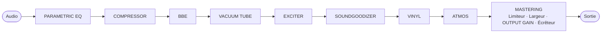
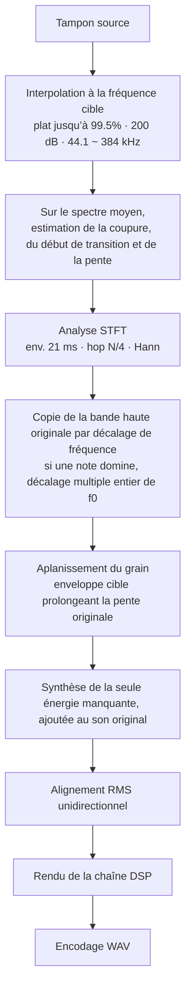

[한국어](README.md) · [English](README.en.md) · [日本語](README.ja.md) · [中文](README.zh.md) · **Français** · [Español](README.es.md)

# ANALOG SOUL DSP ENGINE

> Ceci est une traduction. En cas de divergence avec l’original coréen ([README.md](README.md)), l’original coréen prévaut.

> Les personnes qui ont collaboré ou contribué au projet, ou qui souhaitent le faire, sont priées de me contacter personnellement. Ce projet est un logiciel dont la source est publiée pour que chacun puisse l’utiliser gratuitement. Pour un usage personnel et non commercial, il peut être utilisé sans frais, et vous êtes libre de le modifier pour votre propre usage. Toutefois, les droits d’auteur et la propriété appartiennent à l’auteur original, aux collaborateurs et aux contributeurs : vous ne pouvez donc pas revendiquer ce programme comme le vôtre, ni le distribuer ou le vendre ailleurs.

**Un processeur de timbre analogique qui fonctionne dans le navigateur, et un outil de restauration qui comble les aigus rabotés de l’audio compressé avec pertes.**

`v3.1` · un seul fichier HTML · aucune installation · fonctionne sans connexion Internet · l’audio ne quitte jamais l’appareil

De la partie 1 à la partie 4, chaque section est rédigée en quatre paragraphes. **Motivation** donne la raison pour laquelle la fonction ou la conception était nécessaire ; **Fondements**, les principes, normes et mesures sur lesquels elle repose ; **Mise en œuvre**, la manière dont elle a réellement été implémentée ; **Justification**, la raison pour laquelle cette méthode a été choisie plutôt qu’une autre, et les résultats mesurés.

---

## Sommaire

- [Partie 1 · En termes simples](#part-1)
- [Partie 2 · Principes](#part-2)
- [Partie 3 · Fonctionnement](#part-3)
- [Partie 4 · Algorithmes et équations, physique, conception du système](#part-4)
  - [4.1 Conversion de fréquence d’échantillonnage et noyau STFT](#s41) · [4.2 Estimation de la coupure et de la pente](#s42) · [4.3 Copie par décalage de fréquence et synchronisation sur f0](#s43) · [4.4 Extrapolation de l’enveloppe et grain](#s44) · [4.5 Alignement de niveau](#s45)
  - [4.6 Fonctions de transfert non linéaires](#s46) · [4.7 Budget de repliement](#s47) · [4.8 Division en bandes](#s48) · [4.9 Dynamique](#s49)
  - [4.10 Physique de l’espace](#s410) · [4.11 Stéréo](#s411) · [4.12 Modèle du disque](#s412) · [4.13 Physique de l’audition](#s413)
  - [4.14 Conception du système](#s414) · [4.15 Profondeur de bits](#s415) · [4.16 Problèmes et solutions](#s416) · [4.17 Optimisation](#s417) · [4.18 Limites connues](#s418) · [4.19 Points forts](#s419)
- [Organisation du dépôt](#repo)
- [Journal des modifications](#changelog)
  - [3.1](#cl-v31) · [3.0](#cl-v30) · [2.4](#cl-v24) · [2.3](#cl-v23) · [2.2](#cl-v22)
- [Références](#refs)
- [Licence](#license)

---

<a id="part-1"></a>

## Partie 1 · En termes simples

### De quoi s’agit-il ?

**Motivation.** Il arrive qu’on veuille changer le caractère d’un fichier audio : le rendre chaud, comme s’il était passé par du vieux matériel d’enregistrement, ample, comme si on l’écoutait dans une grande salle de concert, ou rendre régulier un volume qui monte et descend sans cesse. De plus, les fichiers audio téléchargés sur Internet ont souvent perdu leurs sons très aigus, coupés pour réduire la taille du fichier.

**Fondements.** Les effets reproduisent par le calcul la manière dont du vrai matériel et de vraies pièces transforment le son. Ce qu’un tube à vide, un disque et sa platine, la taille et les murs d’une pièce font au son a été traduit en formules. La méthode pour combler les sons aigus coupés et l’intensité appliquée dès l’activation ont été fixées en comparant avec l’audio original non coupé.

**Mise en œuvre.** C’est un programme qui change le caractère du son des fichiers audio que vous lui donnez. Il sait aussi lire les régularités du son restant pour combler de façon plausible la partie haute qui a été coupée. Il n’y a rien à installer : il suffit d’ouvrir un seul fichier dans un navigateur web pour qu’il fonctionne. La musique que vous chargez n’est envoyée nulle part et n’est traitée que dans votre ordinateur. Même les polices sont incluses dans le fichier : l’affichage est identique sans Internet, et rien n’est demandé à l’extérieur.

**Justification.** Pour que le son choisi à l’écoute devienne tel quel le fichier, la lecture et l’enregistrement passent par les mêmes calculs, dans le même ordre. Pour combler le son coupé aussi, le son original est laissé intact et seul ce qui manque est ajouté. Ce n’est que dans une étroite bordure, juste sous l’endroit de la coupure, que le son original est un peu baissé pour se raccorder en douceur au son ajouté.

### Prise en main

**Motivation.** Une personne qui découvre le programme doit pouvoir modifier le son tout de suite et le garder dans un fichier, sans avoir à lire toute la documentation.

**Fondements.** Ce programme a été conçu et testé avec la dernière version de Chrome pour ordinateur de bureau. Dans d’autres navigateurs web, certains affichages ou comportements peuvent différer.

**Mise en œuvre.**

1. Ouvrir `analog-soul-dsp.html` dans un navigateur web. Chrome est recommandé.
2. Lire et accepter les conditions d’utilisation (‘사용 약관’) qui s’affichent dès l’ouverture. Déposer directement un fichier audio vaut aussi acceptation.
3. Faire glisser un fichier audio dans la zone en haut de l’écran.
4. Appuyer sur Lecture (‘재생’), puis activer un à un les interrupteurs des cartes de fonction en écoutant comment le son change. Une carte activée se repère d’un coup d’œil : son contour brille comme un néon.
5. Si le résultat vous plaît, choisir la finesse et la précision dans EXPORT, en bas, puis créer un nouveau fichier avec le bouton Exporter (‘내보내기’).

Pour la documentation, il suffit de commencer par `index.html`. Il en existe cinq, des explications les plus simples aux plus approfondies.

**Justification.** Chrome est recommandé parce que certaines fonctions, comme un enregistrement très fin (192 · 384), sont prises en charge différemment selon les navigateurs web, et que les tests ont été faits dans Chrome. Si l’on conseille d’activer et de désactiver chaque fonction en écoutant, c’est qu’il est plus facile de choisir ce qui vous plaît quand on entend séparément le changement apporté par chacune.

### Les neuf fonctions

**Motivation.** Modifier le son est plus facile à maîtriser quand on procède une étape à la fois. C’est pourquoi chaque carte à l’écran correspond à une fonction. Comme le son change selon l’ordre dans lequel on passe par les mêmes fonctions, il faut pouvoir voir cet ordre et le modifier.

**Fondements.** Chaque carte imite un traitement utilisé en studio d’enregistrement. PARAMETRIC EQ calcule un égaliseur qui monte ou baisse le son selon sa hauteur ; la carte du tube à vide, un vrai circuit à tube ; VINYL, le processus par lequel le disque est gravé puis lu par la pointe de lecture ; DOLBY ATMOS, la façon dont le son rebondit sur les murs d’une pièce et revient. Les principes détaillés se trouvent dans la [partie 2](#part-2) et la [partie 3](#part-3).

**Mise en œuvre.** La carte du flux du signal, au-dessus des cartes, montre l’ordre dans lequel le son passe. On peut changer cet ordre en faisant glisser les noms sur la carte du flux ou les cartes elles-mêmes, et le son change avec l’ordre. Pendant qu’on fait glisser un nœud sur la carte du flux (quand elle tient sur une seule ligne), les autres nœuds s’écartent pour libérer la place où il sera déposé, et quand l’ordre change, les nœuds de la carte du flux et les cartes glissent vers leur nouvelle place. La restauration HD, tout au début, et MASTER, fin de la production, ont une place fixe : elles sont dessinées avec un contour en pointillés et ne peuvent être déplacées ni sur la carte du flux ni parmi les cartes.

| Carte | Rôle |
|---|---|
| **PARAMETRIC EQ** | Renforce ou atténue uniquement les sons à la hauteur voulue. On place jusqu’à 20 points et on les ajuste en les faisant glisser sur le graphique. |
| **COMPRESSOR** | Baisse un peu les sons forts et relève les sons faibles pour rendre l’ensemble régulier. |
| **BBE** | Rend nets la voix parlée et le début des notes des instruments. |
| **VACUUM TUBE** | Calcule un étage d’amplificateur à tube selon le vrai circuit, pour rendre le son chaud et épais, comme s’il était passé par cet appareil. |
| **EXCITER** | Ajoute de l’éclat aux sons aigus. |
| **SOUNDGOODIZER** | Sépare les sons graves, les sons du milieu et les sons aigus, et épaissit chacun séparément. |
| **VINYL** | Donne l’impression de passer vraiment un disque. Imite jusqu’à la poussière sur le disque, la rayure qui claque à chaque tour, la hauteur qui oscille légèrement et les sons aigus qui s’estompent à mesure qu’on approche du centre du disque. |
| **DOLBY ATMOS** | Calcule et fait entendre comment le son résonne dans la pièce choisie parmi un studio d’enregistrement, un club, un cinéma, une salle de concert et un stade. |
| **MASTERING** | La finition. Retouche séparément quatre parties, des sons graves aux sons aigus, et empêche le son de devenir fort au point de distordre. |

**Justification.** Si l’ordre n’est pas figé mais modifiable par glisser-déposer, c’est que l’ordre lui-même change le son. La restauration HD est cependant fixée en tête, pour que MASTER retouche en dernier aussi les sons aigus ajoutés et les empêche de distordre. MASTER, finition de la production, a une place fixe.

**Disposition des cartes**

**Motivation.** Quand on empilait sans espace des cartes de hauteurs différentes, l’ordre s’éparpillait en zigzag, et l’on ne pouvait pas déduire l’ordre de traitement rien qu’en regardant les cases.

**Fondements.** On parcourt l’écran comme on lit un texte : de gauche à droite, de haut en bas. L’épaisseur de la barre de défilement a été fixée par une simulation qui met en balance la facilité de saisie et la longueur du curseur de défilement, et le texte estompé des cartes désactivées respecte un écart de luminosité suffisant pour rester lisible (3 : 1 ou plus).

**Mise en œuvre.** Sur un écran large (900 px ou plus), les cartes ont toutes la même taille (385 px de haut) et sont placées de gauche → droite, de haut → bas, de sorte que leur position suffit à lire l’ordre de traitement. La carte de restauration haute résolution est placée en tête, comme sur la carte du flux, et elle est aussi la première dans le document : l’ordre de déplacement au clavier (Tab) et l’ordre de lecture des lecteurs d’écran sont donc identiques à l’ordre visible. Quand le contenu d’une carte activée déborde, il défile à l’intérieur de la carte (barre de défilement de 22 px à droite), et si l’on continue de tourner la molette une fois arrivé au bout, la page ne suit pas. Quand une carte se rétrécit, les colonnes du nom et de la valeur restent telles quelles et seule la barre du curseur raccourcit. La barre est la plus courte, environ 100 px, sur une carte qui réserve la place de la barre de défilement, quand la carte est la plus étroite (360 px), c’est-à-dire juste au passage à 3 colonnes. L’en-tête des cartes dont le contenu déborde (VINYL · ATMOS · MASTERING) porte un bouton d’agrandissement (chevrons haut et bas) : un clic agrandit cette carte seule à la hauteur de son contenu, ce qui permet de voir tous ses réglages d’un coup. Un nouveau clic la ramène à la hauteur de la tuile, et l’état choisi est mémorisé dans ce navigateur web. Une carte désactivée passe à l’arrière-plan, où ses réglages ne réagissent pas, et tourner la molette au-dessus fait défiler la page. Si l’on commence à faire défiler la page en dehors d’une carte activée, la page continue de défiler même quand une carte activée passe sous le curseur, jusqu’à ce que la molette s’arrête pendant 0.4 s. Si l’on bouge la souris entre-temps, ce maintien se relâche aussitôt, et la carte survolée reçoit la molette et les clics. Quand on fait glisser une carte, un emplacement vide en pointillés apparaît à sa place et suit le curseur, les autres cartes s’écartent, et la carte lâchée glisse depuis l’endroit où elle a été lâchée jusque dans l’emplacement vide. Sur un écran étroit, les cartes s’empilent en une seule colonne.

**Justification.** Avec des cartes de même taille, la position devient l’ordre de traitement. Si les cartes désactivées passent à l’arrière-plan et que le défilement de la page est maintenu, c’est pour que, lorsqu’on fait descendre la page et qu’une carte passe sous le curseur, le défilement ne soit pas happé par la carte et interrompu. Les cartes qui débordent réservent toujours la place de la barre de défilement, qu’elles soient activées ou non, pour que leur contenu ne tressaute pas latéralement. Si la molette arrivée au bout n’est pas transmise à la page, c’est que, sinon, la page remontait, le bas de la carte passait sous la barre de transport fixée en haut, et un clic sur un réglage du bas actionnait la barre de transport. C’était particulièrement fréquent avec VINYL, dont le contenu fait environ 2.7 fois la hauteur visible dans la carte. L’agrandissement n’allonge que la rangée qui contient cette carte, et les autres cartes de la même rangée gardent la hauteur de la tuile : l’ordre de traitement lu par la position ne change donc pas. Sur une carte étroite, seule la barre raccourcit, parce que si le nom ou la valeur étaient tronqués, on ne pourrait plus lire quel réglage est à quelle valeur. La carte de restauration haute résolution est aussi placée en tête dans le document pour que les personnes qui utilisent le clavier ou un lecteur d’écran la parcourent dans le même ordre qu’à l’écran.

**MACRO % et état initial**

**Motivation.** Pour changer l’intensité d’une carte, toucher séparément plusieurs réglages est fastidieux, et il est difficile d’ajuster des valeurs qui s’accordent entre elles. Le son à la première ouverture doit aussi être juste, sans excès.

**Fondements.** L’état initial a été fixé en traitant avec les deux approches 4 morceaux originaux non coupés (les 20 secondes du milieu) et en comparant les résultats. L’approche MACRO laisse presque inchangés les sons graves et la sensation d’ampleur (autour de +2.2 dB), tout en réduisant l’excès des sons aigus (+4.2 → +2.4 dB) et la baisse de volume (−6.2 → −4.9 dB).

**Mise en œuvre.** Le réglage MACRO, tout en haut de la carte, déplace ensemble les principaux réglages de la carte entre leur position la plus faible (0 %) et la valeur de conception de référence (100 %). C’est la même méthode que l’AUTO % de la restauration haute résolution, et les valeurs sont arrondies aux graduations des curseurs. Après qu’on a touché directement un réglage, sa valeur est conservée jusqu’à ce qu’on bouge de nouveau MACRO, et le fichier de réglages enregistre à la fois MACRO et les valeurs des réglages. À la première ouverture, COMPRESSOR 50 % · BBE 40 % · EXCITER 80 % · SOUNDGOODIZER 65 % · MASTERING CHAIN 95 % sont activés, et PARAMETRIC EQ · VACUUM TUBE · VINYL RECORD · DOLBY ATMOS sont désactivés (MACRO 100 %). Le MACRO de PARAMETRIC EQ ne déplace pas les réglages : il fixe dans quelle mesure s’appliquent les hausses et les baisses définies pour chaque point (à 0 %, la courbe est plate). À 0 %, le niveau reste inchangé, sauf pour MASTERING CHAIN (±0.1 dB). Dans MASTERING CHAIN, le limiteur de plafond agit indépendamment de MACRO : sur un master fort, déjà comprimé ou écrêté jusqu’au plafond, le niveau peut baisser de 0.2 ~ 0.9 dB. Dans BBE · SOUNDGOODIZER · MASTERING CHAIN, le réseau de correction de phase ou la division en bandes fait tourner la phase, si bien que le résultat n’est pas identique au son original à l’échantillon près : pour retirer complètement l’effet, désactiver la carte.

**Justification.** Comme un seul réglage fixe l’intensité, le nombre de réglages à toucher pour changer l’intensité d’une carte est passé de 16 à 5.

**Étage de lecture**

**Motivation.** Quand VINYL et ATMOS ne pouvaient être placés qu’avant MASTER, même les bruits de lecture, comme le crépitement du disque, étaient comprimés et gonflés par MASTER.

**Fondements.** Un vrai LP est lu sur une platine : c’est un disque pressé d’après une laque gravée à partir du master. Le crépitement, les sauts, le bruit de surface et le voile apparaissent donc après le mastering. Atmos aussi dessine l’espace selon l’appareil d’écoute une fois le master terminé.

**Mise en œuvre.** Après MASTER vient l’étape où l’on écoute, sur un support de lecture, le son déjà masterisé. Seuls VINYL et ATMOS peuvent être déplacés après MASTER. Sous la barre de titre de ces deux cartes, choisir Avant MASTER (‘MASTER 앞’) ou Après MASTER (‘MASTER 뒤’) dans Position de traitement (‘처리 위치’), ou faire glisser la carte ou le nœud de la carte du flux après MASTER (sur la carte du flux, Alt+→ permet aussi de passer de l’autre côté). L’étage de lecture est signalé par des étiquettes numérotées bleu sarcelle, après la limite bleu sarcelle Lecture (‘재생’) de la carte du flux et sous la zone Étage de lecture · Après MASTER (‘재생 단계 · MASTER 뒤’) de la zone des cartes ; si l’on y fait glisser une autre carte, Dépôt impossible (‘놓을 수 없음’) s’affiche. La garantie CEILING ne vaut que jusqu’à MASTER : le son passé par l’étage de lecture peut dépasser CEILING. Les emplacements et les fichiers de réglages enregistrent aussi l’ordre de l’étage de lecture.

**Justification.** Le bruit qui naît réellement à la lecture doit, comme dans la réalité, apparaître après MASTER pour ne pas être comprimé ni gonflé par MASTER. Les boutons Position de traitement se trouvent hors du corps de la carte : on peut les actionner même quand la carte est désactivée.

**Les réglages de VINYL · VACUUM TUBE · DOLBY ATMOS**

**Motivation.** Pour un disque, un tube ou une pièce, chacun imagine un son différent. C’est en choisissant l’état d’un objet réel, plutôt qu’une vague « intensité », qu’on atteint le son voulu.

**Fondements.** Les réglages de VINYL utilisent tels quels les unités qui figurent dans les manuels du vrai matériel (clics par seconde, décibels, millimètres, picofarads, etc.). DRIVE et BIAS de VACUUM TUBE sont les vraies tensions appliquées au tube, et les pièces de DOLBY ATMOS sont calées sur les durées de réverbération couramment mesurées dans de vraies pièces du même type.

**Mise en œuvre.** Les réglages de VINYL forment trois groupes : le disque, la platine et la pointe de lecture. On règle combien de poussière s’est déposée sur le disque, s’il est rayé, s’il est voilé et combien de fois il a été joué, puis on choisit la régularité de rotation de la platine et la forme de la pointe. Entrer tels quels les chiffres indiqués dans le manuel de chaque appareil donne le son de cette combinaison. Un clic entendu à l’écoute se retrouve au même endroit dans le fichier enregistré.

DRIVE de VACUUM TUBE est l’intensité du son qui entre dans le tube ; BIAS, l’état du tube au repos. Baisser BIAS fait saturer un côté en premier et rend la couleur chaude plus marquée ; le monter rend le son plus propre. Pour DOLBY ATMOS, SPACE est la taille de la pièce, DEPTH la distance d’où semble venir le son, HEIGHT et OBJECT l’intensité du son renvoyé par le plafond et par les murs latéraux. Pour SPACE · HEIGHT · OBJECT, la position centrale (50) correspond aux valeurs d’une vraie pièce.

**Justification.** Les clics sont générés à l’avance dans un ordre déterminé et émis en suivant le temps du morceau : le son entendu et le fichier enregistré sont donc identiques. Les vraies unités servent à ce que l’utilisateur puisse reporter tels quels les chiffres de son propre matériel.

**PARAMETRIC EQ**

**Motivation.** Selon les morceaux, les sons graves bourdonnent, la voix est noyée sous les instruments ou les sons aigus sont agressifs. Souvent, il faut monter ou baisser un peu le son à cette hauteur seulement, sans changer l’ensemble.

**Fondements.** C’est le travail de l’égaliseur (EQ) d’un studio d’enregistrement. Quand on découpe le son par hauteur, c’est la quantité dont on monte ou baisse chaque hauteur qui détermine le timbre. La courbe à l’écran est tracée par le même calcul que celui qui modifie réellement le son : on entend exactement la courbe affichée.

**Mise en œuvre.** Le graphique de la carte porte des points numérotés, chacun chargé d’une hauteur. Faire glisser un point vers la gauche ou la droite change la hauteur qu’il traite ; vers le haut ou le bas, la quantité de hausse ou de baisse. Tourner la molette sur un point rend plus étroite ou plus large la zone traitée autour de cette hauteur. Un double clic sur une zone vide crée un point (jusqu’à 20), un double clic sur un point le désactive temporairement, et un clic droit le supprime. On choisit une forme pour chaque point : **Cloche** (‘벨’), qui gonfle ou creuse une seule hauteur ; **Shelf** (‘셸프’), qui monte ou baisse tout le bas ou tout le haut ; **Coupe** (‘컷’), qui retire le bas ou le haut ; **Notch** (‘노치’), qui creuse profondément une seule hauteur. Un clic sur Éditer en grand (‘크게’) ouvre un grand graphique et le tableau de tous les points, où l’on peut aussi corriger les valeurs en chiffres ; depuis cette fenêtre, on peut aussi lancer la lecture et activer ou désactiver l’EQ. Pendant la lecture, l’image du son avant l’EQ (ligne) et après l’EQ (surface) se superposent. Au départ, l’EQ est désactivé, et quatre points plats, qui ne changent pas le son même une fois l’EQ activé, sont en place. Avec **Importer AutoEQ** (‘AutoEQ 가져오기’), dans la grande fenêtre, on peut aussi charger sous forme de points un fichier de correction de casque d’AutoEQ, mais la correction ainsi ajoutée entre aussi dans le fichier enregistré. Pour adapter l’écoute au casque que vous utilisez, utilisez plutôt « S’adapter à l’appareil d’écoute » ci-dessous.

**Justification.** Dans l’ordre par défaut, l’EQ est en tête. Le but est que les bourdonnements ou les bruits graves à retirer n’agissent pas d’abord sur la compression et la saturation qui suivent. Pour retoucher le son après compression, il suffit de déplacer l’EQ après COMP. Les points sont numérotés dans l’ordre de leur création, et leurs numéros ne changent pas quand on les désactive.

**INPUT GAIN**

**Motivation.** Les fonctions qui donnent du caractère en saturant le son réagissent d’autant plus fortement que le son entrant est fort. Il faut donc pouvoir régler séparément le niveau qui entre dans chaque fonction.

**Fondements.** Du matériel comme les tubes à vide ou les compresseurs sature davantage ou comprime davantage quand l’entrée augmente.

**Mise en œuvre.** Chaque carte a, tout en haut, un réglage **INPUT GAIN**. C’est le niveau du son qui entre dans cette fonction (−24 ~ +24 dB, par pas de 0.1 dB, 0 par défaut). Pour les fonctions qui donnent du caractère en saturant le son, le monter rend l’effet plus marqué ; pour celles qui ne saturent pas, comme PARAMETRIC EQ, seul le niveau change.

**Justification.** INPUT GAIN n’est inséré juste avant la carte que lorsque celle-ci est activée, pour que la valeur d’une carte désactivée ne modifie pas le volume global.

### Combler les aigus coupés

**Motivation.** Dans les fichiers audio réduits en taille, les sons très aigus sont coupés. Même si l’on enregistre avec plus de finesse, l’endroit coupé reste vide.

**Fondements.** La partie haute du son restant suit des règles : la pente selon laquelle elle décroît, les notes qui y résonnent. La méthode de remplissage et les valeurs par défaut ont été fixées en comparant avec l’audio original non coupé, dans le sens qui rapproche le plus le son ajouté de l’original.

**Mise en œuvre.** Ce sont les blocs **HD** et **Ultra · eXtreme HD** qui s’en chargent. Si, à l’enregistrement, on choisit une finesse supérieure à celle du fichier d’origine (pour un fichier à 44.1 kHz : 48 · 88.2 · 176.4 · 352.8 ; pour un fichier à 48 kHz : 96 · 192 · 384), le remplissage s’étend jusqu’à cette hauteur. Dans un morceau où un instrument ou une voix domine, la hauteur musicale du son ajouté est placée sur les harmoniques du son original. La quantité ajoutée se règle avec **HF SYNTH**, et la régularité avec laquelle le son ajouté s’étale en montant se règle avec **SMOOTH**. Avec HF SYNTH à 0, rien n’est ajouté : seule la finesse augmente.

Activer l’interrupteur **LIVE** permet d’écouter le résultat avant d’enregistrer. Il faut patienter un moment à l’activation : le programme parcourt d’abord tout le morceau pour trouver où il est coupé, puis comble une fois le morceau entier. Il recalcule quand on change un réglage, ou quand on fait un choix dans le panneau PRESET puis qu’on le ferme.

**Justification.** Cette fonction ne retrouve pas le son original qui a été coupé : elle dessine un son plausible d’après ce qui reste. C’est pourquoi le son original est laissé tel quel et seul ce qui manque est ajouté ; ce n’est que dans une étroite bordure, juste sous la coupure, que le son original est réduit jusqu’à la moitié pour se raccorder au son ajouté. La hauteur musicale est calée sur les harmoniques parce que, si l’on se contentait de déplacer et de coller, le son ajouté s’écarterait des harmoniques de la note d’origine. Que la différence soit audible ou non dépend du fichier, de l’oreille et du matériel. Plus un fichier a été réduit, plus la différence est grande ; un fichier de bonne qualité au départ ne change presque pas.

### Voir en images

**Motivation.** Il est difficile d’évaluer à l’oreille seule comment le son a changé. En particulier, on n’entend pas toujours bien si les sons très aigus ont été comblés.

**Fondements.** Quand on découpe le son par hauteur et qu’on dessine la force de chaque hauteur, l’endroit coupé et l’endroit comblé deviennent visibles.

**Mise en œuvre.** Dans le graphique du haut, la gauche montre le son original et la droite le son modifié. Comme le même instant est affiché côte à côte, on voit tout de suite ce qui a changé. Un clic sur le graphique le transforme en une image qui défile dans le temps ; plus la couleur est claire, plus le son à cette hauteur est fort.

L’interrupteur X-AXIS, au-dessus du graphique (Adaptatif (‘순응’) · 48 · 96 · 192), permet de fixer l’étendue horizontale. Quand on active et désactive la restauration, le graphique ne s’étire ni ne se contracte, et seule la partie nouvellement comblée attire l’œil.

**Justification.** Les deux graphiques utilisent la même palette de couleurs, car avec des couleurs différentes on ne pourrait pas comparer les niveaux à gauche et à droite. Avec une étendue horizontale fixe, le son d’une même hauteur est toujours dessiné au même endroit.

### S’adapter à l’appareil d’écoute

**Motivation.** Chaque casque et chaque enceinte rend certaines hauteurs plus fortes et d’autres plus faibles. Si l’on règle en écoutant avec ces travers mêlés au son, on finit par corriger des résonances absentes du morceau ou par ajouter au morceau les hauteurs que l’appareil a rognées.

**Fondements.** AutoEQ est un projet public qui, à partir de mesures publiées de casques et d’écouteurs, fournit pour chaque appareil des valeurs de correction qui alignent sa réponse sur une courbe cible. Son fichier de correction (ParametricEQ.txt) se compose d’une dizaine de filtres du même type que les points de PARAMETRIC EQ et d’une valeur d’atténuation globale (Preamp).

**Mise en œuvre.** Appuyer sur le bouton **Correction d’écoute** (‘모니터 보정’) de la barre de transport, puis, dans **Importer AutoEQ** (‘AutoEQ 가져오기’), choisir le ParametricEQ.txt du casque utilisé ou coller son contenu, et appuyer sur **Appliquer** (‘적용’). La correction s’active aussitôt et le nom du casque s’affiche sur le bouton. Dans la fenêtre, on peut voir la courbe de correction et le tableau des filtres, activer ou désactiver la correction, et ajuster Preamp par pas de 0.1 dB. Si la courbe monte au-dessus de 0 dB, le programme signale que les sons forts risquent d’être écrêtés ; il suffit alors de baisser Preamp de la valeur indiquée.

**Justification.** Cette correction ne s’applique qu’à la lecture, juste avant que le son, une fois tous les traitements terminés, parte vers l’appareil. Elle n’entre ni dans le fichier audio enregistré ni dans le fichier de réglages, et n’est mémorisée que dans ce navigateur web. Les travers d’un casque sont une propriété de l’appareil d’écoute, non du morceau : les inscrire dans le fichier donnerait un son faux sur un autre appareil ou pour une autre personne. Le graphique du son modifié à l’écran montre lui aussi le son avant la correction, c’est-à-dire le son qui deviendra le fichier. N’utilisez l’import AutoEQ de PARAMETRIC EQ que pour créer volontairement un fichier destiné à ce casque.

### Comparer à volume égal

**Motivation.** L’oreille humaine trouve meilleur le son le plus fort. Un morceau déjà poussé fort devient souvent moins fort quand on active les fonctions (3 ~ 10 dB avec les réglages par défaut) : en comparant activé et désactivé, la version désactivée paraît facilement meilleure. Pour entendre ce qui a changé, il faut égaliser le volume des deux sons.

**Fondements.** Le volume se mesure en loudness (sonie), en LUFS, selon la norme internationale ITU-R BS.1770. C’est la méthode qu’utilisent la radiodiffusion et les services de musique en ligne pour aligner les volumes : elle compte un peu plus fort les sons aigus, auxquels l’oreille est sensible, et exclut les passages silencieux.

**Mise en œuvre.** Appuyer sur **Comparer** (‘비교’) dans la barre de transport fait passer au son de référence (le bouton affiche un nom comme Original (‘원음’), avec un contour ambre) ; un nouvel appui revient à la version traitée. Le son de référence est d’abord le son original, sans aucune modification ; avec **Référence** (‘견줄 소리’), juste à côté, on peut le remplacer par le son où une seule fonction activée est retirée, comme « sans SOUNDGOODIZER » (‘SOUNDGOODIZER 빼고’). Seule cette fonction est retirée et le reste est inchangé : on entend ainsi uniquement ce que cette fonction a fait. Au premier appui et lors d’un choix, le changement n’intervient qu’après un court instant, le temps de mesurer le volume. Si **Même volume** (‘같은 크기’), juste à côté, est activé (état initial), le son de référence est joué au même volume que la version traitée, et l’ajustement appliqué est affiché, par exemple ‘Original −5.6 dB’ ou ‘sans SG −2.6 dB’. Quand on change un réglage ou une carte, la mesure est refaite peu après.

**Justification.** Seul le son de référence est ajusté, sans toucher à la version traitée : celle-ci s’entend donc toujours au même volume que le fichier qui sera enregistré. Quand il faut monter le son de référence, on ne le monte que jusqu’au point où le son le plus fort n’est pas écrêté (le bouton affiche limite (‘한도’)). Les deux sons sont alignés sur la latence introduite par les traitements (pour le son original, environ 45 ms avec les réglages par défaut ; quand une fonction est retirée, la latence de cette fonction), pour que le rythme ne se décale pas au moment de basculer. Pour retirer une fonction, le programme ne fait pas tourner une seconde copie du traitement : il fait contourner cette fonction par le son, si bien que la lecture ne s’alourdit pas. Cette comparaison ne s’applique qu’à l’écoute et n’entre ni dans le fichier audio enregistré ni dans le fichier de réglages.

### Conserver ses réglages

**Motivation.** Quand on a trouvé des réglages qui plaisent, il faut pouvoir les garder pour les réutiliser, comparer plusieurs réglages en alternant, et les transférer sur un autre ordinateur.

**Fondements.** Un jeu de réglages ne contient que les valeurs des réglages et leurs états Activé/Désactivé, l’ordre des cartes et les points de l’EQ : il tient dans un petit fichier texte. Les emplacements rapides sont conservés dans l’espace de stockage du navigateur web.

**Mise en œuvre.** Le fichier audio et la correction d’écoute n’y sont pas inclus : seuls les réglages le sont.

| Bouton | Rôle |
|---|---|
| **Enregistrer les réglages actuels** (‘화면 설정 저장’) | Crée un fichier avec les réglages affichés à l’écran. Sert à les transférer sur un autre ordinateur. |
| **Emplacements rapides 1~4** (‘빠른 슬롯 1~4’) | Un appui court les charge, un appui long (0.6 s) y enregistre les réglages actuels. Appuyer sur un emplacement vide ramène à l’état initial. |
| **Copier** (‘복사’) | Après cet appui, appuyer successivement sur deux emplacements copie le premier dans le second. Le premier emplacement reste inchangé. |
| **Vider un emplacement** (‘한 슬롯 비우기’) | Après cet appui, appuyer sur un emplacement efface celui-là seulement. |
| **Vider tous les emplacements** (‘모든 슬롯 비우기’) | Un premier appui demande confirmation, un second efface tout. |
| **Sauvegarder tous les emplacements** (‘모든 슬롯을 백업’) | Regroupe les quatre emplacements dans un seul fichier. |
| **Charger** (‘불러오기’) | Reconnaît de lui-même un fichier de réglages ou un fichier de sauvegarde, et restaure son contenu. |

Les emplacements rapides ne restent que dans le navigateur web que vous utilisez. Pour les utiliser sur un autre ordinateur, enregistrez-les dans un fichier. Si l’on charge des réglages enregistrés avec la version 3.0, qui n’avait pas d’EQ, l’EQ revient à son état initial (désactivé, quatre points plats), et le son est exactement celui du moment de l’enregistrement.

À l’enregistrement, la carte du flux du signal en haut et les cartes en dessous clignotent deux fois dans l’ordre de traitement, pour signaler que les valeurs et l’ordre ont été enregistrés. Au chargement, les nœuds de la carte du flux et les cartes glissent jusqu’aux places enregistrées.

**Justification.** Comme seuls les réglages sont enregistrés, sans le fichier audio, le fichier est petit et facile à transférer partout. Un emplacement vide signifie Aucun réglage (‘설정 없음’) : appuyer dessus ramène donc à l’état initial. Vider tous les emplacements est irréversible, d’où la seconde confirmation. Comme Charger identifie de lui-même le type de fichier, il n’est pas nécessaire de préciser de quel fichier il s’agit. Le clignotement suit l’ordre de traitement pour montrer, étape par étape, que l’ordre a lui aussi été enregistré.

### Enregistrer dans un fichier

**Motivation.** Pour écouter ailleurs le son modifié, il faut le garder dans un nouveau fichier audio. La finesse et la précision voulues varient selon l’usage.

**Fondements.** Un fichier audio découpe chaque seconde en tranches minuscules et note à chaque fois l’intensité du son sous forme de nombre. La finesse du découpage (finesse) et la précision avec laquelle les nombres sont notés (précision) déterminent la taille du fichier.

**Mise en œuvre.** Dans EXPORT, en bas, choisir ces deux valeurs, puis appuyer sur le bouton **Exporter** (‘내보내기’).

| Barre | Choix | Signification |
|---|---|---|
| **SAMPLE RATE** | 44.1 · 48 · 96 · 192 · 384 | La finesse avec laquelle chaque seconde est découpée et notée. Choisir plus haut que le fichier d’origine comble les sons aigus coupés jusqu’à cette hauteur ; choisir plus bas réduit la finesse en préservant au mieux le son original. Au chargement d’un fichier, la valeur se cale sur celle du fichier d’origine, et la mention (source) (‘원본’) apparaît sous cette graduation. S’il n’y a pas de graduation identique, la valeur se cale sur la graduation immédiatement supérieure (sur la plus haute si le fichier d’origine dépasse la plus haute), et (source) n’apparaît pas. Si le fichier d’origine est de la famille 44.1 (44.1 · 88.2 · 176.4 · 352.8), les trois graduations du haut deviennent 88.2 · 176.4 · 352.8. |
| **BIT DEPTH** | 16 · 24 · 32 | La précision avec laquelle chaque valeur est notée. Si le fichier d’origine est en 16 bits ou moins, choisir 24 ou 32 comble l’intervalle entre les marches. |

Sous le bouton s’affiche l’ordre dans lequel le traitement est effectué. Plus les nombres sont grands, plus le fichier est gros. Pour un morceau d’une minute : environ 10 MB en 44.1 et 16, environ 33 MB en 96 et 24, environ 88 MB en 192 et 32, environ 176 MB en 384 et 32. Réenregistrer le même fichier avec les mêmes réglages produit un fichier identique à l’octet près.

**Justification.** Si la valeur choisie au départ est celle du fichier d’origine, c’est pour que, si l’on ne touche à rien, le fichier soit enregistré sans conversion. Pour un fichier de la famille 44.1, les graduations du haut deviennent 88.2 · 176.4 · 352.8 parce que ce sont exactement le double, le quadruple, ce qui rend le calcul rapide. Monter un fichier à 44.1 kHz à 88.2 est 32% plus rapide qu’à 96, et la différence de son est plus petite que la plus petite unité notée dans le fichier. Quand on comble les intervalles entre les marches d’un fichier 16 bits, on ne sort pas de la case où se trouvait la valeur d’origine : le son est noté plus finement sans s’écarter du son original.

### Bon à savoir

**Motivation.** À l’usage, quelques situations peuvent dérouter ou surprendre. Les connaître à l’avance évite de mal juger à l’écoute ou de perdre ses réglages.

**Fondements.** Elles découlent de la façon dont l’oreille humaine se laisse tromper par le volume, des limites de ce que prend en charge le navigateur web et de la manière dont ce programme gère les réglages.

**Mise en œuvre.**

- **Si le son semble meilleur dès qu’on active une fonction**, c’est peut-être simplement parce qu’il est plus fort. L’oreille humaine trouve systématiquement meilleur un son devenu plus fort. À l’inverse, un morceau déjà poussé fort perd 3 ~ 10 dB quand on active les fonctions, et la version désactivée peut sembler meilleure. Activez **Comparer** (‘비교’) dans la barre de transport avec **Même volume** (‘같은 크기’) et comparez. Pour entendre ce qu’a fait une seule fonction, retirez-la dans **Référence** (‘견줄 소리’) et écoutez (voir « Comparer à volume égal » plus haut).
- **MASTERING ne monte pas le son de lui-même.** Il laisse intacts les passages calmes et ne comprime que les passages forts. Pour obtenir un son plus fort, montez l’INPUT GAIN de MASTERING pour pousser le limiteur.
- **Si un message indique qu’il est impossible d’enregistrer en 192 ou 384**, c’est que le navigateur web ne prend pas en charge un enregistrement aussi fin. Utilisez Chrome, ou choisissez 96 (88.2 pour la famille 44.1).
- **Si vous tentez d’aller vers une autre documentation après avoir changé des réglages**, une fenêtre de confirmation s’affiche, car les réglages ne sont pas enregistrés automatiquement.
- **La couleur de l’écran se choisit à droite de la barre tout en haut.** Auto (‘자동’) suit le réglage sombre/clair de l’ordinateur ; Nuit (‘야간’) et Jour (‘주간’) gardent l’écran toujours sombre ou toujours clair. Le choix est mémorisé dans ce navigateur web et s’applique au programme comme à la documentation.
- **Le fichier audio enregistré ne contient que le son.** Les réglages utilisés pour le créer n’y sont pas conservés : pour les réutiliser plus tard, enregistrez aussi les réglages.

**Justification.** Si MASTERING ne monte pas le son de lui-même, c’est pour supprimer toute amplification automatique cachée et laisser l’utilisateur décider lui-même de combien le son monte quand il active quelque chose. Le programme demande confirmation quand on part vers une autre documentation, car si l’on quitte avant d’enregistrer, toutes les valeurs modifiées sont perdues.

---

<a id="part-2"></a>
## Partie 2 · Principes

Cette partie explique les phénomènes physiques et perceptifs sur lesquels repose chaque fonction. Les méthodes de calcul sont traitées dans la partie 3, les équations dans la partie 4. Chaque section expose dans l’ordre pourquoi ce principe est nécessaire au programme (Motivation), sur quelles théories et données il s’appuie (Fondements), comment le programme l’utilise (Mise en œuvre) et pourquoi cette méthode a été choisie (Justification).

### 2.1 Deux regards sur le son — temps et fréquence

**Motivation.** Ce programme traite le son sous deux formes : la forme d’onde (temps) et le spectre (fréquence). Préserver la fréquence d’échantillonnage de la source, combler les aigus coupés et choisir la fréquence d’échantillonnage d’export partent tous de la même question : « jusqu’où ce fichier peut-il contenir du son ? ». Pour lire les deux analyseurs à l’écran, il faut aussi connaître l’axe des fréquences logarithmique et les décibels.

**Fondements.** Le son est une variation de la pression de l’air dans le temps. Un fichier d’enregistrement est une suite de nombres qui mesurent cette variation à intervalles réguliers, et l’inverse de cet intervalle est la **fréquence d’échantillonnage**. 44.1 kHz signifie 44,100 mesures par seconde. D’après le théorème d’échantillonnage, la moitié de la fréquence d’échantillonnage, la **fréquence de Nyquist**, est le son le plus aigu que le fichier peut contenir. On peut aussi décomposer le même son en composantes fréquentielles : c’est le **spectre**, qui montre dans quelle proportion chaque hauteur de son est présente. L’oreille humaine perçoit les fréquences sur une échelle logarithmique : passer de 100 Hz à 200 Hz et passer de 1 kHz à 2 kHz s’entendent de la même façon, comme une octave. Le niveau se mesure en **décibels (dB)**. Doubler l’amplitude donne environ +6 dB, et une différence de 10 dB est perçue comme un son à peu près deux fois plus fort.

**Mise en œuvre.** Les analyseurs tracent l’axe horizontal du spectre en barres et l’axe vertical du spectrogramme en échelle logarithmique, de 20 Hz jusqu’à la fréquence de Nyquist d’affichage. Les 128 barres sont réparties régulièrement sur l’axe logarithmique, et chacune montre le maximum des cases (bins) FFT de son intervalle. L’échelle verticale couvre −100 ~ −30 dB (section 3.7). À l’ouverture d’un fichier, la fréquence d’échantillonnage source est lue directement dans l’en-tête du fichier, avant de le confier au décodeur du navigateur (section 3.9). La fréquence d’échantillonnage d’export se choisit dans la plage 44.1 ~ 384 kHz (section 3.8).

**Justification.** Comme l’oreille entend de façon logarithmique, les graphiques sont eux aussi tracés en logarithmique. Sur un axe linéaire, la largeur occupée par une octave doublerait à chaque octave vers le haut, et près de six octaves, de 20 Hz ~ 1 kHz, s’entasseraient à l’extrémité gauche de l’écran. La fréquence d’échantillonnage source est lue dans l’en-tête parce que le décodeur du navigateur la convertit toujours en fréquence d’échantillonnage du périphérique de lecture. Il faut connaître la fréquence de Nyquist d’origine pour juger quelle zone était vide dès le départ.

### 2.2 Dynamique — compression

**Motivation.** Si le volume monte et descend de façon irrégulière, la profondeur de la distorsion dans les étages de saturation qui suivent varie d’un passage à l’autre. C’est pourquoi COMPRESSOR est en tête de la chaîne (section 3.2). Le MASTERING final traite lui aussi le niveau final et les crêtes avec des compresseurs par bande et un limiteur.

**Fondements.** Quand le son dépasse le **seuil**, le compresseur réduit le dépassement en le divisant par le **ratio**. À 4:1, un son qui dépasse le seuil de 8 dB est réduit pour ne plus le dépasser que de 2 dB. L’**attaque** indique avec quelle rapidité il réduit après le dépassement, le **relâchement** avec quelle rapidité il revient à la normale une fois le niveau redescendu. Le **coude (knee)** détermine si la compression s’applique brusquement ou en douceur autour du seuil. La compression réduit les variations de volume. Comme le **facteur de crête**, l’écart entre l’instant le plus fort et la moyenne, diminue, on peut augmenter le volume moyen sans dépasser le même niveau maximal. Remonter l’ensemble d’autant que la compression l’a réduit s’appelle le **gain de compensation** (makeup).

**Mise en œuvre.** L’élément de compression est le `DynamicsCompressorNode` de Web Audio. Le coude de cet élément ne s’étend **que vers le haut** à partir du seuil : la compression commence donc plus haut qu’avec le coude symétrique du matériel, d’une demi-largeur de coude. La spécification applique toujours un gain de compensation automatique $`(1/c(1))^{0.6}`$, qui amplifie même le signal sous le seuil. Ce programme calcule cette valeur avec la même formule et l’annule par son inverse juste après le compresseur (6.03 dB avec les valeurs par défaut de COMPRESSOR). Ainsi, le compresseur lui-même ne touche pas aux sons calmes sous le seuil, et le gain de compensation n’est appliqué qu’à hauteur de ce que fixe MAKEUP. Le compresseur de sortie de SOUNDGOODIZER, ainsi que les compresseurs des quatre bandes et le limiteur de MASTERING, sont compensés de la même façon. Les formules et les valeurs se trouvent en [4.9](#s49).

**Justification.** Si l’on laissait le gain de compensation automatique, le simple fait d’activer le compresseur rendrait le son plus fort, d’une quantité qui varierait selon le seuil, le coude et le ratio. Avant la compensation, avec les valeurs par défaut de COMPRESSOR, un signal calme gagnait +10.0 dB, les 6.03 dB cachés s’ajoutant aux 4 dB de MAKEUP ; MASTERING amplifiait chaque bande différemment, de +5.4 ~ +7.1 dB, et les médiums ressortaient de 1.7 dB. Après la compensation, seul le réglage MAKEUP apporte du gain : le sens du réglage est univoque, et il devient facile de comparer le son activé et le son désactivé au même volume (2.10). En contrepartie, la sortie avec les réglages par défaut est environ 6 dB plus faible qu’avant la compensation. La compensation repose sur la formule de la spécification : dans un environnement qui implémente cette formule différemment, elle est décalée d’autant.

### 2.3 Phase et clarté

**Motivation.** Quand le début d’un son devient flou, le contour des instruments paraît écrasé. La carte BBE agit sur ce contour en modifiant les relations temporelles. De plus, mélanger au son original un signal dont seule la phase a tourné efface certaines fréquences : les cartes à trajet parallèle (l’ancienne structure de BBE, SOUNDGOODIZER) doivent contourner cette propriété. La bande qui détermine la netteté de la voix et des instruments est la cible de PROCESS de BBE et de l’accentuation de présence de SOUNDGOODIZER.

**Fondements.** Un haut-parleur ne peut pas émettre en même temps les sons de toutes les hauteurs. Les sons graves, en particulier, ont tendance à sortir plus tard que les sons aigus. Ce phénomène, où le temps d’arrivée dépend de la fréquence, s’appelle le **temps de propagation de groupe**. Le traitement publié par BBE consiste à retarder les graves d’environ 2.5 ms et les médiums d’environ 0.5 ms par rapport aux aigus. Le fabricant le présente comme une correction de phase du haut-parleur, mais comme il retarde encore davantage des graves déjà retardés par le haut-parleur, il s’agit moins d’une correction que d’un traitement qui fait arriver en premier l’attaque des composantes aiguës pour faire ressortir le contour du début des notes. Un filtre qui ne modifie que la phase et laisse l’amplitude intacte s’appelle un **filtre passe-tout**. Si le signal traverse simplement ce filtre, on peut retarder les seuls sons graves sans toucher à l’amplitude. À l’inverse, si l’on mélange le signal passé par ce filtre au signal d’origine, le son s’annule aux fréquences où les phases s’opposent : pour ne modifier que le temps, il ne faut pas mélanger. Dans la voix humaine, la bande de 2 ~ 5 kHz, où se concentrent les consonnes, détermine la **clarté** (intelligibilité). Le conduit auditif externe est un tube fermé d’un côté par le tympan : il présente une résonance quart d’onde (environ 3.4 kHz), et cette résonance, avec les réflexions du pavillon de l’oreille, renforce 2 ~ 5 kHz de 10 ~ 15 dB. C’est aussi la bande où l’oreille est la plus sensible sur les courbes d’isosonie (ISO 226). Relever un peu cette bande donne l’impression que la voix s’avance.

**Mise en œuvre.** BBE fait passer le signal **en série** par deux passe-tout (220 Hz Q 0.59, 1850 Hz Q 1.47) et ne crée ainsi qu’un temps de propagation de groupe, sans toucher à l’amplitude. Avec les trois réglages à 0, la réponse est de 0.0 dB sur toute la bande, et le temps de propagation de groupe vaut 2.58 ms à 50 Hz, 0.61 ms à 500 Hz et 0.03 ms à 5 kHz. Ensuite, PROCESS relève largement, avec un shelf aigu à 3 kHz (0 ~ +8 dB), la bande où se concentrent consonnes et attaques, et HI DEF prend en charge ce qui se trouve au-dessus avec un shelf aigu à 10 kHz (0 ~ +6 dB). SOUNDGOODIZER relève la bande de présence avec un filtre en cloche (peaking) à 2.5 kHz (Q 0.7, +AMOUNT×3 dB) et, lorsqu’il additionne en parallèle les bandes traitées au son original, il applique aussi au trajet du son original le même passe-tout que celui de la somme des bandes, pour aligner les phases ([4.8](#s48)).

**Justification.** Les fréquences centrales et les Q des deux passe-tout sont ajustés par moindres carrés sur le temps de propagation de groupe cible (2.5 ms sous 150 Hz, 0.5 ms entre 0.4 ~ 1.5 kHz, 0 au-dessus de 5 kHz). L’ancienne structure additionnait la sortie du passe-tout au son original, ce qui creusait un creux là où la phase atteignait −180°. Avec un rapport de mélange g = 0.6, cela fait −12 dB, et de fait, avec LO CONTOUR à 100, 100 ~ 125 Hz et 315 Hz étaient à −9.3 dB. Avec le montage en série actuel, la réponse est plate avec les réglages à 0, et LO CONTOUR à 100 relève en douceur : +9.7 dB à 31.5 Hz, +7.0 dB à 63 Hz, +3.1 dB à 100 Hz. Le matériel fait varier l’accentuation des aigus selon le signal, mais ici il s’agit d’un shelf fixe. Sur une voix, monter PROCESS au-delà de +6 dB fait aussi monter les sifflantes.

### 2.4 Non-linéarité et harmoniques

**Motivation.** VACUUM TUBE, EXCITER et SOUNDGOODIZER saturent volontairement le son pour le colorer, et l’écrêteur de sécurité de MASTERING est lui aussi non linéaire. Les harmoniques qui apparaissent, et dans quelle proportion, constituent le timbre même de la carte. En numérique, saturer peut introduire des sons à des hauteurs incongrues qui n’existaient pas au départ : il faut aussi les maîtriser.

**Fondements.** Saturer un son crée des **harmoniques** qui n’existaient pas. Si l’on sature un son à 100 Hz, de nouvelles composantes apparaissent à 200, 300 et 400 Hz. La manière de saturer détermine quelles harmoniques apparaissent et dans quelle proportion. Une saturation **symétrique**, qui écrase les deux côtés de la même façon (fonction impaire, $`f(-x) = -f(x)`$), ne crée que des harmoniques impaires (3e, 5e…). Une saturation **asymétrique**, qui écrase plus fort un côté, crée aussi des harmoniques paires (2e, 4e…). Dans le développement de Taylor $`f(x + b) = f(b) + f'(b)\,x + \tfrac12 f''(b)\,x^2 + \cdots`$, le coefficient du terme en $`x^2`$, qui produit la 2e harmonique, est proportionnel à la courbure au point de fonctionnement, $`f''(b)`$. La 2e harmonique, une octave au-dessus, se fond bien avec le son d’origine et donne un son épais ; la 3e harmonique, une quinte au-dessus de l’octave, apporte une couleur un peu plus rugueuse. Si le timbre des tubes à vide est dit chaud, c’est en raison des harmoniques paires que produit leur caractéristique asymétrique. La courbe d’une triode est par nature asymétrique, à cause de la loi en puissance 3/2 de la charge d’espace et du courant de grille (modèle de triode de Koren). Saturer le son en numérique demande une précaution : une harmonique nouvellement créée qui dépasse la fréquence de Nyquist ne disparaît pas mais se **replie** vers le bas, et apparaît à une hauteur sans aucun rapport avec le son d’origine. C’est le **repliement (aliasing)**. En outre, à taux de distorsion égal, c’est l’intermodulation d’ordre élevé produite par une courbe dont la courbure change brusquement qui s’entend comme la plus gênante (Geddes & Lee).

**Mise en œuvre.** VACUUM TUBE obtient sa courbe en résolvant les équations d’un étage amplificateur 12AX7 à cathode commune. Avec les valeurs par défaut (DRIVE 30, BIAS 50), un signal de 1 kHz à −6 dBFS donne une 2e harmonique à −33.7 dB et une 3e harmonique à −67.5 dB. EXCITER donne à la courbe $`\tanh`$ des limites de saturation différentes côté positif et côté négatif, +1 et −0.7 ; SOUNDGOODIZER déplace le point de fonctionnement de $`b = 0.08\,\mathrm{SAT}`$ pour créer des harmoniques paires. Le repliement est réduit de deux façons. Les courbes sont appliquées avec un suréchantillonnage (oversampling) d’un facteur 4, et pour EXCITER et la bande aiguë de SOUNDGOODIZER, un passe-bas $`\max(1.4\,f_{\mathrm{lo}},\ f_s/3)`$ placé uniquement avant le trajet de saturation fait passer de 7 à 10.5 l’ordre d’harmonique à partir duquel commence le repliement audible. La composante continue que créent aussi les courbes asymétriques est bloquée par un passe-haut placé après la saturation (TUBE 10 Hz, EXCITER FREQ, SOUNDGOODIZER 12 Hz). Les courbes et les mesures se trouvent en [4.6](#s46), le budget de repliement en [4.7](#s47).

**Justification.** La courbe du tube est obtenue par résolution du circuit plutôt que choisie à la main, parce que l’ancienne courbe, contrairement à ce qu’indiquait son commentaire, donnait avec le BIAS par défaut une 3e harmonique supérieure de 17 dB à la 2e. Le modèle actuel reproduit fidèlement les tendances physiques : sur un petit signal, la 2e harmonique dépasse la 3e de 34 dB ; poussé fort, c’est la 3e qui prend le dessus ; et avec une polarisation froide, la 2e harmonique se renforce. L’ancienne courbe de SOUNDGOODIZER était une fonction impaire pure, si bien que la 2e harmonique plafonnait à −68.6 dB. Multiplier le gain sur la seule demi-période négative ne change pas la courbure à l’origine et ne crée presque pas d’harmoniques paires sur un petit signal : c’est pourquoi le déplacement du point de fonctionnement a été retenu. L’ordre de repliement ne dépend pas de la fréquence d’échantillonnage, car la limite haute de l’entrée monte avec la fréquence de Nyquist, proportionnellement. Monter la fréquence d’échantillonnage ne suffit donc pas à l’améliorer : il faut borner la bande d’entrée à une fraction de la fréquence de Nyquist. Rendre toute la chaîne à un multiple élevé n’a pas été retenu : le temps de rendu et la mémoire augmentent d’autant, un rééchantillonnage supplémentaire s’ajoute, et comme cela ne s’appliquerait qu’à l’export, le son écouté et le fichier différeraient. TUBE n’a pas de limitation de bande : avec MIX à 100, tout le signal passe par la courbe, et cela reviendrait à une coupure à 16 kHz qui n’existe pas dans un vrai étage amplificateur.

### 2.5 Traiter par bandes

**Motivation.** Les sons graves et les sons aigus ont des caractères différents : leur appliquer le même traitement abîme l’un des deux. SOUNDGOODIZER sature séparément trois bandes, et MASTERING comprime séparément quatre bandes. Pour préserver le punch des graves sans que les aigus pompent, il faut des réglages différents pour chaque bande.

**Fondements.** On divise le signal en bandes avec un **filtre séparateur (crossover)**, on les traite séparément, puis on les recombine. Les morceaux ainsi séparés doivent alors, recombinés tels quels, retrouver le niveau d’origine. Une division qui a cette propriété est dite **complémentaire**. Sinon, le son gonfle ou se creuse aux frontières entre bandes. La division Linkwitz–Riley d’ordre 4 s’obtient en mettant en cascade deux Butterworth d’ordre 2 ; la somme des graves et des aigus forme exactement un passe-tout d’ordre 2, d’amplitude 1 à toutes les fréquences.

**Mise en œuvre.** Les deux cartes utilisent des filtres Linkwitz–Riley d’ordre 4. SOUNDGOODIZER divise en deux points de séparation qui dépendent du mode (A 250 Hz / 4 kHz, etc.), MASTERING à 120 Hz / 500 Hz / 5 kHz. Avec deux points de séparation ou plus, une structure en arbre multiplie la bande basse par le passe-tout du point de séparation supérieur, pour que la somme vaille $`AP_a AP_b \cdots`$. La spécification Web Audio interprète le Q de `lowpass` et `highpass` en dB : pour un Butterworth, on entre donc −3.0103 et non 0.707. La dérivation et les valeurs se trouvent en [4.8](#s48).

**Justification.** L’ancien SOUNDGOODIZER plaçait LPF, BPF et HPF en parallèle : la somme des bandes oscillait entre 0.906 ~ 1.568, et la zone autour de 2 kHz gonflait d’environ +4 dB. Si l’on se contente de diviser entre elles les bandes voisines, MASTERING présente un creux de −1.22 dB vers 411 Hz. Entrer 0.707 tel quel comme Q fait gonfler la somme de +7.4 dB à la fréquence de coupure du crossover. Avec la structure en arbre actuelle, l’écart de la somme calculée avec les coefficients de la spécification est de ±0.0000 dB. Le prix à payer est une rotation de phase. La somme des bandes est à −180° au point de séparation : quand on additionne en parallèle les bandes traitées au son original, il faut appliquer le même passe-tout au trajet du son original pour éviter les annulations (sinon −2.3 dB à 250 Hz). Le temps de propagation de groupe vaut au plus environ $`0.543/f_c`$, soit environ 4.5 ms au point de séparation de 120 Hz de MASTERING, ce qui reste sous le seuil de discrimination du temps de propagation de groupe dans les graves. Les bandes qui comportent une saturation ne sont pas linéaires : la planéité de la somme ne vaut qu’à bas niveau, et dans les quatre modes cette réponse reste à ±1.3 dB près.

### 2.6 Espace — réflexions et réverbération

**Motivation.** La carte DOLBY ATMOS place le son dans une pièce. L’ancienne carte utilisait dix réflexions fixes et une réverbération aléatoire différente à chaque fois : le grain de la réverbération changeait même avec les mêmes réglages. Pour régler l’espace avec des grandeurs réelles, comme la taille de la pièce, l’absorption des murs, la distance à la source et la largeur de la source, il faut les principes de l’acoustique des salles.

**Fondements.** Le son entendu dans une pièce se divise en trois parties : le **son direct**, qui arrive tout droit de la source ; les **premières réflexions**, qui arrivent après avoir rebondi une ou deux fois sur les murs et le plafond ; et la **réverbération tardive**, faite de réflexions innombrables qui se mêlent. Les premières réflexions renseignent sur la taille et la forme de la pièce, la réverbération tardive sur sa résonance. Le temps que met la réverbération à baisser de 60 dB s’appelle le **RT60**. Un petit studio d’enregistrement est à 0.3 ~ 0.5 s, une salle de concert autour de 2 s. Plus les murs absorbent le son et plus la pièce est petite, plus la réverbération est courte (formules de réverbération de Sabine et d’Eyring). L’air absorbe lui aussi les sons aigus (ISO 9613-1) : plus la pièce est grande, plus la réverbération des aigus est courte. En s’éloignant de la source, le son direct faiblit, mais la réverbération reste uniforme dans toute la pièce, si bien qu’à partir d’une certaine distance elle dépasse le son direct. Cette distance s’appelle la **distance critique**. Les premières réflexions venant des murs latéraux envoient aux deux oreilles des sons différents et font paraître la source plus large (Barron & Marshall, Hidaka et al.). Un son venant d’en haut arrive avec une accentuation autour de 8 kHz due au pavillon de l’oreille, et l’oreille se sert de cette accentuation comme indice que le son vient d’en haut (bandes directionnelles de Blauert). Les trajets de réflexion peuvent se calculer par la méthode des sources images, qui place de façon répétée les images miroir de la source réfléchies par les murs (Allen & Berkley).

**Mise en œuvre.** ATMOS crée les premières réflexions par des réflexions de sources images dans une pièce parallélépipédique, et la réverbération diffuse par une atténuation fréquentielle combinant le temps de réverbération d’Eyring et l’absorption de l’air, puis effectue une convolution. Le son direct est laissé tel quel, comme le son original. Premières réflexions et réverbération tardive se croisent autour du temps de mélange (Polack, $`\min(\sqrt{V}\ \mathrm{ms},\ 150\ \mathrm{ms})`$) de sorte que la somme de leurs énergies vaille 1. Les réglages sont des grandeurs physiques : SPACE est la dimension de la pièce, DEPTH la distance entre la source et l’auditeur, OBJECT la quantité de réflexions des murs latéraux, HEIGHT la quantité de réflexions du plafond et du sol ainsi que l’accentuation à 8 kHz des réflexions venant d’en haut (au plus +8 dB), REVERB la quantité de réverbération diffuse. À la première ouverture (SPACE 60), le temps de réverbération à 1 kHz est de 0.28 s pour STUDIO et de 2.02 s pour CONCERT, et la distance critique va de STUDIO 1.24 m ~ STADIUM 26.4 m. Le niveau des réflexions et de la réverbération est calé sur la distance d’écoute selon la théorie révisée de Barron. Le tableau des scènes et les formules se trouvent dans la partie DOLBY ATMOS de la section 3.4 et en [4.10](#s410).

**Justification.** Au-delà d’un coefficient d’absorption de 0.2, la formule de Sabine surestime le temps de réverbération (d’environ 28 % à α 0.4) : c’est donc la formule d’Eyring qui est utilisée. Elle suppose qu’à chaque réflexion l’énergie est multipliée par $`1 - \alpha`$, la même hypothèse que celle des réflexions de sources images. Les réflexions sont tronquées selon leur instant d’arrivée et non selon leur ordre : toutes celles qui arrivent avant le temps de mélange sont incluses, quel que soit leur ordre. La réverbération diffuse n’est pas obtenue en filtrant du bruit par des filtres d’octave : l’atténuation est appliquée case par case dans le domaine fréquentiel. Comme les flancs des filtres ne se chevauchent pas, les bandes voisines à réverbération plus longue ne débordent pas. Les nombres aléatoires proviennent d’un générateur déterministe dont la graine dépend des réglages : les mêmes réglages donnent toujours la même réponse, et les réponses sont conservées pour chaque combinaison d’entrées, si bien que le grain de la réverbération ne bouge pas quand on tourne un autre réglage. Les temps de réverbération mesurés sont pour la plupart à moins de 5 % des valeurs attendues, et l’énergie des réflexions et de la réverbération est inférieure de 0.4 ~ 0.9 dB à la théorie révisée de Barron. Malgré son nom, c’est un modèle d’acoustique de salle à 2 canaux, sans rapport avec les formats multicanaux à base d’objets.

### 2.7 Image stéréo

**Motivation.** Le STEREO de SOUNDGOODIZER et le réglage de largeur de MASTERING élargissent ou rétrécissent le son. VINYL supprime, à l’étape de gravure, la différence gauche-droite dans les graves et imite la diaphonie gauche-droite de la cellule. Tout cela repose sur une façon de voir qui décompose la gauche et la droite en mid et side. Comme l’auditeur peut aussi écouter sur un seul haut-parleur, celui d’un smartphone par exemple, il faut également savoir ce qui subsiste en mono.

**Fondements.** Les signaux gauche et droit peuvent être convertis en **mid (M)** et **side (S)**. Le mid est la composante présente à l’identique des deux côtés, le side est la différence entre les deux ($`M = (L + R)/2`$, $`S = (L - R)/2`$). Augmenter la composante side élargit le son ; la réduire le rétrécit. Le point de vigilance est la **compatibilité mono**. Dans une écoute sur un seul haut-parleur, la gauche et la droite s’additionnent ($`L' + R' = 2M`$), et la composante side s’annule alors complètement. Un instrument repoussé trop loin sur les côtés peut devenir inaudible en mono.

**Mise en œuvre.** Le réglage de largeur est réalisé par un seul bloc commun. $`L' = M + wS`$, $`R' = M - wS`$ ; avec $`w = 1`$, la source reste telle quelle, avec 0 on obtient du mono. L’implémentation s’appuie sur la règle de la spécification selon laquelle plusieurs connexions arrivant sur une même entrée d’un `ChannelMergerNode` sont additionnées. SOUNDGOODIZER STEREO couvre 0 (mono) ~ 2× et vaut environ 1.1× à sa valeur par défaut de 55. La largeur de MASTERING couvre 0 ~ 200 (110 par défaut) et se place après le limiteur, avant OUTPUT GAIN et l’écrêteur de sécurité. VINYL applique un passe-haut de 150 Hz à la seule composante side pour ramener les graves au centre. Les équations se trouvent en [4.11](#s411).

**Justification.** Élargir ajoute de la composante side et fait remonter les crêtes ; on place donc ce bloc avant l’écrêteur qui protège le plafond ([4.9](#s49)). La somme mono vaut $`2M`$ quel que soit $`w`$, si bien que toute l’information placée dans le side avec $`w > 1`$ disparaît en mono. De plus, $`w > 1`$ ne fait qu’augmenter la composante side, sans **décorréler** la gauche et la droite. Pour élargir la largeur apparente de la source en abaissant la corrélation interaurale (IACC), une rotation de phase dépendante de la fréquence ou de courts retards aléatoires sont plus efficaces ; dans ce programme, ce rôle revient aux réflexions sur les murs latéraux d’ATMOS (OBJECT).

### 2.8 Défauts du disque vinyle

Le son d’un disque vient de la physique de sa fabrication et de sa lecture. La carte VINYL est un modèle physique qui suit ce processus, et ses réglages sont tous des grandeurs physiques qui figurent dans les fiches techniques réelles de platines, de cellules et de disques. Le moteur temps réel et le moteur de rendu construisent ce bloc avec la même fonction `buildVinylChain`. La structure et les réglages sont décrits dans la partie VINYL de la section 3.4, les équations en [4.12](#s412).

**Gravure**

**Motivation.** Le « toc » arrondi propre au disque, l’épais bruit de surface et les graves ramenés au centre se décident à l’étape où l’on grave le sillon. Pour imiter ce grain, il ne faut pas ajouter le bruit n’importe où, mais suivre l’ordre que créent la gravure et la courbe de lecture.

**Fondements.** Le sillon grave la vitesse du son. Si on le gravait tel quel, les graves feraient osciller le sillon beaucoup trop fort et les aigus, trop faibles, seraient noyés dans le bruit ; on grave donc avec la **courbe d’enregistrement RIAA**, qui réduit les graves et renforce les aigus, et l’on revient en arrière à la lecture avec la courbe inverse. Les constantes de temps de la courbe de lecture RIAA sont 3180 µs, 318 µs et 75 µs, et l’amendement IEC y ajoute une coupure des graves à 20.02 Hz. Le bruit et la poussière nés dans le sillon ne passent alors que par la courbe de lecture : leurs aigus sont atténués et leurs graves gonflés, ce qui donne le « toc » arrondi et l’épais bruit de surface propres au disque. Un sillon stéréo grave séparément les flancs gauche et droit ; or une différence gauche-droite dans les graves fait fortement osciller le sillon de haut en bas et fait sauter la pointe de lecture, c’est pourquoi on ramène les graves au centre lors de la gravure (EQ elliptique).

**Mise en œuvre.** L’entrée passe d’abord par l’EQ elliptique. La composante side (L−R) est filtrée par un passe-haut LR4 à 150 Hz (deux Butterworth d’ordre 2), et la composante mid (L+R) est envoyée dans un passe-tout d’ordre 2 de même phase. Le bruit de surface, les craquements, les pops, les rayures, le ronflement (rumble) et le voilage sont tous générés dans le domaine du sillon et passés par la courbe de lecture RIAA (IEC comprise), et le niveau cible est ajusté en les faisant réellement passer par la courbe puis en mesurant. Un bruit blanc qui traverse la courbe de lecture est plat entre 500 Hz ~ 2 kHz, et penche à −6 dB/oct au-dessus ainsi qu’entre 50 ~ 500 Hz ; une impulsion brève est intégrée en traversant le pôle de 75 µs et se transforme en « toc » arrondi. La courbe d’enregistrement monte sans fin dans les aigus et est donc irréalisable ; on y ajoute un pôle de Neumann à 50 kHz. La référence de niveau est 0 dBFS = vitesse de sillon de 10 cm/s à 1 kHz.

**Justification.** La forme de la courbe de lecture se déforme facilement avec la transformation bilinéaire. Transposée telle quelle, à 48 kHz, 20 kHz serait atténué de 9 dB de plus que la valeur normalisée ; on a donc ajouté un zéro de correction et cherché la valeur qui minimise l’erreur maximale dans la bande audible, ce qui a ramené cette erreur à 0.274 dB à 44.1 kHz et 0.175 dB à 48 kHz. Pour l’EQ elliptique, si l’on ne filtre que la composante side par un passe-haut, sa rotation de phase désaligne le mid et le side, et la gauche et la droite se mélangent même dans les médiums au-dessus de la fréquence de coupure du crossover. Avec un seul passe-haut d’ordre 2 comme auparavant, un son présent uniquement à gauche fuyait vers la droite à −8 dB à 300 Hz et à −19 dB à 1 kHz. En appliquant au mid un passe-tout de même phase, il ne reste au-dessus de la coupure du crossover qu’une différence d’amplitude : la fuite descend à −30 dB à 300 Hz, à −72 dB à 1 kHz et sous −110 dB au-dessus de 3 kHz, et la composante side des graves est réduite de 24 dB par octave, si bien qu’il n’en reste que −38 dB à 50 Hz, −16 dB à 100 Hz et −6 dB à 150 Hz (auparavant −19 · −8 · −3 dB).

**Vitesse du sillon**

**Motivation.** Pour un même morceau, les aigus et la distorsion diffèrent selon l’endroit du disque où il est gravé et la vitesse de rotation en rpm. Les réglages TRACK POS et SPEED traitent cette différence.

**Fondements.** Le disque tourne à une vitesse de rotation constante, si bien que la vitesse du sillon qui défile sous la pointe de lecture est proportionnelle au rayon. À 33⅓ rpm, le sillon extérieur d’un LP de 12 pouces défile à environ 0.51 m par seconde, le sillon intérieur à 0.21 m. Pour un son de même hauteur, les ondulations du sillon sont plus serrées à l’intérieur, ce qui augmente la **distorsion de lecture (tracing)**, où la pointe arrondie ne parvient pas à suivre les courbures, et la **perte de balayage**, où les ondulations sont lues de façon écrasée. L’harmonique 2 de la distorsion de lecture est proportionnelle à rayon de la pointe × amplitude de vitesse × pulsation / vitesse linéaire². C’est pourquoi le dernier morceau d’une face est le plus défavorisé, et le 45 rpm est avantageux pour la qualité sonore.

**Mise en œuvre.** En supposant un pas de sillon constant, on fait décroître le rayon linéairement avec le temps du morceau, de 146 mm à l’extérieur à 60 mm à l’intérieur. Un morceau de 4 minutes placé tout au début de la face parcourt 146 → 130 mm ; placé tout à la fin, 76 → 60 mm. La perte de balayage est réalisée par un passe-bas d’ordre 2 de fréquence de coupure $`v/\lambda_e`$, la distorsion de lecture par le produit de la vitesse du sillon et de sa dérivée, $`V\,dV/dt`$. Les valeurs qui varient avec le rayon sont programmées sous forme de courbes d’automation sur la partie restante du morceau. Avec une pointe elliptique et une usure de 0.4, l’harmonique 2 d’un signal de 8 kHz à −20 dBFS vaut 0.96 % sur le sillon extérieur et 5.63 % sur le sillon intérieur ; à 45 rpm, dans les mêmes conditions, elle descend à 3.1 %.

**Justification.** Pour une sinusoïde, $`V\,dV/dt = \tfrac{A^2\omega}{2}\sin 2\omega t`$ : ce produit reproduit donc exactement la même dépendance que la distorsion de lecture. Pour le filtre de perte de balayage, la distorsion fréquentielle de la transformation bilinéaire fait varier l’atténuation selon la fréquence d’échantillonnage, même pour une fréquence de coupure identique (10 kHz sur le sillon intérieur : −0.43 dB à 48 kHz, −1.94 dB à 192 kHz) ; on applique donc une prédistorsion calée sur 10 kHz, afin d’obtenir la même perte quelle que soit la fréquence d’échantillonnage de l’export.

**Rotation**

**Motivation.** Une bonne part de ce qui fait sonner un disque comme un disque est une structure temporelle qui se répète à chaque tour : la lente oscillation de la hauteur, le clic toujours au même endroit, la montée et la descente d’un disque voilé, l’écho du sillon voisin.

**Fondements.** Si le trou du disque est ne serait-ce que légèrement décentré, le rayon que parcourt la pointe varie à chaque tour et la hauteur oscille lentement (**pleurage**). Pour un même décentrage, le rapport augmente quand le rayon diminue ($`\Delta f/f = e/r`$), si bien que l’oscillation est plus forte vers l’intérieur. La courroie produit une dérive lente, le moteur un tremblement rapide (**scintillement**). D’autres phénomènes encore se répètent à chaque tour. Une rayure radiale produit un clic au même endroit à chaque rotation, une grosse poussière à cheval sur plusieurs sillons se répète pendant quelques tours, et un disque voilé monte et descend au rythme de la rotation. L’empreinte laissée par le sillon immédiatement suivant subsiste un tour plus tard sous la forme d’un faible **écho**.

**Mise en œuvre.** Un excentrement de 0.21 mm donne un pleurage de ±0.14 % sur le sillon extérieur et de ±0.35 % sur le sillon intérieur. La dérive de la courroie (0.05 ~ 0.8 Hz) et le tremblement du moteur (4 ~ 12 Hz) sont mélangés dans un rapport 1 : 2 de sorte que la valeur RMS de l’écart de hauteur égale la valeur WOW & FLUTTER ; on l’intègre ensuite pour la convertir en variation du retard d’une ligne à retard (centre 12 ms). Les rayures se répètent au même angle à chaque rotation, les grosses poussières une fois par tour, 1 ~ 4 fois, en s’affaiblissant progressivement. Le voilage est une composante verticale (L−R) à la fréquence de rotation, et l’écho est ajouté exactement une rotation plus tard, à −54 + 14w dB.

**Justification.** Les matériaux sont générés par des nombres aléatoires à graine fixe, et la longueur de boucle des matériaux liés à la rotation est un multiple entier de la période de rotation. Chaque matériau démarre en fonction de la position temporelle dans le morceau, si bien qu’après une pause, un déplacement dans le morceau ou un changement de chaîne, et aussi bien à la lecture qu’à l’export, le même clic se produit au même endroit. Les grosses poussières sont rares : placées dans une boucle courte, on entendrait le même clic se répéter ; on les génère donc sous forme d’une liste d’événements couvrant toute la durée du morceau, programmés un par un. Les poussières fines sont classées à l’avance dans un flux d’événements fixe, dont on ne retient que la part correspondant à la densité ; augmenter la densité laisse donc inchangés les clics déjà présents et n’en ajoute que de nouveaux. En contrepartie, activer VINYL introduit une latence de 12 ms, égale au centre de la ligne à retard.

**Cellule**

**Motivation.** La cellule ne sépare pas parfaitement la gauche et la droite, et la bobine entre en résonance avec l’entrée de l’amplificateur, ce qui modifie le grain des aigus. Les réglages SEPARATION·AZIMUTH·LOAD CAP traitent ce timbre.

**Fondements.** La pointe de lecture ne sépare pas parfaitement les flancs gauche et droit, si bien que le son fuit de l’un vers l’autre (**diaphonie**), et ce d’autant plus que l’on monte dans les aigus. Si la pointe penche latéralement (erreur d’azimut), c’est pire encore. Dans une cellule MM, l’inductance de la bobine et la capacité de charge forment une résonance RLC.

**Mise en œuvre.** La fuite est inclinée par un passe-haut du premier ordre à 5 kHz, de façon à être exactement égale à la valeur SEPARATION à 1 kHz et à se dégrader d’environ 8 dB à 10 kHz ; on y ajoute une fuite plate égale au $`\tan\theta`$ de l’azimut. La résonance de la cellule est calculée par l’équation du circuit, avec une bobine de 0.5 H · 600 Ω et une charge de 47 kΩ ; elle se situe à 22.5 kHz pour une capacité de charge de 100 pF et à 10.4 kHz pour 470 pF.

**Justification.** Transposer la résonance en passe-bas biquad donne, à 48 kHz, une crête plus haute de 2 dB et une atténuation à 20 kHz supérieure de plus de 9 dB. Les pôles sont donc transposés par la transformation en z adaptée (matched z-transform), qui préserve la résonance, et le numérateur est ajusté pour minimiser l’erreur en dB dans la bande audible, ce qui a ramené l’erreur maximale à 0.21 dB à 44.1 kHz et 0.13 dB à 48 kHz. La diaphonie est multipliée en même temps par un coefficient de normalisation pour que le niveau global ne change pas.

### 2.9 Compression avec pertes et aigus disparus

**Motivation.** Les fichiers compressés avec pertes, comme le mp3 ou l’AAC, sont vides au-dessus d’une certaine hauteur. La restauration HD · Ultra HD · eXtreme HD existe pour combler ce vide, et le même traitement s’applique lorsqu’on choisit à l’export une fréquence d’échantillonnage supérieure à celle de la source. Pour combler, il faut d’abord savoir où le spectre a été coupé et quelle pente il avait en dessous.

**Fondements.** Le mp3 et l’AAC réduisent la taille en éliminant les composantes que l’on remarque difficilement. Un son faible situé juste à côté d’un son fort est masqué et devient inaudible ; ils exploitent ce phénomène de **masquage**. Quand le débit binaire est bas, il y a davantage à éliminer, et tout ce qui dépasse une certaine hauteur est purement et simplement coupé. Sur le spectre, cela forme une **falaise** abrupte. Les sons naturels s’affaiblissent en douceur à mesure qu’ils montent. La falaise créée par l’encodage est bien plus abrupte. La technique **SBR** de MPEG-4 enregistre à part, à l’encodage, la forme approximative des aigus, puis, à la lecture, copie les graves et les façonne selon cette forme pour faire revivre les aigus. Ce programme crée les aigus sans une telle information, en ne regardant que les graves qui restent. Cette approche s’appelle l’**extension de bande aveugle**.

**Mise en œuvre.** À partir d’un spectre moyen recueilli uniformément sur tout le fichier, on trouve la position de la falaise (fréquence de coupure) et la pente en dessous. La pente est bornée à −24 ~ 0 dB par octave. La bande du son original située sous le début de transition est déplacée d’un bloc vers le haut pour couvrir la zone vide, son niveau est ajusté sur la courbe qui prolonge la pente du son original, puis seule l’énergie qui manque par rapport à cette courbe est synthétisée et ajoutée au son original. Le son original situé sous le début de transition ne change pas d’un seul échantillon ; ce n’est que dans la bande de transition, juste sous la fréquence de coupure, que le son original est abaissé jusqu’à la moitié pour se raccorder à la synthèse. Les étapes sont décrites en section 3.5, les équations en [4.2](#s42) ~ [4.5](#s45).

**Justification.** L’extension aveugle ne dispose pas des informations d’enveloppe que transporte le SBR ; estimer la pente du son original par les moindres carrés puis l’extrapoler est donc le meilleur pis-aller. Lors du déplacement, on ne multiplie pas les numéros de case (bin) par un entier : on décale seulement la fréquence. Ainsi, la densité des composantes reste la même que dans la bande source, et l’erreur de phase entre trames ne s’accumule pas en une modulation d’amplitude à la période du hop ([4.3](#s43)). Si la fréquence de coupure atteint 0.95 fois la fréquence de Nyquist cible ou plus, aucune restauration n’est faite. Il s’agit de ne pas recouvrir de synthèse de vrais aigus lorsque la source est déjà en haute résolution. La limite qui demeure est que ce qui est déplacé, c’est le son de la bande source. Si la composition instrumentale de la bande source diffère de celle des vrais aigus, ce rapport-là ne peut pas être restitué (rapport des aigus juste avant un charleston : vérité terrain −10.6 dB, restauration −4.0 dB).

### 2.10 L’illusion du volume

**Motivation.** Activer une carte rend généralement le son plus fort, et un son plus fort paraît tout simplement meilleur. Pour juger si le traitement a réellement apporté une amélioration, il faut écarter cette illusion. C’est la raison pour laquelle ce programme supprime le gain de compensation caché des compresseurs et aligne le niveau après la restauration des aigus.

**Fondements.** On perçoit comme meilleur un son ne serait-ce qu’un peu plus fort. Une différence de 1 dB suffit à faire pencher le jugement. Pour comparer équitablement l’effet d’un traitement, il faut impérativement aligner le volume d’abord. Le critère d’alignement compte aussi. La sensibilité de l’oreille varie selon la fréquence : à énergie égale, la zone de 2 ~ 5 kHz paraît plus forte. La norme de diffusion **ITU-R BS.1770** mesure le volume avec la **pondération K**, qui reflète cette caractéristique. La pondération K relève de près de +4 dB tout ce qui se trouve au-dessus d’environ 2 kHz.

**Mise en œuvre.** Le gain de compensation automatique de tous les compresseurs est annulé, de sorte que le gain vaut 1 sous le seuil (2.2). Après la restauration des aigus, on mesure le RMS de chaque canal et, s’il dépasse celui de la source de plus de 1 %, on le ramène d’autant ([4.5](#s45)). Chaque carte possède un INPUT GAIN et MASTERING un OUTPUT GAIN, ce qui permet d’aligner à la main le volume des versions activée et désactivée pour les comparer. Les analyseurs du son original et de la version traitée (wet) utilisent la même plage en dB et la même échelle de couleurs.

**Justification.** L’alignement RMS est une correction unidirectionnelle qui ne corrige que les cas où le niveau a augmenté ; il évite ainsi le biais d’une version traitée systématiquement plus forte. Toutefois, cette mesure est un RMS non pondéré. L’extension de bande ajoute de l’énergie précisément dans la zone que la pondération K accentue ; si l’on note $`\rho`$ la proportion d’énergie d’aigus ajoutée et $`G`$ le gain de pondération K dans cette bande, le son peut paraître plus fort d’environ $`10\log_{10}(1 + (G - 1)\rho)`$ LU même après l’alignement. Avec $`G = 2.51`$ (+4 dB) et $`\rho = 0.05`$, cela fait environ +0.3 LU. Une comparaison d’écoute rigoureuse devrait se faire en ABX, dans un ordre aléatoire, après un alignement à ±0.1 LU près en loudness à seuil (gated loudness).

### 2.11 Les limites de l’audition

**Motivation.** La restauration des aigus peut remplir jusqu’à 96 · 192 · 384 kHz, mais la part de ce qui est rempli qui s’entend réellement dépend de l’oreille de l’auditeur et du matériel de lecture. Connaître l’ampleur de l’effet que l’on peut attendre permet de choisir judicieusement les réglages et la fréquence d’échantillonnage de sortie.

**Fondements.** Le son le plus aigu que l’on peut entendre baisse avec l’âge. Adolescent, on entend jusqu’à près de 20 kHz, mais vers 50 ans la limite descend souvent aux alentours de 12 ~ 14 kHz. Le matériel de lecture a lui aussi ses limites : un appareil qui fonctionne à 48 kHz ne peut rien restituer au-dessus de 24 kHz, car sa fréquence de Nyquist est de 24 kHz.

**Mise en œuvre.** De ce que remplit l’extension de bande, seule la plage $`[\,f_{\mathrm{cut}},\ f_{\mathrm{hearing}}\,]`$ est audible. Un mp3 à 128 kbps (coupure vers 17 kHz) écouté par une personne d’une vingtaine d’années laisse une plage de 1 ~ 2 kHz de large ; un fichier à 320 kbps (environ 20 kHz ou plus) écouté par une personne d’une quarantaine d’années laisse une plage vide, sans aucun gain. La pré-écoute LIVE recrée le moteur audio à 96 kHz ou à 192 kHz et, si l’appareil ne l’accepte pas, redescend à une valeur possible et l’indique à l’écran (section 3.6). Lorsque l’axe horizontal fixe de l’analyseur (48 · 96 · 192 kHz) est plus large que les données réelles, une ligne pointillée marque la limite et la zone située à sa droite est assombrie. Le tableau par âge se trouve en [4.13](#s413).

**Justification.** La plage de gain effectif se trouve généralement dans la bande audible, si bien que cette partie est transmise même par un appareil à 48 kHz. Les 20 ~ 48 kHz que remplit la restauration à 96 kHz et les 48 ~ 96 kHz que remplit en plus celle à 192 kHz ne sont directement perçus à aucun âge. Au contraire, les composantes situées au-dessus de la limite supérieure de l’audition peuvent rencontrer la non-linéarité de l’étage d’amplification et créer des produits d’intermodulation dans la bande audible ; un réglage qui injecte trop d’harmoniques d’ordre élevé peut donc être contre-productif. Des travaux ont rapporté que les ultrasons influencent l’activité cérébrale (Oohashi et al., 2000), mais les études ultérieures ne l’ont pas reproduit de façon cohérente.

---

<a id="part-3"></a>
## Partie 3 · Fonctionnement

### 3.1 Deux moteurs

**Motivation.** Ce programme fait à la fois deux choses : écouter pendant la lecture et exporter vers un fichier. Autrefois, les deux côtés étaient implémentés séparément. La lecture ignorait l’ordre des cartes modifié par glisser-déposer et traitait dans un ordre fixe, et l’export a lui aussi un temps traité dans un ordre fixe (BBE → TUBE → VINYL → EXCITER → SG → ATMOS → COMP). Il est même arrivé qu’un effet désactivé soit traité comme activé dans le fichier. Une faute de frappe présente d’un seul côté a aussi rendu uniquement le fichier exporté plus sombre. Le problème était que le son entendu et le fichier enregistré différaient.

**Fondements.** On utilise les deux environnements d’exécution de Web Audio. `AudioContext` produit le son sur l’appareil et tourne en temps réel ; `OfflineAudioContext` effectue le rendu du même graphe de nœuds sans appareil, à vitesse maximale, et renvoie un tampon. Les deux environnements suivent les mêmes types de nœuds et la même spécification ; construire le même graphe avec la même fonction donne donc le même traitement.

**Mise en œuvre.** Le programme contient deux moteurs qui effectuent le même traitement.

| | Moteur temps réel | Moteur de rendu |
|---|---|---|
| Usage | Écouter pendant la lecture | Exporter vers un fichier |
| Base | `AudioContext` | `OfflineAudioContext` |
| Nœuds | Reconstruits au démarrage de la lecture, puis lorsque l’ordre, l’interrupteur d’une carte ou la vitesse de rotation de VINYL change pendant la lecture. Si seul un réglage change, les nœuds restent en place et seule la valeur est injectée | Créés à nouveau à chaque export |
| Changement de valeur | Appliqué immédiatement pendant la lecture. Toutefois, quand un changement de scène ou de SPACE dans ATMOS oblige à recréer la réverbération diffuse, il est appliqué 200 ms après l’arrêt du réglage. PARAMETRIC EQ fait glisser les valeurs avec une constante de temps de 10 ms ; si le nombre de bandes, le type, la pente ou l’état activé change, seule la série de filtres de l’EQ est recréée, avec un fondu enchaîné de 20 ms | Fixé à la création |
| Restauration des aigus | Lecture d’un tampon restauré à l’avance | Restauration avant l’entrée dans la chaîne |

Chaque carte est construite par une seule fonction de construction commune qui renvoie `{ in, out, set(p) }`, et les deux moteurs utilisent le même constructeur et la même fonction de lecture des valeurs. Les deux moteurs **lisent de la même façon l’ordre des cartes à l’écran.** L’ordre est déterminé par une seule fonction, qui répartit les cartes avant MASTERING (production) et après (étage de lecture), et les deux moteurs partagent cette fonction. Le son entendu et le fichier enregistré sont donc traités dans le même ordre.

Si l’on change l’ordre ou si l’on active ou désactive une carte pendant la lecture, seule la chaîne de traitement est remplacée, le nœud de l’audio restant en place ; la position de lecture est donc conservée et le son n’est pas interrompu. Les matériaux de bruit de VINYL redémarrent à la position de lecture actuelle. Même si l’on change l’ordre dans la carte du flux du signal, la carte du flux déplace les cartes de la même manière, si bien que l’ordre lu par les deux moteurs est toujours unique. Les cartes rejoignent alors leur nouvelle place avec le même ressort que lors du chargement d’un préréglage (§3.10). Quand l’ordre change via la carte du flux ou un préréglage, le remplacement de la chaîne est reporté après le dessin de la trame d’affichage suivante, et si l’ordre change à nouveau avant le remplacement, seul le dernier est appliqué. Quand on glisse-dépose directement une carte, le remplacement a lieu dès qu’on la lâche.



MASTERING est le dernier étage de la production. Après lui ne peuvent venir que VINYL · ATMOS placés dans l’étage de lecture. OUTPUT GAIN s’applique dans MASTERING juste avant l’écrêteur de plafond ; si MASTERING est désactivé, il s’applique tout au bout de la chaîne. Le moteur temps réel comporte en plus, après la sortie et avant l’appareil, une correction d’écoute. Comme il s’agit d’un étage qui dépend de l’appareil d’écoute choisi, le moteur de rendu n’en a pas (§3.11).

**Justification.** Il n’existe qu’un seul constructeur et une seule fonction d’ordre, afin d’empêcher par construction qu’un seul moteur soit corrigé et que les deux résultats divergent. Si le moteur temps réel ne reconstruit pas la chaîne à chaque mouvement de réglage, c’est en raison du coût de reconstruction. Une reconstruction de la chaîne pendant la lecture prend un peu plus de 0.1 s à chaque fois. Lorsqu’elle était faite immédiatement à chaque changement d’ordre, un préréglage différent comptant quatre cartes activées figeait l’écran pendant 0.6 s avant que les cartes ne bougent. Le remplacement est donc reporté d’une trame d’affichage pour que le déplacement des cartes commence d’abord. La réverbération diffuse d’ATMOS peut prendre jusqu’à 0.3 s à créer pour une grande salle ; pendant la lecture, elle n’est donc créée qu’une fois, après l’arrêt du réglage. Une réponse créée est conservée et réutilisée, si bien que le changement est immédiat quand on revient au même réglage.

### 3.2 Justification de l’ordre par défaut

**Motivation.** Les cartes sont chaînées en série : la sortie d’un étage devient l’entrée du suivant. Une même carte donne un timbre final différent selon sa place. L’ordre initial doit être un ordre qui donne un résultat correct sans qu’on ait à y toucher.

**Fondements.** Il s’appuie sur les propriétés des traitements de dynamique, non linéaires et linéaires, ainsi que sur l’ordre des processus réels de production et de lecture. Un étage non linéaire sature plus ou moins profondément selon le niveau qui y entre, et un compresseur réagit à toutes les composantes présentes dans le signal de détection. La réponse d’un étage linéaire (EQ) est la même quelle que soit sa place, mais le comportement du compresseur et des étages non linéaires qui reçoivent sa sortie dépend de cette place. Un vrai LP est la lecture d’un disque pressé à partir d’une laque gravée depuis le master, et le rendu spatial a lieu dans l’appareil de lecture une fois le master terminé.

**Mise en œuvre.** L’ordre initial est EQ → COMP → BBE → TUBE → EXCITER → SG → VINYL → ATMOS → MASTER. On règle d’abord le grand équilibre tonal, puis le niveau, puis on ajoute de la couleur, et la texture et l’espace viennent en dernier.

| Étage | Nature | Raison de cette place |
|---|---|---|
| PARAMETRIC EQ | Timbre linéaire | Les composantes à retirer (bourdonnement, bruit dans les graves) sont éliminées tout en tête, pour qu’elles ne pilotent pas d’abord la détection du compresseur et la saturation qui suivent. |
| COMPRESSOR | Dynamique | Il faut d’abord régulariser le volume pour que la profondeur de la distorsion qui suit ne varie pas d’un passage à l’autre. |
| BBE | Correction de phase | La correction n’a de sens qu’avant l’ajout d’harmoniques, tant que les relations de phase d’origine sont intactes. |
| VACUUM TUBE | Non linéaire | Crée la structure harmonique de base. |
| EXCITER | Non linéaire des aigus | Étend les aigus en prenant aussi pour matériau les harmoniques créées par le tube. |
| SOUNDGOODIZER | Non linéaire par bande | Équilibre par bande le résultat des étages précédents. |
| VINYL | Dégradation et bruit | Il faut l’appliquer une fois le timbre entièrement construit, pour que le bruit ne soit pas gonflé par des étages non linéaires situés après. |
| ATMOS | Espace | Si la réverbération est appliquée d’abord, la compression qui suit réagit à la queue de réverbération et ondule comme si elle respirait. |
| MASTERING | Contrôle final | Si un autre traitement venait après, le réglage du plafond perdrait son sens. |

**Justification.** Changer l’ordre modifie le résultat de la façon suivante. Placer TUBE avant COMP fait arrondir les crêtes par la saturation d’abord, ce qui abaisse le facteur de crête à l’entrée du compresseur. Au même seuil, la réduction de gain diminue et l’attaque reste plus ferme. Placer VINYL tout en tête fait que le bruit de surface et les clics créent des harmoniques dans les étages de saturation suivants, et le bruit s’étale dans les aigus. Placer ATMOS vers l’avant mêle la réverbération au signal de détection de la compression par bande, ce qui produit un pompage où le gain remonte dans la queue de réverbération. Déplacer l’EQ après COMP fait que les bandes relevées par l’EQ ne sont pas compressées et grossissent telles quelles, tandis que les graves que l’on voulait retirer pilotent d’abord la détection du compresseur. Pour retoucher le timbre après la compression, c’est cependant la bonne place.

### 3.3 Gain d’entrée

**Motivation.** Une carte non linéaire sonne différemment selon le niveau qui y entre. Les seuls réglages internes de la carte ne permettent pas de fixer séparément le niveau qu’elle reçoit. Il fallait pour chaque carte un réglage qui fixe le niveau d’entrée.

**Fondements.** C’est le principe du gain staging. Le facteur linéaire vaut 10^(dB/20), donc −6 dB correspondent à 0.501 et +6 dB à 1.995×. Le point de fonctionnement d’un élément non linéaire et le seuil d’un compresseur sont définis par rapport au niveau d’entrée ; augmenter l’entrée agit donc dans le même sens que baisser le seuil ou augmenter le drive.

**Mise en œuvre.** Juste avant l’entrée de chaque carte s’insère un gain de −24 ~ +24 dB (par pas de 0.1 dB, 0 dB au départ). Si la carte est désactivée, le gain sort lui aussi de la chaîne : on ne voit donc jamais le volume changer alors qu’on a simplement coupé l’interrupteur. Si l’on déplace une carte, son gain d’entrée la suit. Si l’on change la valeur pendant la lecture, seule la valeur change, sans reconstruction de la chaîne.

| Carte | Quand on augmente le gain d’entrée |
|---|---|
| VACUUM TUBE · EXCITER · SOUNDGOODIZER | Le point de fonctionnement se déplace sur la courbe et la saturation s’approfondit. C’est en pratique la même chose qu’augmenter le drive. |
| COMPRESSOR | +3 dB en entrée produisent la même réduction de gain qu’un seuil abaissé de 3 dB. La sortie est plus forte d’autant. |
| PARAMETRIC EQ · BBE · ATMOS | Traitement linéaire : seul le volume change. |
| VINYL | Seule la musique devient plus forte ; le bruit de surface, les clics et le ronflement restent tels quels, si bien que le rapport signal sur bruit change. La distorsion de lecture augmente proportionnellement au carré du signal. |
| MASTERING | Le seuil du compresseur multibande est fixe : c’est donc l’entrée qui détermine directement la profondeur de compression. |

**Justification.** Si le gain d’une carte désactivée restait dans la chaîne, le simple fait de désactiver la carte changerait le volume, et la comparaison par activation et désactivation n’aurait plus de sens. Le gain est donc traité comme une partie de la carte et sort avec elle. Le pas de 0.1 dB permet d’aligner le volume des versions activée et désactivée à 0.1 dB près, et de reprendre tel quel une valeur notée au 0.1 dB, comme le Preamp d’AutoEQ (les touches ←→ du clavier avancent aussi par 0.1 dB). Le gain d’entrée de MASTERING est aussi le réglage qui rend le son plus fort. Depuis que tous les gains de compensation automatiques cachés des compresseurs sont annulés, un signal non compressé ne devient pas plus fort ; pour monter le volume, on pousse donc le limiteur avec l’INPUT GAIN de MASTERING.

### 3.4 Structure de chaque carte

**Motivation.** Pour trouver le son voulu, il faut savoir ce que chaque carte traite et dans quel ordre, et ce que ses réglages modifient réellement. Les valeurs à l’ouverture et la plage que parcourt MACRO diffèrent elles aussi d’une carte à l’autre.

**Fondements.** Chaque carte est le modèle d’un appareil réel ou d’un phénomène physique. Les fondements sont indiqués ci-dessous, carte par carte. Toutes les cartes sont construites avec les nœuds de la spécification Web Audio (`DynamicsCompressor`, `BiquadFilter`, `WaveShaper`, `Convolver`, `IIRFilter`) ; le comportement défini par la spécification sert donc lui aussi de fondement.

**Mise en œuvre.** Dans les schémas ci-dessous, une bifurcation verticale est un chemin parallèle et `(+)` une sommation. `D` désigne le drive et `fs` la fréquence d’échantillonnage. Dans les tableaux, « Initial » est la valeur à la première ouverture du programme. Le MACRO situé tout en haut d’une carte déplace ensemble et linéairement les principaux réglages de cette carte entre leur position la plus faible (0 %) et la valeur de conception de référence (100 %), et les valeurs sont arrondies aux graduations des curseurs. Seul le MACRO de PARAMETRIC EQ ne déplace pas de réglages : c’est une profondeur qui multiplie le gain des cloches et des shelfs. Après une manipulation directe d’un réglage, sa valeur est conservée jusqu’à ce que l’on bouge à nouveau MACRO. Au départ, COMPRESSOR 50 % · BBE 40 % · EXCITER 80 % · SOUNDGOODIZER 65 % · MASTERING 95 % sont activés, et PARAMETRIC EQ · VACUUM TUBE · VINYL · ATMOS sont désactivés à 100 %. Chaque compresseur est suivi d’un gain qui calcule, avec la même formule, le gain de compensation automatique appliqué par la spécification et l’annule ; sous le seuil, le gain du compresseur vaut donc exactement 1 ([4.9](#s49)). Les cartes qui mélangent un chemin de saturation au son original placent aussi sur le chemin du son original la courbe identité avec le même suréchantillonnage (oversampling), afin d’aligner la latence des deux chemins ([4.6](#s46)).

**Justification.** MACRO existe pour qu’on puisse changer l’intensité d’une carte avec un seul réglage. Pour définir l’état initial, on a comparé, sur 4 morceaux de vérité terrain, le son obtenu en empilant cinq cartes à leur valeur de conception de référence et le son réduit par MACRO. L’approche MACRO conservait presque intact l’effet sur les graves et la largeur (de l’ordre de +2.2 dB), tout en réduisant l’exagération des aigus de +4.2 → +2.4 dB et la perte de loudness de −6.2 → −4.9 dB, et le nombre de réglages à manipuler est passé de 16 à 5. MACRO à 0 % ne signifie pas « aucun effet » : c’est la position la plus faible des réglages que déplace MACRO. Si l’on compare le niveau d’une carte activée seule à 0 % avec celui où tout est désactivé (bruit rose calme · master fort poussé jusqu’au plafond · master fort écrêté, 48 kHz · 20 secondes), COMPRESSOR · BBE · EXCITER · SOUNDGOODIZER restent à ±0.1 dB près, et seul MASTERING donne −0.01 · −0.18 · −0.91 dB. En effet, le compresseur multibande ne comprime rien au ratio 1 (−0.02 dB), mais le limiteur de plafond travaille toujours, et la division en bandes fait tourner la phase et augmente les crêtes d’un master fort (+3.4 · +4.5 dB). BBE · SOUNDGOODIZER · MASTERING, qui comportent un réseau de correction de phase ou une division en bandes, ne sont pas identiques au son original à l’échantillon près ; pour retirer complètement leur effet, il faut désactiver la carte.

**PARAMETRIC EQ**

**Motivation.** Les autres cartes modifient le timbre selon des bandes et des courbes fixes ; elles ne pouvaient donc pas traiter sur place les problèmes propres à chaque morceau (résonance à une fréquence précise, graves qui bourdonnent, sifflantes agressives, infra-graves inutiles). Il fallait un égaliseur dont l’utilisateur fixe la fréquence, la largeur et la quantité. On doit pouvoir régler en voyant comment la correction s’applique, et l’image ne doit pas différer du son.

**Fondements.** C’est le `BiquadFilter` de la spécification Web Audio. Les coefficients biquad de la spécification suivent les formules de l’Audio EQ Cookbook de RBJ, et `getFrequencyResponse` calcule la réponse en fréquence avec les mêmes coefficients. Les coupes raides sont des groupes obtenus en factorisant le polynôme de Butterworth en facteurs d’ordre 2 ([4.8](#s48)).

**Mise en œuvre.**

```
Entrée ─▶ Bande 1 ─▶ Bande 2 ─▶ … ─▶ Bande n ─▶ Sortie        (n ≤ 20, bandes désactivées retirées)
          │ Cloche · shelf · notch · coupe 12 dB/oct = 1 biquad
          └ Coupe 24 · 36 · 48 dB/oct = 2 · 3 · 4 étages Butterworth d’ordre 2
```

| Paramètre | Plage | Initial | Types concernés |
|---|---|---|---|
| Type (‘종류’) | Cloche (‘벨’) · Shelf grave (‘로우 셸프’) · Shelf aigu (‘하이 셸프’) · Coupe-bas (‘로우 컷’) · Coupe-haut (‘하이 컷’) · Notch (‘노치’) | ① Shelf grave ② Cloche ③ Cloche ④ Shelf aigu | — |
| Fréquence | 20 Hz ~ 20 kHz | 80 Hz · 400 Hz · 2.5 kHz · 10 kHz | Tous |
| Gain | ±24 dB | 0 dB | Cloche · shelf |
| Q | 0.1 ~ 18 | Cloche 1 | Cloche · notch · coupe 12 dB/oct |
| Pente | 12 · 24 · 36 · 48 dB/oct | — | Coupe |
| MACRO | 0 ~ 100 % | 100 % | Multiplie le gain des cloches et des shelfs |

Les bandes sont chaînées en série dans l’ordre de la liste, et une bande correspond à un biquad (cloche `peaking`, shelf `lowshelf` · `highshelf`, notch `notch`, coupe-bas `highpass`, coupe-haut `lowpass`). Les coupes de 24 dB/oct ou plus enchaînent des Butterworth d’ordre 4 · 6 · 8 décomposés en étages d’ordre 2, et le Q d’une coupe à 12 dB/oct devient la résonance à la fréquence de coupure. Selon la spécification, les shelfs n’utilisent pas de Q. Selon la spécification, le Q de `lowpass` · `highpass` est en dB ; le Q linéaire est donc converti en $`20\log_{10}Q`$ dB. Les bandes désactivées sont retirées de la chaîne, et si aucune bande n’est activée, l’entrée ressort telle quelle avec un gain de 1. MACRO est une profondeur qui ne multiplie que le gain des cloches et des shelfs : même à 0 %, les coupes et les notchs restent. Au départ, quatre bandes plates et désactivées sont en place, si bien qu’activer l’EQ ne change pas le son. On peut avoir jusqu’à 20 bandes, numérotées dans l’ordre de leur création. Si l’on change une valeur pendant la lecture, elle glisse avec une constante de temps de 10 ms ; si le nombre de bandes, le type, la pente ou l’état activé change, une nouvelle série de filtres est créée et l’on bascule par un fondu enchaîné de 20 ms. Quand on passe un type en coupe, Q est mis à la valeur de Butterworth 1/√2 (0.71 dans la cellule) ; quand on passe d’une coupe ou d’un shelf à une cloche ou un notch, Q est mis à 1.

Le petit graphique de la carte et le grand graphique de la grande fenêtre d’édition (‘크게’) obtiennent la réponse avec `getFrequencyResponse` à partir de `BiquadFilter` de même type et de mêmes valeurs que ceux qui produisent le son, tracent la courbe globale et la courbe de la bande sélectionnée, et calculent à la fréquence d’échantillonnage de lecture en cours. Les points sont placés en (fréquence, gain × MACRO), donc à la hauteur de ce que l’on entend ; l’échelle verticale de ±12 dB s’élargit à ±24 dB lorsqu’une courbe ou un point dépasse 11.5 dB (elle ne change pas pendant qu’on fait glisser). Pendant la lecture, les spectres avant l’EQ (ligne) et après (surface) sont superposés. Avec une longueur de transformée de 8192, un lissage temporel de 0.75 et une moyenne par 1/6 d’octave inclinée de +3 dB par octave autour de 1 kHz, un bruit rose apparaît plat. On fait glisser un point pour changer la fréquence et le gain (Shift pour un pas 5 fois plus fin), on utilise la molette sur un point pour changer Q (la pente pour les coupes raides), on double-clique sur une zone vide pour ajouter une bande, on double-clique sur un point pour l’activer ou le désactiver, et on le supprime avec le bouton droit. Tout est aussi possible au clavier (←→ fréquence d’un demi-ton, ↑↓ gain de 0.5 dB, PgUp · PgDn Q de 10 %, [ ] changement de bande, Insert · Delete ajout · suppression, Espace activer ou désactiver, Shift pour un pas plus fin). La grande fenêtre d’édition contient le tableau de toutes les bandes, l’interrupteur d’activation de l’EQ et un bouton de lecture, si bien qu’on peut écouter et comparer avec la fenêtre ouverte. Le bouton **Importer AutoEQ** (‘AutoEQ 가져오기’) de la grande fenêtre d’édition lit le ParametricEQ.txt d’AutoEQ (format Equalizer APO), remplace la liste des bandes et place le Preamp du fichier dans l’INPUT GAIN de cette carte. Les règles de lecture sont les mêmes qu’en §3.11. Une correction placée dans la carte fait partie de la chaîne de traitement et se retrouve donc aussi dans le fichier exporté.

**Justification.** Le graphique est tracé à partir de la réponse des mêmes nœuds : l’image et le son sont donc identiques. Si l’on mesure par réponse impulsionnelle un rendu appliquant tous les types à la fois, l’écart avec le graphique est au plus de 0.002 dB sur 36 points entre 40 Hz ~ 20 kHz, et il reste sous 0.001 dB entre 20 ~ 35 Hz mesuré en régime sinusoïdal permanent (48 kHz ; pour les fréquences d’échantillonnage élevées, voir [4.18](#s418)). Les valeurs de conception sont aussi respectées. Le centre d’une cloche à +6 dB vaut 6.000 dB, le coin d’un shelf vaut la moitié du réglage (+4 dB → 2.000 dB), et la fréquence de coupure d’une coupe est à −3.01 dB quelle que soit la pente ([4.8](#s48)). On retire les bandes désactivées parce qu’un filtre de gain 0 est tout de même calculé. S’il n’y a aucune bande ou si toutes sont désactivées, la sortie est identique à l’entrée échantillon par échantillon (écart maximal mesuré : 0), et les quatre bandes plates initiales donnent aussi un écart de 0 mesuré avec du bruit en entrée. MACRO est une profondeur parce que, les valeurs différant d’une bande à l’autre, il n’existe pas de « valeur de conception de référence » comme pour les autres cartes. On effectue un fondu enchaîné lors d’un changement de structure parce qu’un filtre nouvellement créé part d’un état interne nul, ce qui produit un clic. Mesurée avec une sinusoïde de 1 kHz, la variation maximale entre échantillons reste la même qu’en temps normal (0.065) pendant l’ajout ou la suppression de bandes. On met Q à 1/√2 lors du passage en coupe parce que convertir telle quelle une cloche à Q élevé en coupe créerait une grande crête de résonance à la fréquence de coupure (+12 dB pour Q 4). On ne renumérote pas les points par ordre de fréquence afin que les numéros ne changent pas pendant qu’on les fait glisser. La raison de sa place en tête de chaîne est donnée en §3.2.

**COMPRESSOR**

**Motivation.** Réduire d’abord les variations de volume, pour que les cartes non linéaires qui suivent ne saturent pas différemment d’un passage à l’autre. Les versions précédentes cachaient le gain de compensation automatique que l’élément de compression applique selon la norme. À la valeur de conception de référence, les 6.03 dB cachés s’ajoutaient au MAKEUP de 4 dB, si bien que même un signal calme situé 24 dB sous le seuil devenait plus fort de +10.0 dB. À une époque, MAKEUP n’agissait pas en lecture, tandis qu’à l’export +4 dB s’appliquaient après le compresseur, ce qui donnait un fichier plus chaud que ce que l’on avait entendu.

**Fondements.** C’est le `DynamicsCompressor` de la spécification Web Audio. Il fonctionne en anticipation (feed-forward), et la spécification impose de toujours multiplier par un gain de compensation automatique égal à l’inverse de la courbe de compression appliquée à 1.0, élevé à la puissance 0.6 : (1 / courbe(1.0))^0.6. Le coude ne s’étend qu’au-dessus du seuil, et dans cette zone la pente passe de 1 à 1/ratio en suivant une courbe exponentielle.

**Mise en œuvre.**

```
Entrée ─▶ DynamicsCompressor ─▶ annulation du gain de compensation auto ─▶ gain de compensation ─▶ Sortie
```

| Paramètre | Plage | Initial (MACRO 50 %) | MACRO 0 % → 100 % |
|---|---|---|---|
| THRESHOLD | −60 ~ 0 dB | −9 dB | 0 → −18 dB |
| RATIO | 1:1 ~ 20:1 | 2.5:1 | 1:1 → 4:1 |
| ATTACK | 0.1 ~ 200 ms | 10 ms | — |
| RELEASE | 10 ~ 3000 ms | 250 ms | — |
| KNEE | 0 ~ 40 dB | 10 dB | — |
| MAKEUP | 0 ~ +24 dB | +2 dB | 0 → +4 dB |

Le gain de compensation automatique vaut +1.49 dB aux valeurs initiales et +6.03 dB à la valeur de conception de référence (−18 dB · coude 10 dB · 4:1). Cette valeur est calculée avec la même formule que la spécification et annulée en multipliant directement par son inverse ; le gain d’un signal calme est donc exactement la valeur de MAKEUP. À la valeur de conception de référence, une sinusoïde de 1 kHz en entrée à −42 / −24 / −12 / 0 dBFS donne en sortie −38.0 / −20.0 / −9.5 / −6.0 dBFS. Les équations se trouvent en [4.9](#s49).

La barre de réduction de gain affiche un pourcentage égal à la réduction en dB multipliée par 4 : une barre pleine correspond donc à environ 25 dB de réduction. Pendant la lecture, la barre lit à chaque image la valeur de réduction du compresseur situé dans le bloc COMPRESSOR, et se redessine.

**Justification.** Annuler le gain de compensation automatique rend le compresseur transparent sous le seuil, comme un appareil matériel, et le gain n’est apporté que par le bouton MAKEUP. Contrairement à un compresseur matériel, le son ne devient plus plus fort par le seul fait d’activer la carte. Le fait que le coude ne s’étende que vers le haut est le comportement de la spécification ; il a été laissé tel quel. Cela diffère de l’usage matériel, qui répartit le coude des deux côtés du seuil : pour un même chiffre, la compression commence plus haut de la moitié du coude. Les deux moteurs utilisent le même constructeur `buildCompBlock` et placent le nœud de gain de compensation juste après le compresseur, si bien que le gain ne diffère pas entre la lecture et l’export.

**BBE**

**Motivation.** Rendre les contours plus nets en modifiant les relations temporelles plutôt que l’amplitude. Les versions précédentes ajoutaient au son original un signal passé par un passe-tout. Des creux apparaissaient aux fréquences où la phase était inversée, si bien que LO CONTOUR 100, censé relever les graves, creusait au contraire de −9.3 dB les zones de 100 ~ 125 Hz et de 315 Hz. À une époque, le nom du type de filtre de HI DEF était erroné et ignoré, et il restait un passe-bas à 8 kHz, si bien qu’activer BBE rendait le son étouffé.

**Fondements.** Le traitement publié par la société BBE consiste à retarder les graves d’environ 2.5 ms et les médiums d’environ 0.5 ms par rapport aux aigus. Le fabricant le présente comme une correction de la distorsion de phase des haut-parleurs, mais la coupure basse du woofer et le crossover ont un comportement à phase minimale : le haut-parleur restitue déjà les graves en retard. Ce retard est un traitement qui fait ressortir les contours en avançant l’attaque des aigus, plutôt que de compenser le haut-parleur. Le filtre qui fait tourner uniquement la phase sans changer l’amplitude est le passe-tout ; le temps de propagation de groupe d’un passe-tout d’ordre 2 part de τ(0) = 2/(Q·ω₀) et atteint 4Q/ω₀ autour de ω₀.

**Mise en œuvre.**

```
Entrée ─▶ Passe-tout 220 Hz ─▶ Passe-tout 1850 Hz ─▶ Shelf grave 80 Hz ─▶ Shelf aigu 3 kHz ─▶ Shelf aigu 10 kHz ─▶ Sortie
```

| Élément | Valeur | Initial (MACRO 40 %) | MACRO 0 % → 100 % |
|---|---|---|---|
| Passe-tout 1 | 220 Hz, Q 0.59 | — | — |
| Passe-tout 2 | 1850 Hz, Q 1.47 | — | — |
| LO CONTOUR | Shelf grave 80 Hz, 0 ~ +10 dB | 16 (+1.6 dB) | 0 → 40 (+4.0 dB) |
| PROCESS | Shelf aigu 3 kHz, 0 ~ +8 dB | 24 (+1.9 dB) | 0 → 60 (+4.8 dB) |
| HI DEF | Shelf aigu 10 kHz, 0 ~ +6 dB | 20 (+1.2 dB) | 0 → 50 (+3.0 dB) |

Les trois boutons vont de 0 ~ 100, et le gain des shelfs est proportionnel à leur valeur. En traversant les deux passe-tout **en série**, les graves sont retardés d’environ 2.5 ms et les médiums d’environ 0.5 ms par rapport aux aigus. L’amplitude n’est pas modifiée : avec les trois boutons à 0, toute la bande est à 0.0 dB, et seul le temps de propagation de groupe change, à 2.58 ms à 50 Hz, 0.61 ms à 500 Hz et 0.03 ms à 5 kHz.

**Justification.** Ajouter un passe-tout au son original avec un facteur g donne une amplitude de somme |1 + g·e^(jφ)|/(1 + g), qui tombe à (1 − g)/(1 + g) à la fréquence où la phase vaut −180° (−12 dB pour g = 0.6). Avec deux étages, de tels creux apparaissent à deux endroits ; on n’additionne donc pas et l’on se contente de la mise en série. Depuis le passage en série, LO CONTOUR 100 relève les graves en douceur : +9.7 dB à 31.5 Hz, +7.0 dB à 63 Hz, +3.1 dB à 100 Hz. Le centre et le Q des deux passe-tout sont ajustés par moindres carrés sur un temps de propagation de groupe cible (2.5 ms sous 150 Hz, 0.5 ms entre 0.4 ~ 1.5 kHz, 0 au-dessus de 5 kHz). Le matériel fait varier la quantité d’accentuation des aigus selon le signal, mais Web Audio n’ayant pas de sidechain, ce comportement n’est pas repris et l’on utilise des shelfs fixes. Sur une voix, monter PROCESS au-delà de +6 dB fait monter les sifflantes avec.

**VACUUM TUBE**

**Motivation.** Ajouter la saturation et les harmoniques d’un étage d’amplification à tube à vide. Les versions précédentes utilisaient une courbe choisie à la main, une tanh dont seule la demi-période négative était multipliée par 1.15, et les fréquences de coupure du chemin de dérivation des graves et du chemin de saturation différaient, si bien qu’ils n’étaient pas complémentaires. Seul le chemin de saturation était retardé de 4 ms, ce qui provoquait une annulation de −8.0 dB à 250 Hz, et à cause des filtres placés après la saturation, 20 kHz était à −17 dB.

**Fondements.** Ce sont l’équation du courant de plaque de Koren (1996) pour la triode 12AX7, la droite de charge de plaque, le courant de grille qui circule quand la grille est positive et la capacité d’entrée Miller. Au lieu de choisir la courbe à la main, on obtient de ces équations la caractéristique de transfert et la limite dans les aigus. Le point de fonctionnement de BIAS 50 (plaque 200 V, 0.5 mA, gain 51) correspond à un étage d’amplification typique utilisant une 12AX7 sur une charge de 100 kΩ.

**Mise en œuvre.**

```
Entrée ─┬─▶ LPF Miller (f_M) ─▶ courbe 12AX7 4× ─▶ blocage DC 10 Hz ─▶ ×MIX ──────────▶ (+) ─▶ OUT ─▶ Sortie
        └─▶ alignement de latence (même latence 4×) ───────────────────────▶ ×(1−MIX) ───┘
```

On résout par les équations un étage à cathode commune utilisant une seule triode 12AX7 (B+ 250 V, charge de plaque 100 kΩ, résistance de source 68 kΩ). DRIVE est la tension de signal appliquée à la grille pour 0 dBFS, BIAS la polarisation de grille. La sortie est divisée par le gain petit signal : augmenter DRIVE ne change donc pas l’amplitude des petits signaux et ne fait qu’approfondir la saturation. Le passe-bas créé par la capacité d’entrée Miller est placé avant la grille, c’est-à-dire avant la courbe. Sa fréquence de coupure va de 19.6 ~ 77.5 kHz selon BIAS (26.0 kHz pour BIAS 50). Le chemin du son original reçoit la même latence de suréchantillonnage, si bien que les deux chemins sont alignés à l’échantillon près quelle que soit la position de MIX. Les équations se trouvent en [4.6](#s46).

| Paramètre | Plage | Initial (MACRO 100 %) | MACRO 0 % → 100 % | Grandeur physique |
|---|---|---|---|---|
| DRIVE | 0 ~ 100 | 30 | 0 → 30 | Tension de signal de grille 0.1 · 100^DRIVE V (0.1 ~ 10 V, 0.40 V à 30) |
| BIAS | 0 ~ 100 | 50 | — | Polarisation de grille −3 + 2.5 · BIAS V (−3 ~ −0.5 V, −1.75 V à 50) |
| OUTPUT | −12 ~ +6 dB | 0 dB | — | Gain de sortie |
| MIX | 0 ~ 100 | 50 | 0 → 50 | Proportion du chemin de saturation |

Au départ, la carte est désactivée. À MACRO 0 %, MIX vaut 0 et le chemin de saturation n’est pas mélangé.

**Justification.** Avec un modèle physique, chaque bouton correspond à une tension, et les tendances attendues apparaissent d’elles-mêmes. Aux valeurs initiales (DRIVE 30 · BIAS 50), l’harmonique 2 d’une sinusoïde de 1 kHz à −6 dBFS dépasse l’harmonique 3 de 34 dB. Une polarisation froide donne une harmonique 2 forte, une polarisation chaude un son propre, et une attaque très forte écrête les deux côtés, si bien que l’harmonique 3 prend le dessus. Le résultat du rendu concorde à 0.1 dB près avec les valeurs calculées par les équations. Pour la limite dans les aigus, on n’a gardé que la seule coupure Miller présente dans un véritable étage d’amplification. On ne place pas de filtre de limitation de bande avant la saturation parce qu’à MIX 100 %, tout le signal traverse la courbe, ce qui créerait une coupure à 16 kHz qui n’existe pas dans un véritable étage. En contrepartie, avec des réglages extrêmes comme DRIVE 100, le repliement (aliasing) d’une sinusoïde de 12 kHz à −6 dBFS monte jusqu’à −43 dB ([4.7](#s47)).

**EXCITER**

**Motivation.** Faire revivre les harmoniques aiguës affaiblies par l’enregistrement et la lecture, pour ajouter de la brillance et de la netteté aux attaques. Dans les versions précédentes, même avec DRIVE au maximum, la pente de la courbe ne variait que de 5 %, et les harmoniques ne bougeaient que d’un peu plus de 1 dB. Le passe-bande placé après la saturation rognait le haut des harmoniques créées, et la latence de 4 ms du chemin de saturation produisait une ondulation en peigne de ±3 dB entre 3 ~ 12 kHz.

**Fondements.** C’est la méthode commercialisée pour la première fois dans les années 1970 par l’Aural Exciter d’Aphex. Des harmoniques sont créées dans une chaîne latérale (sidechain) passe-haut et mélangées à bas niveau. À niveau égal, des composantes qui suivent la structure harmonique du son original sonnent plus naturellement qu’un bruit relevé à l’EQ, et les harmoniques créées se situent au moins une octave au-dessus du son original, comblant les zones que le son original ne masque pas.

**Mise en œuvre.**

```
Entrée ─┬─▶ alignement de latence ────────────────────────────────────────────────────────▶ (+) ─▶ Sortie
        └─▶ HPF(FREQ) ─▶ LPF(max(1.4·FREQ, fs/3)) ─▶ saturation 4× ─▶ HPF(FREQ) ─▶ ×0.5·MIX ─┘
```

| Paramètre | Plage | Initial (MACRO 80 %) | MACRO 0 % → 100 % |
|---|---|---|---|
| FREQ | 2 ~ 12 kHz | 6 kHz | — |
| DRIVE | 0 ~ 100 | 32 | 0 → 40 |
| MIX | 0 ~ 100 | 28 | 0 → 35 |

La courbe de saturation est de la forme $`f(Du)/D`$ : la composante linéaire des petits signaux ne dépend pas de DRIVE, et seules les harmoniques augmentent. DRIVE correspond à une attaque de 0 ~ 24 dB, et des limites de saturation différentes en positif et en négatif, +1 et −0.7, créent aussi des harmoniques paires. Le passe-bas placé avant la saturation n’agit que sur la chaîne latérale et réduit le repliement ; sa fréquence de coupure est bornée pour ne pas dépasser 0.45·fs. Le passe-haut FREQ placé après la saturation conserve les harmoniques créées et retire les produits graves et la composante continue générés par la saturation. À MIX maximal, la quantité mélangée est de 0.5×.

**Justification.** Depuis le passage à la forme f(D·u)/D, DRIVE agit réellement : l’harmonique 2 d’une sinusoïde de 7 kHz à −12 dBFS (FREQ 6 kHz, MIX 100 %) vaut −68.9 / −50.1 / −54.8 dBFS pour DRIVE 0 / 50 / 100, soit une variation de plus de 20 dB. Après la saturation, on utilise un passe-haut FREQ au lieu d’un passe-bande, ce qui préserve le haut des harmoniques. Le passe-bas placé avant la saturation repousse de 7 à 10.5 l’ordre des harmoniques qui se replient dans la bande audible avec un suréchantillonnage 4×. Les harmoniques des composantes au-dessus de 16 kHz sont de toute façon hors de la bande audible : l’effet n’y perd rien. Le léger creux autour de FREQ et le peu plus de +1 dB au-dessus sont une forme propre à la chaîne latérale, due à la phase des deux étages passe-haut. L’effet ne fonctionne que s’il reste des aigus dans la source ; pour un audio dont les aigus sont entièrement coupés, c’est la restauration des aigus (§3.5) qui prend le relais.

**SOUNDGOODIZER**

**Motivation.** Ajouter de la densité et de la présence en mélangeant un signal saturé par bande au son original laissé intact. Les versions précédentes utilisaient en parallèle un passe-bas, un passe-bande et un passe-haut, si bien que la somme des bandes oscillait entre 0.906 ~ 1.568. Même en silence, une composante continue de −42.3 dBFS sortait, et seul le chemin d’export présentait une crête de +7.4 dB à chaque point de division. À cause de la phase de la somme des bandes, il y avait aussi une annulation de −2.3 dB avec le son original à 250 Hz. À une époque, STEREO ne modifiait pas la largeur, mais seulement le relâchement du compresseur.

**Fondements.** Le traitement parallèle (souvent dit « à la new-yorkaise ») ajoute la densité du signal traité tout en préservant les transitoires du son original. Saturer par bandes empêche l’intermodulation par laquelle la forte énergie des graves régit la saturation des aigus. La division en bandes est un Linkwitz–Riley d’ordre 4 ([4.8](#s48)). L’accentuation à 2.5 kHz vise la bande où l’oreille est la plus sensible, là où la résonance quart d’onde du conduit auditif (environ 3.4 kHz) et les réflexions du pavillon renforcent 2 ~ 5 kHz de 10 ~ 15 dB.

**Mise en œuvre.**

```
Entrée ─┬─▶ AP(lo) ─▶ AP(hi) ─▶ alignement de latence ─────────────────────────────────────────────────────────────────▶ (+) ─▶ ÷(1+0.3·AMT) ─▶ peaking 2.5 kHz ─▶ compression ─▶ largeur M/S ─▶ Sortie
        ├─▶ LR-LP(lo) ─▶ AP(hi) ──────────────────────────────▶ saturation ─▶ ×0.7·LOW ─┐                                 │
        ├─▶ LR-HP(lo) ─▶ LR-LP(hi) ───────────────────────────▶ saturation ─▶ ×0.5·MID ─┼─▶ blocage DC 12 Hz ─▶ ×0.6·AMT ─┘
        └─▶ LR-HP(lo) ─▶ LR-HP(hi) ─▶ LPF(max(1.4·hi, fs/3)) ─▶ saturation ─▶ ×0.4·HI ──┘
```

| Mode | Caractère | Points de division lo / hi | Drive (graves / médiums / aigus) | SAT graves / médiums / aigus · STEREO fixés par le bouton |
|---|---|---|---|---|
| A | Warm & Punchy | 250 Hz / 4 kHz | 0.40 / 0.34 / 0.28 | 60 / 50 / 35 · 55 |
| B | Bright & Airy | 180 Hz / 6 kHz | 0.55 / 0.47 / 0.39 | 35 / 45 / 70 · 70 |
| C | Full & Rich | 300 Hz / 3.5 kHz | 0.50 / 0.43 / 0.35 | 75 / 60 / 45 · 45 |
| D | Crispy & Detailed | 200 Hz / 8 kHz | 0.60 / 0.51 / 0.42 | 40 / 65 / 80 · 65 |

| Paramètre | Plage | Initial (MACRO 65 %, mode A) | MACRO 0 % → 100 % |
|---|---|---|---|
| AMOUNT | 0 ~ 100 | 33 | 0 → 50 |
| LOW SAT | 0 ~ 100 | 39 | 0 → 60 |
| MID SAT | 0 ~ 100 | 33 | 0 → 50 |
| HI SAT | 0 ~ 100 | 26 | 0 → 40 |
| STEREO | 0 ~ 100 | 55 | — |

Les boutons de mode changent les points de division et le drive, et écrasent les trois curseurs SAT et le curseur STEREO avec les valeurs du tableau ci-dessus. Les trois bandes sont séparées en arbre, si bien que leur somme vaut $`AP(lo)\cdot AP(hi)`$. Les mêmes passe-tout sont appliqués au chemin du son original, pour que le son original et la somme des bandes ne se rencontrent pas en opposition de phase aux points de division et ne s’annulent pas. La courbe de saturation mélange un écrêtage doux et un polynôme d’ordre 3, ajoute un déplacement du point de fonctionnement b = 0.08·SAT, et soustrait f(0) pour qu’une entrée nulle donne une sortie nulle. Le peaking est à 2.5 kHz, Q 0.7, +3·AMOUNT dB. Le compresseur de sortie a un seuil de `−10 − 8·AMOUNT dB`, un ratio de 2:1, une attaque de 3 ms, un relâchement de 200 ms et un coude de 6 dB, et son gain de compensation automatique est annulé. Sous AMOUNT 25, la compression entre progressivement avec AMOUNT. En lisant AMOUNT sur 0 ~ 1, avec `c = min(1, AMOUNT / 0.25)`, le ratio vaut `1 + c` et le seuil `c·(−10 − 8·AMOUNT) dB` ; à AMOUNT 0, on a donc ratio 1 · seuil 0 dB, et rien n’est comprimé. STEREO règle la largeur M/S de 0 (mono) ~ 2× : 50 correspond à la source, et la valeur initiale 55 à environ 1.1×. Dans les quatre modes, la réponse à bas niveau reste à ±1.3 dB près, et la crête est l’accentuation à 2.5 kHz.

**Justification.** La séparation en arbre fait de la somme des trois bandes un passe-tout d’amplitude 1, et les mêmes passe-tout et l’alignement de latence sur le chemin du son original éliminent les annulations lors de l’addition en parallèle. Les deux fonctions de saturation sont impaires : les mélanger seules ne produirait que des harmoniques impaires ; les harmoniques paires viennent donc du déplacement du point de fonctionnement. La part statique de la composante continue créée par ce déplacement est soustraite de la courbe, et la part qui varie avec le signal est bloquée par le passe-haut à 12 Hz placé juste après la somme des trois bandes, si bien qu’une entrée silencieuse donne une sortie exactement nulle. Seule la bande aiguë a une limitation de bande avant la saturation, parce que pour les graves et les médiums le crossover limite déjà la bande. Le relâchement du compresseur est fixé à 200 ms et séparé du réglage de largeur. La compression entre avec AMOUNT parce qu’à AMOUNT 0, la compression doit se reposer elle aussi, en même temps que la saturation et la présence. Jusqu’à la version 3.1.6, même à AMOUNT 0, tout ce qui dépassait −10 dBFS était comprimé à 2 : 1, si bien qu’un signal de test masterisé fort perdait 2.7 ~ 3.3 dB du seul fait d’activer la carte. Comme la valeur de conception est atteinte à AMOUNT 25, le son de l’état initial (AMOUNT 33) ne change pas.

**VINYL**

**Motivation.** Ce n’est pas un effet qui pose du bruit sur l’audio : il suit le processus par lequel un disque est gravé puis lu, et produit ce son-là. Dans les versions précédentes, les deux moteurs avaient des implémentations séparées, et le nom du shelf aigu du côté export était erroné et ignoré, si bien qu’un passe-bas à 8 kHz s’appliquait et rendait l’export plus sombre que la lecture. Les grosses poussières étaient placées dans une boucle courte, et le même clic se répétait à intervalle régulier ; même en pause, le bruit continuait de s’écouler.

**Fondements.** Ce sont les courbes d’enregistrement et de lecture RIAA (T1 3180 µs, T2 318 µs, T3 75 µs) et la coupure des graves IEC à 20 Hz (7950 µs) sur le chemin du bruit, l’EQ elliptique de la gravure, la perte de balayage et la distorsion de lecture déterminées par le rayon de la pointe et la vitesse linéaire, et la résonance RLC de la bobine (0.5 H · 600 Ω) et de la charge (47 kΩ) d’une cellule MM. Tous les réglages sont des grandeurs physiques qui figurent dans les fiches techniques réelles de platines, de cellules et de disques.

**Mise en œuvre.**

```
Entrée ─▶ EQ elliptique (LR4, 150 Hz) ─┬──────────────────────────────────────────────────────────────▶ (+) sillon
                                       ├─▶ écho postérieur (1 rotation plus tard) ─────────────────────▶ ┤
                                       └─▶ gravure RIAA ─▶ V·dV/dt ─▶ lecture RIAA ─▶ HP 1k ───────────▶ ┤
   bruit de surface · craquements · pops · rayures · ronflement · voilage ─▶ lecture RIAA + IEC 20 Hz ─▶ ┘
(+) sillon ─▶ LP de perte de balayage (selon le rayon) ─▶ résonance de la cellule ─▶ retard pleurage·scintillement ─▶ diaphonie dépendante de la fréquence ─▶ Sortie
```

| Section | Paramètre | Plage · initial | Effet dans le modèle |
|---|---|---|---|
| RECORD (disque) | SPEED | 33⅓ / 45 rpm · 33⅓ | Vitesse linéaire, période de rotation, durée d’une face |
| | TRACK POS | 0 ~ 100 % · 30 | Zone de rayon où se trouve le morceau |
| | SURFACE S/N | 40 ~ 75 dB · 60 | RMS du bruit de surface = −S/N dBFS |
| | CRACKLE | 0 ~ 40 /s · 8 | Densité des clics de poussière fine |
| | POPS | 0 ~ 120 /min · 10 | Densité des clics de grosse poussière, répétés 1 ~ 4 fois, une fois par rotation |
| | SCRATCH | −60 ~ −10 dBFS · aucun | Rayure au même endroit à chaque rotation |
| | WARP | 0 ~ 3 mm · 0.5 | Vitesse verticale 2π·f_rot·h |
| | ECCENTRICITY | 0 ~ 0.5 mm · 0.10 | Pleurage d’excentricité e/r |
| | PLAYS | 0 ~ 1000 fois · 100 | Usure w = 1 − e^(−n/300) |
| TURNTABLE (platine) | WOW & FLUTTER | 0.01 ~ 0.30 % · 0.08 | RMS de la dérive de courroie et du tremblement du moteur |
| | RUMBLE | −80 ~ −40 dB · −65 | RMS du ronflement |
| | ARM RESONANCE | 6 ~ 16 Hz · 10 | Crête de résonance du bras de lecture |
| CARTRIDGE (cellule) | STYLUS | Conique (‘원뿔’) · Elliptique (‘타원’) · MicroLine (‘마이크로라인’) · Elliptique | Rayon 15.2 · 7.6 · 2.8 µm |
| | SEPARATION | 15 ~ 35 dB · 25 | Fuite à 1 kHz, environ +8 dB dans les aigus |
| | AZIMUTH | 0 ~ 3° · 0.5 | Ajout d’une fuite plate de tan θ |
| | LOAD CAP | 100 ~ 470 pF · 200 | Résonance RLC de la bobine MM |

Au départ, la carte est désactivée et MACRO est à 100 %. MACRO déplace ensemble SURFACE S/N 75 → 60 dB, CRACKLE 0 → 8, POPS 0 → 10, WARP 0 → 0.5, ECCENTRICITY 0 → 0.1, PLAYS 0 → 100, WOW & FLUTTER 0.01 → 0.08 % et RUMBLE −80 → −65 dB. Même à 0 %, il reste un bruit de surface de −75 dBFS, un ronflement de −80 dB, un pleurage de 0.01 %, ainsi que l’EQ elliptique, la perte de balayage et la diaphonie.

La référence de niveau est 0 dBFS = vitesse de sillon de 10 cm/s à 1 kHz. Les deux moteurs construisent ce bloc avec la même fonction `buildVinylChain` et lisent aussi les valeurs avec la même fonction. Les valeurs qui varient avec le rayon (fréquence de coupure de la perte de balayage, coefficient de distorsion de lecture, profondeur du pleurage d’excentricité) sont programmées en une seule fois, sous forme de courbes d’automation, sur toute la partie restante du morceau. Les matériaux sont générés par des nombres aléatoires à graine fixe et démarrent en fonction de la position temporelle dans le morceau ; à la lecture comme à l’export, le même clic se produit donc au même endroit. Le centre de la ligne à retard de pleurage et de scintillement est à 12 ms : activer la carte retarde le son d’autant. Les équations se trouvent en [4.12](#s412).

**Justification.** Le bruit et les clics naissent dans le sillon ; on les fait donc passer par la courbe de lecture. Un bruit blanc qui traverse la courbe de lecture prend la forme du bruit de surface propre au disque, et une impulsion brève devient un « toc » arrondi en traversant le pôle de 75 µs. La distorsion de lecture est réalisée par le produit de la vitesse du sillon et de sa dérivée, V·dV/dt. Pour une sinusoïde, ce produit devient une harmonique 2 proportionnelle au niveau et à la fréquence et inversement proportionnelle au carré de la vitesse linéaire, ce qui reproduit la même dépendance qu’une vraie pointe de lecture. Les pops sont des événements rares : dans une boucle courte, on entendrait la répétition ; ils sont donc programmés séparément sur toute la durée du morceau. L’écho antérieur n’a pas été inclus : il faudrait anticiper sur la suite, ce qui ne permet pas d’obtenir le même résultat qu’en temps réel. Le constructeur a été unifié pour éviter qu’une erreur dans un seul moteur ne fasse diverger le son entendu et le fichier.

**DOLBY ATMOS**

**Motivation.** Ajouter la sensation d’espace d’une source qui résonne dans une pièce. Les versions précédentes utilisaient dix réflexions fixes indépendantes de la taille de la pièce et une réverbération aléatoire différente à chaque fois. La réverbération changeait à chaque export et différait aussi de celle de la lecture. La queue de réverbération était un son sombre dont la première coupure se situait vers 150 Hz, et le son direct, inclus dans la réponse initiale, passait aussi par le shelf de hauteur. OBJECT ajoutait au son original une copie retardée d’un canal, ce qui créait un filtre en peigne.

**Fondements.** Ce sont les réflexions par sources images (image source) d’une pièce parallélépipédique, le temps de réverbération d’Eyring, l’absorption de l’air selon ISO 9613-1 (20 °C · humidité relative 50 %), le temps de mélange ≈ √V ms (Polack), la théorie révisée de Barron pour l’énergie réfléchie et la cohérence interaurale sin(kd)/(kd). Les recherches montrant que les réflexions sur les murs latéraux abaissent la corrélation interaurale et font paraître la source plus large (Barron · Marshall, Hidaka · Beranek · Okano), ainsi que les bandes directionnelles de la verticale au-dessus de la tête (Blauert), servent aussi de fondement.

**Mise en œuvre.**

```
Entrée ─┬────────────────────────────────────────────────────────────────────────────────────────────────────────────────────────▶ (+) ─▶ Sortie    son direct (son original inchangé)
        ├─▶ RI des premières réflexions (sources images, deux sources × deux oreilles) ─▶ ×MIX ─────────────────────────────────────┤
        └─▶ RI de la réverbération diffuse (décroissance par fréquence, deux sources × deux oreilles) ─▶ ×MIX·2·REV·r·e^(−0.02r/T) ─┘
```

Malgré son nom, c’est un **modèle d’acoustique de salle à 2 canaux**, sans rapport avec les formats multicanaux à base d’objets. On calcule la réponse impulsionnelle à partir des réflexions par sources images d’une pièce parallélépipédique et du temps de réverbération d’Eyring, puis on effectue une convolution. Une entrée stéréo est considérée comme deux sources sur scène, et l’on crée une réponse à 4 canaux reçue par deux oreilles. Les premières réflexions incluent toutes les sources images qui arrivent jusqu’à 1.5 fois le temps de mélange, quel que soit leur ordre ; la réverbération diffuse est synthétisée avec le taux de décroissance exact pour chaque fréquence ; les deux se raccordent en se partageant l’énergie dans l’intervalle de 0.5 ~ 1.5 fois le temps de mélange. À réglages identiques, la réponse est toujours identique. Les équations et la vérification se trouvent en [4.10](#s410).

| Scène | Dimensions (SPACE 60) | Coefficient d’absorption | Temps de réverbération 125 / 1k / 8k Hz | Distance critique |
|---|---|---|---|---|
| STUDIO | 7.6 × 5.4 × 3.2 m | 0.37 | 0.28 / 0.28 / 0.23 s | 1.24 m |
| CLUB | 21.6 × 16.2 × 5.4 m | 0.29 | 0.80 / 0.79 / 0.52 s | 2.77 m |
| CINEMA | 27.0 × 19.4 × 9.7 m | 0.40 | 0.82 / 0.81 / 0.53 s | 4.49 m |
| CONCERT | 43.2 × 27.0 × 19.4 m | 0.29 | 2.10 / 2.02 / 0.87 s | 6.00 m |
| STADIUM | 162 × 119 × 43 m | 0.40 | 4.14 / 3.84 / 1.10 s | 26.4 m |

| Bouton | Initial (MACRO 100 %) | Grandeur physique |
|---|---|---|
| SPACE | 60 | Toutes les dimensions de la pièce 0.6 ~ 1.4×. Le temps de réverbération et le retard des réflexions varient ensemble. |
| DEPTH | 50 | Distance entre la source et l’auditeur `r = 1 + DEPTH·(0.7·longueur − 1)` m (longueur = longueur de la pièce) |
| HEIGHT | 45 | Réflexions du plafond et du sol 0 ~ 2×, accentuation à 8 kHz des réflexions venant d’au-dessus de la tête 0 ~ +8 dB |
| OBJECT (OBJECT MIX à l’écran) | 40 | Réflexions sur les murs latéraux 0 ~ 2× — largeur de la source |
| REVERB | 35 | Réverbération diffuse 0 ~ 2× |
| MIX (DRY/WET à l’écran) | 60 | Quantité totale de réflexions et de réverbération. Le son direct reste toujours le son original inchangé |

Tous les boutons vont de 0 ~ 100. Au départ, la carte est désactivée et la scène est CINEMA. MACRO déplace les six boutons de 0 jusqu’aux valeurs initiales ci-dessus ; à 0 %, MIX vaut 0 et seul le son direct passe. La valeur 50 de HEIGHT·OBJECT·REVERB correspond aux valeurs physiques de la pièce. Le tableau des scènes se base sur SPACE 60, valeur à la première ouverture ; quand on appuie sur un bouton de scène, SPACE·HEIGHT·DEPTH·REVERB·OBJECT prennent aussi des valeurs propres à chaque scène, et le temps de réverbération à 1 kHz devient STUDIO (SPACE 25) 0.21 s · CLUB (SPACE 55) 0.76 s · CINEMA (SPACE 75) 0.90 s · CONCERT (SPACE 85) 2.37 s · STADIUM (SPACE 95) 4.73 s.

**Justification.** Dans une pièce dont le coefficient d’absorption dépasse 0.2, la formule de Sabine surestime le temps de réverbération (d’environ 28 % pour α 0.4) ; on utilise donc la formule d’Eyring, qui considère que l’énergie diminue de (1 − α) à chaque réflexion. C’est la même hypothèse que pour les réflexions par sources images, si bien que les premières réflexions et la réverbération se raccordent sans heurt. Si l’on construisait la réverbération diffuse en la découpant avec des filtres de bande, les flancs des filtres se chevaucheraient et la bande à réverbération longue fuirait vers les aigus ; on applique donc, dans le domaine fréquentiel, le temps de réverbération exact et la cohérence interaurale à chaque case (bin). Le son direct est laissé tel quel sur le chemin du son original, si bien qu’aucun bouton ne modifie le son original. OBJECT est passé d’une copie retardée à l’intensité des réflexions sur les murs latéraux afin de ne garder que le peigne des réflexions qui se produit dans une pièce réelle. La réponse est créée avec une graine fixe et conservée pour chaque combinaison d’entrées, si bien que le grain de la réverbération ne vacille pas quand on tourne d’autres boutons.

**MASTERING**

**Motivation.** À la fin de la production, il prend en charge la compression par bande, le contrôle des crêtes, la largeur stéréo et le gain de sortie, et veille à ce que les échantillons de sortie ne dépassent pas le plafond. Dans les versions précédentes, à cause du gain de compensation automatique caché des quatre bandes et du limiteur, même les passages calmes devenaient plus forts de +5.4 ~ +7.1 dB selon la bande, et les médiums ressortaient de 1.7 dB. La division ne se faisait qu’entre bandes adjacentes, ce qui créait un creux de −1.2 dB vers 411 Hz, et sur un train d’impulsions, la sortie dépassait jusqu’à +2.97 dBFS. OUTPUT GAIN se trouvait après l’écrêteur, si bien qu’une simple hausse de +3 dB faisait grimper la sortie jusqu’à +2.38 dBFS.

**Fondements.** La compression multibande empêche le pompage, où la forte énergie des graves fait baisser le gain des aigus. La division en bandes suit une structure en arbre Linkwitz–Riley d’ordre 4 ([4.8](#s48)). La limitation finale au plafond repose sur le phénomène de Gibbs : quand on écrête nettement une forme d’onde puis qu’on limite sa bande, il reste près des arêtes une oscillation qui dépasse d’environ 9 % la hauteur d’origine. La méthode de mesure des crêtes entre échantillons (true peak) est définie par ITU-R BS.1770.

**Mise en œuvre.**

```
Entrée ─┬─▶ LR-LP(120) ─▶ AP(500) ─▶ AP(5k) ──────▶ compression 1 ─┐
        ├─▶ LR-HP(120) ─▶ LR-LP(500) ─▶ AP(5k) ───▶ compression 2 ─┤
        ├─▶ LR-HP(120) ─▶ LR-HP(500) ─▶ LR-LP(5k) ▶ compression 3 ─┼─▶ (+) ─▶ limiteur ─▶ largeur M/S ─▶ OUTPUT GAIN ─▶ écrêteur de sécurité 4× ─▶ limitation au plafond ─▶ Sortie
        └─▶ LR-HP(120) ─▶ LR-HP(500) ─▶ LR-HP(5k) ▶ compression 4 ─┘
```

| Bande | Plage | Seuil | Ratio | Attaque | Relâchement | Coude |
|---|---|---|---|---|---|---|
| 1 | ~120 Hz | −24 dB | min(LOW, 4) | 30 ms | 80 ms | 10 |
| 2 | 120~500 Hz | −22 dB | LOW | 15 ms | 120 ms | 8 |
| 3 | 500 Hz~5 kHz | −20 dB | MID | 5 ms | 180 ms | 6 |
| 4 | 5 kHz~ | −22 dB | min(HIGH, 3) | 2 ms | 150 ms | 5 |

| Paramètre | Plage | Initial (MACRO 95 %) | MACRO 0 % → 100 % |
|---|---|---|---|
| LOW · MID · HIGH COMP (ratio) | 1 ~ 10 | 2 · 3 · 2 | 1 → 2 · 3 · 2 |
| STEREO WIDTH | 0 ~ 200 | 110 | 100 → 110 |
| CEILING | −6 ~ 0 dB | −0.3 dB | — |
| OUTPUT GAIN | −12 ~ +12 dB | 0 dB | — |

La valeur initiale de 95 % donne, à cause de l’arrondi aux graduations, les mêmes valeurs que 100 %. Le limiteur a un seuil = CEILING, un ratio de 20:1, une attaque de 1 ms, un relâchement de 50 ms et un coude dur. Le gain de compensation automatique de tous les compresseurs est annulé, si bien qu’un signal calme non compressé passe à 0.0 dB sur toute la bande. À MACRO 0 % (ratio de bande 1), les compresseurs de bande ne compriment rien, mais le limiteur travaille indépendamment de MACRO. Même si la somme de la division en bandes a une amplitude de 1, sa phase tourne : un master fort poussé jusqu’au plafond ou écrêté voit ses crêtes augmenter (+3.4 · +4.5 dB sur les signaux de test), et le limiteur les écrase, ce qui le rend plus faible de 0.18 · 0.91 dB. Viennent ensuite la largeur M/S, OUTPUT GAIN, l’écrêteur doux et une étape qui limite une fois de plus au plafond à la fréquence d’échantillonnage d’origine ; les échantillons de sortie de MASTERING ne dépassent donc pas le plafond. L’écrêteur doux est parfaitement linéaire sous 0.85 fois le plafond et tend asymptotiquement vers le plafond au-dessus. Si VINYL · ATMOS sont placés dans l’étage de lecture (après MASTERING), leur sortie peut dépasser le plafond.

**Justification.** Avec trois points de crossover, diviser seulement entre bandes adjacentes ne donne pas une somme passe-tout ; on organise donc la division en arbre pour que la somme vaille AP(120)·AP(500)·AP(5k). L’attaque est longue dans les graves et de plus en plus courte vers les aigus. Une période à 120 Hz dure 8.3 ms : une attaque de 30 ms correspond à environ 3.6 périodes et ne réagit qu’à l’enveloppe sans déformer la forme d’onde, tandis que dans les aigus les transitoires sont courts et 2 ms suffisent à les saisir. Comprimer les graves au-delà de 4:1 fait disparaître le punch, et comprimer les aigus au-delà de 3:1 rend audible la remontée du gain pendant la décroissance des cymbales ; les ratios des bandes 1 · 4 sont donc plafonnés. Un limiteur à base de compresseur a un ratio de 20:1 et laisse passer 1/20 de ce qui dépasse le plafond ; on place donc un écrêteur à la fin. Pour un écrêteur suréchantillonné 4 fois, le filtre de sous-échantillonnage (downsampling) fait renaître le dépassement de Gibbs ; on limite donc une fois de plus à la fréquence d’échantillonnage d’origine pour garantir la valeur maximale des échantillons. La largeur est placée après le limiteur, pour que celui-ci n’écrase pas à nouveau les crêtes grossies par l’élargissement, et l’écrêteur est placé après la largeur et le gain de sortie, pour que le signal reste sous le plafond même si l’on monte OUTPUT GAIN ou élargit l’image. La garantie porte jusqu’à la valeur maximale des échantillons ; le true peak n’est pas calculé séparément. Un réencodage en compression avec pertes peut faire monter les crêtes de 0.5 ~ 1.5 dB ; pour la diffusion, un plafond de −1.0 dB est donc recommandé.
### 3.5 Chaîne de restauration des aigus

**Motivation.** La compression avec pertes (MP3, AAC, etc.) coupe tout ce qui se trouve au-dessus d’environ 16 kHz pour économiser des bits. Le spectre garde une falaise verticale. Les sons naturels ne font que s’éteindre progressivement à mesure que l’on monte vers les aigus, sans s’arrêter net à une fréquence donnée ; même si l’oreille ne remarque pas directement la falaise, l’impression d’ensemble devient étouffée. La partie basse de la bande coupée, 16 ~ 20 kHz, est d’ailleurs une zone tout à fait audible selon l’âge et la personne. Même en exportant à une fréquence d’échantillonnage élevée, une simple interpolation laisse vide la bande supérieure nouvellement créée. Cette chaîne remplit ce vide de manière cohérente avec le son original. « Restauration » est un terme de commodité ; il s’agit plus exactement d’une synthèse. Elle ne peut pas faire revivre le signal d’origine qui a été coupé.

**Fondements.** Elle imite la réplication de bande de MPEG-4 SBR. SBR passe par quatre étapes — patching, ajustement de l’enveloppe, plancher de bruit et filtrage inverse —, et l’enveloppe et le plancher de bruit sont transmis par l’encodeur dans le flux binaire. Ici, ces informations n’existent pas (approche aveugle) : le patching et l’ajustement de l’enveloppe se font dans le domaine STFT, et le rôle du filtrage inverse est assuré par l’aplanissement du grain. L’enveloppe est tracée en prolongeant la pente du spectre original, estimée par moindres carrés. L’interpolation suit la conception d’un filtre sinc à fenêtre de Kaiser. La forme de la courbe cible et plusieurs constantes ont été ajustées par un test qui coupe une source sans perte, la restaure, puis compare le résultat à la vérité terrain ([4.4](#s44)).

**Mise en œuvre.** Le traitement suit l’ordre ci-dessous.



1. **Interpolation.** La source est montée à la fréquence cible. Le calcul est fait directement, sans recourir au convertisseur du navigateur ; la bande d’origine reste donc plate jusqu’à 99.5% de la fréquence de Nyquist, et la partie haute nouvellement créée reste vide ([4.1](#s41)).
2. **Estimation.** Pour chaque canal, 64 points répartis uniformément sur tout le fichier sont choisis ; sur le spectre moyenné avec une résolution d’environ 23.4 Hz, on cherche la position de la falaise (fréquence de coupure), l’endroit où la falaise commence (début de transition) et la pente sur l’intervalle de 0.5 ~ 0.85 fois la fréquence de coupure. Si la fréquence de coupure vaut au moins 0.95 fois la fréquence de Nyquist cible, c’est-à-dire si la source remplit déjà la bande cible, le traitement s’arrête ici ([4.2](#s42)).
3. **Analyse.** Des trames d’environ 21 ms (2048 points à 96 kHz, 4096 points à 192 kHz), décalées d’un quart à chaque pas, sont décomposées en composantes fréquentielles avec une fenêtre de Hann. En stéréo, le traitement porte sur mid (M) et side (S) au lieu de gauche et droite.
4. **Copie décalée.** La bande originale située sous le début de transition (de la moitié de la fréquence de coupure jusqu’au début de transition) est déplacée en bloc vers le haut pour couvrir le vide. Les patchs déplacés se chevauchent sur leurs bords et sont raccordés par une pondération à puissance complémentaire (cos/sin). À partir du quatrième patch, la fenêtre source est décalée peu à peu vers le bas, et certains patchs sont retournés dans le sens des fréquences. Dans les trames où une note domine, le décalage est réglé sur un multiple entier de la fréquence fondamentale ($`f_0`$) de cette note, afin que les harmoniques déplacées tombent toutes sur la grille harmonique d’origine ([4.3](#s43)).
5. **Enveloppe.** Le grain du son déplacé est lissé de plus en plus à mesure que l’on monte (SMOOTH), et son niveau est ajusté sur une seule courbe. La courbe prolonge la pente du son original puis, au-dessus de la fréquence de coupure, chute de 30 dB sur une octave selon un S en cosinus, avant de continuer parallèlement. Au-dessus de l’endroit où la musique s’arrête (KNEE 2), elle est encore abaissée de 30 dB sur deux octaves, et la composante synthétisée est atténuée à partir de 70% de la fréquence de Nyquist jusqu’à devenir nulle à la fréquence de Nyquist. Les frontières des patchs ne se voient pas dans le niveau ([4.4](#s44)).
6. **Complément.** Seule la part manquante par rapport à la courbe est synthétisée et ajoutée au son original. Sous le début de transition, on ne fait qu’ajouter, si bien que les composantes originales restent intactes. Dans la bande de transition (du début de transition à la fréquence de coupure), le son original est atténué en cosinus, sans descendre sous la moitié de son amplitude, et la composante synthétisée est relevée d’autant pour assurer le raccord. Lorsqu’un codec a laissé vide, dans une trame, un trou qui descend sous le début de transition, le remplissage commence à partir de ce trou.
7. **Alignement.** Pour chaque canal, si le RMS a augmenté de plus de 1% par rapport à la source, il est ramené au RMS de la source. S’il a diminué, il est laissé tel quel ([4.5](#s45)).
8. **Rendu.** Le tampon restauré traverse les cartes activées, dans l’ordre affiché à l’écran. C’est le même ordre qu’en LIVE, et le plafond de MASTERING s’applique en incluant les aigus restaurés. Seuls VINYL · ATMOS, placés dans l’étage de lecture après MASTERING, viennent après.

**Justification.** L’interpolation est faite directement parce que la spécification ne fixe pas la qualité du convertisseur du navigateur. Une implémentation par interpolation linéaire rogne la bande passante (−3.9 dB à 16 kHz) et laisse des images (repliement spectral) au-dessus de l’ancienne fréquence de Nyquist. Sur une seule trame, la fréquence de coupure a une grande variance ; on réduit celle-ci en utilisant le spectre moyen de tout le morceau. C’est pourquoi la restauration ne peut pas se faire en temps réel (voir 3.6). L’ancienne méthode, qui recollait la même bande source à chaque octave, provoquait à chaque frontière des sauts de niveau et des changements de densité, indices qui faisaient entendre les octaves comme des couches séparées. Avec la méthode actuelle, qui s’ajuste sur une seule courbe, l’écart type de la différence entre bandes adjacentes de 1/12 d’octave est passé de 1.05 dB à 0.25 dB (vérité terrain 0.26 dB) ([4.4](#s44)). L’ajustement sur $`f_0`$ est une translation qui déplace toute la bande de la même quantité ; l’instant des transitoires et la continuité de phase entre trames restent donc intacts. Les patchs sont décalés et retournés parce que, lorsqu’ils utilisaient tous la même source, le motif interne de la source se répétait à chaque intervalle de patch (autocorrélation du grain résiduel moyen du morceau 0.55 ~ 0.64, contre 0.1 pour le son original). Décaler dès le deuxième patch dégradait un peu l’étalement des transitoires et la justesse des harmoniques ; le décalage commence donc au quatrième. La courbe chute en S parce que les vrais enregistrements chutent ainsi au-dessus de la fréquence de coupure. Un prolongement presque rectiligne donnait un excès de +10 ~ 20 dB entre 20 ~ 24 kHz. L’atténuation au bord de la fréquence de Nyquist suit une propriété du format : dans les vrais fichiers, le filtre du convertisseur fait chuter le niveau à partir d’environ 70% de la fréquence de Nyquist. En n’ajoutant que la part manquante, le son original et la synthèse ne se superposent pas au même endroit et le son ne s’épaissit pas. Toutefois, si l’on ne faisait qu’ajouter dans la bande de transition, seules les cases (bins) manquantes étaient remplies par-dessus l’énergie originale dispersée par le MP3, et la moyenne du morceau dépassait la vérité terrain d’un peu plus de 1 dB. C’est pourquoi le son original est partiellement atténué, sans jamais être supprimé, de sorte que la moitié de l’intensité instantanée préservée par le codec subsiste. Si l’on laissait le trou tel quel, chaque trame présentait une marche « bande restaurée pleine au-dessus d’un sommet vide » (43% des trames sur un vrai MP3 à 64 kbps). Le RMS n’est ramené que lorsqu’il a augmenté, afin que la comparaison A/B ne penche pas en faveur de la version traitée. La restauration est placée en tête de chaîne pour avoir le même ordre qu’en LIVE, de sorte que le plafond de MASTERING soit respecté jusqu’après la restauration. Auparavant, l’export restaurait après la chaîne, et le résultat différait de celui de LIVE.

### 3.6 Pré-écoute LIVE

**Motivation.** Cette fonction permet d’écouter directement le résultat de la restauration avant l’export et de vérifier l’effet des réglages de restauration choisis.

**Fondements.** Comme l’estimation de la fréquence de coupure doit examiner tout le fichier (voir 3.5), un traitement en temps réel qui fait défiler les trames une à une est impossible par principe. En revanche, la chaîne DSP peut être traitée en temps réel avec des nœuds Web Audio. On effectue donc seulement la restauration à l’avance, et la chaîne est appliquée en temps réel comme d’habitude.

**Mise en œuvre.** Dès que l’interrupteur est activé, tout le morceau est restauré de la même manière que pour l’export (interpolation directe → restauration), le résultat est conservé, puis c’est lui qui est lu.

- HD LIVE fonctionne à 96 kHz, Ultra HD LIVE à 192 kHz. Pour une source de la famille 44.1, ce sont 88.2 kHz et 176.4 kHz. Les deux interrupteurs ne peuvent pas être activés en même temps.
- Pendant l’activation, le moteur audio lui-même est recréé à cette fréquence d’échantillonnage. Si l’appareil n’accepte pas cette fréquence, la valeur par défaut de l’appareil est utilisée à la place et l’écran affiche « limite de l’appareil » (‘장치 제한’). Dans ce cas, le résultat de la restauration est lui aussi abaissé directement à cette fréquence, afin que la conversion pendant la lecture ne replie pas les aigus. La position et l’état de lecture sont conservés.
- Seul le résultat du mode activé est conservé. Si la combinaison du mode, de SYNTH, de SMOOTH, des autres réglages de restauration (AUTO · KNEE · ATTACK · SUSTAIN · WIDTH) et du fichier (nom et taille) est identique, rien n’est recalculé. Désactiver l’interrupteur ou ouvrir un nouveau fichier supprime le résultat conservé ; à la réactivation, la restauration repart donc de zéro.
- Les réglages de restauration réagissent au relâchement, et ne relancent la restauration que si le LIVE de ce mode est activé. Il n’y a pas de recalcul continu pendant le glissement.
- Les valeurs choisies dans le panneau PRESET sont appliquées une seule fois, avec une nouvelle restauration, à la fermeture du panneau (y compris par un clic à l’extérieur, par Esc ou en passant au panneau d’un autre mode). Tant que le panneau est ouvert et que vous combinez des choix d’un onglet à l’autre, rien n’est reconstruit ; et si le résultat choisi a les mêmes valeurs que la pré-écoute actuelle, rien n’est reconstruit non plus. Si le LIVE de ce mode est activé, le message « La pré-écoute LIVE sera reconstruite à la fermeture de la fenêtre. » (‘창을 닫으면 LIVE 미리듣기를 다시 만듭니다.’) s’affiche sous le panneau.
- Si un réglage change de nouveau pendant une restauration (par exemple en le déplaçant plusieurs fois de suite au clavier), la demande n’est pas abandonnée : une fois la restauration terminée, une nouvelle restauration est lancée avec la dernière valeur. La restauration lit toutes les valeurs des réglages en une fois au départ ; les valeurs modifiées en cours de route ne s’y mêlent donc pas.
- L’ordre de traitement est le même que pour l’export. Dans les deux cas : **restauration → chaîne**. La restauration n’a lieu qu’une fois, en tête de chaîne ; tourner les boutons d’une carte ne la fait donc pas recalculer.
- L’export repart toujours de la source, indépendamment de l’interrupteur LIVE. La restauration n’est pas appliquée deux fois.

**Justification.** Restaurer tout le morceau à l’avance impose un temps de préparation à l’activation, mais permet d’utiliser tel quel le même algorithme que l’export. Lorsque l’appareil refuse la fréquence d’échantillonnage cible, le résultat de la restauration est abaissé à l’avance, car confier la conversion au navigateur pendant la lecture peut provoquer du repliement. Le résultat de la restauration dans la bande audible reste inchangé. Les réglages ne réagissent qu’au relâchement parce qu’une restauration recalcule tout le morceau ; on évite ainsi de reconstruire pendant le glissement. L’ordre entendu en LIVE doit être le même dans le fichier pour que le son entendu devienne tel quel le fichier. Auparavant, LIVE restaurait d’abord le son original alors que l’export restaurait après la chaîne, et les deux résultats n’étaient pas parfaitement identiques. Le préréglage est appliqué à la fermeture du panneau pour éviter de restaurer de nouveau tout le morceau à chaque choix pendant que l’on combine un choix par onglet. Jusqu’à 3.1.9, quand un préréglage déplaçait les réglages, aucun signal ne demandait de relancer la restauration : les réglages affichaient la nouvelle valeur (SYNTH 65 en choisissant Brillant (‘밝게’)) alors que le son entendu avait été produit avec l’ancienne valeur (50).

### 3.7 Analyseurs

**Motivation.** Il s’agit de voir côte à côte le spectre avant et après traitement, pour constater à l’œil où la compression avec pertes a coupé les aigus et où la restauration les a comblés.

**Fondements.** L’AnalyserNode du navigateur effectue la FFT et le lissage temporel, puis renvoie la plage de dB spécifiée normalisée sur 0 ~ 255. La grille en dB des barres et l’échelle de couleurs du spectrogramme se réfèrent aux mêmes bornes haute et basse ; les deux affichages concordent donc toujours.

**Mise en œuvre.** Le signal original est dérivé juste avant d’entrer dans toutes les cartes et mesuré séparément ; la version traitée (wet) (‘적용본’) est mesurée juste avant la sortie. La correction d’écoute (§3.11) s’applique après ce point de mesure : le graphe de la version traitée représente donc le son qui deviendra le fichier. Les deux graphes utilisent la même plage de dB et la même échelle de couleurs ; une même couleur correspond donc à une même pression acoustique. Lorsque LIVE est activé, le tampon lu est la version restaurée ; les aigus restaurés apparaissent donc aussi dans le graphe du son original. Cliquer sur un graphe fait basculer entre barres et spectrogramme.

| Élément | Valeur |
|---|---|
| Longueur de transformée | 2048 (1024 cases) |
| Lissage temporel | 0.8 |
| Plage affichée | −100 ~ −30 dB, graduations de 10 dB |
| Barres | 128 à espacement logarithmique (20 Hz ~ limite haute affichée), maximum de l’intervalle |
| Spectrogramme | 2 px par image, historique d’environ 8.7 secondes (largeur 1040 px, sur la base de 60 images par seconde) |
| Axe horizontal fixe | Adaptatif (‘순응’) · 48 · 96 · 192 kHz (limite haute affichée : la moitié de cette valeur) |

Si la plage fixe est plus large que les données réelles, une ligne pointillée est tracée à la frontière et la partie droite est recouverte d’un voile sombre. Dans le spectrogramme aussi, la zone au-dessus de la fréquence de Nyquist réelle est peinte de la couleur du vide.

Le spectre du graphe de PARAMETRIC EQ est mesuré indépendamment de cet analyseur, avant et après la carte EQ (PARAMETRIC EQ au §3.4).

**Justification.** Les barres utilisent le maximum de l’intervalle et non la moyenne, car avec la moyenne un pic à bande étroite est dilué dans les cases voisines et disparaît. Les barres sont regroupées en intervalles logarithmiques parce que des barres à cases linéaires ne correspondaient pas à l’échelle logarithmique. Le lissage temporel de 0.8 atténue les variations brusques entre trames et facilite la lecture, mais les crêtes instantanées des transitoires brefs paraissent plus petites. Le spectrogramme existe parce qu’un spectre statique ne montre que la valeur instantanée. Pour juger une limitation de bande sur l’ensemble du morceau, il faut un axe temporel. L’axe horizontal est fixe parce que, lorsqu’on active ou désactive LIVE, la fréquence de Nyquist réelle change et une même composante apparaît à un autre endroit de l’écran. Avec un axe fixe, seule la zone nouvellement remplie se distingue. Au-delà de la frontière, la zone est laissée vide car prolonger la valeur de la frontière pour la remplir ferait paraître présent un signal inexistant.

### 3.8 Export

**Motivation.** Il s’agit d’enregistrer le résultat du traitement dans un fichier à la fréquence d’échantillonnage et à la profondeur de bits voulues. Si vous choisissez une spécification supérieure à la source, la bande haute vide et les bits manquants sont complétés ; si vous choisissez une spécification inférieure, la conversion descend sans repliement.

**Fondements.** Elle s’appuie sur la conversion de fréquence d’échantillonnage fondée sur le théorème d’échantillonnage (fréquence de Nyquist) ([4.1](#s41)), le dither TPDF qui transforme l’erreur d’arrondi du PCM entier en bruit uniforme (Lipshitz, Wannamaker et Vanderkooy 1992), l’amélioration de la profondeur de bits qui exploite la grille entière de la source ([4.15](#s415)), le format WAV (RIFF) et le format zip non compressé (store).

**Mise en œuvre.** La fréquence d’échantillonnage (44.1 · 48 · 96 · 192 · 384 kHz — pour une source de la famille 44.1 : 44.1 · 48 · 88.2 · 176.4 · 352.8 kHz) et la profondeur de bits se choisissent séparément. Au chargement d’un fichier, la fréquence d’échantillonnage et la profondeur de bits se placent sur la graduation égale à la source, et la mention (source) (‘원본’) s’affiche sous le chiffre de cette graduation. Si la source est inférieure aux graduations, 44.1 kHz et 16 bits sont choisis ; si elle est supérieure, la graduation la plus haute et 32 bits ; si elle tombe entre deux graduations, la graduation immédiatement supérieure est choisie, sans mention. Pour une source compressée avec pertes, dont la profondeur de bits est inconnue, 16 bits est choisi. Pour une source sans grille entière, comme un WAV 32 bits float ou un AIFF, la profondeur de bits est lue dans l’en-tête du fichier.

| Par rapport à la source | Traitement |
|---|---|
| Identique | Aucune conversion |
| Supérieur | upscaling — interpolation en spécification maximale (suréchantillonnage (upsampling)) → restauration des aigus (réglages HD si la fréquence de sortie est inférieure ou égale à 96 kHz, Ultra HD à 176.4 · 192 kHz, eXtreme HD à 352.8 · 384 kHz) |
| Inférieur | sous-échantillonnage (downsampling) — conversion en spécification efficace, sans restauration |

| Profondeur de bits | Encodage | Traitement |
|---|---|---|
| 16 | PCM entier | dither TPDF |
| 24 | PCM entier | amélioration de la profondeur de bits → dither TPDF |
| 32 | virgule flottante | amélioration de la profondeur de bits |

Le dither TPDF est ajouté avec une distribution triangulaire de ±1 LSB lorsque l’interrupteur de dither (activé par défaut) est activé. Les échantillons déjà situés sur la grille (silence numérique, source entière non modifiée) sont écrits tels quels, sans dither. L’ordre complet est **amélioration → conversion → restauration → chaîne → encodage**. La conversion n’utilise pas la même spécification à la montée et à la descente ([4.1](#s41)), et la restauration est sautée si SYNTH vaut 0. L’amélioration de la profondeur de bits n’a lieu que si la source est un fichier entier de 16 bits ou moins, que l’écriture se fait à une profondeur supérieure et que REFINE n’est pas à 0 ; elle est alors effectuée en premier, à la fréquence d’échantillonnage de la source ([4.15](#s415)). Le nom du fichier indique le chemin suivi. Avec restauration, HD · UHD · XHD est ajouté, comme dans `_HD48k24bit` · `_UHD192k32bit` · `_XHD384k32bit` ; sinon dsp, comme dans `_dsp44.1k16bit`.

Deux vérifications ont lieu avant le démarrage : le navigateur peut-il effectuer le rendu à cette fréquence d’échantillonnage, et la taille prévue (durée × fréquence d’échantillonnage × canaux × octets par échantillon) ne dépasse-t-elle pas environ 1.8 GB ? En cas de dépassement, l’export ne démarre pas et un message l’explique.

La correction d’écoute n’existe pas dans le moteur de rendu et n’est donc pas incluse dans le fichier exporté (§3.11).

Dans un navigateur ordinaire, l’enregistrement se fait directement sous forme de fichier `.wav`. Dans un environnement intégré (embed) où l’enregistrement de fichiers est restreint et où wav ne figure pas parmi les formats autorisés, le fichier est livré dans un zip non compressé. Comme il n’y a pas de compression, la décompression redonne le fichier d’origine tel quel.

**Justification.** Proposer les graduations 88.2 · 176.4 · 352.8 kHz pour une source de la famille 44.1 permet à cette source de trouver sa propre graduation et de sortir sans conversion ; monter une source à 44.1 kHz vers 88.2 kHz est 32% plus rapide que vers 96 kHz. La différence de qualité entre les deux familles se situe sous le plancher d’arrondi du format de fichier. La spécification la plus élevée est utilisée à la montée parce que l’interpolation est l’étape qui transpose la source telle quelle et que le coût n’y compte pas ; à la descente, la spécification efficace suffit. Le dither fait de l’erreur d’arrondi un bruit uniforme sans corrélation avec le signal, au lieu d’une distorsion qui suit le signal, de sorte que les queues qui s’éteignent ne se désagrègent pas de façon granuleuse. L’amélioration de la profondeur de bits se fait tout au début parce que la grille entière de la source ne subsiste intacte qu’à la fréquence d’échantillonnage de la source. La fréquence d’échantillonnage est testée avant le rendu pour éviter un problème : dans les navigateurs qui refusent 192 kHz, l’exception n’était pas traitée et bloquait tous les exports suivants. La taille est estimée à l’avance parce qu’une telle taille dépasse les limites du navigateur. L’emballage zip existe parce que la fonction d’enregistrement de l’environnement de publication n’autorise pas l’extension wav, mais autorise zip.

### 3.9 Lecture de la fréquence d’échantillonnage source

**Motivation.** Le décodeur du navigateur convertit toujours à la fréquence du contexte audio utilisé pour le décodage. La fréquence d’échantillonnage « source » (‘원본’) de l’export ne fonctionne alors pas comme son nom l’indique, et une source haute résolution retombe à la fréquence de l’appareil (par exemple 48 kHz).

**Fondements.** Elle suit l’endroit où la spécification de chaque conteneur (RIFF/WAVE, FLAC `STREAMINFO`, en-tête d’identification Vorbis, en-tête de trame audio MPEG, structure en boîtes du format de fichier média de base ISO) inscrit la fréquence d’échantillonnage.

**Mise en œuvre.** Pour conserver la fréquence de la source, il faut connaître cette valeur avant le décodage : l’en-tête du fichier est donc lu directement, puis le décodage se fait avec un contexte à cette fréquence.

| Format | Emplacement lu |
|---|---|
| WAV | champ de fréquence d’échantillonnage, après recherche du bloc `fmt ` |
| FLAC | champ de 20 bits du bloc `STREAMINFO` |
| OGG Vorbis | champ de 32 bits du paquet d’en-tête d’identification |
| MP3 | combinaison version-indice de l’en-tête de la première trame, après avoir sauté la balise ID3v2 |
| MP4 · M4A · AAC | champ en virgule fixe 16.16 de l’AudioSampleEntry, atteint en suivant `moov → trak → mdia → minf → stbl → stsd` |

Dans le MP4, la même valeur figure souvent aussi dans l’échelle de temps (timescale) de `mdhd`, mais pour l’AAC de la famille SBR elle peut y être inscrite comme la moitié de la fréquence de sortie. C’est pourquoi `stsd` est examiné d’abord, et `mdhd` n’est utilisé qu’en cas d’échec. Si la lecture échoue ou si la valeur sort de 8 ~ 768 kHz, le décodage se fait à la fréquence par défaut de l’appareil. Si le décodage à la fréquence de la source échoue, une nouvelle tentative a aussi lieu à la fréquence par défaut de l’appareil. AIFF ne figure pas dans le tableau et est décodé à la fréquence par défaut de l’appareil.

**Justification.** `stsd` est examiné d’abord parce que, dans la famille SBR mentionnée ci-dessus, `mdhd` peut donner une valeur erronée. La limite haute est de 768 kHz parce que Chromium accepte des fréquences jusqu’à celle-ci. Lorsque la limite haute était de 192 kHz, les sources à 352.8 · 384 kHz passaient à 48 kHz dès leur chargement.

### 3.10 Préréglages

Tout l’état de l’écran est sérialisé dans un seul JSON. L’audio n’y est pas inclus. Il s’enregistre et se charge sous forme de fichier (`.json`), et quatre Emplacements rapides (‘빠른 슬롯’) conservés dans le navigateur sont disponibles (appui bref : chargement ; appui long de 0.6 seconde : enregistrement).

#### Contenu enregistré

**Motivation.** Il s’agit de pouvoir retrouver plus tard, à l’identique, des réglages soigneusement ajustés, et d’appliquer les mêmes réglages à d’autres morceaux.

**Fondements.** On s’appuie sur le fait que tout l’état de l’écran tient dans les éléments de saisie (curseurs, cases à cocher), l’ordre des cartes dans le document et les boutons de mode et de scène sélectionnés. Seule la liste des bandes de PARAMETRIC EQ n’est pas un élément de saisie et est enregistrée à part.

**Mise en œuvre.** Sont enregistrés 85 curseurs, 13 cases à cocher, l’ordre des cartes, le mode SOUNDGOODIZER, la scène ATMOS et la liste des bandes de PARAMETRIC EQ (`peq` : pour chaque bande, type, fréquence, gain, Q, pente et activation). Les champs d’édition de l’EQ n’ont pas de nom (id) et ne se mêlent donc pas à la liste des curseurs et des cases à cocher. Les curseurs et les cases à cocher étant tous enregistrés tels qu’ils figurent à l’écran, les réglages de restauration, la fréquence d’échantillonnage et la profondeur de bits d’export, l’axe horizontal de l’analyseur et les interrupteurs LIVE en font aussi partie. La correction d’écoute n’est pas enregistrée (§3.11).

**Justification.** L’audio n’étant pas inclus, le fichier pèse un peu plus de 3 KB (environ 5.5 KB si les 20 bandes d’EQ sont utilisées), et les mêmes réglages peuvent s’appliquer tels quels à un autre morceau.

#### Ordre d’application

**Motivation.** Certaines valeurs en écrasent d’autres ; si on les applique dans n’importe quel ordre, les valeurs enregistrées ne reviennent pas à l’identique.

**Fondements.** Les boutons de scène et de mode écrasent, dès qu’on les presse, leurs curseurs subordonnés avec leurs propres valeurs par défaut. LIVE, dès qu’il est activé, restaure de nouveau tout le morceau (voir 3.6).

**Mise en œuvre.** L’application suit l’ordre scène ATMOS → mode SOUNDGOODIZER → bandes EQ → curseurs → bascules → ordre des cartes → interrupteurs LIVE. Pour des réglages de la version 3.0, qui n’avait pas d’EQ, l’EQ est remis à l’état initial (désactivé, quatre bandes plates, MACRO 100 %, INPUT GAIN 0) ; comme l’ordre des cartes enregistré ne contient pas d’EQ, la carte EQ est placée en tête. Lors de l’application de l’ordre des cartes, le panneau de restauration haute résolution est toujours mis en première position, et seuls VINYL · ATMOS restent après MASTERING.

**Justification.** La scène et le mode doivent être appliqués en premier pour que les valeurs de curseurs enregistrées viennent se placer par-dessus. LIVE ne doit être enclenché qu’une fois, après que toutes les autres valeurs sont en place, pour ne pas répéter la restauration. Pour les réglages 3.0, l’EQ est remis à l’état initial parce que, si l’EQ — qui n’existait pas alors — restait activé, le son différerait de celui du moment de l’enregistrement.

#### Emplacement vide

**Motivation.** Un emplacement vide signifie l’état Aucun réglage (‘설정 없음’). Le presser remet toutes les valeurs à leur valeur par défaut.

**Fondements.** La valeur initiale de chaque saisie inscrite dans le HTML (`defaultValue` · `defaultChecked`) sert de valeur par défaut.

**Mise en œuvre.** L’état juste après le chargement de la page est conservé comme valeur par défaut, et c’est lui qui est appliqué. Les curseurs et les cases à cocher prennent pour référence les `defaultValue`·`defaultChecked` inscrits dans le HTML, et l’EQ revient à quatre bandes plates.

**Justification.** Il s’agit que les valeurs inscrites dans le document servent de référence, même si l’initialisation de l’application a modifié des valeurs.

#### Reconnaissance du fichier chargé

**Motivation.** Il s’agit de charger les fichiers de préréglage et les fichiers de sauvegarde d’emplacements avec le même bouton, sans que l’utilisateur ait à choisir le type.

**Fondements.** Chaque fichier enregistré indique son type dans le champ `format`.

**Mise en œuvre.** Si le champ `format` du fichier vaut `asde-preset`, il est appliqué aux valeurs actuelles ; s’il vaut `asde-slots`, les emplacements sont restaurés. Il en va de même si vous faites glisser le fichier sur le panneau. Les anciens noms (`uhd…`) des réglages enregistrés avant 3.0.27 sont lus sous les nouveaux noms (`uxhd…`).

**Justification.** Le second module de restauration ayant été renommé Ultra · eXtreme HD, il faut lire les anciens noms sous les nouveaux pour que les réglages antérieurs reviennent à l’identique.

#### Mode d’édition des emplacements

**Motivation.** Normalement, un appui sur un bouton d’emplacement charge et un appui long enregistre. Pour copier ou vider, il faut choisir la cible avec ces mêmes boutons.

**Fondements.** C’est un système de modes qui ne donne qu’un seul sens à la fois à un bouton.

**Mise en œuvre.** Copier (‘복사’) (appuyer sur l’emplacement source puis sur l’emplacement cible) et Vider un emplacement (‘한 슬롯 비우기’) ne peuvent pas être actifs en même temps. Pendant un mode, l’action normale des emplacements est suspendue, et le même bouton ou `Esc` annule. Si vous choisissez un emplacement vide comme source de copie ou tentez de vider un emplacement déjà vide, le mode reste actif et vous invite à choisir de nouveau. Vider tous les emplacements (‘모든 슬롯 비우기’) ne s’exécute que si vous appuyez une seconde fois dans les 6 secondes.

**Justification.** L’action normale doit être suspendue pendant un mode pour que l’appui servant à choisir la cible ne se transforme pas en chargement ou en écrasement. Vider tous les emplacements est irréversible, d’où une confirmation supplémentaire.

#### Signal d’enregistrement

**Motivation.** Il s’agit d’indiquer immédiatement à l’écran que l’enregistrement a réussi et ce qu’il contient.

**Fondements.** Le code des préréglages doit fonctionner même sans couche d’interface ; le cœur de l’application se contente donc d’émettre un événement, et c’est la couche d’interface qui se charge du dessin.

**Mise en œuvre.** Lorsque l’enregistrement réussit, par fichier ou par appui long sur un emplacement, l’événement `asde:preset-saved` est émis. La couche d’interface le reçoit et fait clignoter deux fois, pendant 640 ms, les nœuds de la carte du flux et l’intérieur des cartes dans l’ordre de traitement (restauration HD → chaîne → MASTERING), à 38 ms d’intervalle. La couleur est la couleur de capuchon de chaque processeur.

**Justification.** Le clignotement suit l’ordre de traitement : la succession des clignotements montre que l’ordre a lui aussi été enregistré.

#### Animation au chargement

**Motivation.** Charger un préréglage modifie l’ordre des cartes. Si les cartes se téléportent, on perd facilement de vue ce qui est allé où.

**Fondements.** Elle utilise la technique FLIP, qui mesure les positions avant et après le changement et n’anime que la différence, ainsi que la solution analytique d’une oscillation amortie (ressort) de masse 1.

**Mise en œuvre.** Juste avant et juste après l’application, `asde:preset-apply-start` et `asde:preset-apply-end` sont émis de façon synchrone. Juste avant, la couche d’interface mesure la position des cartes par rapport à la zone des cartes ; juste après, elle redessine immédiatement la carte du flux, puis déplace les cartes et les nœuds de la carte du flux par FLIP. La trajectoire est une image clé de transformation qui échantillonne à 120 Hz la solution analytique d’une oscillation amortie de masse 1 (réponse 0.38 s, taux d’amortissement 0.86, dépassement d’environ 0.5 %) ; elle s’exécute donc dans le compositeur, et se termine lorsque l’enveloppe de l’oscillation passe sous 0.25 px (0.15 ~ 1 s). Pour un déplacement de 800 px, il faut environ 0.2 s pour atteindre 90 %, environ 0.3 s pour 99 % et environ 0.6 s jusqu’à l’arrêt. Si un nouveau chargement survient en cours de mouvement, la position et la vitesse actuelles sont reprises comme conditions initiales. Si le réglage de réduction des animations du système d’exploitation est activé, les cartes ne sont pas déplacées et le signal d’enregistrement n’est joué qu’une fois, atténué.

**Justification.** Avec un ressort au taux d’amortissement voisin de 0.86, une carte immobile part vigoureusement et sans attente, ralentit en douceur avant la cible, puis s’arrête après un très léger dépassement. Mesurer par rapport à la zone des cartes permet de ne garder que le mouvement des cartes les unes par rapport aux autres, même si le contenu situé au-dessus s’agrandit ou rétrécit et décale toute la zone. N’animer que la transformation fait tourner l’animation dans le compositeur, et l’échantillonnage à 120 Hz la garde fluide même sur les écrans à fréquence de rafraîchissement élevée. Grâce à la reprise de la vitesse, une carte en mouvement ne s’arrête pas pour repartir.

#### Animation de la carte du flux

**Motivation.** Lorsque l’ordre change (glisser un nœud, Alt+←/→, glisser une carte, préréglage), la carte du flux passe elle aussi au nouvel ordre. Comme pour les cartes, il faut voir ce qui est allé d’où à où.

**Fondements.** Elle utilise la même technique FLIP et les mêmes images clés de ressort que les cartes.

**Mise en œuvre.** La carte du flux recrée ses nœuds à chaque redessin. C’est pourquoi, juste avant et juste après le dessin, on mesure la position des cellules (fil + nœud), on les apparie par l’attribut `data-mod` des nœuds, et les cellules qui ont changé de place sont déplacées avec les mêmes images clés de ressort que les cartes. Si un redessin survient pendant le mouvement, la vitesse actuelle est reprise. Pendant le glissement d’un nœud (sur une seule ligne), les autres cellules sont poussées latéralement (transition de 0.3 s) de la différence entre leur position dans le nouvel ordre et leur position actuelle, afin de libérer l’emplacement de dépôt. La largeur d’une cellule ne dépend pas de l’ordre (la largeur restante est partagée également entre les fils) ; cette position est donc identique à celle obtenue après le dépôt (écart mesuré inférieur à 0.2 px). La détermination de l’emplacement de dépôt se fait sur la position de mise en page d’avant la poussée, et ne vacille donc pas avec le mouvement. Sur plusieurs lignes, les retours à la ligne peuvent changer : rien n’est poussé et seule la ligne d’indication est utilisée. Le nœud déposé part de l’endroit où il a été lâché (le pointeur).

**Justification.** Les nœuds étant recréés, il faut les apparier par `data-mod`, et non par l’élément lui-même, pour relier l’ancienne et la nouvelle position. L’espace libéré montre où le nœud va se placer ; la ligne d’indication est donc masquée pendant le glissement. Comme la détermination se fait sur la position de mise en page, un dépôt au même endroit donne le même ordre.

#### Reconstruction de la chaîne

**Motivation.** Reconstruire la chaîne pendant la lecture (`hotswapDSP`) prend un peu plus de 0.1 s à chaque fois. En le faisant à chaque changement d’interrupteur de module ou d’ordre, un préréglage dont quatre activations différaient figeait l’écran 0.6 seconde avant que les cartes ne bougent.

**Fondements.** Si le travail lourd est fait après que le navigateur a dessiné l’image suivante, le déplacement des cartes passe d’abord au compositeur et l’écran ne se fige pas.

**Mise en œuvre.** Les demandes émises pendant l’application sont regroupées et exécutées une seule fois après le dessin de l’image suivante ; si un autre chargement survient entre-temps, seul le dernier est exécuté. L’ordre des cartes n’est pas touché si le résultat est identique à l’ordre actuel.

**Justification.** Rattacher les cartes dans le même ordre ne ferait que reconstruire inutilement la chaîne en cours de lecture. En reportant le remplacement après la première image lors d’un changement d’ordre dans la carte du flux, la première image est passée de 102 ~ 142 ms à 23 ~ 34 ms.

### 3.11 Correction d’écoute

**Motivation.** La réponse en fréquence de l’appareil d’écoute (casque, enceintes) n’est pas plate. Si l’on ajuste les réglages en écoutant sans corriger ces irrégularités, le morceau se modifie de façon à compenser les irrégularités de l’appareil. Placer les valeurs de correction AutoEQ dans la carte PARAMETRIC EQ rend juste le son entendu, mais la correction entre aussi dans le fichier, qui sonne faux sur d’autres appareils. Il fallait un étage de correction distinct de la chaîne de traitement, appliqué uniquement à la lecture.

**Fondements.** Le ParametricEQ.txt produit par AutoEQ est au format de configuration d’Equalizer APO. Il se compose d’une ligne `Preamp: -6.2 dB` et, pour chaque filtre, d’une ligne indiquant type, fréquence, gain et Q, comme `Filter 1: ON PK Fc 105 Hz Gain -2.7 dB Q 0.70`. PK · LSC · HSC sont les biquads peaking, low shelf et high shelf du RBJ cookbook ; on peut donc les transposer avec le même `BiquadFilter` que PARAMETRIC EQ.

**Mise en œuvre.**

```
… ─▶ MASTERING ─▶ (étage de lecture) ─▶ gain de sortie ─▶ analyseur de la version traitée ─▶ Preamp ─▶ filtre 1 … n ─▶ appareil
                                                                                         └─ correction d’écoute (lecture seule) ─┘
```

| Élément | Valeur |
|---|---|
| Position | après la sortie du moteur temps réel, avant l’appareil (après l’analyseur de la version traitée). Absente du moteur de rendu |
| Filtres | jusqu’à 20 bandes construites avec le même constructeur que PARAMETRIC EQ (`buildPEQBlock`), profondeur 100 % |
| Preamp | −24 ~ +24 dB, par pas de 0.1 dB |
| Désactivé (‘꺼짐’) | gain du Preamp exactement 1, aucune bande — les échantillons sortent inchangés |
| Changement pendant la lecture | Preamp déplacé avec une constante de temps de 10 ms, valeur exacte au bout de 0.1 s ; fondu enchaîné de 20 ms si le nombre, le type ou l’activation des bandes change |
| Stockage | stockage de ce navigateur (`asde.monitor.v1`) — non inclus dans les préréglages ni dans les emplacements |

Le fichier est lu selon les règles suivantes. La fonction Importer AutoEQ (‘AutoEQ 가져오기’) de PARAMETRIC EQ (§3.4) suit les mêmes règles.

| Ligne du fichier | Interprétation |
|---|---|
| `Preamp: x dB` | Preamp (0 dB si absent). En cas d’import dans la carte EQ : INPUT GAIN de la carte |
| `PK` · `PEQ` · `Modal` | Cloche (‘벨’) |
| `LSC` · `LS`, `HSC` · `HS` | Shelf grave · Shelf aigu (‘로우 · 하이 셸프’) |
| `NO` | Notch (‘노치’) (10 si Q absent) |
| `HP` · `HPQ`, `LP` · `LPQ` | Coupe-bas · Coupe-haut (‘로우 · 하이 컷’) 12 dB/oct (1/√2 si Q absent) |
| `BW Oct b` | $`Q = \sqrt{2^b}\,/\,(2^b - 1)`$ (1 octave → √2) |
| `OFF` | importé comme bande désactivée |
| Autres types (`BP`, etc.) | ignorés, avec un avertissement |
| `GraphicEQ:` | non lu (autre format, qui trace une courbe avec des centaines de points) |

Les valeurs hors plage sont ramenées dans la plage de PARAMETRIC EQ (20 Hz ~ 20 kHz, ±24 dB, Q 0.1 ~ 18), les filtres au-delà de 20 sont abandonnés, et les modifications sont signalées dans la ligne d’aperçu. Les virgules décimales, les commentaires (`#`) et les `Filter:` sans numéro sont aussi lus. Le fichier est lu uniquement sur cet ordinateur, avec FileReader, et le nom du fichier privé de ` ParametricEQ` et de `.txt` sert de nom de correction. La courbe de la fenêtre trace la correction réelle, Preamp et bandes combinés, avec le même `getFrequencyResponse` que le son, à la fréquence d’échantillonnage de la lecture en cours. Si le point le plus haut de la courbe dépasse 0.1 dB, un message invite à baisser le Preamp d’autant.

**Justification.** La correction est placée après l’analyseur, pour que le spectre de la version traitée à l’écran et le fichier exporté désignent le même son. Le moteur de rendu ne comportant pas cet étage, deux fichiers exportés avec la correction activée puis désactivée sont identiques à l’octet près (chaîne avec PARAMETRIC EQ seul activé), et même pendant un export avec toutes les cartes activées, la fonction de correction d’écoute n’est pas appelée une seule fois. Désactivée, la sortie est identique à l’entrée échantillon par échantillon (écart maximal mesuré 0) ; activée, l’écart entre le son rendu et la courbe reste inférieur à 0.0006 dB (48 kHz, 12 points entre 50 Hz ~ 16 kHz). Avec un sinus de 1 kHz en lecture, activer, désactiver ou modifier le Preamp laisse la variation maximale entre échantillons identique à la normale (0.065), sans aucun clic ; et à partir de 0.1 s après la désactivation, le son est identique, à l’échantillon près, à celui d’une correction jamais activée. Au démarrage de la lecture, le Preamp est réglé immédiatement, pour que le début ne sorte pas fort, sans Preamp. Les shelves ont une pente fixée par la spécification (S = 1, équivalent à Q 1/√2) et diffèrent donc légèrement du Q 0.70 des shelves d’AutoEQ, mais l’écart est de 0.029 dB pour un shelf de ±6 dB et de 0.045 dB à ±10 dB ([4.18](#s418)). La correction n’est pas enregistrée dans les préréglages parce qu’elle est liée à l’appareil, et non au morceau ou aux réglages ; si elle suivait le fichier de réglages sur un autre ordinateur, ce serait une correction erronée. Pour la même raison, modifier seulement la correction d’écoute ne compte pas comme un changement de réglages, et aucune confirmation n’est demandée lorsqu’on passe à un autre document. Un avertissement apparaît quand la courbe dépasse 0 dB parce que le plafond de MASTERING s’arrête avant la correction : l’appareil peut écrêter à hauteur de ce que la correction ajoute.

### 3.12 Comparer, Référence et Même volume

**Motivation.** Activer la chaîne de traitement rend plus faible un morceau masterisé fort. En effet, MAKEUP ne compense pas l’écrasement opéré par la compression de bus de SOUNDGOODIZER et par la compression multibande et le limiteur de MASTERING (sur le signal de test, avec les réglages initiaux : −5.6 et −7.0 dB). En écoutant tour à tour activé et désactivé, le biais qui fait paraître meilleur le côté le plus fort fait pencher la comparaison vers le son original. On peut égaliser à la main avec INPUT GAIN, mais cela modifie le son de la chaîne de traitement. Si l’on active et désactive l’alimentation d’une carte pour entendre ce qu’elle fait, on subit le même biais et, en plus, le rythme est décalé de la latence de cette carte (2 ~ 21 ms avec les réglages initiaux — COMPRESSOR · SOUNDGOODIZER · MASTERING incluent chacun les 6 ms d’anticipation de leur compresseur).

**Fondements.** La loudness (sonie) intégrée de l’ITU-R BS.1770-4 : pondération K (shelf + passe-haut), blocs de 400 ms avec 75 % de recouvrement, portes absolue à −70 LUFS et relative à −10 LU. Pour les fréquences d’échantillonnage autres que 48 kHz, le prototype analogique dont sont issus les coefficients du tableau de la spécification est converti à cette fréquence par transformation bilinéaire.

**Mise en œuvre.**

```
Original :
gain d’entrée ─▶ chaîne de traitement … ─▶ gain de sortie ─▶ analyseur de la version traitée ─▶ × gain traité ─┐
    └─▶ retard (latence de la chaîne) ─▶ × gain original ─────────────────────────────────────────────(+)─▶ correction d’écoute ─▶ appareil

Sans la carte X :
… ─▶ avant X ─▶ [INPUT GAIN de X ─▶ X] ─▶ × gain de passage ─┐
        └─▶ retard (latence de X) ─▶ × gain de dérivation ───(+)─▶ cartes suivantes … ─▶ gain de sortie ─▶ analyseur de la version traitée ─▶ × gain traité ─▶ correction d’écoute ─▶ appareil
```

| Élément | Valeur |
|---|---|
| Position | dans le moteur temps réel uniquement. Original — après l’analyseur de la version traitée, avant la correction d’écoute / sans une carte — autour de cette carte. Absent du moteur de rendu |
| Référence (‘견줄 소리’) | Original (‘원음’), ou sans l’une des cartes activées (liste dans l’ordre de traitement). Une fois le choix fait, la chaîne est reconnectée et mesurée, puis l’écoute passe à ce son. Si la carte choisie est désactivée, retour à Original et Version traitée (‘처리본’) |
| Bascule | Original — gains traité et original en fondu enchaîné linéaire de 30 ms / sans une carte — gains de passage, de dérivation et traité en fondu enchaîné de 30 ms entre (1, 0, 1) et (0, 1, $`g`$) |
| Original | entrée de la chaîne (après le gain d’entrée ; son restauré si la restauration LIVE est activée), retardée de la latence mesurée de la chaîne |
| Dérivation | dérivée avant l’INPUT GAIN de la carte choisie, retardée de la latence de cette carte, puis réunie à la sortie de la carte. Côté traité, la somme vaut $`1\cdot x + 0\cdot y = x`$ : identique à la sortie de la carte à l’échantillon près. Aucune chaîne supplémentaire n’est exécutée |
| ‘sans MASTER’ | à l’export, lorsque MASTER est désactivé, OUTPUT GAIN s’applique en fin de chaîne, après l’étage de lecture (VINYL · ATMOS) — il est donc multiplié avec le gain traité, pour correspondre à cette position |
| Même volume (‘같은 크기’) | gain de la référence $`g = 10^{(L_B - L_A)/20}`$ ; côté traité, toujours gain 1 et passage. S’il faut monter le niveau, seulement jusqu’à ce que la crête ne dépasse pas −0.1 dBFS (pour l’original, sur tout le morceau ; pour le son sans une carte, sur l’intervalle de mesure, avec le badge limite (‘한도’)) |
| Intervalle de mesure | de 2 secondes avant à 8 secondes après la position de lecture (10 secondes ; en fin de morceau, l’intervalle recule). Les 2 secondes précédentes sont rendues en même temps puis jetées, pour mesurer une fois le compresseur et la réverbération stabilisés |
| Rendu | version traitée — même fonction que l’export (`buildOfflineChain` · `getParams`), à la fréquence d’échantillonnage de la source / son sans une carte — mêmes valeurs, seule l’activation de cette carte étant coupée. Si le morceau, les valeurs et l’ordre sont identiques et que l’intervalle entoure la position de lecture (à moins de 15 secondes de son centre), le rendu de la version traitée est réutilisé |
| Latence | intercorrélation de la somme des canaux des deux sons sur les 2 secondes centrales de l’intervalle de mesure — approximative en additionnant par groupes de 8 échantillons, puis précise à ±8 échantillons à la fréquence d’échantillonnage d’origine (0.25 seconde au maximum). Latence de la chaîne : original et version traitée ; latence de carte : son sans la carte et version traitée |
| Analyseur | en comparaison avec l’original, la version traitée telle quelle ; à l’écoute du son sans une carte, ce son (avant l’alignement Même volume) |
| Nouvelle mesure | au premier appui, au choix d’une référence (bascule après la mesure), après un changement de réglages suivi de 1.2 seconde de calme, et quand la position de lecture s’éloigne de plus de 15 secondes du centre de l’intervalle mesuré. Sans aucun appui, aucune mesure |
| Nouveau morceau, enregistrement | avec un nouveau morceau, retour à Version traitée et Original, et suppression des valeurs mesurées. Non inclus dans les fichiers de réglages ni dans les emplacements |

**Justification.** Le gain traité est maintenu à 1, pour que la version traitée écoutée soit toujours identique au fichier qui sera exporté. En exécutant le graphe temps réel dans un OfflineAudioContext, le trajet traité est identique à la chaîne d’export à l’échantillon près (écart maximal 0), et le trajet original est identique, aux arrondis float près (3.6 × 10⁻⁸), au son original multiplié par le gain d’alignement et retardé de la latence de la chaîne. Faire varier en continu le gain de l’original pour suivre le volume sur de courts intervalles reviendrait à compresser l’original ; l’alignement se fait donc sur une seule valeur, la loudness intégrée de l’intervalle de mesure. On mesure autour de la position de lecture plutôt que sur tout le morceau parce que la compression agit différemment dans les passages calmes et forts : c’est la différence à l’endroit écouté qui convient à la comparaison, et le rendu est aussi plus court (12 secondes avec les réglages initiaux : environ 1.5 seconde dans cet environnement de test). Une limite est imposée quand on monte l’original parce que, si l’appareil écrête, l’égalisation du volume perd son sens. Les quantités d’alignement mesurées sur les signaux de test sont −5.6 dB pour un master fort poussé jusqu’au plafond, −7.0 dB pour un master fort écrêté et +0.6 dB pour un bruit rose calme ; la latence de la chaîne est de 2,184 échantillons (48 kHz, 45.5 ms). Pour le calcul de loudness, un sinus de 997 Hz à −20 dBFS donne −20.000 LUFS à 48 kHz (spécification), et −19.997 · −20.017 LUFS à 44.1 · 96 kHz, en raison de l’écart de réponse du filtre K converti par transformation bilinéaire. L’original et la version traitée étant mesurés à la même fréquence d’échantillonnage, l’alignement n’en est pas affecté.

La comparaison sans une carte (3.1.9) place une dérivation autour de cette carte au lieu d’exécuter une seconde chaîne. Avec deux chaînes, le calcul doublerait, et les états des compresseurs des deux chaînes évolueraient séparément, ce qui obligerait à les laisser se stabiliser à chaque bascule. Avec la dérivation, les cartes suivantes reçoivent tel quel le son sans cette carte ; tant que ces cartes suivantes sont invariantes par décalage temporel, le résultat équivaut à un export avec cette seule carte désactivée, retardé de la latence de la carte. En exécutant le graphe temps réel dans un OfflineAudioContext, le trajet traité reste identique à la chaîne d’export à l’échantillon près même avec la dérivation connectée (écart maximal 0), et le trajet sans la carte correspond à l’export avec cette seule carte désactivée, multiplié par le gain d’alignement et retardé de la latence de la carte, avec des résidus de COMPRESSOR −46.8 · BBE −42.9 · EXCITER −53.4 · SOUNDGOODIZER −42.8 · MASTERING CHAIN −150.3 dB. Un résidu subsiste pour les cartes suivies d’un compresseur parce que le DynamicsCompressor de Chromium calcule le gain par blocs de 32 échantillons et ne produit donc pas une sortie identique à l’échantillon près pour un retard qui n’est pas un multiple de 32 (résidu mesuré isolément −41 ~ −49 dB ; 0 après le démarrage pour un multiple de 32). Dans la chaîne aussi, à partir de 0.5 seconde après le démarrage, COMPRESSOR · EXCITER, dont la latence de carte est un multiple de 32, donnent −97.0 · −94.2 dB, tandis que BBE · SOUNDGOODIZER, dont elle ne l’est pas, donnent −43.1 · −45.3 dB. La latence de carte est mesurée directement par intercorrélation des deux rendus (son sans la carte, version traitée). La calculer comme différence de deux latences mesurées via l’original ferait fluctuer le résultat de ±8 échantillons pour les cartes qui modifient la phase. Les latences de carte mesurées avec les réglages initiaux sont COMPRESSOR 288 · BBE 108 · EXCITER 192 · SOUNDGOODIZER 569 · MASTERING CHAIN 996 échantillons (48 kHz, 6.0 · 2.3 · 4.0 · 11.9 · 20.8 ms) ; après alignement, la latence d’intercorrélation entre le son sans la carte et la version traitée est de 0 ~ 4 échantillons, et l’écart de loudness reste inférieur à 0.005 LU. Même avec les neuf cartes activées, en les retirant une par une, le trajet traité reste identique à l’export (écart maximal 0) ; retirer une carte placée avant VINYL RECORD fait monter le résidu à −15 ~ −29 dB. En effet, VINYL ajoute le bruit de sillon (bruit de surface, crépitements, pops, rayures) et le voilage en suivant le temps du morceau : si seule la musique est retardée de la latence de cette carte, elle se décale d’autant par rapport à ces sons (leur niveau et leur nature restent les mêmes). Les quantités d’alignement mesurées sont ‘sans COMPRESSOR’ +0.14 · ‘sans BBE’ +0.37 · ‘sans EXCITER’ +0.01 · ‘sans SOUNDGOODIZER’ −2.59 · ‘sans MASTERING CHAIN’ −2.75 dB (original −5.60 dB) — ce sont SOUNDGOODIZER et MASTERING CHAIN qui rendent plus faible un morceau masterisé fort. Le premier choix d’une carte prend environ 2.7 secondes, avec deux rendus ; le passage à une autre carte, environ 1.6 ~ 2.0 secondes, le rendu de la version traitée étant réutilisé ; le retour à l’original, environ 0.25 seconde, sans rendu (master fort à 48 kHz, en cours de lecture, dans cet environnement de test).

---

<a id="part-4"></a>
## Partie 4 · Algorithmes et équations, physique, conception du système

Notation : $`x[n]`$ signal d’origine, $`f_s`$ fréquence d’échantillonnage, $`N`$ longueur de trame, $`R`$ hop, $`\Delta f = f_s/N`$ espacement des cases, $`X_m[k]`$ spectre de la trame $`m`$. Les paramètres en majuscules sont des valeurs normalisées sur $`[0,1]`$.

<a id="s41"></a>

### 4.1 Conversion de fréquence d’échantillonnage et noyau STFT

**Conversion de fréquence d’échantillonnage**

**Motivation.** L’extension de bande opère sur le signal monté à la fréquence d’échantillonnage cible. La méthode de montée fixe donc la limite supérieure de tous les résultats qui suivent. Si l’on confie la conversion au nœud de lecture du navigateur, la qualité est inconnue, car la spécification ne la fixe pas. Dans les environnements où elle est implémentée par interpolation linéaire, la réponse devient $`\mathrm{sinc}^2(f/f_{s,\mathrm{in}})`$ : pour une source à 44.1 kHz, 5 · 10 · 16 kHz sont rognés de −0.37 · −1.50 · −3.94 dB, et des images (repliement spectral) de −12 ~ −25 dB par rapport à l’octave supérieure subsistent au-dessus de l’ancienne fréquence de Nyquist. Extension désactivée, ces images sortent telles quelles ; extension activée, la bande haute rognée devient la source de l’extension. L’interpolation maison de la version précédente terminait elle aussi sa bande passante à 0.45 fois la plus basse des deux fréquences d’échantillonnage (19.85 kHz pour 44.1 kHz) : les 20 ~ 22 kHz de la source passaient rognés (−7.1 dB à 21 kHz) à la restauration et étaient comblés par du son synthétisé.

**Fondements.** Elle utilise la conversion de fréquence d’échantillonnage polyphase, un filtre sinc à fenêtre de Kaiser et les formules de conception de Kaiser (1974). En écrivant le rapport des fréquences d’échantillonnage de sortie et d’entrée comme une fraction irréductible $`L/M`$ (320/147 pour 44.1 → 96 kHz), la partie fractionnaire de la position d’entrée ne prend exactement que $`L`$ valeurs. La pondération est un sinc fenêtré par Kaiser.

$$
h(d) = 2f_c\,\mathrm{sinc}(2f_c d)\,\frac{I_0\!\left(\beta\sqrt{1-(d/D)^2}\right)}{I_0(\beta)},\qquad |d| < D
$$

$`d = u - i`$ est la distance en unités d’échantillons d’entrée, $`f_c`$ le milieu de la frontière entre bande passante et bande atténuée divisé par la fréquence d’échantillonnage d’entrée, et $`D`$ la demi-longueur. Une fois fixées l’atténuation en bande atténuée $`A`$ et la largeur de la bande de transition $`\Delta`$ (en cycles par échantillon d’entrée), les formules de Kaiser déterminent le reste.

$$
\beta = 0.1102\,(A - 8.7),\qquad 2D \approx \frac{A - 7.95}{14.36\,\Delta}
$$

**Mise en œuvre.** L’échantillon de sortie $`n`$ est placé à la position d’entrée $`u = nM/L`$. La position d’entrée n’est pas accumulée en virgule flottante mais suivie en entiers ; l’erreur de position ne s’accumule donc pas, même sur de longs fichiers. La conversion suit deux voies selon le sens. La montée est une interpolation qui transpose la source telle quelle : elle utilise la spécification la plus élevée sans regarder au coût ; la descente privilégie l’efficacité tout en préservant la source au mieux.

| Élément | Montée (interpolation) | Descente |
|---|---|---|
| Bande passante | plate jusqu’à 99.5% de la fréquence de Nyquist d’entrée (21.94 kHz pour 44.1 kHz) | plate jusqu’à 98% de la fréquence de Nyquist de sortie (21.61 kHz pour 44.1 kHz) |
| Bande atténuée | 200 dB à partir de la fréquence de Nyquist d’entrée ($`\beta = 21.08`$) | 180 dB à partir de la fréquence de Nyquist de sortie ($`\beta = 18.88`$) |
| Filtrage raide | une fois, au double de la fréquence d’échantillonnage d’entrée (10,701 coefficients pour une source à 44.1 kHz) | une fois, à la fréquence d’échantillonnage obtenue après les étages de division par deux (moins de 4 fois la sortie) (pour 96 → 44.1 kHz, 2,610 coefficients à 96 kHz ; pour 48 → 44.1 kHz, à 48 kHz ; pour 384 → 44.1 kHz, à 96 kHz) |
| Étages amont et aval | court étage polyphase pour atteindre la cible (absent si la cible vaut exactement le double de l’entrée) | si l’entrée vaut au moins 4 fois la cible, d’abord de courts étages de division par deux, et à la fin un court étage polyphase (si la fréquence restante vaut exactement le double de la sortie, pas d’étage final : filtrage puis suppression d’un échantillon sur deux) |
| Phase | phase linéaire, les $`L`$ phases étant toutes calculées exactement ($`L \le 8192`$ ; 2560 au plus pour toutes les fréquences d’échantillonnage courantes) | identique |

Le filtrage raide est réalisé par convolution FFT en recouvrement-sauvegarde (overlap-save). Les blocs font au moins 4 fois la longueur du filtre, si bien que la sortie utile en représente au moins les 3/4, et tous les calculs sont en double précision. Le retard $`(L_h - 1)/2`$ du filtre symétrique de longueur impaire est retranché, si bien que la sortie se place au même instant que l’entrée.

Les courts étages polyphases ont peu de coefficients, car les images sont lointaines (44.1 → 96 kHz : 28 coefficients ; 96 → 44.1 kHz : 24 coefficients ; 48 → 44.1 kHz, fréquences proches : 148 coefficients). L’étage final qui atteint la cible place sa coupure (point à −6 dB) à la fréquence de Nyquist d’entrée de l’étage, et le début de sa bande atténuée à la fréquence d’échantillonnage d’entrée de l’étage moins la limite haute du contenu. Les étages de division par deux ne bloquent que les composantes qui se replieraient dans la bande de sortie : le début de leur bande atténuée est placé à la fréquence d’échantillonnage de sortie de l’étage moins la fréquence de Nyquist de sortie. Pour chaque phase, les pondérations sont divisées par leur somme, afin que le gain en continu soit exactement 1. La table des pondérations est en double précision. Les tampons entre étages sont aussi en double précision, si bien que l’arrondi n’a lieu qu’une fois, à la fin ; les courts étages polyphases recopient l’entrée bloc par bloc avec une marge, sans copier l’entrée entière.

**Justification.** Les 200 dB de la montée sont choisis plus profonds que l’arrondi du stockage float32, et les 180 dB de la descente correspondent au niveau de précision 28 bits de SoX VHQ. Le filtrage raide de la montée compte 10,701 coefficients : multiplier échantillon par échantillon demanderait plus de 5 000 opérations par échantillon de sortie. Le coût de la convolution FFT en recouvrement-sauvegarde est presque indépendant du nombre de coefficients. Dans les courts étages polyphases, la première image doit impérativement tomber dans la bande atténuée, car si elle chevauche la bande de transition, elle se mêle à la normalisation qui fixe à 1 le gain en continu de chaque phase et fausse le gain de la bande passante. Lorsque la table des pondérations était en float32, l’arrondi des coefficients formait un motif fixe et laissait non pas du bruit, mais des composantes groupées comme des notes, vers −166 dBc. Lorsque les tampons entre étages étaient en float32, le repliement (aliasing) de 192 → 48 kHz était à −149.7 dBc ; après le passage en double précision, il est descendu à −158.1 dBc, comme SoX.

La même entrée a été convertie avec libsoxr (le rééchantillonneur de SoX) et les deux ont été mesurés côte à côte. La réponse est relative à 1 kHz ; les images et le repliement sont le maximum des composantes qui devraient être rejetées hors bande ; le résidu est la plus grande composante restante après soustraction du sinus de 997 Hz. Les amplitudes sont obtenues par un sinus ajusté par moindres carrés à la fréquence connue, afin que les pertes de la fenêtre de mesure ne s’y mêlent pas.

| Montée | Ce programme | SoX VHQ (28 bits · 95%) | SoX maximum (33 bits · 99.5%) |
|---|---|---|---|
| 44.1 → 96, réponse à 21.5 kHz | 0.0000 dB | −6.10 dB | −0.0056 dB |
| 44.1 → 96, réponse à 21.9 kHz | 0.0000 dB | −71.4 dB | −0.0075 dB |
| 44.1 → 96, image maximale | −166.8 dBc | −168.7 dBc | −166.6 dBc |
| 44.1 → 384, image maximale | −170.8 dBc | −172.0 dBc | −168.8 dBc |
| 44.1 → 96, résidu maximal à 997 Hz | −180.5 dBc | −180.7 dBc | −180.4 dBc |

| Descente | Ce programme | SoX VHQ (28 bits · 95%) | SoX (28 bits · 98%) |
|---|---|---|---|
| 96 → 44.1, réponse à 21.6 kHz | 0.0000 dB | −13.5 dB | −0.0042 dB |
| 96 → 44.1, repliement maximal | −164.8 dBc | −164.8 dBc | −164.8 dBc |
| 48 → 44.1, repliement maximal | −159.4 dBc | −159.4 dBc | −159.4 dBc |
| 384 → 44.1, repliement maximal | −168.7 dBc | −170.6 dBc | −170.6 dBc |
| 192 → 48, repliement maximal | −158.1 dBc | −158.1 dBc | −158.1 dBc |
| 96 → 44.1, résidu maximal à 997 Hz | −179.7 dBc | −180.0 dBc | −179.6 dBc |

Dans les deux voies, la bande passante est plus large et plus plate que celle de SoX, et images, repliement et résidus se situent bien en dessous du plancher d’arrondi du stockage float32 (vers −150 dBc), à moins de 2 dB de SoX. Grâce à la recopie bloc par bloc, la mémoire et la vitesse sont les mêmes qu’avec des tampons intermédiaires float32 (±7%). Pour toutes les conversions, l’erreur d’alignement temporel est de 0 échantillon. Traiter 10 secondes en mono prend 0.29 ~ 0.45 s à la montée et 0.27 ~ 0.48 s à la descente (Node). Dans un vrai Chromium, en descendant un fichier 96 kHz 24 bits à 44.1 kHz, 1 kHz est à 0.00 dB, et l’endroit où se replierait un sinus de 30 kHz (14.1 kHz) est à −171.2 dBc.

**Noyau STFT**

**Motivation.** L’extension de bande déplace le spectre trame par trame, en ajuste le niveau, puis le reconvertit en signal temporel. Ce noyau d’analyse-synthèse ne doit pas brouiller le son original, et ne doit laisser aucun raccord après la reconversion.

**Fondements.** La transformée de Fourier à court terme (STFT) avec addition-recouvrement, et la condition de reconstruction parfaite (COLA). La même fenêtre étant appliquée à l’analyse et à la synthèse, la fenêtre effective est $`w^2`$. La reconstruction parfaite exige que la somme recouverte de $`w^2`$ soit constante.

**Lemme — COLA de Hann².** Pour $`w[n] = \tfrac12 - \tfrac12\cos(2\pi n/N)`$ et $`R = N/4`$, dans l’intervalle intérieur

$$
w^2[n] = \frac38 - \frac12\cos\frac{2\pi n}{N} + \frac18\cos\frac{4\pi n}{N}
$$

et les quatre termes décalés de $`R = N/4`$ sont répartis uniformément, à 90° d’intervalle pour le premier cosinus et à 180° pour le second ; leurs sommes respectives sont donc nulles. Par conséquent

$$
\sum_m w^2[n - mR] = 4 \cdot \frac38 = \frac32 .
$$

**Mise en œuvre.**

| Élément | Valeur | 96 kHz | 192 kHz |
|---|---|---|---|
| Longueur de trame N | env. 21 ms | 2048 | 4096 |
| Hop R | N/4 | 512 (5.3 ms) | 1024 (5.3 ms) |
| Espacement des cases Δf | fs/N | 46.9 Hz | 46.9 Hz |
| Fenêtre | Hann | largeur du lobe principal 4Δf | lobe secondaire maximal −31.5 dB |

La longueur de trame est le nombre de points, puissance de 2, le plus proche de 0.0213 s. Les trames commencent à $`m = -3`$, c’est-à-dire à $`-3R`$ ; chaque échantillon du fichier est donc couvert par quatre trames, et la division par la constante $`3/2`$ est exacte même au début et à la fin. Seule la part à ajouter $`h`$, produite pour chaque trame, est reconvertie ; le son original $`x`$ lui-même ne passe pas par la transformée. $`h`$ contient à la fois les aigus synthétisés et la part qui atténue partiellement le son original dans la bande de transition (le fondu enchaîné partiel de 4.4).

$$
h[n] = \frac{2}{3}\sum_m w[n - mR]\;\mathcal{F}^{-1}\{Y_m\}[n - mR],\qquad y = x + h
$$

La composante synthétisée s’accumule dans un tampon circulaire de longueur $`N + R`$, et elle est ajoutée au son original à partir de l’intervalle devenu définitif une fois un hop écoulé. La trame suivante lit à partir de là ; les échantillons déjà ajoutés ne se mêlent donc pas à l’analyse du son original. La FFT réelle place les échantillons pairs et impairs dans les parties réelle et imaginaire d’une FFT complexe de $`N/2`$ points, puis les sépare par un post-traitement, ce qui divise le calcul par deux (Sorensen et al., 1987). L’écart avec une DFT calculée directement est inférieur ou égal à $`10^{-11}`$.

Seule la détection de la fréquence de coupure utilise une transformée séparée, à une résolution de 23.4 Hz (4096 points à 96 kHz, 8192 points à 192 kHz). La fenêtre est la même fenêtre de Hann.

**Justification.** La longueur de trame est définie en temps et non en nombre d’échantillons, si bien que les résolutions temporelle et fréquentielle sont les mêmes à 96 · 192 kHz. Environ 21 ms est un compromis qui suit l’attaque d’un charleston en un ou deux hops tout en séparant les partiels de la bande source à l’intérieur de la largeur du lobe principal (187.5 Hz). Par rapport à la largeur de bande du filtre auditif à 16 kHz (ERB d’environ 1.75 kHz), des cases de 46.9 Hz sont largement assez fines. Le hop est fixé à $`N/4`$ parce que la somme recouverte de Hann² est alors exactement constante, et que la rotation de phase entre trames de 4.3 se réduit à $`1, i, -1, -i`$, sans erreur d’arrondi. Aucun tampon de synthèse de la longueur du fichier n’est utilisé, ce qui économise environ 230 MB par canal pour 5 minutes à 192 kHz. La transformée de détection de la coupure est séparée, à 23.4 Hz, pour localiser la falaise avec une finesse double de celle du noyau d’extension. Le choix de la fenêtre de Hann ici tient à ses lobes secondaires : un lobe secondaire maximal de −31.5 dB et une décroissance de −18 dB/oct évitent que le critère de −30 dB de la section suivante ne soit noyé dans la fuite spectrale. Avec une fenêtre rectangulaire (−13 dB, −6 dB/oct), la fuite aurait rempli la zone sous la falaise.

**Graduations de la famille 44.1**

**Motivation.** Si l’on cale des sources à 88.2 · 176.4 · 352.8 kHz sur les graduations 96 · 192 · 384 kHz, la fréquence d’échantillonnage identique à la source ne figure pas parmi les graduations, et le réglage par défaut passe toujours par une conversion.

**Fondements.** Entre fréquences d’échantillonnage multiples entiers de 44.1 kHz, le rapport est entier, ce qui simplifie les étages de conversion. La base en est une mesure comparant la même entrée à 44.1 kHz montée dans les deux familles.

**Mise en œuvre.** Pour une source multiple entier de 44.1 kHz, les graduations 96 · 192 · 384 kHz deviennent 88.2 · 176.4 · 352.8 kHz. Dans cette famille, le noyau d’extension compte 2048 · 4096 · 8192 points (environ 23.2 ms, hop de 5.8 ms, espacement des cases de 43.1 Hz), et la détection de la coupure passe à une résolution de 21.5 Hz. HD · Ultra HD · eXtreme HD se répartissent selon la fréquence de sortie (96 kHz ou moins · 176.4 · 192 kHz · 352.8 · 384 kHz) ; descendre une source à 352.8 kHz vers 176.4 kHz est donc un sous-échantillonnage sans restauration, quelle que soit la bande.

**Justification.** Ce n’est pas pour la qualité sonore, mais pour que les sources à 88.2 · 176.4 · 352.8 kHz trouvent leur propre graduation et sortent par défaut sans conversion. En comparant la même entrée à 44.1 kHz montée dans les deux familles, la différence se situe bien en dessous du plancher d’arrondi du format de fichier.

| 44.1 → | Réponse à 21.9 kHz | Image maximale | Résidu maximal à 997 Hz / total | Traitement de 60 secondes |
|---|---|---|---|---|
| 88.2 / 96 | 0.0000 / 0.0000 dB | −171.1 / −166.8 dBc | −181.0 / −151.9 · −180.5 / −150.7 dBc | 539 / 793 ms |
| 176.4 / 192 | 0.0000 / 0.0000 dB | −169.7 / −168.9 dBc | −181.8 / −151.3 · −181.3 / −150.7 dBc | 1,017 / 1,028 ms |
| 352.8 / 384 | 0.0000 / 0.0000 dB | −171.2 / −170.8 dBc | −181.7 / −151.0 · −181.5 / −150.7 dBc | 1,361 / 1,530 ms |

88.2 kHz étant exactement le double, le dernier étage polyphase disparaît et le traitement est 32% plus rapide.

<a id="s42"></a>

### 4.2 Estimation de la coupure et de la pente

**Motivation.** Ce qu’il faut combler, et en quelle quantité, dépend de l’endroit où la source a été coupée (fréquence de coupure $`c`$), de la pente avec laquelle les aigus descendent avant la coupure, et de l’endroit où l’encodeur a commencé à rogner les aigus (début de transition $`f_{lo}`$). Si ces trois valeurs sont mal estimées, de vrais aigus sont recouverts par la synthèse, ou bien des trous et des ressauts apparaissent au raccord.

**Fondements.** La limitation de bande de l’encodeur apparaît comme une falaise dans le spectre moyen. Le périodogramme d’une trame unique a une grande variance ; la moyenne de Bartlett la réduit. La bande de référence 1 ~ 4 kHz est celle où la sensibilité est la plus élevée sur les courbes d’isosonie et celle à laquelle les encodeurs perceptifs attribuent les bits en premier ; c’est donc un point de référence qui survit à l’encodage quel que soit le genre. La pente est modélisée par une droite sur un axe de fréquence logarithmique (dB par octave).

**Mise en œuvre.**

**Spectre moyen.** Dans chaque canal, 64 points répartis uniformément sur tout le fichier sont choisis, et l’amplitude et la puissance de tous les canaux sont moyennées ensemble (moyenne de Bartlett). La moyenne des amplitudes sert à détecter la fréquence de coupure, la moyenne des puissances à ajuster la pente.

$$
\bar A[k] = \frac{1}{M}\sum_{m=1}^{M} \left| X_m[k] \right|,\qquad
\bar P[k] = \frac{1}{M}\sum_{m=1}^{M} \left| X_m[k] \right|^2
$$

**Lissage et dB.** Après une moyenne glissante à 9 coefficients, $`D[k] = 20\log_{10}\max(\bar A_9[k],\ 10^{-12})`$. Comme il s’agit du logarithme de la moyenne arithmétique et non de la moyenne des logarithmes, les trames de forte énergie pèsent davantage, ce qui évite de se laisser tromper par les passages calmes.

**Niveau de référence.** $`D_{\mathrm{ref}}`$ = moyenne sur l’intervalle 1 ~ 4 kHz.

**Recherche.** La borne supérieure vaut 0.995 fois la plus basse des deux fréquences de Nyquist, celle de la source et celle de la cible. En descendant depuis la borne supérieure par pas de 6 cases (bins), le premier endroit où la moyenne sur 12 cases dépasse $`D_{\mathrm{ref}} - 30\,\mathrm{dB}`$ (l’extrémité haute de ces 12 cases) est retenu comme fréquence de coupure $`c`$. Si la moyenne sur les 12 cases situées 12 cases au-dessus de la fréquence de coupure n’est pas inférieure d’au moins 15 dB à celle située juste en dessous, on considère qu’il ne s’agit pas d’une falaise et l’on recherche à nouveau le point où l’écart entre deux moyennes voisines sur 12 cases dépasse 20 dB. Le résultat est borné : au moins 0.05 fois $`N/2`$, au plus la borne supérieure. Si la fréquence de coupure atteint au moins 0.95 fois la fréquence de Nyquist cible, on considère qu’il n’y a pas de bande à combler et aucune restauration n’est effectuée.

| Seuil | Rapport d’amplitude | Signification |
|---|---|---|
| −30 dB | 1/31.6 | Présence ou absence de signal réel |
| −15 dB | 1/5.6 | Vérification de la falaise |
| −20 dB | 1/10 | Critère de chute brutale pour la nouvelle recherche |
| −1.5 dB | 1/1.19 | Début de transition (par rapport à la droite ajustée) |

**Pente.** L’intervalle $`[0.5c,\ 0.85c]`$ est divisé en bandes de 1/12 d’octave ; pour chaque bande, la puissance moyenne par case est calculée en dB, puis une droite est ajustée par moindres carrés en fonction de $`x = \log_2(f/c)`$.

$$
L(x) = L_c + \alpha x,\qquad \alpha \in [-24,\ 0]\ \mathrm{dB/oct}
$$

**Début de transition.** En descendant depuis la fréquence de coupure, le premier endroit où la puissance moyenne (largeur ±1%) revient à moins de −1.5 dB de la droite ajustée est pris comme début de transition $`f_{lo}`$ (borné à $`[0.8c,\ c]`$). C’est là que commencent la bande de transition du passe-bas de l’encodeur et la bande supérieure qui apparaît et disparaît d’une trame à l’autre (sfb21 en MP3) et tire la moyenne vers le bas. En dessous, le son original est conservé tel quel ; au-dessus, l’énergie manquante est comblée.

**Justification.** La borne supérieure de recherche existe parce qu’au-dessus se trouve une zone qui n’a jamais existé dans la source. La règle des 0.95 sert à ne pas recouvrir de vrais aigus par de la synthèse lorsque la source est déjà en haute résolution. L’ajustement de la pente sur des bandes regroupées sert à pondérer uniformément sur l’axe de fréquence logarithmique : un ajustement case par case laisserait la partie haute, qui compte beaucoup de cases, dicter la pente. Une pente montante est bornée à 0 : que les aigus du son original montent ne justifie en rien qu’ils continuent de monter jusqu’aux ultrasons. Avec un critère de −3 dB pour le début de transition, la recherche s’arrêtait au milieu de la zone où la bande supérieure clignote, laissant un trou d’un peu plus de 0.5 kHz dans les trames dont le sommet est vide (trames vides de plus de 10 dB par rapport à la vérité terrain : 40.8% → 9.4% à −1.5 dB). Cette estimation suppose que la limitation de bande est la même sur tout le morceau. Les trames coupées plus bas sont prises en charge par le comblement des trous décrit en 4.3.

<a id="s43"></a>

### 4.3 Copie par décalage de fréquence et synchronisation sur f0

**Bande source et patchs (copie décalée à bande latérale unique)**

**Motivation.** Pour combler la zone au-dessus de la coupure, il faut une matière qui ait le même grain que le son original. L’ancienne méthode déplaçait la bande source en multipliant les numéros de case par $`k`$ ; il en résultait une modulation d’amplitude à la période du saut (hop) dans la bande étendue, des composantes de plus en plus clairsemées à chaque octave gravie, donc un grain différent d’une couche à l’autre, et un étalement des aigus en avant des transitoires.

**Fondements.** La modulation à bande latérale unique (BLU, SSB) translate une bande d’un seul bloc et laisse intactes son enveloppe et sa structure temporelle. Dans le domaine STFT, elle s’exprime exactement par un décalage de cases et une rotation de phase entre trames.

**Proposition 1 — décalage et rotation de phase.** La trame $`m`$ observe $`x[mR + n]`$. Monter de $`s`$ cases les cases de fréquence positive et remplir les fréquences négatives par conjugaison revient à multiplier le signal analytique de la trame fenêtrée par $`e^{\,i2\pi sn/N}`$ et à en prendre la partie réelle. Pour que les trames mises bout à bout forment une seule modulation $`e^{\,i2\pi s(mR+n)/N}`$ sur tout l’axe temporel, il faut multiplier en outre chaque trame par $`e^{\,i2\pi smR/N}`$, et si $`R = N/4`$,

$$
e^{\,i2\pi smR/N} = e^{\,i\pi sm/2} = i^{\,sm}
$$

Le résultat équivaut à une **modulation à bande latérale unique (SSB)** qui translate la bande source de $`s\Delta f`$. Comme les facteurs ne valent que $`1, i, -1, -i`$, il n’y a pas non plus d’erreur d’arrondi (pendant la synchronisation sur f0, c’est la rotation cumulée décrite plus bas qui s’applique).

**Proposition 2 — conservation de la densité.** Le décalage ne change pas l’espacement des cases ; la densité de composantes de la bande étendue est donc la même que celle de la bande source.

**Mise en œuvre.** La bande source est $`[c/2,\ f_{lo}]`$, sous le début de transition (cases $`k_A`$ ~ $`k_B`$, largeur $`W`$). Comme $`f_{lo} \ge 0.8c`$, sa largeur va de 0.68 à 1 octave. Le patch $`p`$ décale toute la bande source de $`s_p`$ cases vers le haut.

$$
s_1 = k_{lo} - v - k_A,\qquad s_{p+1} = s_p + W - v,\qquad v = \max\!\big(8,\ \mathrm{round}(W/4)\big)
$$

Le premier patch commence $`v`$ cases sous le début de transition, et les patchs voisins se chevauchent de $`v`$ cases. Les zones de chevauchement sont raccordées par des pondérations complémentaires en puissance $`\cos(\pi t/2)`$, $`\sin(\pi t/2)`$.

$$
P_m[k] = \sum_p w_p(k)\; X_m[k - s_p]\; i^{\,s_p m}
$$

Pour une fréquence de coupure de 16 kHz, les patchs qui déplacent la bande source 8.0 ~ 15.9 kHz par pas de 5.9 kHz sont au nombre de 6 à 96 kHz et de 14 à 192 kHz, et les patchs voisins se chevauchent d’environ 2 kHz. À partir du quatrième patch, la fenêtre source est légèrement décalée et certains patchs sont inversés (voir plus bas le motif répétitif des patchs).

**Justification.** Les cases qui forment le lobe principal d’un partiel sont déplacées ensemble ; la forme du lobe principal, c’est-à-dire la position du partiel entre les cases, est donc conservée. En multipliant les numéros de case par $`k`$ comme l’ancienne méthode, les cases voisines se retrouvent à $`k`$ cases d’écart, la porteuse est liée au centre des cases, et l’écart avec la fréquence réelle du partiel s’accumule en erreur de phase entre trames, jusqu’à $`k\pi/4`$ par saut. Pour $`k \ge 4`$, cela devenait une modulation d’amplitude à la période du saut (+16 ~ +23 dB → −1.8 ~ +2.0 dB avec la copie décalée ; le signal de vérité terrain lui-même : +1 ~ +7.5 dB). De plus, multiplier les numéros de case par $`k`$ ne remplit qu’une case sur $`k`$ dans la zone cible : la densité diminue de moitié à chaque octave et le grain change d’une couche à l’autre. En planéité spectrale, les −6.7 dB à 35 kHz et −18.1 dB à 70 kHz de l’ancienne méthode deviennent −0.8 dB avec la copie décalée (vérité terrain −0.1 dB). Le chevauchement des patchs est raccordé de façon complémentaire en puissance parce que deux patchs proviennent de cases sources différentes et sont presque décorrélés : ce qui s’additionne, c’est la puissance et non l’amplitude. Avec une pondération complémentaire en amplitude, un creux d’environ −3 dB apparaîtrait au centre du croisement. Comme la structure temporelle de la bande source est transportée telle quelle, les transitoires restent à leur place. L’énergie des aigus étalée 12 ~ 1 ms avant un clic est passée de −14.9 dB (192 kHz : −12.3 dB) avec l’ancienne méthode à −37.8 dB.

**Inharmonicité et décalage synchronisé sur f0**

**Motivation.** Un partiel déplacé $`f + s\Delta f`$ sort de la grille harmonique si le décalage n’est pas un multiple entier de la fondamentale. Dans un test où une note seule de 220 Hz était coupée à 16 kHz, avec le seul décalage, 0% de l’énergie de la bande étendue tombait sur la grille harmonique (±10 Hz).

**Fondements.** La largeur de bande du filtre auditif à 16 kHz (ERB d’environ 1.75 kHz) contient plusieurs partiels à la fois ; dans cette zone, ce qui transmet la hauteur est donc la période de l’enveloppe temporelle plutôt que la position de chaque partiel, et la modulation à bande latérale unique conserve cette période. Mais si l’on peut aussi faire coïncider les positions, c’est encore mieux. En réglant le décalage sur un multiple entier de $`f_0`$, on a $`k f_0 + n f_0 = (k + n) f_0`$ : les harmoniques déplacées tombent sur la grille.

**Mise en œuvre.** Dans les trames où une note ressort, le décalage des patchs est aligné sur un multiple entier du $`f_0`$ de cette note.

$$
\Delta_p = \mathrm{round}\!\left(\frac{s_p\,\Delta f}{f_0}\right) f_0,\qquad k f_0 + \Delta_p = (k + n_p)\,f_0
$$

Comme $`\Delta_p`$ devient un nombre fractionnaire de cases, la rotation est cumulée pour chaque patch : $`\theta_p(m) = \theta_p(m-1) + \tfrac{\pi}{2}\,\Delta_p/\Delta f`$. Tant qu’aucun alignement n’est appliqué, l’incrément est entier et le résultat est identique à $`i^{\,s_p m}`$. L’alignement n’est appliqué que si $`f_0 \le v\Delta f/2`$, afin que le chevauchement des patchs voisins ne tombe pas sous la moitié.

$`f_0`$ est déterminé à chaque trame à partir des crêtes tonales de la bande source. Une crête tonale est une crête qui dépasse d’au moins 6 dB les creux situés de part et d’autre (maintenue jusqu’à 3 dB si elle était déjà une crête tonale) et dont la fréquence instantanée se prolonge à moins de 0.5 case de celle de la trame précédente pendant au moins 3 trames. La fréquence instantanée est obtenue en retranchant de l’écart de phase avec la trame précédente l’avance attendue du saut, $`\pi k/2`$. Quand une note ressort, les crêtes tonales voisines sont des harmoniques voisines ; la médiane de leurs écarts (valeurs supérieures à 2 cases) est donc prise comme candidate, puis affinée par moindres carrés : $`f_0 = \sum F_i k_i / \sum k_i^2`$. La valeur n’est acceptée que s’il y a au moins 6 crêtes et qu’au moins 70% d’entre elles se trouvent sur des multiples entiers (±0.1) ; si elle est perdue, la valeur précédente est maintenue pendant 8 trames (environ 43 ms). Les trames où plusieurs notes se mêlent et qu’un seul $`f_0`$ ne peut expliquer utilisent le décalage d’origine.

| 44.1 kHz (fréquence de coupure 16 kHz) → 96 kHz, HF SYNTH 60 · SMOOTH 40 | Décalage seul | Synchronisation sur f0 |
|---|---|---|
| Note seule 220 Hz — sur la grille harmonique (±10 Hz) | 0% | 100% |
| Note seule — numéros d’harmoniques comblés 16.5 ~ 24 kHz · 24 ~ 40 kHz | 0/35 · 0/72 | 34/35 · 72/72 |
| Deux notes 220 · 277.18 Hz — sur la grille à ±10 Hz · ±20 Hz | 26.1% · 45.3% | 32.2% · 49.8% |
| Écart d’énergie de comblement (harmoniques · bruit · mélange) | Référence | −0.1 · 0.0 · 0.0 dB (par rapport à la version 3.0.24 avec la synchronisation sur f0 désactivée : note seule −0.27 dB, plusieurs notes + bruit −0.02 dB) |
| Fluctuation de l’écart entre bandes voisines de 1/3 d’octave · coude maximal | 0.14 · 0.27 dB | 0.14 · 0.28 dB |
| Étalement vers l’avant de la part restaurée produite par un clic (5 ~ 40 ms) | −31.8 dB | −31.2 dB |

Le temps de traitement augmente d’environ 40% (4 secondes en mono : 0.42 → 0.58 s).

**Justification.** Les harmoniques déplacées tombent sur la grille et leur espacement reste $`f_0`$ ; la finesse et la période de l’enveloppe sont donc conservées ensemble. Le décalage reste identique pour tout le patch, si bien que les propriétés de la proposition 1 (position temporelle au sein de la trame, continuité de phase entre trames) restent valables. Le maintien sur 8 trames évite que la position fasse des allers-retours lorsqu’un transitoire perturbe la détection. Si le décalage changeait sans cesse, l’extension des notes de fond se déplacerait et ressemblerait à un étalement.

**Alternative écartée — transposition par multiple entier.** Une autre façon d’aligner les harmoniques consiste à multiplier par $`T`$ la fréquence de chaque crête (Laroche–Dolson 1999, transposition harmonique de MPEG USAC eSBR). Le taux de coïncidence avec la grille pour une note seule était de 100%, mais les nouvelles harmoniques n’étaient comblées qu’une sur $`T`$ (version améliorée : 16.5 ~ 24 kHz 17/35, 24 ~ 40 kHz 30/72), de sorte que l’espacement et la période de l’enveloppe étaient multipliés par $`T`$ ; de plus, déplacer chaque crête d’une quantité différente rompait la position temporelle au sein de la trame, et les transitoires s’étalaient. Même en ajoutant une amélioration qui prolonge les crêtes tonales par prédiction dans les trames transitoires, l’étalement vers l’avant propre au clic était de −28.7 dB, moins bon que la synchronisation sur f0 dans les mêmes conditions (−31.2 dB), et le grain clairsemé demeurait. Cette méthode revenant à défaire la conservation de la densité de la proposition 2, elle n’a pas été retenue.

**Raccord sur de l’audio issu de vrais codecs**

**Motivation.** Avec des signaux de test lisses, il est facile de prolonger la pente, et les défauts de raccord ne se voient pas. Sur de l’audio réellement encodé en MP3 et en AAC, le raccord entre le son original et les aigus comblés présentait un creux de 1 ~ 3 dB.

**Fondements.** 30 secondes de musique (grosse caisse, caisse claire, charleston, basse, accords, mélodie) compressées avec de vrais codecs ont été converties par upscaling à 96 kHz dans un vrai Chromium ; les creux et les crêtes de la zone de raccord (du début de transition à 1.15 fois la fréquence de coupure) ont été mesurés en bandes de 1/24 d’octave par rapport à une droite de tendance ajustée de part et d’autre du raccord (réglages par défaut ; ce Chromium ne sachant pas lire l’AAC, le même fichier a été décodé en WAV puis chargé).

**Mise en œuvre.** Pour compter l’énergie que le son original possède déjà, la fenêtre de moyennage ne franchit pas la fréquence de coupure et, en dessous, elle est resserrée à ±2 cases. La bande de transition est raccordée par un fondu enchaîné partiel qui abaisse le son original jusqu’à la moitié et fait monter la synthèse (4.4 Ajouter seulement ce qui manque).

| Audio de vrais codecs → 96 kHz (bande de transition) | Creux / crête moyens sur le morceau, 3.0.18 → actuel | Creux par blocs de 1 s : médiane · 5% les pires, 3.0.18 → actuel | Marche par trame, 5% supérieurs, 3.0.20 → actuel |
|---|---|---|---|
| MP3 128 kbps (16.45 ~ 16.73 kHz) | −1.2 / +0.0 → +0.0 / +0.3 dB | −1.0 · −2.0 → −0.2 · −0.8 dB | +9.9 → +4.8 dB |
| AAC 96 kbps (15.77 ~ 16.73 kHz) | −2.8 / +0.1 → −0.1 / +0.4 dB | −1.3 · −2.0 → −0.2 · −0.9 dB | +5.5 → +5.5 dB |
| MP3 64 kbps (10.52 ~ 11.25 kHz) | −2.7 / −0.1 → −0.8 / +1.3 dB | −2.3 · −4.3 → −1.0 · −2.4 dB | +42.6 → +8.8 dB |

**Justification.** La version précédente comblait trop peu à deux endroits. Elle multipliait le manque par une pondération en cosinus surélevé $`r`$ couvrant toute la bande de transition, si bien qu’au milieu on obtenait $`(1-r)\langle|X|^2\rangle + rT^2`$, en deçà de la cible ; et elle moyennait la puissance du son original sur une fenêtre large (environ ±330 Hz), qui chevauchait la fréquence de coupure et la pente raide du haut de la transition, de sorte que le son original était surestimé. Ce qui reste à 64 kbps provient des ondulations du comblement, fait en déplaçant le son original (±1.6 dB même hors du raccord), et d’un petit biais dû au fait qu’on ne comble trame par trame que le manque, dans le bas de la transition où le son original est encore à son niveau normal.

**Marches par trame**

**Motivation.** Même si la moyenne sur le morceau est plate, des marches peuvent apparaître trame par trame. Le MP3 vide entièrement le sommet sous la fréquence de coupure dans environ 6% (128 kbps) à un tiers (64 kbps) des trames. La version précédente fixait le point de départ du comblement au début de transition du morceau entier et traitait donc ces trous comme du son original ; dans ces trames, une bande restaurée pleine se posait au-dessus du sommet vide, ce qui créait des frontières horizontales dans le spectrogramme.

**Fondements.** Pour chaque trame, des tendances linéaires ont été ajustées de part et d’autre du raccord, et l’on a mesuré la différence entre l’écart à la tendance juste au-dessus de la fréquence de coupure (côté restauration) et juste sous le début de transition (côté son original) (trames de 43 ms).

**Mise en œuvre.** Lorsqu’une trame présente un trou, le codec ayant entièrement vidé la zone sous la fréquence de coupure, cette trame est comblée à partir du trou. En descendant sous le début de transition, au moins 4 cases consécutives situées 30 dB ou plus sous la cible sont considérées comme un trou. La descente s’arrête à 75% de la fréquence de coupure et ne va pas plus bas que l’endroit atteint par le premier patch. Dans une trame trouée, la bande de transition est vide elle aussi ; elle est donc entièrement comblée, sans pondération. Les cases qui contiennent du son original n’ont aucun manque, et rien n’y est ajouté.

**Justification.** Les 5% supérieurs des marches par trame sont passés de +42.6 → +8.8 dB en MP3 64 kbps et de +9.9 → +4.8 dB en 128 kbps (tableau ci-dessus). Il reste les trames qui plongent vers le bas (−2 ~ −8 dB dans les 5% inférieurs). Le niveau de restauration est fixé en prolongeant la pente de l’octave située sous la fréquence de coupure ; dans les trames où le sommet du son original est plus fort que cela, comme les transitoires, le côté restauration se raccorde donc une marche plus bas.

**Motif répétitif des patchs**

**Motivation.** Si tous les patchs reprennent la même bande source, le motif contenu dans la source se répète à chaque intervalle de patch (environ 6 kHz). L’autocorrélation du grain résiduel fin, en moyenne sur le morceau, était de 0.46 ~ 0.64 (environ 0.1 pour le son original).

**Fondements.** Même si la fenêtre source est inversée dans le sens des fréquences, l’emploi conjoint de la conjugaison et de la rotation conserve la position temporelle des transitoires. Des suites irrationnelles différentes ne se répètent pas en même temps. Dans un vrai Chromium, un MP3 128k a été converti par upscaling, et l’on a mesuré, dans le sens des fréquences, l’autocorrélation du grain résiduel fin obtenu en retranchant la tendance large du spectre moyen du morceau.

**Mise en œuvre.** Certains patchs inversent la fenêtre source dans le sens des fréquences (miroir) et, à partir du quatrième patch, la fenêtre source est légèrement décalée vers le bas (de moins de ⅙ de la largeur de la bande source). Un patch inversé place dans la case cible $`k`$ le conjugué de la case source $`c-k`$ et le fait tourner de $`c`$ à chaque trame. Pour les transitoires, la conjugaison et la rotation se compensent, si bien qu’ils restent au même instant ; et si $`c`$ est aligné sur un multiple entier de f0, les harmoniques inversées tombent elles aussi sur la grille. Le choix des patchs à inverser suit $`\sqrt2-1`$ et l’ampleur du décalage suit une suite fondée sur le nombre d’or, de sorte que les deux suites ne se répètent jamais ensemble ; le premier patch est laissé tel quel pour ne pas modifier le raccord.

| Résultat | Répétition à l’intervalle des patchs (maximum de l’autocorrélation du grain résiduel, intervalles de 2 ~ 40 kHz), 3.0.21 → actuel |
|---|---|
| 44.1 → 176.4 / 352.8 kHz | 0.46 / 0.55 → 0.10 / 0.12 |
| 48 → 192 / 384 kHz | 0.51 / 0.64 → 0.08 / 0.13 |

**Justification.** Le décalage seul plafonnait vers 0.3 : le motif ne fait que changer de place en gardant sa forme, et parmi une vingtaine de patchs, quelques paires se retrouvent à nouveau à des positions semblables. Élargir le décalage à ⅓, ½ ou ⅔ de la largeur de la bande source faisait descendre la source et dégradait l’étalement des clics et la continuité ; le miroir seul donnait 0.26 et 0.29 (avec seulement deux états de miroir, environ la moitié des paires partagent le même motif). Un décalage de ⅙ dès le deuxième patch (3.0.22) ramenait le motif répétitif dans l’objectif, mais dégradait légèrement la coïncidence harmonique à deux notes à ±20 Hz (49.8 → 47.2%) et l’étalement vers l’avant propre au clic (−31.2 → −31.0 dB). Réduire le décalage à ⅑ ou 1/12 changeait entièrement la combinaison des positions des patchs et donnait des résultats encore pires (±20 Hz : 40.7 et 39.1% ; étalement : −29.8 et −30.3 dB) ; en n’appliquant le décalage qu’à partir du quatrième patch, loin du raccord, tout est devenu meilleur qu’en 3.0.21.

| Conditions à respecter (signal synthétique, coupure à 16 kHz → 96 kHz) | 3.0.21 | Décalage dès le deuxième patch (3.0.22) | Décalage dès le quatrième patch (actuel) |
|---|---|---|---|
| Coïncidence harmonique, note seule ±10 / ±20 Hz | 100 / 100% | 100 / 100% | 100 / 100% |
| Coïncidence harmonique, deux notes ±10 / ±20 Hz | 32.2 / 49.8% | 37.0 / 47.2% | 32.5 / 53.2% |
| Fluctuation de la continuité par 1/3 d’octave / coude maximal | 0.14 / 0.28 dB | 0.13 / 0.26 dB | 0.12 / 0.24 dB |
| Étalement vers l’avant propre au clic | −31.2 dB | −31.0 dB | −32.0 dB |

Le raccord varie à ±0.1 dB près par rapport à 3.0.21 (en MP3 64 kbps, la médiane et les 5% supérieurs des marches par trame sont plus grands de +0.1 dB et la crête moyenne sur le morceau de +0.01 dB, tandis que le creux et la médiane par blocs de 1 s sont légèrement plus petits). Le premier patch et la bande de transition sont identiques à 3.0.21 ; la différence vient des patchs supérieurs, dans la bande de 1.5 ~ 1.8 fois la fréquence de coupure que couvre la droite de tendance de la mesure. L’étalement des clics est le rapport avant (5 ~ 40 ms) / après (0 ~ 20 ms) calculé sur la seule part restaurée produite par le clic, sans la part restaurée des notes de fond.

**Test de vérité terrain**

**Motivation.** Avec les seuls indicateurs sans vérité terrain, on ne peut pas savoir à quel point les aigus comblés sont proches du son réel d’origine.

**Fondements.** 40 secondes d’une source sans perte (FLAC 96 kHz, 24 bits, produite à 48 kHz) ont servi de vérité terrain. Après abaissement à 44.1 kHz (SoX), elles ont été compressées en MP3 128k (coupure à 16.2 kHz), MP3 96k (15.2 kHz) et AAC 128k (17.3 kHz), puis le résultat, remonté à 96 kHz par la seule interpolation et la seule restauration de l’application, a été comparé à la source (sans chaîne DSP).

**Mise en œuvre.** Des aigus synthétisés ne peuvent pas avoir la même forme d’onde ; on les examine donc par leur spectre d’amplitude. La LSD est la moyenne quadratique, pour chaque trame de 43 ms, de l’écart en dB entre le résultat et la vérité terrain de la fréquence de coupure à 22 kHz ; l’erreur perceptive approchée découpe les environs du raccord en bandes de la largeur du filtre auditif (ERB) et compare à la vérité terrain la sonie (énergie^0.23) toutes les trames de 10 ms (erreur de timbre moyenne sur le morceau + erreur d’enveloppe).

| 3.0.23 → 3.0.24 | MP3 128k | MP3 96k | AAC 128k |
|---|---|---|---|
| LSD (coupure ~ 22 kHz) | 16.5 → 11.0 dB | 15.9 → 11.6 dB | 14.9 → 11.0 dB |
| Biais de niveau 20 ~ 22 kHz | +13.4 → +1.7 dB | +14.5 → −0.1 dB | +10.2 → +3.1 dB |
| Biais de niveau dans la bande de transition | +2.6 → −0.3 dB | +2.5 → +0.1 dB | +1.6 → −0.8 dB |
| Biais de niveau sur 1 kHz au-dessus de la coupure | +2.8 → −0.1 dB | +3.0 → +0.7 dB | +2.3 → −0.1 dB |
| Erreur de marche au raccord (par rapport à la marche de la vérité terrain, biais) | +3.4 → +2.3 dB | +1.2 → +2.0 dB | +5.7 → +4.5 dB |
| Erreur perceptive approchée | 78.2 → 33.8% | 63.4 → 27.6% | 84.4 → 38.2% |

Le test a été étendu à trois autres codecs, sur de l’audio réel.

| Codecs supplémentaires (3.0.23 → 3.0.24) | Coupure · début de transition | LSD | Biais : transition · 1 kHz au-dessus de la coupure · 20 ~ 22 kHz (3.0.24) | Erreur perceptive approchée |
|---|---|---|---|---|
| MP3 VBR (LAME -V 6) | 15.9 · 13.4 kHz | 15.8 → 11.9 dB | +0.5 · +0.6 · +1.9 dB | 81.6 → 35.4% |
| Ogg Vorbis (-q 2) | 16.6 · 15.7 kHz | 16.7 → 12.2 dB | +0.7 · +1.5 · +4.1 dB | 80.4 → 43.3% |
| Opus 32 kbps | 20.0 kHz (pas de transition) | 15.0 → 13.7 dB | — · +6.8 · +7.5 dB | 80.8 → 70.7% |

Le tampon de restauration de la pré-écoute LIVE passe par la même conversion de fréquence d’échantillonnage et la même restauration que l’export et lui est identique échantillon par échantillon (vrai Chromium, écart maximal nul en HD 88.2 kHz et en Ultra HD 176.4 kHz). Les seules différences sont l’amélioration de la profondeur de bits (½ LSB au plus) et la chaîne DSP, appliquées uniquement à l’export, ainsi que la conversion pour la lecture lorsque l’appareil refuse la fréquence d’échantillonnage cible.

**Justification.** L’ancienne courbe cible (un prolongement de la pente presque droit, avec une courbure de 3 dB/oct²) suivait bien les moments où les aigus montent et descendent (corrélation temporelle de 0.84 ~ 0.88 sur 16 ~ 20 kHz, toujours la même aujourd’hui), mais ne parvenait pas à suivre l’accentuation de la pente de cet enregistrement au-dessus de 16 kHz, de −20 dB à −45 dB par octave, et comblait donc 20 ~ 24 kHz avec 10 ~ 20 dB de trop. La nouvelle courbe (4.4) suit cette forme (chute puis aplatissement), et sa pente de départ est nulle, si bien qu’il n’y a pas de falaise au raccord. Une cycloïde inversée utilisée telle quelle tombe à la verticale à la fréquence de coupure et donnait une erreur de 3.7 dB sur 16.5 ~ 24 kHz ; la courbe en S en cosinus donnait 1.0 dB.

La bande de transition ne devient pas plate par simple addition, car la somme de l’énergie du son original (0.87 et 0.89 par rapport à la vérité terrain) et du comblement nécessaire (par case, vérité terrain − son original : 0.37 et 0.38) dépasse déjà 1 (MP3 128k et 96k). En quantifiant cette bande, le MP3 disperse l’énergie : certaines cases sont au-dessus de la vérité terrain, d’autres sont vides ; même en ne comblant exactement que les cases déficitaires, la moyenne sur le morceau est donc trop haute de +0.9 ~ 1.0 dB. Élargir la moyenne du son original, lisser dans le temps ou adoucir le manque ne réduisait l’écart que de 0.1 ~ 0.3 dB ; le fondu enchaîné (abaisser le son original par un filtre d’atténuation et faire monter la synthèse par un fondu) ramenait la moyenne sur le morceau à ±0.8 dB de la vérité terrain, mais remplaçait par de la synthèse l’intensité instantanée que le codec avait préservée et augmentait de 0.5 ~ 1.6 dB l’erreur de marche au raccord par trame. L’erreur perceptive approchée étant la même à 1 point de pourcentage près pour l’addition seule, le fondu enchaîné partiel et le fondu enchaîné complet (le partiel étant très légèrement le plus bas), c’est le fondu enchaîné partiel, qui n’abaisse le son original que jusqu’à la moitié, qui a été retenu. L’erreur perceptive approchée est la plus forte non pas au raccord, mais dans les 1 ~ 2 bandes de filtre auditif situées au-dessus de la fréquence de coupure (17 ~ 22 kHz, 46 ~ 71%) : c’est la part due au désaccord entre l’enveloppe des aigus synthétisés, à l’échelle de 10 ms, et la vérité terrain.

Avec Opus, la fréquence de coupure est haute (20 kHz) et l’amélioration est faible. Cet enregistrement chute déjà fortement dès 16 kHz, mais la courbe en S ne commence à chuter qu’à partir de la fréquence de coupure, et comme il n’y a pas de bande de transition, la correction de pente locale ne s’applique pas. C’est que l’atténuation naturelle de la musique est liée à une fréquence absolue, et non à la fréquence de coupure du codec.

Les conditions à respecter sont : synchronisation sur f0 à 100% pour une note seule, coïncidence harmonique à deux notes ±10 / ±20 Hz 32.5 / 53.2 → 51.6 / 60.0%, étalement vers l’avant propre au clic −32.0 → −34.1 dB (−34.7 dB avant le fondu enchaîné partiel), motif répétitif des patchs 0.08 ~ 0.13. L’indicateur sans vérité terrain qui trace des droites de tendance de part et d’autre du raccord et l’indicateur de continuité qui examine 17 ~ 40 kHz en trois bandes de 1/3 d’octave interprètent désormais la courbure voulue de la courbe cible comme un défaut ; les décisions ont donc été prises sur les indicateurs comparés à la vérité terrain.

**Marches près de la fréquence de coupure**

**Motivation.** Dans les barres de l’analyseur, une marche apparaissait près de la fréquence de coupure (16 ~ 20 kHz pour une source à 44.1 kHz). Elle était la plus nette avec le PRESET Max (‘최대’), et apparaissait aussi avec les valeurs par défaut et d’autres préréglages, en HD, Ultra et eXtreme HD.

**Fondements.** L’analyseur de l’application a été reproduit à l’identique (fenêtre de Blackman de 2048 points, lissage 0.8, 128 barres ; chaque barre prenant le maximum de son intervalle), les barres ont été tracées toutes les 0.25 s, et l’on a compté comme marche tout endroit où la chute dépassait de plus de 3.3 dB la chute habituelle des bandes inférieures et où les barres suivantes étaient plus plates que d’habitude. Les marches présentes au même endroit dans les barres du son original et les chutes dues à des barres touchant le plancher (−100 dB) ont été exclues (marches propres à la restauration). Comme l’application, le fichier entier a été analysé en une fois, et quatre segments de deux morceaux en MP3 et AAC 320 kbps ont été mesurés aux fréquences d’échantillonnage de l’application (88.2 · 176.4 · 352.8 kHz). La vérité terrain se compose de 84 cas où les décodages de ces deux mêmes morceaux (musique présente jusqu’à 19.5 kHz) ont été réencodés en MP3, AAC et Vorbis à plusieurs débits binaires.

**Mise en œuvre.** Il y avait trois causes.

1. L’atténuation 16 ~ 20 kHz des morceaux de test faisait partie du son original lui-même. Le grain de cette bande (planéité spectrale 0.45 ~ 0.54) est le même que celui des bandes inférieures, le codec n’a supprimé que 0.1 ~ 1.5 % des cases (18 ~ 47 % après réencodage à bas débit binaire), et un réencodage à 320 kbps ne la rognait pas. Le son original sous le début de transition n’étant pas modifié, cette chute demeure.
2. La courbe cible descendait juste sous la fréquence de coupure avec la pente locale raide du son original, mais repartait de la pente globale au-dessus de la fréquence de coupure. La pente s’adoucissait donc brusquement à la fréquence de coupure, et un palier plat se formait après le sommet raide du son original. Désormais, au-dessus de la fréquence de coupure, l’écart de pente locale est repris puis résorbé sur 1 octave, et le premier S est rendu moins profond d’autant, de sorte que l’atténuation totale au-dessus reste la même qu’avant ($`J`$ en [4.4](#s44)).
3. La ligne presque plate au-dessus de SYNTH 50 basculait d’un coup, à la fréquence de coupure, à −3 dB par octave. Dans les morceaux où le sommet du son original est raide (−31 ~ −39 dB par octave), un palier plat se formait juste après la chute. Désormais, la ligne plate part de la fréquence de coupure avec la même pente que la branche en S, s’aplanit sur 1 octave et ne devient jamais plus brillante que l’ancienne ligne plate ($`F`$ en [4.4](#s44)).

| 3.1.10 → 3.1.11 | Discret (‘은은’) | Par défaut (‘기본’) | Brillant (‘밝게’) | Riche (‘풍부’) | Max |
|---|---|---|---|---|---|
| Marches propres à la restauration (deux morceaux, quatre segments, fréquences d’échantillonnage de l’application) | 3.1 → 1.8 % | 4.6 → 3.0 % | 9.1 → 4.2 % | 6.5 → 3.4 % | 19.8 → 11.5 % |

| 84 cas de vérité terrain | Par défaut 3.1.10 → 3.1.11 | Max 3.1.10 → 3.1.11 |
|---|---|---|
| Biais sur 1 kHz au-dessus de la coupure · au-delà jusqu’à 19.5 kHz (moyenne des valeurs absolues) | 2.64 · 2.69 → 2.61 · 2.60 dB | 2.74 · 4.74 → 2.62 · 3.77 dB |
| LSD · marches absentes de la vérité terrain | 6.06 dB · 5.9 % → 6.02 dB · 5.9 % | 7.36 dB · 9.2 % → 6.74 dB · 7.3 % |

**Justification.** Remonter le son original jusqu’à la droite de tendance ferait disparaître sa chute, mais modifierait un son qui existait déjà ; cela n’a donc pas été fait. La jonction ne s’applique pas aux fichiers dont la fréquence de coupure est inférieure à 16 kHz et s’applique pleinement à 17 kHz (proportionnellement entre les deux). En effet, pour les fichiers coupés juste au-dessus de 16 kHz environ, là où commence l’atténuation naturelle de la musique, la jonction assombrissait encore la zone déjà sombre au-dessus de la fréquence de coupure (appliquée sans pondération, dans le groupe à coupure inférieure à 16 kHz : [c, c+1 kHz) 2.27 → 2.40 dB). Depuis l’ajout de ce seuil, aucun groupe des 84 cas de vérité terrain ne s’est dégradé par rapport à avant, et sous une coupure de 16 kHz le résultat est identique à l’échantillon près. Résorber la ligne plate sur une demi-octave seulement (0.5 octave) faisait apparaître une nouvelle marche juste au-dessus de la fréquence de coupure (nombre d’événements dans l’analyse du morceau entier : 25 auparavant → 46) ; avec 1 octave, on revenait au niveau d’avant (23). Une pente finale nulle permet de retrouver le niveau loin au-dessus, mais elle est bornée pour ne pas dépasser l’ancienne ligne plate — sans cette borne, en montant un morceau brillant à 352.8 kHz, la zone au-dessus de 60 kHz devenait plus brillante qu’avant de +1.7 ~ +4.4 dB, la crête de sortie augmentait, et la remise à niveau RMS abaissait jusqu’à la bande du son original. Un mécanisme qui abaisse la courbe cible en mesurant le niveau du son original au sommet de la bande de transition a aussi été testé, mais n’a pas été intégré : quand l’application analyse le fichier entier, il ne s’active pas sur les morceaux de test, mais il s’activait dès que le retard avant le décodage différait de quelques centaines d’échantillons ; à la frontière entre activation et désactivation, la sortie de la bande de transition sautait de jusqu’à 0.9 dB ; et sur une source passée par un passe-bas préalable en pente douce, il rendait la zone au-dessus de la fréquence de coupure plus sombre de 2 dB que la vérité terrain. Un mécanisme qui aligne trame par trame le niveau de départ sur le sommet du son original n’a pas non plus été intégré, car il déplaçait la marche vers le raccord ou rompait la monotonie de SYNTH.

**Règles AUTO et validation croisée des variables manipulées**

**Motivation.** Le caractère des aigus varie d’un morceau à l’autre ; une seule valeur par défaut ne convient pas à tous les morceaux.

**Fondements.** Quatre sources sans perte (ref5 et trois morceaux numériques : un hip-hop brillant, une ballade de bande originale sombre et une ballade à l’image large) ont servi de vérité terrain pour mesurer toutes les combinaisons des variables manipulées. Pour chaque morceau, 40 secondes ont été compressées en MP3 128k puis restaurées, et évaluées par un score par rapport à la vérité terrain, J = valeur RMS du biais de niveau par bande (dB) + LSD (dB) + 3 × erreur relative des montées et retombées sur 17 ~ 20 kHz. L’indicateur perceptif approché, biaisé en faveur des niveaux plus bas, a été exclu de l’évaluation. Dans la grille, SMOOTH 9 × ATTACK 3 × SUSTAIN 3 ont été réellement restaurés, tandis que pour SYNTH 21 × KNEE 7 la variation de niveau a été appliquée par la formule de la courbe cible, soit 11 907 combinaisons calculées par morceau.

**Mise en œuvre.** Seules ont été retenues les règles qui améliorent le résultat sur au moins deux morceaux à la fois. Les morceaux sombres dont la pente dans les graves est de −14.8 dB/oct ou moins reçoivent ATTACK −3 dB ; ceux dont la pente locale au sommet est plus douce que −21.9 dB/oct reçoivent KNEE = fréquence de coupure + 0.5 kHz. Les deux règles s’appliquent en proportion du taux AUTO. SMOOTH répartit le lissage du grain trame par trame : il n’est pas appliqué aux instants d’attaque, et les trames nettement tonales (trames où la planéité spectrale de la bande du son original est faible) reçoivent une intensité fixée séparément. Les trois variables (SMOOTH des trames continues, instants d’attaque, trames nettement tonales) ont été validées en alternant les morceaux, et la combinaison qui améliore les quatre morceaux tout en maintenant les tests synthétiques dans la plage des versions passées a été fixée comme AUTO 100%.

| AUTO | Variation de J sur les quatre morceaux (par rapport à 0%) | Total | Coïncidence à deux notes ±10 / ±20 Hz | Étalement vers l’avant propre au clic |
|---|---|---|---|---|
| 0% (3.0.25) | 0 · 0 · 0 · 0 | 0 | 51.6 / 60.0% | −34.1 dB |
| 50% | −0.04 · −0.39 · −1.13 · −1.78 | −3.35 | 50.5 / 58.6% | −34.5 dB |
| **75% (par défaut)** | −0.09 · −0.72 · −1.24 · −2.54 | −4.58 | 50.1 / 58.1% | −33.9 dB |
| 100% | −0.13 · −1.02 · −0.95 · −2.92 | −5.02 | 49.8 / 57.6% | −33.4 dB |

**Justification.** Les valeurs optimales par morceau étaient nettes (amélioration de J de 0.7 ~ 5.0 selon le morceau), mais une formule qui devine la valeur propre à chaque morceau à partir d’indices dans les graves, testée en laissant un morceau de côté à tour de rôle, faisait moins bien que la valeur par défaut (3.1 contre 2.1 dB en moyenne) ; elle n’a donc pas été utilisée. Pour SYNTH, aucune règle ne se départageait selon un indice fondé sur le principe (une règle qui se départageait selon la largeur stéréo a été jugée fortuite et écartée). Pour SMOOTH, plus il était appliqué fortement, meilleurs étaient les résultats sur les quatre morceaux (les aigus de la vérité terrain ont un grain plus régulier), mais au prix d’une dégradation de l’étalement vers l’avant du clic (−34.1 → −29.7 dB) et de la coïncidence harmonique à deux notes (51.6 → 49.0%). En cherchant la cause, il est apparu que lisser l’amplitude dans les trames d’attaque répartissait l’énergie du son instantané sur toute la trame, et que dans les trames nettement tonales les crêtes harmoniques étaient rabotées. C’est pourquoi le traitement est réparti trame par trame. Quel que soit le taux, les quatre morceaux s’améliorent, et à 75% le clic reste au niveau de 3.0.25. La synchronisation sur f0 pour une note seule (±10 / ±20 Hz : 100%) et les numéros d’harmoniques comblés sont inchangés.

<a id="s44"></a>

### 4.4 Extrapolation de l’enveloppe et grain

**Enveloppe cible**

**Motivation.** Si l’on garde pour la matière déplacée l’amplitude qu’elle avait dans la bande source, les frontières entre patchs se voient dans le niveau. L’amplitude à combler doit être fixée par une seule courbe qui prolonge la pente que le son original dessinait sous la fréquence de coupure. De plus, une ligne prolongée en droite comblait 20 ~ 24 kHz avec 10 ~ 20 dB de trop par rapport aux enregistrements réels (4.3, test de vérité terrain).

**Fondements.** La pente globale et le début de transition de 4.2, ainsi que la forme réelle des aigus mesurée avec des sources sans perte comme vérité terrain (pente qui s’accentue au-dessus de la fréquence de coupure puis s’aplatit). La forme de la courbe est un S en cosinus, c’est-à-dire la hauteur d’une cycloïde tracée en fonction de l’angle de roulement.

**Mise en œuvre.** À chaque trame, la pente $`\alpha_m`$ est réajustée sur la bande source $`[0.5c,\ \min(0.85c,\ f_{lo})]`$, mais ramenée vers la valeur globale et lissée dans le temps.

$$
\alpha' = \mathrm{clip}\!\big(\alpha + 0.5\,\mathrm{clip}(\alpha_m - \alpha,\ \pm 6),\ [-24,\ 0]\big),\qquad
\bar\alpha_m = a\,\bar\alpha_{m-1} + (1-a)\,\alpha',\quad a = e^{-R/(0.05 f_s)}
$$

Le niveau de la trame est l’ordonnée à l’origine par moindres carrés avec la pente fixée à $`\bar\alpha_m`$, $`L_m = \bar y - \bar\alpha_m \bar x`$ ($`\bar x`$ et $`\bar y`$ sont les moyennes des positions et des niveaux des bandes d’ajustement). La cible est une courbe qui part de cette droite, suit dans la bande de transition le coude réel du son original et, au-dessus de la fréquence de coupure, chute selon un S en cosinus avant de continuer parallèlement.

$$
T_m^2(f) = g^2 \cdot 10^{\left(L_m + \bar\alpha_m x + e(x) + J(x) - (D - c_J)\,S(x)\right)/10},\qquad x = \log_2\frac{f}{c},\qquad S(x) = \tfrac12\Big(1-\cos\big(\pi \min(1,\,\max(0,x)/W)\big)\Big)
$$

$$
e(x) = \begin{cases} 0 & x < x_\ell \\ o + \Delta\alpha\,\big(\min(x,0) - x_\ell\big) & x \ge x_\ell \end{cases},\qquad x_\ell = \log_2\frac{\ell}{c},\qquad D = 30\ \mathrm{dB},\ W = 1\ \mathrm{oct}
$$

$$
J(x) = \frac{s_J}{3}\Big(1 - \big(1 - \min(1,\,x^{+})\big)^3\Big),\qquad s_J = \Delta\alpha \cdot \mathrm{clip}\Big(\frac{c - 16\ \mathrm{kHz}}{1\ \mathrm{kHz}}\Big),\qquad c_J = \min\Big(D,\ -\frac{s_J}{3}\Big),\qquad x^{+} = \max(0, x)
$$

$`S`$ a une pente de départ nulle : il prolonge donc telle quelle la pente du son original à la fréquence de coupure, est le plus raide au milieu et s’aplatit en bas. $`J`$ reprend au-dessus de la fréquence de coupure l’écart de pente locale $`\Delta\alpha`$ de la bande de transition située sous la fréquence de coupure, et le résorbe jusqu’à 0 sur 1 octave. Le premier S est rendu moins profond d’autant ($`c_J`$), si bien que l’atténuation totale 1 octave plus haut reste égale à $`D`$. Il ne s’applique pas si la fréquence de coupure est inférieure à 16 kHz et s’applique pleinement à partir de 17 kHz (4.3, marches près de la fréquence de coupure). $`e(x)`$ est la correction de la bande de transition. Si la pente locale moyenne sur le morceau juste sous le début de transition $`\ell`$ (0.8ℓ ~ ℓ) est plus raide que le prolongement de la pente, la courbe descend plus raide de cet écart $`\Delta\alpha`$ (pente locale bornée à −48 dB par octave ; si elle est plus douce, $`\Delta\alpha = 0`$), et elle part abaissée de la quantité $`o`$ (0 ~ −3 dB) dont le son original se trouve sous le prolongement de la pente au début de transition.

| Au-dessus de la coupure | 0.25 octave | 0.5 octave | 1 octave ou plus |
|---|---|---|---|
| Atténuation en S $`D\,S(x)`$ | −4.4 dB | −15.0 dB | −30 dB |

Les réglages ajoutent quelques éléments à cette formule. Régler KNEE au-dessus de la fréquence de coupure repousse le départ de $`S`$ à $`x_0 = \log_2(\mathrm{KNEE}/c)`$. À partir de la fin de la musique (KNEE 2), une réduction supplémentaire de 30 dB est appliquée sur 2 octaves avec la même forme en cosinus, et près de la fréquence de Nyquist une atténuation des bords est multipliée (voir plus bas). ATTACK et SUSTAIN s’ajoutent au $`L_m`$ de la trame.

SYNTH fixe la forme et la quantité de cette courbe. En dessous de 50, la courbe entière est abaissée en gardant sa forme ($`g = 0.5 + \mathrm{SYNTH}`$) ; au-dessus de 50, la courbe située au-dessus de la fréquence de coupure est déplacée linéairement en dB vers la ligne plate $`F`$, jusqu’à devenir $`F`$ à 100. $`F`$ part de la fréquence de coupure avec la même pente $`\bar\alpha_m`$ que la branche en S, s’aplanit sur 1 octave, ne devient jamais plus brillante que l’ancienne ligne plate (−3 dB par octave) et ne descend jamais sous la branche en S.

$$
F(x) = \max\Big(E_S(x),\ \min\big(\bar\alpha_m\,(x^{+} - R(x)),\ -3\,x^{+}\big)\Big),\qquad R(x) = \int_0^{x^{+}} \tfrac12\big(1 - \cos(\pi \min(1, t))\big)\,dt
$$

$`E_S(x)`$ est la branche en S au-dessus de la fréquence de coupure ($`\bar\alpha_m x + J(x) - (D - c_J)S(x)`$). Une fois entièrement aplanie, la ligne plate passe $`|\bar\alpha_m|/2`$ sous le niveau de la fréquence de coupure (−8 dB si la pente du morceau est de −16 dB par octave). Loin au-dessus, là où l’ancienne ligne à −3 dB/oct passe plus bas, c’est l’ancienne ligne qui est suivie. Avec SYNTH 0, la restauration est sautée et seule la conversion de fréquence d’échantillonnage est effectuée.

| SYNTH | 0 | 1 | 25 | 50 (par défaut) | 75 | 100 |
|---|---|---|---|---|---|---|
| Cible | Interpolation seule | Courbe −5.8 dB | Courbe −2.5 dB | Courbe telle quelle | À mi-chemin entre la courbe et la ligne plate | Ligne plate (aplanie sur 1 octave, au plus l’ancienne ligne à −3 dB/oct) |

**Justification.** La pente réajustée à chaque trame a une grande variance, car elle ne repose que sur neuf bandes environ. Écrêter l’écart avec la valeur globale à ±6 dB/oct et n’en appliquer que la moitié divise par 4 la variance de l’écart, et un lissage exponentiel de 50 ms (environ 9 sauts) filtre les fluctuations restantes. Ainsi, dans les moments brillants, l’extension devient aussi plus brillante, sans que les erreurs d’ajustement des trames courtes fassent vaciller l’enveloppe. Le prix à payer est un biais : dans les moments réellement brillants, la pente n’est suivie qu’à moitié. Le niveau est obtenu comme ordonnée à l’origine avec la pente fixée, et suit donc fidèlement l’amplitude de la trame. Le S en cosinus a une pente de départ nulle, si bien qu’il n’y a pas de falaise au raccord, et il est plus proche de la vérité terrain (1.0 dB) que la cycloïde brute, qui tombe à la verticale à la fréquence de coupure (erreur de 3.7 dB sur 16.5 ~ 24 kHz). $`D`$ et $`W`$ sont des valeurs provisoires ajustées sur des sources sans perte prises comme vérité terrain (4.3, test de vérité terrain). Le prolongement de la pente en ligne droite gonflait la bande de transition de 1 ~ 2 dB par rapport à la vérité terrain, d’où la correction de la bande de transition $`e(x)`$. La jonction $`J`$ et la pente de départ de la ligne plate $`F`$ ont été introduites pour supprimer la marche qui se formait lorsque la pente de la courbe cible s’adoucissait brusquement à la fréquence de coupure (4.3, marches près de la fréquence de coupure).

**Réglages et AUTO**

**Motivation.** Même avec des valeurs par défaut ajustées sur la vérité terrain, il faut pouvoir régler séparément, selon le morceau, l’environnement d’écoute et les goûts, la quantité d’aigus, l’endroit où ils s’infléchissent, l’impact des attaques et la largeur.

**Fondements.** Les réglages sont reliés directement aux paramètres de la courbe cible et du lissage du grain. Les règles AUTO proviennent de la validation croisée des variables manipulées décrite en 4.3.

**Mise en œuvre.** Les modules HD et Ultra · eXtreme HD disposent des réglages suivants (KNEE 2 uniquement dans Ultra · eXtreme HD).

| Réglage | Plage · valeur par défaut | Rôle |
|---|---|---|
| AUTO | 0 ~ 100% · 75% | À l’ouverture d’un fichier, applique à ATTACK et KNEE, dans cette proportion, les règles déterminées par l’analyse du son original, place SMOOTH entre 10 (0%) et 50 (100%) et fait passer l’intensité du lissage du grain des trames nettement tonales de 0.1 à 0.25. 0% correspond au comportement par défaut de 3.0.25 (le fait de ne pas lisser le grain aux instants d’attaque s’applique toujours, quel que soit le taux) |
| HF · UHF SYNTH | 0 ~ 100 · 50 | Forme et quantité de la courbe cible (tableau ci-dessus) |
| SMOOTH | 0 ~ 100 · fixé par AUTO (40 à 75%) | Degré auquel le grain est rendu plus régulier vers le haut |
| KNEE | AUTO · 12 ~ 24 kHz | Point où le premier S commence à s’infléchir. AUTO correspond à la fréquence de coupure, et il ne descend jamais en dessous (la restauration commencerait plus bas que le son original et créerait un ressaut au raccord) |
| KNEE 2 | AUTO · 24 ~ 64 kHz | Point où la musique s’arrête. AUTO est le point où la courbe cible passe 42 dB sous le niveau de la fréquence de coupure (borné à 24 ~ 48 kHz) ; il est d’autant plus haut que le son original est brillant. À partir de là, une réduction supplémentaire et progressive de 30 dB est appliquée sur 2 octaves |
| ATTACK · SUSTAIN | −6 ~ +6 dB · 0 | Agissent uniquement, dans les aigus restaurés, sur les instants d’attaque et sur la résonance qui retombe après l’attaque. N’agissent que lorsque le signal dépasse le fond de plus de 6 dB, et la queue allongée ne dépasse pas une ligne située 1 dB sous la hauteur de l’attaque après application d’ATTACK |
| WIDTH | 0 ~ 150% · AUTO(100%) | Largeur stéréo des aigus restaurés (voir plus bas) |

**Justification.** KNEE 2 existe parce que, dans les enregistrements réels, la musique s’arrête quelque part entre 15 et 48 kHz et qu’au-dessus il n’y a que du bruit. ATTACK et SUSTAIN n’agissent qu’au-delà de 6 dB au-dessus du fond afin de laisser intactes les petites fluctuations. La raison pour laquelle les règles AUTO ont été définies comme des règles valables sur au moins deux morceaux, plutôt que comme des formules prédisant la valeur optimale de chaque morceau, est exposée en 4.3.

**Atténuation des bords et restauration mid / side**

**Motivation.** Remplir la partie synthétisée jusqu’à la fréquence de Nyquist donne une forme différente de celle des vrais fichiers haute résolution. Si la stéréo est synthétisée séparément à gauche et à droite, les deux parties synthétisées ne se ressemblent pas, et les aigus restaurés s’étalaient environ 10 dB plus large que la vérité terrain (sur 17 ~ 20 kHz, side/mid à +3.0 dB contre −7.5 et −10.8 dB pour la vérité terrain).

**Fondements.** Dans les vrais fichiers, le filtre du convertisseur fait chuter le niveau à partir d’environ 70% de la fréquence de Nyquist, jusqu’à atteindre le plancher à l’extrémité (75% pour une source à 96 kHz, 68% pour une source à 384 kHz). La largeur stéréo se traduit par le rapport entre les composantes mid (M) et side (S). Le joint stereo du MP3 et de l’AAC réduit la composante side des aigus.

**Mise en œuvre.** Quelle que soit la sortie, le comblement s’arrête à sa propre fréquence de Nyquist. L’amplitude de la partie synthétisée est réduite en cosinus à partir de 70% de la fréquence de Nyquist pour atteindre 0 à la fréquence de Nyquist (le son original reste inchangé ; toujours appliqué, indépendamment de SYNTH). En stéréo, ce sont le mid et le side qui sont restaurés, et non la gauche et la droite. La partie side synthétisée est construite en prolongeant les aigus de la composante side du son original ; la largeur suit donc le son original instant par instant, et la part réduite par le joint stereo est compensée de +6 dB (WIDTH est ce coefficient, 100% correspondant à AUTO). Ce coefficient n’est pas appliqué à la composante du fondu enchaîné qui abaisse le son original dans la bande de transition.

**Justification.** L’atténuation des bords est une propriété du format ; elle s’applique donc quels que soient les réglages. La compensation de +6 dB de la partie side synthétisée a fait passer l’erreur moyenne de largeur sur les quatre morceaux de 1.7 dB à 0.8 dB.

**Préréglages**

**Motivation.** Avec autant de réglages, il est difficile de choisir d’un coup la direction voulue. Il faut pourtant que les valeurs ajustées par AUTO pour chaque morceau restent actives.

**Fondements.** L’onglet Base (‘기준’) correspond au taux AUTO validé par la vérité terrain ; les autres onglets sont des préréglages de goût, alignés sur les directions dans lesquelles les réglages modifient le son.

**Mise en œuvre.** Le bouton PRESET de chacun des deux modules de restauration ouvre un panneau divisé en onglets (Base, Brillance (‘밝기’), Texture (‘질감’), Espace (‘공간’) et Genre (‘음악 종류’) ; les modules Ultra · eXtreme HD ajoutent Ultra-aigus (‘초고역’)). On peut choisir une option par onglet et les combiner. L’onglet Base fixe le taux AUTO (Naturel (‘자연’) 75%, Précis (‘정확’) 100%, Grain d’origine préservé (‘원음 결 보존’) 0%), et les autres onglets fixent l’ampleur du déplacement par rapport aux valeurs qu’AUTO a réglées pour le morceau (par exemple Brillant (‘밝게’) = SYNTH +15 · KNEE +1 kHz ; Hip-hop / Électro (‘힙합 · 전자음’) = SYNTH +10 · KNEE +1 kHz · ATTACK +2 · SUSTAIN −1 dB). Ainsi, à l’ouverture d’un fichier, le préréglage choisi est réappliqué par-dessus les valeurs qu’AUTO a ajustées pour le morceau, et dès qu’un curseur est déplacé à la main, le résumé devient « Personnalisé » (‘사용자 조정’). Si LIVE est activé, la fermeture du panneau relance une fois la restauration avec les valeurs choisies (voir 3.6).

**Justification.** Les préréglages sont des ajustements relatifs plutôt que des valeurs fixes afin que l’AUTO propre à chaque morceau reste actif. Seul l’onglet Base a été validé par la vérité terrain.

**Aplanissement du grain (SMOOTH)**

**Motivation.** La matière déplacée emporte avec elle les crêtes tonales de la bande source ; plus on monte, plus ces crêtes ressortent par rapport aux aigus d’instruments réels. Dans les trames où plusieurs notes se mêlent et où la synchronisation sur f0 ne s’applique pas, il reste aussi de l’inharmonicité.

**Fondements.** Dans les aigus des instruments réels, les composantes de bruit l’emportent sur les harmoniques à mesure que la fréquence monte. En appliquant un exposant à la seule structure fine de l’amplitude, puis en divisant à nouveau par la puissance moyenne locale, on peut modifier le contraste sans changer le niveau.

**Mise en œuvre.** Un exposant est appliqué à la structure fine $`F = |P|/\sqrt{\langle |P|^2\rangle}`$ du spectre déplacé, afin d’aplatir les crêtes de plus en plus à mesure que l’on monte. $`\langle\cdot\rangle`$ est une moyenne glissante de largeur ±4.5% autour de la fréquence centrale.

$$
G = F^{\gamma},\qquad \gamma(x) = \frac{1}{1 + 12\,\mathrm{SMOOTH}\cdot\max(0,\,x)},\qquad \hat G = \frac{G}{\sqrt{\langle G^2\rangle}}
$$

La puissance moyenne locale de $`\hat G`$ vaut exactement 1 ; le niveau est donc fixé par $`T`$ seul. À la fréquence de coupure, $`\gamma = 1`$ : le grain se raccorde à celui du son original, et plus on monte, plus les crêtes tonales s’étalent régulièrement, comme du bruit. La phase n’est pas modifiée, et la structure temporelle reste donc inchangée.

L’exposant est mélangé trame par trame. Si $`a`$ est le degré d’attaque (détecteur ATTACK) et $`t`$ le degré de tonalité (1 si la planéité spectrale de la bande source est inférieure ou égale à 0.15, 0 si elle est supérieure ou égale à 0.45), alors $`\gamma = (1-a)\big((1-t)\,\gamma_S + t\,\gamma_L\big) + a\cdot 1`$. $`\gamma_S`$ est la valeur de la formule ci-dessus avec SMOOTH, et $`\gamma_L`$ la valeur de la même formule avec l’intensité fixée par AUTO (0.1 à 0% ~ 0.25 à 100%). Aux instants d’attaque, le grain n’est pas lissé.

| SMOOTH (pour $`c`$ = 16 kHz : 22.6 · 32 · 48 · 96 kHz) | $`x = 0.5`$ | 1 | 1.58 | 2.58 |
|---|---|---|---|---|
| 0 | 1 | 1 | 1 | 1 |
| 10 (AUTO 0%) | 0.62 | 0.45 | 0.34 | 0.24 |
| 40 (AUTO 75%, par défaut) | 0.29 | 0.17 | 0.12 | 0.07 |
| 50 (AUTO 100%) | 0.25 | 0.14 | 0.10 | 0.06 |
| 100 | 0.14 | 0.08 | 0.05 | 0.03 |

**Justification.** Comme on n’applique qu’un exposant avant de réaligner le niveau, SMOOTH ne déplace pas de puissance : il ne modifie que le contraste entre crêtes et creux. L’échelle de l’intensité du lissage du grain a été multipliée par quatre avec l’arrivée d’AUTO (coefficient de l’ancienne formule 3 → 12 ; curseur à 50 = ancien 200), parce que, dans le test de vérité terrain sur quatre morceaux, plus SMOOTH était appliqué fortement, meilleurs étaient les résultats. La raison pour laquelle les instants d’attaque et les trames nettement tonales sont traités à part est exposée en 4.3 (règles AUTO).

**Ajouter seulement ce qui manque**

**Motivation.** Si l’on ajoute simplement la synthèse au son original, elle se superpose à l’énergie que celui-ci possède déjà et épaissit le son. À l’inverse, dans la bande de transition où le codec a rogné les aigus, l’énergie dispersée par le son original faisait qu’avec la simple addition, la moyenne sur le morceau dépassait la vérité terrain d’un peu plus de 1 dB.

**Fondements.** La partie synthétisée $`H`$ n’est pas corrélée au son original $`X`$ dans une même case ; on a donc $`E|X + H|^2 = |X|^2 + E|H|^2`$. En posant $`E|H|^2 = T^2 - \langle|X|^2\rangle`$, la somme vaut exactement $`T^2`$ là où le son original n’atteint pas la cible, et rien n’est ajouté là où il atteint ou dépasse la cible. La méthode pour la bande de transition a été choisie lors du test de vérité terrain de 4.3.

**Mise en œuvre.** On commence par compter l’énergie que le son original possède déjà. La puissance du son original $`\langle S_m\rangle`$ est moyennée sans franchir la fréquence de coupure et, en dessous, elle est comptée sur une fenêtre resserrée à ±2 cases. Le son original sous le début de transition reste inchangé. La bande de transition $`[\ell,\ c)`$ est traitée par fondu enchaîné partiel : le son original est abaissé en cosinus jusqu’à la moitié (−6 dB) (filtre d’atténuation) et la synthèse monte vers la cible en proportion de $`1 - w_o^2`$ (fondu). Au-dessus de la fréquence de coupure, le manque est entièrement comblé.

$$
D_m^2(k) = \begin{cases} \big(1 - w_o^2(k)\big)\,T_m^2(k), & \ell \le f_k < c \\ \max\!\big(0,\ T_m^2(k) - \langle S_m\rangle(k)\big), & f_k \ge c \end{cases},\qquad
w_o(k) = \max\!\Big(\tfrac12,\ \cos\frac{\pi\,(k - k_\ell)}{2\,(k_c - k_\ell)}\Big)
$$

$$
Y_m(k) = D_m(k)\,\hat G(k)\,\frac{P_m(k)}{|P_m(k)|} - \big(1 - w_o(k)\big)\,X_m(k)
$$

Le second terme n’existe que dans la bande de transition $`\ell \le f_k < c`$. $`S_m = |X_m|^2`$ est la puissance du son original. Lorsqu’une trame présente un trou, le codec ayant entièrement vidé la zone sous la fréquence de coupure (4.3, marches par trame), cette trame est comblée à partir du début du trou avec la seconde ligne, $`\max(0,\ T^2 - \langle S\rangle)`$, sans abaisser le son original. Le son original sous le début de transition reste inchangé, et dans les trames où la bande de transition et la bande supérieure sont vides, seule la partie vide est comblée. Le son original et la synthèse ne se superposent jamais au même endroit en épaississant le son.

**Justification.** La version précédente multipliait le manque dans la bande de transition par une pondération en cosinus surélevé, si bien que le milieu restait en deçà de la cible, et une moyenne trop large chevauchait la fréquence de coupure et la pente raide, ce qui surestimait le son original (4.3, raccord sur de l’audio issu de vrais codecs). Le fondu enchaîné partiel ne supprime jamais complètement le son original et conserve la moitié de l’intensité instantanée que le codec avait préservée. Un fondu enchaîné complet ajuste bien la moyenne sur le morceau, mais augmentait de 0.5 ~ 1.6 dB l’erreur de marche au raccord par trame. Dans le test de vérité terrain, le biais dans la bande de transition est passé de +1.6 ~ +2.6 dB à −0.8 ~ +0.1 dB.

Une musique synthétique à 192 kHz dont la vérité terrain est connue (cordes, cuivres, basse, charleston et bruit de salle) a été abaissée à 44.1 kHz, coupée à 16 kHz puis restaurée, et comparée à l’ancienne méthode.

| 96 kHz, coupure à 16 kHz | Vérité terrain | Ancienne méthode | Actuelle |
|---|---|---|---|
| Écart type de la différence entre bandes voisines de 1/12 d’octave | 0.26 dB | 1.05 dB | 0.25 dB |
| Saut maximal | 0.6 dB | 4.2 dB | 0.5 dB |
| Variation dans la zone du son original 12 ~ 14.4 kHz | — | −4.9 dB | 0.00 dB |
| Planéité spectrale à 35 kHz | −0.1 dB | −6.7 dB | −0.8 dB |
| Erreur moyenne de la bande étendue par rapport à la vérité terrain | — | 11.8 dB | 0.7 dB |

Sur huit conditions, comprenant des fréquences de coupure de 11 et 19.5 kHz, 192 kHz et une source dont la bande supérieure clignote d’une trame à l’autre, l’écart type est de 0.22 ~ 0.29 dB (vérité terrain 0.14 ~ 0.27 dB, ancienne méthode 0.68 ~ 1.61 dB) et le saut maximal de 0.5 ~ 1.0 dB (ancienne méthode 2.2 ~ 7.0 dB). Dans la source qui clignote, la proportion de trames à bande supérieure vide dont la zone 16 ~ 16.6 kHz est vide de plus de 10 dB par rapport à la vérité terrain est de 96.5 % avec l’ancienne méthode, contre 9.4 % actuellement.

<a id="s45"></a>

### 4.5 Alignement de niveau

**Motivation.** Combler les aigus rend le signal plus fort. Quand on compare la version traitée à la source, on a tendance à trouver meilleure la plus forte des deux ; si on la laisse plus forte, la comparaison A/B penche en faveur de la version traitée.

**Fondements.** C’est une mesure simple qui aligne l’énergie (RMS) du signal sur celle de la source. Ses limites s’évaluent avec la loudness (sonie) à pondération K de l’ITU-R BS.1770. La pondération K accentue de près de +4 dB la région située au-dessus d’environ 2 kHz.

**Mise en œuvre.** Une fois la restauration terminée, on compare pour chaque canal la RMS à celle de la source, et on ne la ramène que si elle a augmenté de plus de 1 %.

$$
\mathrm{RMS}_{\mathrm{out}} > 1.01\,\mathrm{RMS}_{\mathrm{in}}
\ \Rightarrow\
y \leftarrow y\cdot\frac{\mathrm{RMS}_{\mathrm{in}}}{\mathrm{RMS}_{\mathrm{out}}}
$$

C’est une correction unidirectionnelle, qui ne ramène que les cas où le niveau a augmenté. Comme la restauration a lieu avant la chaîne DSP, les crêtes sont gérées par le plafond de MASTERING en fin de chaîne, et l’étage de restauration n’écrête pas les échantillons de son côté.

**Justification.** Comme la correction est unidirectionnelle, elle empêche le biais A/B par lequel la version traitée serait systématiquement plus forte. Toutefois, cette mesure est une **RMS non pondérée**. L’extension de bande ajoute de l’énergie précisément dans la région que la pondération K accentue ; même après un alignement en RMS non pondérée, il reste donc un léger écart de loudness pondérée. Si l’on note $`\rho = \Delta E/E_{\mathrm{tot}}`$ la part de l’énergie aiguë ajoutée dans l’énergie totale et $`G`$ (rapport d’énergie) le gain de pondération K de cette bande, l’écart de loudness qui subsiste après l’alignement non pondéré vaut approximativement

$$
\Delta L \approx 10\log_{10}\!\big(1 + (G - 1)\rho\big)\ \mathrm{LU}
$$

Une pondération K de +4 dB correspond à un rapport d’énergie $`G = 10^{0.4} \approx 2.51`$ ; pour $`\rho = 0.05`$, on obtient $`\Delta L \approx 10\log_{10}(1 + 1.51 \times 0.05) \approx +0.32`$, soit environ +0.3 LU. Cela signifie que la version traitée peut paraître un peu plus forte même après l’alignement, et qu’une partie de l’impression d’amélioration quand on monte SYNTH peut venir de cette hausse de loudness. Une comparaison d’écoute rigoureuse doit se faire en ABX, dans un ordre aléatoire, après un alignement à ±0.1 LU près en loudness à porte (gated loudness). L’alignement RMS actuel ne satisfait pas cette exigence.

<a id="s46"></a>

### 4.6 Fonctions de transfert non linéaires

#### Tube à vide — triode 12AX7

**Motivation.** Dans la version précédente, le VACUUM TUBE utilisait une courbe $`\tanh`$ dont seule la demi-période négative était multipliée par 1.15. Les graves étaient dérivés par un passe-bas de 120 ~ 200 Hz puis additionnés au chemin de saturation (passe-haut de 100 ~ 180 Hz) ; mais les fréquences de coupure des deux filtres différaient, si bien qu’ils n’étaient pas complémentaires, et seul le chemin de saturation était retardé de 4 ms, d’où une annulation à −8.0 dB à 250 Hz. À cause des filtres placés après la saturation, 20 kHz se trouvait lui aussi à −17 dB. Les réglages ne correspondaient pas non plus à des grandeurs physiques : on ne pouvait pas savoir à quoi DRIVE et BIAS correspondaient dans un véritable étage amplificateur.

**Fondements.** L’équation du courant de plaque de la triode reprend le modèle SPICE de Koren (1996) et ses coefficients pour la 12AX7. Comme la charge d’espace limite le flux, le courant de plaque est proportionnel à la puissance 3/2 de la tension effective (loi de Child–Langmuir). La tension de plaque est fixée par la droite de charge, et la limite haute devant la grille par l’effet Miller (Miller, 1920) : c’est le phénomène par lequel la petite capacité $`C_{gp}`$ entre la grille et la plaque, multipliée par le gain de l’étage, apparaît à l’entrée.

**Mise en œuvre.** Au lieu de choisir la courbe à la main, on résout l’équation du courant de plaque de la triode (Koren) et le circuit.

$$
E_1 = \frac{V_p}{k_p}\ln\!\left(1 + \exp\!\left(k_p\left(\frac{1}{\mu} + \frac{V_g}{\sqrt{k_{vb} + V_p^2}}\right)\right)\right),\qquad
I_p = \frac{2\,E_1^{\,x}}{k_{g1}}\quad(E_1 > 0)
$$

Pour la 12AX7, $`\mu = 100`$, $`x = 1.4`$, $`k_{g1} = 1060`$, $`k_p = 600`$, $`k_{vb} = 300`$. La tension de plaque s’obtient en résolvant la droite de charge $`V_p = B^{+} - I_p(V_g, V_p)\,R_p`$ ($`B^{+} = 250`$ V, $`R_p = 100`$ kΩ) par dichotomie (50 itérations). Quand la grille devient positive, le courant de grille $`K_g V_g^{1.5}`$ ($`K_g = 0.5`$ mA/V^1.5) fait chuter la tension dans la résistance de source $`R_s = 68`$ kΩ, d’où $`V_s = V_g + R_s K_g V_g^{1.5}`$. Cette équation est elle aussi inversée par dichotomie pour obtenir $`V_g`$ à partir de $`V_s`$. À cause de la puissance 3/2 de la loi de charge d’espace et du courant de grille, la courbe est intrinsèquement asymétrique.

Les réglages valent $`V_b = -3 + 2.5\,\mathrm{BIAS}`$ V et $`V_d = 0.1\cdot 100^{\mathrm{DRIVE}}`$ V (BIAS · DRIVE de 0 ~ 1, soit −3 ~ −0.5 V et 0.1 ~ 10 V), et la sortie est la variation par rapport au point de fonctionnement, divisée par le gain petit signal $`A`$.

$$
y(x) = \frac{V_q - V_p\big(V_b + V_d\,x\big)}{A\,V_d},\qquad A = -\frac{dV_p}{dV_g}\bigg|_{V_b}
$$

Cette sortie annule l’inversion, passe par 0 pour une entrée nulle, et son gain en petit signal vaut 1. La capacité d’entrée Miller devant la grille forme un passe-bas

$$
f_M = \frac{1}{2\pi R_s\big(C_{gk} + (1 + A)\,C_{gp}\big)},\qquad C_{gk} = 1.6\ \mathrm{pF},\ C_{gp} = 1.7\ \mathrm{pF}
$$

placé avant la courbe. Comme cette fréquence de coupure peut dépasser Nyquist, on choisit le pôle d’un filtre à un seul pôle de façon à reproduire exactement l’amplitude analogique en continu et à $`\min(f_M, 0.35 f_s)`$. Quand BIAS change, $`f_M`$ se déplace avec $`A`$ ; on reconstruit alors le filtre et on le remplace. Après la saturation, un passe-haut à 10 Hz joue le rôle de condensateur de liaison (voir [composante continue](#s46)), et le mélange avec le chemin du son original se fait via MIX.

| BIAS | Grille | Tension de plaque | Courant de plaque | Gain A | Coupure Miller |
|---|---|---|---|---|---|
| 0 | −3.00 V | 243.4 V | 0.066 mA | 15.8 | 77.5 kHz |
| 50 | −1.75 V | 200.3 V | 0.497 mA | 51.0 | 26.0 kHz |
| 100 | −0.50 V | 123.9 V | 1.261 mA | 68.3 | 19.6 kHz |

**Justification.** En divisant la sortie par $`A\,V_d`$, monter DRIVE laisse inchangé le volume des petits signaux et ne fait qu’approfondir la saturation. Les multiples shelfs et filtres de crête (peaking) de la version précédente ont été abandonnés ; seule reste la coupure Miller, qui est la limite haute d’un véritable étage amplificateur. La coupure Miller se situe autour de 26 kHz, donc au-dessus de Nyquist à 48 kHz, et l’on ne peut pas utiliser la transformation bilinéaire avec prédistorsion fréquentielle (prewarping). On a donc choisi d’ajuster l’amplitude d’un pôle unique en deux points ; à 48 kHz, l’écart avec l’analogique reste inférieur à 0.3 dB jusqu’à 16 kHz. Le point de fonctionnement à BIAS 50 (plaque à 200 V, 0.5 mA, gain 51) est celui d’un étage typique utilisant une 12AX7 avec une charge de 100 kΩ. Comme DRIVE et BIAS sont devenus des tensions, les préréglages enregistrés avec une version précédente sonnent différemment, même avec les mêmes valeurs de réglage.

On a vérifié par un rendu à 1 kHz −6 dBFS, MIX 100, que le modèle reste intact après le suréchantillonnage (oversampling) ×4 et l’échantillonnage de la courbe (valeurs relatives à la fondamentale). Le résultat du rendu concorde à 0.1 dB près avec les valeurs calculées directement à partir des équations.

| DRIVE / BIAS | 2e harmonique | 3e harmonique | Gain de la fondamentale |
|---|---|---|---|
| 30 / 50 (par défaut) | −33.7 dB | −67.5 dB | 0.0 dB |
| 50 / 50 | −25.6 dB | −51.4 dB | −0.1 dB |
| 100 / 50 | −18.8 dB | −11.8 dB | −7.6 dB |
| 50 / 0 | −13.6 dB | −38.1 dB | +0.3 dB |
| 50 / 100 | −38.0 dB | −54.5 dB | −0.1 dB |

Toutes les tendances attendues physiquement apparaissent aussi. En petit signal, la 2e harmonique dépasse la 3e de 34 dB ; quand on pousse fort, les deux côtés écrêtent et la 3e harmonique passe devant. Une polarisation froide, proche du côté où le courant se coupe, donne une 2e harmonique forte ; une polarisation chaude utilise la partie rectiligne de la courbe et reste propre.

#### Courbe de l’EXCITER

**Motivation.** Dans la version précédente, la courbe était $`\tanh(3x\,(1 + 0.05\,\mathrm{DRIVE}))`$ : même avec DRIVE au maximum, la pente ne changeait que de 5 %, et les harmoniques ne bougeaient que d’un peu plus de 1 dB. DRIVE ne fonctionnait pratiquement pas.

**Fondements.** C’est la méthode commercialisée dans les années 1970 par l’Aphex Aural Exciter : on génère des harmoniques dans une chaîne latérale (sidechain) passe-haut et on les mélange à bas niveau. Une courbe impaire ne produit que des harmoniques impaires ; pour obtenir des harmoniques paires, on brise la symétrie en donnant des limites de saturation différentes aux côtés positif et négatif (voir [symétrie et harmoniques](#s46)).

**Mise en œuvre.** $`D = 10^{1.2\,\mathrm{DRIVE}}`$ (0 ~ 24 dB),

$$
y = \frac{f(D\,u)}{D},\qquad
f(u) = \begin{cases} \tanh u, & u \ge 0\\[2pt] 0.7\tanh(u/0.7), & u < 0 \end{cases}
$$

La demi-période positive sature à +1, la négative à −0.7. Avant la courbe se trouvent le passe-haut FREQ et une limitation de bande réservée au chemin de saturation ([4.7](#s47)) ; après la courbe, un nouveau passe-haut FREQ ne laisse passer que les harmoniques situées au-dessus de FREQ, et la moitié de MIX est ajoutée au son original.

**Justification.** Des deux côtés, la pente à l’origine vaut 1 : la composante linéaire des petits signaux ne dépend pas de DRIVE, et seules les harmoniques augmentent. À 7 kHz −12 dBFS, FREQ 6 kHz, MIX 100, la 2e harmonique pour DRIVE 0 / 50 / 100 vaut −68.9 / −50.1 / −54.8 dBFS, et la 3e −65.7 / −45.4 / −41.3 dBFS : elles bougent de plus de 20 dB de plus que dans la version précédente. Poussée très fort, la forme d’onde se rapproche d’une onde carrée asymétrique, c’est-à-dire d’une onde carrée symétrique plus une composante continue, si bien que les harmoniques paires diminuent à nouveau. La 2e harmonique est maximale vers DRIVE 75. Le filtre placé après la saturation est un passe-haut FREQ au lieu de l’ancien passe-bande (1.5·FREQ, Q 0.8), car le passe-bande rognait la partie haute des harmoniques générées et mélangeait la fondamentale avec une phase tournée.

#### Courbe du SOUNDGOODIZER — symétrie et harmoniques

**Motivation.** Se contenter de mélanger deux termes impairs, ou de multiplier le gain de la seule demi-période négative, ne produit presque pas d’harmoniques paires en petit signal. Pour régler avec SAT la quantité d’harmoniques paires bande par bande, il faut une autre manière de briser la symétrie.

**Fondements.** Une fonction impaire, telle que $`f(-x) = -f(x)`$, n’a que des termes d’ordre impair dans son développement de Tchebychev, et ne produit donc que des harmoniques impaires. Ce qui crée des harmoniques paires, c’est le **déplacement du point de fonctionnement**.

$$
f(x + b) = f(b) + f'(b)\,x + \tfrac12 f''(b)\,x^2 + \cdots
$$

Le terme $`x^2`$ crée la 2e harmonique et une composante continue, et son coefficient est proportionnel à $`f''(b)`$. Pour une fonction impaire, $`f''(0) = 0`$ : **avec une polarisation nulle, la 2e harmonique est nulle elle aussi**. Multiplier le gain de la seule demi-période négative ne change pas la courbure à l’origine, et ne crée donc presque pas d’harmoniques paires en petit signal.

**Mise en œuvre.** $`\kappa = 1 + 2.5\,\mathrm{SAT}`$, $`d = 1 + 1.5\,\mathrm{DRIVE}`$, $`b = 0.08\,\mathrm{SAT}`$, $`u = (x + b)d`$,

$$
f(x) = \mathrm{clamp}\!\left[\left(1 - 0.3\,\mathrm{SAT}\right)\frac{u}{1 + \kappa|u|}
  + 0.3\,\mathrm{SAT}\left(u - \frac{u^3}{3\kappa}\right),\ -1,\ 1\right],\qquad
y(x) = f(x) - f(0)
$$

Les deux termes ci-dessus sont impairs : les mélanger ne suffit pas à créer des harmoniques paires, et c’est $`b`$ qui brise la symétrie en déplaçant le point de fonctionnement. Une fois le point de fonctionnement déplacé, on a $`f(b) \ne 0`$ même pour une entrée nulle ; on retranche donc $`f(0)`$ de la courbe pour supprimer la composante continue statique. DRIVE est le niveau d’attaque (drive) du mode ; les médiums en utilisent 0.85 fois, les aigus 0.7 fois.

| SOUNDGOODIZER, DRIVE 0.4, amplitude 0.7 | 2e harmonique | 3e harmonique | 4e harmonique |
|---|---|---|---|
| SAT 0.2 | −37.8 dB | −17.2 dB | −44.4 dB |
| SAT 0.6 | −28.8 dB | −17.8 dB | −35.2 dB |
| SAT 1.0 | −26.7 dB | −20.4 dB | −33.5 dB |

**Justification.** Le déplacement du point de fonctionnement crée directement une courbure à l’origine $`f''(b)`$ : des harmoniques paires apparaissent même en petit signal, et leur quantité croît avec SAT (tableau ci-dessus). La composante polynomiale d’ordre 3 a une dérivée troisième constante et des dérivées d’ordre supérieur nulles, si bien que l’ordre des harmoniques qu’elle produit est limité. La composante continue dynamique que crée en même temps le déplacement du point de fonctionnement ($`\tfrac12 f''(b)\,A^2/2`$) varie avec l’amplitude du signal et ne peut pas être supprimée par la courbe ; c’est le passe-haut placé après la saturation qui s’en charge (voir [composante continue](#s46)).

#### Échantillonnage de la courbe

**Motivation.** Dans la version précédente, la grille des courbes de l’EXCITER et du SOUNDGOODIZER était décalée d’une demi-case, et l’entrée 0 tombait entre deux échantillons. Comme la courbe ne passait pas par l’origine, même une courbe symétrique produisait un peu de composante continue et d’harmoniques paires. De plus, `WaveShaper` borne les entrées situées hors de ±1 à la valeur extrême de la courbe ; un signal dépassant 0 dBFS est donc écrêté indépendamment de la courbe.

**Fondements.** La spécification Web Audio associe l’entrée $`x`$ à l’indice de courbe $`v = \tfrac{N-1}{2}(x + 1)`$ et interpole linéairement.

**Mise en œuvre.** Conformément à la correspondance de la spécification, l’échantillon $`i`$ est placé à l’entrée $`2i/(N-1) - 1`$. La courbe compte 4097 points. TUBE et EXCITER, qui peuvent dépasser 0 dBFS, reçoivent leur entrée réduite à 1/8, et leur courbe est construite sur la plage ±8 (+18 dBFS). Comme la courbe est calculée à l’amplitude d’origine, aucune correction n’est nécessaire côté sortie. La courbe du SOUNDGOODIZER, conçue pour saturer à ±1, est construite sur ±1 sans ajustement de plage.

**Justification.** Avec $`2i/N - 1`$, la grille est décalée d’une demi-case, la courbe ne passe pas par l’origine, et même une courbe symétrique produit un peu de composante continue et d’harmoniques paires. En divisant par $`N - 1`$, l’entrée 0 tombe exactement sur l’échantillon central de la courbe. 4097 étant impair, il existe bien un échantillon central.

#### Retard du suréchantillonnage

**Motivation.** Le chemin de saturation suréchantillonné ×4 est retardé de 4 ms, mais pas le chemin du son original ; les mélanger produisait un filtre en peigne. Dans la version précédente, TUBE s’annulait à −8.0 dB vers 250 Hz, et EXCITER présentait des ondulations de ±3 dB sur 3 ~ 12 kHz.

**Fondements.** Les filtres de montée et de descente du suréchantillonnage introduisent un retard, dont la spécification laisse la valeur à l’implémentation. En reproduisant les filtres de type Chromium (sinc à fenêtre de Blackman, 128 coefficients à la montée, 256 coefficients demi-bande à la descente), on obtient 128 échantillons pour ×2 et 192 échantillons pour ×4 (2.67 ms et 4 ms à 48 kHz). Si l’on additionne le chemin de saturation en parallèle au son original, ce retard devient un filtre en peigne.

$$
H(f) = 1 + g\,e^{-j2\pi f\tau},\qquad f_{\mathrm{notch}} = \frac{2k+1}{2\tau}
$$

**Mise en œuvre.** On place dans le chemin du son original **la courbe identité avec le même suréchantillonnage**. Pour ne pas dépasser la plage ±1 de la courbe, on divise par 8 avant et on multiplie par 8 après. TUBE · EXCITER · SOUNDGOODIZER utilisent tous ce jumeau de retard.

**Justification.** Caler le retard en saisissant sa valeur numérique ferait se décaler les chemins selon le retard propre à chaque implémentation. Faire passer les deux chemins par le même filtre rend le retard identique, quelle que soit l’implémentation. Avec TUBE à MIX 50 et une impulsion en entrée, une seule crête apparaît, à l’échantillon 192 : les deux chemins sont alignés à l’échantillon près.

#### Composante continue

**Motivation.** Une courbe asymétrique crée une composante continue en même temps que des harmoniques paires. La composante continue grignote la marge (headroom) d’un seul côté et déplace le point de fonctionnement du limiteur, ce qui provoque un écrêtage asymétrique. Dans la version précédente, il n’y avait pas de passe-haut après la saturation et la composante continue fuyait jusqu’à la sortie (SOUNDGOODIZER −26 dB, TUBE −30 dB) ; même ensuite, faute de blocage du continu après les saturateurs médiums et aigus du SOUNDGOODIZER, une entrée silencieuse produisait une composante continue de −42.3 dBFS.

**Fondements.** Le terme $`x^2`$ du déplacement du point de fonctionnement crée une composante continue en même temps que la 2e harmonique ([symétrie et harmoniques](#s46)). La composante continue se divise en une part présente à entrée nulle (continu statique) et une part qui varie avec l’amplitude du signal (continu dynamique).

**Mise en œuvre.** La part présente à entrée nulle (continu statique) est supprimée en définissant la courbe de façon qu’elle passe par l’origine ; la part qui varie avec le signal est bloquée par le passe-haut placé après la saturation.

| Module | Continu statique (entrée 0) | Continu dynamique (selon le signal) |
|---|---|---|
| TUBE | Sortie définie comme la variation par rapport au point de fonctionnement $`V_q - V_p`$ | Passe-haut 10 Hz après la saturation (condensateur de liaison) |
| EXCITER | La courbe passe par l’origine | Passe-haut FREQ après la saturation |
| SOUNDGOODIZER | On retranche $`f(0)`$ de la courbe | Un seul passe-haut 12 Hz sur le bus qui somme les trois bandes |

**Justification.** Si le passe-haut n’est placé **qu’avant** la saturation, il ne bloque pas la composante continue créée par la saturation. La version précédente considérait que le passe-haut du crossover remplissait aussi ce rôle, mais ce filtre se trouvait avant la saturation. Le SOUNDGOODIZER ne place pas de filtre dans chaque bande : il bloque le continu en une seule fois sur le bus sommé. Pour une entrée silencieuse, la sortie des trois modules vaut exactement 0.

#### Intermodulation et perception

**Motivation.** Ajuster seulement le taux de distorsion harmonique lors du choix d’une courbe ne dit pas si le résultat est agréable à l’écoute. Le taux de distorsion harmonique est peu corrélé au désagrément perçu d’une non-linéarité.

**Fondements.** À taux de distorsion égal, les préférences divergent fortement selon les propriétés des dérivées d’ordre élevé de la courbe. Une compression douce dominée par des harmoniques paires de bas ordre est appréciée, tandis que l’intermodulation d’ordre élevé produite par les courbes dont la courbure change brusquement est la plus rejetée (Geddes & Lee).

**Mise en œuvre.** On examine les trois courbes selon ce critère. La courbe de la triode est lisse en dehors des régions de blocage et de courant de grille, et la $`\tanh`$ de l’EXCITER est indéfiniment dérivable. La composante polynomiale d’ordre 3 du SOUNDGOODIZER a une dérivée troisième constante.

**Justification.** Les courbes lisses sont avantagées selon ce critère. En petit signal, la courbe de la triode donne une 2e harmonique plus forte que la 3e de plusieurs dizaines de dB, ce qui la rapproche du profil apprécié, dominé par les harmoniques paires de bas ordre. La composante polynomiale d’ordre 3 du SOUNDGOODIZER a des dérivées nulles au-delà de l’ordre 3, si bien que l’ordre des harmoniques qu’elle produit est limité.

<a id="s47"></a>

### 4.7 Budget de repliement

**Motivation.** La saturation crée des harmoniques d’ordre élevé absentes de l’entrée ; celles qui dépassent la fréquence de Nyquist se replient dans la bande audible et deviennent des composantes non harmoniques (repliement, ou aliasing). La spécification autorise un suréchantillonnage de ×4 au maximum ; il faut savoir, dans ces limites, à partir d’où le repliement devient audible pour décider où placer la limitation de bande.

**Fondements.** Le suréchantillonnage ×4 applique la courbe à la fréquence interne $`4f_s`$, avec une fréquence de Nyquist interne $`2f_s`$, puis sous-échantillonne. Une composante $`f`$ située au-delà du Nyquist interne se replie en $`4f_s - f`$ ; la condition pour qu’elle subsiste après le sous-échantillonnage est donc

$$
4f_s - f < \frac{f_s}{2}\ \Longleftrightarrow\ f > 3.5\,f_s .
$$

Si l’entrée est limitée à $`f_c`$, l’ordre harmonique à partir duquel commence le repliement audible est

$$
n^{*} = \frac{3.5\,f_s}{f_c}.
$$

Comme la limite haute de l’entrée monte proportionnellement à Nyquist, cette valeur est **indépendante de la fréquence d’échantillonnage**. Sans limitation, $`n^{*} = 7`$ pour $`f_c = f_s/2`$ ; avec un passe-bas à $`f_s/3`$ avant la saturation, $`n^{*} = 10.5`$. Augmenter la fréquence ne suffit pas à améliorer les choses : il faut restreindre la bande d’entrée à une fraction de Nyquist.

**Mise en œuvre.** L’EXCITER et la bande aiguë du SOUNDGOODIZER placent, sur le seul chemin de saturation, un passe-bas Butterworth d’ordre 2 à $`\min\!\big(0.45\,f_s,\ \max(1.4\,f_{\mathrm{lo}},\ f_s/3)\big)`$. $`f_{\mathrm{lo}}`$ est la FREQ de l’EXCITER, ou le point de séparation de la bande aiguë du SOUNDGOODIZER. Les bandes graves et médiums du SOUNDGOODIZER n’en ont pas, puisque le crossover y limite déjà la bande. Le chemin du son original n’est pas modifié. TUBE n’utilise pas ce filtre : c’est la capacité d’entrée Miller, physiquement présente ([4.6](#s46)), qui agit comme passe-bas avant la courbe.

On a injecté des sinus à des fréquences qui ne coïncident ni avec les harmoniques ni avec leurs positions repliées, puis mesuré la puissance des composantes non harmoniques dans la bande audible, par rapport à la fondamentale (48 kHz).

| Réglage | 5 kHz, −6 dBFS | 12 kHz, −6 dBFS | 16 kHz, −12 dBFS |
|---|---|---|---|
| TUBE DRIVE 60, MIX 100 | −126 dB | −125 dB | −120 dB |
| TUBE DRIVE 100, MIX 100 | −53 dB | −43 dB | −49 dB |
| EXCITER DRIVE 100, MIX 100 | −101 dB | −55 dB | −63 dB |
| SOUNDGOODIZER D, AMOUNT·SAT 100 | −82 dB | −53 dB | −59 dB |

**Justification.** Placer le passe-bas sur le seul chemin de saturation ne lui fait rien perdre en efficacité, car les harmoniques des composantes situées au-dessus de 16 kHz sont de toute façon toutes hors de la bande audible. TUBE n’a pas de limitation de bande, car à MIX 100 tout le signal passe par la courbe : ce serait une coupure à 16 kHz qui n’existe pas dans un véritable étage amplificateur. Les pires valeurs du tableau ci-dessus correspondent à un sinus fort dans les aigus avec le drive au maximum. TUBE DRIVE 100 pousse la grille à 10 V, un écrêtage sévère, d’où des harmoniques d’ordre élevé importantes. Dans la musique réelle, les composantes de 12 ~ 16 kHz sont 30 ~ 40 dB plus basses que les médiums ; avec les mêmes réglages, les produits repliés se situent donc vers −70 ~ −90 dBFS, et à TUBE DRIVE 60 ou moins ils sont proches de la limite de mesure.

Faire le rendu de toute la chaîne à un multiple de la fréquence cible, puis redescendre, repousse $`n^{*}`$ du même facteur. Cela a été intégré une fois à l’export puis retiré au build suivant ; ce n’est pas retenu.

| Rendu interne | Ordre de départ (chemin à bande limitée) | Temps de rendu | Mémoire de crête (5 min, stéréo, 48 kHz) |
|---|---|---|---|
| ×1 (actuel) | 10.5 | référence | 220 MB |
| ×2 | 21 | ×2 | 439 MB |
| ×4 | 42 | ×4 | 879 MB |

- Le temps de rendu et la mémoire augmentent du même facteur, et la marge est d’autant plus réduite que la fréquence d’échantillonnage de sortie est élevée. Le plafond du rendu hors ligne de Chromium étant de 768 kHz, une sortie à 384 kHz est limitée au double.
- Le rééchantillonnage passe d’une à deux fois, ce qui introduit une ondulation dans la bande passante et du ringing avant et après les transitoires.
- Comme cela ne s’applique qu’à l’export, le son écouté et le fichier enregistré s’écartent à nouveau sur ce même axe.

<a id="s48"></a>

### 4.8 Division en bandes — Linkwitz–Riley d’ordre 4

#### Paire de filtres LR4

**Motivation.** Dans la version précédente, le SOUNDGOODIZER plaçait LPF · BPF · HPF en parallèle : la somme des bandes oscillait entre 0.906 ~ 1.568 (mode A), et la région de 2 kHz était gonflée d’environ +4 dB. Quand on divise un signal en bandes puis qu’on les additionne, un signal non traité doit revenir à l’identique.

**Fondements.** C’est le Linkwitz–Riley d’ordre 4, formé de deux Butterworth d’ordre 2 ($`Q = 1/\sqrt2`$) en cascade. Avec $`s = j\omega/\omega_c`$ et $`D(s) = s^2 + \sqrt2\,s + 1`$, on a

$$
H_{LP} = \frac{1}{D^2},\qquad H_{HP} = \frac{s^4}{D^2}.
$$

La somme des deux chemins vaut

$$
H_{LP} + H_{HP} = \frac{1 + s^4}{D^2}
= \frac{(s^2 + \sqrt2 s + 1)(s^2 - \sqrt2 s + 1)}{(s^2 + \sqrt2 s + 1)^2}
= \frac{s^2 - \sqrt2\,s + 1}{s^2 + \sqrt2\,s + 1}
$$

soit exactement un **passe-tout d’ordre 2**.

**Mise en œuvre.** Le SOUNDGOODIZER et MASTERING construisent la paire de filtres de la même façon, en enchaînant en série deux biquads Butterworth d’ordre 2.

**Justification.** L’amplitude de la somme vaut 1 à toutes les fréquences ; seule la phase tourne de 0° à −360°. Valeurs vérifiées numériquement : pour $`f/f_c`$ = 0.25, 0.5, 1, 2, 4, amplitude 1.000000 et phases −41.3°, −86.6°, −180.0°, +86.6°, +41.3° (les deux dernières sont −273.4° et −318.7° ramenées dans ±180°). Le prix à payer est le temps de propagation de groupe. En posant $`u = (\omega/\omega_c)^2`$,

$$
\tau(\omega) = \frac{2\sqrt2}{\omega_c}\cdot\frac{1 + u}{1 + u^2},
$$

qui est maximal en $`u = \sqrt2 - 1`$ : $`\tau_{\max} \approx 0.543/f_c`$. Au point de séparation de 120 Hz de MASTERING, cela fait environ 4.5 ms, moins que le seuil de discrimination du temps de propagation de groupe dans les graves (quelques dizaines de ms).

#### Unité du Q dans la spécification

**Motivation.** La valeur 0.707, censée désigner un Butterworth, était saisie telle quelle, et tous les filtres passe-bas et passe-haut présentaient une crête. La somme des bandes de MASTERING et du SOUNDGOODIZER gonflait jusqu’à +7.4 dB aux fréquences de coupure du crossover. La paire de filtres du SOUNDGOODIZER dans le moteur de rendu, qui reçoit le type de filtre en paramètre, avait été oubliée lors de la première correction ; à une époque, seul le fichier exporté gardait ainsi une crête de +7.4 dB à chaque point de séparation.

**Fondements.** La dérivation ci-dessus suppose un $`Q = 1/\sqrt{2}`$ linéaire. Or la spécification Web Audio **interprète en dB** le Q de `lowpass`·`highpass`.

$$
\alpha = \frac{\sin\omega_0}{2\cdot 10^{Q/20}}
$$

**Mise en œuvre.** Pour un Butterworth, on saisit $`Q = 20\log_{10}(1/\sqrt{2}) = -3.0103`$ (`Q_BUTTER` dans le code). Pour un passe-bas à amortissement critique, on saisit de la même façon $`20\log_{10}0.5 = -6.0206`$. `peaking`·`allpass`·`bandpass` utilisent un Q linéaire ; seuls ces deux types font exception.

**Justification.** Saisir 0.707 tel quel donne un Q linéaire de 1.085, soit une crête de +1.74 dB par section, et la somme LR4 gonfle de +7.4 dB au point de séparation. Une simulation avec un Q linéaire ne révèle pas ce défaut ; les coefficients sont donc vérifiés en les calculant avec les formules de la spécification. Depuis que les deux moteurs construisent leurs filtres avec un seul et même constructeur, il ne peut plus arriver qu’un seul des deux se trompe.

#### Avec trois fréquences de coupure du crossover ou plus

**Motivation.** Quand les 4 bandes de MASTERING n’étaient séparées qu’entre bandes adjacentes, il y avait un creux de −1.2 dB vers 411 Hz.

**Fondements.** Si l’on sépare les fréquences de coupure $`a < b < c`$ seulement entre bandes adjacentes ($`LP_a + HP_a LP_b + HP_b LP_c + HP_c`$), la somme n’est pas un passe-tout : avec 120 / 500 / 5000 Hz, un creux de −1.22 dB apparaît vers 411 Hz (48 kHz).

**Mise en œuvre.** On construit une structure arborescente : on ajoute aux bandes basses le passe-tout des fréquences de coupure supérieures, et aux bandes hautes le passe-haut des fréquences de coupure inférieures.

$$
LP_a AP_b AP_c + HP_a LP_b AP_c + HP_a HP_b LP_c + HP_a HP_b HP_c = AP_a AP_b AP_c
$$

Ici, $`AP_x = LP_x + HP_x`$. Le passe-tout est réalisé avec un `allpass` de Q linéaire $`1/\sqrt2`$.

**Justification.** La somme de la structure arborescente a une amplitude exactement égale à 1. Comme l’`allpass` de RBJ utilise la même prédistorsion que les passe-bas et passe-haut, l’égalité reste exacte en numérique ; l’écart de la somme calculée avec les coefficients de la spécification est de ±0.0000 dB à 44.1, 48 et 192 kHz.

#### Phase de la somme parallèle

**Motivation.** Même après l’alignement du retard de suréchantillonnage, un creux de −2.3 dB subsistait à 250 Hz dans le SOUNDGOODIZER.

**Fondements.** Même si son amplitude vaut 1, la somme des bandes a une phase tournée, de −180° au point de séparation. Quand on ajoute les bandes traitées en parallèle au son original, comme dans le SOUNDGOODIZER, le son original et la somme des bandes se rencontrent en opposition de phase au point de séparation et s’annulent.

**Mise en œuvre.** On applique le même $`AP(lo)\cdot AP(hi)`$ au chemin du son original. Les trois bandes du SOUNDGOODIZER sont grave = $`LP^2(lo)\,AP(hi)`$, médium = $`HP^2(lo)\,LP^2(hi)`$ et aigu = $`HP^2(lo)\,HP^2(hi)`$, et le chemin du son original passe par les deux passe-tout et par le jumeau de retard ([4.6](#s46)).

**Justification.** Les deux chemins ont désormais la même phase : à bas niveau, la somme des bandes s’ajoute au son original en phase, et la réponse ne fait que s’incliner doucement selon le gain de chaque bande. Comme une bande saturée n’est pas linéaire, la planéité de la somme ne vaut qu’à bas niveau ; dans les quatre modes, cette réponse reste dans ±1.3 dB. Sa crête est l’accentuation de présence voulue à 2.5 kHz. Dans l’ancienne configuration parallèle LPF + BPF + HPF, la somme des termes linéaires oscillait entre 0.906 ~ 1.568 (mode A), et la région de 2 kHz était gonflée d’environ +4 dB.

#### Biquads de l’égaliseur paramétrique

**Motivation.** Une bande du PARAMETRIC EQ doit sonner exactement selon les valeurs réglées. Le gain central de la cloche (‘벨’), le coin du shelf (‘셸프’), la fréquence de coupure et la pente de la coupe (‘컷’) doivent correspondre aux nombres affichés à l’écran, et augmenter la pente d’une coupe ne doit ni gonfler la région de la fréquence de coupure ni déplacer cette fréquence.

**Fondements.** Le biquad de la spécification fixe ses coefficients par les formules RBJ. La cloche (`peaking`) utilise $`A = 10^{G/40}`$ et $`\alpha = \sin\omega_0/(2Q)`$, si bien que son gain central vaut exactement $`G`$ dB ; le shelf suit la formule de shelf de pente S = 1, d’où un gain de $`G/2`$ dB au coin $`f_0`$. Les pôles d’un Butterworth d’ordre $`n`$ sont répartis régulièrement sur le cercle unité dans le demi-plan gauche, et chaque paire de pôles conjugués donne un facteur d’ordre 2 $`s^2 + s/Q_k + 1`$.

$$
Q_k = \frac{1}{2\sin\dfrac{(2k-1)\pi}{2n}},\qquad k = 1,\dots,\frac{n}{2}
$$

**Mise en œuvre.** Pour chaque pente, on enchaîne en série les étages suivants.

| Pente | Ordre | Q par étage |
|---|---|---|
| 12 dB/oct | 2 | Q de l’utilisateur (en passant en coupe : 1/√2 ≈ 0.707, Butterworth) |
| 24 dB/oct | 4 | 0.541 · 1.307 |
| 36 dB/oct | 6 | 0.518 · 0.707 · 1.932 |
| 48 dB/oct | 8 | 0.510 · 0.601 · 0.900 · 2.563 |

Le Q de `highpass` · `lowpass` est exprimé en dB selon la spécification ; on saisit donc $`20\log_{10}Q_k`$ pour chaque étage (pour la même raison que dans « Unité du Q dans la spécification » plus haut). `peaking` · `notch` utilisent le Q linéaire tel quel. La profondeur MACRO $`d`$ (0 ~ 1) n’intervient que sous la forme $`G \to dG`$, pour la cloche et le shelf. Comme les bandes sont en série, la réponse globale est le produit des réponses des étages ; le graphe est lui aussi tracé en plaçant la même liste d’étages dans des nœuds du même type et en multipliant leurs `getFrequencyResponse`.

**Justification.** Une cascade Butterworth a la bande passante la plus plate, et son amplitude à la fréquence de coupure vaut $`1/\sqrt2`$ (−3.01 dB) quel que soit l’ordre ; changer seulement la pente ne déplace donc pas la coupe. Voici les valeurs mesurées par réponse impulsionnelle à 48 kHz.

| Bande | Valeur mesurée |
|---|---|
| Cloche +6 dB · 1 kHz · Q 1.41 | centre 6.000 dB |
| Cloche −9 dB · 250 Hz · Q 4 | centre −9.000 dB |
| Shelf grave (‘로우 셸프’) +4 dB · 100 Hz | coin 2.000 dB, 20 Hz 4.00 dB |
| Shelf aigu (‘하이 셸프’) −6 dB · 8 kHz | coin −3.000 dB |
| Notch (‘노치’) 3 kHz · Q 8 | centre −119 dB, 1 kHz −0.009 dB |
| Coupe-bas (‘로우 컷’) 200 Hz · 12 / 24 / 36 / 48 dB/oct (12 avec Q 1/√2) | fréquence de coupure −3.01 dB, une octave en dessous −12.3 / −24.1 / −36.1 / −48.2 dB |
| Coupe-bas 12 dB/oct · Q 4 | fréquence de coupure +12.04 dB ($`20\log_{10}4`$) |

Si seule la coupe à 12 dB/oct a un Q réglable, c’est qu’avec un seul étage d’ordre 2, le Q est directement la résonance à la fréquence de coupure, ce qui a son utilité ; dans une coupe raide, en revanche, modifier le Q de chaque étage ferait perdre le caractère Butterworth, et avec lui la position de la fréquence de coupure et la planéité de la bande passante.

<a id="s49"></a>

### 4.9 Dynamique

#### Courbe statique

**Motivation.** Lire la valeur du coude (KNEE) d’un réglage comme sur un compresseur matériel conduit à se tromper sur le point où la compression commence.

**Fondements.** COMPRESSOR, le compresseur de bus du SOUNDGOODIZER, ainsi que le compresseur 4 bandes et le limiteur de MASTERING sont tous des `DynamicsCompressorNode` de Web Audio, dont l’algorithme de traitement est fixé par la spécification. La conversion entre dB et linéaire est $`g = 10^{\,\mathrm{dB}/20}`$ : −6 dB → 0.501, +6 dB → 1.995.

**Mise en œuvre.** Le coude du compresseur Web Audio s’étend sur $`K`$ dB **uniquement au-dessus** du seuil $`T`$. Sous le seuil, le signal est inchangé ; dans la zone du coude, on suit la courbe exponentielle $`y = T_{\mathrm{lin}} + (1 - e^{-k(x - T_{\mathrm{lin}})})/k`$, et au-delà une droite de pente $`1/R`$. $`k`$ est déterminé par 15 itérations de dichotomie géométrique, de sorte que la pente au bout du coude vaille $`1/R`$.

**Justification.** Cette courbe est fixée par la spécification et ne peut pas être changée ; elle diffère du coude symétrique $`[T - K/2,\ T + K/2]`$ du matériel, si bien qu’à valeur égale, la compression commence $`K/2`$ plus haut. L’annulation du gain de compensation automatique (ci-dessous) n’est elle aussi juste que si elle recalcule exactement cette courbe.

#### Gain de compensation automatique

**Motivation.** Ce nœud amplifie même les passages calmes dès qu’il est activé. La version précédente avait été conçue sans le savoir : dans COMPRESSOR, 6.03 dB cachés s’ajoutaient aux 4 dB de MAKEUP, si bien que les signaux calmes étaient amplifiés de +10.0 dB, et le limiteur dépassait le plafond de 0.17 dB, reportant la charge sur l’écrêteur.

**Fondements.** La spécification multiplie toujours la sortie par l’inverse de la valeur de la courbe en 1.0, élevé à la puissance 0.6.

$$
\mathrm{makeup} = \left(\frac{1}{c(1)}\right)^{0.6}
$$

Les signaux calmes situés sous le seuil sont eux aussi amplifiés d’autant, et cette quantité varie selon le seuil, le coude et le ratio.

**Mise en œuvre.** Ce programme l’annule en multipliant, juste après le compresseur, par l’inverse calculé avec la même formule ; tous les compresseurs ont donc un gain de 1 sous le seuil, et le gain de compensation n’est apporté que par MAKEUP.

| Compresseur (réglage) | Seuil · coude · ratio | Gain de compensation automatique annulé |
|---|---|---|
| COMPRESSOR (état initial, MACRO 50 %) | −9 · 10 · 2.5 | 1.49 dB |
| COMPRESSOR (MACRO 100 %) | −18 · 10 · 4 | 6.03 dB |
| MASTERING bande 1 / 2 / 3 / 4 (valeurs par défaut) | −24·10·2 / −22·8·2 / −20·6·3 / −22·5·2 | 5.68 / 5.43 / 6.93 / 5.90 dB |
| Bus SOUNDGOODIZER (AMOUNT 33 état initial / 50 / 100) | −12.6·6·2 / −14·6·2 / −18·6·2 | 2.94 / 3.35 / 4.55 dB |
| Limiteur MASTERING (plafond −0.3) | −0.3 · 0 · 20 | 0.17 dB |

**Justification.** Sur un compresseur matériel, c’est l’utilisateur qui fixe le gain de compensation. Dans une compression multibande où chaque bande a des réglages différents, l’écart entre ces gains cachés devient directement une inclinaison du timbre. Sans annulation, MASTERING amplifierait les signaux calmes différemment selon la bande, de +5.4 ~ +7.1 dB, et les médiums ressortiraient de 1.7 dB. Après annulation, COMPRESSOR suit, à tous les niveaux d’entrée, la courbe de la spécification augmentée de MAKEUP. En contrepartie, l’annulation repose sur la formule de la spécification : dans un environnement qui l’implémente différemment, elle se décale d’autant. Le gain caché ayant été supprimé, la sortie par défaut est plus faible que dans la version précédente ; pour monter le niveau, on pousse le limiteur avec l’INPUT GAIN de MASTERING.

#### Limite inférieure de la constante de temps d’attaque

**Motivation.** Une attaque trop courte sur un compresseur multibande déforme la forme d’onde des bandes basses, ce qui s’entend comme de la distorsion. Il faut déterminer, pour chaque bande, en dessous de quelle valeur l’attaque ne doit pas descendre.

**Fondements.** Si le gain $`g(t)`$ varie avec une constante de temps $`\tau`$, le spectre de $`y = g\,x`$ s’étale de $`\pm 1/(2\pi\tau)`$. Si ces bandes latérales pénètrent en deçà de la fréquence la plus basse de la bande, $`f_{\mathrm{lo}}`$, c’est la forme d’onde elle-même qui est déformée.

$$
\frac{1}{2\pi\tau} < f_{\mathrm{lo}}\ \Longleftrightarrow\ \tau > \frac{1}{2\pi f_{\mathrm{lo}}}
$$

**Mise en œuvre.** Les attaques des quatre bandes de MASTERING sont placées au-dessus de cette limite.

| Bande | f_lo | Limite inférieure de τ | Réglage | Marge |
|---|---|---|---|---|
| 1 | ~20 Hz | 8.0 ms | 30 ms | ×3.8 |
| 2 | 120 Hz | 1.33 ms | 15 ms | ×11 |
| 3 | 500 Hz | 0.32 ms | 5 ms | ×16 |
| 4 | 5 kHz | 0.03 ms | 2 ms | ×63 |

Les bandes 1 et 4 ont un ratio plafonné (4:1, 3:1).

**Justification.** Si la bande 1 a la plus petite marge, ce n’est pas que la conception soit trop juste : c’est que dans les graves, cette contrainte est réellement contraignante. En dessous de 30 ms, la forme d’onde de la fondamentale de la grosse caisse commence à se déformer. Le plafonnement du ratio sert à éviter la perte de punch dans les graves et le pompage dans les aigus.

#### Écrêteur de sécurité

**Motivation.** `DynamicsCompressor` n’a pas d’entrée de sidechain et, avec un ratio de 20:1, il laisse passer 1/20 du dépassement du plafond. Le limiteur seul ne peut donc pas garantir le plafond. Dans la version précédente, un train d’impulsions le dépassait jusqu’à +2.97 dBFS ; et comme l’OUTPUT GAIN se trouvait après l’écrêteur, monter de seulement +3 dB avec un plafond de −0.3 dB faisait grimper la sortie jusqu’à +2.38 dBFS.

**Fondements.** Le filtre passe-bas qui abaisse la fréquence d’échantillonnage recrée des crêtes en reconstituant les angles de la forme d’onde écrêtée (phénomène de Gibbs, environ 9 % sur une onde carrée à bande limitée). Les crêtes que l’appareil de lecture crée entre les échantillons (true peak) sont un objet de mesure distinct, défini par l’ITU-R BS.1770.

**Mise en œuvre.** On place au dernier étage une courbe statique normalisée par rapport au plafond. $`c = 10^{\,\mathrm{CEIL}/20}`$, $`t = 0.85`$,

$$
|y| =
\begin{cases}
|x|, & |x| \le t\\[2pt]
t + (1-t)\tanh\!\left(\dfrac{|x| - t}{1 - t}\right), & |x| > t
\end{cases}
$$

On injecte $`x/c`$ dans la courbe et on remultiplie le résultat par $`c`$. La courbe tend asymptotiquement vers 1 et, pour réduire les harmoniques créées par l’écrêtage, elle est appliquée avec un suréchantillonnage ×4. On borne ensuite une nouvelle fois à $`\pm c`$, à la fréquence d’échantillonnage d’origine. L’ordre est limiteur → réglage de largeur M/S → OUTPUT GAIN → écrêteur, tout au bout de la chaîne.

| Pire cas (plafond −0.3 dBFS) | Sans bornage | Après bornage |
|---|---|---|
| Onde carrée 100 Hz 0 dBFS, OUTPUT +12 dB | +0.32 dBFS | −0.30 dBFS |
| Train d’impulsions +12 dBFS, OUTPUT +12 dB | +2.97 dBFS | −0.30 dBFS |
| Sinus 40 Hz −6 dBFS, INPUT +24 dB | −0.62 dBFS | −0.62 dBFS |

**Justification.** Sous 85 % du plafond, la courbe est parfaitement linéaire : les signaux ordinaires ne subissent aucune coloration, et au-delà, le coude doux (soft knee) produit moins d’harmoniques d’ordre élevé qu’un écrêtage dur. Pour autant, une courbe qui ne dépasse pas 1 ne garantit pas une sortie sous le plafond. Les dépassements que ressuscite le filtre de sous-échantillonnage sont rattrapés par le bornage final à la fréquence d’échantillonnage d’origine ; ces dépassements étant petits et rares, le repliement que crée ce bornage est négligeable. Ce qui est garanti, c’est le maximum des **échantillons**. Les crêtes que le filtre de reconstruction de l’appareil de lecture crée entre les échantillons (true peak) ne sont pas calculées séparément. L’écrêteur est placé **après** le réglage de largeur M/S et l’OUTPUT GAIN, tout au bout de la chaîne, parce qu’élargir l’image ajoute de la composante side et qu’augmenter le gain de sortie grossit tout le signal, ce qui fait remonter les crêtes.

| OUTPUT GAIN | Crête de sortie, placé après l’écrêteur | Crête de sortie, placé avant l’écrêteur |
|---|---|---|
| −6 dB | −6.62 dBFS | −6.30 dBFS |
| 0 dB | −0.62 dBFS | −0.62 dBFS |
| +3 dB | +2.38 dBFS (plafond dépassé) | −0.62 dBFS |
| +12 dB | +11.38 dBFS (plafond dépassé) | −0.62 dBFS |

Cas d’un plafond de −0.3 dB, avec une sortie du limiteur écrasée jusqu’au plafond. Un signal qui touche exactement le plafond ressort à −0.62 dBFS, parce que la courbe tend vers 1 sans jamais l’atteindre ($`0.85 + 0.15\tanh 1 = 0.964`$, −0.32 dB).

<a id="s410"></a>

### 4.10 Physique de l’espace

ATMOS calcule la façon dont une source résonne dans une pièce parallélépipédique. Le son direct est laissé tel quel, comme son original, et les premières réflexions et la réverbération diffuse sont générées séparément puis ajoutées.

#### Réflexions par sources images

**Motivation.** Dans la version précédente, les premières réflexions étaient dix retards fixes, indépendants de la taille de la pièce, et le son direct, inclus dans la réponse initiale, passait lui aussi par le shelf de hauteur. Même en changeant de pièce, les instants et les intensités des réflexions ne suivaient pas la pièce.

**Fondements.** En plaçant de façon répétée les images miroir de la source par rapport aux murs, les trajets de réflexion deviennent des droites (Allen & Berkley). Le son venant d’en haut arrive avec la région de 8 kHz accentuée par le pavillon de l’oreille, et un son dont cette bande est accentuée est perçu comme venant d’en haut (bandes directionnelles de Blauert).

**Mise en œuvre.** Les images sur l’axe $`x`$ sont

$$
x_n = nL + \begin{cases} x_s, & n\ \text{pair}\\ L - x_s, & n\ \text{impair}\end{cases}
$$

et il en va de même pour $`y`$ et $`z`$. Le nombre de réflexions est $`|n_x| + |n_y| + |n_z|`$, et l’amplitude d’une réflexion vaut

$$
a = \frac{1}{\sqrt2}\,\beta^{\,\mathrm{order}}\,\frac{r_0}{d}\,e^{-m(d - r_0)/2}\,\sqrt{1 - w(t)},\qquad \beta = \sqrt{1 - \alpha},\quad t = \frac{d - r_0}{c}
$$

$`r_0`$ est la distance du son direct jusqu’au centre de la tête, $`m`$ le coefficient d’absorption de l’air à 1 kHz, et $`1/\sqrt2`$ la part due à la répartition de l’entrée stéréo sur deux sources. On construit quatre réponses, des deux sources vers les deux oreilles (vraie stéréo). La troncature se fait non pas selon l’ordre mais selon l’**instant d’arrivée** : toutes les réflexions qui arrivent dans 1.5 fois le temps de mélange sont incluses, quel que soit leur ordre. Les réflexions sur les murs latéraux sont multipliées par OBJECT, celles du plafond et du sol par HEIGHT, avec un facteur de 0 ~ 2, et les réflexions venant d’au-dessus de la tête reçoivent, selon HEIGHT, un relèvement de la région de 8 kHz pouvant atteindre +8 dB.

**Justification.** Comme les réflexions sont calculées à partir de la géométrie de la pièce, modifier la taille de la pièce et la distance change en même temps les instants et les intensités des réflexions. Tronquer selon l’instant d’arrivée fait entrer toutes les réflexions arrivant avant le temps de mélange, quel que soit leur ordre ; au-delà, c’est la réverbération diffuse qui prend le relais. Chacune des deux sources émet la moitié de la puissance d’entrée, si bien qu’avec un signal mono, l’énergie des réflexions ne double pas. Le son direct n’est pas inclus dans la réponse mais laissé dans le chemin du son original, pour qu’il ne passe pas par l’accentuation de hauteur.

#### Temps de réverbération

**Motivation.** Dans la version précédente, la queue de réverbération était un bruit filtré par trois passe-bas du premier ordre (coefficients 0.98 · 0.95 · 0.90) : une queue sombre dont la première coupure se situait vers 150 Hz à 48 kHz, et cette fréquence de coupure se déplaçait avec la fréquence d’échantillonnage.

**Fondements.** L’hypothèse selon laquelle l’énergie est multipliée par $`1 - \alpha`$ à chaque réflexion équivaut à la formule d’Eyring. Au-delà d’un coefficient d’absorption de 0.2, la formule de Sabine surestime le temps de réverbération (d’environ 28 % pour α 0.4). L’absorption de l’air suit l’ISO 9613-1.

**Mise en œuvre.** On utilise la formule d’Eyring complétée par l’absorption de l’air.

$$
T(f) = \frac{0.161\,V}{-S\ln(1 - \alpha) + 4\,m(f)\,V}
$$

$`m(f)`$ est l’absorption de l’air à 20 °C et 50 % d’humidité relative (ISO 9613-1), interpolée en log-log entre les valeurs par bande d’octave. En dessous de 125 Hz, on prend la première valeur ; au-dessus de 8 kHz, on prolonge en $`f^2`$. Chaque scène a un coefficient d’absorption moyen α, et SPACE multiplie toutes les dimensions de la pièce par 0.6 ~ 1.4.

**Justification.** L’hypothèse étant la même que pour les réflexions par sources images, premières réflexions et réverbération s’emboîtent dans un seul et même modèle. α a été choisi pour que, au SPACE par défaut (×1.08), le temps de réverbération d’Eyring corresponde à la valeur typique de ce type de pièce (studio d’enregistrement 0.28 s, club et cinéma 0.8 s, salle de concert 2.0 s, stade couvert 3.8 s, à 1 kHz). L’absorption de l’air croît à peu près comme le carré de la fréquence ; plus la pièce est grande, plus la réverbération des aigus est donc courte.

#### Distance et niveau de la réverbération

**Motivation.** Quand la source s’éloigne, le son direct s’affaiblit, mais la réverbération reste uniformément répartie dans toute la pièce. Pour que DEPTH modifie physiquement le rapport entre son direct et réverbération, il faut connaître l’intensité de la réverbération en fonction de la distance.

**Fondements.** À la distance critique $`r_c = \sqrt{0.161\,V/(16\pi T)}`$, les énergies du son direct et de la réverbération sont égales. À la distance d’écoute $`r`$, le rapport entre l’énergie réfléchie et celle du son direct suit la théorie révisée de Barron.

$$
\frac{E_{\mathrm{refl}}}{E_{\mathrm{direct}}} = \left(\frac{r}{r_c}\right)^2 e^{-0.04\,r/T}
$$

Le temps de mélange $`t_{\mathrm{mix}} = \min(\sqrt{V}\ \mathrm{ms},\ 150\ \mathrm{ms})`$ est l’approximation de Polack.

**Mise en œuvre.** DEPTH correspond à la distance $`r = 1 + \mathrm{DEPTH}\cdot(0.7L - 1)`$ m. La densité d’énergie réfléchie décroît à partir de l’arrivée du son direct selon $`\varepsilon(t) = E\,k\,e^{-kt}`$, avec $`k = 13.82/T`$, et la réverbération tardive en prend la part donnée par le poids de fondu enchaîné $`w(t)`$. $`w`$ est un cosinus surélevé qui monte de 0 à 1 sur l’intervalle de 0.5 ~ 1.5 fois $`t_{\mathrm{mix}}`$ ; les premières réflexions prennent l’énergie $`1 - w`$ et la réverbération tardive $`w`$, de sorte que la somme vaut 1. La réponse tardive est construite pour 1 m, et l’intensité en fonction de la distance, $`r\,e^{-0.02\,r/T}`$ (en amplitude), est appliquée comme un gain.

**Justification.** Les premières réflexions et la réverbération diffuse sont des signaux non corrélés : c’est l’énergie, et non l’amplitude, qu’il faut partager pour que la somme vaille 1. Si la réponse tardive ne dépend que de la pièce et de sa taille, tourner DEPTH ne demande pas de reconstruire la réponse, mais seulement de changer le gain.

#### Synthèse de la réverbération diffuse

**Motivation.** La version précédente générait la réverbération tardive avec `Math.random()` : la réverbération différait à chaque export, et différait aussi de celle de la lecture. Il fallait en outre un temps de réverbération exact par bande et une corrélation correcte entre les deux oreilles.

**Fondements.** La cohérence interaurale d’un champ diffus vaut $`\gamma(f) = \sin(kd)/(kd)`$ ($`d = 0.18`$ m, Cook et al.) : presque totale dans les graves, elle disparaît progressivement en montant vers les aigus.

**Mise en œuvre.** On applique une décroissance à chaque case (bin) dans le domaine fréquentiel (trame 1024, saut 256, fenêtre de synthèse de Hann).

$$
X(f, t) \propto e^{-\delta(f)\,t}\,N,\qquad \delta(f) = \frac{6.91}{T(f)}
$$

Les signaux des deux oreilles sont construits de façon à présenter cette cohérence :

$$
L = a N_1 + b N_2,\qquad R = a N_1 - b N_2,\qquad a^2 = \frac{1+\gamma}{2},\ b^2 = \frac{1-\gamma}{2}
$$

(là où $`\gamma`$ devient négatif, on le fixe à 0). Les deux signaux réels sont obtenus par une seule transformée inverse complexe. Les nombres aléatoires proviennent d’un générateur déterministe dont la graine est fixée par les réglages : les mêmes réglages donnent toujours la même réponse.

**Justification.** Contrairement au filtrage d’un bruit par des filtres de bande d’octave, les flancs des filtres ne se chevauchent pas, et une bande voisine à réverbération longue ne déborde pas. Les résultats ont été confrontés à la théorie. Le temps de réverbération mesuré par intégration inverse de Schroeder de l’énergie des bandes STFT reste le plus souvent à moins de 5 % de la valeur attendue de l’intégration par bande d’octave ; dans les graves, faute de cases, il varie jusqu’à 10 %. La cohérence interaurale vaut 0.96 / 0.54 / 0.04 à 125 / 500 / 1000 Hz (théorie : 0.97 / 0.60 / 0.00). L’énergie réflexions + réverbération est inférieure de 0.4 ~ 0.9 dB à la théorie révisée de Barron, car les premières réflexions géométriques diffèrent de la densité lisse de la théorie statistique. Le tableau ci-dessous donne l’énergie réflexions + réverbération par rapport au son direct, mesurée avec une impulsion mono à SPACE 60 (×1.08), avec MIX · REVERB · OBJECT · HEIGHT à leurs valeurs physiques.

| Scène · DEPTH | r | Rendu | Théorie révisée de Barron |
|---|---|---|---|
| STUDIO 20 | 1.9 m | 1.7 dB | 2.4 dB |
| CINEMA 70 | 13.5 m | 6.1 dB | 6.7 dB |
| CONCERT 50 | 15.6 m | 6.2 dB | 7.0 dB |
| STADIUM 30 | 34.7 m | −0.1 dB | 0.8 dB |

#### Réflexions sur les murs latéraux et largeur de la source

**Motivation.** Dans la version précédente, OBJECT ajoutait au son original une copie du canal droit retardée de 1 ~ 5 ms, ce qui créait un filtre en peigne dans le même canal (avec τ = 3 ms, premier creux à 167 Hz, espacement de 333 Hz).

**Fondements.** Plus la corrélation interaurale des 80 premières ms, IACC<sub>E</sub>, est faible, plus la source paraît large (Hidaka et al.). Les réflexions sur les murs latéraux arrivent aux deux oreilles à des instants et avec des intensités différents, ce qui abaisse l’IACC (Barron & Marshall).

**Mise en œuvre.** Parmi les réflexions des sources images, OBJECT fait varier l’intensité des réflexions sur les murs latéraux ($`n_y \ne 0`$) d’un facteur 0 ~ 2. 50 % correspond à la valeur physique de la pièce.

**Justification.** Abaisser l’IACC par des réflexions ne laisse que le peigne des réflexions qui se forme dans une vraie pièce. L’IACC<sub>E</sub> mesuré en injectant une impulsion dans la seule entrée gauche vaut 0.40 / 0.27 / 0.20 pour OBJECT 0 / 50 / 100.

<a id="s411"></a>

### 4.11 Stéréo

#### Largeur M/S

**Motivation.** MASTER STEREO WIDTH et SOUNDGOODIZER STEREO agissent sur la largeur stéréo. Dans la version précédente, MASTER STEREO WIDTH n’avait qu’un curseur et une valeur, sans aucun traitement, et le STEREO de SOUNDGOODIZER ne modifiait pas la largeur mais seulement le relâchement du compresseur.

**Fondements.** Il s’agit de la décomposition M/S, qui sépare le signal gauche-droite en composantes mid (M) et side (S).

$$
M = \frac{L + R}{2},\quad S = \frac{L - R}{2},\qquad
L' = M + wS,\quad R' = M - wS
$$

**Mise en œuvre.** Un séparateur de canaux et des nœuds de gain produisent $`M`$ et $`S`$, puis $`+wS`$ et $`-wS`$ sont ajoutés à chaque canal. L’implémentation s’appuie sur la règle selon laquelle plusieurs connexions arrivant sur la même entrée d’un `ChannelMergerNode` sont additionnées. Avec $`w = 0`$, on obtient du mono ; avec $`w = 2`$, la composante side est doublée.

**Justification.** Avec $`w = 1`$, on a $`L' = L`$ et $`R' = R`$ : c’est l’identité. Les limites sont tout aussi nettes. En sommant en mono, on obtient

$$
L' + R' = 2M
$$

et $`S`$ disparaît entièrement ; toute information placée sur les côtés avec $`w > 1`$ disparaît donc en mono. De plus, $`w > 1`$ ne fait qu’amplifier la composante side sans la **décorréler**. Pour abaisser la corrélation interaurale (IACC) et élargir la largeur apparente de la source (ASW), une rotation de phase dépendant de la fréquence ou de courts retards aléatoires sont plus efficaces.

#### Diaphonie entre canaux

**Motivation.** À la lecture d’un disque, le son d’un canal fuit dans l’autre, et cette fuite augmente vers les aigus. VINYL doit produire cette diaphonie en reprenant telles quelles la séparation et l’azimut de la fiche technique de la cellule.

**Fondements.** La séparation d’une cellule se dégrade dans les aigus, et si la pointe de lecture penche latéralement (erreur d’azimut $`\theta`$), elle se dégrade en plus, uniformément, de $`\tan\theta`$.

**Mise en œuvre.** À partir de la séparation SEP à 1 kHz, on pose $`L_1 = 10^{-\mathrm{SEP}/20}`$ et l’on note $`H_1(f)`$ un passe-haut du premier ordre à 5 kHz ; alors

$$
\ell(f) = L_1\big(a + b\,H_1(f)\big) + \tan\theta,\qquad n = \frac{1}{1 + aL_1 + \tan\theta}
$$

$$
L' = n\big(L + \ell * R\big),\qquad R' = n\big(R + \ell * L\big)
$$

Comme la composante plate et la composante passe-haut s’ajoutent séparément au canal opposé, $`\ell`$ est une somme complexe. Les coefficients $`a, b`$ sont donc résolus à partir de la réponse complexe du passe-haut numérique réellement utilisé à cette fréquence d’échantillonnage. Les conditions sont $`|a + b\,H_1(1\ \mathrm{kHz})| = 1`$ et $`|a + b\,H_1(10\ \mathrm{kHz})| = 2.5`$ ; la solution est la racine positive d’une équation du second degré en $`r = b/a`$, calculée une seule fois par fréquence d’échantillonnage. À 48 kHz, $`a = 0.874`$ et $`b = 1.832`$ ; sur 44.1 ~ 384 kHz, $`a`$ vaut 0.858 ~ 0.877 et $`b`$ 1.819 ~ 1.904. $`n`$ réduit le son direct d’autant que la fuite plate, si bien qu’un signal mono dans les graves garde son niveau.

**Justification.** La fuite doit être exactement égale à la séparation à 1 kHz pour qu’on puisse entrer telles quelles les valeurs de la fiche technique de la cellule. Le facteur 2.5 (+7.96 dB) à 10 kHz est une valeur de conception qui représente la dégradation de la séparation dans les aigus. Les anciens coefficients 0.579 et 2.149 avaient été fixés en supposant que les amplitudes des deux composantes s’additionnaient simplement ; la fuite réelle, qui s’additionne avec la phase, était donc environ 2.3 dB plus faible que $`L_1`$ à 1 kHz (une séparation de 35 dB ressortait à 37.3 dB). Une fois la phase prise en compte dans la résolution, la fuite à 1 kHz égale $`L_1`$ à 0.01 dB près à 44.1, 48, 96 et 192 kHz, et celle à 10 kHz est supérieure de 7.96 dB à celle à 1 kHz. Les fuites à 10 et 20 kHz restent identiques à l’ancienne version à 0.2 dB près. Le tableau ci-dessous donne la fuite (relative au son direct) mesurée à 48 kHz en rendant, à travers le vrai nœud de diaphonie, une sinusoïde présente uniquement à gauche.

| Séparation · azimut | 1 kHz | 10 kHz | 20 kHz |
|---|---|---|---|
| 35 dB · 0° | −35.0 dB | −27.0 dB | −26.4 dB |
| 25 dB · 0.5° | −23.8 dB | −16.5 dB | −15.9 dB |
| 15 dB · 3° | −12.8 dB | −6.1 dB | −5.5 dB |

<a id="s412"></a>

### 4.12 Modèle du disque

VINYL n’est pas un effet qui pose du bruit sur l’audio, mais un modèle qui suit le processus physique de la gravure jusqu’à la lecture. Le bruit et les clics sont tous considérés comme naissant dans le sillon et passent par la courbe de lecture RIAA ; les pertes et la distorsion de l’étape où la pointe de lecture lit le sillon varient dans le temps selon l’endroit de la face que parcourt le morceau. La référence de niveau est 0 dBFS = vitesse de sillon de 10 cm/s à 1 kHz.

#### Courbe RIAA

**Motivation.** Pour que le bruit né dans le sillon et la distorsion entre gravure et lecture sonnent comme sur un vrai disque, il faut passer exactement par les courbes d’enregistrement et de lecture RIAA. Or la courbe RIAA numérique atténuait 20 kHz de 9 dB de trop à 48 kHz.

**Fondements.** La courbe de lecture est

$$
H_P(s) = \frac{1 + sT_2}{(1 + sT_1)(1 + sT_3)},\qquad
T_1 = 3180\,\mu\mathrm{s},\ T_2 = 318\,\mu\mathrm{s},\ T_3 = 75\,\mu\mathrm{s}
$$

et, sur le chemin du bruit, on ajoute la coupure des graves de la révision IEC, $`sT_4/(1 + sT_4)`$, $`T_4 = 7950\,\mu\mathrm{s}`$ (20.02 Hz). La courbe d’enregistrement $`H_R = 1/H_P`$ monte sans fin dans les aigus et n’est pas réalisable ; on lui ajoute donc le pôle de Neumann $`T_5 = 3.18\,\mu\mathrm{s}`$ (50 kHz).

**Mise en œuvre.** Le dénominateur de $`H_P`$ étant d’un ordre supérieur, la transformation bilinéaire place un zéro en $`z = -1`$, et à 48 kHz, 20 kHz est atténué de 9 dB de plus que la valeur normalisée de −19.6 dB. On ajoute au numérateur un facteur de correction $`(1 + sT_z)`$ pour égaliser les ordres, et l’on cherche par section dorée sur un axe logarithmique le $`T_z`$ qui minimise l’erreur maximale sur 20 Hz ~ min(20 kHz, 0.45 $`f_s`$). La courbe est normalisée à 0 dB à 1 kHz.

| Fréquence d’échantillonnage | 44.1 kHz | 48 kHz | 96 kHz | 192 kHz |
|---|---|---|---|---|
| Erreur maximale dans la bande audible | 0.274 dB | 0.175 dB | 0.006 dB | 0.002 dB |

**Justification.** L’ajout du zéro de correction supprime le zéro forcé à Nyquist. La courbe d’erreur étant unimodale en $`T_z`$, la section dorée converge. Comme le montre le tableau, même à 48 kHz l’erreur dans la bande audible reste sous 0.2 dB.

#### Géométrie du sillon

**Motivation.** Les pertes d’aigus et la distorsion d’un disque diffèrent fortement selon que la pointe de lecture se trouve dans les sillons extérieurs ou intérieurs. Il faut suivre l’endroit de la face où se trouve le morceau pour reproduire le phénomène d’un même morceau qui sonne différemment au début et à la fin.

**Fondements.** Pour un LP de 12 pouces, sillon extérieur $`R_o = 146`$ mm, sillon intérieur $`R_i = 60`$ mm, durée maximale d’une face $`S`$ (22 minutes à 33⅓ rpm, 15 minutes à 45 rpm). À pas de sillon constant, le rayon diminue linéairement avec le nombre de tours, c’est-à-dire avec le temps.

**Mise en œuvre.** Pour une durée de morceau $`T`$ et une TRACK POS $`p`$, on a

$$
s(t) = p\left(1 - \frac{T}{S}\right) + \frac{t}{S},\qquad
r(t) = R_o - (R_o - R_i)\,s(t),\qquad
v(t) = 2\pi\,r(t)\,\frac{\mathrm{rpm}}{60}
$$

(si $`T \ge S`$, le morceau occupe toute la face). Un morceau de 4 minutes placé tout au début de la face parcourt 146 → 130 mm ; placé tout à la fin, 76 → 60 mm. Les trois valeurs qui varient avec le rayon (fréquence de coupure de la perte de balayage, coefficient de distorsion de lecture, profondeur du pleurage d’excentricité) sont programmées sur l’intervalle restant sous forme de courbes de 96 points.

**Justification.** Comme le point de départ est fixé par la durée du morceau et TRACK POS, un même morceau a moins de pertes et de distorsion s’il est placé au début de la face, et davantage s’il est placé à la fin. En programmant d’un coup les trois valeurs sous forme de courbes sur tout l’intervalle restant, elles évoluent avec le temps du morceau sans qu’il faille leur injecter des valeurs en continu pendant la lecture.

#### Perte de balayage

**Motivation.** Lorsque la longueur d’onde enregistrée $`\lambda = v/f`$ approche la largeur de contact de la pointe de lecture, les aigus diminuent. L’atténuation doit être plus forte vers les sillons intérieurs et à mesure que la pointe s’use. Or, une fois transposée en biquad, l’atténuation différait selon la fréquence d’échantillonnage pour un même $`f_c`$ (10 kHz en sillon intérieur : −0.43 dB à 48 kHz, −1.94 dB à 192 kHz).

**Fondements.** La fréquence de coupure analogique est déterminée par la longueur d’onde de balayage effective.

$$
f_c = \frac{v(t)}{\lambda_e},\qquad \lambda_e = 10.7\,\mu\mathrm{m}\cdot\frac{r_s}{7.6\,\mu\mathrm{m}}\,(1 + 1.5\,w)
$$

**Mise en œuvre.** On l’approche par un passe-bas du second ordre à amortissement critique (la fréquence de coupure ne descend pas sous 800 Hz). Pour éviter la distorsion de fréquence bilinéaire du biquad, on applique une pré-distorsion (prewarping) afin que le filtre égale l’analogique à la fréquence de référence $`f_r = \min(10\,\mathrm{kHz},\ 0.4f_s)`$.

$$
f_{c,d} = \frac{f_s}{\pi}\arctan\!\left(\tan\frac{\pi f_r}{f_s}\cdot\frac{f_c}{f_r}\right)
$$

| Perte à 10 kHz, Elliptique (‘타원형’) | w 0 | w 0.4 | w 1 |
|---|---|---|---|
| Sillon extérieur | −0.37 dB | | |
| Sillon intérieur | −2.01 dB | −4.44 dB | −8.40 dB |

**Justification.** Après correction, la perte à 10 kHz est identique aux quatre fréquences jusqu’à la deuxième décimale. Qu’on écoute à 48 kHz ou qu’on exporte à 192 kHz, la perte est la même. Comme $`\arctan`$ ne dépasse pas $`\pi/2`$, le résultat ne dépasse jamais non plus la fréquence de Nyquist.

#### Distorsion de lecture (tracing)

**Motivation.** La pointe arrondie ne suit pas exactement les ondulations du sillon et produit une harmonique de rang 2. Cette distorsion, qui augmente dans les sillons intérieurs et dans la bande des sibilantes, est la distorsion des sillons intérieurs bien connue des disques.

**Fondements.** La courbure maximale du déplacement du sillon $`a\sin(2\pi x/\lambda)`$ vaut $`a(2\pi/\lambda)^2`$ ; en substituant l’amplitude de vitesse $`V = a\omega`$ et $`\lambda = v/f`$, on obtient $`V\omega/v^2`$. L’harmonique de rang 2 produite parce qu’une pointe de rayon $`r_s`$ ne peut pas suivre cette courbure vaut

$$
D_2 \propto \frac{r_s\,V\,\omega}{v^2}.
$$

**Mise en œuvre.** Pour une sinusoïde,

$$
V\,\frac{dV}{dt} = A\sin\omega t \cdot A\omega\cos\omega t = \frac{A^2\omega}{2}\sin 2\omega t
$$

donc le produit de la vitesse du sillon et de sa dérivée reproduit exactement la même dépendance. Le produit est appliqué à la vitesse du sillon passée par la courbe d’enregistrement ; on revient ensuite par la courbe de lecture, puis un passe-haut à 1 kHz retire les produits d’enveloppe basse fréquence. Le coefficient est $`K(t) = 0.006\,(r_s/7.6\,\mu\mathrm{m})\,(v_{\mathrm{ref}}/v(t))^2\,(1 + 2w)`$, avec $`v_{\mathrm{ref}} = 0.51`$ m/s (vitesse linéaire du sillon extérieur à 33⅓ rpm). $`r_s`$ est le rayon de la pointe (Conique (‘원뿔형’) 15.2, Elliptique 7.6, MicroLine (‘마이크로라인’) 2.8 µm), $`w`$ le degré d’usure. Comme un signal entrant dans un `AudioParam` est réduit en mono, la multiplication se fait canal par canal.

| Harmonique de rang 2, Elliptique, w 0.4 | Sillon extérieur | Sillon intérieur |
|---|---|---|
| 1 kHz −10 dBFS | 0.12 % | 0.69 % |
| 4 kHz −10 dBFS | 0.76 % | 4.49 % |
| 8 kHz −20 dBFS | 0.96 % | 5.63 % |

**Justification.** C’est en l’appliquant à la vitesse du sillon passée par la courbe d’enregistrement qu’on obtient la distorsion d’un vrai sillon, aux aigus accentués. Le tableau donne des valeurs de simulation échantillon par échantillon (48 kHz, 12 pouces, 33⅓). La distorsion étant proportionnelle au niveau et à la fréquence et inversement proportionnelle au carré de la vitesse linéaire, la condition sillon intérieur, 8 kHz, −20 dBFS descend à 3.1 % à 45 rpm. La courbe de sécurité qui suit la multiplication ne reçoit pas de suréchantillonnage (oversampling) : le signal produit par la multiplication est faible et ne contribue pas au repliement (aliasing), et le suréchantillonnage n’ajoutait que 2.67 ms de latence.

#### Usure

**Motivation.** Un disque beaucoup écouté a plus de bruit, moins d’aigus et plus de distorsion. Un seul paramètre, le nombre de lectures, pilote ces changements ensemble.

**Fondements.** Pour un nombre de lectures $`n`$, le degré d’usure vaut

$$
w = 1 - e^{-n/300}
$$

La constante de temps de 300 lectures est une hypothèse du modèle, qui dépend de l’état de la pointe de lecture et de la force d’appui.

**Mise en œuvre.** 0.28 à 100 lectures, 0.63 à 300 lectures, 0.96 à 1000 lectures. $`w`$ intervient dans la longueur d’onde de balayage ($`1 + 1.5w`$), le coefficient de distorsion de lecture ($`1 + 2w`$), le bruit de surface (+12w dB) et le post-écho (+14w dB).

**Justification.** Avec cette forme de saturation exponentielle, l’usure croît vite pendant les premières centaines de lectures, puis s’approche de 1. La constante de temps de 300 lectures étant une hypothèse du modèle et non une mesure, elle peut différer d’un appareil réel dont la pointe et la force d’appui sont différentes.

#### Fluctuations de vitesse

**Motivation.** Le trou d’un disque est légèrement décentré (excentricité), et la courroie et le moteur font aussi varier la vitesse. Ces fluctuations font trembler la hauteur du son.

**Fondements.** La variation de vitesse due à l’excentricité $`e`$ (ECCENTRICITY) est inversement proportionnelle au rayon et indépendante de la vitesse de rotation.

$$
\frac{\Delta f}{f}(t) = \frac{e}{r(t)},\qquad A(t) = \frac{e/r(t)}{2\pi f_{\mathrm{rot}}}
$$

**Mise en œuvre.** $`A(t)`$ est l’amplitude du retard. Avec $`e = 0.21`$ mm, on obtient ±0.14 % en sillon extérieur et ±0.35 % en sillon intérieur. La dérive de la courroie (0.05 ~ 0.8 Hz) et le tremblement du moteur (4 ~ 12 Hz) sont mélangés dans un rapport 1 : 2 de sorte que le RMS de l’écart de hauteur égale la valeur WOW & FLUTTER, puis intégrés par $`\tau(t) = -\int p\,dt`$ pour devenir une variation de retard. La ligne à retard est centrée sur 12 ms.

**Justification.** Intégrer l’écart de hauteur pour le convertir en retard permet d’utiliser telle quelle la valeur en % WRMS des fiches techniques. Le RMS mesuré est de 0.0997 % pour une cible de 0.1 %, et à 0.30 % l’écart de retard maximal est de 2.5 ms. La ligne à retard est placée après la cellule pour que tout ce qui est lu dans le sillon (musique, bruit, clics) subisse les mêmes fluctuations.

#### Cellule

**Motivation.** Une cellule MM présente dans les aigus une crête et une coupure qui dépendent de la capacité de charge de l’entrée phono. Transposée en biquad, cette résonance était faussée (à 48 kHz, 20 kHz faux de plus de 9 dB).

**Fondements.** Dans une cellule MM, l’inductance de la bobine résonne avec la capacité de charge. Avec une bobine de 0.5 H et 600 Ω et une charge standard de 47 kΩ,

$$
H(s) = \frac{1}{LC\,s^2 + (L/R_L + R_c C)\,s + 1 + R_c/R_L}
$$

| Capacité de charge | Résonance | 10 kHz | 15 kHz | 20 kHz |
|---|---|---|---|---|
| 100 pF | 22.5 kHz | −0.4 dB | −1.2 dB | −2.6 dB |
| 200 pF | 15.9 kHz | +0.9 dB | −0.1 dB | −3.2 dB |
| 300 pF | 13.0 kHz | +2.0 dB | −0.5 dB | −5.6 dB |
| 470 pF | 10.4 kHz | +3.3 dB | −3.4 dB | −9.6 dB |

**Mise en œuvre.** Les pôles sont transposés par la transformation en z adaptée (matched z-transform) $`z = e^{sT}`$, et les trois coefficients du numérateur sont ajustés par Nelder–Mead pour minimiser la somme des carrés des erreurs en dB sur 100 Hz ~ min(20 kHz, 0.45 $`f_s`$). Les coefficients d’un IIR ne pouvant pas être modifiés après sa création, le filtre n’est reconstruit et remplacé que lorsque la capacité de charge change.

**Justification.** Transposée en passe-bas biquad, la crête est 2 dB trop haute à 48 kHz et 20 kHz est atténué de plus de 9 dB de trop. La technique du zéro de correction de la RIAA laissait elle aussi 2 dB d’erreur sur un système du second ordre résonant. La transformation en z adaptée préserve sans distorsion la fréquence de résonance et l’amortissement. L’erreur maximale au-dessus de 1 kHz est de 0.21 dB à 44.1 kHz, 0.13 dB à 48 kHz et 0.00 dB à 192 kHz.

#### Le son dans le sillon

**Motivation.** Le bruit de surface et les clics naissent dans le sillon et passent par la courbe de lecture. Si l’on se contente de poser le bruit après la courbe de lecture, on n’obtient ni la couleur de bruit propre au disque ni le « toc » arrondi.

**Fondements.** Un bruit blanc passé par la courbe de lecture devient le spectre de bruit de surface caractéristique du disque : plat de 500 Hz ~ 2 kHz, et descendant de −6 dB/oct au-dessus ainsi que sur 50 ~ 500 Hz. Une impulsion brève, intégrée en traversant le pôle à 75 µs, se transforme en « toc » arrondi.

**Mise en œuvre.** Tout est généré dans le domaine du sillon et passe par la courbe de lecture RIAA (IEC compris). Les niveaux cibles sont atteints en faisant réellement passer les matériaux, une fois générés, par la courbe de lecture, et en les mesurant.

| Matériau | Génération | Cible après la courbe de lecture |
|---|---|---|
| Bruit de surface | bruit blanc avec une corrélation gauche-droite de 0.2 | RMS = −S/N + 12w dBFS |
| Craquements (crackle) | sélection par rang dans un flux fixe de 40 par seconde, Pareto α 1.6, largeur 20 ~ 60 µs | médiane −40 dBFS |
| Pops | sélection par rang dans un flux fixe de 120 par minute, liste d’événements de tout le morceau programmés individuellement, α 1.3, largeur 150 ~ 600 µs, 1 ~ 4 fois par tour | médiane −28 dBFS |
| Rayure (scratch) | même angle à chaque tour, impulsions doubles espacées de 0.3 ms | valeur SCRATCH |
| Ronflement (rumble) | 3 ~ 28 Hz, vertical (L−R) dominant, résonance du bras de lecture +8 dB | RMS = valeur RUMBLE (hors résonance) |
| Voile (warp) | sinusoïde à la fréquence de rotation, vertical (L−R) | 2π·f_rot·h / 10 cm/s, −40 dBFS pour 1 mm |
| Post-écho | son original un tour plus tard | −54 + 14w dB |

**Justification.** Comme les niveaux sont réellement mesurés et ajustés après la génération des matériaux, les niveaux cibles restent les mêmes même si la courbe de lecture diffère légèrement selon la fréquence d’échantillonnage. Pour le voile, une hauteur de 1 mm donne −29.1 dB dans le domaine du sillon et devient −40 dBFS après la courbe de lecture et la coupure des graves IEC. Le bruit de surface demande des millions d’échantillons ; comme pour un bruit large bande c’est le spectre, et non la distribution, qui détermine le son, on utilise des nombres aléatoires uniformes de variance 1.

#### Déterminisme

**Motivation.** La position des clics ne doit pas différer entre ce qu’on a entendu et le fichier exporté, et la disposition de la poussière ne doit pas changer chaque fois qu’on tourne le réglage de densité. Après une pause, un déplacement dans le morceau ou un remplacement de chaîne, le même son doit revenir au même endroit.

**Fondements.** Un générateur de nombres aléatoires déterministe à graine fixe produit toujours la même suite pour la même graine. Les phénomènes liés à la rotation (poussière couvrant plusieurs sillons, rayure, voile, excentricité, fluctuations de vitesse) se répètent à chaque période de rotation.

**Mise en œuvre.** Pour les craquements, on attribue un rang à chaque événement d’un flux fixe de 40 événements par seconde, et seule la part correspondant à la densité réglée est retenue. Les pops sont créés comme une liste d’événements couvrant toute la durée du morceau, et programmés un par un. Les matériaux sont produits avec des nombres aléatoires à graine fixe, et l’instant, l’amplitude et la largeur des clics sont fixés en secondes puis dessinés à chaque fréquence d’échantillonnage. La longueur de boucle des matériaux liés à la rotation est un multiple entier de la période de rotation. Au début de la lecture, chaque source démarre avec un décalage $`t_0 \bmod L`$ par rapport au temps du morceau $`t_0`$. Les matériaux ne sont créés qu’une fois par combinaison de fréquence d’échantillonnage et de vitesse de rotation, et les deux combinaisons les plus récentes sont conservées.

**Justification.** Grâce à la sélection par rang, augmenter la densité laisse en place les clics déjà présents et n’en ajoute que de nouveaux. Les pops étant rares, les placer dans une boucle courte ferait entendre la répétition du même clic ; ils sont donc créés comme une liste couvrant tout le morceau. Comme tout est fixé en secondes, les clics surviennent au même endroit et avec la même amplitude qu’on écoute à 48 kHz ou qu’on exporte à 192 kHz ; et comme la longueur de boucle est un multiple entier de la période de rotation, la périodicité est respectée même aux limites de la boucle. Comme chaque source démarre avec un décalage tiré du temps du morceau, le même son revient au même endroit après une pause, un déplacement dans le morceau ou un remplacement de chaîne.

<a id="s413"></a>

### 4.13 Physique de l’audition

**Limite supérieure de l’audition.**

**Motivation.** Il faut savoir quelle part de la bande que remplit la restauration des aigus est réellement audible pour pouvoir dire sur quels fichiers cette fonction est utile et sur lesquels elle n’a pas de sens.

**Fondements.** La limite supérieure de l’audition humaine baisse avec l’âge. Même chez une personne jeune à l’audition excellente, la limite se situe généralement à 18 ~ 20 kHz.

| Tranche d’âge | Limite supérieure approximative |
|---|---|
| Fin de l’adolescence | 17 ~ 20 kHz |
| Trentaine | 15 ~ 17 kHz |
| Cinquantaine | 12 ~ 14 kHz |

**Mise en œuvre.** Le programme ne demande pas l’âge de l’auditeur. Il remplit plutôt la zone située au-dessus de la fréquence de coupure jusqu’à la fréquence de Nyquist de la fréquence d’échantillonnage cible, et indique séparément la part audible au moyen de l’intervalle de gain effectif ci-dessous.

**Justification.** Comme la limite audible varie d’un auditeur à l’autre pour un même fichier, le gain audible n’est pas promis sous la forme d’un chiffre unique, mais décrit par un intervalle. La partie « Est-ce vraiment audible ? » du Guide technique (‘기술 설명서’) est organisée selon le même critère.

**Intervalle de gain effectif.**

**Motivation.** L’extension de bande ne produit une différence audible qu’entre le point où la source a été coupée et la limite supérieure de l’audition de l’auditeur. Si cet intervalle est vide, la restauration n’apporte aucun gain audible.

**Fondements.** La fréquence de coupure de la compression avec pertes et la limite supérieure de l’audition du tableau ci-dessus. Un mp3 à 128 kbps est coupé vers 17 kHz avec les réglages par défaut de LAME, et un 320 kbps vers 20 kHz ou plus.

**Mise en œuvre.** L’intervalle de gain audible se limite à

$$
[\ f_{\mathrm{cut}},\ \ f_{\mathrm{hearing}}\ ]
$$

Un mp3 à 128 kbps (coupé vers 17 kHz avec les réglages par défaut de LAME) écouté par une personne dans la vingtaine laisse un intervalle large de 1 ~ 2 kHz ; un 320 kbps (vers 20 kHz ou plus) écouté par une personne dans la quarantaine laisse un intervalle vide, donc aucun gain. Dans la plage que remplit la restauration, la partie 20 ~ 48 kHz remplie à 96 kHz, la partie 48 ~ 96 kHz qu’ajoute 192 kHz et la partie 96 ~ 192 kHz qu’ajoute 384 kHz ne sont directement perçues à aucun âge.

**Justification.** Plus le débit binaire de la source est bas, plus la fréquence de coupure est basse et l’intervalle large ; meilleure est la source, plus l’intervalle se rétrécit. C’est pourquoi la documentation indique que cette fonction est utile pour un mp3 à 128 kbps, subtile pour un 320 kbps et sans intérêt pour une source sans perte.

**Bande critique.**

**Motivation.** Si la résolution fréquentielle du noyau de restauration est plus grossière que la largeur que l’oreille distingue, le grain des aigus synthétisés devient perceptible. Il faut vérifier que la résolution est suffisante dans la bande que traite le noyau.

**Fondements.** La largeur de bande rectangulaire équivalente de Moore–Glasberg, $`\mathrm{ERB}_N = 24.7\,(4.37F + 1)`$ Hz ($`F`$ en kHz).

**Mise en œuvre.** À 16 kHz, cette largeur de bande est d’environ 1752 Hz. La trame du noyau de restauration dure environ 21 ms, ce qui donne un espacement des cases (bins) de 46.9 Hz à 48, 96, 192 et 384 kHz, et de 43.1 Hz à 88.2, 176.4 et 352.8 kHz. Un espacement de 46.9 Hz échantillonne cette bande avec 37 cases.

**Justification.** Dans les aigus que traite la restauration, cette résolution est largement suffisante. À l’inverse, l’ERB à 1 kHz (133 Hz) ne couvre que 3 cases ; utiliser ce noyau pour traiter les graves exigerait une transformée multirésolution. La restauration ne traitant que les aigus, une seule résolution suffit.

**Fusion et séparation.**

**Motivation.** Le résultat dépend de ce que les partiels synthétisés **fusionnent** avec le son original en un seul son ou se **séparent** en une couche distincte. S’ils se séparent, les aigus sonnent comme un son distinct posé sur le son original.

**Fondements.** L’analyse de scène auditive de Bregman. Les indices de la fusion sont l’attaque commune, la modulation d’amplitude commune, la continuité de l’enveloppe spectrale et l’harmonicité.

**Mise en œuvre.** L’attaque commune et la modulation d’amplitude commune sont fortement satisfaites, car l’enveloppe temporelle de la bande source est transposée telle quelle. La **continuité de l’enveloppe spectrale** est garantie structurellement, puisqu’on applique une courbe cible qui prolonge la pente du son original. La courbe cible est une courbe en S qui part avec une pente nulle à la fréquence de coupure, si bien qu’il n’y a pas de falaise au raccord ; dans le test de vérité terrain, le biais de niveau sur le 1 kHz situé au-dessus de la fréquence de coupure est de −0.1 ~ +0.7 dB ([4.3](#s43), [4.4](#s44)). L’harmonicité est conditionnelle. Les partiels déplacés s’écartent des multiples entiers, mais dans cette bande les filtres auditifs reçoivent plusieurs partiels à la fois et transmettent la hauteur par la période de l’enveloppe, et le décalage à bande latérale unique préserve cette période. Dans les trames où une seule note domine, le décalage est aligné sur un multiple entier de $`f_0`$ ([4.3](#s43)). Pour que les crêtes tonales clairsemées ne ressortent pas de façon métallique dans le haut du spectre, SMOOTH réduit la tonalité (tonality) à mesure qu’on monte ([4.4](#s44)).

**Justification.** Sur les quatre indices, trois peuvent être garantis par la structure, mais l’harmonicité ne peut pas être respectée quand plusieurs notes se mélangent. La position n’est donc alignée que lorsque c’est possible, et l’inharmonicité restante est laissée comme une question de position individuelle, moins importante dans cette bande. Les limites sont décrites en [4.18](#s418).

**Effets indirects des composantes ultrasonores.**

**Motivation.** Il faut examiner si le fait de remplir une bande inaudible n’a vraiment aucun effet sur le son, ou s’il peut nuire.

**Fondements.** La non-linéarité des étages d’amplification et l’intermodulation. Il a été rapporté que les ultrasons influent sur l’activité cérébrale (Oohashi et al., 2000), mais ce résultat n’a pas été reproduit de façon cohérente par les recherches ultérieures.

**Mise en œuvre.** Les composantes situées au-dessus de la limite supérieure de l’audition peuvent, en rencontrant la non-linéarité d’un étage d’amplification, créer des produits d’intermodulation dans la bande audible. Ce n’est pas une amélioration mais une distorsion. La restauration atténue la partie synthétisée selon un cosinus à partir de 70% de la fréquence de Nyquist de sortie, de sorte qu’elle atteigne 0 à Nyquist, et Ultra · eXtreme HD réduisent de 30 dB supplémentaires la zone au-dessus de la fin de la musique (KNEE 2) sur 2 octaves ([4.4](#s44)).

**Justification.** L’intermodulation est la raison physique pour laquelle un réglage qui ajoute trop d’harmoniques d’ordre élevé peut être contre-productif. Les ultra-aigus se referment donc à l’extrémité, comme le filtre de conversion d’un vrai fichier, et pour réduire la charge sur l’équipement de lecture, on peut utiliser le préréglage Protection du matériel (‘기기 보호’), qui abaisse KNEE 2.

<a id="s414"></a>

### 4.14 Conception du système

**Format de préréglage.**

**Motivation.** Pour conserver des réglages sans avoir à les refaire, les transférer sur un autre ordinateur et écouter deux réglages en alternance, il faut un format de fichier qui contienne les réglages, ainsi que des emplacements rapides (‘빠른 슬롯’) dans le navigateur.

**Fondements.** Toutes les commandes à l’écran sont des curseurs et des cases à cocher dotés d’un id unique, et l’ordre des cartes est l’ordre DOM de la zone des cartes. Tout cela est transposé tel quel en JSON.

**Mise en œuvre.**

```json
{
  "format": "asde-preset",
  "version": 1,
  "savedAt": "2026-09-28T12:00:00.000Z",
  "sliders": { "compThr": "-18", "tubeDrive": "30" },
  "toggles": { "compOn": true, "hdLiveOn": false },
  "order": ["mod-hd", "mod-peq", "mod-comp", "mod-bbe", "mod-tube", "mod-exciter", "mod-sg", "mod-vinyl", "mod-atmos", "mod-master"],
  "sgMode": "A",
  "atmosScene": "cinema"
}
```

| Champ | Contenu |
|---|---|
| `format` | `asde-preset` pour un réglage unique, `asde-slots` pour un lot d’emplacements |
| `sliders` | id de curseur → valeur (chaîne) |
| `toggles` | id de case à cocher → activé ou non |
| `order` | ordre de disposition des id de cartes. La carte restauration HD (`mod-hd`) occupe toujours la première place, et seules les cartes de l’étage de lecture (VINYL · ATMOS) peuvent se placer après MASTER. Dans les fichiers enregistrés jusqu’à la 3.1.4, `mod-hd` se trouve à la fin ; elle est déplacée en tête au chargement |
| `slots` | dans un lot d’emplacements, `"1"`~`"4"` → objet de réglages ou `null` |

L’audio n’est pas inclus. Les emplacements rapides se trouvent dans `asde.preset.slot.1` ~ `.4` du stockage du navigateur. Charger (‘불러오기’) lit le champ `format` : s’il s’agit d’un fichier de réglages, il l’applique aux valeurs actuelles ; s’il s’agit d’un lot d’emplacements, il ne restaure que les emplacements. L’ordre d’application est scène et mode → curseurs → cases à cocher → ordre des cartes → LIVE. Les valeurs enregistrées sous les anciens noms (`uhd…`) sont reprises sous les nouveaux noms (`uxhd…`) au chargement.

**Justification.** Les boutons de scène et de mode écrasent les curseurs qui en dépendent, d’où leur application en premier ; LIVE restaurant de nouveau tout le morceau, il n’est déclenché qu’une fois, à la fin. Si l’ordre est identique à l’ordre actuel, ni les cartes ni la chaîne ne sont touchées. Tous les accès au stockage du navigateur sont enveloppés dans une gestion d’exceptions, de sorte que, même dans un environnement où le stockage est bloqué, l’application ne s’arrête pas et affiche seulement un avertissement. Les fichiers d’un autre format et les fichiers qui ne sont pas du JSON sont refusés avec des messages différents.

**Encodage WAV.**

**Motivation.** Le son traité doit être enregistré sans perte dans un fichier, à la profondeur de bits choisie. Si, lors de l’écriture en entiers, le facteur d’échelle ne correspond pas à celui du décodeur, les échantillons changent même avec des réglages identiques à la source.

**Fondements.** L’en-tête standard RIFF/WAVE et ses codes de format (1 PCM, 3 IEEE float), ainsi que la convention de division qu’utilise Chrome pour décoder les entiers.

**Mise en œuvre.**

| Bits | Code de format | Conversion |
|---|---|---|
| 16 · 24 | 1 (PCM) | négatifs $`\times 2^{b-1}`$, positifs $`\times (2^{b-1}-1)`$, puis ajout d’un dither TPDF et arrondi. En 24 bits, 3 octets little-endian |
| 32 | 3 (IEEE float) | écrit tel quel |

Les échantillons, canaux entrelacés, suivent l’en-tête standard de 44 octets. Les tableaux de canaux ne sont extraits qu’une fois, hors de la boucle d’échantillons. Le facteur d’échelle et le dither sont décrits en [4.15](#s415).

**Justification.** C’est en faisant du facteur d’échelle l’inverse exact de la division du décodage que, toutes cartes désactivées et à la même profondeur, le résultat est identique bit à bit à la source. Demander les tableaux de canaux à chaque échantillon entraînait environ 92 millions d’appels pour 4 minutes de stéréo à 192 kHz, et l’application semblait figée ([4.16](#s416)).

**Cycle de vie du graphe.**

**Motivation.** Changer l’ordre des cartes ou leur activation pendant la lecture oblige à reconstruire le graphe de traitement. Si le câblage interne d’un bloc composite est alors coupé, ou si un nœud source audio non arrêté subsiste, le son disparaît ou du bruit continue de circuler.

**Fondements.** Dans Web Audio, `disconnect()` ne coupe que les connexions de sortie du nœud. Un `AudioBufferSourceNode` ne peut pas être redémarré une fois lancé, et il ne s’arrête pas quand on le déconnecte.

**Mise en œuvre.** Le moteur temps réel conserve les nœuds sources audio et remplace le graphe de traitement par un nouveau. Lors du recâblage, les blocs composites (largeur M/S, modèle du disque, paire de filtres LR) ne coupent que leurs sorties vers l’extérieur, ce qui préserve leur câblage interne. Les connexions entrantes sont gérées par le `disconnect()` du nœud précédent. Les matériaux du modèle du disque étant des `AudioBufferSourceNode`, ils sont explicitement arrêtés sur les trois chemins (arrêt de la lecture, pause et remplacement de chaîne), puis redémarrés dans la nouvelle chaîne à la même position temporelle du morceau.

**Justification.** Couper aussi l’intérieur cassait les blocs, et le son disparaissait après la reconstruction de la chaîne. Si les matériaux du disque n’étaient pas arrêtés, le bruit de surface restait audible pendant la pause, et des oscillateurs de pleurage s’accumulaient à chaque lecture, ce qui augmentait l’utilisation du CPU ([4.16](#s416)).

**Précision numérique.**

**Motivation.** Traiter un long morceau sur des millions de trames accumule les erreurs d’arrondi, et un filtre à très basse fréquence normalisée devient sensible aux erreurs de coefficients. Le son original ne doit pas se dégrader au fil du traitement.

**Fondements.** Le nombre de chiffres significatifs de la double précision (environ $`10^{-16}`$), la sensibilité des pôles des structures IIR en forme directe, et la propriété de la virgule flottante qui fait entrer un signal à décroissance exponentielle dans le domaine des nombres dénormaux.

**Mise en œuvre.** La restauration n’accumule en double précision, par addition-recouvrement, que la partie synthétisée, et ajoute une seule fois au son original chaque segment finalisé après un saut (hop). Comme seules quatre trames s’additionnent par échantillon, l’erreur accumulée est de l’ordre de $`10^{-16}`$, et le son original, qui ne passe par aucune transformée, conserve ses valeurs d’origine intactes. Les tables de pondération par phase du rééchantillonneur sont stockées en double précision et les sommes sont aussi accumulées en double précision ; les tampons entre étages étant eux aussi en double précision, l’arrondi n’a lieu qu’une seule fois, à la fin. À 192 kHz, un filtre séparateur (crossover) à 120 Hz a une fréquence normalisée $`f_c/f_s = 6.25\times10^{-4}`$ ; les pôles d’une structure en forme directe se concentrent près de $`z = 1`$ et la sensibilité aux coefficients augmente. Les queues de réverbération et les enveloppes de compresseur s’approchent exponentiellement de 0 et entrent dans le domaine des nombres dénormaux.

**Justification.** Stocker les tables de pondération en float32 laissait, par l’arrondi des coefficients, des résidus groupés autour de −166 dBc. Pour le crossover, le risque pratique est faible puisque les navigateurs l’implémentent en interne en double précision, mais lors d’un portage vers un autre environnement, il vaut la peine d’envisager une structure à variables d’état ou en treillis. Les nombres dénormaux exigent aussi un traitement explicite lors d’un portage.

**Quantification de l’analyseur.**

**Motivation.** Pour lire les différences à l’écran, il faut savoir avec quelle finesse les couleurs et les barres du spectre et du spectrogramme représentent les dB réels.

**Fondements.** La sortie en octets de l’analyseur Web Audio normalise l’intervalle `minDecibels` ~ `maxDecibels` sur 0 ~ 255.

**Mise en œuvre.** La plage est de −100 ~ −30 dB ; ces 70 dB étant divisés en 256 niveaux (255 intervalles), la résolution d’affichage est d’environ 0.27 dB. Les deux panneaux, Original (‘원음’) et version traitée (wet) (‘적용본’), utilisent la même plage et la même table de 256 couleurs.

**Justification.** C’est parce que les deux panneaux ont la même plage et les mêmes couleurs qu’une même couleur correspond aux mêmes dB et que la comparaison côte à côte est valable. La plage étant explicitement fixée, les couleurs et la légende correspondent aux valeurs réelles.

<a id="s415"></a>

### 4.15 Profondeur de bits

**Motivation.** Enregistrer une source 16 bits en 24 ou 32 bits laisse intact le bruit d’arrondi de la source. Ce bruit est amplifié avec le reste dans les passages calmes en traversant le gain de compensation (MAKEUP) du compresseur et le limiteur de la chaîne. À l’inverse, lors de l’écriture en entiers, la nouvelle erreur d’arrondi peut briser grossièrement les queues qui s’éteignent.

**Fondements.** La grille des sources entières, la reconstruction cohérente (Thao & Vetterli 1994), le filtre de Wiener à approche dirigée par la décision (decision-directed, Ephraim & Malah 1984), l’estimation du bruit de la famille des statistiques minimales (Martin 2001), la mise en forme du bruit (noise shaping, Wannamaker 1992) et le dither TPDF (Lipshitz, Wannamaker & Vanderkooy 1992).

**Mise en œuvre.** On détermine la grille de la source et, uniquement lorsqu’une source entière de 16 bits ou moins est écrite à une profondeur supérieure, on réduit le bruit d’arrondi à l’intérieur de la cellule où se trouvait la valeur d’origine. Les sources avec mise en forme du bruit sont détectées séparément et filtrées avec une intensité de bruit différente selon la fréquence. Lors de l’écriture en entiers, on ajoute un dither, et le facteur d’échelle inverse la division du décodeur. Les sous-sections ci-dessous décrivent l’implémentation étape par étape.

**Justification.** La grille n’existant que dans la source, l’amélioration se fait avant la conversion de fréquence d’échantillonnage, à la fréquence d’échantillonnage source. En contraignant le résultat à ne pas sortir de la cellule, on maintient la garantie de ne pas abîmer la source.

**Détection de la grille.**

**Motivation.** L’amélioration et le décalage de bits exigent de savoir sur combien de bits entiers la source était codée. Appliqués à une source compressée avec pertes ou en float, ce seraient des traitements sans fondement.

**Fondements.** Pour une source entière de $`b`$ bits, tous les échantillons restent, après décodage, de la forme $`k/S`$. Le diviseur $`S`$ dépend du décodeur. Chrome divise les négatifs par $`2^{b-1}`$ et les positifs par $`2^{b-1}-1`$, pour faire coïncider −1.0 et +1.0 avec les deux extrémités de la plage entière ; certains décodeurs divisent les deux signes par $`2^{b-1}`$.

**Mise en œuvre.** Les deux candidats sont testés séparément pour chaque signe. On parcourt uniformément environ 400 000 échantillons ; si, pour chaque signe, 99.9% des échantillons non nuls tombent à moins de 0.005 LSB d’une même grille, on retient cette profondeur. On teste dans l’ordre 8, 16 puis 24 bits. Les fichiers presque silencieux, qui comptent moins de 500 échantillons de chaque signe, ne sont pas évalués.

**Justification.** Les valeurs divisées par $`2^{b-1}-1`$ ne sont pas représentables exactement en float32, d’où une tolérance ; en 24 bits, seul $`2^{23}`$ est examiné, car à cette profondeur la précision du float32 est égale au pas de la grille. Les sources compressées avec pertes et les sources en float n’ont pas de grille et ne sont pas améliorées.

**Reconstruction cohérente.**

**Motivation.** On ne peut pas retrouver la valeur d’origine perdue à l’arrondi, mais on peut choisir une valeur plus plausible dans l’intervalle où elle se trouvait. Toute estimation qui s’écarterait de la source doit alors être interdite.

**Fondements.** Pour une source arrondie sans dither, l’échantillon $`q`$ est la valeur d’origine $`x`$ arrondie au point de grille le plus proche ; $`x`$ se trouvait donc dans la cellule $`C_q = [\,q-\Delta/2,\ q+\Delta/2\,]`$. Pour une source avec dither TPDF, $`x`$ peut s’en écarter jusqu’à ±1.5 LSB, et cette cellule est une approximation prudente. Une estimation compatible avec la cellule est dite cohérente (Thao & Vetterli 1994).

**Mise en œuvre.** L’amélioration cherche une valeur plus plausible à l’intérieur de cette cellule.

1. Passage dans le domaine STFT (fenêtre 2048, saut 512, √Hann). Si l’on considère l’erreur d’arrondi comme un bruit blanc de variance $`\sigma^2=\Delta^2/12`$, l’intensité du bruit dans chaque case (bin) vaut $`P_n = \sigma^2 \sum_n w_n^2 = \sigma^2 N/2`$.
2. On applique un gain de Wiener à partir du SNR a posteriori $`\gamma_k = |Y_k|^2/P_n`$ et du SNR a priori dirigé par la décision (Ephraim & Malah 1984). Le gain ne descend pas sous 0.1.
3. Si le signal $`\hat x`$ reconstruit par addition-recouvrement sort de la cellule, il est ramené à la limite de la cellule. Le résultat ne s’écarte pas de plus de ½ LSB de la source. La demi-largeur de la cellule suit, pour chaque signe, la division du décodeur ($`1/2S_+`$, $`1/2S_-`$).
4. On mélange selon REFINE $`r`$. La cellule étant convexe, la valeur mélangée reste dans la cellule. Le silence numérique, où les zéros se suivent sur plus de 64 échantillons, reste à 0.

```math
\xi_k(t) = \alpha\, G_k(t-1)^2\, \gamma_k(t-1) + (1-\alpha)\max\bigl(\gamma_k(t)-1,\ 0\bigr),\qquad G_k(t) = \max\!\Bigl(\frac{\xi_k(t)}{1+\xi_k(t)},\ 0.1\Bigr),\qquad \alpha = 0.98
```

```math
\tilde x = \min\bigl(\max(\hat x,\ q-\Delta/2),\ q+\Delta/2\bigr),\qquad y = q + r\,(\tilde x - q)
```

**Justification.** Le SNR a priori étant lissé dans le temps, il ne se produit pas de bruit musical qui s’allume et s’éteint case par case. Ramener aux limites de la cellule garantit que le résultat ne contredit pas la source. Ce processus ne s’exécute qu’une fois : multiplier les itérations accroît l’erreur sur les sources denses sans dither (voir les mesures ci-dessous).

**Sources avec mise en forme du bruit.**

**Motivation.** Les enregistrements commerciaux sont souvent ramenés à 16 bits avec un dither à mise en forme du bruit. Dans ces sources, l’erreur sort de plusieurs LSB de la cellule de ±½ LSB et l’hypothèse d’un bruit plat est fausse ; l’amélioration fondée sur l’hypothèse plate n’avait presque aucun effet (0.04 dB).

**Fondements.** La rétroaction d’erreur $`q_n = \mathrm{round}(s_n - \sum_j F_j e_{n-j} + d_n)`$ repousse le bruit d’arrondi vers les aigus selon la forme $`|1 - F(e^{i\omega})|^2`$ (Wannamaker 1992). La musique va et vient, mais le bruit d’arrondi est toujours présent ; le plancher des instants calmes prend donc la forme du bruit (famille des statistiques minimales, Martin 2001).

**Mise en œuvre.** On détecte ces sources et l’on utilise une intensité de bruit différente pour chaque fréquence.

1. Les spectres par trame de tous les canaux sont lissés sur 7 cases et conservés, puis on calcule pour chaque case le 10e centile $`L_k`$. Avec le facteur mesuré sur un bruit blanc, $`\hat P_k = L_k / 0.4915`$. Les trames de silence numérique sont exclues.
2. Le plancher de 15 ~ 19.5 kHz n’est considéré comme mis en forme que s’il remplit les trois conditions. Hauteur : au moins 10 fois et au plus 4000 fois (+36 dB) le niveau d’arrondi plat $`P_\text{flat} = (\Delta^2/12)\,N/2`$. Forme : au moins 3 fois le plancher de 3 ~ 5 kHz et celui de 8 ~ 11 kHz. Régularité : en additionnant l’énergie de cette bande pour chaque trame, la trame du 2e centile vaut au moins 0.794 fois (−1 dB) celle du 10e centile.
3. Au-dessus de 8 kHz, on utilise $`\hat P_k`$ lissé une seconde fois ; en dessous, on le borne par $`\min(\hat P_k, P_\text{flat})`$.
4. Le SNR a posteriori du gain de Wiener devient $`|Y_k|^2/P_k`$, et la cellule est élargie à $`[\,q - K\Delta,\ q + K\Delta\,]`$. $`K`$ vaut 3 fois (arrondi au supérieur) l’écart type estimé du bruit mis en forme, $`\sigma = \sqrt{\tfrac{2}{N^2}\big(P_0 + P_{N/2} + 2\sum_k P_k\big)}\,/\,\Delta`$, et ne dépasse en aucun cas 16 LSB (−66 dBFS). Cette largeur est indiquée dans la fenêtre de progression.

**Justification.** L’hypothèse selon laquelle le plancher est toujours du bruit ne tient pas pour une musique dont les aigus ne s’interrompent jamais. Dans un morceau où se succèdent charleston, ride et cymbales, la musique reste présente dans les aigus même aux instants calmes, et considérer ce plancher comme du bruit revient à retirer de la musique (jusqu’à la 3.1.9 : sur un morceau de charleston synthétique, l’erreur par rapport à la valeur vraie augmentait jusqu’à 34.8 dB, avec un écart allant jusqu’à 16 LSB par rapport à la source). C’est pourquoi l’étape 2 vérifie trois critères pour savoir si le plancher ressemble à un bruit mis en forme. Le bruit mis en forme monte fortement dans la dernière octave (+5.3 ~ +39.0 dB par rapport à 8 ~ 11 kHz), alors que le plancher des cymbales et du charleston est plat dans le haut (+0.3 ~ +2.1 dB). Le bruit de dither a toujours la même intensité, si bien que les trames du 2e et du 10e centile restent à moins de 0.6 dB l’une de l’autre, alors que pour la queue d’un son qui s’éteint, l’écart se creuse. La limite haute se situe 5 dB au-dessus de la courbe la plus forte connue (SoX high-shibata, +31 dB). La mise en forme du bruit ne fait qu’abaisser le bruit dans les graves ; la borne de l’étape 3 évite donc de prendre pour du bruit les graves, où la musique est toujours présente. Les spectres par trame ne servent qu’à l’estimation et sont libérés avant l’amélioration, si bien que la mémoire maximale instantanée n’augmente pas. Les sources plates ne déclenchent pas la détection, sont traitées exactement comme avant et conservent la garantie de ½ LSB.

**Mesures.**

**Motivation.** Il faut connaître en chiffres dans quelle mesure l’amélioration se rapproche réellement des valeurs d’origine, et sur quelles sources elle est importante ou faible.

**Fondements.** Des signaux dont la valeur vraie est connue ont été ramenés à 16 bits, puis on a mesuré par l’énergie de l’erreur dans quelle mesure le résultat amélioré se rapproche de la valeur vraie (REFINE 100 ; entre parenthèses, les bits gagnés).

**Mise en œuvre.**

| Source \ méthode de passage en 16 bits | sans dither | TPDF | mise en forme Lipshitz d’ordre 5 | mise en forme pondérée F d’ordre 9 | mise en forme pondérée E améliorée d’ordre 9 |
|---|---|---|---|---|---|
| Musique clairsemée (quatre instruments, −20 → −100 dBFS) | 6.8 dB (1.1) | 6.3 dB (1.0) | 18.7 dB (3.1) | 19.2 dB (3.2) | 18.3 dB (3.0) |
| Même musique + bruit d’enregistrement −110 dBFS | 6.2 dB (1.0) | 5.8 dB (1.0) | 18.2 dB (3.0) | 18.9 dB (3.1) | 18.2 dB (3.0) |
| Note calme tenue −60 dBFS | 10.4 dB (1.7) | 6.4 dB (1.1) | 19.5 dB (3.2) | 19.7 dB (3.3) | 18.6 dB (3.1) |
| Musique dense (notes harmoniques + bruit rose 40%) | 0.4 dB (0.1) | 1.3 dB (0.2) | 2.4 dB (0.4) | 3.3 dB (0.5) | 4.3 dB (0.7) |
| Largeur de cellule $`K`$ en cas de mise en forme du bruit (σ estimé) | ½ LSB | ½ LSB | 7 LSB (2.0) | 13 LSB (4.2) | 16 LSB (7.1) |

Dans un vrai Chromium, exporter en 24 bits un WAV 16 bits à mise en forme pondérée F abaisse le plancher d’erreur de −77.9 à −97.1 dBFS, soit de 19.2 dB, et l’écart maximal par rapport à la source est exactement de 13 LSB. La version précédente obtenait 0.04 dB sur les sources avec mise en forme du bruit. L’amélioration d’un morceau stéréo de 4 minutes prend environ 6 secondes dans Chrome, et moins du double lorsque s’y ajoute la détection de la mise en forme du bruit.

**Test de détection (3.1.10).** 15 signaux synthétiques dont la valeur vraie est connue ont été ramenés à 16 bits selon 16 méthodes (sans dither, TPDF, TPDF incliné, huit mises en forme SoX, passe-haut d’ordre 1 ~ 3, deux courbes de seuil d’audition), et 450 cas ont été mesurés à 44.1 et 48 kHz (20 secondes en stéréo, REFINE 100 ; à 48 kHz, les deux courbes SoX réservées à 44.1 kHz sont exclues). Les chiffres sont des réductions d’erreur ; une valeur négative signifie que le résultat s’est éloigné de la valeur vraie.

| Source | 3.1.9 | 3.1.10 |
|---|---|---|
| 7 musiques aux aigus toujours présents (trois charlestons, ride, deux morceaux mixés, bruit aigu −66 dBFS au-dessus de 10 kHz), 210 cas | tout en mise en forme (K=16) · −34.8 ~ +2.7 dB · jusqu’à 16 LSB de la source | tout plat · −0.06 ~ +0.40 dB · à moins de ½ LSB |
| Charleston intermittent (1 seconde jouée, 1 seconde de pause) sans dither | mise en forme (K=16) · −33.5 dB | plat · +0.15 dB |
| Sources avec mise en forme du bruit (musique clairsemée, note calme, bruit d’enregistrement −110 et −90 dBFS, bruit rose −85 dBFS, charleston intermittent), 119 cas | mise en forme | détection, K et réduction d’erreur inchangés |
| Mise en forme passe-haut d’ordre 1, la plus faible (K=3) | mise en forme · +2.8 ~ +18.0 dB | plat · +1.1 ~ +2.8 dB |
| Courbes faibles sur un bruit d’enregistrement de −90 dBFS (pondération E modifiée, ordre 2) | mise en forme (K=5) · +3.6 ~ +3.7 dB | plat · +0.3 ~ +0.4 dB |
| Bruit toujours présent uniquement au-dessus de 10 kHz, −78 dBFS | mise en forme (K=13 ~ 16) · −22.2 ~ +7.6 dB | inchangé (indiscernable) |

Le plancher musical et le bruit mis en forme se distinguent par trois chiffres. La montée par rapport à 8 ~ 11 kHz : +5.3 ~ +39.0 dB pour les sources mises en forme et +0.3 ~ +2.1 dB pour la musique ; la régularité : −0.27 ~ −0.57 dB et −0.53 ~ −2.03 dB (−10.4 ~ −11.5 dB pour le charleston intermittent produit sans dither) ; la hauteur du plancher : +13.3 ~ +32.0 dB et +34.4 ~ +73.9 dB. La correction de la détection ne fait que réduire le nombre de sources considérées comme mises en forme ; les sources plates sont donc traitées exactement comme avant.

**Justification.** Ce qui détermine le gain, c’est la densité du spectre. Les composantes musicales qui se superposent au bruit dans les mêmes cases avec une intensité comparable ne peuvent pas en être séparées ; le gain diminue donc à mesure que les composantes couvrant une large bande sont nombreuses. Pour une source dense arrondie sans dither, l’erreur est déjà répartie uniformément dans la cellule, et une estimation qui se déplace arbitrairement dans la cellule peut même augmenter l’erreur de 3 dB ($`\Delta^2/12 \to \Delta^2/6`$). Comme multiplier les itérations dégrade ce cas, le processus ne s’exécute qu’une fois. La déquantification exploitant la parcimonie (Brauer et al. 2016, Záviška et al. 2021) répète la transformée plusieurs dizaines de fois ou davantage, ce qui est trop lourd pour traiter un morceau entier dans un navigateur. Cette ampleur prend son sens après l’amplification de la chaîne. Le bruit d’arrondi d’une source 16 bits est amplifié avec le reste dans les passages calmes en traversant le gain de compensation du compresseur et le limiteur ; le réduire en tête de chaîne abaisse d’autant le plancher de bruit des sorties 24 et 32 bits.

**Dither.**

**Motivation.** Si l’on se contente d’arrondir lors de l’écriture en entiers, l’erreur devient une distorsion qui suit le signal, et les queues qui s’éteignent se brisent grossièrement.

**Fondements.** Le dither à distribution triangulaire (TPDF) rend les moments d’ordre 1 et 2 de l’erreur totale indépendants du signal (Lipshitz, Wannamaker & Vanderkooy 1992).

**Mise en œuvre.** Lors de l’écriture en entiers, on ajoute avant l’arrondi un dither TPDF $`d = u_1 - u_2`$ ($`u_i \sim U[0,1)`$, en LSB). L’erreur d’arrondi devient un bruit homogène de variance $`\Delta^2/4`$. Le dither n’est pas ajouté aux échantillons déjà sur la grille (à moins de 0.005 LSB de la grille de sortie, silence numérique, source entière non modifiée). Le générateur aléatoire est un xorshift32 à valeur initiale fixe ; même pour les échantillons qui ne reçoivent pas de dither, on tire de la même façon deux nombres, de sorte que les nombres utilisés par chaque échantillon sont déterminés par sa position. Aucun dither n’est ajouté en float 32 bits. On peut le désactiver avec DITHER (activé par défaut).

**Justification.** La sortie 16 bits reçoit un bruit blanc d’environ −96 dBFS, mais en échange les queues qui s’éteignent ne se brisent pas grossièrement. Ne pas toucher aux échantillons situés sur la grille préserve une sortie identique bit à bit à la source, et la valeur initiale fixe garantit le même fichier pour la même entrée. Si l’on sautait les nombres aléatoires pour les échantillons situés sur la grille, la moindre petite différence en amont décalerait le dither de tous les échantillons suivants et changerait tout le fichier ; on utilise donc le même nombre de tirages par échantillon ([4.16](#s416)).

**Facteur d’échelle entier.**

**Motivation.** En utilisant pour les échantillons négatifs le même facteur que pour les positifs (32767), les échantillons négatifs au-delà de −6 dBFS se décalaient de 1 LSB vers 0 (0.23% des échantillons sur le morceau de test). Lors de l’élargissement de 16 à 24 bits, seuls les positifs étaient multipliés par 256.0078, ce qui appliquait aussi un léger gain différent aux deux signes.

**Fondements.** La division qu’utilise Chrome pour lire les entiers (négatifs $`2^{b-1}`$, positifs $`2^{b-1}-1`$), et le facteur d’échelle réel de la source trouvé par la détection de la grille.

**Mise en œuvre.** Les négatifs sont multipliés par $`2^{b-1}`$, les positifs par $`2^{b-1}-1`$. S’il existe une grille détectée dans la source et qu’on écrit à une profondeur égale ou supérieure, on multiplie le facteur détecté par $`2^{b-b_0}`$. En élargissant 16 bits à 24 bits, on obtient les entiers multipliés exactement par 256, et seules les valeurs remplies par l’amélioration viennent s’insérer entre eux. L’appartenance à la grille est évaluée dans l’unité de la source.

**Justification.** Comme la division du décodage est exactement inversée, en désactivant toutes les cartes et en écrivant à la même profondeur de bits que la source, on retrouve les entiers de la source bit à bit (100 % mesuré). L’appartenance à la grille est évaluée dans l’unité de la source parce que l’erreur d’arrondi float32 de $`k/32767`$ atteint jusqu’à 0.4 LSB en unités 24 bits.

<a id="s416"></a>

### 4.16 Problèmes et solutions

**Motivation.** Les défauts tels qu’une lecture différente du fichier enregistré, des potentiomètres qui ne réagissent pas, un dépassement du plafond ou des couches qui apparaissent dans les aigus restaurés nuisent directement au résultat audible.

**Fondements.** Les défauts ont été trouvés par trois voies : en lisant le code d’implémentation lors de la rédaction de la documentation (version 2.3), lors d’une vérification qui a remesuré tous les effets avec un moteur de rendu hors ligne conforme à la spécification Web Audio (2.4.31), et lors de tests prenant une source sans perte comme vérité terrain (version 3.0).

**Mise en œuvre.** Pour chaque élément, le tableau ci-dessous indique le symptôme (Motivation), la cause et ses éléments probants (Fondements), la solution (Mise en œuvre), puis la raison du choix de cette solution ou le résultat mesuré (Justification). Le détail par build se trouve dans le [Journal des modifications](#changelog).

**Justification.** Plusieurs défauts venaient de ce que le moteur de lecture et le moteur de rendu implémentaient séparément le même traitement (MAKEUP, le shelf aigu de VINYL, le Q des paires de filtres de SOUNDGOODIZER). La solution consiste donc le plus souvent à faire utiliser aux deux moteurs le même constructeur de blocs et la même fonction de lecture des valeurs.

| Motivation (symptôme) | Fondements (cause et éléments probants) | Mise en œuvre (solution) | Justification (raison du choix, résultat) |
|---|---|---|---|
| Le son entendu diffère du fichier enregistré | L’ordre défini par glisser-déposer n’était appliqué qu’à l’export ; la lecture suivait un ordre fixe | Les deux moteurs lisent l’ordre affiché à l’écran | Le son entendu devient tel quel le fichier. Aujourd’hui, les deux moteurs utilisent la même fonction pour répartir l’ordre des cartes entre avant MASTER (production) et après MASTER (étage de lecture) |
| SMOOTH n’a aucun effet | Transmis à la fonction de restauration mais jamais utilisé | Relié à l’intensité de lissage de la restauration (aujourd’hui l’exposant d’aplanissement du grain, [4.4](#s44)) | L’aplanissement du grain fixe la puissance moyenne locale à 1 : la courbe cible seule fixe le niveau, et seul le grain change |
| STEREO WIDTH · VINYL WOBBLE · CROSSTALK sans effet (potentiomètres antérieurs à v2.3) | Les valeurs existent mais ne sont pas dans le chemin du signal | Implémentés par une largeur M/S, une modulation à retard variable et une sommation croisée des canaux | Le pleurage suit la période de rotation à 33⅓ rpm (0.556 Hz) et le scintillement 4.2 Hz, comme les périodes des appareils réels ; la diaphonie ne modifie pas le niveau global grâce à une compensation de la sommation. La partie disque est désormais un modèle physique exprimé dans les unités d’une fiche technique ([4.12](#s412)) |
| SOUNDGOODIZER STEREO ne modifie pas la largeur | Ne réglait que le relâchement du compresseur de sortie | Remplacé par une vraie largeur M/S ; relâchement fixé à 200 ms | Le nom et le comportement concordent désormais (0 = mono, 50 = source, 100 = composante side ×2) |
| Fluctuation d’amplitude des aigus synthétisés | Lors de la transposition, la phase de la source était copiée telle quelle, ce qui rompait la cohérence entre trames | Multiplier la phase par l’ordre | C’était un remède destiné à aligner l’avance de phase entre trames. Cette méthode laissait elle aussi une fluctuation à la période du saut (hop) pour $`k \ge 4`$ ; elle a ensuite été remplacée par un décalage à bande latérale unique (voir plus bas « La bande restaurée fluctue à la période du saut ») |
| SOUNDGOODIZER ne produit pas d’harmoniques paires | Les deux termes étant des fonctions impaires, aucune harmonique paire n’apparaît (2e harmonique à −68.6 dB, contrairement à l’intention indiquée dans le commentaire) | Introduction d’un décalage du point de fonctionnement (−28.9 dB) | Décaler l’entrée de la courbe de $`b = 0.08 \times \mathrm{sat}`$ crée une asymétrie qui fait apparaître des harmoniques paires. Avec sat 0.6, la 2e harmonique est à −28.9 dB |
| Composante continue en sortie | Pas de passe-haut après la saturation asymétrique, et la bande grave du master est un passe-bas : la composante continue arrive donc telle quelle (SOUNDGOODIZER −26 dB, TUBE −30 dB) | Passe-haut à 12 Hz juste après la saturation | Un passe-haut du 2e ordre bloque la composante continue jusqu’à −274 dB. Aujourd’hui, TUBE la bloque à 10 Hz, comme un condensateur de liaison |
| Bosse autour de 2 kHz | LPF+BPF+HPF en parallèle, somme 0.906 ~ 1.568 | Linkwitz–Riley d’ordre 4, somme 1.000 | Une paire passe-bas et passe-haut LR4 se somme en un passe-tout, dont l’amplitude est plate ([4.8](#s48)) |
| Bruit rugueux quand on monte le drive | Les harmoniques de saturation dépassent la fréquence de Nyquist et se replient | Suréchantillonnage (oversampling) ×4 + limitation de bande avant la saturation, ordre de début du repliement 7 → 10.5 | Limiter la bande au 1/3 de la fréquence d’échantillonnage élève à 10.5 l’ordre à partir duquel le repliement commence, indépendamment de la fréquence d’échantillonnage. La méthode consistant à rendre tout l’export à une fréquence multiple ne s’appliquait qu’à la sortie standard 16 bits et portait à deux le nombre de rééchantillonnages ; elle a été abandonnée ([4.7](#s47)) |
| Le calcul de la réverbération est lourd | Les parties précoce et tardive convoluaient deux fois la même réponse | Séparation en deux réponses différentes, réponse précoce d’environ 0.1 s (à l’époque) | La réponse précoce étant plus courte, la charge de calcul a diminué. Aujourd’hui, le temps de mélange sert de frontière entre premières réflexions et réverbération diffuse ([4.10](#s410)) |
| Les crêtes dépassent le plafond | Le ratio du limiteur étant de 20:1, 1/20 du dépassement subsiste | Écrêteur de sécurité en dernier étage | Sous 85% du plafond, il est parfaitement linéaire ; au-dessus, il tend asymptotiquement vers le plafond. Placé après le réglage de largeur stéréo, il empêche les crêtes de remonter même quand on élargit l’image |
| Monter OUTPUT GAIN fait dépasser le plafond | Le gain de sortie s’appliquait après l’écrêteur (+2.4 dBFS à +3 dB) | Déplacé avant l’écrêteur (sous le plafond même à +12 dB) | Le dernier étage qui protège le plafond doit toujours se trouver tout à la fin |
| MAKEUP sans effet en lecture | Le moteur temps réel écrivait MAKEUP sur le nœud de sortie final, que le bloc master écrasait aussitôt. À l’export, +4 dB par défaut s’appliquaient après le compresseur, si bien que les deux résultats divergeaient | Un nœud de gain de compensation placé juste après le compresseur aligne les deux moteurs | Un recensement exhaustif du nœud sur lequel chacun des 60 contrôles est écrit dans les deux moteurs a confirmé qu’aucun nœud ne reçoit deux contrôles |
| Après une pause, la reprise repart du début | La fonction de lecture appelait d’abord la fonction d’arrêt, qui remettait la position de lecture à 0. La recherche via la barre de progression et le basculement LIVE passaient par le même chemin et revenaient tous au début | Mémoriser la position avant l’arrêt puis la restaurer | Les trois chemins passant tous par la fonction de lecture, il suffit de corriger cet unique endroit |
| Déplacer la barre de progression pendant la lecture donne l’impression d’un arrêt | Le déplacement arrête la source précédente et relance une nouvelle source, mais l’événement `ended` de la précédente arrive en retard, de façon asynchrone, et la nouvelle lecture est traitée comme terminée. Le son continue à la nouvelle position, mais le bouton affiche ▶ PLAY, le temps se fige, et un nouvel appui repart du début du morceau | N’accepter que l’`ended` de la source en cours de lecture | Problème qui subsistait après la correction de la ligne précédente (2.4.29). Un test lit un morceau de 4 s, le déplace au milieu et vérifie qu’il est toujours en lecture (2.40 s) 0.4 s plus tard (3.1.8) |
| Le bruit de surface s’entend même en pause | La pause n’arrêtait que l’audio et laissait tourner les sources de bruit. Une source tampon continue de tourner même déconnectée | Arrêter tous les matériaux du disque lors de l’arrêt, de la pause et du remplacement de la chaîne | Les matériaux redémarrent à la même position temporelle du morceau : les clics entendus tombent donc au même endroit dans le fichier |
| Activer BBE assourdit le son au contraire, et HI DEF ne réagit pas | Le type de filtre était écrit `'highShelf'`. Web Audio n’accepte que la minuscule `'highshelf'` et ignore silencieusement une valeur erronée : le filtre restait donc sur sa valeur par défaut, un passe-bas à 8 kHz. Les deux moteurs ayant la même erreur, la comparaison ne la révélait pas | Corrigé en minuscules. ATMOS HEIGHT avait la même faute de frappe | Les valeurs énumérées de la spécification sont sensibles à la casse, et une valeur invalide est ignorée sans erreur. Si les deux moteurs se trompent de la même façon, les comparer l’un à l’autre ne révèle rien |
| L’export de VINYL est plus sombre que la lecture | Les deux moteurs avaient des implémentations séparées, et le shelf aigu côté export, avec la même faute de frappe, appliquait un passe-bas à 8 kHz | Les deux moteurs utilisent le même constructeur et la même fonction de lecture des valeurs | Avec une seule implémentation, il ne peut plus y avoir d’erreur d’un seul côté |
| Activer MASTERING·SOUNDGOODIZER fait gonfler certaines bandes | La spécification Web Audio interprète le Q de `lowpass`·`highpass` en dB, mais la valeur 0.707 visant un Butterworth était passée telle quelle. Elle devenait 1.085 en linéaire, et la somme LR4 atteignait +7.4 dB au point de séparation | Q corrigé à −3.0103 dB, sur 36 filtres passe-bas et passe-haut | $`20\log_{10}(1/\sqrt2) = -3.0103`$ dB est le Q de Butterworth exprimé dans l’unité de la spécification |
| Creux de −1.2 dB dans la somme de MASTERING | Trois fréquences de coupure du crossover, mais une division uniquement entre bandes adjacentes (autour de 411 Hz) | Structure en arbre et compensation passe-tout, somme ±0.0000 dB | Toutes les bandes doivent subir la même rotation de phase pour que la somme des quatre bandes soit plate ([4.8](#s48)) |
| En lecture, ATMOS ne fait entendre que la queue de réverbération | Le chemin de mise à jour des valeurs plaçait dans les deux convolueurs, précoce et tardif, une même réponse tardive créée sans argument de distinction | Fournir des réponses différentes, et les réutiliser si les entrées sont identiques | Le son direct et les premières réflexions reviennent, et tourner un autre potentiomètre ne régénère plus la réverbération |
| L’utilisation du CPU augmente au fil des lectures | Les oscillateurs de pleurage créés à chaque lecture n’étaient jamais arrêtés et s’accumulaient | Les nettoyer en même temps lors de l’arrêt | La chaîne temps réel est reconstruite à chaque lecture : toute source démarrée doit donc impérativement être arrêtée dans le chemin d’arrêt |
| Le son disparaît après une reconstruction de la chaîne | Le câblage interne des blocs composites était lui aussi déconnecté | Ne déconnecter que la sortie | `disconnect()` ne coupe que les connexions de sortie, et les connexions entrantes sont coupées par le nœud précédent : couper la sortie suffit donc à retirer le bloc de la chaîne ([4.14](#s414)) |
| Après un échec à 192 kHz, l’export reste bloqué pour de bon | La création d’un contexte inutilisé se trouvait hors de la gestion des exceptions, si bien que le verrou n’était jamais libéré | Tout entourer d’une gestion des exceptions et ajouter une vérification préalable | La fréquence d’échantillonnage cible est d’abord testée avec un petit contexte ; si elle n’est pas prise en charge, l’utilisateur est prévenu avant le démarrage, et l’export est bloqué si la taille prévue dépasse 1.8 GB |
| L’encodage à 192 kHz est si lent qu’il semble figé | Le tableau du canal était redemandé à chaque échantillon (environ 92 millions de fois pour 4 minutes en stéréo) | Extraire les tableaux de canaux une seule fois, hors de la boucle | Seul le calcul reste dans la boucle d’échantillons |
| L’enregistrement d’un gros fichier est annulé sans message | L’URL temporaire était libérée avant le début de l’enregistrement | Attacher le lien au document et différer la libération | Repousser la libération de 60 secondes laisse aux gros fichiers le temps de commencer à s’enregistrer |
| La fréquence d’échantillonnage de la source disparaît | Le décodeur convertissait à la fréquence de l’appareil | Lire directement l’en-tête du conteneur et décoder à cette fréquence | `decodeAudioData` convertit à la fréquence d’échantillonnage du contexte : il faut créer un contexte à la fréquence de la source et y décoder pour que la source reste intacte |
| Une source à 352.8 · 384 kHz passe à 48 kHz dès son chargement | Si la fréquence d’échantillonnage indiquée dans l’en-tête du fichier dépasse 192 kHz, le décodage se fait à la fréquence par défaut de l’appareil au lieu de celle de la source | Limite relevée à 768 kHz, avec nouvel essai à la valeur par défaut en cas d’échec | Chromium accepte jusqu’à 768 kHz |
| Charger un préréglage rend certaines valeurs fausses | Les boutons de scène et de mode écrasaient les curseurs | Appliquer d’abord la scène et le mode, puis les curseurs | Les valeurs de curseur enregistrées doivent l’emporter sur celles du préréglage de scène pour que l’état revienne exactement tel qu’il a été enregistré |
| Charger un préréglage pendant la lecture fige l’écran avant qu’il ne réagisse (0.6 s pour un préréglage où quatre états marche/arrêt diffèrent) | La chaîne était reconstruite pour chaque module dont l’état marche/arrêt changeait, même à ordre identique. Une reconstruction prend un peu plus de 0.1 s | Regrouper les demandes et reconstruire une seule fois après l’image suivante ; ne rien faire si l’ordre est identique | On passe de 0.61 s à 32 ms, et de 144 ms à 28 ms pour un préréglage de même ordre. Le déplacement des cartes s’affiche d’abord à l’écran |
| Changer l’ordre dans la carte du flux pendant la lecture fige un peu plus de 0.1 s avant d’être pris en compte | Le remplacement de la chaîne se faisait sur-le-champ | Différé après le dessin de l’image suivante ; en cas de changements successifs, seul le dernier est appliqué | La première image arrive désormais en 23 ~ 34 ms au lieu de 102 ~ 142 ms |
| Changer de document fait arriver à une position intermédiaire de la page | Restauration automatique du défilement par le navigateur ; le défilement fluide annulait le déplacement | Désactiver la restauration automatique et défiler instantanément au seul moment du déplacement | Le défilement fluide est traité comme une animation et annulé pendant le chargement : le défilement instantané n’est donc utilisé qu’au moment du déplacement |
| Activer le compresseur fait monter même les passages calmes | Gain de compensation automatique de l’élément de compression (COMPRESSOR +6.03 dB, MASTERING +5.4 ~ +7.1 dB par bande) | Annulation par multiplication par l’inverse calculé avec la même formule | La formule de gain de compensation de la spécification est calculée telle quelle puis annulée : le compresseur a donc un gain unitaire sous le seuil, et seul le potentiomètre MAKEUP apporte du gain. La sortie par défaut est environ 6 dB plus faible qu’auparavant |
| Le plafond est dépassé même après l’écrêteur de sécurité | En reconstituant la forme d’onde écrêtée à 4 fois la fréquence d’échantillonnage, le filtre de sous-échantillonnage (downsampling) produit un dépassement de Gibbs (jusqu’à +2.97 dBFS) | Limiter une seconde fois au plafond à la fréquence d’échantillonnage d’origine | Un filtre à bande limitée ne peut éviter un dépassement sur les arêtes écrêtées : il faut limiter à la fréquence d’échantillonnage en vigueur après l’apparition du dépassement pour garantir la valeur maximale des échantillons |
| BBE LO CONTOUR rabote les graves | La sortie passe-tout était ajoutée au son original et s’annulait aux fréquences en opposition de phase (100 Hz −9.3 dB) | Passe-tout en série, graves traités par un shelf | Un passe-tout utilisé seulement en série ne modifie pas l’amplitude : la réponse est plate avec le potentiomètre à 0 |
| Activer VACUUM TUBE creuse les 250 Hz | Seul le chemin de saturation subissait la latence de suréchantillonnage (4 ms) et s’annulait avec le chemin de contournement des graves (−8.0 dB). Le shelving donnait −17 dB à 20 kHz | Modèle de circuit 12AX7, même latence sur le chemin du son original | La spécification laisse à l’implémentation la valeur de la latence de suréchantillonnage : on place donc sur le chemin du son original une courbe identité avec le même suréchantillonnage, ce qui aligne les latences quelle que soit l’implémentation. Avec les valeurs par défaut, toute la bande reste à ±1 dB |
| Les aigus d’EXCITER sont irréguliers | Le même retard créait un filtre en peigne avec le son original (3 ~ 12 kHz ±3 dB) | Alignement des retards ; le passe-bande après saturation devient un passe-haut | Même alignement des retards que pour TUBE |
| EXCITER DRIVE ne réagit presque pas | La pente de la courbe ne variait que de 5 % au plus (un peu plus de 1 dB sur les harmoniques) | Attaque (drive) de 0 ~ 24 dB | Avec la saturation asymétrique, les harmoniques varient de plus de 20 dB |
| Le point de séparation de SOUNDGOODIZER gonfle uniquement dans le fichier exporté | Le Q de la paire de filtres du moteur de rendu était resté à 0.707 en linéaire (+7.4 dB) | Les deux moteurs utilisent le même constructeur | La correction du Q n’avait été appliquée qu’à un seul moteur : les implémentations ont été fusionnées en une seule |
| Une composante continue sort même en silence | Pas de blocage de la composante continue après la saturation médiums et aigus de SOUNDGOODIZER (−42.3 dBFS), et grille de la courbe décalée d’une demi-cellule | Soustraire f(0) de la courbe, passe-haut à 12 Hz sur le bus de sommation, correction de la grille | La spécification fait correspondre l’indice de la courbe par $`(N-1)/2\cdot(x+1)`$ : il faut placer l’échantillon $`i`$ en $`2i/(N-1)-1`$ pour qu’une entrée de 0 tombe à l’origine de la courbe |
| La réverbération ATMOS diffère à chaque export | La réverbération tardive était générée avec `Math.random()` | Générateur déterministe à graine fixe | À réglages identiques, la réponse est toujours la même : la lecture et le fichier, ainsi que deux exports successifs, sont identiques |
| ATMOS OBJECT produit un filtre en peigne | Une copie retardée du canal droit était ajoutée au son original. Dans un même canal, cela donne $`1 + g\,e^{-j2\pi f\tau}`$ | Réglage de la largeur de la source sonore par l’intensité des réflexions sur les murs latéraux | Une source sonore paraît d’autant plus large que la corrélation interaurale (IACC) est faible, et dans une vraie salle, ce sont les premières réflexions latérales qui l’abaissent (Hidaka et al.) |
| La restauration HD présente des couches en escalier | Pour chaque octave, la même octave sous la fréquence de coupure était répétée à 1/k (saut maximal de 4.2 dB) ; avec des numéros de case (bin) multipliés par k, la densité des composantes diminuait de moitié à chaque octave | Copie décalée en fréquence de la bande supérieure du son original, et enveloppe ajustée sur une seule courbe prolongeant la pente du son original (saut de 0.5 dB) | Le décalage ne change pas l’écart entre cases, ce qui préserve la densité des composantes ([4.3](#s43)) |
| Le suréchantillonnage (upsampling) rabote les aigus et laisse des images (repliement spectral) | Confié à la conversion du nœud de lecture du navigateur (avec une implémentation par interpolation linéaire, −3.9 dB à 16 kHz, −16 dB au-dessus de 22 kHz) | Conversion polyphase sinc à fenêtre de Kaiser calculée directement (±0.0002 dB, images à −114 dB ou moins) | La qualité de conversion du nœud de lecture n’est pas fixée par la spécification. Elle a depuis été encore améliorée avec deux gabarits distincts (voir plus bas « L’interpolation rabote les 20 ~ 22 kHz de la source », [4.1](#s41)) |
| Le son original sous la fréquence de coupure est raboté | Dans les 25% sous la fréquence de coupure, le son original était remplacé par le son synthétisé (12 ~ 14.4 kHz −4.9 dB) | Laisser le son original intact et n’ajouter que l’énergie manquante | Sous le début de transition, pas un seul échantillon du son original ne change, et le son original et la synthèse ne se superposent pas en s’épaississant (variation de 0.00 dB sur 12 ~ 14.4 kHz) |
| La bande restaurée fluctue à la période du saut | La porteuse liée au centre des cases et l’avance de phase multipliée par k se désaccordent pour k ≥ 4 (+20 dB) | Décalage à bande latérale unique et rotation de phase i^(s·m) à chaque trame | Si le saut vaut N/4, la rotation par trame ne prend que les valeurs $`1, i, -1, -i`$, sans aucune erreur d’arrondi ([4.3](#s43)) |
| Le fichier HD dépasse le plafond et est écrêté à ±0.99 | Restauration après la chaîne (MASTERING) | Restauration avant la chaîne — même ordre que LIVE | Le son entendu devient tel quel le fichier, et le plafond de MASTERING est respecté jusqu’après la restauration |
| Les vrais aigus d’une source haute résolution sont recouverts par la synthèse | Limite haute de la recherche de la fréquence de coupure fixée au 1/4 de la fréquence cible | Recherche jusqu’au Nyquist de la source ; si aucune bande n’est à combler, l’étape est sautée | Pour les aigus déjà présents dans la source, c’est la source qui fait office de vérité terrain |
| « Erreur de rendu » (‘렌더링 오류’) s’affiche après chaque enregistrement | Le message de fin calculait la taille à partir d’une variable locale d’une autre fonction | Calculer la taille à partir des octets encodés, et n’afficher la fin qu’en cas d’enregistrement effectif | Le message de fin n’écrase plus les messages d’annulation ou d’échec |
| Si l’appareil refuse 96 kHz, les aigus de LIVE peuvent se replier | La conversion des tampons à une autre fréquence d’échantillonnage était confiée au nœud de lecture | Convertir directement le résultat de la restauration à la fréquence de l’appareil avant de le lire | Grâce à la même conversion de fréquence d’échantillonnage que l’export, la restauration de la bande audible reste intacte et les aigus ne se replient pas |
| L’interpolation rabote les 20 ~ 22 kHz de la source et les images sont à −112 dBc | Un gabarit unique : bande passante à 0.45 fois la plus basse des deux fréquences d’échantillonnage, 100 dB (21 kHz −7.1 dB) | Deux branches : montante 99.5% · 200 dB, descendante 98% · 180 dB ; le filtrage raide se fait par FFT | La conversion montante est l’étape qui transporte la source : le coût n’y compte pas ; la conversion descendante privilégie l’efficacité. Les images sont sous −166 dBc ; comparée à SoX sur la même entrée, la bande passante est plus large et la réjection identique à 4 dB près ([4.1](#s41)) |
| Les composantes résiduelles de l’étage polyphase s’agglutinent à −166 dBc | Table de coefficients stockée en float32 | Table de coefficients en double précision | L’arrondi des coefficients float32 produit des résidus agglutinés comme des notes |
| Les harmoniques transposées s’écartent de la grille harmonique d’origine (note unique : 0%) | Valeur de décalage indépendante de la fondamentale | Quand une note ressort, valeur de décalage calée sur un multiple entier de f0 (100%) | L’alignement ne s’applique que s’il y a au moins 6 crêtes de notes, dont au moins 70% sur des multiples entiers de f0, et il est maintenu pendant 8 trames : même si un transitoire perturbe la détection, la position ne fait pas d’allers-retours ([4.3](#s43)) |
| L’amélioration de la profondeur de bits est sans effet sur une source avec dither à mise en forme du bruit (noise shaping) (0.04 dB) | Hypothèse de bruit plat, cellule de ±½ LSB | Estimation de la forme du bruit, intensité du bruit par fréquence, cellule de ±3σ, au plus 16 LSB (19 dB) | Une source plate ne déclenche pas la détection et est traitée exactement comme avant, au bit près ([4.15](#s415)) |
| En écriture 16 · 24 bits, les échantillons négatifs sont décalés de 1 LSB (0.23% des échantillons) | Même facteur d’échelle (32767) pour les négatifs que pour les positifs. En passant de 16 à 24 bits, seuls les positifs étaient multipliés par 256.0078 | Facteur $`2^{b-1}`$ pour les négatifs, $`2^{b-1}-1`$ pour les positifs ; si la source a une grille, ce facteur multiplié par $`2^{b-b_0}`$ | Le facteur est le même que celui du décodage de Chrome : avec toutes les cartes désactivées et une écriture à la même profondeur, le résultat est identique à la source au bit près ([4.15](#s415)) |
| Le raccord se creuse sur de vrais fichiers codés (MP3 · AAC −1.2 ~ −2.8 dB) | Le poids de transition montait lentement jusqu’à la fréquence de coupure ; la fenêtre de moyenne du son original enjambait la fréquence de coupure et la pente raide, et gonflait le son original avec du bruit | Le poids monte dans le premier quart ; la moyenne se fait sous la fréquence de coupure, sur la bande de transition ±2 cases (−0.0 ~ −0.2 dB) | Les codecs rabotent la bande de transition de plusieurs dizaines de dB en quelques cases : une fenêtre large surestime donc le son original. Le MP3 à 64 kbps passe de −2.6 à −1.5 dB |
| Les aigus restaurés s’étalent plus largement en stéréo que la vérité terrain (side/mid +3.0 contre −7.5 dB) | Synthèse séparée de la gauche et de la droite : les deux parties synthétisées ne se ressemblent pas | Restauration en mid et side, side +6 dB (erreur moyenne de largeur 1.7 → 0.8 dB) | La partie side synthétisée prolonge les aigus de la composante side du son original, et la largeur suit donc le son original ; les +6 dB compensent la part de composante side que la stéréo jointe (joint stereo) a réduite dans les aigus |
| Le grain des aigus est moins régulier que la vérité terrain (SMOOTH optimal en butée à 100) | Lissage du grain d’intensité 3, identique sur toute la trame | Intensité 12, non appliquée aux instants d’attaque, et traitement à part des trames où une note est nette (AUTO la fixe à 0.1 ~ 0.25) | Aplatir l’amplitude aux instants d’attaque étalait le son transitoire sur toute la trame, et dans les trames où une note est nette, les crêtes harmoniques étaient rabotées. Les quatre morceaux se rapprochent tous de la vérité terrain, avec un étalement des clics au même niveau |
| Les ultra-aigus s’étendent jusqu’au bout du Nyquist de la sortie | Aucun traitement de l’extrémité | À partir de 70% du Nyquist, descente jusqu’à 0 à l’extrémité | Cela reproduit la forme des vrais fichiers, qui retombent vers 70% du Nyquist à cause du filtre du convertisseur. C’est une propriété du format : elle s’applique toujours, indépendamment de SYNTH |
| Charger un format illisible n’affiche que le message d’erreur en anglais du navigateur | L’erreur était affichée telle quelle | Indiquer la raison (AAC, ALAC, WAV float 64 bits, etc.), les alternatives, et le fait que le fichier précédent reste chargé | Les alternatives sont le WAV 16 · 24 bits ou le FLAC, et Chrome ou Edge |
| Les aigus sont comblés plus fort qu’en réalité (+10 ~ 20 dB sur 20 ~ 24 kHz par rapport à la vérité terrain) | Prolongement de la pente presque droit + courbure de 3 dB/oct². Ne suit pas les enregistrements, qui deviennent plus raides au-dessus de 16 kHz, de −20 à −45 dB par octave | Atténuation en S cosinus de 30 dB sur 1 octave (+0 ~ +3 dB) | La pente initiale étant nulle, il n’y a pas de falaise au raccord. Avec une cycloïde inversée telle quelle, la chute est verticale à la fréquence de coupure et l’erreur sur 16.5 ~ 24 kHz était de 3.7 dB, contre 1.0 dB pour le S cosinus |
| La bande de transition gonfle par rapport à la vérité terrain (+1.6 ~ +2.6 dB) | Prolongement de pente droit, addition seule. Sur l’énergie du son original dispersée par le codec, seules les cases manquantes étaient comblées, d’où une moyenne trop haute sur le morceau | Pente locale, niveau de départ, fondu enchaîné partiel (±0.8 dB) | Le fondu enchaîné complet remplaçait par la synthèse l’intensité instantanée préservée par le codec, ce qui augmentait l’erreur de raccord par trame ; l’erreur d’approximation perceptive des trois méthodes restant à moins de 1 point de pourcentage, on a retenu le fondu enchaîné partiel, qui n’abaisse le son original que jusqu’à la moitié |
| Le grain résiduel de la bande restaurée se répète à chaque intervalle de patch (environ 6 kHz) (autocorrélation 0.55 ~ 0.64) | Tous les patchs proviennent de la même bande source | Retourner certains patchs dans le sens des fréquences et décaler peu à peu la fenêtre source (0.08 ~ 0.13) | Le décalage seul plafonnait vers 0.3. Le décalage ne commence qu’au quatrième patch, loin du raccord : le taux de coïncidence harmonique à deux notes et l’étalement des clics ne se dégradent donc pas |
| Une marche apparaît là où le haut de la source est vide dans une trame (MP3 64 kbps, 5% supérieurs +42.6 dB) | Point de départ du comblement fixé au début de transition global du morceau | Chercher le trou dans chaque trame et combler à partir de là (+8.8 dB) | Plus de 4 cases consécutives à plus de 30 dB sous la cible sont considérées comme un trou, et l’on descend jusqu’à 75% de la fréquence de coupure. Les cases où le son original est présent ne manquent de rien et restent intactes |
| Marche près de la fréquence de coupure (barres de l’analyseur ; marche propre à la restauration de 19.8 % en Max (‘최대’)) | La courbe cible, descendue avec la pente locale sous la fréquence de coupure, repartait au-dessus avec la pente globale ; la ligne plate de Max s’infléchissait d’un coup à −3 dB/oct à la fréquence de coupure | Au-dessus de la fréquence de coupure, l’écart de pente locale est repris puis relâché sur 1 octave (poids 0 → 1 pour une fréquence de coupure de 16 → 17 kHz) ; la ligne plate part avec la même pente que la branche en S, se relâche sur 1 octave et ne dépasse pas l’ancienne ligne | Marche propre à la restauration : Par défaut (‘기본’) 4.6 → 3.0 %, Max 19.8 → 11.5 % ; aucun groupe des 84 cas de vérité terrain ne se dégrade. Les chutes propres au son original subsistent, puisque le son original est préservé |
| Les arrondis entre les étages de la conversion descendante laissent une ligne à −150 dBc | Tampon intermédiaire en float32, copie de toute l’entrée | Tampon intermédiaire en double précision, marges par bloc (−158 dBc, comme SoX) | L’arrondi se réduit à une seule opération finale, et la mémoire et la vitesse restent inchangées (±7%) |
| Exporter avec les mêmes réglages donne des échantillons légèrement différents à chaque exécution (9 résultats différents pour 9 exports aux mêmes réglages ; cartes par défaut jusqu’à 4.76 × 10⁻⁴, toutes les cartes 5.81 × 10⁻⁴) | Quand trois connexions ou plus convergent vers l’entrée d’un nœud, Chromium change à chaque exécution l’ordre dans lequel il les additionne. L’addition en virgule flottante n’étant pas associative, le dernier chiffre diffère, et l’écart grossit en traversant les compresseurs suivants (surtout MASTERING). Cas concernés : les trois bandes de SOUNDGOODIZER ; pour VINYL, le signal du sillon, le bruit du sillon, la diaphonie entre canaux et le temps de retard du pleurage ; pour ATMOS, son direct + réflexions ; les quatre bandes de MASTERING | À partir de trois, les connexions sont regroupées deux à deux par des points de jonction de gain 1 et additionnées dans un ordre fixé. Sur un AudioParam de valeur non nulle, les connexions entrent regroupées en une seule. Les pops qui se chevauchent sont répartis sur des voies distinctes | Avec deux connexions, $`a+b=b+a`$ : l’ordre n’importe pas. Même en activant toutes les cartes et en rouvrant la page entre les exports, les fichiers float 32 bits et 16 bits sont identiques à l’octet près. Seul l’ordre d’addition a changé : l’écart avec la version précédente est donc du même ordre de grandeur que l’écart entre deux exports de la version précédente |
| En 16 bits, la différence d’un seul échantillon change environ 22 % des octets du fichier | Le tirage aléatoire du dither était sauté pour les échantillons situés sur la grille. Dès qu’un échantillon quittait la grille, le dither de tous les échantillons suivants était décalé d’un cran | Tirer aussi deux nombres aléatoires pour les échantillons sur la grille, simplement sans les utiliser | Modifier un échantillon ne change plus que cet échantillon (version précédente 42,212 octets → 1 octet). Les propriétés du dither (moyenne 0, variance de l’erreur d’arrondi $`\Delta^2/4`$) restent inchangées |
| Choisir un préréglage de restauration HD ne change pas la pré-écoute LIVE (le réglage indique SYNTH 65, mais le son a été produit avec 50) | Le signal qui reconstruit LIVE n’était émis qu’au relâchement d’un réglage, et les préréglages ne l’émettaient pas. Les demandes arrivant pendant la restauration étaient abandonnées, et les valeurs des réglages étaient lues après l’attente | À la fermeture du panneau ou au passage au panneau d’un autre mode, restaurer une fois de plus si les valeurs ont changé ; une demande reçue pendant la restauration est traitée à la fin avec les dernières valeurs ; les valeurs des réglages sont toutes lues au démarrage | Pendant qu’on combine les choix onglet par onglet, le morceau entier n’est pas restauré à répétition. Si les valeurs n’ont pas changé, rien n’est reconstruit, et la lecture n’est pas interrompue |
| Une musique aux aigus permanents est prise pour une source avec mise en forme du bruit (sur un morceau à charleston synthétique, l’erreur par rapport à la valeur vraie augmente jusqu’à 34.8 dB ; déplacement jusqu’à 16 LSB par rapport à la source) | La détection ne regardait que la hauteur du plancher sur 15 ~ 19.5 kHz et le contraste avec 3 ~ 5 kHz. Avec un charleston, une ride ou des cymbales qui jouent sans arrêt, le plancher des aigus est de la musique même dans les instants calmes | Ajout de la limite haute du plancher (+36 dB), de la montée du contraste avec 8 ~ 11 kHz (×3) et de la régularité (trames aux percentiles 2% et 10% à moins de 1 dB l’une de l’autre) | Sur 450 signaux synthétiques (44.1 · 48 kHz), les 210 musiques aux aigus permanents sont toutes revenues à « plat » (−0.06 ~ +0.40 dB, dans ½ LSB). Pour les sources avec mise en forme du bruit, la détection, K et le résultat sont inchangés |

<a id="s417"></a>

### 4.17 Optimisation

**Motivation.** Le programme décode, restaure, rend et lit en temps réel un morceau entier dans un seul onglet du navigateur. Si le calcul est trop lourd ou si la mémoire déborde, l’écran se fige ou l’enregistrement échoue.

**Fondements.** Les goulets d’étranglement mesurés (nombre d’appels de dessin, nombre d’appels de fonction de l’encodeur, temps de génération des matériaux, taille des tampons) et les techniques standard du traitement du signal (FFT réelle, convolution overlap-save, rééchantillonnage polyphase, tampon circulaire).

**Mise en œuvre.** Pour chaque élément du tableau ci-dessous, on indique ce qui a été réduit et sur quoi cela repose.

**Justification.** Seules sont utilisées des optimisations qui ne modifient pas le son : ne pas refaire un calcul dont le résultat est identique (conservation), faire le même calcul avec moins d’opérations (FFT, précalcul), ou rendre la main pendant le calcul.

| Élément | Motivation | Fondements | Mise en œuvre | Justification |
|---|---|---|---|---|
| **Spectrogramme** | Dessiner les barres sous forme de rectangles à chaque image demandait environ 300 appels de dessin | La couleur ne dépend que de la valeur de l’analyseur normalisée sur 0 ~ 255 | 11 points de contrôle sont précuits en une table de 256 couleurs, et une colonne est écrite d’un coup avec `ImageData`. Le défilement redessine le canevas sur lui-même en composition `copy` | Le dessin par image se réduit à 2 écritures d’image. La composition `copy` évite l’accumulation de l’alpha |
| **Remplacement sans interruption** | Redémarrer l’audio lorsqu’on change l’ordre ou l’état marche/arrêt pendant la lecture coupe la lecture | Le nœud source audio et le graphe de traitement sont connectés séparément | Quand l’ordre ou l’état marche/arrêt change, le nœud source audio reste en place et seul le graphe de traitement est remplacé | La position de lecture est conservée, et le remplacement est différé après l’image suivante pour que l’écran réagisse d’abord ([4.16](#s416)) |
| **Conservation des résultats LIVE** | LIVE restaure tout le morceau dès son activation, ce qui prend du temps | Même entrée et mêmes réglages donnent le même résultat | Les résultats de restauration sont conservés par combinaison de mode, de valeurs des réglages et de fichier, et une combinaison identique n’est pas recalculée | Réactiver avec la même combinaison bascule instantanément |
| **Réactivité de la restauration** | Si l’écran se fige pendant le traitement d’un long morceau, on ne peut pas suivre la progression | Le navigateur ne dessine l’écran que lorsque le script lui rend la main | La restauration rend la main toutes les 64 trames, et l’étage polyphase du rééchantillonnage tous les 130 000 et quelques échantillons (2¹⁷), en affichant la progression | L’écran ne se fige pas, même pendant le traitement d’un long morceau |
| **Précalcul des noyaux** | Recalculer les mêmes coefficients à chaque échantillon est un gaspillage | Les phases du rééchantillonneur, les facteurs de rotation de la FFT et les valeurs CRC ne dépendent pas de l’entrée | Les tables de coefficients par phase du rééchantillonneur, les facteurs de rotation (twiddle factors) de la FFT et la table CRC-32 sont construits une seule fois, hors de la boucle | Il ne reste que des multiplications et des additions dans la boucle interne |
| **FFT réelle et découpage en étages** | La conversion de fréquence d’échantillonnage et la STFT représentent l’essentiel du calcul | Une transformée réelle à N points peut se calculer par une FFT complexe à N/2 points. Pour les filtres longs, la convolution par FFT a un coût presque indépendant du nombre de coefficients | Une transformée réelle à N points est calculée par une FFT complexe à N/2 points. Le filtrage raide est appliqué une seule fois par convolution FFT overlap-save ; en conversion montante, on filtre au double de la fréquence d’échantillonnage puis un court étage polyphase ajuste la fréquence ; en conversion descendante, si l’entrée vaut au moins 4 fois la cible, des étages de division par deux réduisent d’abord la fréquence | La FFT réelle divise les opérations par deux. Les courts étages polyphases ne servent qu’aux étages où les images sont lointaines, ce qui réduit le nombre de coefficients ([4.1](#s41)) |
| **Mémoire de la restauration** | Accumuler la partie synthétisée dans un tampon de la longueur du fichier épuise la mémoire pour un long morceau à 192 kHz | Une fois un saut passé, plus aucune trame ne s’ajoutera à cette portion | La partie synthétisée est accumulée dans un tampon circulaire de longueur N + R et ajoutée au son original à mesure que les portions sont finalisées | Pour 5 minutes à 192 kHz, environ 230 MB de moins par canal |
| **Réutilisation des matériaux du disque** | Le moteur temps réel reconstruit la chaîne à chaque lecture, pause ou bascule : générer les matériaux à chaque fois provoquerait un blocage à chaque fois | Un `AudioBuffer` n’est pas lié à un contexte et peut servir dans un autre contexte de même fréquence. Pour un bruit large bande, c’est le spectre, et non la distribution, qui détermine le son | Les tampons de bruit de surface, de poussière, de rayures, de ronflement (rumble) et de fluctuation de vitesse sont générés une seule fois par combinaison de fréquence d’échantillonnage et de vitesse de rotation, et les deux combinaisons les plus récentes sont conservées. Le bruit de surface utilise un tirage aléatoire uniforme de variance 1 au lieu d’un tirage gaussien | La première génération prend environ 0.2 s à 48 kHz, la réutilisation 0.01 ms. Les matériaux à 192 kHz pèsent plusieurs dizaines de MB : seules deux combinaisons sont gardées. Le bruit de surface nécessitant des millions d’échantillons, un tirage uniforme suffit |
| **Réutilisation des filtres de cellule** | La transformée en z adaptée et l’ajustement des coefficients du numérateur sont des calculs itératifs, donc lourds | Le résultat ne dépend que de la fréquence d’échantillonnage et de la capacité de charge | La transformée en z adaptée et l’ajustement de Nelder–Mead sont calculés une seule fois par combinaison fréquence d’échantillonnage · capacité de charge, puis conservés. Les tampons de craquements (crackle) sont aussi conservés pour les quatre densités les plus récentes | Tourner un potentiomètre ne refait pas le même calcul |
| **Réutilisation des réponses spatiales** | La génération de la réponse tardive d’une grande salle prend jusqu’à 0.3 s | Les premières réflexions ne dépendent que de scène · SPACE · HEIGHT · DEPTH · OBJECT, et la réverbération tardive que de scène · SPACE | La réponse précoce d’ATMOS est conservée par combinaison fréquence d’échantillonnage · scène · SPACE · HEIGHT · DEPTH · OBJECT, et la réponse tardive par combinaison fréquence d’échantillonnage · scène · SPACE. Pendant la lecture, une nouvelle réponse tardive n’est créée qu’une fois, après 0.2 s d’immobilité du curseur | Tourner les potentiomètres d’une autre carte ne régénère pas la réverbération ; à réglages identiques, la réponse est identique et le grain de la réverbération ne fluctue pas |
| **Pic de mémoire** | Un rendu à 192 kHz en 32 bits consomme beaucoup de mémoire | Seuls les tampons qui ne sont plus référencés sont récupérés | À la fin du rendu, la référence au tampon de rééchantillonnage est coupée pour qu’il soit récupéré, et les tableaux de travail par canal sont libérés dès la fin du traitement de leur canal. Si la taille de fichier prévue dépasse 1.8 GB, le rendu est bloqué avant de commencer | La mémoire est rendue après le rendu, et aucun rendu dépassant les limites du navigateur n’est lancé |
| **Encodeur** | Demander le tableau du canal à chaque échantillon représente environ 92 millions d’appels pour 4 minutes de stéréo à 192 kHz | Les tableaux de canaux ne changent pas pendant l’encodage | Les tableaux de canaux sont extraits une seule fois et réutilisés dans la boucle d’échantillons | L’encodage à 192 kHz n’est plus lent au point de sembler figé |
| **Graphe EQ** | Calculer la courbe de réponse et le spectre à chaque image est inutilement lourd | La courbe ne change que lorsque les valeurs de bande changent, et le spectre que pendant la lecture | Le dessin n’a lieu qu’en cas de changement ; le dessin à chaque image n’a lieu que pendant la lecture, EQ activé et graphe visible à l’écran. Quand la grande fenêtre d’édition est ouverte, le graphe de la carte masquée se met en pause. Les filtres servant au calcul de la réponse réutilisent des nœuds créés une fois, et la moyenne par 1/6 d’octave est obtenue par une seule soustraction par point à partir de la somme cumulée des intensités | La somme cumulée n’est construite qu’une fois par image et par analyseur (4096 cases), sans réadditionner les cases pour chaque point |
| **Chemin d’enregistrement** | La fonction d’enregistrement de la page publiée n’autorise pas l’extension wav | Une entrée zip non compressée (store) peut se construire avec seulement un en-tête et un CRC-32 | Un zip non compressé est assemblé directement, sans bibliothèque de compression : seulement l’en-tête, le CRC-32 et la date MS-DOS. Ouvert en tant que fichier local, l’enregistrement se fait directement en `.wav` | Le tout fonctionne en un seul fichier sans bibliothèque externe, et une fois décompressé, on retrouve le fichier intact |

<a id="s418"></a>

### 4.18 Limites connues

**Motivation.** Il faut savoir ce qui fonctionne et ce qui ne fonctionne pas pour choisir ses réglages et se fier aux résultats. Des limites cachées mènent à des comparaisons et à des attentes erronées.

**Fondements.** Les valeurs mesurées sur des signaux synthétiques et des sources de vérité terrain, les hypothèses posées par les modèles, et les points que la spécification du navigateur laisse à l’implémentation.

**Mise en œuvre.** Pour chaque élément, le tableau ci-dessous indique pourquoi la limite existe, la mesure ou l’hypothèse qui l’étaye, le comportement actuel et la parade, et la raison pour laquelle elle a été laissée en l’état.

**Justification.** Les défauts corrigeables ont été corrigés en [4.16](#s416). Ce qui reste ici n’a pas été corrigé, ou ne peut pas l’être, pour des raisons de coût, de cohérence avec la lecture en temps réel ou d’absence d’information.

| Limite | Motivation | Fondements | Mise en œuvre | Justification |
|---|---|---|---|---|
| **Repliement (aliasing) dû à la saturation** | Le suréchantillonnage (oversampling) ne va que jusqu’à ×4 : une partie des harmoniques de saturation se replient | Avec un réglage extrême comme TUBE DRIVE 100 et une forte sinusoïde aiguë en entrée, on mesure jusqu’à −43 dB par rapport au fondamental. Sur de la musique, c’est environ −70 ~ −90 dBFS, et à DRIVE 60 ou moins, c’est proche de la limite de mesure | La limitation de bande avant saturation élève à 10.5 l’ordre à partir duquel le repliement commence | Raisons et coût en [4.7](#s47) |
| **Limites de l’extension aveugle** | Ce qui est transposé est le son de la bande source : si la composition instrumentale de la bande source diffère de celle des vrais aigus, ces proportions ne peuvent pas être restituées | Juste avant un coup de charleston, la proportion d’aigus est de −10.6 dB dans la vérité terrain et de −4.0 dB après restauration, un résultat qui suit tel quel les −3.8 dB de la bande source | Suivre l’enveloppe de la bande source et caler le niveau sur la courbe cible | Contrairement à SBR, on ne dispose pas des informations d’enveloppe et de plancher de bruit enregistrées par l’encodeur |
| **La règle AUTO est ajustée sur deux des quatre morceaux** | Pour un morceau proche du seuil, la décision peut vaciller | La pente locale de ref5 vaut −23.4 en analyse de la source et −28.5 dB/oct en analyse à 96 kHz, soit 1.5 dB d’écart avec le seuil de −21.9 | AUTO 75% cède 1.5 point de pourcentage de taux de coïncidence harmonique à deux notes : pour un morceau centré sur des notes pures, il suffit de baisser AUTO | Une formule devinant une valeur par morceau, évaluée en laissant de côté un morceau à la fois, faisait moins bien que la valeur par défaut : seules les règles qui améliorent tout sur au moins deux morceaux ont été retenues ([4.3](#s43)) |
| **Une source dont la fréquence de coupure est haute, vers 20 kHz, a des aigus un peu brillants** | L’atténuation naturelle de la musique commence à une fréquence absolue (vers 16 kHz pour cet enregistrement), alors que la courbe en S commence à la fréquence de coupure | En Opus 32 kbps (coupure à 20 kHz), les 20 ~ 22 kHz étaient un peu plus de +7 dB au-dessus de la vérité terrain | Sans bande de transition, la correction de pente locale ne s’applique pas. Baisser SYNTH réduit l’écart | La courbe cible doit être tracée par rapport à la fréquence de coupure pour éviter une falaise au raccord |
| **L’évolution des aigus synthétisés a une limite de prédictibilité** | Sur des évolutions de 0.1 s ou plus, un écart subsiste avec la vérité terrain | La corrélation temporelle entre aigus synthétisés et vérité terrain (0.84 ~ 0.88) égale déjà celle de la bande inférieure (0.85), qui est le meilleur prédicteur de la vérité terrain | L’écart restant (20 ~ 24% d’erreur d’approximation perceptive) correspond à la part des aigus effacés par le codec que la bande inférieure ne permet pas de deviner | Une correction calant le niveau par trame sur l’intensité instantanée de la bande inférieure a été testée, mais elle ne réduisait pas l’erreur d’enveloppe et n’a pas été intégrée |
| **La courbe d’atténuation est une valeur provisoire fixée sur un seul morceau** | Les 30 dB sur 1 octave ont été ajustés en prenant pour vérité terrain une seule source sans perte (produite en 48 kHz) | Pour des enregistrements dont les aigus vont plus loin, la courbe peut être tracée plus bas que la réalité, et pour ceux qui s’infléchissent plus tôt, plus haut | Monter HF SYNTH déplace la courbe vers le plat. La bande de transition abaisse le son original jusqu’à la moitié : la moitié de l’intensité instantanée préservée par le codec est donc remplacée par la synthèse | Elle reste une valeur provisoire calée sur un seul morceau du test de vérité terrain, et l’atténuation propre à chaque morceau se règle avec SYNTH |
| **L’atténuation propre au son original peut ressembler à une marche** | La musique décroît d’elle-même plus raidement à partir d’environ 16 kHz, et la restauration ne modifie pas le son original sous le début de transition | Pour deux morceaux de test (320 kbps), la chute sur 16 ~ 20 kHz venait entièrement du son original, qu’il s’agisse du grain, des cases jetées par le codec ou du résultat réencodé | Comparée au son original dans l’analyseur, la même chute apparaît au même endroit. Aux instants où le haut du son original est très raide, même en Max (‘최대’), deux ou trois barres juste au-dessus de la fréquence de coupure restent plates (par ex. son original 91, puis 88 · 90 · 88 ; en 3.1.10, 90 · 96 · 98) | Remonter le son original jusqu’à la ligne de tendance modifierait le son qui était là. Un dispositif calant le niveau de départ à chaque trame déplaçait la marche ou cassait la monotonie de SYNTH : il n’a pas été intégré |
| **Les ultra-aigus de Max et Brillant (‘밝게’) sont plus bas qu’en 3.1.10** | La ligne plate part de la fréquence de coupure avec la pente du son original et se relâche sur 1 octave : elle passe donc plus bas d’autant | Analyse du morceau de test entier : Max −1.8 ~ −1.9 dB sur 20 ~ 25 kHz, −4.3 ~ −4.7 dB au-dessus de 28 kHz (Ultra HD), −5.6 dB au-dessus de 28 kHz à la fréquence d’échantillonnage HD, et −5.9 dB vers 32 kHz sur une seule bande de 1/24 d’octave. Brillant : −1.9 · −3.7 dB | La bande audible sous 20 kHz est inchangée. Juste au-dessus de la fréquence de coupure, monter KNEE éclaircit le son | Un relâchement plus étroit faisait apparaître une nouvelle marche juste au-dessus de la fréquence de coupure. La vérité terrain ne va que jusqu’à 19.5 kHz : le niveau au-dessus de 20 kHz n’a aucun fondement en vérité terrain |
| **Le raccordement repose sur des valeurs fixées à partir de deux morceaux** | La porte de fréquence de coupure 16 → 17 kHz et la largeur de 1 octave ont été choisies sur 84 cas de vérité terrain issus de deux morceaux de test | Même avec les valeurs par défaut, la zone au-dessus de la fréquence de coupure change (morceaux de test : en 1/3 d’octave à 25 kHz, Warak −3.4 dB · QWER −1.2 dB ; à 20 kHz, −0.4 · −0.2 dB) | La première chute juste au-dessus de la fréquence de coupure devient une rampe au lieu d’un palier et se creuse (médiane de la chute au raccord −2.2 → −3.0 dB). En Max, pour une source à 48 kHz montée en HD (96 kHz), les marches juste au-dessus de la fréquence de coupure sont devenues plus nombreuses (Warak, 6 segments : 9 → 22) | Faute de vérité terrain pour d’autres morceaux, il s’agit d’une évaluation intra-échantillon |
| **Quand plusieurs notes se mêlent, l’alignement sur la grille harmonique échoue** | Le décalage n’est calé sur un multiple entier de $`f_0`$ que lorsqu’une note ressort : dans les trames où plusieurs notes se mêlent, les partiels transposés sont inharmoniques | Au test à deux notes, 50.1% sur la grille (±10 Hz) (AUTO 75%) | Pour les fichiers dont la fréquence de coupure est basse, sous 8 kHz, cela peut s’entendre comme une coloration métallique. Monter SMOOTH l’atténue | Dans cette bande, ce qu’on entend est la périodicité de l’enveloppe plutôt que la position de chaque composante : c’est rarement un problème ([4.13](#s413)) |
| **Une seule fréquence de coupure est estimée** pour tout le morceau | Certains fichiers VBR voient leur largeur de bande changer fortement d’un passage à l’autre | Seul le manque étant comblé, le son original et la synthèse ne se superposent pas | Dans chaque trame, le trou sous la fréquence de coupure est recherché et comblé jusqu’à 75% de la fréquence de coupure | Les trames coupées encore plus bas restent vides en dessous |
| **L’alignement de niveau n’utilise pas la pondération K** | Même après alignement, la version traitée peut sembler un peu plus forte | La pondération K de BS.1770 accentue les aigus, là où l’extension de bande ajoute de l’énergie | Pour une comparaison rigoureuse, aligner sur la loudness (sonie) à porte, puis faire un test ABX | Voir [4.5](#s45) |
| **ATMOS suppose une salle parallélépipédique à absorption uniforme** | Pas de matériaux différents selon les murs, ni de mobilier ou de public, ni de diffusion par dispersion (scattering) ; seule l’absorption de l’air varie avec la fréquence | L’énergie réflexions + réverbération est inférieure de 0.4 ~ 0.9 dB à la théorie révisée de Barron | Calcul par réflexions de sources images, réverbération d’Eyring et absorption de l’air (ISO 9613-1) | Le modèle calcule réflexions et réverbération à partir des seules dimensions de la salle, du coefficient d’absorption et de la distance d’écoute : les potentiomètres sont des grandeurs physiques ([4.10](#s410)) |
| **L’annulation du compresseur repose sur la formule de gain de compensation de la spécification** | Dans un environnement qui implémente une formule différente, le gain des signaux calmes s’écarte d’autant | Formule de gain de compensation automatique de la spécification Web Audio | Multiplication par l’inverse calculé avec la même formule (y compris 15 itérations de recherche du coefficient de coude) | Il n’existe aucun moyen de lire directement le gain interne de l’élément de compression |
| **Le plafond porte sur la valeur maximale des échantillons** | Les crêtes entre échantillons (true peak) ne sont pas garanties | Les échantillons sont limités au plafond à la fréquence d’échantillonnage d’origine | Pour un fichier qui sera réencodé avec pertes, il est plus sûr de placer le plafond vers −1 dB. Si VINYL · ATMOS sont placés après MASTER (étage de lecture), leur son peut dépasser CEILING | La garantie de CEILING s’arrête à la sortie de MASTER |
| **La latence du suréchantillonnage varie selon l’environnement** | La spécification laisse à l’implémentation la latence du suréchantillonnage de WaveShaper (Chromium ×4 : 192 échantillons) | Le chemin du son original passe par le même suréchantillonnage, ce qui aligne les deux chemins | Le son ne dépend pas de l’environnement, mais activer TUBE · EXCITER · SOUNDGOODIZER retarde toute la chaîne de quelques ms, d’une quantité qui peut varier selon l’environnement | La méthode aligne sans supposer la valeur de la latence : aucun filtre en peigne n’apparaît, quelle que soit l’implémentation |
| **Extrémité aiguë de la perte de balayage** | L’atténuation à 10 kHz est respectée quelle que soit la fréquence d’échantillonnage, mais à 44.1 · 48 kHz, la zone vers 15 kHz est proche du Nyquist | Le filtre de perte des aigus est prédistordu (prewarping) pour donner la même atténuation à chaque fréquence d’échantillonnage | À 44.1 · 48 kHz, la zone vers 15 kHz est rabotée de 2 ~ 5 dB de plus que la cible | La distorsion fréquentielle de la transformation bilinéaire ne peut coïncider avec l’analogique qu’à une seule fréquence de référence ; cette référence a été fixée à 10 kHz ($`0.4 f_s`$ aux basses fréquences d’échantillonnage) |
| **L’écho précurseur du disque** n’est pas modélisé | L’empreinte laissée par le sillon précédent s’entend un tour **avant** : il faudrait anticiper | La lecture en temps réel ne peut pas voir les échantillons futurs | Seul l’écho postérieur existe | Parce qu’on ne pourrait pas obtenir le même résultat qu’en lecture temps réel |
| **La constante de temps d’usure de 300 lectures** et **les valeurs de bobine de la cellule (0.5 H, 600 Ω)** | Les appareils réels varient selon l’état de la pointe de lecture, la force d’appui et le modèle de cellule | Ce sont des hypothèses de modèle fixées à des valeurs typiques | Usure $`= 1 - e^{-\text{nombre}/300}`$ ; cellule MM : bobine 0.5 H · 600 Ω, résistance de charge 47 kΩ | Le nombre de lectures se règle avec un potentiomètre ; la constante de temps et les valeurs de bobine sont des constantes fixes du modèle. Les potentiomètres suivent les paramètres et les unités indiqués dans les fiches techniques |
| **Le morceau est supposé tenir sur une seule face** | La durée des morceaux précédents et suivants d’un vrai album n’est pas prise en compte | La trajectoire radiale est déterminée par la durée du morceau et TRACK POS | TRACK POS permet de choisir la position du morceau | Le programme ne connaît que le morceau en cours |
| **VINYL ajoute une latence de 12 ms** | La ligne à retard variable qui modélise le pleurage retarde le signal de sa valeur centrale | Valeur centrale de la ligne à retard : 12 ms | Une fois VINYL activé, toute la chaîne est retardée de 12 ms | Il faut faire osciller le retard dans les deux sens pour que la hauteur monte et descende : une valeur centrale est donc nécessaire |
| **La largeur M/S n’est pas une décorrélation** | À partir d’une largeur de ×1.3, il faut vérifier la compatibilité mono | En sommant en mono, la composante side disparaît entièrement : toute l’information ajoutée par l’élargissement disparaît en mono | La composante side est simplement multipliée par un facteur | Voir [4.11](#s411) |
| **Aux très bas débits binaires, une ondulation d’environ ±1.5 dB subsiste au raccord** | Elle vient du grain du son original transposé, et d’un biais dû au comblement, trame par trame, du seul manque dans le bas de la transition, où le son original est encore à son niveau | MP3 à 64 kbps : creux moyen sur le morceau −0.8 dB, crête +1.3 dB (3.0.21, indicateur sans vérité terrain) ; trame par trame, dans les trames transitoires où le haut du son original est fort, la restauration se raccorde jusqu’à −8 dB plus bas | En MP3 128 kbps et AAC 96 kbps, la moyenne sur le morceau reste dans 0.4 dB | Voir [4.3](#s43) |
| **Le gain de l’amélioration de la profondeur de bits dépend du contenu** | Les composantes musicales d’intensité semblable au bruit et situées dans les mêmes cases ne peuvent pas être séparées du bruit | Environ 1 bit sur une musique clairsemée (environ 3 bits pour une source avec mise en forme du bruit), mais 0.1 ~ 0.7 bit sur une musique dense couvrant une large bande | La détection de la mise en forme du bruit (noise shaping) se fonde sur le plancher des instants calmes : un bruit toujours présent et uniforme seulement au-dessus de 10 kHz (comme un bruit aigu synthétisé) ne peut être distingué d’un bruit mis en forme et est traité comme tel. Même alors, l’écart reste dans ±16 LSB (sur un fichier 16 bits produit avec un dither plat à partir d’un bruit aigu à −78 dBFS, K=13, erreur par rapport à la valeur vraie augmentée de 17.4 ~ 22.2 dB). La mise en forme du 1er ordre la plus faible (K=3) est traitée comme plate | Ne s’applique pas aux sources compressées avec pertes, qui n’ont pas de grille. Voir [4.15](#s415) |
| **Aux fréquences d’échantillonnage élevées, le graphe EQ et le son diffèrent très légèrement dans l’extrême grave** | Pour les filtres à pôles bas (coupe-bas, cloche dans les graves, shelf), entre 20 ~ 30 Hz, le son rendu par le navigateur diffère légèrement de la réponse théorique (le graphe), d’autant plus que la fréquence d’échantillonnage est élevée | Mesuré en régime sinusoïdal établi, 44.1 · 48 kHz restent à moins de 0.002 dB sur toute la plage 20 Hz ~ 20 kHz ; sur 20 ~ 30 Hz d’un coupe-bas 30 Hz à 48 dB/oct, l’écart atteint au plus 0.013 dB à 96 kHz et 0.055 dB à 192 kHz. Au-dessus de 40 Hz, il reste sous 0.004 dB même à 192 kHz. Mesuré par réponse impulsionnelle, l’écart apparaît plus grand dans cette zone (environ 0.05 dB à 48 kHz), mais il n’existe pas en régime établi : on l’attribue au bruit de calcul accumulé dans la longue traîne grave | Le graphe est tracé avec `getFrequencyResponse`, sur les mêmes coefficients théoriques | C’est un calcul interne au navigateur, impossible à corriger. Même là où l’écart est le plus grand, on se trouve déjà sur une pente fortement atténuée |
| **Le Q des shelfs AutoEQ est approximé** | Selon la spécification, les shelfs de Web Audio n’utilisent pas Q : leur pente est fixée à S = 1 (équivalent à Q 1/√2) | Les shelfs des fichiers AutoEQ ont un Q de 0.70. En comparant les deux réponses avec les formules RBJ, l’écart atteint au plus 0.015 dB pour un shelf de ±3 dB, 0.029 dB à ±6 dB et 0.045 dB à ±10 dB | Les shelfs sont appliqués avec S = 1, et un avertissement d’approximation s’affiche si Q s’écarte de 1/√2 de plus de 0.02 ou si un shelf de 6 dB (`LS 6dB`) est fourni | Un shelf d’une autre pente ne peut être réalisé qu’avec un filtre à coefficients directs (IIRFilter), qui ne permet pas de faire varier les valeurs en douceur pendant la lecture |
| **Le format GraphicEQ d’AutoEQ n’est pas lu** | GraphicEQ décrit une courbe par des centaines de points fréquence · gain | Une suite de 20 biquads ne peut pas s’ajuster point par point | Seul ParametricEQ.txt est lu ; si l’on fournit un GraphicEQ, un message le signale | Une conversion approchée ne permettrait pas de garantir l’écart avec la courbe d’origine |
| **Les polices embarquées ne contiennent que les caractères utilisés** | Embarquer une police dans le fichier l’alourdit d’autant : impossible d’embarquer entière une police coréenne (Noto Sans KR) (environ 6 MB par graisse) | Les sept pages utilisent 958 syllabes hangeul, 181 autres symboles et l’ASCII. En ne gardant que ceux-ci, une graisse de Noto Sans KR pèse un peu plus de 74 KB, et une graisse de Barlow un peu plus de 17 KB | Un WOFF2 limité aux caractères utilisés est embarqué dans chaque HTML (programme 605 KB → 1.05 MB, environ 0.5 MB de plus par page de documentation). Les autres caractères (par ex. un hangeul rare dans le nom d’un fichier chargé) sont dessinés avec les polices installées sur l’ordinateur | Un fichier de police partagé par plusieurs pages réduirait la taille totale, mais le programme est un fichier HTML unique dont l’affichage doit rester intact même s’il est déplacé seul : la police est donc embarquée dans chaque fichier |
| **Les chemins 192 · 384 kHz** dépendent de la prise en charge par le navigateur | La limite de fréquence d’échantillonnage du rendu hors ligne est fixée par le navigateur | Chromium accepte le rendu hors ligne jusqu’à 768 kHz | La fréquence d’échantillonnage cible est d’abord testée avec un petit contexte ; si elle n’est pas prise en charge, l’utilisateur est prévenu avant le démarrage | Prévenir avant le démarrage évite qu’un rendu échoué ne bloque l’export ([4.16](#s416)) |
| **Conteneur inconnu** | La fréquence d’échantillonnage de la source ne peut pas être lue | Les formats dont l’en-tête est lu directement sont WAV · FLAC · OGG · MP3 · MP4 | Décodage à la valeur par défaut de l’appareil | Un en-tête illisible n’est pas deviné |

<a id="s419"></a>

### 4.19 Points forts

**Motivation.** Rassembler en un seul endroit ce qui distingue ce programme des autres approches et les raisons pour lesquelles on peut se fier à ses résultats.

**Fondements.** Chaque point s’appuie sur l’implémentation et les mesures des sections précédentes. La dernière colonne du tableau renvoie à la section correspondante.

**Mise en œuvre.** Pour chaque point du tableau ci-dessous, on indique pourquoi il était nécessaire, sur quoi il repose, comment il est implémenté et pourquoi cette approche a été choisie.

**Justification.** Chaque affirmation est accompagnée de son implémentation et de sa mesure, afin que l’utilisateur puisse la vérifier lui-même dans la documentation et dans le programme.

| Point fort | Motivation | Fondements | Mise en œuvre | Justification |
|---|---|---|---|---|
| **Un seul fichier** | S’il faut une installation, un compte, un serveur ou des outils de build, un obstacle apparaît avant même de pouvoir s’en servir | Web Audio et l’API File suffisent pour le décodage, le traitement et l’encodage | Tout le programme tient dans un seul fichier HTML. Les polices, réduites aux seuls caractères utilisés, sont elles aussi intégrées au fichier : même sans connexion Internet, tout fonctionne à l’identique, affichage compris, et aucune requête n’est envoyée vers l’extérieur | Même le zip est assemblé directement, sans bibliothèque de compression : il n’y a aucune dépendance externe ([4.17](#s417)) |
| **L’audio ne quitte jamais l’appareil** | L’audio est le bien de l’utilisateur | Du décodage à l’enregistrement, le traitement passe par les API du navigateur | Du décodage à l’enregistrement, tout se déroule dans le navigateur, et l’audio n’est jamais envoyé à un serveur. Les préréglages ne contiennent pas non plus l’audio | Comme il n’y a pas de serveur de traitement, il n’y a nulle part où l’envoyer |
| **On enregistre ce que l’on entend** | Si la lecture et le fichier diffèrent, la pré-écoute perd son sens | Une même fonction donne un même résultat | Le moteur de lecture et le moteur de rendu utilisent les mêmes règles d’ordre et les mêmes blocs d’effets. La restauration se fait elle aussi, dans les deux chemins, en tête de chaîne | C’est la conséquence des écarts apparus lorsque les deux moteurs étaient implémentés séparément ([4.16](#s416)). Seule la correction d’écoute (§3.11) est volontairement appliquée à la lecture uniquement, pour effacer les irrégularités de l’appareil d’écoute |
| **Mêmes réglages, même fichier** | Si le résultat change à chaque exécution, on ne peut ni comparer deux fichiers ni recréer le même fichier | En float, le dernier chiffre d’une addition dépend de l’ordre, et le navigateur n’additionne pas dans un ordre fixe les connexions qui convergent vers une même entrée | Chaque point de jonction reçoit au plus deux connexions, si bien qu’il n’y a pas d’ordre d’addition, et les nombres aléatoires du dither sont liés à la position de l’échantillon. Exporter la même source avec les mêmes réglages donne, à chaque fois, un fichier identique à l’octet près | Le bruit et la réverbération utilisés par le traitement proviennent eux aussi de nombres aléatoires à graine fixe : le son entendu, le fichier et un fichier réexporté sont tous identiques ([4.16](#s416)) |
| **La fréquence d’échantillonnage de la source est conservée** | Le décodeur du navigateur convertit vers la fréquence d’échantillonnage de l’appareil | La fréquence d’échantillonnage de la source est inscrite dans l’en-tête du conteneur | Les en-têtes WAV, FLAC, OGG, MP3 et MP4 sont lus directement, et le décodage se fait à cette fréquence (jusqu’à 768 kHz) | Aucune conversion de fréquence d’échantillonnage n’a lieu, sauf si l’on enregistre à une fréquence inférieure à celle de la source |
| **La source n’est pas altérée** | Le résultat, traitement désactivé, ne doit pas différer de la source | Le facteur d’échelle entier est le même que la division du décodage, et l’amélioration est projetée à l’intérieur de la cellule | Toutes les cartes désactivées et avec la même profondeur de bits que la source, le fichier écrit est identique à la source bit à bit ; l’amélioration de la profondeur de bits ne s’écarte pas de la source de plus de ½ LSB (pour une source avec mise en forme du bruit (noise shaping), 3σ du bruit d’origine, au plus 16 LSB) | Voir [4.15](#s415) |
| **La comparaison est équitable** | Si la version traitée est plus forte, l’illusion qu’elle sonne mieux apparaît | L’illusion du volume ([4.5](#s45)) | Le son original et la version traitée (wet) sont affichés côte à côte avec la même échelle et la même palette de couleurs, et la restauration ne ramène que l’énergie qui a augmenté | C’est une correction unidirectionnelle, qui n’agit que lorsque le niveau a augmenté : elle empêche le biais par lequel la version traitée deviendrait systématiquement plus forte |
| **La restauration préserve la bande du son original** | Modifier le son présent à l’origine en comblant les aigus serait une perte | Conversion de fréquence d’échantillonnage à deux branches et synthèse n’ajoutant que ce qui manque ([4.1](#s41), [4.4](#s44)) | L’interpolation transfère la bande d’origine jusqu’à 99.5% de la fréquence de Nyquist à moins de 0.0001 dB près (la suppression des images est du même niveau que le réglage le plus élevé de SoX), et la restauration des aigus laisse intact le son original sous le début de transition et n’ajoute que l’énergie manquante (seule la bande de transition, juste sous la fréquence de coupure, abaisse le son original jusqu’à la moitié pour le raccord) | La variation du son original dans la plage 12 ~ 14.4 kHz est de 0.00 dB |
| **Les harmoniques ajoutées tombent à leur place** | Si les harmoniques déplacées s’écartent de la grille, elles peuvent sonner métalliques | Décalage synchronisé sur f0 ([4.3](#s43)) | Quand une note ressort, les harmoniques déplacées se placent toutes, sans exception, aux multiples entiers des harmoniques d’origine | Dans un test sur une seule note, la proportion sur la grille est passée de 0% à 100% |
| **Le disque se règle avec des spécifications réelles** | Avec des réglages abstraits de 0 ~ 100, il est difficile d’imiter un appareil donné | Paramètres et unités figurant dans les fiches techniques de platines, de cellules et de disques | On saisit directement les chiffres des notices d’appareils : pleurage et scintillement en %, ronflement (rumble) en dB, séparation en dB, capacité de charge en pF | Les chiffres des réglages peuvent être confrontés directement à la notice d’un appareil réel ([4.12](#s412)) |
| **Le disque est construit par la physique, non par l’imitation** | Superposer du bruit ne suit pas le processus par lequel un disque transforme le son | Courbe RIAA de la gravure et de la lecture, rayon du sillon et perte de balayage, période de rotation | Il y a les courbes RIAA d’enregistrement et de lecture, la perte et la distorsion dépendant du rayon du sillon, la poussière et les rayures qui se répètent à chaque tour, et un clic entendu à un endroit se retrouve au même endroit dans le fichier | Parce que ces éléments sont générés par des nombres aléatoires à graine fixe et reproduits en fonction de la position temporelle dans le morceau |
| **L’EQ sonne comme il est dessiné** | Si l’image et le son diffèrent, régler à l’œil n’a pas de sens | `getFrequencyResponse` du même nœud | Le graphe est tracé avec la réponse de filtres du même type et des mêmes valeurs que ceux qui produisent le son, et pendant la lecture, les spectres avant et après l’EQ sont superposés | À 44.1 · 48 kHz, l’écart entre le son et le graphe reste inférieur à 0.002 dB sur toute la plage 20 Hz ~ 20 kHz (§3.4) |
| **Le plafond n’est jamais dépassé** | Si la sortie dépasse le plafond, elle est écrêtée par l’appareil de lecture ou par l’encodage suivant | Mesure du dépassement de Gibbs d’un écrêteur à 4 fois la fréquence d’échantillonnage (+2.97 dBFS) | Tout au bout de MASTERING, après l’écrêteur doux, une limitation au plafond à la fréquence d’échantillonnage d’origine fait que, même en montant OUTPUT GAIN, aucun échantillon de sortie de MASTER ne dépasse CEILING | La garantie vaut jusqu’à la sortie de MASTER. Si VINYL · ATMOS sont placés après MASTER, leur son peut dépasser CEILING ([4.18](#s418)) |
| **Aucun gain caché** | Si le simple fait d’activer un module augmente le volume, la comparaison est faussée | Formule du gain de compensation automatique de la spécification Web Audio | Le gain de compensation automatique qu’applique, par norme, l’élément de compression est annulé : la variation de volume quand on active ou désactive un module correspond exactement à ce qui a été réglé | Seul le réglage MAKEUP apporte du gain |
| **Tube et salle calculés par la physique** | Avec des courbes arbitraires et des réflexions fixes, on ne peut pas expliquer la relation entre les réglages et le son | Équation de triode de Koren, réflexions par sources images, réverbération d’Eyring | VACUUM TUBE résout l’équation et le circuit d’une triode 12AX7, DOLBY ATMOS les réflexions par sources images et la réverbération d’Eyring. Les réglages sont des grandeurs physiques comme la tension de grille, la taille de la salle et la distance | Comme les valeurs des réglages sont des grandeurs physiques, on peut suivre le résultat par la physique ([4.6](#s46), [4.10](#s410)) |
| **Les réglages ne se perdent pas** | Des réglages soignés ne doivent pas disparaître à la fermeture d’un onglet | Enregistrement dans un fichier et stockage du navigateur | Il y a l’enregistrement dans un fichier, les emplacements rapides, la sauvegarde groupée et la confirmation avant de quitter | Même là où le stockage est bloqué, la voie du fichier reste disponible ([4.14](#s414)) |
| **Les coefficients sont publics** | Sans savoir quel traitement est appliqué, on ne peut pas vérifier le résultat | Constantes du code et mesures | Fréquences de coupure des filtres, Q, constantes de temps, courbes et seuils sont tous consignés dans la documentation et vérifiés par la mesure | Les mêmes valeurs figurent dans la spécification et dans le traité du développeur |
| **Les limites sont chiffrées** | Présenter comme audible ce qui ne l’est pas induit l’utilisateur en erreur | Physique de l’audition ([4.13](#s413)) et tests de vérité terrain | Ce qui s’entend et ce qui ne s’entend pas, ainsi que l’ampleur de l’erreur résiduelle, ne sont pas dissimulés | Les limites sont rassemblées en [4.18](#s418) |

---

<a id="repo"></a>

## Organisation du dépôt

| Fichier | Contenu |
|---|---|
| `analog-soul-dsp.html` | Le programme lui-même |
| `index.html` | Index de la documentation. Les cinq documents, des renvois par thème et l’historique des révisions par version |
| `analog-soul-manual.html` | Manuel officiel. Référence de toutes les cartes et fonctions |
| `analog-soul-plain.html` | Guide en langage simple. Toutes les fonctions, sans jargon |
| `analog-soul-guide.html` | Guide technique (guide d’autoformation). Plages des paramètres et justification des choix, réglages selon les situations |
| `analog-soul-engineering.html` | Spécification du traitement du signal. Schémas fonctionnels, tables de coefficients, mesures |
| `analog-soul-internals.html` | Traité du développeur. Code d’implémentation, dérivations et démonstrations |
| `README.md` | Ce document. Langage simple, principes, fonctionnement, algorithmes et journal des modifications |
| `CNAME` | Réglage du domaine personnalisé pour la publication web |

Les documents sont reliés entre eux par les noms de fichiers d’un même dossier : si vous téléchargez le dépôt entier, vous pouvez tout parcourir depuis `index.html`, même sans Internet. Chaque fichier contient ses propres polices (WOFF2 réduites aux seuls caractères utilisés), si bien que le programme et la documentation n’envoient aucune requête vers l’extérieur à l’ouverture.

**Environnement pris en charge.** Le développement et les tests ont été menés en partant du principe d’un fonctionnement fluide sur une version récente de Google Chrome pour ordinateur de bureau. Le fonctionnement est le même sur Edge et les autres navigateurs basés sur Chromium ; sur les autres navigateurs, certains affichages (par exemple l’épaisseur de la barre de défilement à l’intérieur des cartes) ou comportements peuvent différer. Le rendu à 192 · 384 kHz peut ne pas être pris en charge selon le navigateur ; dans ce cas, un avertissement s’affiche avant le démarrage.

**Version actuelle.** v3.1. Les modifications par version figurent dans l’historique des révisions de `index.html`, et le détail de chaque build dans le [journal des modifications](#changelog) ci-dessous.

---

<a id="changelog"></a>

## Journal des modifications

On consigne ici ce qui a changé à chaque build. Le build le plus récent vient en premier.

- Le **numéro** est de la forme `version.build`. Les builds sont comptés à partir de 0 pour chaque version.
- La **date** est en heure normale de Corée (KST).
- Le **résumé par version** se trouve dans l’historique des révisions de `index.html`, et le résumé destiné aux utilisateurs dans l’historique des révisions du Manuel officiel. Ici, on note de façon plus fine ce qui a changé dans chaque build.
- Les entrées sont classées en **Ajouts** (nouvelles fonctions), **Modifications** (comportement ou apparence modifiés), **Corrections** (défauts corrigés), **Suppressions** et **Documentation**. Sous **À noter** figurent les cas où d’anciens réglages ou le son changent.
- Une modification annulée au build suivant est consignée telle qu’elle était dans son build, puis notée de nouveau dans le build qui l’annule.

| Version | Build | Période | Résumé |
|---|---|---|---|
| [3.1](#cl-v31) | 3.1.0 ~ 3.1.14 (15) | 2026-10-11 ~ 2026-10-25 | EQ paramétrique (20 bandes, graphe, spectre, grande fenêtre d’édition, préréglages), Importer AutoEQ (‘AutoEQ 가져오기’) et correction d’écoute, INPUT GAIN au pas de 0.1 dB, agrandissement des cartes et poignée inférieure des cartes qui débordent, polices intégrées (aucune requête externe), mêmes réglages, même fichier, ordre de documentation de la carte HD et champ de valeur des tuiles étroites, police coréenne dans les champs à chasse fixe, compression de SOUNDGOODIZER à AMOUNT 0 et mesure à MACRO 0 %, Comparer à l’original (‘원음 비교’) et Même volume (‘같은 크기’), comparaison sans une carte et unification de la terminologie, prise en compte des préréglages de restauration dans LIVE et détection de la mise en forme du bruit, effet d’allumage, lueur néon, glissement des barres de valeur, ondulation des boutons et icône d’onglet, marches autour de la fréquence de coupure de la restauration des aigus, glisser-déposer des cartes, README en six langues |
| [3.0](#cl-v30) | 3.0.0 ~ 3.0.36 (37) | 2026-09-28 ~ 2026-10-11 | Interface de console d’enregistrement, carte du flux du signal, console de nuit et de jour, unification de l’affichage de la documentation, animation des cartes, format d’export, profondeur de bits, 384kHz, synchronisation sur f0, source avec mise en forme du bruit, raccord, affichage de la source, raccord par trame, correction des motifs de patch, tests de vérité terrain et nouvelle courbe cible, élargissement de la vérification, AUTO et réglages de restauration, système de noms et préréglages de restauration, tuiles de cartes et défilement, étage de lecture, MACRO et état initial, animation de la carte du flux, équations du traité en TeX, révision des explications, fuite entre canaux de VINYL, phase de l’EQ elliptique |
| [2.4](#cl-v24) | 2.4.0 ~ 2.4.32 (33) | 2026-09-14 ~ 2026-09-28 | Préréglages et emplacements rapides, reconstruction physique des effets, modèle de disque de VINYL, refonte de la restauration HD, README |
| [2.3](#cl-v23) | 2.3.0 ~ 2.3.29 (30) | 2026-03-06 ~ 2026-09-14 | Analyseur A/B, pré-écoute LIVE, INPUT GAIN, ordre identique dans les deux moteurs, cinq documents et index général |
| [2.2](#cl-v22) | — | — | Version initiale |

<a id="cl-v31"></a>

### 3.1

C’est la version qui ajoute la carte PARAMETRIC EQ. On peut placer jusqu’à 20 bandes, les modifier en les faisant glisser sur le graphe et, pendant la lecture, voir superposés les spectres avant et après l’EQ. Le graphe est tracé à partir de la réponse des mêmes filtres que ceux qui produisent le son : on entend ce qui est dessiné. La correction d’écoute (‘모니터 보정’) a aussi été ajoutée : elle lit les fichiers de correction AutoEQ et égalise, à la lecture seulement, le casque utilisé pour l’écoute. Il y a enfin la comparaison, qui fait entendre la version traitée à volume égal face au son original ou au son privé d’une carte.

#### 3.1.14 — 2026-10-25

**Modifications**

- L’écriture ‘ULTRA HD’ devient ‘Ultra HD’ partout : écran de l’application (titre du module de restauration, description de l’interrupteur LIVE, ligne d’état, indication du chemin d’export), les six documents, le README dans les six langues et les entrées précédentes du journal des modifications. La forme abrégée ‘ULTRA · eXtreme HD’ devient elle aussi ‘Ultra · eXtreme HD’. Le comportement et le son ne changent pas.

#### 3.1.13 — 2026-10-21

**Ajouts**

- Le README est publié en six langues — coréen (README.md), English (README.en.md), 日本語 (README.ja.md), 中文 simplifié (README.zh.md), Français (README.fr.md) et Español (README.es.md). Les six fichiers ont tous en tête la même ligne de choix de langue, ce qui permet de passer de l’un à l’autre, et tout a été traduit : texte, tableaux, équations et jusqu’au journal des modifications. Les liens internes utilisent les mêmes ancres et mènent à la même section quelle que soit la langue.
- Les noms coréens affichés dans l’application (noms de PRESET, etc.) sont suivis, après la traduction, de leur nom d’origine entre parenthèses, pour qu’on puisse les faire correspondre à l’écran. En cas de divergence entre une traduction et l’original coréen, c’est l’original coréen qui fait foi.

**Modifications**

- Le lot de livrables passe de 8 à 13 fichiers (ajout des versions du README en cinq langues).

**Corrections**

- Correction de deux coquilles de l’original coréen relevées pendant la traduction : dans l’entrée 3.0.20, ‘HD · ULTRA · eXtreme HD · eXtreme HD’ devient ‘HD · Ultra HD · eXtreme HD’ (README et Index), et dans la phrase sur la barre de valeur des points « À noter » de 3.1.11, ‘끄기’ (désactiver) devient ‘끌기’ (faire glisser).

#### 3.1.12 — 2026-10-21

**Corrections**

- Déplacer une carte en la faisant glisser à la place de la carte voisine fonctionnait mal ; c’est corrigé. Comme l’emplacement de dépôt était déterminé par la moitié gauche ou droite de la carte sous le curseur, déposer sur la moitié proche d’une carte voisine (la moitié gauche pour la voisine de droite, la moitié droite pour la voisine de gauche) renvoyait la carte à sa place d’origine. Une tuile faisant un peu plus de 400 px, il fallait glisser au-delà de la moitié de la carte voisine pour que le déplacement ait lieu.
- Désormais, en entrant sur une carte située après la position actuelle, la carte va derrière celle-ci, et en entrant sur une carte située avant, elle va devant. Où que l’on dépose sur une carte voisine, les deux cartes échangent leur place, et en déposant sur une carte située deux positions plus loin, elle va derrière celle-ci. La moitié gauche de la carte MASTER correspond toujours à la position juste avant, et la moitié droite au début de l’étage de lecture.
- La carte qui a changé de place reste sous le curseur pendant qu’elle glisse avec son ressort ; elle n’est donc pas réexaminée tant que le curseur ne l’a pas quittée. Sinon, l’indicateur de position faisait des allers-retours en clignotant (jusqu’à 59 fois pendant 1.2 s d’immobilité du curseur).
- Valeurs mesurées (tuile de 1280 px, COMPRESSOR déposé à 20 · 45 · 55 · 80 % de la carte voisine) : en 3.1.11, la carte revenait à sa place d’origine dans quatre positions sur huit ; en 3.1.12, elle est déplacée dans les huit positions, et l’indicateur de position change 0 fois. Test orig/dnd_swap_test.js (inclus dans final.sh — 3 échecs en 3.1.11).

#### 3.1.11 — 2026-10-14

**Ajouts**

- L’interrupteur des cartes et les voyants de la carte du flux du signal s’allument comme une ampoule. Tant que l’on appuie, le point central du voyant éteint clignote irrégulièrement (un cycle de 0.44 s, répété jusqu’au relâchement) ; au moment du relâchement, le point gonfle en blanc puis revient, tandis que deux anneaux d’onde de choc, un halo lumineux et dix étincelles se propagent (0.3 ~ 0.56 s). Le son s’active ou se coupe, comme avant, au moment où l’interrupteur change d’état (au relâchement) ; pendant l’appui, le son ne change pas.
- La bordure des effets activés brille comme un néon. En thème Nuit (‘야간’), c’est une fine bordure mêlant 30% de blanc à la couleur du processeur, avec un halo de la couleur du processeur (à l’extérieur : anneau de 1 px, 12 px et 30 px ; à l’intérieur : 12 px) ; en thème Jour (‘주간’), comme le tube blanc et le halo foncé paraissaient ternes sur un fond clair, on dessine une bordure de la couleur du processeur avec un halo léger. Les nœuds de la carte du flux suivent le même principe (à l’extérieur : anneau de 1 px et 10 px ; à l’intérieur : 6 px), et la carte de restauration HD brille tant que LIVE est appliqué à la lecture. Comme c’est une lumière statique, l’écran n’est pas redessiné tant qu’elle reste allumée. La lueur intérieure de la carte est dessinée sur la couche supérieure de la carte, pour ne pas être masquée par le fond de la ligne d’en-tête.
- Au relâchement, le néon se propage depuis l’emplacement du voyant. Pour une carte, la bordure néon part de l’interrupteur et se propage tout autour de la carte (0.57 s), et une légère vague de lumière parcourt la carte en suivant son front. Pour un nœud, le fond allumé et le néon se propagent depuis le voyant (0.35 s). Le front est dessiné avec un masque arrondi aux bords adoucis, si bien qu’aucun arc net ne subsiste dans le halo ; il avance à une vitesse presque constante, puis ralentit à la fin. Carte et nœud s’allument et s’éteignent ensemble, au même instant, quel que soit celui sur lequel on appuie.
- À l’extinction, le voyant persiste un instant, comme un filament qui refroidit, puis s’assombrit (0.3 s), et le néon s’estompe en 0.25 s. Le corps grisé d’une carte désactivée s’éclaircit ou s’assombrit lui aussi en 0.3 s lors de l’activation ou de la désactivation.
- Il suffit d’appuyer sur une barre de valeur, sans la faire glisser, pour que la poignée glisse jusqu’à l’endroit pressé. Elle démarre doucement, accélère, puis s’arrête comme sous l’effet d’un frein (cubic-bezier(.65, 0, .25, 1)) ; la durée est de 0.24 ~ 0.6 s selon la fraction de la barre parcourue (240 + 360 × √fraction ms). Pendant le mouvement, des événements input sont envoyés comme si l’on faisait glisser la poignée, si bien que le son suit, et les réglages déplacés par MACRO · AUTO se déplacent eux aussi avec la même courbe. L’événement change n’est envoyé qu’une fois, à la fin : les réglages de restauration HD ne relancent donc la restauration qu’une seule fois, une fois le déplacement terminé. Si l’on fait glisser en maintenant l’appui, la poignée suit dès lors le comportement natif du navigateur ; un simple appui sur la poignée ne la déplace pas, et les flèches du clavier la font avancer d’un cran immédiatement. Si, pendant le trajet, on appuie sur un autre point de la même barre, la poignée repart de sa position actuelle vers ce point ; si l’on appuie ailleurs ou sur une touche, elle se place immédiatement à sa position finale. Les commutateurs à graduations du format d’export restent inchangés.
- Lorsqu’un bouton modifie plusieurs réglages à la fois (PRESET de restauration HD · Ultra HD, modes de SOUNDGOODIZER, scènes ATMOS, chargement d’un emplacement ou d’un fichier, Réinitialiser (‘초기화’)), les barres modifiées se déplacent elles aussi avec le même mouvement. La valeur et le son changent à l’instant où l’on appuie sur le bouton ; seuls la poignée et le remplissage sont dessinés en glissant depuis leur position précédente. Ainsi, si entre-temps la chaîne est reconstruite, LIVE relance la restauration ou un export a lieu, c’est la valeur finale qui est utilisée ; le PRESET de restauration HD ne bascule pas sur Personnalisé (‘사용자 조정’), et les valeurs de réglage enregistrées ne sont pas écrasées par MACRO.
- Lorsqu’on appuie sur des boutons comme Enregistrer (‘저장’), Charger (‘불러오기’), emplacement (‘슬롯’), Copier (‘복사’), Lecture (‘재생’) et Exporter (‘내보내기’), ou sur les boutons de mode de SOUNDGOODIZER et de scène ATMOS, une petite lumière jaillit à l’endroit pressé, comme une goutte d’eau qui tombe, la surface s’éclaircit, et trois ondes circulaires se propagent, s’amortissent à l’intérieur du bouton puis disparaissent (0.9 s). L’ondulation utilise une teinte atténuée de la couleur du texte du bouton, est dessinée au-dessus du fond et sous le texte, et est découpée selon la forme du bouton pour ne pas en sortir. Au clavier, elle part du centre ; les boutons désactivés n’en produisent pas.
- Une icône d’onglet (favicon) a été ajoutée. Le programme et les six documents utilisent la même icône. C’est une aiguille d’instrument de mesure (arc gradué, aiguille, axe) dessinée sans couleur, en traits d’une seule teinte ; suivant le réglage d’affichage de l’ordinateur, elle est dessinée en noir sur un affichage clair et en blanc sur un affichage sombre. L’icône est intégrée au fichier sous forme d’adresse data:, sans requête externe (vérifié en ouvrant les sept fichiers via un serveur HTTP local : les seules requêtes reçues étaient celles des documents eux-mêmes).

**Modifications**

- La bordure des cartes activées passe d’un trait mêlant 42% de la couleur du processeur à un néon, et celle des nœuds activés de la carte du flux passe d’un trait de la couleur du processeur à un néon. Les nœuds de l’étage de lecture gardent leur bordure cyan, et leur lueur est elle aussi cyan ; les cartes de l’étage de lecture conservent leur trait cyan en haut (3 px) et reçoivent en plus le néon. Pendant qu’on fait glisser un nœud de la carte du flux, une ombre de glissement est utilisée et le néon est suspendu.
- Au-dessus de HF SYNTH 50 (PRESET Brillant (‘밝게’), Max (‘최대’), Riche (‘풍부’), etc.), la ligne plate part à la fréquence de coupure avec la pente du son original et s’aplanit progressivement sur une octave ; les ultra-aigus ont donc baissé d’autant. Sur les morceaux de test (analyse du morceau entier), Max donne −1.8 ~ −1.9 dB à 20 ~ 25 kHz, −4.3 ~ −4.7 dB (Ultra HD) et −5.6 dB (HD) au-dessus de 28 kHz, et −5.9 dB vers 32 kHz sur une seule bande de 1/24 d’octave ; Brillant donne −1.9 · −3.7 dB. La bande audible sous 20 kHz est inchangée. Le résultat n’est jamais plus brillant que l’ancienne ligne plate (−3 dB par octave).
- Même avec la valeur par défaut (SYNTH 50), les fichiers dont la fréquence de coupure est au-dessus de 16 kHz ont légèrement baissé au-dessus de la fréquence de coupure. Sur les morceaux de test, la bande de 1/3 d’octave à 25 kHz donne Warak −3.4 · QWER −1.2 dB, et celle à 20 kHz −0.4 · −0.2 dB. Les fichiers dont la fréquence de coupure est sous 16 kHz sont identiques à 3.1.10 jusqu’à l’échantillon.

**Corrections**

- En restauration des aigus (HD · Ultra · eXtreme HD), la marche qui se formait dans les barres de l’analyseur autour de la fréquence de coupure (16 ~ 20 kHz pour une source à 44.1 kHz) a été réduite. Il y avait deux causes. La courbe cible descendait, juste sous la fréquence de coupure, selon la pente locale abrupte du son original, puis repartait, au-dessus de la fréquence de coupure, de la pente globale, ce qui créait un palier plat après le sommet abrupt du son original. Par ailleurs, la ligne presque plate au-dessus de HF SYNTH 50 se coudait d’un coup à −3 dB par octave à la fréquence de coupure, si bien qu’à Max un palier apparaissait juste après la chute.
- Au-dessus de la fréquence de coupure, la courbe reprend l’écart de pente locale de la bande de transition et le résorbe sur une octave ; le premier S est adouci d’autant, si bien que l’atténuation totale au-dessus (30 dB) est inchangée. Si la fréquence de coupure est sous 16 kHz, ce raccordement n’est pas appliqué ; il s’applique pleinement à partir de 17 kHz (car, pour les fichiers coupés juste au-dessus de 16 kHz, où commence l’atténuation naturelle de la musique, il assombrissait davantage une zone déjà sombre au-dessus de la fréquence de coupure). Le même raccordement a été ajouté au calcul de la fin de la musique (AUTO KNEE 2).
- La ligne plate part à la fréquence de coupure avec la même pente que la branche en S et s’aplanit progressivement sur une octave ; elle n’est jamais plus brillante que l’ancienne ligne plate (−3 dB par octave) et ne descend jamais sous la branche en S. Ainsi, monter SYNTH n’assombrit aucune zone, et l’ordre des préréglages (Discret (‘은은’) < Par défaut (‘기본’) < Brillant ≤ Max) est respecté jusque juste au-dessus de la fréquence de coupure.
- Valeurs mesurées (3.1.10 → 3.1.11, analyse du fichier entier comme dans l’application, deux morceaux, quatre segments, 88.2 · 176.4 · 352.8 kHz) : marche propre à la restauration Discret 3.1 → 1.8 · Par défaut 4.6 → 3.0 · Brillant 9.1 → 4.2 · Riche 6.5 → 3.4 · Max 19.8 → 11.5 %, aucune case dégradée. Marche au raccord de la fréquence de coupure à Max 3.6 → 1.3 %. 84 cas de vérité terrain (les deux mêmes morceaux réencodés avec plusieurs codecs et débits binaires) : LSD par défaut 6.06 → 6.02 dB, LSD à Max 7.36 → 6.74 dB, biais de (fréquence de coupure + 1 kHz) ~ 19.5 kHz 4.74 → 3.77 dB, aucun groupe dégradé. La bande du son original (sous le début de transition) est inchangée (écart inférieur à −150 dB).

**À noter**

- Si l’on sort de l’interrupteur ou du voyant en maintenant l’appui, le clignotement s’arrête ; si l’on y revient en maintenant l’appui, il reprend. Si l’on relâche à l’extérieur, l’interrupteur ne change pas. Au clavier, le voyant clignote tant que la barre d’espace est enfoncée et s’allume au relâchement ; passer à un autre élément avec Tab en maintenant la touche annule l’action. Pour un interrupteur changé sans appui, comme avec Entrée dans la carte du flux, le voyant du côté actionné clignote une fois (0.27 s), puis carte et nœud s’allument ensemble. Un interrupteur allumé reste tel quel pendant l’appui et s’éteint au relâchement.
- Pour les interrupteurs changés par le programme, comme lors du chargement de réglages, ainsi qu’avec le réglage de réduction des animations de l’ordinateur, le changement est immédiat, sans effet (le néon est conservé). Avec la réduction des animations, les barres de valeur se déplacent elles aussi immédiatement, et l’ondulation des boutons ne se propage pas : le bouton brille faiblement une fois.
- Les cartes sont dessinées avec les coins rognés (overflow: hidden), si bien que la lueur des éléments internes ne peut pas sortir de la bordure ; c’est pourquoi, uniquement pendant la propagation du néon, une couche de même position et de même taille que la carte est superposée sur la zone des cartes. Une fois la propagation terminée, la carte reprend son propre néon et la couche est retirée dans la même image : aucune image ne montre un halo doublé ou manquant (0 sur un enregistrement de 70 images, pour les cartes comme pour les nœuds). La couche coïncide exactement avec la bordure de la carte (écart de 0 px en disposition en tuiles, en pile et pour les cartes repliées).
- Comme la carte du flux est redessinée à chaque changement d’interrupteur, l’effet d’un nœud enregistre son heure de départ et le motif de ses étincelles, puis les reprend sur le nœud nouvellement dessiné, au même point dans le temps. Même si la carte du flux est redessinée en cours d’effet parce qu’une autre carte a été modifiée, la propagation et les étincelles ne sont pas interrompues. L’état de l’effet est stocké non dans une classe mais dans l’attribut data-ign, si bien que la mesure du débordement, qui surveille les classes des cartes, n’est pas relancée par l’effet.
- Durées de propagation mesurées (enregistrement des images à l’écran, à partir du relâchement) : carte 575 ms · nœud 351 ms (valeurs fixées : 0.57 · 0.35 s).
- Mesures de la barre de valeur (COMPRESSOR MACRO 50 → 20 %, 30 % de la barre) : 409 ms jusqu’à la fin du déplacement ; vitesse de progression de 0.0012 sur les premiers 20 %, 0.0118 au milieu et 0.0015 /ms sur les derniers 20 % (le milieu environ 10 fois plus rapide que le début) ; quasiment immobile 40 ms après l’appui ; 17 événements input, 1 événement change. La valeur finale est identique à celle qu’aurait appliquée directement le navigateur (MACRO 20, THRESHOLD −3.5 dB), et les valeurs après un glissement, un nouvel appui ou un appui ailleurs sont elles aussi identiques aux valeurs appliquées directement. Le mode D de SOUNDGOODIZER fait passer HI SAT de 26 à 80 dès l’appui, seule la poignée glissant depuis 72.4 px en arrière, avec 0 événement input ; le PRESET de restauration HD Discret (‘은은하게’) applique immédiatement HF 35, et le résumé reste « Naturel · Discret » (‘자연 · 은은하게’).
- Au même instant que sur l’écran de l’utilisateur (Max, après la barre du sommet du son original à 91), les premières barres de la restauration sont passées de 90 · 96 · 98 à 88 · 90 · 88, mais aux instants où le sommet du son original est très abrupt, deux ou trois barres restent plates. La cause n’est pas le niveau, mais l’écart de pente (environ −40 dB par octave au sommet du son original, −13 ~ −16 dB au départ de la restauration). Un mécanisme alignant, pour chaque trame, le niveau de départ sur le sommet du son original n’a pas été retenu, car il déplaçait la marche vers le raccord ou cassait la monotonie de SYNTH.
- L’atténuation de 16 ~ 20 kHz des deux morceaux de test (MP3 · AAC 320 kbps) appartient au son original lui-même (son grain est le même que celui des bandes inférieures, les cases (bins) écartées par le codec ne représentent que 0.1 ~ 1.5 %, et un réencodage à 320 kbps ne la rogne pas). Comme le son original n’est pas modifié, cette chute reste visible telle quelle dans l’analyseur.
- La première chute juste au-dessus de la fréquence de coupure est devenue une rampe au lieu d’un palier, et s’est approfondie (médiane de la chute au raccord −2.2 → −3.0 dB). Pour une source à 48 kHz montée en HD (96 kHz) à Max, les événements de marche juste au-dessus de la fréquence de coupure sont passés de 9 à 22 sur six segments de Warak (marches au total : 145 → 94).
- La vérité terrain n’existant que jusqu’à 19.5 kHz, les variations de niveau au-dessus de 20 kHz n’ont pas de fondement de vérité terrain ; le seuil d’activation du raccordement (16 → 17 kHz) et sa largeur ont été choisis à l’aide de la vérité terrain des deux morceaux. Un mécanisme abaissant la courbe cible d’après le niveau du son original mesuré au sommet de la bande de transition n’a pas été retenu : il s’activait et se désactivait au moindre écart de la latence avant décodage, faisait sauter la sortie de la bande de transition de jusqu’à 0.9 dB à cette limite, et assombrissait de 2 dB supplémentaires les sources dotées d’un passe-bas préalable en pente douce.

**Documentation**

- README Partie 1 (Prise en main), Manuel officiel (STEP 02, activer/désactiver un module, barre de valeur, boutons, carte du flux du signal, historique des révisions), Langage simple (« N’allumer qu’un seul appareil », « L’aspect des appareils »), guide d’autoformation (chaîne de traitement), Index général (trois lignes pour 3.1.11, carte du flux du signal, console de jour)
- README 4.3 (Marches autour de la fréquence de coupure — nouvelle section), 4.4 (raccordement J de la courbe cible, ligne plate F, tableau SYNTH), 4.16 (une ligne de problème), 4.18 (trois lignes de limites connues), Traité du développeur §3 (formule de la courbe cible, citations de code, raccordement à la fréquence de coupure et ligne plate), Spécification du traitement du signal (formule de la courbe cible et tableau SYNTH — l’ancienne notation −1.5x² et la valeur HD par défaut 60 alignées sur le code actuel), historique des révisions du Manuel officiel, Index général (une ligne pour la marche de 3.1.11)

#### 3.1.10 — 2026-10-14

**Corrections**

- Les valeurs choisies dans le panneau PRESET de la restauration HD · Ultra · eXtreme HD n’étaient pas prises en compte dans la pré-écoute LIVE ; c’est corrigé. Le préréglage déplaçait les réglages sans émettre le signal demandant une nouvelle restauration (celui qui se produit quand on relâche un réglage) : le réglage affichait la nouvelle valeur (SYNTH 65 en choisissant Brillant (‘밝게’)), mais le son entendu avait été produit avec l’ancienne valeur (50). Désormais, à la fermeture du panneau (clic à l’extérieur ou Esc, y compris en passant au panneau d’un autre mode), si le résultat choisi diffère de la pré-écoute en cours, la restauration est relancée une fois. Tant que le panneau est ouvert et que l’on combine des choix d’un onglet à l’autre, rien n’est recalculé, et si les valeurs sont identiques, rien n’est recalculé non plus, si bien que la lecture n’est pas interrompue. Si LIVE est activé pour ce mode, un message s’affiche sous le panneau : « La pré-écoute LIVE sera recréée à la fermeture de la fenêtre. » (‘창을 닫으면 LIVE 미리듣기를 다시 만듭니다.’)
- Les requêtes reçues pendant une nouvelle restauration étaient abandonnées ; c’est corrigé. Lorsqu’on déplaçait un réglage plusieurs fois de suite au clavier, la restauration ne se faisait qu’avec la première valeur, et la dernière n’était pas prise en compte. Désormais, la dernière requête est conservée et, une fois la restauration terminée, si le mode ou la valeur a changé, une nouvelle restauration est enchaînée.
- La clé sous laquelle est conservé le résultat de la restauration LIVE était calculée avant l’attente de 30 ms, alors que les réglages de restauration étaient lus après l’attente du rééchantillonnage : un résultat produit avec des valeurs modifiées entre-temps pouvait donc être conservé sous le nom des anciennes valeurs. C’est corrigé. Les réglages utilisés pour la restauration sont lus en une seule fois avant la première attente, et la clé est elle aussi calculée juste avant le rendu.
- L’amélioration de la profondeur de bits prenait à tort pour des sources avec dither à mise en forme du bruit des musiques dont les aigus sont présents en permanence, comme le charleston, la ride et les cymbales ; c’est corrigé. La détection vérifiait seulement si, aux instants calmes, le plancher de 15 ~ 19.5 kHz valait au moins 10 fois le niveau d’arrondi plat et au moins 3 fois le plancher de 3 ~ 5 kHz ; or, pour une musique dont les aigus ne s’interrompent jamais, ce plancher est la musique elle-même, et cette condition était remplie. La musique était alors prise pour du bruit et retirée : sur un morceau de charleston synthétique, l’erreur par rapport à la valeur vraie augmentait de jusqu’à 34.8 dB, et le signal s’écartait de la source de jusqu’à 16 LSB.
- Trois conditions ont été ajoutées à la détection. La hauteur du plancher doit être d’au plus 4000 fois le niveau d’arrondi plat (+36 dB) (5 dB au-dessus de la courbe connue la plus forte, SoX high-shibata, à +31 dB). Le plancher doit valoir au moins 3 fois celui de 8 ~ 11 kHz, c’est-à-dire monter fortement dans la dernière octave (bruit mis en forme : +5.3 ~ +39.0 dB ; plancher du charleston, de la ride et des cymbales : +0.3 ~ +2.1 dB). En sommant l’énergie de cette bande pour chaque trame, la trame au 2e centile doit valoir au moins 0.794 fois (−1 dB) la trame au 10e centile (bruit de dither permanent : −0.27 ~ −0.57 dB ; queue de sons qui s’éteignent : −0.53 ~ −2.03 dB).

**À noter**

- 15 signaux synthétiques dont la valeur vraie est connue ont été produits en 16 bits selon 16 méthodes (sans dither, TPDF, TPDF incliné, huit mises en forme du bruit de SoX 14.4.2, passe-haut d’ordre 1 ~ 3, deux courbes de seuil d’audition), et 450 cas ont été mesurés à 44.1 · 48 kHz (20 s en stéréo, REFINE 100). Les 210 cas des 7 musiques à aigus permanents (trois de charleston, une de ride, deux morceaux mixés, bruit aigu à −66 dBFS au-dessus de 10 kHz) étaient tous détectés comme mis en forme (K=16) en 3.1.9, avec une réduction d’erreur de −34.8 ~ +2.7 dB ; ils reçoivent désormais tous un traitement plat, à −0.06 ~ +0.40 dB, à moins de ½ LSB de la source. Une source de charleston sans dither, jouant 1 s puis se taisant 1 s, est elle aussi passée de −33.5 dB à +0.15 dB.
- Pour les sources avec mise en forme du bruit (musique clairsemée, notes calmes, bruit d’enregistrement à −110 · −90 dBFS, bruit rose à −85 dBFS, charleston avec silences), les 119 cas détectés comme mis en forme le restent, avec la même détection, le même K et la même réduction d’erreur. Le tableau de mesures de README 4.15 est lui aussi inchangé.
- En contrepartie, la mise en forme passe-haut d’ordre 1 la plus faible (K=3), dont la remontée dans la dernière octave n’est que de +3.3 ~ +3.7 dB, est traitée comme plate (réduction d’erreur +2.8 ~ +18.0 → +1.1 ~ +2.8 dB). Il en va de même pour les courbes faibles (pondération E modifiée, ordre 2) d’une source dont le bruit d’enregistrement à −90 dBFS couvre 3 ~ 11 kHz (+3.6 ~ +3.7 → +0.3 ~ +0.4 dB). Dans les deux cas, la source n’est pas altérée.
- Un bruit réparti uniformément et en permanence uniquement au-dessus de 10 kHz a la même hauteur, la même forme et la même régularité qu’un bruit mis en forme, et on ne peut pas les distinguer. Un fichier 16 bits produit avec un dither plat à partir d’un bruit aigu à −78 dBFS est toujours vu comme mis en forme (K=13), et l’erreur par rapport à la valeur vraie augmente de 17.4 ~ 22.2 dB (dans ±16 LSB). La limite connue de README 4.18 a été corrigée avec ce cas. Le cas noté auparavant, « morceau rare où les aigus sont toujours forts et les médiums calmes », n’est plus vu comme mis en forme.
- Vérifié par de vrais exports (toutes les cartes désactivées, fréquence d’échantillonnage de la source, 24bit · 32bit float). Parmi six sources 16 bits, les deux sources plates et les deux sources avec mise en forme du bruit (pondération F K=13 · Lipshitz K=7) sont identiques à 3.1.9 à l’octet près, et pour les deux sources de charleston (TPDF · Lipshitz), l’écart maximal par rapport à la source est passé de 16 LSB à 0.500 LSB.
- Les fichiers exportés à partir de sources float sont identiques à 3.1.9 à l’octet près (deux signaux de test × 7 configurations, 14 fichiers).

**Documentation**

- README Partie 1 (LIVE), 3.6 (Pré-écoute LIVE — PRESET, requêtes en attente), 4.4 (préréglages de restauration), 4.15 (détection des sources avec mise en forme du bruit, test de détection), 4.16 (deux lignes de problème), 4.18 (limites connues), Manuel officiel (pré-écoute LIVE, PRESET de restauration, amélioration de la profondeur de bits, historique des révisions), Langage simple (pré-écoute, PRESET), guide d’autoformation (mode LIVE, PRESET, amélioration de la profondeur de bits), Spécification du traitement du signal (formule de détection des sources avec mise en forme du bruit, test de détection, limites connues, clé de conservation LIVE), Traité du développeur §9 (quand la restauration LIVE est recréée) · §19 (sources avec mise en forme du bruit — détection, citations de code, vérification), Index général (deux lignes pour 3.1.10)
- Dans la Spécification du traitement du signal, le caractère ‘뺄’, absent de la police intégrée au document, s’affichait dans une police différente selon l’ordinateur ; il a été remplacé par ‘빼면’ (phrase ajoutée en 3.1.9). Le texte de cette version n’utilise que des caractères présents dans la police intégrée.

#### 3.1.9 — 2026-10-13

**Ajouts**

- Un bouton **Référence** (‘견줄 소리’) a été ajouté à la barre de transport. Comme son à comparer, on peut choisir, au lieu du son original, la version traitée privée d’une seule carte activée. Un appui fait apparaître le son original et les cartes activées, dans l’ordre de traitement ; choisir ‘sans SOUNDGOODIZER’ (‘SOUNDGOODIZER 빼고’) retire uniquement SOUNDGOODIZER et laisse les autres cartes telles quelles, si bien que l’on peut comparer uniquement ce qu’a fait cette carte. Après le choix, le volume et la latence sont mesurés, puis le son bascule immédiatement (le bouton affiche Mesure en cours… (‘재는 중’)).
- Le son privé d’une carte n’est pas obtenu en faisant tourner une seconde copie de la chaîne, mais par une dérivation placée autour de cette carte, dans la même chaîne. La dérivation se sépare avant l’INPUT GAIN de la carte, est retardée de la latence de cette carte, et se croise en fondu sur 30 ms avec la sortie de la carte au point de jonction. Les cartes suivantes reçoivent tel quel le son privé de cette carte. La latence d’une carte est mesurée par intercorrélation entre un rendu où seule cette carte est désactivée et le rendu de la version traitée (état initial, 48 kHz — COMPRESSOR 288 · BBE 108 · EXCITER 192 · SOUNDGOODIZER 569 · MASTERING CHAIN 996 échantillons).
- Même volume (‘같은 크기’) aligne aussi le son privé d’une carte sur la loudness (sonie) intégrée de la version traitée (ITU-R BS.1770-4). La plage de mesure est rendue une fois de plus avec les valeurs où seule cette carte est désactivée, puis mesurée, et la correction appliquée est affichée sous la forme ‘sans SG −2.6 dB’ (‘SG 빼고 −2.6 dB’). Quand il faut augmenter le niveau, on ne l’augmente que jusqu’au point où la crête de la plage de mesure ne dépasse pas −0.1 dBFS. Si l’on retire MASTERING CHAIN, OUTPUT GAIN est intégré par multiplication au gain de la version traitée, afin d’être appliqué en fin de chaîne (après l’étage de lecture), comme à l’export (le chemin sans MASTER, avec ATMOS placé après MASTER et OUTPUT GAIN à −3 dB, présente un résidu de −135.1 dB par rapport à l’export).

**Modifications**

- Le bouton Comparer à l’original (‘원음 비교’) de la barre de transport est renommé **Comparer** (‘비교’). Il bascule entre la version traitée et la référence ; pendant l’écoute de la référence, le bouton affiche le son écouté, par exemple Original (‘원음’) ou ‘sans SG’. Le bouton Même volume et la manière de basculer restent inchangés.
- Le rendu de la version traitée est réutilisé. Si le morceau, les réglages et l’ordre des cartes sont les mêmes et que la plage mesurée se trouve encore autour de la position de lecture (à moins de 15 s de son centre), la loudness et la latence de la version traitée sont réutilisées : lorsqu’on change seulement de référence, il n’y a qu’un seul rendu (aucun pour le son original). Attentes mesurées pendant la lecture d’un master fort à 48 kHz : environ 2.7 s au premier choix d’une carte, environ 1.6 ~ 2.0 s pour passer à une autre carte, environ 0.25 s pour passer au son original.
- Si la carte choisie est désactivée, la référence revient au son original et l’on écoute la version traitée (le son privé d’une carte désactivée est identique à la version traitée). À l’ouverture d’un nouveau morceau, on revient à la version traitée, avec le son original comme référence.
- La terminologie a été unifiée : upscaling (interpolation + restauration), suréchantillonnage (upsampling) (étape d’interpolation) et sous-échantillonnage (downsampling). Le texte décrivant le chemin de traitement sous le bouton d’export a été aligné sur les termes de la documentation — « upscaling — interpolation de qualité maximale » (‘업스케일링 — 최고 음질 보간’) → « upscaling — interpolation au standard maximal » (‘업스케일링 — 최고 규격 보간’), « downsampling (plat jusqu’à 98%) » (‘다운샘플링(98%까지 평탄)’) → « downsampling — conversion au standard d’efficacité (plat jusqu’à 98%) » (‘다운샘플링 — 효율 규격 변환(98%까지 평탄)’). Le commentaire d’en-tête du code de restauration HD, qui appelait l’ensemble du processus ‘HD Upsample’, a été corrigé en « HD upscaling : upsampling (interpolation) → restauration par prolongement spectral fondée sur la FFT ».
- Les 16 occurrences de « upsampling » (‘업샘플’) dans la version publiée de 3.1.8 (README 4, Index général 2, Manuel officiel 3, Spécification du traitement du signal 2, Traité du développeur 3, commentaires de l’application 2) désignent toutes l’étape d’interpolation — l’interpolation polyphase sinc à fenêtre de Kaiser de la restauration des aigus, et l’upsampling ×4 à l’intérieur du suréchantillonnage (oversampling) — et ont donc été laissées telles quelles. Il n’y en a aucune dans Langage simple ni dans le guide d’autoformation.

**À noter**

- Même avec la dérivation connectée, le chemin de la version traitée est identique à la chaîne d’export jusqu’à l’échantillon. En faisant tourner le graphe temps réel dans un OfflineAudioContext, l’écart maximal est de 0 dans tous les cas : en retirant une à une les cinq cartes activées à l’état initial, en activant les neuf cartes puis en les retirant une à une, et en retirant MASTER avec ATMOS placé après MASTER et OUTPUT GAIN à −3 dB (la somme avec un gain de passage de 1 et un gain de dérivation de 0 vaut, en IEEE 754, 1 · x + 0 · y = x).
- Le chemin privé d’une carte est identique, avec des résidus de COMPRESSOR −46.8 · BBE −42.9 · EXCITER −53.4 · SOUNDGOODIZER −42.8 · MASTERING CHAIN −150.3 dB, à l’export où seule cette carte est désactivée, multiplié par le gain de correction et retardé de la latence de la carte (master fort à 48 kHz, 20 s). S’il subsiste un résidu pour les cartes suivies d’un compresseur, c’est parce que le DynamicsCompressor de Chromium calcule le gain par blocs de 32 échantillons et ne produit donc pas une sortie identique à l’échantillon près pour un retard qui n’est pas un multiple de 32. Au-delà de 0.5 s après le début, COMPRESSOR · EXCITER, dont la latence est un multiple de 32, donnent −97.0 · −94.2 dB, et BBE · SOUNDGOODIZER, dont la latence n’en est pas un, −43.1 · −45.3 dB (un compresseur seul, mesuré isolément avec L = 1 · 8 · 264 échantillons, donne −49 · −41 · −41 dB, et 0 après le début pour un multiple de 32).
- Le son privé d’une carte et la version traitée sont alignés en temps (latence d’intercorrélation de 0 ~ 4 échantillons) et en volume (écart de loudness inférieur à 0.005 LU). Sans compensation de la latence, la version traitée serait en retard de la latence de cette carte. Pour les cartes qui modifient la phase, la latence varie de quelques échantillons selon le son de la plage mesurée (MASTERING CHAIN 996 · 986 échantillons, moins de 0.2 ms).
- Pendant l’écoute du son privé d’une carte, l’analyseur de spectre affiche lui aussi ce son (le changement se faisant dans la chaîne, avant l’alignement de Même volume). Lorsque la référence est le son original, il affiche comme avant la version traitée.
- Avec VINYL RECORD placé en aval et une carte située avant lui retirée, la musique est retardée de la latence de cette carte, mais le bruit de sillon de VINYL (bruit de surface, crépitements, pops, rayures) et le voile du disque sont ajoutés en fonction du temps du morceau et se décalent d’autant par rapport à l’export (où seule cette carte est désactivée). Avec les neuf cartes activées, le résidu du chemin privé d’une carte placée avant VINYL est de −15 ~ −29 dB, et le niveau et la nature du bruit et du voile sont les mêmes.
- Corrections mesurées pour le son privé d’une carte sur un master fort à 48 kHz (état initial) : sans COMPRESSOR +0.14 · sans BBE +0.37 · sans EXCITER +0.01 · sans SOUNDGOODIZER −2.59 · sans MASTERING CHAIN −2.75 dB (son original −5.60 dB). La part qui rend plus faible un morceau masterisé fort provient de SOUNDGOODIZER et de MASTERING CHAIN.
- Les fichiers exportés sont identiques à 3.1.8 à l’octet près (deux signaux de test × 7 configurations, 14 fichiers).

**Documentation**

- README Partie 1 (Comparer à volume égal, Bon à savoir), 3.12 (Comparer, Référence et Même volume), Manuel officiel (sommaire, outils de monitoring, exclusions des préréglages, historique des révisions), Langage simple (chapitre 3, chapitre 8, « En cas de problème »), guide d’autoformation, Spécification du traitement du signal, Traité du développeur §8 (le son privé d’une carte) et Index général ont été mis à jour.

#### 3.1.8 — 2026-10-13

**Ajouts**

- Des boutons **Comparer à l’original** (‘원음 비교’) et **Même volume** (‘같은 크기’) ont été ajoutés à la barre de transport. Un appui sur Comparer à l’original bascule, par un fondu enchaîné de 30 ms, vers le son original, qui ne passe pas par la chaîne de traitement ; un nouvel appui revient à la version traitée. Le son original est retardé de la latence de la chaîne de traitement (environ 45 ms à l’état initial), pour que le rythme ne se décale pas au basculement. Pendant l’écoute du son original, le bouton prend une bordure ambre et affiche Original (‘원음’).
- Même volume (activé par défaut) aligne le son original sur la loudness (sonie) intégrée de la version traitée (ITU-R BS.1770-4 — pondération K, blocs de 400 ms avec 75 % de recouvrement, portes absolue à −70 LUFS et relative à −10 LU). L’intervalle allant de 2 s avant à 8 s après la position de lecture est rendu avec la même fonction que l’export (les 2 s qui précèdent sont aussi rendues, puis écartées) pour mesurer la loudness du son original et de la version traitée ainsi que la latence de la chaîne, et la correction appliquée est affichée sur le bouton, par exemple « Original −5.6 dB » (‘원음 −5.6 dB’). La version traitée n’est pas modifiée : la version traitée que l’on entend est donc toujours identique au son qui sera exporté. Quand il faut augmenter le niveau du son original, on ne l’augmente que jusqu’au point où la crête du morceau entier ne dépasse pas −0.1 dBFS, et l’on ajoute la mention limite (‘한도’).
- Au premier appui, le basculement a lieu après la mesure (le bouton affiche Mesure en cours… (‘재는 중’) ; environ 1.5 s dans cet environnement de test). Ensuite, la mesure est refaite lorsque les réglages, les cartes ou l’ordre ont changé et que tout reste calme pendant 1.2 s, ou lorsque la position de lecture s’éloigne de plus de 15 s du centre de la plage mesurée. Si le bouton n’a jamais été pressé, aucune mesure n’est faite, et à l’ouverture d’un nouveau morceau, on revient à la version traitée. Cela ne s’applique qu’à la lecture et n’entre ni dans l’export, ni dans les fichiers de réglages, ni dans les emplacements.

**Corrections**

- Lorsqu’on déplaçait la position en cliquant sur la barre de progression pendant la lecture, le son continuait depuis la nouvelle position, mais l’application se croyait arrêtée ; c’est corrigé. Le bouton revenait à ▶ PLAY, le temps s’arrêtait, et un nouvel appui relançait la lecture depuis le début du morceau. La notification de fin (`ended`) de la source précédente, arrêtée lors du déplacement, arrivait en retard, après le démarrage de la nouvelle lecture, et celle-ci était alors traitée comme terminée. Désormais, seule la fin de la source en cours de lecture est prise en compte. Le problème subsistait depuis la correction de 2.4.29 qui préservait la position de lecture.

**À noter**

- Corrections de Même volume mesurées sur les signaux de test (état initial) : master fort poussé jusqu’au plafond −5.6 dB (son original −8.52 · version traitée −14.12 LUFS), master fort écrêté −7.0 dB, bruit rose calme +0.6 dB. La latence de la chaîne est de 2,184 échantillons (48 kHz, 45.5 ms).
- Mesures faites en faisant tourner le graphe temps réel dans un OfflineAudioContext. Le chemin du son original est identique, à l’arrondi float près, au son original multiplié par le gain de correction et retardé de la latence de la chaîne (écart maximal 3.6 × 10⁻⁸), et le chemin de la version traitée est identique à la chaîne d’export jusqu’à l’échantillon (écart maximal 0).
- Le calcul de loudness donne −20.000 LUFS pour un sinus de 997 Hz à −20 dBFS à 48 kHz, conformément à la spécification. À 44.1 · 96 kHz, il donne −19.997 · −20.017 LUFS en raison de l’écart de réponse du filtre K obtenu par transformation bilinéaire ; comme le son original et la version traitée sont mesurés à la même fréquence d’échantillonnage, l’alignement n’en est pas affecté. Les portes donnent les mêmes valeurs (−23.033 · −23.064 LUFS) qu’un calcul mené jusqu’aux blocs limites, sur un signal enchaînant des segments à −23 dBFS et à −80 · −40 dBFS.
- Les fichiers exportés sont identiques à 3.1.7 à l’octet près (deux signaux de test × 7 configurations, 14 fichiers).
- La cause de la baisse de volume indiquée dans le journal des modifications de 3.0.30 (« principalement, MAKEUP trop faible par rapport à la compression appliquée par COMPRESSOR ») ne concordait pas avec les mesures de 3.1.7. À l’état initial, COMPRESSOR augmente au contraire un master fort de 0.4 ~ 0.6 dB, et la baisse provient de SOUNDGOODIZER (seul : −4.2 · −4.8 dB) et de MASTERING CHAIN (seul : −4.0 · −4.5 dB) (deux signaux de test, README 3.12).
- Pour écouter l’effet d’une seule carte à volume égal, activez uniquement cette carte et utilisez Comparer à l’original. Une comparaison faite en activant et désactivant une carte ne corrige toujours pas le volume. Quand Comparer à l’original affiche Original, vous écoutez le son non traité : tourner les réglages ne change pas le son.

**Documentation**

- Ajouts dans README Partie 1 (Comparer à l’original à volume égal, Bon à savoir), 3.12 (Comparer à l’original, Même volume), 4.16 (barre de progression), Manuel officiel (sommaire, outils de monitoring, exclusions des préréglages, historique des révisions), Langage simple (chapitre 3, chapitre 8, « En cas de problème »), guide d’autoformation, Spécification du traitement du signal, Traité du développeur §8 et Index général. L’ordre de l’historique des révisions du Manuel officiel, où la ligne 3.1.7 se trouvait avant 3.1.6, a aussi été corrigé.

#### 3.1.7 — 2026-10-13

**Corrections**

- Le compresseur de sortie de SOUNDGOODIZER comprimait à 2 : 1 au-dessus de −10 dBFS même à AMOUNT 0, si bien que le simple fait d’activer la carte à MACRO 0 % (AMOUNT et les trois SAT à 0) rendait plus faibles les morceaux masterisés fort (−2.72 · −3.33 dB sur les signaux de test) ; c’est corrigé. La saturation et la présence se reposaient à AMOUNT 0, mais la compression, elle, travaillait toujours. Désormais, la compression entre en jeu avec AMOUNT. En lisant AMOUNT sur 0 ~ 1, avec c = min(1, AMOUNT / 0.25), le ratio vaut 1 + c et le seuil c·(−10 − 8·AMOUNT) dB : à AMOUNT 0, ratio 1 et seuil 0 dB, rien n’est comprimé, et à partir d’AMOUNT 25 (MACRO 50 %), le comportement est le même qu’avant.
- Les variations de niveau à MACRO 0 % indiquées dans la documentation (BBE · SOUNDGOODIZER · MASTERING CHAIN −2.1 · −5.4 · −4.9 dB) ont été remesurées. Ces valeurs étaient le gain de correction à appliquer au son original après alignement temporel : si la phase tourne, elles diminuent même quand le volume est inchangé. Mesuré de la même manière (moindres carrés), même BBE, dont le niveau est de 0.00 dB, ressort à −2.8 ~ −6.4 dB. Les chiffres et explications de la Spécification du traitement du signal et du README ont été modifiés d’après une nouvelle mesure en énergie excluant les 0.5 s de début et de fin.

**À noter**

- Variation de niveau de chaque carte activée seule à MACRO 0 % (bruit rose calme · master fort poussé jusqu’au plafond · master fort écrêté ; 48 kHz, 20 s, 32bit float) : COMPRESSOR 0.00 · 0.00 · 0.00, BBE 0.00 · 0.00 · 0.00, EXCITER −0.01 · 0.00 · −0.01, SOUNDGOODIZER +0.08 · +0.04 · +0.07 (3.1.6 : +0.05 · −2.72 · −3.33), MASTERING CHAIN −0.01 · −0.18 · −0.91 dB.
- Les +0.04 ~ +0.08 dB restants de SOUNDGOODIZER viennent de STEREO 55 (largeur ×1.1). STEREO est un réglage que MACRO ne déplace pas : il reste appliqué même à 0 %, et réglé à 50, il donne 0.00 dB.
- Les compresseurs multibandes de MASTERING CHAIN ne compriment rien avec un ratio de 1 (−0.02 dB). Le limiteur de plafond travaille indépendamment de MACRO, et comme la somme de la division en bandes a un module de 1 mais fait tourner la phase, elle augmente les crêtes des masters poussés jusqu’au plafond ou écrêtés (+3.4 · +4.5 dB) ; le limiteur comprime d’autant. Sur un signal calme, il ne travaille pas.
- BBE · SOUNDGOODIZER conservent, même à 0 %, un réseau de correction de phase (passe-tout) qui modifie la forme des crêtes sans changer le volume (crêtes +3.0 ~ +4.8 dB sur un master fort). Si MASTERING CHAIN suit, son limiteur les comprime. Pour retirer complètement l’effet sur le son, désactivez la carte.
- À l’état initial (SOUNDGOODIZER MACRO 65 %, AMOUNT 33) et pour AMOUNT 25 et plus, le son est inchangé. Sur 36 fichiers 32bit float exportés à partir des trois signaux de test — tout désactivé, état initial, chaque carte seule à son MACRO initial, chaque carte seule à MACRO 0 % —, seuls les trois de SOUNDGOODIZER 0 % ont changé ; les autres sont identiques à 3.1.6 à l’octet près. Là où SOUNDGOODIZER MACRO est réglé sous 50 % (AMOUNT 1 ~ 24), la compression est plus faible qu’avant.

**Documentation**

- Cette correction a été ajoutée à la Spécification du traitement du signal (mesures à 0 % de MACRO % sous forme de tableau, compression de sortie de SOUNDGOODIZER, limiteur de MASTERING), au Traité du développeur (§6 tableau du gain de compensation automatique, §12 BBE, §15 citations de code et explication de SOUNDGOODIZER, §18 MASTERING), au README Partie 1 (MACRO % et état initial) · 3.4 (explication de MACRO dans les spécifications des cartes, SOUNDGOODIZER, MASTERING), au Manuel officiel (historique des révisions, AMOUNT de SOUNDGOODIZER) et à l’Index général.

#### 3.1.6 — 2026-10-13

**Corrections**

- Correction d’un problème : les caractères coréens (hangul) placés dans les zones en police à chasse fixe de la Spécification du traitement du signal, du Traité du développeur et de l’Index général (cellules de valeurs des tableaux, lignes d’équations, commentaires de code, schémas en blocs) ainsi que dans les équations (MathML) du Traité du développeur étaient dessinés non pas avec la Noto Sans KR intégrée au fichier, mais avec une police différente selon l’ordinateur. Ni la liste des polices à chasse fixe (JetBrains Mono, IBM Plex Mono, police à chasse fixe du système) ni la liste des polices d’équations (police mathématique de l’ordinateur) ne contenaient de police avec le hangul ; seul le hangul retombait donc sur la police coréenne par défaut de cet ordinateur. C’était déjà le cas avant que les polices soient intégrées aux fichiers en 3.1.3 (les documents de la 3.0.30 conservés dans le dépôt ont la même liste). Noto Sans KR a été ajoutée après les polices latines des deux listes (à la même place que dans la liste des polices du texte courant).
- Parmi les éléments contenant du hangul, ceux dont la liste de polices n’incluait pas Noto Sans KR passent de 192 dans la Spécification du traitement du signal, 197 (dont 6 équations) dans le Traité du développeur et 1 dans l’Index général à 0 sur toutes les pages. Dans cet environnement de test, le nombre de caractères hangul dessinés avec une police de l’ordinateur passe de 1,540 (Spécification), 2,798 (Traité) et 6 (Index) à 0. Le symbole ‘∝’ de ces mêmes zones (une occurrence dans la Spécification) est lui aussi désormais dessiné avec la Noto Sans KR intégrée.
- Noto Sans KR a aussi été ajoutée aux trois règles qui n’indiquaient que ‘JetBrains Mono, monospace’ (Index général, ainsi que les étiquettes et les noms de réglages du Manuel officiel). Ces zones ne contenant actuellement pas de hangul, l’affichage reste identique.

**À noter**

- La police du hangul ayant changé, les retours à la ligne et la hauteur des lignes diffèrent légèrement dans la Spécification du traitement du signal et le Traité du développeur. Dans cet environnement de test, les documents sont devenus plus courts de 84 et 19 px à 1280 px, et de 147 et 122 px à 390 px (l’ancienne police coréenne variant d’un ordinateur à l’autre, l’ampleur du changement varie aussi). Aucun débordement horizontal n’apparaît dans l’un ou l’autre, et la mise en page des quatre autres documents ainsi que le programme restent inchangés.
- Les caractères absents des quatre polices intégrées (comme le signe moins en exposant ⁻) et les symboles mathématiques des équations sont, comme avant, dessinés avec les polices de l’ordinateur.

**Documentation**

- Cette correction a été ajoutée à l’historique des révisions du Manuel officiel et à l’Index général.

#### 3.1.5 — 2026-10-13

**Modifications**

- Dans l’ordre des cartes (`order`) enregistré dans les fichiers de réglages et les emplacements, la première position revient désormais à la carte de restauration HD (`mod-hd`) (conformément à l’ordre du document dans la zone des cartes). Pour les fichiers enregistrés jusqu’à la 3.1.4, `mod-hd` est déplacé en tête au chargement même s’il se trouve à la fin, et si l’ordre est identique à l’ordre actuel, les cartes ne sont pas réattachées. Si un fichier enregistré en 3.1.5 est chargé dans la 3.1.4, la carte HD est placée à la position propre à cette version (la fin) et le reste de l’ordre est conservé.

**Corrections**

- Correction d’un problème : juste après le passage à 3 colonnes, lorsque la largeur des cartes était de 360 ~ 371 px (1,175 ~ 1,209 px dans une fenêtre dont la barre de défilement fait 15 px), les cellules de valeurs de VINYL · ATMOS · MASTERING étaient coupées à droite (dans MASTERING à 1,180 px : 95 % → 95, 0.0 → 0, 2:1 → 2, −0.3 → −0). Les cartes dont le contenu déborde réservent 22 px pour la barre de défilement, mais la barre du curseur ne descendait pas sous la largeur par défaut de 129 px d’un champ de plage (range input) ; les lignes de réglages dépassaient ainsi la largeur de contenu du corps de la carte de 28 px au maximum, dont au plus 12 px, situés au-delà de la marge intérieure (16 px), étaient coupés. Désormais, la barre des tuiles peut devenir plus courte que cela (comme dans la carte HD) : seule la barre rétrécit, le nom et la cellule de valeur restant inchangés. La barre la plus courte mesure 101 px, dans une carte qui réserve la place de la barre de défilement, pour une largeur de carte de 360 px.
- Pour la même raison, les endroits où, sans être coupée, la fin de ligne empiétait sur la marge intérieure du corps ont été corrigés en même temps. À 1,175 ~ 1,191 px, toutes les lignes des six autres cartes d’effet (PARAMETRIC EQ · COMP · BBE · TUBE · EXCITER · SOUNDGOODIZER) empiétaient elles aussi sur la marge, et à partir de 1,210 px, 33 lignes de VINYL · ATMOS · MASTERING (16 px à 1,210 px, 1.2 px à partir de 1,280 px, où la largeur de carte atteint son maximum de 387 px). Désormais, sur 85 largeurs de 900 ~ 2,560 px, toutes les lignes restent à l’intérieur de la marge. De ce fait, la barre des trois cartes sur grand écran a aussi raccourci de 1.5 px (129 → 127.5 px).
- Correction d’un problème : la carte de restauration HD n’apparaissait en tête de la zone des cartes que par le CSS (order) et se trouvait à la toute fin du document ; en naviguant avec Tab, on passait d’abord par PARAMETRIC EQ et l’on n’atteignait la carte HD qu’en dernier, et les lecteurs d’écran lisaient eux aussi la carte HD en dernier (WCAG 2.4.3, ordre du focus). La carte HD est désormais placée en tête aussi dans le document : l’ordre visuel, l’ordre de tabulation et l’ordre de lecture sont identiques, HD → EQ → COMP → … → MASTER. Le réordonnancement effectué après un glisser-déposer de carte, après un déplacement via la carte du flux ou les boutons de position de traitement, et après le chargement de réglages place lui aussi la carte HD en tête, et n’y touche pas si elle y est déjà. Auparavant, chaque réordonnancement détachait puis réattachait la carte HD, ce qui faisait perdre le focus clavier qui s’y trouvait.
- Correction : appuyer sur la barre de titre de la carte de restauration HD et la faire glisser lançait un glissement — la carte disparaissait et un repère d’emplacement apparaissait —, puis, au relâchement, la carte revenait à sa place. Désormais, comme MASTER, elle ne peut pas être déplacée par glissement.
- Correction : les exposants ⁵ et ⁸ (10⁻⁵, 10⁻⁸) du tableau du §10 du Traité du développeur, absents de la police intégrée, étaient dessinés avec une autre police de l’ordinateur. Lors de l’ajout du tableau en 3.1.4, la liste des caractères à inclure dans les polices n’avait pas été régénérée. Les polices intégrées contiennent désormais les 958 syllabes hangul et les 181 autres symboles utilisés dans les sept pages, ainsi que l’ASCII, et le nombre de caractères indiqué dans le commentaire de police de chaque fichier est lui aussi compté à partir de cette liste. Le signe moins en exposant (⁻), absent des quatre polices intégrées, est toujours dessiné avec une police de l’ordinateur, comme avant.

**À noter**

- La disposition de l’écran, l’ordre de traitement et le son exporté restent inchangés. La carte HD étant hors de la chaîne de traitement, la fonction qui lit l’ordre de traitement l’ignore, et les fichiers 32bit float exportés avec les mêmes réglages qu’en 3.1.4 sont identiques à l’échantillon près (combinaisons : cartes par défaut, toutes les cartes, SOUNDGOODIZER, VINYL, ATMOS, MASTERING). Les positions des cartes, de l’indication de l’étage de lecture et des 21 nœuds de la carte du flux sont elles aussi identiques à la 3.1.4 sur six largeurs de 390 ~ 1,920 px.

**Documentation**

- Cette correction a été ajoutée à la partie 1 du README (Les neuf fonctions, disposition des cartes), à 4.14 (exemple de fichier de réglages, description de `order`), à 4.18 (nombre de caractères des polices intégrées), à l’historique des révisions du Manuel officiel et à l’Index général. Dans l’exemple de fichier de réglages de 4.14, `mod-peq`, présent depuis la 3.1.0, manquait ; il a été ajouté.

#### 3.1.4 — 2026-10-11

**Corrections**

- Correction d’un problème : même avec les mêmes réglages, les échantillons exportés variaient légèrement d’une exécution à l’autre. Lorsque trois connexions ou plus convergent vers l’entrée d’un nœud, Chromium change à chaque rendu l’ordre dans lequel il les additionne ; or l’addition en float n’est pas associative, si bien que (a+b)+c et (a+c)+b diffèrent sur le dernier chiffre. De tels points de jonction existaient dans SOUNDGOODIZER (trois bandes), VINYL (quatre signaux de sillon, cinq bruits de sillon, diaphonie sur deux canaux), ATMOS (son direct + premières réflexions + réverbération tardive) et MASTERING (quatre bandes), et le temps de retard (AudioParam) du pleurage de VINYL ajoutait deux connexions à sa valeur centrale. En exportant 9 fois avec les mêmes réglages (3 pages × 3 fois, 32bit float), on obtenait 9 résultats différents avec les cartes par défaut, avec des écarts allant jusqu’à 4.76 × 10⁻⁴ (environ −66 dBFS), et jusqu’à 5.81 × 10⁻⁴ avec toutes les cartes. Désormais, à partir de trois, les connexions sont regroupées deux par deux via des points de jonction de gain 1 et additionnées dans un ordre fixe (avec deux, a+b = b+a, donc l’ordre est sans effet), et les connexions vers un AudioParam dont la valeur n’est pas 0 sont regroupées en une seule. Dans le même test, chaque configuration ne donne plus qu’un seul résultat.
- Les pops de VINYL utilisent une source par événement ; lorsque trois ou plus retentissent en même temps, le même problème se produit (cinq pops superposés réunis sur une entrée et rendus 10 fois donnent 10 résultats différents). Les pops sont répartis à tour de rôle, par ordre chronologique, sur K files, et les files sont additionnées deux par deux. Si le pop i + 2K commence après la fin du pop i, trois pops ne peuvent pas retentir ensemble dans une même file ; K est donc la plus petite puissance de 2 qui satisfait cette condition dans la liste des événements du morceau. Comme K vaut presque toujours 1, les pops sont alors connectés directement, sans file, comme jusqu’ici.
- Correction d’un problème : les nombres aléatoires du dither 16 · 24bit se décalaient sur les échantillons situés sur la grille. Pour les échantillons sur la grille, qui n’utilisent pas de dither, aucun nombre aléatoire n’était tiré ; une seule différence infime en amont décalait ainsi le dither de tous les échantillons suivants (en modifiant un échantillon d’une seconde de stéréo à 48 kHz, 42,212 octets sur les 192,000 du fichier 16bit changeaient). Désormais, deux nombres aléatoires sont tirés pour chaque échantillon et ne sont simplement pas utilisés pour les échantillons sur la grille : seul 1 octet, celui de cet échantillon, change.

**À noter**

- Avec la même source et les mêmes réglages, le fichier est désormais identique à l’octet près, quel que soit le nombre d’exports (vérifié sur des fichiers 32bit float et 16bit avec dither, toutes les cartes activées, en rouvrant la page à chaque fois).
- Le son est inchangé. Seul l’ordre des additions a changé : l’écart avec la 3.1.3 est du même ordre que l’écart qui apparaissait d’une exécution à l’autre en 3.1.3 (cartes par défaut : 4.75 × 10⁻⁴ au maximum, contre 4.76 × 10⁻⁴ entre deux exécutions de la 3.1.3), et si seules PARAMETRIC EQ · COMP · BBE · TUBE · EXCITER, qui n’ont pas de point de jonction, sont activées, le résultat est identique à la 3.1.3 à l’échantillon près.
- Les fichiers exportés en 16 · 24bit avec dither présentent un motif de bruit de dither différent de celui des fichiers de la 3.1.3. Son niveau et ses propriétés (moyenne 0, variance de l’erreur d’arrondi Δ²/4) sont les mêmes.

**Documentation**

- Ajouts à la partie 1 du README (Enregistrer dans un fichier), à 4.15 (dither), à 4.16 (exports avec les mêmes réglages différents d’une exécution à l’autre ; décalage du dither qui se propage à tout le fichier 16bit), à 4.19 (mêmes réglages, même fichier), au Traité du développeur §10 (ordre d’addition aux points de jonction), §16 (files de pops) et §19 (encodeur), à la Spécification du traitement du signal et au guide d’autoformation (dither), à l’historique des révisions du Manuel officiel et à l’Index général.
- La fluctuation d’export indiquée en 3.1.1 (6.65 × 10⁻⁶ au maximum avec les cartes par défaut) était une valeur mesurée avec MASTER désactivé. Dans l’état par défaut, MASTER activé, les petites différences apparues en amont s’amplifiaient en traversant les compresseurs de MASTERING pour atteindre 4.76 × 10⁻⁴.

#### 3.1.3 — 2026-10-11

**Modifications**

- Les polices sont désormais intégrées aux fichiers. Barlow, Barlow Condensed et Noto Sans KR (ainsi que JetBrains Mono pour les documents), auparavant téléchargées depuis Google Fonts, ont été réduites en WOFF2 ne conservant que les caractères utilisés dans les sept pages (957 syllabes hangul, 179 autres symboles et l’ASCII), puis intégrées sous forme d’adresses data: dans le @font-face de chaque HTML. Le hinting, les fonctionnalités OpenType (comme tnum, qui aligne la largeur des chiffres) et les tables de noms sont conservés. Le programme et les documents n’émettent désormais aucune requête externe à l’ouverture (auparavant, une requête Google Fonts par page), et l’affichage est identique même sans connexion Internet.

**À noter**

- Les fichiers ont grossi : programme 605 KB → 1.05 MB ; les documents ont augmenté d’environ 0.5 MB chacun (un peu plus de 74 KB par graisse de Noto Sans KR, un peu plus de 17 KB par graisse de Barlow).
- Les caractères absents des polices intégrées (par exemple des caractères hangul rares dans le nom d’un fichier chargé) sont dessinés avec les polices installées sur l’ordinateur.
- Les polices ne relèvent pas de la licence de ce programme mais de la SIL Open Font License 1.1. La mention de droits d’auteur et le texte intégral de la licence figurent dans le commentaire de police de chaque HTML et dans la table de noms des polices.

**Documentation**

- L’intégration des polices a été ajoutée à la partie 1 du README (De quoi s’agit-il ?, disposition des cartes), à 4.18 (polices intégrées limitées aux caractères utilisés), à 4.19 (un seul fichier), à Organisation du dépôt, à Licence (polices), au Manuel officiel (fonctionnement hors ligne, historique des révisions) et à l’Index général.
- Dans Organisation du dépôt du README, la version actuelle était restée à v3.0 ; elle a été corrigée en v3.1.
- Les hauteurs de carte indiquées en 3.1.2 avaient été mesurées avec une police de substitution, car cet environnement de test ne pouvait pas télécharger Google Fonts (erreur de certificat). Elles ont été remesurées avec les polices intégrées. Avant la correction (3.1.1), continuer à faire défiler après avoir atteint la fin faisait monter la page de 605 ~ 785 px, et 6 ~ 7 réglages du bas de chaque carte se retrouvaient hors de l’écran ou sous la barre de transport (indiqué précédemment : 594 ~ 774 px et 5 ~ 7) ; VINYL agrandie mesure 861 px pour une largeur de fenêtre de 1280 px ou plus (846 px à 920 ~ 1100 px ; indiqué précédemment : 876 px). Les cartes dont la barre de titre gagne une ligne à cause du bouton d’agrandissement sont VINYL (à partir de 1280 px, hauteur visible dans la carte 292 → 277 px), ATMOS (autour de 1000 px, 292 → 277 px) et MASTERING (900 ~ 920 px, 336 → 315 px) ; ATMOS ne change pas à partir de 1280 px (indiqué précédemment : ATMOS à partir de 1280 px, VINYL autour de 920 px). Le contenu de VINYL fait environ 2.7 fois la hauteur visible dans la carte (indiqué précédemment : environ 2.8 fois).
- L’indication « jusqu’à 9 sur une ligne » pour les boutons de bande de l’EQ reste exacte avec les polices intégrées pour une largeur de fenêtre de 1280 px ou plus. Sur les grands écrans plus étroits (900 ~ 1280 px), les cartes sont plus larges et jusqu’à 10 ~ 13 boutons tiennent sur une ligne ; la largeur de fenêtre a donc été précisée dans le manuel et le guide d’autoformation.

#### 3.1.2 — 2026-10-11

**Ajouts**

- Agrandissement de carte : sur grand écran, un bouton d’agrandissement (chevrons haut et bas) apparaît dans la barre de titre des cartes dont le contenu déborde (VINYL · ATMOS · MASTERING). Un appui agrandit cette seule carte à la hauteur de son contenu (VINYL sur un écran de 1440 px : 385 → 876 px), ce qui permet de voir tous les réglages sans faire défiler ; un nouvel appui la ramène à la hauteur de la tuile. Les autres cartes de la même rangée gardent la hauteur de la tuile, si bien que l’ordre de traitement, lu d’après les positions, ne change pas. L’état agrandi est conservé dans ce navigateur (`asde.ui.grown`). Le bouton est masqué pour les cartes repliées et sur écran étroit (empilement sur une colonne, où les cartes ont déjà la hauteur de leur contenu).

**Modifications**

- Les sous-titres de carte passent à la ligne entre les mots (keep-all). Comme l’ajout du bouton d’agrandissement a rétréci la barre de titre, le sous-titre passe à la ligne suivante pour ATMOS sur les écrans de 1280 px ou plus et pour VINYL autour de 920 px ; la hauteur visible dans la carte diminue respectivement de 18 px (261 → 243) et de 14 px (292 → 278) (tout est visible une fois la carte agrandie). La barre de titre des autres cartes est inchangée.

**Corrections**

- Problème : après avoir fait défiler jusqu’au bout le corps d’une carte dont le contenu déborde (VINYL · ATMOS · MASTERING), continuer à tourner la molette faisait monter la page ; le bas de la carte passait sous la barre de navigation et la barre de transport fixées en haut, et appuyer sur un réglage du bas actionnait la barre de transport. Le corps d’une carte activée qui déborde ne transmet plus la molette à la page, même une fois la fin atteinte (overscroll-behavior: contain). En 1280×720, 1440×900 et 1920×1080, continuer à faire défiler après la fin déplace la page de 0 px, et tous les réglages des trois cartes sont accessibles. Auparavant, la page montait de 594 ~ 774 px et 5 ~ 7 réglages du bas se retrouvaient hors de l’écran ou sous la barre de transport. Sur une carte qui ne déborde pas, la molette fait toujours défiler la page.
- Problème : pendant 0.4 seconde après un défilement de la page, les cartes activées ne recevaient ni la molette ni les clics ; si l’on passait aussitôt sur une carte pour la faire défiler, c’était la page qui défilait, et appuyer sur un réglage restait sans effet. Ce blocage est désormais levé immédiatement dès que la souris se déplace de plus de 6 px. Tant que l’on fait défiler sans bouger la souris, il est maintenu : la page continue de défiler même lorsqu’une carte activée passe sous le curseur.

**Documentation**

- L’agrandissement de carte et ces corrections ont été ajoutés à la disposition des cartes de la partie 1 du README, au Manuel officiel (agrandissement de carte, historique des révisions), au guide d’autoformation (comment lire l’écran, anatomie d’un module), au Guide en langage simple (découvrir l’écran, en cas de problème) et à l’Index général.

#### 3.1.1 — 2026-10-11

**Ajouts**

- Correction d’écoute : fenêtre qui s’ouvre avec le bouton Correction d’écoute (‘모니터 보정’) de la barre de transport. Elle lit un ParametricEQ.txt d’AutoEQ pour égaliser la réponse du casque ou des enceintes utilisés pour l’écoute. Elle ne s’applique que pendant la lecture, après la sortie du moteur temps réel et avant le périphérique (après l’analyseur de la version traitée), et n’entre ni dans les fichiers exportés, ni dans les fichiers de réglages, ni dans les emplacements. L’état activé, le nom, le Preamp (−24 ~ +24 dB, par pas de 0.1 dB) et les filtres sont conservés dans le stockage de ce navigateur (`asde.monitor.v1`).
- Fenêtre de correction d’écoute : elle contient la courbe de correction combinant le Preamp et les filtres (même getFrequencyResponse que pour le son, à la fréquence d’échantillonnage de lecture), le tableau des filtres, l’interrupteur, le champ Nom (‘이름’) et le bouton Vider (‘비우기’) (à presser une seconde fois dans les 3 secondes). Si le point le plus haut de la courbe dépasse 0.1 dB, un message invite à baisser le Preamp d’autant. Le bouton de la barre de transport affiche l’état activé et le nom de la correction.
- Fenêtre Importer AutoEQ (‘AutoEQ 가져오기’) : elle lit un ParametricEQ.txt (format Equalizer APO) par sélection de fichier, glisser-déposer ou collage, affiche un aperçu du nombre de filtres, de leurs types, du Preamp et des conversions effectuées, puis l’applique. Elle lit PK · PEQ · Modal (cloche), LSC · LS · HSC · HS (shelf), NO (notch), HP · HPQ · LP · LPQ (coupe à 12 dB/oct), BW Oct (converti en Q) et OFF (bande désactivée), ignore les autres types et refuse GraphicEQ. Les valeurs hors plage sont ramenées aux limites et les filtres au-delà de 20 sont abandonnés. Le fichier est lu uniquement sur cet ordinateur.
- « Importer AutoEQ » dans la grande fenêtre d’édition de PARAMETRIC EQ : remplace la liste des bandes par les filtres du fichier et reporte le Preamp dans l’INPUT GAIN de la carte. La fenêtre et la barre d’état signalent qu’une correction placée dans la carte est aussi incluse dans le fichier exporté.

**Modifications**

- L’INPUT GAIN de toutes les cartes passe d’un pas de 0.5 dB à un pas de 0.1 dB (les touches ←→ aussi, par 0.1 dB). L’objectif est d’aligner le volume entre l’état activé et l’état désactivé à 0.1 dB près, et de reporter telles quelles des valeurs notées au 0.1 dB, comme le Preamp d’AutoEQ. Les valeurs enregistrées auparavant sont lues telles quelles.

**À noter**

- La correction d’écoute ne s’applique qu’à la lecture : lorsqu’elle est activée, le son entendu et le fichier exporté diffèrent volontairement. Ne l’importez dans la carte EQ que pour créer un fichier destiné spécifiquement à un casque.
- Les shelfs d’AutoEQ (Q 0.70) sont appliqués avec les shelfs de ce programme (S = 1 selon la spécification, équivalent à Q 1/√2). L’écart entre les deux réponses est de 0.029 dB pour un shelf de ±6 dB et de 0.045 dB à ±10 dB.
- Mesures : désactivée, la correction d’écoute est identique à l’entrée à l’échantillon près (écart maximal 0) ; activée, l’écart entre le son rendu et la courbe reste inférieur à 0.0006 dB (48 kHz, 12 points de 50 Hz ~ 16 kHz). Pendant qu’on l’active, la désactive et modifie le Preamp en cours de lecture, la variation maximale entre échantillons d’un sinus à 1 kHz reste la même qu’en temps normal (0.065). Deux fichiers exportés correction activée puis désactivée sont identiques à l’octet près (chaîne avec seule PARAMETRIC EQ activée), et pendant un export avec toutes les cartes activées, la fonction de correction d’écoute n’est jamais appelée.

**Documentation**

- La correction d’écoute et l’import AutoEQ ont été ajoutés à la partie 1 du README (PARAMETRIC EQ, INPUT GAIN, nouvelle section « S’adapter à l’appareil d’écoute », Conserver ses réglages), à 3.1 · 3.3 · 3.4 · 3.7 · 3.8 · 3.10, à la nouvelle section 3.11 Correction d’écoute, à 4.18 (approximation du Q des shelfs, GraphicEQ) et à 4.19, et le pas de l’INPUT GAIN y a été corrigé en 0.1 dB. Le 0.5 dB mentionné dans le journal des modifications de la version 2.3 est laissé tel quel, puisqu’il correspond à cette version.
- La correction d’écoute et l’import AutoEQ ont été ajoutés au Manuel officiel, au Guide en langage simple, au guide d’autoformation et à la Spécification du traitement du signal, et l’entrée 3.1.1 ainsi que des lignes de renvoi ont été ajoutées à l’Index général.
- Le chapitre 8 « Écouter en l’adaptant à son casque » a été ajouté au Guide en langage simple, ce qui décale d’un cran les numéros des chapitres suivants (Enregistrer dans un fichier, chapitre 9 ~ glossaire, chapitre 12).
- Le titre de la section des outils de monitoring du Manuel officiel indiquait « 3 outils de visualisation », alors que la section contient neuf cartes d’outils ; le nombre a été retiré et la correction d’écoute ajoutée.

#### 3.1.0 — 2026-10-11

**Ajouts**

- Carte PARAMETRIC EQ : jusqu’à 20 bandes, chacune avec son type (Cloche (‘벨’), Shelf grave (‘로우 셸프’), Shelf aigu (‘하이 셸프’), Coupe-bas (‘로우 컷’), Coupe-haut (‘하이 컷’), Notch (‘노치’)), sa fréquence (20 Hz ~ 20 kHz), son gain (±24 dB), son Q (0.1 ~ 18) et la pente des coupes (12 · 24 · 36 · 48 dB/oct). Chaque bande correspond à un filtre biquad Web Audio, et les coupes de 24 dB/oct ou plus enchaînent 2 ~ 4 étages Butterworth d’ordre 2. Les bandes désactivées sont retirées de la chaîne, et s’il n’y a aucune bande activée, les échantillons sortent inchangés.
- Le MACRO de l’EQ est une profondeur qui multiplie le gain des cloches et des shelfs (à 0 %, la réponse est plate ; coupes et notch inchangés). L’INPUT GAIN est le même que sur les autres cartes. Au départ, la carte est désactivée et contient quatre bandes plates (shelf grave à 80 Hz, cloche à 400 Hz, cloche à 2.5 kHz, shelf aigu à 10 kHz).
- Graphique de l’EQ : le petit graphique de la carte et le grand graphique de la grande fenêtre d’édition tracent la courbe de réponse globale et celle de la bande sélectionnée. Les courbes sont obtenues par getFrequencyResponse à partir de filtres de même type et de mêmes valeurs que ceux qui produisent le son, et calculées à la fréquence d’échantillonnage de lecture. L’échelle verticale est de ±12 dB et s’élargit à ±24 dB lorsqu’une courbe ou un point dépasse 11.5 dB (elle ne change pas pendant un glissement).
- Pendant la lecture, les spectres avant l’EQ (ligne) et après l’EQ (surface) sont superposés. Avec une taille de transformée de 8192, une moyenne par 1/6 d’octave et une inclinaison de +3 dB par octave autour de 1 kHz, un bruit rose apparaît plat. Le graphique n’est redessiné que lorsqu’il est visible à l’écran, que l’EQ est activé et que la lecture est en cours.
- Manipulation du graphique : faire glisser un point règle la fréquence et le gain (Shift pour une précision au 1/5), la molette sur un point règle le Q (la pente pour les coupes raides), un double-clic sur une zone vide ajoute une cloche, un double-clic sur un point l’active ou le désactive, et le bouton droit le supprime. Au clavier : ←→ fréquence (demi-ton, Shift 1/48 d’octave), ↑↓ gain (0.5 dB, Shift 0.1 dB), PgUp · PgDn Q (10 %, Shift 2 %), [ ] changer de bande, Home · End première et dernière bande, Insert ajouter, Delete supprimer, Espace activer ou désactiver, Enter grande fenêtre d’édition.
- Grande fenêtre d’édition, bouton En grand (‘크게’) : toutes les bandes se modifient dans un tableau. Elle comporte l’interrupteur de l’EQ et un bouton de lecture, pour écouter et comparer sans fermer la fenêtre, et Revenir à l’état initial (‘처음 상태로’) ne rétablit les valeurs qu’après un second appui dans les 3 secondes. Esc ou un clic à l’extérieur la ferme, et le focus revient là où il était avant l’ouverture (généralement le bouton En grand).
- Champs numériques : pendant la saisie, seules les valeurs dans la plage sont appliquées immédiatement (pour que les fréquences ‘1’ → ‘10’ → ‘100’ ne s’appliquent pas brièvement au son), et à la fin de la saisie, une valeur hors plage est ramenée à la limite. ↑↓ utilisent les mêmes pas que le clavier du graphique.
- Les préréglages (fichiers de réglages, emplacements) contiennent aussi la liste des bandes de l’EQ (`peq`).

**Modifications**

- L’EQ est placé en tête de l’ordre de traitement par défaut (EQ → COMP → BBE → TUBE → EXCITER → SG → VINYL → ATMOS → MASTER). Sur grand écran, la zone des cartes devient une grille de 3 × 3 tuiles.
- Pendant la lecture, une modification des valeurs de l’EQ est suivie avec une constante de temps de 10 ms ; si le nombre de bandes, le type, la pente ou l’état activé change, une nouvelle série de filtres est créée et un fondu enchaîné de 20 ms assure la transition. Même pendant l’ajout ou la suppression de bandes, la variation maximale entre échantillons d’un sinus à 1 kHz reste la même qu’en temps normal (0.065).
- Passer le type à une coupe règle le Q sur la valeur Butterworth 1/√2 (0.71 dans le champ) ; passer d’une coupe ou d’un shelf à une cloche ou un notch le règle sur 1. Cela évite qu’une grande crête de résonance apparaisse à la fréquence de coupure lorsqu’une cloche à Q élevé devient une coupe.
- L’ordre de repli des deux moteurs, utilisé uniquement en l’absence de zone des cartes à l’écran, différait de l’un à l’autre (le moteur de rendu suivait l’ancien ordre fixe BBE → TUBE → VINYL → EXCITER → SG → ATMOS → COMP) ; il a été aligné sur l’ordre par défaut. À l’écran, c’est toujours l’ordre de la zone des cartes qui est lu, si bien que le son ne change pas.
- Sur grand écran, les cartes mesurent à nouveau le débordement (place de 22 px pour la barre de défilement) aussi lorsque la hauteur de leur contenu change. Avec 10 bandes d’EQ ou plus, les boutons de bande passent sur deux lignes et la carte défile en interne.
- L’indication de version dans l’en-tête passe à v3.1.

**Corrections**

- Le texte sous le bouton ✕ Réinitialiser (‘✕ 초기화’) indiquait « Réinitialiser le fichier et les réglages » (‘파일 및 설정 초기화’) ; or ce bouton ne fait qu’arrêter la lecture, vider le fichier chargé, la pré-écoute LIVE et l’affichage des analyseurs, et remettre l’INPUT GAIN à 0, en laissant inchangés les autres réglages, les interrupteurs des cartes et l’ordre. Le texte a été corrigé en « Rétablir le fichier et l’INPUT GAIN » (‘파일 · INPUT GAIN 되돌리기’). Pour ramener toutes les valeurs à l’état initial, appuyer sur un SLOT vide.

**À noter**

- Les fichiers de réglages et emplacements enregistrés en 3.0 ne contiennent pas d’EQ. Au chargement, l’EQ est remis à son état initial (désactivé, quatre bandes plates, MACRO 100 %, INPUT GAIN 0), ce qui reproduit exactement le son du moment de l’enregistrement. Comme l’EQ ne figure pas dans l’ordre des cartes, la carte EQ est placée en tête.
- À 44.1 · 48 kHz, l’écart entre le son rendu et le graphique reste inférieur à 0.002 dB sur toute la plage 20 Hz ~ 20 kHz (réponse impulsionnelle avec tous les types appliqués à la fois : 0.002 dB au maximum sur 36 points ; sinus de 20 ~ 35 Hz en régime établi : 0.001 dB). À fréquence d’échantillonnage élevée, l’écart se creuse légèrement dans la zone 20 ~ 30 Hz pour les filtres à pôles bas : pour un coupe-bas de 48 dB/oct à 30 Hz, 0.013 dB au maximum à 96 kHz et 0.055 dB au maximum à 192 kHz.

**Documentation**

- L’EQ a été ajouté à la partie 1 du README (Les neuf fonctions, PARAMETRIC EQ, Conserver ses réglages), à 3.1 · 3.2 · 3.3 · 3.4 (PARAMETRIC EQ) · 3.7 · 3.10 · 4.8 (biquads de l’EQ paramétrique) · 4.17 · 4.18 · 4.19, et l’indication de version a été corrigée en 3.1.
- La taille du fichier de réglages dans 3.10 du README a été corrigée d’après la mesure. Elle était indiquée comme « un peu plus de 1 KB », mais elle était déjà de 2.4 KB en 3.0.36 ; elle est désormais d’un peu plus de 3 KB (environ 5.5 KB avec 20 bandes d’EQ).
- La carte EQ a été ajoutée au Manuel officiel, au Guide en langage simple, au guide d’autoformation et à la Spécification du traitement du signal, et la version 3.1 ainsi que ses lignes d’historique ont été ajoutées à l’Index général.
- Le Manuel officiel place l’EQ en MODULE 01 et décale d’un cran les numéros des modules et des sections suivants. Le badge de version est vert pour v3.1 et ambre pour v3.0.
- Dans les descriptions de DOLBY ATMOS et MASTER du Guide en langage simple, depuis la 3.0.30, `\1\n` s’affichait littéralement et une phrase manquait dans chacune ; le texte original de la version précédente a été rétabli (« Le stade est le plus vaste et le studio d’enregistrement le plus petit. Il suffit d’appuyer pour entendre tout de suite la différence. », « Empêche le son de dépasser un certain volume. »).
- Les descriptions « le bouton Réinitialiser ramène à l’état initial » et « réinitialise tous les réglages » du Guide en langage simple et du Manuel officiel ont été corrigées selon le comportement réel. ✕ Réinitialiser ne rétablit que le fichier, l’INPUT GAIN et LIVE ; c’est un SLOT vide qui ramène toutes les valeurs à l’état initial.

<a id="cl-v30"></a>

### 3.0

Version qui redessine l’interface à la manière d’une console d’enregistrement. Le texte est agrandi, l’interface est dessinée en console de nuit ou en console de jour selon le réglage sombre ou clair de l’ordinateur, et une carte du flux du signal permet de voir et de modifier l’ordre de traitement. À l’enregistrement d’un préréglage, les cartes clignotent dans l’ordre de traitement ; au chargement ou lors d’un changement d’ordre, elles glissent vers leur nouvelle place. L’ensemble de la documentation a lui aussi été aligné sur le même style de console.

#### 3.0.36 — 2026-10-11

**Modifications**

- La pente de l’EQ elliptique passe de 12 dB à 24 dB par octave, ce qui rend les graves plus nettement mono. La composante side résiduelle est de −38 dB à 50 Hz, −16 dB à 100 Hz et −6 dB à 150 Hz (auparavant −19 · −8 · −3 dB). Le point où la composante side est à −3 dB monte de 150 Hz à environ 187 Hz.
- Le passe-tout traversé par la composante mid ne modifie pas l’amplitude et ne fait tourner que la phase des graves (temps de propagation de groupe d’environ 3 ms vers 150 Hz).

**Corrections**

- Mélange gauche-droite de l’EQ elliptique de VINYL : l’EQ elliptique, qui supprime la différence gauche-droite des graves à l’étape de gravure, filtrait uniquement la composante side (L−R) par un passe-haut d’ordre 2 à 150 Hz ; la rotation de phase qui en résultait mélangeait la gauche et la droite même dans les médiums au-dessus du point de croisement (un son présent seulement à gauche passait à droite à −8 dB à 300 Hz, −19 dB à 1 kHz et −41 dB à 10 kHz). C’était ce phénomène, plus que la séparation de la cellule (SEPARATION), qui déterminait la séparation gauche-droite dans les médiums. Désormais, la composante side passe par un passe-haut LR4 à 150 Hz (deux Butterworth d’ordre 2) et la composante mid par un passe-tout d’ordre 2 de même phase, ce qui aligne la phase des deux composantes. La fuite mesurée en injectant un sinus dans la chaîne VINYL réelle est de −30 dB à 300 Hz, −72 dB à 1 kHz et inférieure à −110 dB au-dessus de 3 kHz.

**Documentation**

- Les descriptions de l’EQ elliptique dans 2.8 · 3.4 du README et dans la Spécification du traitement du signal ont été mises à jour avec la nouvelle structure et les valeurs mesurées, et une ligne d’historique a été ajoutée à l’Index général.

#### 3.0.35 — 2026-10-10

**Corrections**

- Coefficients de fuite entre canaux de VINYL : la fuite plate et la fuite passe-haut à 5 kHz sont ajoutées séparément au canal opposé et se combinent donc avec leur phase, alors que les coefficients (0.579 · 2.149) avaient été fixés en supposant que leurs amplitudes s’additionnent simplement. Ainsi, la fuite à 1 kHz était d’environ 2.3 dB inférieure à SEPARATION (35 dB donnait 37.3 dB). Désormais, les coefficients sont résolus à partir de la réponse complexe du passe-haut réellement utilisé à cette fréquence d’échantillonnage (0.874 · 1.832 à 48 kHz) : la fuite à 1 kHz correspond à SEPARATION à 0.01 dB près, et celle à 10 kHz lui est supérieure de 7.96 dB (2.5 fois). Vérifié à 44.1 · 48 · 96 · 192 kHz en rendant un sinus présent seulement à gauche à travers les vrais nœuds de diaphonie. Les fuites à 10 · 20 kHz restent identiques à l’ancienne version à 0.2 dB près, et l’écart selon la fréquence d’échantillonnage passe de 0.2 dB à 0.03 dB.

**À noter**

- À SEPARATION égale, le mélange gauche-droite autour de 1 kHz augmente d’environ 2.3 dB. Avec des réglages enregistrés auparavant, la stéréo des médiums peut paraître un peu plus étroite.

**Documentation**

- Les formules et tableaux de fuite de 4.11 du README et de la Spécification du traitement du signal ont été mis à jour avec les nouveaux coefficients et les valeurs mesurées, et une ligne d’historique a été ajoutée à l’Index général.

#### 3.0.34 — 2026-10-04

**Documentation**

- L’avis en tête du README a été mis en accord avec la licence. Au lieu de « open source » et « entièrement gratuit », il indique désormais qu’il s’agit d’un logiciel dont la source est publiée, que l’on peut l’utiliser et le modifier gratuitement à des fins personnelles et non commerciales, et que, les droits d’auteur et la propriété appartenant à l’auteur original, aux collaborateurs et aux contributeurs, on ne peut ni se l’approprier, ni le distribuer, ni le vendre.

#### 3.0.33 — 2026-10-03

**Corrections**

- Correction d’un problème : l’export ignorait les réglages de restauration des aigus (KNEE · KNEE 2 · ATTACK · SUSTAIN · WIDTH, ainsi que le lissage du grain des trames fortement tonales fixé par AUTO). Les valeurs de réglage à transmettre à la fonction de restauration étaient passées par erreur en argument d’une autre fonction, celle qui construit le message de progression ; le fichier exporté était donc restauré avec les valeurs par défaut et différait du son entendu en LIVE. Désormais, LIVE et l’export restaurent avec les mêmes valeurs de réglage.
- Correction d’un problème : en chargeant un préréglage (fichier de réglages, emplacement) avec LIVE activé, les réglages de restauration chargés n’étaient pas pris en compte dans la pré-écoute. Si l’interrupteur LIVE ne changeait pas, aucun signal ne demandait de la reconstruire. Désormais, une vérification supplémentaire est faite après le chargement, et la pré-écoute n’est reconstruite que si les réglages de restauration ou le fichier ont changé.
- Correction d’un problème : la barre de réduction de gain de COMPRESSOR restait toujours à 0. Après le déplacement du compresseur dans le bloc COMPRESSOR, la barre continuait de lire l’ancien emplacement.
- Exemple de résidu de loudness du Traité du développeur : en prenant le gain de pondération K G (+4 dB) comme rapport d’énergie 10^0.4 ≈ 2.51, on obtient pour ΔE/E_tot = 0.05 10·log₁₀(1 + 1.51 × 0.05) = +0.32 LU, alors que le texte indiquait « environ +0.5 LU ». Le texte précise désormais que G est un rapport d’énergie et a été corrigé en « environ +0.3 LU », avec le détail du calcul (en rapport d’amplitude on obtient +0.13 LU, et en appliquant deux fois le rapport d’amplitude à l’énergie +1.0 LU : aucune des deux lectures ne donnait 0.5).
- Les formules de restauration des aigus du Traité du développeur ont été alignées sur le code actuel : coefficient de l’exposant de lissage du grain γ 3 → 12 ; fondu partiel dans la bande de transition (le son original est abaissé d’un facteur w_o = max(½, cos …) et la synthèse vaut (1 − w_o²)T²) ; suppression de la description du poids r(k), devenu sans effet ; critère de trou « plus de 4 cases (bins) » → « 4 cases ou plus » ; largeur de la bande source « un peu plus d’une octave » → « 0.68 ~ 1 octave ».

**Documentation**

- Les parties 1 ~ 4 du README ont été réécrites en quatre paragraphes par section (Motivation, Fondements, Mise en œuvre, Justification). Lorsqu’une section couvre plusieurs processeurs ou éléments, chacun reçoit ses quatre paragraphes, ou bien un tableau comporte les mêmes quatre colonnes. Seuls les motifs et fondements présents dans les commentaires du code, le journal des modifications et la documentation ont été repris.
- Toutes les descriptions du README ont été confrontées au code et les écarts corrigés. Principaux points : graduations d’export pour les fichiers à 44.1 kHz (88.2 · 176.4 · 352.8) ; les conditions d’utilisation s’affichent à chaque ouverture ; valeurs initiales de COMPRESSOR (MACRO 50 % : −9 dB · 2.5 : 1 · +2 dB, MAKEUP caché de 1.49 dB — l’ancienne mention −18 · 4 : 1 correspondait à MACRO 100 %) ; tableau γ du lissage du grain (coefficient 12) ; la restauration des aigus abaisse le son original jusqu’à la moitié dans la bande de transition (l’ancienne mention « pas un seul échantillon du son original n’est modifié » ne vaut que sous le début de transition) ; plage de détection de la fréquence source 8 ~ 768 kHz ; entrées enregistrées dans les préréglages (83 curseurs, 12 cases à cocher) ; le moteur temps réel reconstruit son graphe au démarrage de la lecture et lors d’un changement d’ordre, d’interrupteur ou de vitesse de rotation ; table de pondération du rééchantillonneur en double précision ; la fuite entre canaux de VINYL, où la fuite plate et la fuite des aigus s’additionnent avec leur phase, est inférieure d’environ 2.2 dB à L1 à 1 kHz (tableau remplacé par les valeurs réelles du code) ; la garantie CEILING s’arrête à la sortie de MASTER.
- Un avis de contact pour la collaboration et les contributions, ainsi qu’un avis sur l’utilisation gratuite, ont été placés en tête du README.
- La formule et le tableau γ du lissage du grain (coefficient 3 → 12 ; SMOOTH par défaut à 40 avec AUTO 75 % dans les deux modules) et le tableau de fuite entre canaux de VINYL (valeurs combinées avec la phase) de la Spécification du traitement du signal ont été alignés sur le code actuel.

#### 3.0.32 — 2026-10-02

**Modifications**

- Les 30 encadrés d’équations du Traité du développeur (21 dans le texte, 9 encadrés récapitulatifs) ont été réécrits en TeX, puis convertis en MathML lors de la génération du document avec KaTeX 0.16 (sortie MathML). Le résultat ne contient ni script ni police externe : le navigateur dessine fractions, radicaux, indices et exposants, et définitions par cas avec la police mathématique de l’ordinateur (Cambria Math sous Windows, STIX Two Math sous macOS). Le TeX d’origine est conservé dans l’annotation (application/x-tex) de chaque équation et peut être copié.
- Dans les encadrés, les intitulés (droite de charge, sortie, etc.) et les remarques restent en texte ; seules les équations passent en composition mathématique. Les colonnes d’intitulés et d’équations sont alignées sur une grille, et les parenthèses et particules grammaticales attachées à une équation passent à la ligne avec elle. Les équations larges se font défiler horizontalement dans l’encadré, comme auparavant.
- Harmonisation des notations : le A de la sortie de la triode est écrit « en (V_g = V_b) » au lieu d’un indice à barre verticale, et le ‘n pair ? … : …’ des sources images est écrit sous forme de définition par cas. Comme le MathML de Chrome ne respecte pas l’alignement des colonnes, les équations qui s’étendent sur deux lignes (sortie du compresseur, somme des bandes) ont été coupées en lignes distinctes, alignées en laissant vide la partie avant le signe égal.
- Traité du développeur : 251 → 351 KB.

**Corrections**

- Formule du dépassement de Gibbs de l’onde carrée : (1/π)∫₀^π sin t / t dt · 2 − 1 vaut 0.179, soit le double du 0.0895 indiqué à côté (« environ 9 % » dans le texte). Corrigé en (1/π)Si(π) − 1/2 ≈ 0.0895, rapporté à un échelon unité (Si(π) = 1.85194, intégration numérique). En décibels, 20·log₁₀(1.0895) = +0.74 dB ; « environ +0.75 dB » a donc été corrigé en « environ +0.74 dB ».

**À noter**

- Sur les ordinateurs sans police mathématique (certains Linux), le rendu utilise une police de substitution, et la forme et l’espacement des symboles peuvent être grossiers.

**Documentation**

- Une ligne d’historique a été ajoutée à l’Index général.

#### 3.0.31 — 2026-10-02

**Modifications**

- La carte du flux du signal est elle aussi animée avec le même ressort que les cartes. Auparavant, lorsque l’ordre changeait, la carte du flux était redessinée sur place et les nœuds passaient au nouvel ordre sans mouvement. Désormais, les positions sont mesurées juste avant et juste après le dessin, et les nœuds déplacés glissent de leur ancienne place vers la nouvelle (réponse 0.38 s, taux d’amortissement 0.86, même courbe que les cartes). C’est le cas pour le glissement de nœuds, Alt+← / →, les boutons de position de traitement, le glissement de cartes et le chargement de préréglages ; si l’ordre change de nouveau pendant le mouvement, la vitesse en cours est reprise.
- Pendant le glissement d’un nœud (lorsque la carte du flux tient sur une ligne), les autres nœuds s’écartent sur le côté pour libérer l’emplacement de dépôt (transition de 0.3 s). Comme l’emplacement libéré indique où le nœud sera déposé, la ligne indicatrice ambre est masquée, ainsi que les fils du nœud déplacé. Les positions d’écartement sont identiques aux positions après le dépôt (écart mesuré inférieur à 0.2 px). Au dépôt, le nœud glissé rejoint sa nouvelle place depuis l’endroit où il a été lâché (le pointeur) ; en cas d’annulation avec Esc, il revient à sa place avec les nœuds qui s’étaient écartés.
- Dans une carte du flux répartie sur plusieurs lignes, les retours à la ligne peuvent changer : les nœuds ne s’écartent donc pas pendant le glissement et l’emplacement est indiqué comme avant par la ligne indicatrice. Le ressort après le dépôt est le même.
- L’emplacement de dépôt est déterminé d’après les positions de mise en page d’avant l’écartement (et non d’après la position à l’écran des nœuds en mouvement). Le critère est le même qu’avant : déposer au même endroit donne le même ordre.
- Si l’ordinateur est réglé pour réduire les animations, les nœuds passent directement à leur nouvelle place, sans transition d’écartement ni ressort.

**Documentation**

- Les descriptions de la carte du flux (« la carte du flux change instantanément ») dans le README, le manuel, le guide d’autoformation, le Guide en langage simple et l’Index général ont été mises à jour avec le nouveau mouvement ; une ligne d’historique a été ajoutée à l’Index général, et l’implémentation du mouvement de la carte du flux à la partie Préréglages du README.

#### 3.0.30 — 2026-10-02

**Ajouts**

- MACRO % : un réglage MACRO a été placé en haut de chaque carte. Il déplace ensemble les principaux réglages de la carte entre leur position la plus faible (0 %) et leur valeur de conception de référence (100 %) (même principe que l’AUTO % de la restauration haute résolution), et les valeurs sont arrondies aux graduations des curseurs. Après une modification directe d’un réglage, sa valeur est conservée jusqu’au prochain mouvement du MACRO. Le fichier de réglages enregistre le MACRO avec les valeurs des réglages, et les anciens fichiers sans MACRO se chargent tels quels.

**Modifications**

- État initial : COMPRESSOR 50 % · BBE 40 % · EXCITER 80 % · SOUNDGOODIZER 65 % · MASTERING CHAIN 95 % démarrent activés, et VACUUM TUBE · VINYL RECORD · DOLBY ATMOS démarrent désactivés (MACRO 100 %). La réinitialisation des réglages revient elle aussi à cet état.
- Fondements du choix de l’état initial : la méthode qui lit les nombres comme un ordre de traitement et celle qui les lit comme des MACRO ont été comparées en traitant 4 morceaux de vérité terrain (les 20 secondes du milieu). Avec la méthode de l’ordre, l’écart avec l’ordre actuel était de 0.35 dB ou moins sur tous les indicateurs : les nombres n’influaient presque pas sur le son. La méthode MACRO conservait presque intacts les effets sur les graves et la largeur (de l’ordre de +2.2 dB) tout en réduisant l’exagération des aigus (+4.2 → +2.4 dB) et la perte de loudness (−6.2 → −4.9 dB), et le nombre de réglages à toucher pour changer l’intensité des cartes passait de 16 à 5.
- Hauteur des tuiles de carte 350 → 385 px : relevée de la hauteur d’une ligne MACRO, si bien que les cartes dont le contenu déborde restent, comme avant, les trois VINYL · ATMOS · MASTER.

**À noter**

- MACRO 0 % ne signifie pas absence d’effet. En activant une carte seule à 0 % et en la comparant au son avec toutes les cartes désactivées, COMPRESSOR · EXCITER sont pratiquement transparents (résidus −50 · −60 dB), mais pour BBE · SOUNDGOODIZER · MASTERING CHAIN, la structure même de la carte modifie le niveau (−2.1 · −5.4 · −4.9 dB) et le timbre. Pour supprimer complètement l’effet, désactiver la carte.
- Avec les effets activés, les morceaux masterisés fort perdent 3 ~ 10 dB de volume (principalement parce que le MAKEUP est faible par rapport à la réduction appliquée par COMPRESSOR). Lors d’une comparaison activé/désactivé, tenez compte du fait que la version désactivée paraît plus forte.

**Documentation**

- Le MACRO et l’état initial ont été décrits dans le README, le manuel, le Guide technique, le Guide en langage simple et l’Index général, et la philosophie centrale du manuel a été adaptée au nouvel état initial. Le Guide technique contient désormais le tableau MACRO par carte, les mesures à 0 % et les résultats de la comparaison des deux méthodes.

#### 3.0.29 — 2026-10-01

**Ajouts**

- Étage de lecture (après MASTER) : VINYL et DOLBY ATMOS peuvent être déplacés après MASTER. Un vrai LP est un disque pressé à partir d’une laque gravée depuis le master, puis lu sur une platine : crépitements, pops, bruit de surface et voilage apparaissent donc après le mastering ; de même, le rendu spatial d’Atmos a lieu sur l’appareil d’écoute, une fois le master terminé. Tant que ces deux cartes ne pouvaient être placées qu’avant MASTER, même le bruit de lecture passait par la compression multibande et le limiteur, où il était écrasé puis gonflé.
- Pour les déplacer : boutons Position de traitement (‘처리 위치’), Avant MASTER · Après MASTER (‘MASTER 앞 · 뒤’), sous la barre de titre des deux cartes ; glissement de la carte ; glissement du nœud dans la carte du flux ; Alt+← / → dans la carte du flux. La bande Position de traitement se trouve hors du corps de la carte : elle reste cliquable même carte désactivée, et se replie avec la carte.
- Repères visuels : la frontière bleu-vert Lecture (‘재생’) après MASTER dans la carte du flux, le titre de zone Étage de lecture · Après MASTER (‘재생 단계 · MASTER 뒤’) dans la zone des cartes (avec une indication en pointillés lorsqu’elle est vide), et les numéros et bordures de nœud bleu-vert des cartes de l’étage de lecture. Si une autre carte est glissée vers l’étage de lecture, la zone et la frontière virent au rouge en indiquant Dépôt impossible (‘놓을 수 없음’), et la position ne change pas.

**Modifications**

- Ordre de traitement : le temps réel et l’export utilisent la même fonction pour séparer l’ordre des cartes entre avant MASTER (production) et après MASTER (étage de lecture), si bien que l’ordre du son entendu et celui du fichier exporté ne divergent pas. Pendant l’export, le message de progression affiche lui aussi MASTER à sa position réelle.
- Les emplacements et fichiers de réglages enregistrent et restaurent aussi l’ordre de l’étage de lecture. Dans les réglages enregistrés auparavant, MASTER est à la fin, ce qui reste valable tel quel.
- La garantie CEILING s’arrête à la sortie de MASTER. Le son qui traverse l’étage de lecture peut dépasser le CEILING.
- Tests (Chromium réel) : avec VINYL activé, rendre la même entrée avant puis après MASTER donne des sorties qui diffèrent jusqu’à 4.3 × 10⁻² ; VINYL désactivé, elles sont identiques au niveau de la fluctuation de rendu (2.4 × 10⁻⁷). Acceptation et refus du glissement des cartes et des nœuds, déplacement avec Alt, enregistrement et restauration des emplacements, repli, mise en page mobile et contrôle du contraste sur 10 écrans : tout est passé.

**Documentation**

- Dans le README, le manuel, le Guide technique, le Guide en langage simple, la Spécification, la Structure interne et l’Index général, « MASTER est toujours le dernier » a été remplacé par « dernier étage de la production, suivi de l’étage de lecture (VINYL · ATMOS) », et l’étage de lecture a été décrit.

#### 3.0.28 — 2026-10-01

**Ajouts**

- Environnement pris en charge : l’article 6 des conditions d’utilisation, le README et la documentation indiquent désormais que le développement et les tests sont faits sur la dernière version de Google Chrome pour ordinateur de bureau.

**Modifications**

- Disposition des cartes d’effet : sur grand écran (900 px ou plus), les cartes ont toutes la même taille (350 px de haut) et sont placées de gauche → droite, puis de haut → bas. Avec l’ancienne méthode, qui empilait sans espace des cartes de hauteurs différentes, l’ordre se dispersait en zigzag et la position seule ne permettait pas de connaître l’ordre de traitement. La carte de restauration haute résolution est placée en tête, comme dans la carte du flux. Sur écran étroit, l’empilement sur une colonne est conservé.
- Une carte activée dont le contenu déborde défile en interne (barre de défilement de 22 px à droite, sans flèches — la largeur a été fixée par une simulation arbitrant entre le temps nécessaire pour la saisir et la longueur des barres de curseur). Les cartes qui débordent réservent toujours la place de la barre de défilement, qu’elles soient activées ou non, de sorte que le contenu ne tressaute pas lors de l’activation ou de la désactivation.
- Le corps d’une carte désactivée passe à l’arrière-plan en état inactif (inert) : ses réglages ne réagissent pas et la molette au-dessus fait défiler la page. L’activation, le glissement et le repli depuis la barre de titre fonctionnent toujours. L’atténuation a été réglée pour que le texte inactif garde un contraste d’au moins 3 : 1.
- Continuité du défilement de la page : si l’on commence à tourner la molette hors d’une carte activée, la page continue de défiler, même lorsqu’une carte activée passe sous le curseur, jusqu’à ce que la molette s’arrête 0.4 seconde.
- Lorsqu’on fait glisser une carte, un emplacement vide en pointillés apparaît et suit le curseur, et les autres cartes s’écartent avec le même ressort que la carte du flux. La carte lâchée glisse depuis l’endroit du dépôt jusque dans l’emplacement vide, et revient à sa place d’origine en cas d’annulation. Avec le réglage de réduction des animations, le déplacement est immédiat.

**Documentation**

- La disposition des cartes, le défilement interne des cartes, les cartes désactivées, la continuité du défilement, l’animation du glisser-déplacer et l’environnement pris en charge ont été décrits dans le README, le manuel, le Guide technique, le Guide en langage simple et l’Index général.

#### 3.0.27 — 2026-09-30

**Ajouts**

- Préréglages de restauration des aigus : le bouton PRESET des deux modules de restauration ouvre un panneau divisé en onglets (Base (‘기준’), Brillance (‘밝기’), Texture (‘질감’), Espace (‘공간’), Genre (‘음악 종류’), et Ultra-aigus (‘초고역’) pour Ultra · eXtreme HD). On choisit une option par onglet et on peut les combiner : Base fixe l’AUTO %, et les autres onglets déterminent de combien s’écarter des valeurs qu’AUTO a réglées pour le morceau. Si l’on déplace directement un curseur, le résumé passe à Personnalisé (‘사용자 조정’). Seul l’onglet Base a été validé par rapport à la vérité terrain ; les autres sont des préréglages de goût.

**Modifications**

- Système de noms : les niveaux de sortie sont répartis en HD (88.2 · 96kHz), Ultra HD (176.4 · 192kHz) et eXtreme HD (352.8 · 384kHz). Le second module de restauration devient Ultra · eXtreme HD RESTORE ; selon la fréquence d’échantillonnage de sortie, le résumé d’export indique restauration HD, Ultra HD ou eXtreme HD, et le suffixe du nom de fichier est _HD, _UHD ou _XHD (par ex. _UHD176.4k16bit, _XHD352.8k16bit).
- En plus des libellés de l’interface et de la documentation, les identifiants (uhd… → uxhd…) et les commentaires du code source ont été changés. Le nom du paramètre de l’atténuation de la limite haute du contenu musical, appliquée à toutes les sorties, a été corrigé de uhdRoll en endRoll. Dans les réglages enregistrés auparavant (emplacements, fichiers de réglages), les anciens noms sont repris sous les nouveaux noms au chargement.

**Documentation**

- Toutes les mentions de niveau dans le README, l’Index général, le manuel, le Guide technique, le Guide en langage simple et la Spécification ont été adaptées au nouveau système de noms (Ultra HD là où seuls 176.4 · 192kHz sont visés, ainsi que pour la mention de LIVE, qui lit jusqu’à 192kHz), et la description des préréglages a été ajoutée. Dans le Guide technique, les paragraphes écrits autour d’anciens boutons d’export disparus ont été réécrits selon le fonctionnement actuel, et les citations de code du Traité ont été réextraites avec les nouveaux identifiants.

#### 3.0.26 — 2026-09-30

**Ajouts**

- AUTO % : un réglage AUTO (75% par défaut) a été ajouté à chacun des modules HD · Ultra · eXtreme HD. À l’ouverture d’un fichier, il analyse le son original pour régler SMOOTH · ATTACK · KNEE selon le morceau, et ajuste l’intensité du lissage du grain des trames fortement tonales. Les règles ont été établies en mesurant toutes les combinaisons sur quatre sources sans perte ; seules ont été retenues celles qui amélioraient tous les résultats sur au moins deux morceaux (pente des graves de −14.8 dB/oct ou moins → ATTACK −3 dB ; pente locale tout en haut du spectre supérieure à −21.9 dB/oct → KNEE à fréquence de coupure + 0.5 kHz). 0% correspond au comportement par défaut de la 3.0.25.
- Ajout des réglages KNEE (premier coude, 12 ~ 24kHz) · KNEE 2 (limite haute du contenu musical, Ultra · eXtreme HD, 24 ~ 64kHz) · ATTACK · SUSTAIN (±6 dB) · WIDTH (0 ~ 150%). ATTACK · SUSTAIN n’agissent que sur les attaques et sur la résonance qui s’éteint dans les aigus restaurés, et laissent le fond inchangé.

**Modifications**

- À partir de la limite haute du contenu musical (KNEE 2 AUTO : point où la courbe cible descend 42 dB sous son niveau à la fréquence de coupure, 24 ~ 48kHz), une atténuation douce supplémentaire de 30 dB est appliquée sur 2 octaves, et la composante synthétisée est réduite en cosinus à partir de 70% de la fréquence de Nyquist de chaque sortie pour atteindre 0 à Nyquist (même forme que le filtre du convertisseur dans les vrais fichiers).
- La stéréo est restaurée en mid et side. En synthétisant gauche et droite séparément, les aigus restaurés s’étalaient un peu plus de 10 dB plus large que la vérité terrain (side/mid à 17 ~ 20kHz : +3.0 contre −7.5 dB). La composante side synthétisée est multipliée par +6 dB au titre d’une correction de joint stereo (erreur de largeur moyenne sur quatre morceaux 1.7 → 0.8 dB).
- L’intensité du lissage du grain de SMOOTH passe de 3 à 12 (curseur à 50 = ancien 200) ; le lissage n’est pas appliqué aux attaques détectées trame par trame, et les trames fortement tonales (trames dont la planéité spectrale dans la bande du son original est faible) reçoivent l’intensité fixée par AUTO. Le SMOOTH par défaut vaut 40 avec AUTO 75%.
- Par rapport à la vérité terrain (quatre sources sans perte, AUTO 75% contre 3.0.25) : score J total −4.58, les quatre morceaux se rapprochant tous de la vérité terrain ; l’étalement propre aux clics est de −33.9 dB (3.0.25 : −34.1 dB) et la synchronisation sur f0 d’une note seule reste à 100%.

**Documentation**

- Mises à jour : tableau des réglages, formule de SMOOTH, 4.3 (règles AUTO et validation croisée des variables manipulées), 4.16 et 4.18 du README ; descriptions des réglages dans le manuel, le Guide technique et le Guide en langage simple ; Spécification 03 ; Traité §3 (nouveaux mécanismes, citations de code) ; Index général. La valeur par défaut de HF SYNTH indiquée dans le Guide technique (60) a été corrigée en 50.
- Les valeurs qui se sont dégradées sont aussi indiquées : à AUTO 75%, le taux de correspondance des harmoniques sur deux notes passe de 51.6 / 60.0% à 50.1 / 58.1%, et l’étalement propre aux clics se dégrade de 0.2 dB. Baisser AUTO ramène aux valeurs précédentes.

#### 3.0.25 — 2026-09-29

**Ajouts**

- Lorsque vous chargez un format que le navigateur ne sait pas lire, la barre d’état indique la raison (AAC et ALAC dans certaines builds de Chromium, WAV float 64 bits, etc.), les solutions de rechange (WAV 16 ou 24 bits ou FLAC, Chrome ou Edge) et le fait que le fichier précédent reste chargé. Auparavant, seul le message d’erreur du navigateur, en anglais, s’affichait.

**Documentation**

- Le test de vérité terrain a été étendu à MP3 VBR (−V 6), Ogg Vorbis (−q 2) et Opus 32k (LSD 3.0.23 → 3.0.24 : 15.8 → 11.9, 16.7 → 12.2, 15.0 → 13.7 dB). Pour Opus, dont la fréquence de coupure est élevée (20kHz), l’atténuation naturelle commence déjà sous la fréquence de coupure, si bien que 20 ~ 22kHz dépasse la vérité terrain d’un peu plus de +7 dB ; ce point a été consigné dans les limites.
- Il a été vérifié dans un vrai Chromium que le tampon de restauration de la pré-écoute LIVE passe par la même conversion de fréquence d’échantillonnage et la même restauration que l’export, et qu’il lui est identique à l’échantillon près (HD 88.2 · Ultra HD 176.4kHz, écart maximal 0). Les différences restantes sont l’amélioration de la profondeur de bits et la chaîne DSP, par lesquelles seul l’export passe, ainsi que la conversion pour la lecture lorsque l’appareil refuse la fréquence d’échantillonnage cible.
- Les valeurs de restauration restantes ont été remesurées : numéros d’harmoniques comblés pour une note seule 35/35 · 72/72 ; écart d’énergie de remplissage entre la version avec et la version sans synchronisation sur f0, −0.27 dB pour une note seule et −0.02 dB pour plusieurs notes ; étalement propre au clic de la solution abandonnée (transposition par multiples entiers pic par pic, après compléments) −28.7 dB (synchronisation sur f0 dans les mêmes conditions : −31.2 dB). Les valeurs −16.6 · −30.5 dB, notées selon l’ancienne définition, ont été remplacées.
- Une correction qui aligne le niveau par trame des aigus synthétisés sur l’intensité instantanée de la bande située juste sous le début de transition a été testée, mais elle n’a pas réduit l’erreur d’enveloppe et n’a donc pas été intégrée. La corrélation temporelle entre les aigus synthétisés et la vérité terrain (0.84 ~ 0.88) est déjà égale à celle de la bande inférieure, qui prédit le mieux la vérité terrain (0.85) ; l’écart d’évolution restant a donc été consigné dans le README 4.18 comme une limite de prédiction des aigus effacés par le codec.
- Corrigés : README 4.3 · 4.16 · 4.18, Spécification 03, Traité §3, le manuel, la résolution des problèmes du Guide technique et du Guide en langage simple, et l’Index général.

#### 3.0.24 — 2026-09-29

**Ajouts**

- Test de vérité terrain : 40 secondes d’une source sans perte (FLAC 96kHz · 24 bits) sont ramenées à 44.1kHz puis compressées en MP3 128k, MP3 96k et AAC 128k, et le résultat, après interpolation et restauration seules, est comparé directement à la source. Le test examine le LSD, le biais de niveau par bande, l’erreur de marche au raccord par rapport à la marche de la vérité terrain, et l’erreur d’approximation perceptive par bandes ERB (écart moyen de timbre et d’enveloppe du volume sur 10 ms).

**Modifications**

- La courbe cible des aigus est désormais une courbe qui, partant du prolongement de la pente du son original, s’en écarte de 30 dB sur 1 octave selon un S en cosinus, puis lui reste parallèle (la forme obtenue en traçant la hauteur d’une cycloïde en fonction de l’angle de roulement, pente initiale 0). L’ancienne courbe cible (prolongement droit + courbure 3 dB/oct²) remplissait 20 ~ 24kHz de 10 ~ 20 dB de trop par rapport à la vérité terrain. LSD 14.9 ~ 16.5 → 11.0 ~ 11.6 dB, erreur d’approximation perceptive 63 ~ 84% → 28 ~ 38%.
- Le sens de HF SYNTH et de UHF SYNTH a changé. 50 correspond à cette courbe (valeur par défaut 50 pour les deux réglages ; pour HD, elle passe de 60 à 50) ; au-dessus de 50, la courbe se déplace vers une ligne presque plate à −3 dB par octave et devient presque plate à 100 ; au-dessous de 50, toute la courbe est abaissée en gardant sa forme.
- La courbe cible de la bande de transition est désormais ajustée au coude réel du son original à partir de la pente locale juste sous le début de transition et de l’écart de niveau au départ, et le fondu croisé est devenu partiel : le son original est abaissé jusqu’à la moitié par un cosinus, et la synthèse est montée de 1 − w². Biais dans la bande de transition par rapport à la vérité terrain +1.6 ~ +2.6 → −0.8 ~ +0.1 dB ; 1kHz au-dessus de la coupure +2.3 ~ +3.0 → −0.1 ~ +0.7 dB.
- Les textes d’aide du module de restauration ont été adaptés à la nouvelle courbe.

**Documentation**

- Corrigés : dans le README, la description de la courbe cible (équation, tableau de la décroissance en S, tableau SYNTH), 3.5, 4.3 (test de vérité terrain), 4.16 et 4.18 ; Spécification 03 (courbe cible, test de vérité terrain, limites) ; Traité §3 (description de la courbe cible, équations, citations de code) ; les explications et valeurs recommandées de SYNTH dans le manuel, le Guide technique et le Guide en langage simple ; l’Index général.
- Les valeurs qui se sont dégradées ont aussi été consignées. Le biais de l’erreur de marche au raccord par rapport à la marche de la vérité terrain a augmenté de 0.5 ~ 1.6 dB par rapport à l’addition seule (compromis avec la planéité moyenne sur le morceau ; écart d’erreur d’approximation perceptive inférieur à 1%p), et l’étalement propre au clic est passé de −34.7 dB avant le fondu croisé partiel à −34.1 dB (3.0.23 : −32.0 dB).

#### 3.0.23 — 2026-09-29

**Corrections**

- Le glissement de la fenêtre source de 3.0.22, qui dégradait légèrement les conditions à préserver, a été corrigé. En faisant glisser à partir du deuxième patch, la bande source descendait : atteinte des harmoniques à ±20 Hz pour deux notes 49.8 → 47.2%, pré-étalement propre au clic −31.2 → −31.0 dB. Réduire l’amplitude du glissement à ⅑ · 1/12 changeait en bloc la combinaison de placement des patchs et aggravait les choses ; en faisant glisser à partir du quatrième patch, éloigné du raccord, tout est devenu meilleur qu’en 3.0.21 (deux notes 32.5 / 53.2%, continuité 0.14 → 0.12 dB, étalement −31.2 → −32.0 dB, une note 100%).
- Le motif répétitif est à 0.10 · 0.12 pour 176.4 · 352.8kHz et à 0.08 · 0.13 pour 192 · 384kHz, donc dans l’objectif. Le raccord fluctue à ±0.1 dB près par rapport à 3.0.21 (légèrement plus grand pour la médiane et les 5% supérieurs de la marche par trame en MP3 64kbps, +0.1 dB, et pour le pic moyen sur le morceau, +0.01 dB ; légèrement plus petit pour le creux et la médiane par blocs de 1 seconde). Le premier patch et la bande de transition sont identiques à 3.0.21.

**Documentation**

- Les formulations de la documentation de 3.0.22 selon lesquelles le raccord est inchangé (README, Spécification, journal des modifications), et la continuité, l’étalement du clic et le raccord sont inchangés ou légèrement meilleurs (Index général), ne correspondaient pas aux mesures et ont été corrigées ; un tableau comparant côte à côte le glissement à partir du deuxième patch, le glissement à partir du quatrième patch et 3.0.21 a été ajouté au README 4.3 et à la Spécification 03. Les citations de code et le texte du Traité §3, ainsi que les principes de fonctionnement du manuel et du Guide technique, ont aussi été corrigés.

#### 3.0.22 — 2026-09-29

**Modifications**

- La répétition du grain résiduel de la bande restaurée à chaque intervalle de patch (environ 6kHz) a été supprimée. Tous les patchs déplaçaient la même bande source, si bien que le motif contenu dans la source s’imprimait couche après couche (autocorrélation 0.55 ~ 0.64) ; désormais, certains patchs inversent la fenêtre source dans le sens des fréquences (à la case (bin) cible k, le conjugué de la case source c − k, avec une rotation de c à chaque trame), et chaque patch fait glisser la fenêtre source vers le bas dans la limite de ⅙ de la largeur de la source. Les patchs à inverser sont déterminés par √2 − 1 et l’amplitude du glissement par une suite fondée sur le nombre d’or ; le premier patch est laissé tel quel afin de ne pas modifier le raccord.
- Dans un vrai Chromium, l’autocorrélation du résultat de l’upscaling d’un MP3 128k a évolué ainsi : 176.4 · 352.8kHz 0.46 · 0.55 → 0.09 · 0.10, 192 · 384kHz 0.51 · 0.64 → 0.09 · 0.14. Synchronisation sur f0 pour une note 100%, continuité au tiers d’octave 0.14 → 0.13 dB, pré-étalement propre au clic −31.2 → −31.0 dB ; le raccord est inchangé.

**Documentation**

- Le pré-étalement du clic de −34.9 → −33.8 dB (translation parallèle → synchronisation sur f0) noté en 3.0.17 n’est reproductible avec aucune version actuelle ; il a été corrigé en précisant la définition : pré-étalement propre au clic, après soustraction de la part restaurée de la note de fond, −31.8 → −31.2 dB. Mesurées de la même manière, les versions 3.0.16 à 3.0.21 donnent toutes environ −31 dB, ce qui confirme aussi que les transitoires ne se sont pas dégradés entre-temps.
- Corrigés : README 4.3 (motif répétitif des patchs) et 4.16, la nouvelle sous-section de la Spécification 03 sur le motif répétitif des patchs, Traité §3 (description des patchs miroirs et citation de code, deux citations sur les patchs), les principes de fonctionnement du manuel et du Guide technique, et l’Index général.

#### 3.0.21 — 2026-09-29

**Corrections**

- Correction d’un problème où une marche apparaissait à chaque trame au raccord entre la bande de la source et la bande restaurée. Le MP3 vide souvent d’un bloc, trame par trame, le haut de la plage sous la fréquence de coupure (environ 6% à 128kbps, environ un tiers à 64kbps) ; comme le point de départ du remplissage était figé au début de transition du morceau entier, ce trou restait tel quel dans le son original, seule la bande restaurée juste au-dessus était remplie, et une frontière horizontale apparaissait dans le spectrogramme.
- Désormais, à chaque trame, on descend sous le début de transition et, si plus de 4 cases consécutives sont au moins 30 dB sous la cible, la zone est considérée comme un trou ; à partir de là (jusqu’à 75% de la fréquence de coupure), tout est rempli sans pondération. Les cases qui contiennent du son original ne manquent de rien et restent inchangées.
- Les 5% supérieurs de la marche par trame par rapport à la tendance de part et d’autre du raccord (côté restauré − côté original) ont diminué : MP3 128kbps +9.9 → +4.8 dB, 64kbps +42.6 → +8.8 dB. Creux et pic moyens sur le morceau : 128kbps +0.0 / +0.3 dB, AAC 96kbps −0.1 / +0.4 dB, 64kbps −0.8 / +1.3 dB.

**Documentation**

- Corrigés : README 3.5, 4.3 (tableau des marches moyennes sur le morceau, par blocs de 1 seconde et par trame, et marche par trame), 4.16 et 4.18 (limite VBR restreinte aux trames coupées sous 75% de la fréquence de coupure) ; le raccord dans la Spécification 03 ; Traité §3 (prémisse de la proposition 3.5, citation du code de détection des trous) ; les principes de fonctionnement du manuel et du Guide technique ; l’Index général.

#### 3.0.20 — 2026-09-29

**Ajouts**

- Dans les graduations d’export, la mention (source) (‘원본’) est ajoutée sous le nombre de la case qui correspond à la source, et cette case est sélectionnée par défaut. Cela vaut pour la fréquence d’échantillonnage comme pour la profondeur de bits. Si la source est inférieure aux graduations, 44.1kHz et 16 bits sont choisis ; si elle est supérieure, la graduation la plus haute et 32 bits ; si elle se situe entre deux graduations, la graduation immédiatement supérieure, sans mention.
- Pour une source à un multiple entier de 44.1kHz (44.1 · 88.2 · 176.4 · 352.8), les graduations de fréquence d’échantillonnage deviennent 44.1 · 48 · 88.2 · 176.4 · 352.8. Les sources à 88.2 · 176.4 · 352.8kHz trouvent leur propre graduation et sont exportées par défaut sans conversion ; monter une source à 44.1kHz vers 88.2kHz est 32% plus rapide que vers 96kHz. La différence de qualité sonore se situe sous le plancher d’arrondi du format de fichier.
- Pour les sources sans grille entière, comme les WAV ou AIFF float 32 bits, la profondeur de bits est lue dans l’en-tête du fichier.

**Modifications**

- HD · Ultra HD · eXtreme HD sont distingués par la fréquence d’échantillonnage de sortie. Jusqu’à 96kHz, c’est le réglage HD ; à 176.4 · 192kHz, Ultra HD ; à 352.8 · 384kHz, eXtreme HD ; pour un export à une fréquence inférieure à celle de la source, seul un sous-échantillonnage (downsampling) est effectué, sans restauration, quelle que soit la bande. L’étiquette du module de restauration devient HD 48 ~ 96kHz, Ultra HD 176.4 ~ 384kHz.
- La fréquence d’échantillonnage de la pré-écoute LIVE suit la famille de la source : 88.2 · 176.4kHz pour une source de la famille 44.1, 96 · 192kHz sinon.
- La mention (source) des graduations est placée sur une deuxième ligne sous le nombre, pour ne pas chevaucher le texte voisin, même dans la dernière case.

**Corrections**

- Correction d’un problème où, lorsque la fréquence d’échantillonnage de l’en-tête du fichier dépassait 192kHz, le fichier était décodé à la fréquence d’échantillonnage par défaut de l’appareil au lieu de la fréquence d’échantillonnage source, si bien qu’une source à 352.8 · 384kHz passait à 48kHz dès son chargement. La limite supérieure a été relevée à 768kHz ; en cas d’échec, un nouvel essai a lieu avec la valeur par défaut, comme auparavant.

**Documentation**

- Les explications sur les graduations de fréquence d’échantillonnage, la distinction HD et la mention source ont été corrigées dans : README 3.8, 4.1 (graduations de la famille 44.1 et tableau comparant les deux familles) et le tableau d’enregistrement de la partie 1 ; le manuel (STEP 04 · 05, MODULE 09, SECTION 11) ; le Guide technique (05 · 07) ; le Guide en langage simple ; l’Index général.

#### 3.0.19 — 2026-09-29

**Corrections**

- Correction d’un creux au raccord entre le son original et les aigus comblés lors de l’upscaling d’audio compressé par de vrais codecs. Le manque dans la bande de transition était multiplié par une pondération en cosinus surélevé couvrant toute la bande, si bien que le milieu n’atteignait pas la cible ; de plus, la puissance du son original était moyennée sur une large fenêtre (environ ±330 Hz), qui traversait la fréquence de coupure et la pente abrupte du haut de la transition et surestimait ainsi le son original.
- La pondération monte de 0 → 1 sur le premier quart de la bande de transition ; au-dessus, tout le manque est comblé. La moyenne du son original ne dépasse plus la fréquence de coupure et, dans la bande de transition, se limite à ±2 cases.
- Dans un vrai Chromium, avec 30 secondes de musique soumises à un upscaling à 96kHz, le creux moyen sur le morceau, mesuré par rapport à la ligne de tendance de part et d’autre du raccord, a évolué ainsi : MP3 128kbps −1.2 → −0.2 dB, AAC 96kbps −2.8 → −0.0 dB, MP3 64kbps −2.6 → −1.5 dB. Le pic reste sous +0.8 dB.

**Documentation**

- Corrigés : README 3.5, 4.3 (tableau des mesures du raccord pour l’audio de vrais codecs), 4.16 et 4.18 ; la nouvelle sous-section de la Spécification 03 sur le raccord ; la proposition 3.5 et la citation de code du Traité §3.

#### 3.0.18 — 2026-09-29

**Ajouts**

- Prise en charge des sources avec dither à mise en forme du bruit : si une source 16bit a été produite avec un dither à mise en forme du bruit (noise shaping), le plancher des instants calmes est collecté pour chaque case dans les spectres par trame de tout le fichier afin d’estimer la forme du bruit, qui est ensuite filtré avec une intensité différente à chaque fréquence. Sur une source mise en forme avec pondération F, la réduction d’erreur est passée de 0.04 dB à 19.2 dB (3.2 bits) (vrai Chromium, −77.9 → −97.1 dBFS).
- Sur les sources avec mise en forme du bruit, l’écart par rapport à la source est limité à 3 fois le σ estimé du bruit de mise en forme, et en aucun cas à plus de 16 LSB ; la fenêtre de progression indique cette largeur (pondération F : 13 LSB). Les sources plates ne déclenchent pas la détection et sont traitées comme avant, à l’identique au bit près ; la garantie de ½ LSB est également maintenue.

**Modifications**

- Les tampons entre étages de la conversion de fréquence d’échantillonnage sont passés en double précision, et l’étage polyphase, au lieu de copier toute l’entrée, la transfère bloc par bloc avec une marge. La mémoire et la vitesse sont inchangées (±7%), l’arrondi n’a plus lieu qu’une seule fois, à la fin, ce qui abaisse le résidu de 1 ~ 4 dB, et le repliement (aliasing) 192 → 48kHz est passé de −149.7 à −158.1 dBc, au niveau de SoX.
- Les indications de fréquence d’échantillonnage de l’export distinguent désormais l’upscaling (interpolation + restauration) et le sous-échantillonnage.

**Documentation**

- Le README 4.15 inclut désormais la prise en charge des sources avec mise en forme du bruit et un tableau de mesures élargi selon la nature de la source et la méthode utilisée pour produire le 16 bits. Le fait que la prémisse de la cellule d’arrondi n’est exacte que pour les sources sans dither a été corrigé, et 4.1 · 4.16 · 4.18 · 4.19 ainsi que les références (Martin 2001, Wannamaker 1992) ont été corrigés.
- Une sous-section sur les sources avec mise en forme du bruit a été ajoutée à la Spécification 07, ces sources et une citation de code au Traité §19, et les explications et tableaux sur la profondeur de bits du manuel, du Guide technique, du Guide en langage simple et de l’Index général ont été remplacés par les nouvelles mesures. Les mentions upscaling et sous-échantillonnage ont été ajoutées au README 3.8 et au tableau du manuel.

#### 3.0.17 — 2026-09-29

**Ajouts**

- Fréquence d’échantillonnage 384kHz et sélecteur à cinq positions : SAMPLE RATE passe à cinq positions, 44.1 · 48 · 96 · 192 · 384. Au chargement d’un fichier, il se règle sur la valeur égale à la source (à défaut, la valeur immédiatement supérieure), et l’indication à côté précise ce qui se produit : « identique à la source », « interpolation et restauration » ou « conversion efficace ».
- Pour toute fréquence d’échantillonnage supérieure à celle de la source, les aigus sont comblés jusqu’à la fréquence de Nyquist cible. Jusqu’à 96kHz, le réglage HD est utilisé ; à 192kHz, Ultra HD ; à 384kHz, eXtreme HD ; à 384kHz, le remplissage va jusqu’à 192kHz.
- Décalage synchronisé sur f0 pour la restauration des aigus : aux instants où une note se détache, la quantité dont la bande supérieure du son original est décalée est alignée sur un multiple entier de la fréquence fondamentale de cette note, de sorte que les harmoniques déplacées tombent toutes sur la grille harmonique d’origine. Dans le test à une note, la proportion sur la grille est passée de 0% à 100% et les numéros d’harmoniques comblés de 0/35 · 0/72 à 34/35 · 72/72 ; le pré-étalement des transitoires (−34.9 → −33.8 dB), l’énergie de remplissage (à 0.1 dB près) et la continuité sont restés comme avant.

**Modifications**

- La conversion de fréquence d’échantillonnage a été scindée en deux voies. La montée (interpolation) filtre sans regarder au coût, plate jusqu’à 99.5% de la fréquence de Nyquist d’entrée, avec 200 dB ; la descente privilégie l’efficacité, plate jusqu’à 98% de la fréquence de Nyquist de sortie, avec 180 dB. Le filtrage raide n’est appliqué qu’une fois, par convolution FFT, et si l’entrée fait au moins 4 fois la cible, elle est d’abord réduite par de courts étages de division par deux.
- La comparaison avec SoX (libsoxr) sur la même entrée a confirmé que la bande passante est plus large et plus plate que SoX VHQ (95%) et que le réglage le plus élevé de SoX (0.0000 dB jusqu’à 21.9kHz pour 44.1 → 96kHz), et que la réjection des images, du repliement et du résidu équivaut à celle de SoX à 4 dB près (−160 ~ −180 dBc).
- La table de coefficients de l’étage polyphase est passée en double précision. L’arrondi des coefficients float32 laissait des composantes groupées autour de −166 dBc.
- L’étiquette du module de restauration haute résolution est devenue HD 48 · 96kHz, Ultra · eXtreme HD 192 · 384kHz.

**Corrections**

- Correction d’un problème où la bande passante de l’interpolation de suréchantillonnage (upsampling) s’arrêtait à 0.45 fois la plus basse des deux fréquences d’échantillonnage (19.85kHz pour 44.1kHz), si bien que les 20 ~ 22kHz de la source passaient à la restauration déjà atténués (21kHz −7.1 dB) et étaient comblés par du son synthétique. Les images sont aussi descendues de −112 dBc à moins de −166 dBc.

**Documentation**

- Le README 4.1 a été réécrit sous le titre Conversion de fréquence d’échantillonnage et noyau STFT (spécifications des deux voies, comparaison avec SoX), et les mesures du décalage synchronisé sur f0 et de la solution abandonnée (transposition par multiples entiers pic par pic) ont été ajoutées au 4.3. La partie 1, 3.5, 3.8, 4.16 ~ 4.19 et les références ont aussi été corrigées.
- L’argument du rendu par multiples, dans le README 4.7 et la Spécification 08, qui indiquait 192kHz comme limite supérieure du rendu hors ligne du navigateur, a été corrigé. Chromium accepte jusqu’à 768kHz.
- Le manuel (nouvelle sous-section de MODULE 09 sur l’alignement des harmoniques, tableau de SECTION 11), le Guide en langage simple, le Guide technique (07, conversion de fréquence d’échantillonnage — deux voies), la Spécification (03 conversion de fréquence d’échantillonnage et synchronisation sur f0, 08 limites), le Traité (§2 conversion de fréquence d’échantillonnage, §3 inharmonicité et synchronisation sur f0, citations de code) et l’Index général ont été adaptés au nouveau comportement.

#### 3.0.16 — 2026-09-28

**Ajouts**

- Choix du format d’export : au lieu des trois boutons WAV · HD · Ultra HD, la fréquence d’échantillonnage (source · 48 · 96 · 192) et la profondeur de bits (16 · 24 · 32) se choisissent séparément avec des sélecteurs gradués identiques à l’X-AXIS du spectre, et un seul bouton d’export enregistre le fichier. Les flèches du clavier permettent aussi de se déplacer.
- Le texte du bouton affiche le format choisi et, en dessous, le chemin de traitement (p. ex. amélioration de la profondeur de bits → conversion 96kHz → restauration HD → traitement DSP → 24bit (dither)). À côté des deux sélecteurs s’affiche ce qui change par rapport à la source.
- La fréquence d’échantillonnage 48kHz peut être choisie. Si la source est plus élevée, elle est abaissée ; seule la fréquence d’échantillonnage change, sans restauration.
- Amélioration de la profondeur de bits : lorsqu’une source en entiers 16bit est écrite en 24 · 32bit, seul le bruit d’arrondi est réduit, sans sortir de la cellule où se trouvait la valeur d’origine (±½ LSB). Sur des signaux dont la vraie valeur est connue, l’erreur a diminué de 1.4 dB pour la musique (2.7 dB dans les passages qui s’éteignent) et d’environ 7 dB pour une sinusoïde calme. L’intensité se règle avec REFINE dans la colonne BIT DEPTH du module de restauration haute résolution (par défaut 100).
- Lors de l’écriture en entiers, un dither TPDF est ajouté avant l’arrondi. Il n’est pas ajouté aux échantillons déjà situés sur la grille, et une même entrée donne le même fichier. Il peut être désactivé avec DITHER dans la colonne BIT DEPTH (activé par défaut).
- Au chargement d’un fichier, la grille entière de la source est détectée et la profondeur de bits (p. ex. 16bit) s’affiche dans les informations du fichier. Rien n’est affiché pour les sources compressées avec pertes, et aucune amélioration ne leur est appliquée.

**Modifications**

- La profondeur de bits a été séparée de la fréquence d’échantillonnage. Auparavant, HD était lié à 24bit et Ultra HD à 32bit ; désormais, les combinaisons sont libres, comme 96kHz 16bit ou la fréquence d’échantillonnage source en 24bit.
- Les badges du module de restauration haute résolution ont été séparés en 96kHz · 192kHz · 24 · 32bit, et une colonne BIT DEPTH a été placée à côté des colonnes HD · Ultra · eXtreme HD. Sur un écran large, trois colonnes ; en rétrécissant, la disposition passe à deux colonnes puis à une.
- Le suffixe du nom de fichier reflète le chemin suivi : avec restauration, _HD96k24bit · _UHD192k32bit ; sinon, par exemple _dsp44.1k16bit.
- La fréquence d’échantillonnage, la profondeur de bits, REFINE et DITHER sont enregistrés avec le préréglage.
- La couleur des liens de la barre de navigation de la documentation a été alignée sur celle du programme. Dans les sept fichiers, l’accueil est en ambre, les autres documents en gris et le document courant en texte clair.

**Corrections**

- Correction d’un problème où, à l’écriture en entiers 16 · 24bit, les échantillons négatifs utilisaient le même facteur d’échelle que les positifs (32767), de sorte que les échantillons négatifs au-delà de −6 dBFS étaient décalés de 1 LSB vers 0 (0.23% des échantillons de l’audio de test). Le facteur correspond désormais au décodage de Chrome : avec tous les modules désactivés et une écriture à la même profondeur que la source, le résultat est identique à la source au bit près.
- Correction d’un problème où, lors de l’écriture d’une source 16bit en 24bit, seuls les échantillons positifs étaient multipliés par 256.0078, ce qui appliquait un micro-gain différent aux deux signes. Le facteur est désormais exactement 256.

**Documentation**

- Ajout au README d’une nouvelle section 4.15 Profondeur de bits (détection de grille, reconstruction cohérente, mesures, dither, facteurs d’échelle entiers) ; les sections suivantes deviennent 4.16 ~ 4.19. Corrigés : Enregistrer dans un fichier de la partie 1, 3.8 Export, 4.7, l’encodage WAV de 4.14, les limites connues et les points forts ; cinq références ont été ajoutées.
- Dans le manuel, STEP 04 · 05, MODULE 09 (sous-section sur l’amélioration de la profondeur de bits), SECTION 11 Export (tableau fréquence d’échantillonnage, profondeur de bits et taille), les astuces d’utilisation et les notes de révision ont été adaptés à la nouvelle méthode.
- Réécrits : Enregistrer dans un fichier du Guide en langage simple (finesse et précision), 07 Export du Guide technique (amélioration de la profondeur de bits, conversion en entiers et dither), 07 Profondeur de bits et sortie de la Spécification (limites de spécification déplacées en 08) et §19 Profondeur de bits du Traité (références en §20).
- De nouvelles entrées ont été ajoutées à la carte des sujets et à l’historique des révisions v3.0 de l’Index général.

#### 3.0.15 — 2026-09-28

**Ajouts**

- Choix des couleurs de l’écran : Auto (‘자동’), Nuit (‘야간’) et Jour (‘주간’), à droite de la barre de navigation supérieure, permettent de choisir les couleurs de l’écran. Auto suit le réglage sombre ou clair de l’ordinateur ; Nuit et Jour fixent les couleurs indépendamment de ce réglage.
- La valeur choisie est mémorisée dans ce navigateur et s’applique à la fois au programme et à tous les documents ; les autres fenêtres ouvertes suivent immédiatement. La valeur enregistrée est appliquée avant le dessin de la page, ce qui évite l’apparition fugace d’une autre couleur.

**Documentation**

- La manière de choisir a été décrite dans les indications sur les couleurs de l’écran et les notes de révision du manuel, dans « Lire l’écran » du Guide technique, dans « Parcourir l’écran » du Guide en langage simple et dans « Bon à savoir » de la partie 1 du README.

#### 3.0.14 — 2026-09-28

**Ajouts**

- Pendant le glissement d’un nœud dans la carte du flux du signal, appuyer sur Échap, la perte du focus par la fenêtre ou l’ouverture du menu du clic droit annule le glissement et remet le nœud à sa place.

**Modifications**

- Lorsqu’on appuie sur un nœud avec la souris, la sélection de texte et le glisser par défaut du navigateur n’interfèrent plus.

**Corrections**

- Correction d’un problème où, si le signal de relâchement du bouton était manqué pendant le glissement d’un nœud, le glissement ne se terminait pas : le nœud suivait le pointeur même après le relâchement et la carte du flux n’était pas redessinée. Pendant le glissement, les déplacements et relâchements sont écoutés sur toute la fenêtre, et si le bouton est détecté comme déjà relâché, le glissement se termine à la dernière position.
- Correction d’un problème où le nœud s’arrêtait net lorsque le pointeur sortait du nœud après la perte de sa capture. Il continue désormais à suivre même hors du nœud.
- Correction d’un problème où appuyer sur un autre nœud alors qu’un glissement restait en cours faisait glisser les deux nœuds ensemble. Un seul nœud est glissé à la fois.

**Documentation**

- La manière d’annuler avec Échap pendant le glissement a été décrite dans le tableau des commandes du manuel et dans « Changer l’ordre » du Guide technique et du Guide en langage simple.

#### 3.0.13 — 2026-09-28

**Modifications**

- Dans la carte du flux du signal, le nœud MASTER est lui aussi dessiné avec une bordure en pointillés, comme le nœud de restauration HD. Tous les éléments à position fixe, y compris Original (‘원음’) et Sortie (‘출력’) aux deux extrémités, sont en pointillés ; les nœuds déplaçables par glissement sont en trait plein. L’état activé ou désactivé est indiqué par le voyant et le fond.

**Documentation**

- La signification de la bordure en pointillés a été ajoutée au tableau des commandes et aux notes de révision du manuel, à « Changer l’ordre » du Guide technique et du Guide en langage simple, et à la partie 1 du README.
- Dans l’historique des révisions de l’Index général, l’entrée « contraste du texte », qui décrivait le nœud HD désactivé par « une bordure en pointillés et un point gris », a été corrigée en « un fond vide et un point gris ». Les pointillés ne signifient pas « désactivé », mais une position fixe.

#### 3.0.12 — 2026-09-28

**Documentation**

- Le journal des modifications par build a été déplacé d’un fichier séparé vers la section « Journal des modifications » du README, et `CHANGELOG.md` a été supprimé.
- Le sommaire et l’indication de la version actuelle du README, le tableau de l’organisation du dépôt, ainsi que les indications de l’historique des révisions de l’Index général et des notes de révision du Manuel officiel ont été adaptés en conséquence.

#### 3.0.11 — 2026-09-28

**Documentation**

- Ajout du fichier de journal des modifications par build `CHANGELOG.md`. Les 75 builds, de 2.3.0 jusqu’à ce build, y sont consignés sous des numéros `version.build`.
- Une mention de `CHANGELOG.md` a été ajoutée au début et au tableau v3.0 de l’historique des révisions de l’Index général, au début et à la ligne [Documentation] des notes de révision du Manuel officiel, ainsi qu’à l’indication de la version actuelle et au tableau de l’organisation du dépôt du README.

#### 3.0.10 — 2026-09-28

**Modifications**

- L’indication de version est passée à v3.0. À partir de 3.0.0, qui a adopté l’écran de console d’enregistrement, il s’agit d’une nouvelle version. L’en-tête du programme, la couverture et le pied de page de l’Index général, la couverture et le pied de page du Manuel officiel et le README sont en v3.0.

**Documentation**

- Une nouvelle entrée « v3.0 — version actuelle » a été créée dans l’historique des révisions de l’Index général et les notes de révision du manuel, et les entrées postérieures à la refonte de l’écran y ont été déplacées depuis v2.4. Seules les entrées et explications antérieures à la refonte restent dans v2.4.
- Dans l’entrée « Barre d’outils supérieure commune », la partie concernant le passage à l’aspect console a été détachée et déplacée vers « Barre d’outils supérieure en console » de v3.0.
- Les badges de version du corps du manuel ont été répartis en trois couleurs : v3.0 en vert, v2.4 en violet et v2.3 en bleu ; 10 fonctions postérieures à la refonte de l’écran portent le badge v3.0.
- La carte du manuel dans l’Index général, restée à « ENTRY · v2.3 », a été corrigée, et l’indication de version a été retirée de la description « Écran réel » du manuel.

#### 3.0.9 — 2026-09-28

**Ajouts**

- Lorsque l’ordre est modifié en glissant un nœud dans la carte du flux du signal ou avec Alt+←/→, les cartes en dessous rejoignent leur nouvelle place avec le même ressort que lors du chargement d’un préréglage. La carte du flux change à l’instant du dépôt. Avec le réglage de réduction des animations, les cartes changent simplement de place, immédiatement.

**Modifications**

- Si le code qui a changé l’ordre a déjà redessiné la carte du flux, le même contenu n’est plus redessiné une seconde fois à l’image suivante. Le chargement des préréglages a gagné autant en rapidité.

**Corrections**

- Correction d’un problème où, en modifiant l’ordre dans la carte du flux pendant la lecture, l’écran restait figé jusqu’à la fin du remplacement de la chaîne (un peu plus de 0.1 seconde à chaque fois) avant que le changement n’apparaisse. Le remplacement a été reporté après le dessin de la première image, qui est passée de 102~142 ms à 23~34 ms ; si l’ordre est de nouveau modifié avant le remplacement, seul le dernier changement est appliqué.

**Documentation**

- Le déplacement des cartes a été ajouté au tableau des commandes et à STEP 03 de l’ordre de travail du manuel, à « Changer l’ordre » du Guide en langage simple et du Guide technique, ainsi qu’aux parties 1 et 3 du README.

#### 3.0.8 — 2026-09-28

**Ajouts**

- Indication d’enregistrement de préréglage : lors d’un enregistrement par Enregistrer les réglages actuels (‘화면 설정 저장’) ou par un appui long sur un emplacement, les nœuds de la carte du flux du signal et les cartes clignotent deux fois, chacun dans sa couleur, dans l’ordre de traitement (restauration HD → chaîne → MASTERING). Le clignotement dure 640 ms, en cascade à 38 ms d’intervalle, et les cartes repliées clignotent aussi.
- Déplacement au chargement : au chargement d’un préréglage, la carte du flux passe à l’ordre enregistré dès l’appui, et les cartes glissent vers leurs places enregistrées. Il s’agit d’un ressort de réponse 0.38 seconde et de taux d’amortissement 0.86, qui démarre sans attente : pour un déplacement de 800 px, environ 0.2 seconde jusqu’à 90%, environ 0.3 seconde jusqu’à 99% et environ 0.6 seconde jusqu’à l’arrêt. C’est identique pour un fichier, un emplacement ou un emplacement vide (valeurs par défaut).
- Si un nouveau chargement a lieu pendant que les cartes bougent, elles ne s’arrêtent pas pour repartir : elles reprennent leur position et leur vitesse actuelles et changent de direction vers la nouvelle place.
- Si le réglage de réduction des animations du système d’exploitation est activé, les cartes se placent immédiatement à leur nouvelle place, et l’indication d’enregistrement clignote faiblement une seule fois, sans cascade.

**Corrections**

- Correction d’un problème où charger un préréglage pendant la lecture reconstruisait la chaîne pour chaque module dont l’état activé changeait, et même lorsque l’ordre était identique, si bien que l’écran ne réagissait qu’après s’être figé. Un chargement qui prenait 0.61 seconde avec un préréglage différant sur quatre états d’activation prend désormais 32 ms. Les demandes de reconstruction sont regroupées et exécutées une seule fois après le dessin de la première image.
- Le chargement d’un préréglage de même ordre ne touche ni aux cartes ni à la chaîne (pendant la lecture, 144 ms → 28 ms).

**À noter**

- L’ordre des modules est enregistré dans les préréglages et restauré depuis 2.4.11. À partir de ce build, cette restauration est visible sous la forme du déplacement des cartes.

**Documentation**

- Un tableau « Lors de l’enregistrement et du chargement » et une indication sur la réduction des animations ont été ajoutés à la section 10 du manuel, et le fonctionnement et les valeurs mesurées ont été décrits dans la partie 3 §3.10 du README.

#### 3.0.7 — 2026-09-28

**Corrections**

- Dans l’Index général, l’absence de marge intérieure dans les encadrés d’information, qui collait le texte à la barre, le dessin des séparateurs de sections avec le filet en relief par défaut du navigateur, et l’absence de filet supérieur et de disposition gauche-droite dans le pied de page ont été corrigés pour correspondre au manuel.
- L’espacement des lettres du sous-titre coréen de la couverture de l’Index général a été resserré.
- L’ancienne lueur néon et l’ombre noire diffuse du cadre « Écran réel » du manuel, qui ressemblaient à des taches en mode clair, ont été remplacées par l’ombre des cartes de la console.

**Documentation**

- L’« Écran réel » du Manuel officiel a été remplacé par une capture du programme en fonctionnement prise sur un véritable ordinateur (JPEG 126 KB). Il s’affiche désormais avec la vraie police Barlow.

#### 3.0.6 — 2026-09-28

**Modifications**

- Le Traité du développeur est lui aussi passé à l’écran de console. Les numéros de section sont des badges numérotés, les propositions et lemmes des encadrés à barre bleue ; le programme et les six documents utilisent désormais le même écran et la même barre de navigation.
- Les 43 citations de code ont pris l’aspect d’écrans d’instruments. Le bandeau d’en-tête suit le mode, et le code est affiché sur un écran sombre dans les deux modes. Les couleurs syntaxiques sont identiques dans les deux modes, avec un contraste d’au moins 7:1 sur le fond.

**Corrections**

- Les défauts de contraste du Traité (302 emplacements sur 2,787 en mode sombre, 77 en mode clair) ont été ramenés à 0. Le plus petit texte est passé de 10 px à 12.5 px.
- Correction d’un problème où les zones d’équations et de schémas fonctionnels du Traité et de la Spécification, plus étroites que le corps du texte, coupaient les longues lignes. Les zones à faire défiler horizontalement sont passées de 12 → 1 dans le Traité et de 15 → 2 dans la Spécification.

#### 3.0.5 — 2026-09-28

**Modifications**

- L’Index général, le Manuel officiel, le Guide en langage simple, le Guide technique et la Spécification ont adopté le même écran de console que le programme. Ils s’affichent en console de nuit ou de jour selon le réglage de l’ordinateur, l’un des deux peut être imposé avec l’attribut `data-theme`, et ils utilisent les mêmes polices que le programme (y compris Noto Sans KR pour le coréen), ainsi que les mêmes cartes de façade, titres de section, badges numérotés et étiquettes en pilule.
- Les cartes qui décrivent les modules ont reçu les mêmes couleurs de processeur que dans le programme. Les zones qui correspondent à l’écran, comme le code, les équations et les schémas fonctionnels, sont sombres dans les deux modes.
- La barre de navigation supérieure a pris le même aspect console que dans le programme. Elle suit les deux modes, et le séparateur « / » n’est pas lu par les lecteurs d’écran. La même règle `data-theme` a été ajoutée au programme.
- La largeur du corps de l’Index général a été alignée sur celle du manuel, et la couverture qui occupait toute la fenêtre a été réduite à un logotype.

**Corrections**

- Les défauts de contraste des cinq documents ont été ramenés à 0 dans les deux modes et les deux largeurs. Avant le changement, 177 emplacements sur 515 dans l’Index général, environ 290 dans le manuel, environ 180 dans la Spécification et 10 en mode clair dans le Guide technique n’atteignaient pas 4.5:1.
- Les petits textes de 7.7~9.6 px ont été agrandis à 12 px ou plus (sauf les indices et exposants des équations).
- Correction d’un problème où, à la largeur d’un téléphone, l’Index général (89 px) et le manuel (57 px) débordaient horizontalement, page entière.

**Suppressions**

- Le fond de particules, la traînée du curseur, l’arrivée en vol des cartes, le scintillement des lignes de balayage, les numéros de section flottants et la barre de progression du manuel ont été retirés. Tout le contenu est visible dès le départ, et le dessin d’arrière-plan qui tournait sans arrêt a disparu.

**Documentation**

- L’« Écran réel » du manuel a été remplacé par l’écran actuel.

#### 3.0.4 — 2026-09-28

**Ajouts**

- Console de jour : si l’ordinateur est en mode clair, l’écran s’affiche en console de jour claire ; en mode sombre, en console de nuit. Seul le réglage du système d’exploitation est suivi, si bien qu’un changement de réglage pendant que l’application est ouverte est pris en compte sans rechargement.
- Les zones d’instruments comme le spectre, les courbes et les vumètres restent sombres dans les deux modes, comme sur un vrai matériel. L’ambre a été séparé en une teinte pour le texte (foncée) et une teinte pour les surfaces (claire), et sur fond clair un anneau léger remplace le halo lumineux. Les fenêtres de licence, de progression et de confirmation de sortie, ainsi que l’écran de refus de la licence, suivent aussi le mode.

**Corrections**

- Correction des défauts de contraste présents aussi dans la console de nuit (graduations de l’axe des fréquences à 2.6:1, numéros des nœuds désactivés, textes d’aide, rouge d’erreur, badges HD, etc.). Les 360 textes de l’écran principal et des quatre fenêtres, dans les deux modes, sont tous à 4.5:1 ou plus.
- L’ancien cyan figé dans le badge 3D SPATIAL d’ATMOS a été remplacé par la couleur de processeur d’ATMOS.

**Documentation**

- Des indications sur les couleurs de l’écran ont été ajoutées à « Outils de monitoring » du manuel, à « Lire l’écran » du Guide technique et à « Parcourir l’écran » du Guide en langage simple.

#### 3.0.3 — 2026-09-28

**Documentation**

- Les travaux sur l’écran de 3.0.0~3.0.2 ont été consignés dans l’historique des révisions de l’Index général (9 entrées) et les notes de révision du manuel (4 lignes).
- La carte du flux du signal ainsi que les numéros et le repli des cartes ont été ajoutés à STEP 02·03 et au tableau de la chaîne de traitement du manuel, et l’ancienne phrase « les nombres en dB se répètent quatre fois horizontalement » a été corrigée.
- « Lire l’écran », « Changer l’ordre » et les graduations du spectre du Guide technique, ainsi que « Parcourir l’écran » et « Changer l’ordre » du Guide en langage simple, ont été adaptés à l’écran actuel.
- La carte du flux du signal a été ajoutée à « Les huit fonctions » de la partie 1 et à la section 3.1 du README.

#### 3.0.2 — 2026-09-28

**Modifications**

- La carte du flux du signal mesure la largeur réelle et choisit entre une seule ligne, une seule ligne compacte aux marges et au texte réduits, ou plusieurs lignes. Aucune largeur de référence n’est fixée, ce qui la garde ajustée même si la police change. En plusieurs lignes, la taille n’est pas réduite, et un câble qui descend en coude depuis la ligne du dessus est dessiné en tête de ligne.
- Sur écran tactile, l’étape compacte est sautée et la zone de pression des voyants est élargie de 24 px à 32×34 px.
- En plusieurs lignes, la position de dépôt lors d’un glissement est déterminée par « le nombre de nœuds situés avant le pointeur dans l’ordre de lecture ». Un dépôt en fin de ligne affiche l’indicateur après le dernier nœud de cette ligne ; l’indicateur de position flotte sans repousser la disposition et est dessiné au-dessus du nœud glissé.

**Corrections**

- Correction d’un problème où, en mode plusieurs lignes, l’ordre changeait même lorsqu’un nœud était reposé à sa place.

#### 3.0.1 — 2026-09-28

**Ajouts**

- Carte du flux du signal : au-dessus de la chaîne de traitement, Original (‘원음’) → restauration HD → processeurs → MASTER → Sortie (‘출력’) s’affichent sur une ligne. Glisser un nœud change l’ordre, appuyer sur le voyant active ou désactive le module, et appuyer sur le nom amène à la carte correspondante, qui clignote une fois. Au clavier, Alt+←/→ déplace d’une position, et pendant la lecture le signal circule dans les câbles.
- Numéro d’ordre de traitement devant le nom de la carte, repli des cartes et Tout replier (‘모두 접기’) (conservés après rechargement), empilement sans vide à côté des cartes longues.
- La rainure des curseurs se remplit de la couleur du processeur à hauteur de la valeur. Pour les valeurs qui passent par 0, comme INPUT GAIN, le remplissage part de 0.
- La barre de transport reste collée en haut de l’écran pendant le défilement (elle reste à sa place à 640 px de largeur ou moins).

**Modifications**

- L’écran a été entièrement redessiné en « console de nuit », dans le style des tranches de console d’enregistrement. Façade gris-bleu à gravures ivoire, valeurs en ambre comme sur un VU-mètre, et une couleur de capuchon attribuée à chaque processeur, utilisée à l’identique pour l’en-tête des cartes, les nœuds de la carte du flux et le remplissage des curseurs. Les lignes de balayage et le halo fluorescent ont été supprimés.
- Les quatre polices mélangées ont été réduites à la seule famille Barlow et Barlow Condensed, et le texte a été agrandi d’un cran pour s’adapter à la police étroite (12~15 px).
- Les nombres en dB du spectre ne sont plus placés que tous les 20 dB, à gauche seulement, pour ne pas masquer les barres. Les lignes de grille restent tous les 10 dB.
- Le texte d’aide en anglais de la zone de dépôt de fichier a été remplacé par des phrases en coréen comme « Déposez un fichier audio ici » (‘음악 파일을 여기에 놓으세요’).

**Corrections**

- Correction d’un problème où l’interrupteur ne recevait pas le focus clavier et ne pouvait être activé qu’à la souris. On s’y déplace avec Tab, et Espace l’active ou le désactive.

#### 3.0.0 — 2026-09-28

**Modifications**

- Le texte à l’écran a été agrandi. Le texte, qui faisait surtout 8~10.4 px (7.7 px pour le plus petit), a été réparti selon son rôle sur quatre niveaux, 11·12·13·14 px, de sorte qu’aucun texte ne fait moins de 11 px. Chaque niveau est défini par une seule variable.
- Pour que le texte agrandi tienne, les cases d’étiquettes et de valeurs ont été élargies selon le plus grand nombre de caractères, la largeur maximale de l’application est passée de 1100 → 1240 px et la largeur minimale des cartes de 320 → 360 px. Si le nom d’une carte est long, le sous-titre passe à la ligne suivante, et sur un écran étroit les deux colonnes HD sont empilées verticalement.

**Corrections**

- Correction d’un problème où le texte des graduations dans le canevas du spectre paraissait étiré ou écrasé horizontalement selon la largeur de l’écran. Il est désormais dessiné en pixels d’écran.
- Correction d’un problème où les deux dernières graduations se chevauchaient sur l’échelle des fréquences agrandie (au moins 40 px d’écart avec la dernière graduation).

<a id="cl-v24"></a>

### 2.4

Cette version a créé le moyen de conserver les réglages et de les recharger. Tous les effets ont été revérifiés et corrigés à l’aide de modèles physiques et de mesures, la restauration haute résolution a été refaite selon une méthode de décalage de fréquence qui se raccorde sans strates, et la structure de navigation ainsi que la protection contre la sortie de l’ensemble de la documentation ont été remaniées en même temps.

#### 2.4.32 — 2026-09-28

**Modifications**

- La restauration HD · Ultra · eXtreme HD a été refaite selon la méthode du décalage de fréquence. L’ancienne méthode, qui copiait l’octave située sous le point de coupure aux positions 2·4·8… fois avec une intensité 1/k, a été remplacée par une méthode qui décale seulement en fréquence la bande supérieure du son original (décalage à bande latérale unique), la raccorde et l’ajuste à une courbe prolongeant la pente du son original ; les strates en marches qui apparaissaient à chaque octave ont disparu (saut maximal 4.2 dB → 0.5 dB).
- Le suréchantillonnage n’est plus confié à la conversion du nœud de lecture du navigateur : il est calculé directement par une conversion polyphase sinc à fenêtre de Kaiser. Bande passante ±0.0002 dB, images à −100 dB ou moins (auparavant, l’interpolation linéaire atténuait 14.4 kHz de −3.2 dB et laissait au-dessus de 22 kHz une image à −16.5 dB).
- L’export suit lui aussi le même ordre « restauration → chaîne » que LIVE. Le son entendu devient tel quel le fichier, et le plafond de MASTERING est respecté jusqu’après la restauration.

**Corrections**

- Problème où le son original des 25% situés sous le point de coupure était remplacé par du son synthétique, ce qui atténuait 12~14.4 kHz de −4.9 dB.
- Problème où la transposition qui multipliait les numéros de case par k décalait la phase entre les trames pour k ≥ 4, faisant trembler la bande restaurée à la période du saut (hop).
- Problème où les fichiers HD dépassaient le plafond à cause de la restauration placée après la chaîne et étaient écrêtés à ±0.99.
- Problème où la limite supérieure de la recherche de fréquence de coupure était fixée à 1/4 de la fréquence d’échantillonnage cible, ce qui pouvait recouvrir de synthèse les vrais aigus d’une source déjà en haute résolution.
- Problème où, si l’appareil refusait 96·192 kHz, la conversion du tampon de restauration était confiée au nœud de lecture et les aigus se repliaient. L’application abaisse désormais elle-même à 48 kHz pour la lecture.
- Problème où le fichier était enregistré mais « erreur de rendu » (‘렌더링 오류’) s’affichait à chaque fois et masquait aussi le message d’annulation de l’enregistrement. L’achèvement n’est affiché que lorsque l’enregistrement a eu lieu.

**À noter**

- Le sens de SYNTH a changé. 50 correspond exactement au prolongement de la pente du son original, 60 à +0.8 dB et 100 à +3.5 dB. Les valeurs SYNTH des préréglages enregistrés produisent un son différent d’avant.

**Documentation**

- Les sections 3.5·3.6 et 4.1~4.5 du README, les §2·§3 du Traité du développeur (exactitude de la phase polyphase, décalage à bande latérale unique, principe de l’erreur de phase de l’ancienne méthode, fondu croisé à puissance complémentaire), le chapitre 03 de la Spécification, ainsi que les principes de fonctionnement et les valeurs recommandées du manuel, du Guide technique et du Guide en langage simple ont été mis à jour selon la nouvelle méthode.
- L’entrée erronée « la fréquence d’échantillonnage d’origine n’est pas préservée » de la liste des limites du Guide technique a été corrigée.

#### 2.4.31 — 2026-09-28

**Modifications**

- Tous les effets ont été mesurés et revérifiés avec un moteur de rendu hors ligne conforme à la spécification Web Audio, puis corrigés à l’aide de modèles physiques et de mesures. La lecture et l’export utilisent le même constructeur de blocs pour tous les modules.
- COMPRESSOR : le gain de compensation automatique caché (+6.03 dB) prévu par la spécification, qui amplifie même le signal sous le seuil, est calculé avec la même formule et compensé. Seul le bouton MAKEUP apporte désormais du gain.
- BBE : la structure ajoutait un filtre passe-tout au son original, ce qui créait des creux aux fréquences en opposition de phase (100 Hz −9.3 dB à LO CONTOUR 100). Elle a été remplacée par un alignement de phase qui retarde le son original en série, et la réponse est plate avec le bouton à 0.
- VACUUM TUBE : la courbe de transfert est calculée avec l’équation de Koren de la triode 12AX7, la droite de charge, le courant de grille et la capacité d’entrée Miller. DRIVE est la tension du signal de grille (0.1~10 V), BIAS la polarisation de grille (−3 ~ −0.5 V).
- EXCITER : alors que les harmoniques ne bougeaient que d’un peu plus de 1 dB même avec DRIVE au maximum, une attaque de 0~24 dB et une saturation asymétrique les font désormais varier de plus de 20 dB.
- SOUNDGOODIZER : le courant continu émis dans le silence (−42.3 dBFS) est bloqué, et la division en bandes est passée à une structure en arbre avec passe-tout sur le son original. Le Q du crossover resté dans le chemin d’export, qui laissait une crête de +7.4 dB dans le fichier seulement, a aussi été corrigé.
- DOLBY ATMOS : dix réflexions fixes et une réverbération aléatoire différente à chaque fois ont été remplacées par un modèle physique de la pièce : réflexions par sources images, réverbération d’Eyring et absorption de l’air (ISO 9613-1), fondu croisé à énergie complémentaire ; à réglages identiques, la réponse est toujours la même.
- MASTERING : le gain de compensation automatique caché des quatre bandes et du limiteur (+5.4~+7.1 dB par bande) est compensé, et une limitation supplémentaire à la fréquence d’échantillonnage d’origine garantit que le maximum des échantillons ne dépasse le plafond (−0.3 dB) pour aucune entrée. Auparavant, il était dépassé jusqu’à +2.97 dBFS sur un train d’impulsions.
- Le chemin de saturation suréchantillonné 4 fois (oversampling) avait 4 ms de retard, mais pas le chemin du son original, si bien que leur mélange formait un filtre en peigne. Le même retard a été ajouté au chemin du son original pour les aligner.
- La réponse tardive d’ATMOS pour une grande pièce prend jusqu’à 0.3 seconde à générer ; pendant la lecture, elle est donc générée une seule fois, après l’arrêt du curseur.

**Corrections**

- Problème où les valeurs de THD et le graphique de forme d’onde de la carte TUBE calculaient séparément une ancienne courbe disparue et, en mesurant les harmoniques uniquement comme composantes sinus, ne comptaient pas la 2e harmonique. Ils sont désormais calculés avec la même courbe que le son (par défaut 2.06%).
- L’atténuation ×0.95 (−0.445 dB) restée dans la bande 1 de MASTERING a été supprimée.

**À noter**

- La suppression du gain de compensation automatique caché rend la sortie avec les réglages par défaut environ 6 dB plus faible qu’avant. Pour monter le volume, pousser le limiteur avec INPUT GAIN de MASTERING.
- DRIVE et BIAS de TUBE étant devenus des tensions, les préréglages enregistrés sonnent différemment d’avant.
- La garantie du plafond porte sur le maximum des échantillons ; les crêtes entre échantillons (true peak) ne sont pas garanties. Avec des réglages extrêmes comme TUBE DRIVE 100, un repliement subsiste jusqu’à −43 dB par rapport à la fondamentale.

**Documentation**

- Le Traité du développeur a été restructuré en 19 chapitres, avec aux §11~§18 une entrée par effet (description, monde physique, équations, code source, vérification par mesure, corrections apportées). Les 227 lignes de citations de code correspondent au code source, et la bibliographie compte 34 références.
- Les explications sur la signification des boutons et sur le volume ont été corrigées dans les sections sur les modules de la Spécification, le README, le manuel, le Guide technique et le Guide en langage simple, et l’explication du principe de BBE, qui divergeait d’un document à l’autre, a été unifiée en « traitement qui met les aigus en avant pour faire ressortir les contours ».

#### 2.4.30 — 2026-09-28

**Modifications**

- Les réglages de VINYL ont été remplacés par 16 paramètres, avec les noms et les unités figurant dans les fiches techniques de vraies platines, cellules et disques. Disque (vitesse de rotation, position sur la piste %, bruit de surface S/N dB, crépitements /s, pops /min, rayures dBFS, voile mm, excentricité mm, nombre de lectures), platine (pleurage et scintillement % WRMS, ronflement (rumble) dB, résonance du bras de lecture Hz), cellule (forme de la pointe de lecture, séparation des canaux dB, azimut °, capacité de charge pF).
- La résonance RLC de la bobine de la cellule et de la capacité de charge a été numérisée par transformée z adaptée (matched z). Avec un biquad, l’erreur à 20 kHz dépassait 9 dB à 48 kHz ; l’erreur dans la bande audible est désormais inférieure à 0.21 dB.
- Les grosses poussières sont planifiées dans une liste d’événements couvrant tout le morceau plutôt que dans une boucle courte, si bien que le même clic ne se répète plus à intervalle régulier.

**Corrections**

- Web Audio interprète le Q des filtres passe-bas et passe-haut en dB, mais la valeur 0.707, censée signifier Butterworth, y était passée telle quelle, si bien que tous les filtres présentaient une crête. La somme des bandes de MASTERING et de SOUNDGOODIZER gonflait jusqu’à +7.4 dB aux fréquences de coupure du crossover ; 36 emplacements ont été corrigés.
- La division en 4 bandes de MASTERING, qui ne séparait que des bandes adjacentes et laissait un creux de −1.2 dB vers 411 Hz, a été remplacée par une structure en arbre avec compensation passe-tout, ce qui rend la somme plate.

**À noter**

- Les réglages ayant changé, les valeurs VINYL des préréglages enregistrés auparavant ne sont pas chargées.
- Le gonflement aux fréquences de coupure du crossover ayant disparu, le son avec MASTERING et SOUNDGOODIZER activés diffère d’avant.

#### 2.4.29 — 2026-09-28

**Modifications**

- VINYL a été refait sous la forme d’un modèle physique qui suit le processus de gravure et de lecture d’un disque : EQ elliptique de gravure et courbe d’enregistrement RIAA ; courbe de lecture RIAA, qui filtre la poussière, les rayures, le ronflement et le voile produits dans le sillon ; perte d’aigus, distorsion de lecture (tracing) et pleurage d’excentricité, qui s’accentuent selon le rayon ; défauts répétés à chaque tour et écho du sillon suivant ; diaphonie entre canaux, plus forte dans les aigus.
- Nouveaux boutons SCRATCH, TRACK POS et SPEED (33⅓ / 45 rpm).
- Le matériau du disque est généré à partir de nombres aléatoires à graine fixe et lu en fonction de la position temporelle dans le morceau, si bien qu’un clic entendu pendant la lecture se retrouve au même endroit dans le fichier exporté.
- La courbe RIAA numérique, qui atténuait 20 kHz de 9 dB de trop à 48 kHz, a été ramenée à une erreur de 0.18 dB dans la bande audible grâce à une optimisation des zéros de correction, et le filtre de perte d’aigus est prédéformé (prewarping) pour donner la même atténuation à chaque fréquence d’échantillonnage.

**Corrections**

- Problème où la reprise après une pause, la recherche dans la barre de progression et le passage en LIVE revenaient tous au début du morceau.
- Problème où la pause n’arrêtait que l’audio, tandis que le bruit du disque continuait.
- Problème où le type de filtre de BBE HI DEF et d’ATMOS HEIGHT, écrit 'highShelf', était ignoré, laissant un passe-bas à 8 kHz. Activer BBE rendait au contraire le son plus étouffé, et HI DEF n’avait aucun effet.
- Problème où le chemin d’export de l’ancien VINYL était lui aussi plus sombre que la lecture à cause de la même faute de frappe.

**À noter**

- La signification des boutons ayant changé, les préréglages enregistrés auparavant produisent un son VINYL différent. Activer VINYL introduit une latence de 12 ms.

#### 2.4.28 — 2026-09-28

**Modifications**

- Les réponses d’ATMOS sont conservées par combinaison d’entrées et ne sont plus régénérées quand on tourne d’autres boutons. Le grain de la réverbération ne fluctue plus.
- Une vérification exhaustive du nœud sur lequel chacune des 60 commandes écrit, dans les deux moteurs, a confirmé qu’aucun nœud n’est écrit par deux commandes à la fois.

**Corrections**

- Problème où OUTPUT GAIN était placé après l’écrêteur de sécurité, si bien qu’avec un plafond de −0.3 dB, une hausse de seulement +3 dB faisait grimper la sortie jusqu’à +2.38 dBFS. Il a été déplacé avant l’écrêteur et la sortie reste sous le plafond même à +12 dB.
- Problème où, pendant la lecture, MAKEUP de COMPRESSOR n’avait aucun effet, tandis qu’à l’export +4 dB étaient appliqués par défaut après le compresseur, produisant un fichier au signal plus chaud que ce qui avait été entendu. Un nœud de gain de compensation placé juste après le compresseur aligne les deux moteurs.
- Problème où, pendant la lecture, ATMOS injectait la même réponse de réverbération tardive dans les parties précoce et tardive, si bien que le son direct et les premières réflexions manquaient et que seule la queue de réverbération s’entendait, en double.

**Documentation**

- Le mode de génération du bruit rose, décrit à tort dans la Spécification comme la méthode Voss-McCartney, a été corrigé en méthode IIR de Paul Kellet.
- L’entrée sur le gain de sortie a été retirée des limites connues du README, et des éléments ont été ajoutés au tableau des problèmes et à l’optimisation.

#### 2.4.27 — 2026-09-28

**Documentation**

- Ajout de README.md. La partie 1 est en langage simple, sans termes techniques ; la partie 2 traite des principes, la partie 3 du fonctionnement, la partie 4 des algorithmes et équations, de la physique, de la conception du système, des problèmes et solutions, de l’optimisation, des limites et des points forts ; les équations ne figurent que dans la partie 4.
- Les ancres automatiques des titres en coréen étant instables, le sommaire a reçu des ancres explicites, et les clauses de licence et les mentions de marques ont été ajoutées.

#### 2.4.26 — 2026-09-14

**Modifications**

- La substitution de l’adresse de publication dans les liens entre documents a été supprimée, et les 151 liens sont tous écrits comme chemins relatifs dans le même dossier. Ils fonctionnent tels qu’écrits dans le HTML, sans script.
- L’indication pour l’usage local de l’Index général, auparavant affichée par un script, est devenue un texte toujours visible.

#### 2.4.25 — 2026-09-14

**Modifications**

- Les liens entre documents sont écrits avec le nom de fichier (`analog-soul-manual.html#preset`, etc.) et non avec l’adresse de publication, et la logique a été inversée pour ne les remplacer par l’adresse de publication que dans la version publiée. Même sans exécution de script, les fichiers sont liés entre eux en local.

#### 2.4.24 — 2026-09-14

**Documentation**

- La mention « implémenté dans v2.3 » du manuel a elle aussi été remplacée par un badge, et toutes les fonctions de v2.4 ont reçu un badge (v2.4 : 25, v2.3 : 12).
- Les couleurs des badges ont été réparties par version : v2.4, alors version actuelle, en vert et v2.3 en bleu ; une légende a été ajoutée en tête des notes de révision.

#### 2.4.23 — 2026-09-14

**Documentation**

- Les 8 mentions « ajouté dans v2.4 » du manuel ont été remplacées par des badges de version, et une règle a été ajoutée pour donner une marge droite aux badges placés en tout début de phrase.

#### 2.4.22 — 2026-09-14

**Documentation**

- Ajout d’indications v2.4 à huit endroits du manuel (Utilisation, Entrée, Chaîne de traitement, Monitoring, SOUNDGOODIZER, DOLBY ATMOS, restauration HD, Export) : utilisation des emplacements, le fait qu’un préréglage ne contient pas l’audio, l’ordre de rétablissement qui applique d’abord scènes et modes, la raison pour laquelle LIVE est activé en dernier, etc.
- Ajout de deux cartes aux astuces d’utilisation (placer deux réglages dans des emplacements et les écouter en alternance ; conserver ses réglages avant l’export).

#### 2.4.21 — 2026-09-14

**Modifications**

- Le numéro de version affiché passe à v2.4 (en-tête du programme, index général, manuel).

**Documentation**

- L’historique des révisions de l’index général est découpé en v2.4, v2.3 et v2.2 version initiale.
- Ajout dans le manuel d’une nouvelle section « SECTION 10 Préréglages — conservation des réglages » (‘SECTION 10 프리셋 — 설정 보관’), et décalage des numéros des sections suivantes (Export 11, Astuces d’utilisation 12).
- Ajout d’une ligne Préréglages au tableau de renvois de l’index général, ce qui porte le nombre de sujets à 24 ; les 151 liens profonds sont tous valides.

#### 2.4.20 — 2026-09-14

**Modifications**

- Le bouton « ⬇ Enregistrer un seul emplacement » (‘⬇ 단일 슬롯만 저장’) est renommé « ⬇ Enregistrer les réglages actuels » (‘⬇ 화면 설정 저장’). Le comportement est inchangé.

#### 2.4.19 — 2026-09-14

**Modifications**

- Annulation du mode de sélection d’emplacement du build précédent. « ⬇ Enregistrer un seul emplacement » (‘⬇ 단일 슬롯만 저장’) exporte les réglages actuels de l’écran dans un seul fichier, et « ⬇ Sauvegarder tous les emplacements » (‘⬇ 모든 슬롯을 백업’) regroupe les quatre emplacements dans un seul fichier.

#### 2.4.18 — 2026-09-14

**Modifications**

- Les boutons d’enregistrement sont renommés « ⬇ Enregistrer un seul emplacement » (‘⬇ 단일 슬롯만 저장’) et « ⬇ Sauvegarder tous les emplacements » (‘⬇ 모든 슬롯을 백업’), et l’enregistrement d’un seul emplacement devient un mode de sélection qui fait choisir un emplacement et l’exporte dans un fichier numéroté. Ce comportement a été annulé au build suivant.

#### 2.4.17 — 2026-09-14

**Ajouts**

- Ajout d’une ligne de résultat dans le panneau des préréglages. La barre d’état se trouvant sous EXPORT, le résultat des actions sur les préréglages était hors de l’écran. Les 39 messages s’affichent tous aussi sur cette ligne, et succès, avertissement et erreur se distinguent par la couleur.

**Modifications**

- Le délai de maintien de la confirmation « Vraiment effacer ? » (‘정말 지울까요?’) passe de 4 secondes à 6 secondes.

**Corrections**

- Quand tous les emplacements étaient vides, « Vider tous les emplacements » (‘모든 슬롯 비우기’) semblait ne produire aucune réaction. Le bouton affiche désormais brièvement « Vide » (‘비어 있음’).

#### 2.4.16 — 2026-09-14

**Ajouts**

- Vider un emplacement (‘한 슬롯 비우기’) : après avoir cliqué sur le bouton, choisir un emplacement ; seul cet emplacement est effacé.
- « Vider » (‘비우기’) devient « Vider tous les emplacements » (‘모든 슬롯 비우기’) et, l’action étant irréversible, une confirmation en deux étapes est ajoutée. Au premier clic, le bouton devient « Vraiment effacer ? » (‘정말 지울까요?’), et l’action ne s’exécute que si l’on clique de nouveau dans le délai imparti.

**Modifications**

- Les modes copie et vidage ne sont jamais actifs en même temps. Pendant un mode, le chargement et l’enregistrement des emplacements sont suspendus ; cliquer de nouveau sur le bouton ou appuyer sur Esc annule le mode.

#### 2.4.15 — 2026-09-14

**Ajouts**

- Copie d’emplacement : après avoir cliqué sur Copier (‘복사’), cliquer successivement sur l’emplacement source et sur l’emplacement cible pour transférer le contenu. Le mode et la source sont signalés par une couleur, et si la cible avait un contenu, le résultat indique qu’il a été écrasé. Si l’on choisit un emplacement vide ou le même emplacement, le mode reste actif pour permettre un nouveau choix.

#### 2.4.14 — 2026-09-14

**Ajouts**

- Cliquer sur un emplacement vide ramène toutes les valeurs à leur valeur par défaut. La référence est l’état juste après le chargement de la page, et les curseurs et cases à cocher sont réécrits avec les valeurs par défaut du balisage, ce qui restaure exactement l’état initial. L’audio reste chargé.

#### 2.4.13 — 2026-09-14

**Ajouts**

- Un fichier glissé-déposé sur le panneau des préréglages suit le même chemin de traitement. Quand un fichier est glissé au-dessus, la couleur de la bordure indique où le déposer.

**Modifications**

- Le chargement (‘불러오기’) est unifié. Il lit le champ `format` du fichier : un fichier de réglages est appliqué aux valeurs actuelles, une sauvegarde d’emplacements restaure les emplacements. Un fichier qui ne provient pas de ce programme et un fichier qui n’est pas du JSON sont signalés chacun par un message différent.

#### 2.4.12 — 2026-09-14

**Ajouts**

- Sauvegarde groupée des emplacements : les quatre emplacements sont regroupés dans un seul fichier pour l’export et la restauration. Les emplacements vides sont enregistrés comme `null`, si bien que même leur position est restaurée, et la restauration ne modifie que les emplacements, sans toucher aux réglages actuels de l’écran. Le nombre d’emplacements utilisés est affiché, et le bouton de sauvegarde est désactivé quand tous sont vides.

#### 2.4.11 — 2026-09-14

**Ajouts**

- Préréglages : ajout du panneau PRESET au-dessus d’EXPORT. Les réglages s’enregistrent et se chargent sous forme de fichier `.json`, et quatre emplacements rapides (‘빠른 슬롯’) sont conservés dans le navigateur (appui court : chargement ; appui long de 0.6 s : écrasement ; les emplacements qui ont un contenu sont en vert).
- Un préréglage contient 50 curseurs, 10 bascules, l’ordre des modules, le mode SOUNDGOODIZER et la scène ATMOS, mais pas l’audio (un peu plus de 1 KB).
- L’ordre d’application est : scènes et modes → curseurs → bascules → ordre des modules → LIVE. Les boutons de scène et de mode écrasent les curseurs qui en dépendent, ils sont donc appliqués en premier ; LIVE restaure de nouveau tout le morceau, il n’est donc activé qu’une seule fois, en dernier. Pendant la lecture, seule la chaîne est remplacée, sans interrompre la lecture.
- Tous les accès au stockage sont enveloppés dans une gestion d’exceptions : même dans un environnement où le stockage est bloqué, le programme ne s’arrête pas et se contente d’afficher un message. Les fichiers d’un autre format sont refusés.

#### 2.4.10 — 2026-09-14

**Ajouts**

- Confirmation de sortie : si, après avoir modifié une valeur, on tente d’aller vers un autre document par la barre de navigation supérieure, une fenêtre de confirmation s’ouvre. Elle montre la destination visée et propose « Rester » (‘머무르기’) ou « Quitter » (‘나가기’) ; elle se ferme en cliquant sur l’arrière-plan ou avec Esc. Un changement d’ordre des modules compte aussi comme une modification, et une réinitialisation ramène à l’état sans modification. L’actualisation et la fermeture de l’onglet sont gérées par l’avertissement par défaut du navigateur.

#### 2.4.9 — 2026-09-14

**Ajouts**

- Cliquer dans la barre de navigation sur le document en cours de consultation ramène tout en haut de la page.

**Corrections**

- En changeant de document, la page n’arrivait toujours pas en haut. À cause du défilement fluide appliqué au document, le déplacement était traité comme une animation, puis annulé pendant le chargement. Le défilement est désormais instantané au seul moment du déplacement, répété à plusieurs moments du chargement, et appliqué à tous les éléments de défilement, qui diffèrent selon les navigateurs.

#### 2.4.8 — 2026-09-14

**Corrections**

- En changeant de document, la restauration automatique du défilement du navigateur faisait atterrir au milieu de la page, à la position consultée auparavant. La restauration automatique est désactivée, la page commence en haut en l’absence de fragment (hash), et la restauration depuis le cache de retour arrière est aussi prise en charge.
- Lors d’un saut vers une ancre, la cible était masquée par la barre de navigation et sa première ligne n’était pas visible (scroll-margin-top 46 px).

#### 2.4.7 — 2026-09-14

**Modifications**

- Annulation de la barre de navigation à deux entrées et du changement de couverture du build précédent. La partie gauche de la barre de navigation redevient un seul lien « ◂ Index général » (‘◂ 통합 색인’).
- Dans la barre de navigation, « Programme » (‘프로그램’) devient « Lancer l’application principale » (‘메인 어플리케이션 실행하기’).

**Documentation**

- L’historique des révisions de l’index général garde son format d’origine à 2 colonnes, et le nombre d’entrées passe de 9 à 36.

#### 2.4.6 — 2026-09-14

**Modifications**

- La partie gauche de la barre de navigation est divisée en deux entrées, « Index général / Journal des mises à jour » (‘통합 색인 / 업데이트 로그’), et la section historique de l’index général est étendue en un journal des mises à jour (22 entrées) classé en quatre catégories : nouveautés, implémentation, corrections et améliorations. Annulé au build suivant.

#### 2.4.5 — 2026-09-14

**Modifications**

- La barre de navigation supérieure, qui existait en deux variantes selon les documents, est unifiée. Sa palette fixe, indépendante du thème du document, lui donne le même aspect dans tous les documents ; elle indique le document courant et se place au-dessus de tous les éléments, sauf la fenêtre de licence. Elle est masquée à l’impression.

**Corrections**

- Le sommaire de gauche du guide technique, de la spécification et du traité passait sous la barre de navigation. La position et la hauteur du rail sont corrigées de la hauteur de la barre de navigation.

#### 2.4.4 — 2026-09-14

**Ajouts**

- La barre de navigation supérieure est aussi ajoutée au programme. Auparavant, aucun lien ne menait du programme vers les documents.

**Corrections**

- L’index existait en deux exemplaires, `analog-soul-index.html` et `index.html`, si bien qu’on arrivait sur un fichier différent selon le chemin d’accès. Les deux sont fusionnés en un seul `index.html`.

#### 2.4.3 — 2026-09-14

**Ajouts**

- Point d’entrée local `index.html` : en plaçant les fichiers dans un même dossier et en l’ouvrant, on peut naviguer entre tous. Ouvert en local, il convertit automatiquement les liens écrits avec l’adresse de publication en noms de fichiers du même dossier (ancres conservées), et affiche un message indiquant que, dans cet environnement, l’export s’enregistre directement en `.wav`.

#### 2.4.2 — 2026-09-14

**Corrections**

- Le numéro de version de l’en-tête du programme était resté à v2.2 ; il est corrigé en v2.3.

#### 2.4.1 — 2026-09-14

**Documentation**

- Retrait du hub d’entrée des documents et de l’avertissement de périmètre du manuel officiel, qui retrouve son aspect d’origine. Les notes de version v2.3 sont déplacées dans une section du manuel (RELEASE NOTES), placée tout en haut du sommaire.
- L’index général est refait dans le même langage visuel que le manuel (polices, jetons de couleur, couverture, titres de sections, tableaux, encadrés, pied de page). La carte de lancement du programme est placée tout en haut, et le contenu est élargi aux cinq documents, manuel officiel compris, et à un tableau de renvois à 6 colonnes (23 sujets, 111 liens profonds).
- La barre de navigation des six documents est unifiée en « Index général / Programme / Manuel officiel / Langage simple / Guide technique / Spécification / Traité » (‘통합 색인 / 프로그램 / 공식 매뉴얼 / 쉬운 말 / 기술 설명서 / 사양서 / 논고’).

#### 2.4.0 — 2026-09-14

**Documentation**

- Le corps du manuel officiel est complété pour correspondre aux fonctions de v2.3. Section Monitoring : spectres A/B gauche-droite, spectrogramme et carte X-AXIS ; section chaîne de traitement : sous-section INPUT GAIN ; section HD : sous-sections LIVE et SMOOTH ; sections VINYL · MASTER : paramètres nouvellement implémentés et écrêteur de fin de chaîne ; section Entrée : conservation de la fréquence d’échantillonnage source ; section Export : différences de chemin d’enregistrement.
- L’avertissement de périmètre du manuel est remplacé par les notes de version v2.3, et les nouvelles fonctions portent un badge v2.3. Toutes les mentions v2.2 du corps du texte sont supprimées.

<a id="cl-v23"></a>

### 2.3

Version qui ajoute l’analyseur A/B son original / version traitée et le spectrogramme, la pré-écoute LIVE de HD · Ultra HD et un INPUT GAIN par module, et qui fait en sorte que la lecture et l’export suivent le même ordre et appliquent le même traitement. Les défauts trouvés en lisant le code d’implémentation pendant la rédaction des cinq documents et de l’index général ont aussi été corrigés dans cette version.

#### 2.3.29 — 2026-09-14

**Ajouts**

- L’export fonctionne aussi sur la page publiée en ligne. La fonction d’enregistrement de l’environnement de publication n’accepte pas l’extension wav ; le WAV est donc livré enveloppé dans un ZIP non compressé (CRC-32 et date MS-DOS écrits directement ; une fois décompressé, le fichier est identique à l’original). Ouvert comme fichier local, le programme enregistre directement en `.wav`, comme auparavant.
- Chaque erreur, comme un enregistrement refusé, une taille dépassée ou un afflux de requêtes, a son propre message dans la barre d’état.

**Documentation**

- Le message erroné en tête de l’index général (l’export ne pourrait pas être utilisé sur la page publiée) est remplacé par un lien de lancement du programme, et une carte de lancement est ajoutée au hub du manuel.

#### 2.3.28 — 2026-09-14

**Documentation**

- Ajout, en tête du manuel officiel, d’un hub d’entrée des documents (cartes des documents, bannière de l’index général, barre de navigation supérieure) et d’un avertissement de périmètre signalant les fonctions alors absentes du manuel (LIVE, INPUT GAIN, spectrogramme, X-AXIS). En 2.4.1, le hub a été retiré et le point d’entrée est revenu à l’index général.

#### 2.3.27 — 2026-09-14

**Documentation**

- Ajout de l’index général (nom de fichier à l’époque : `analog-soul-index.html`). Il contient des cartes des documents avec le niveau de connaissances préalables requis, quatre parcours de lecture selon l’objectif, un tableau de renvois reliant 22 sujets aux sections correspondantes des quatre documents (90 liens profonds) et les neuf défauts trouvés et corrigés pendant la rédaction des documents.
- Ajout, en haut de chaque document, d’une barre de navigation vers l’index général et les autres documents.

#### 2.3.26 — 2026-09-14

**Corrections**

- La courbe de saturation de SOUNDGOODIZER était une fonction purement impaire, si bien qu’aucune harmonique paire n’apparaissait (2e harmonique à −68.6 dB, contrairement au commentaire). Un décalage du point de fonctionnement b = 0.08 × sat est ajouté : à sat 0.6, la 2e harmonique est à −28.9 dB.
- La composante continue (DC) produite par la saturation asymétrique fuyait jusqu’à la sortie (SOUNDGOODIZER −26 dB, TUBE −30 dB). Le trajet après la saturation n’avait aucun passe-haut et la bande grave de MASTERING est un passe-bas, si bien qu’elle arrivait telle quelle. Un passe-haut d’ordre 2 à 12 Hz placé juste après chacune des deux saturations la bloque à −274 dB.

**Documentation**

- Le commentaire de TUBE « principalement 2e harmonique » est corrigé d’après la mesure (avec BIAS par défaut à 50, la 3e harmonique domine de 17 dB ; les harmoniques paires sont pilotées par BIAS), et les trois documents sont corrigés avec les valeurs mesurées. Dans le traité, la mention « affirmation non vérifiée » est remplacée par une proposition et un tableau de mesures.

#### 2.3.25 — 2026-09-14

**Documentation**

- Ajout du traité du développeur (12 chapitres, 23 blocs de code, 11 équations, 10 théorèmes et propositions). Les 96 lignes de code citées ont été comparées automatiquement à l’implémentation réelle.
- Il présente notamment la preuve COLA pour hop = N/4, la justification de l’application qui multiplie la phase par l’ordre, le résultat selon lequel l’inharmonicité ne dépend pas de l’ordre, les limites de l’extension de bande vues à travers les indices de l’analyse de scène auditive de Bregman, et la remarque selon laquelle un alignement RMS non pondéré laisse subsister un écart de loudness pondérée K ; la bibliographie compte 15 références.

#### 2.3.24 — 2026-09-14

**Modifications**

- Annulation du rendu suréchantillonné (oversampling) du build précédent. Il ne s’appliquait qu’à la sortie standard 16 bits, celle qui en tire le moins de bénéfice (HD, UHD et XHD ne peuvent pas utiliser de facteur de suréchantillonnage à cause de la limite du navigateur) ; le rééchantillonnage passait à deux étapes et introduisait de l’oscillation (ringing) ; et la lecture en temps réel et l’export divergeaient de nouveau sur ce point.

**Documentation**

- Ajout dans la spécification d’une section « Estimation du repliement résiduel » (‘잔류 앨리어싱 산정’) : ordre de départ 10.5, produits repliés d’environ −80 dBFS, tableau mesuré du repliement résiduel, du temps de rendu et de la mémoire pour un suréchantillonnage de 1, 2 et 4 fois, et raisons pour lesquelles il n’a pas été retenu.

#### 2.3.23 — 2026-09-14

**Modifications**

- Ajout d’un rendu suréchantillonné à l’export : 4 fois pour 90 secondes ou moins, 2 fois au-delà, et 1 fois si la mémoire manque, avec ajustement automatique. Annulé au build suivant.

#### 2.3.22 — 2026-09-14

**Ajouts**

- Lecture de la fréquence d’échantillonnage source des M4A/AAC. Le programme parcourt les boîtes MP4 et lit d’abord la fréquence d’échantillonnage dans stsd ; il n’utilise mdhd qu’en cas d’échec (pour la famille SBR, mdhd indique parfois la moitié de la fréquence de sortie).

**Modifications**

- Ajout d’une limitation de bande à 1/3 de la fréquence d’échantillonnage juste avant la saturation dans TUBE, EXCITER et les aigus de SOUNDGOODIZER, ce qui fait passer l’ordre harmonique à partir duquel commence le repliement de 7 à 10.5. Cette relation ne dépend pas de la fréquence d’échantillonnage.

**Corrections**

- La boucle de recherche de la fréquence d’échantillonnage OGG manquait la dernière position candidate.

#### 2.3.21 — 2026-09-14

**Corrections**

- Avec WOBBLE à 0, la lecture et l’export étaient décalés de 6 ms. L’export insère désormais lui aussi toujours le bloc de pleurage, ce qui les aligne.

**Suppressions**

- Suppression de champs de données inutilisés : loQ et hiQ des préréglages SOUNDGOODIZER (devenus inutiles après le remplacement de la division en bandes) et roomSize des scènes ATMOS (jamais lu).

#### 2.3.20 — 2026-09-14

**Ajouts**

- Ajout d’un écrêteur de sécurité brickwall en fin de chaîne. En dessous de 85% du plafond, il est parfaitement linéaire ; au-dessus, il tend asymptotiquement vers le plafond. Placé après le réglage de largeur stéréo, il empêche les crêtes de remonter même quand on élargit l’image.
- Conservation de la fréquence d’échantillonnage source. Le décodage, qui rééchantillonnait à la fréquence de l’appareil, lit désormais directement les en-têtes WAV, FLAC, OGG et MP3 et décode à leur fréquence d’échantillonnage. L’export WAV conserve maintenant la fréquence d’échantillonnage source telle quelle.

**Modifications**

- La division en bandes de SOUNDGOODIZER passe à une configuration complémentaire Linkwitz-Riley d’ordre 4. Avec des LPF, BPF et HPF en parallèle, la somme des bandes oscillait sur 0.906~1.568 ; elle vaut maintenant 1.000 sur toute la bande.
- Le suréchantillonnage des six waveshapers utilisés pour la saturation passe de 2 fois à 4 fois.

**Corrections**

- Lors de la reconstruction de la chaîne, le câblage interne des blocs composites était lui aussi coupé, ce qui cassait ces blocs. Seules les sorties vers l’extérieur sont désormais déconnectées.
- Les oscillateurs de pleurage et de scintillement créés à chaque lecture n’étaient pas arrêtés et s’accumulaient.

#### 2.3.19 — 2026-09-14

**Ajouts**

- Implémentation de MASTER STEREO WIDTH. Seuls le curseur et sa valeur existaient, sans aucun traitement. Le signal est séparé en M/S, la composante side est multipliée par le coefficient de largeur, et l’étage est placé après le limiteur.
- Implémentation de VINYL WOBBLE. Un retard variable centré sur 6 ms est modulé par un pleurage à 0.556 Hz (période de rotation à 33⅓ rpm) et un scintillement à 4.2 Hz ; l’écart de hauteur maximal est de ±0.31%.
- Implémentation de VINYL CROSSTALK. Une sommation croisée des canaux fait fuir au maximum −9.1 dB, et une correction de la somme laisse le niveau global inchangé.

**Modifications**

- Le STEREO de SOUNDGOODIZER ne modifiait que le relâchement du compresseur et non la largeur stéréo ; c’est désormais un véritable réglage de largeur M/S (0 mono, 50 identique à la source, 100 side doublé). Le relâchement est fixé à 200 ms.
- ATMOS convoluait deux fois la même réponse pour les premières réflexions et la réverbération tardive ; elles utilisent désormais des réponses distinctes. La réponse des premières réflexions étant plus courte, la charge de calcul diminue aussi.
- Pour que la lecture et l’export utilisent les mêmes blocs communs, les trois nouveaux traitements sont ajoutés symétriquement des deux côtés.

**Corrections**

- Dans la restauration haute résolution, le transfert des harmoniques copiait la phase source telle quelle, ce qui rompait la cohérence entre trames. La phase est désormais elle aussi multipliée par l’ordre.

#### 2.3.18 — 2026-09-13

**Documentation**

- Le document de référence technique est réécrit en spécification du traitement du signal. Les détails d’implémentation (noms de nœuds, code, mémoire, encodage, compatibilité des navigateurs) en sont retirés, et y sont ajoutés un schéma fonctionnel du traitement du signal, des tableaux des types de filtres, fréquences de coupure, Q et constantes de temps, les fonctions de transfert, la justification acoustique des valeurs et un chapitre sur les limites de l’audition. 11 valeurs clés ont été vérifiées par rapport au code.

#### 2.3.17 — 2026-09-13

**Documentation**

- Ajout du document de référence technique (`analog-soul-engineering.html`). À partir des seules valeurs extraites du code, il décrit les schémas du signal par module, les tableaux de coefficients des filtres, les équations de l’extension de bande, de la configuration STFT jusqu’à la normalisation OLA, et le coût de calcul.
- Le chapitre 7 consignait les paramètres non implémentés (MASTER STEREO WIDTH, VINYL WOBBLE · CROSSTALK), le STEREO de SOUNDGOODIZER dont le nom et le comportement divergeaient, la phase omise dans le transfert des harmoniques et la double convolution d’ATMOS. Corrigés en 2.3.19.

#### 2.3.16 — 2026-09-13

**Documentation**

- Dans le guide en langage simple, les noms de modules redeviennent ceux affichés à l’écran (COMPRESSOR, BBE SONIC MAXIMIZER, VACUUM TUBE …), avec leur sens donné en sous-titre d’une ligne. Les exemples de réglages utilisent aussi les noms de l’écran.

#### 2.3.15 — 2026-09-13

**Documentation**

- Le guide en langage simple est réécrit pour des lecteurs adultes, sur un ton poli (`analog-soul-plain.html`). Les termes techniques sont remplacés par des comparaisons imagées, seuls les chiffres indispensables sont conservés, et la restauration haute résolution forme le chapitre le plus long. Le renommage des modules en coréen a été annulé au build suivant.

#### 2.3.14 — 2026-09-13

**Documentation**

- Ajout de la première version du guide en langage simple, au niveau d’un enfant. Elle a été réécrite pour des lecteurs adultes au build suivant.

#### 2.3.13 — 2026-09-13

**Ajouts**

- Changer l’ordre pendant la lecture remplace uniquement la chaîne de traitement, en conservant la position de lecture.

**Modifications**

- Le libellé AIR MIX d’Ultra · eXtreme HD est renommé SMOOTH. Il commande en réalité le même paramètre de lissage.

**Corrections**

- La lecture (moteur temps réel) ignorait l’ordre modifié par glisser-déposer et traitait dans un ordre fixe, si bien que l’ordre de traitement du son écouté différait de celui du fichier exporté. Les deux moteurs lisent l’ordre des cartes à l’écran, et INPUT GAIN suit lui aussi son module. MASTERING est toujours en dernier.
- SMOOTH était seulement transmis à la fonction de restauration sans être utilisé. Il commande désormais le rayon (1~4) et le taux d’application du noyau gaussien. À 0, le lissage est sauté ; à 100, le noyau à 9 coefficients (taps) est appliqué entièrement.

**Documentation**

- Suppression des deux limitations du guide technique (SMOOTH sans effet, différence d’ordre), et ajout d’un tableau du rayon du noyau et du taux d’application selon la valeur de SMOOTH.

#### 2.3.12 — 2026-09-13

**Documentation**

- Ajout du guide technique (`analog-soul-guide.html`). Ses 11 chapitres portent les mentions débutant, intermédiaire et avancé, de sorte qu’une lecture dans l’ordre permet l’autoformation ; le chapitre 5 entier (8 sections) traite de la restauration HD · Ultra · eXtreme HD. Il présente les 8 étapes de l’algorithme de restauration, les différences entre HD et Ultra · eXtreme HD, le principe de LIVE, une synthèse sur ce qui est réellement audible et la procédure de vérification au spectrogramme.
- Les deux défauts trouvés pendant la rédaction (SMOOTH ne fonctionne pas ; l’ordre des modules diffère entre la lecture et l’export) y sont consignés comme limitations. Corrigés en 2.3.13.

#### 2.3.11 — 2026-09-13

**Ajouts**

- Ajout d’INPUT GAIN (−24 ~ +24 dB, par pas de 0.5 dB, 0 par défaut) sur la première ligne sous le titre des huit modules. Il n’est inséré juste avant son module que lorsque ce module est activé, si bien que le gain d’un module désactivé ne modifie pas le niveau ; pendant la lecture, seule la valeur change, sans reconstruire la chaîne. La réinitialisation le ramène à 0 dB.

#### 2.3.10 — 2026-09-13

**Ajouts**

- Commutateur X-AXIS à 4 positions pour le spectre (adaptatif · 48 · 96 · 192). La limite haute de l’axe est fixée à la fréquence de Nyquist de la fréquence d’échantillonnage choisie, de sorte qu’une même fréquence reste au même endroit, que LIVE soit activé ou non.
- Si la plage fixe est plus large que les données réelles, une ligne pointillée marque la limite, la zone à sa droite est assombrie, et le message « données réelles jusqu’à …kHz » (‘실제 데이터는 …kHz까지’) s’affiche.

**Corrections**

- Quand la plage fixe était large, le spectrogramme peignait les ultra-aigus sans données avec la valeur de la ligne la plus haute. Cette zone est désormais dessinée comme du silence.

#### 2.3.9 — 2026-09-13

**Modifications**

- Les lignes de grille et les lignes de fréquence du spectrogramme utilisent elles aussi la même graduation, et l’historique du spectrogramme est vidé quand la fréquence d’échantillonnage change.

**Corrections**

- Les graduations de fréquence étaient figées à 20 Hz ~ 20 kHz et espacées régulièrement, en décalage avec le graphique réel (axe logarithmique, jusqu’à la fréquence de Nyquist de la fréquence d’échantillonnage de l’appareil). Les graduations sont désormais calculées à partir de la fréquence de Nyquist réelle et placées en coordonnées logarithmiques (48 kHz 24k, HD LIVE 48k, Ultra HD LIVE 96k), et la dernière graduation est mise en évidence. Les graduations sont espacées d’au moins 80 px.

#### 2.3.8 — 2026-09-13

**Ajouts**

- Avant le rendu, la fréquence d’échantillonnage cible est testée sur un petit contexte : si elle n’est pas prise en charge, un message l’indique, et si la taille de fichier prévue dépasse 1.8 GB, l’export est bloqué avant de commencer. À la fin du rendu, les références aux tampons de rééchantillonnage sont libérées pour rendre la mémoire.

**Corrections**

- Après l’échec d’un export à 192 kHz, plus aucun export ne répondait. Un contexte de rendu inutilisé était créé hors de la gestion des exceptions, et le verrou n’était jamais libéré. Ce contexte est supprimé et tout l’export est enveloppé dans une gestion d’exceptions.
- L’encodage WAV demandait le tableau du canal à chaque échantillon, soit environ 92 millions d’appels pour 4 minutes de stéréo à 192 kHz. Il est désormais récupéré une seule fois, hors de la boucle.
- L’enregistrement des gros fichiers était annulé sans avertissement. L’URL temporaire était libérée avant le début de l’enregistrement. Le lien est désormais attaché au document avant le clic, et la libération est repoussée de 60 secondes.

#### 2.3.7 — 2026-09-13

**Ajouts**

- Ajout de graduations de 10 dB sur −30 ~ −100 dB sur l’axe vertical du spectre en barres, avec les valeurs répétées à quatre endroits dans la largeur. Les multiples de 20 dB sont plus foncés, et le texte est entouré d’un contour pour rester lisible même par-dessus les barres.

#### 2.3.6 — 2026-09-13

**Modifications**

- Le spectrogramme passe à une palette arc-en-ciel fondée sur la pression acoustique (noir → bleu marine → cyan → vert → jaune → rouge → blanc, table de 256 niveaux). Les panneaux gauche et droit utilisent les mêmes couleurs, si bien qu’une même couleur correspond au même niveau en dB.
- La plage en dB de l’analyseur est fixée explicitement à −100 ~ −30 dB pour que les couleurs et la légende correspondent aux valeurs réelles, et une légende en dB est ajoutée sous le canevas. Chaque colonne est dessinée en une seule fois, ce qui fait passer les appels de dessin par trame de 300 à 2.

#### 2.3.5 — 2026-09-13

**Ajouts**

- Pré-écoute LIVE de HD · Ultra · eXtreme HD RESTORE. Elle fait écouter le résultat de la restauration avant l’export. À l’activation, le morceau entier est restauré une fois et ce tampon est lu ; il n’est reconstruit que lorsqu’un paramètre change. Les deux pré-écoutes ne peuvent pas être activées en même temps ; le périphérique audio est rouvert à 96 ou 192 kHz, et si l’appareil refuse, la valeur par défaut est utilisée à la place et « limite de l’appareil » (‘장치 제한’) s’affiche. La position et l’état de lecture sont conservés.

**À noter**

- LIVE restaure d’abord le son original puis le fait passer par la chaîne, alors que l’export de l’époque restaurait après la chaîne : les deux résultats n’étaient donc pas strictement identiques. En 2.4.32, l’export a lui aussi été aligné sur l’ordre restauration → chaîne.

#### 2.3.4 — 2026-09-13

**Ajouts**

- Cliquer sur le graphique du spectre fait basculer entre spectre en barres et spectrogramme. Les deux panneaux basculent ensemble afin de comparer le son original et la version traitée sur la même base ; 1040 px de largeur conservent environ 8~9 secondes d’historique, et l’historique reste affiché même quand la lecture s’arrête.

#### 2.3.3 — 2026-09-13

**Ajouts**

- Spectres A/B gauche-droite : sous les informations du fichier et au-dessus de la barre de transport, le son original (ORIGINAL) et la version traitée (PROCESSED) sont tracés côte à côte. Le son original est prélevé juste avant l’entrée de tous les modules et n’est pas envoyé vers la sortie audio.
- Ajout, pour chaque barre, d’une ligne de crête qui redescend lentement, ainsi que de l’indication de la fréquence la plus énergétique et de son niveau en dB. En dessous de 900 px de largeur, les panneaux s’empilent verticalement.

**Modifications**

- La hauteur du canevas du spectre passe de 90 px à 150 px.

**Corrections**

- Les barres utilisaient des cases (bins) de fréquence linéaires et la grille une graduation logarithmique, si bien que graduations et barres ne coïncidaient pas. Les 128 barres sont désormais regroupées sur des intervalles de fréquence logarithmiques.

#### 2.3.2 — 2026-03-06

**Modifications**

- Le journal de la fenêtre de progression de l’export est réduit à 4.5 lignes, et la dernière ligne s’estompe progressivement en dégradé.

#### 2.3.1 — 2026-03-06

**Modifications**

- L’ordre des modules par défaut devient COMP → BBE → TUBE → EXCITER → SG → VINYL → ATMOS → MASTER. Le niveau est réglé d’abord, la couleur vient ensuite, et la texture et l’espace sont placés à la fin.

#### 2.3.0 — 2026-03-06

**Modifications**

- Les libellés d’étape de la fenêtre de progression de l’export suivent l’ordre de traitement réel des effets activés.

**Corrections**

- Les effets désactivés étaient tout de même traités comme activés dans le fichier exporté. L’export lit l’état d’activation et retire entièrement de la chaîne les modules désactivés.
- L’export ignorait l’ordre des cartes à l’écran et traitait dans un ordre fixe (BBE → TUBE → VINYL → EXCITER → SG → ATMOS → COMP). Il suit désormais l’ordre de la zone des cartes, et MASTERING est toujours en dernier.

<a id="cl-v22"></a>

### 2.2 — version initiale

Version comprenant huit modules de traitement (COMPRESSOR, BBE SONIC MAXIMIZER, VACUUM TUBE, EXCITER, SOUNDGOODIZER, VINYL RECORD, DOLBY ATMOS, MASTERING CHAIN), l’export avec restauration HD · Ultra · eXtreme HD, un ordre de traitement modifiable en faisant glisser les cartes, un affichage de spectre de base et le manuel officiel. Comme elle précède la numérotation des builds, elle n’a pas d’historique détaillé. Les défauts corrigés à partir de 2.3 étaient présents dans cette version.

---

<a id="refs"></a>

## Références

- Allen, J. B. (1977). Short-term spectral analysis, synthesis, and modification by discrete Fourier transform. *IEEE Trans. ASSP*, 25(3).
- Griffin, D. & Lim, J. (1984). Signal estimation from modified short-time Fourier transform. *IEEE Trans. ASSP*, 32(2).
- Laroche, J. & Dolson, M. (1999). Improved phase vocoder time-scale modification of audio. *IEEE Trans. Speech and Audio Processing*, 7(3).
- Dietz, M., Liljeryd, L., Kjörling, K. & Kunz, O. (2002). Spectral Band Replication, a novel approach in audio coding. *AES 112th Convention*.
- Laroche, J. & Dolson, M. (1999). New phase-vocoder techniques for real-time pitch shifting, chorusing, harmonizing, and other exotic audio modifications. *JAES*, 47(11).
- Larsen, E. & Aarts, R. M. (2004). *Audio Bandwidth Extension: Application of Psychoacoustics, Signal Processing and Loudspeaker Design*. Wiley.
- Kaiser, J. F. (1974). Nonrecursive digital filter design using the I0-sinh window function. *Proc. IEEE ISCAS*.
- Martin, R. (2001). Noise power spectral density estimation based on optimal smoothing and minimum statistics. *IEEE Trans. Speech and Audio Processing*, 9(5).
- Wannamaker, R. A. (1992). Psychoacoustically optimal noise shaping. *JAES*, 40(7/8).
- ISO/IEC 23003-3:2012. *Information technology — MPEG audio technologies — Part 3: Unified speech and audio coding*.
- *SoX — Sound eXchange* · *libsoxr (the SoX Resampler library)*.
- Thao, N. T. & Vetterli, M. (1994). Deterministic analysis of oversampled A/D conversion and decoding improvement based on consistent estimates. *IEEE Trans. Signal Processing*, 42(3).
- Ephraim, Y. & Malah, D. (1984). Speech enhancement using a minimum mean-square error short-time spectral amplitude estimator. *IEEE Trans. ASSP*, 32(6).
- Lipshitz, S. P., Wannamaker, R. A. & Vanderkooy, J. (1992). Quantization and dither: A theoretical survey. *JAES*, 40(5).
- Brauer, C., Gerkmann, T. & Lorenz, D. (2016). Sparse reconstruction of quantized speech signals. *ICASSP 2016*.
- Záviška, P., Rajmic, P. & Mokrý, O. (2021). Audio dequantization using (co)sparse (non)convex methods. *ICASSP 2021*.
- Crochiere, R. E. & Rabiner, L. R. (1983). *Multirate Digital Signal Processing*. Prentice-Hall.
- Sorensen, H. V., Jones, D. L., Heideman, M. T. & Burrus, C. S. (1987). Real-valued fast Fourier transform algorithms. *IEEE Trans. ASSP*, 35(6).
- Moore, B. C. J. & Glasberg, B. R. (1990). Derivation of auditory filter shapes from notched-noise data. *Hearing Research*, 47.
- Zwicker, E. & Fastl, H. (1999). *Psychoacoustics: Facts and Models*. Springer.
- Bregman, A. S. (1990). *Auditory Scene Analysis*. MIT Press.
- Blauert, J. (1997). *Spatial Hearing*. MIT Press.
- Linkwitz, S. H. (1976). Active crossover networks for noncoincident drivers. *JAES*, 24(1).
- Schroeder, M. R. (1962). Natural sounding artificial reverberation. *JAES*, 10(3).
- Polack, J.-D. (1993). Playing billiards in the concert hall. *Applied Acoustics*, 38.
- Geddes, E. R. & Lee, L. W. (2003). Auditory perception of nonlinear distortion. *AES 115th Convention*.
- ITU-R BS.1770-4 (2015). Algorithms to measure audio programme loudness and true-peak audio level.
- Borland, D. & Taylor, R. M. (2007). Rainbow color map (still) considered harmful. *IEEE CG&A*, 27(2).
- Oohashi, T. et al. (2000). Inaudible high-frequency sounds affect brain activity. *J. Neurophysiology*, 83.
- Lewis, W. D. & Hunt, F. V. (1941). A theory of tracing distortion in sound reproduction from phonograph records. *JASA*, 12.
- IEC 60098 (1987). Analogue audio disk records and reproducing equipment.
- Langmuir, I. (1913). The effect of space charge and residual gases on thermionic currents in high vacuum. *Physical Review*, 2(6).
- Miller, J. M. (1920). Dependence of the input impedance of a three-electrode vacuum tube upon the load in the plate circuit. *Scientific Papers of the Bureau of Standards*, 15(351).
- Koren, N. (1996). Improved vacuum-tube models for SPICE simulations. *Glass Audio*, n° 5, 1996.
- Giannoulis, D., Massberg, M. & Reiss, J. D. (2012). Digital dynamic range compressor design — A tutorial and analysis. *JAES*, 60(6).
- W3C (2021). *Web Audio API* (Recommendation).
- ISO 226 (2003). Acoustics — Normal equal-loudness-level contours.
- Sabine, W. C. (1922). *Collected Papers on Acoustics*. Harvard University Press.
- Eyring, C. F. (1930). Reverberation time in "dead" rooms. *JASA*, 1(2).
- Allen, J. B. & Berkley, D. A. (1979). Image method for efficiently simulating small-room acoustics. *JASA*, 65(4).
- ISO 9613-1 (1993). Acoustics — Attenuation of sound during propagation outdoors — Part 1: Calculation of the absorption of sound by the atmosphere.
- Cook, R. K., Waterhouse, R. V., Berendt, R. D., Edelman, S. & Thompson, M. C. (1955). Measurement of correlation coefficients in reverberant sound fields. *JASA*, 27(6).
- Schroeder, M. R. (1965). New method of measuring reverberation time. *JASA*, 37(3).
- Barron, M. & Marshall, A. H. (1981). Spatial impression due to early lateral reflections in concert halls. *J. Sound and Vibration*, 77(2).
- Barron, M. & Lee, L.-J. (1988). Energy relations in concert auditoriums. I. *JASA*, 84(2).
- Hidaka, T., Beranek, L. L. & Okano, T. (1995). Interaural cross-correlation, lateral fraction, and low- and high-frequency sound levels as measures of acoustical quality in concert halls. *JASA*, 98(2).
- Kuttruff, H. (2009). *Room Acoustics* (5th ed.). Spon Press.
- Hewitt, E. & Hewitt, R. E. (1979). The Gibbs–Wilbraham phenomenon: An episode in Fourier analysis. *Archive for History of Exact Sciences*, 21(2).

---

<a id="license"></a>

## Licence

Copyright (c) 2026 Velvitty(연이). All Rights Reserved.

1. **Usage personnel et non commercial uniquement.** La consultation et l’exécution ne sont autorisées qu’à des fins d’apprentissage personnel, d’enseignement et de recherche non commerciale.
2. **Redistribution interdite.** La distribution, la sous-licence et la vente de ce logiciel et de son code source sont interdites. Tous les droits de distribution appartiennent à l’auteur original.
3. **Redistribution de versions modifiées interdite.** Les modifications à des fins d’apprentissage personnel sont autorisées, mais le code modifié ne peut pas être distribué à d’autres personnes.
4. **Usage commercial interdit.** Toute utilisation commerciale sans l’autorisation écrite de l’auteur original est interdite.

Le texte intégral figure dans le commentaire d’en-tête de `analog-soul-dsp.html` et dans la fenêtre d’acceptation affichée au premier lancement du programme.

**Polices.** Les polices intégrées au programme et aux documents, Barlow · Barlow Condensed (Copyright 2017 The Barlow Project Authors), Noto Sans KR ((c) 2014-2021 Adobe, with Reserved Font Name 'Source') et JetBrains Mono (Copyright 2020 The JetBrains Mono Project Authors), appartiennent à leurs titulaires respectifs et relèvent non pas de la licence ci-dessus mais de la [SIL Open Font License 1.1](https://openfontlicense.org). Ce sont des sous-ensembles ne conservant que les caractères utilisés ; les mentions de copyright et le texte intégral de la licence sont conservés tels quels dans le commentaire de police et la table des noms de police de chaque fichier HTML.

**Marques.** Dolby Atmos est une marque ou un nom de produit de Dolby Laboratories, BBE et Sonic Maximizer de BBE Sound, et Soundgoodizer d’Image-Line. Les noms des cartes de ce programme servent uniquement à indiquer la nature du traitement ; ils n’ont aucun lien avec ces sociétés et n’implémentent pas les algorithmes de leurs produits.
