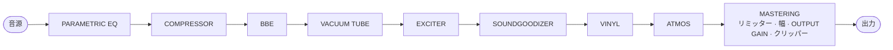
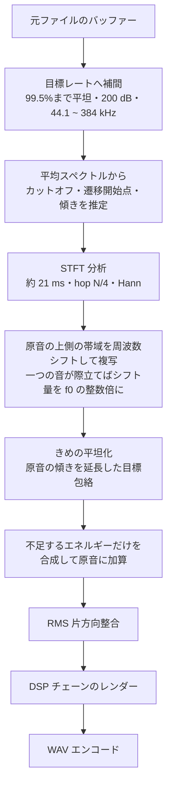

[한국어](README.md) · [English](README.en.md) · **日本語** · [中文](README.zh.md) · [Français](README.fr.md) · [Español](README.es.md)

# ANALOG SOUL DSP ENGINE

> これは翻訳です。韓国語の原文（[README.md](README.md)）と異なる場合は、原文が優先されます。

> 共同作業や貢献をしてくださった方、またはこれからしてくださる方は、個別にご連絡ください。このプロジェクトは、誰でも無料で使えるようにソースを公開したソフトウェアです。個人的・非営利の目的であれば費用なしで使うことができ、改変して使ってみるのも自由です。ただし、著作権と所有権は原作者・共同作業者・貢献者にあるため、このプログラムを自分のものだと主張したり、他の場所で配布・販売したりすることはできません。

**ブラウザーで動作するアナログ音色処理器であり、非可逆圧縮音源の削られた高域を埋め込む復元ツールです。**

`v3.1` · 単一の HTML ファイル · インストール不要 · インターネット接続なしで動作 · 音源は機器の外に出ません

第1部から第4部までの各節は、四つの段落で書いています。**目的**はその機能や設計が必要になった理由、**根拠**は拠りどころとなった原理・規格・実測、**方法**は実際に実装した方法、**この方法の理由**は他の方法ではなくその方法を選んだ理由と測定結果です。

---

## 目次

- [第1部 · やさしい言葉で](#part-1)
- [第2部 · 原理](#part-2)
- [第3部 · 動作の仕組み](#part-3)
- [第4部 · アルゴリズムと数式、物理、システム設計](#part-4)
  - [4.1 サンプルレート変換と STFT カーネル](#s41) · [4.2 カットオフと傾きの推定](#s42) · [4.3 周波数シフト複写と f0 同期](#s43) · [4.4 包絡の外挿ときめ](#s44) · [4.5 レベル整合](#s45)
  - [4.6 非線形伝達関数](#s46) · [4.7 エイリアシング予算](#s47) · [4.8 帯域分割](#s48) · [4.9 ダイナミクス](#s49)
  - [4.10 空間の物理](#s410) · [4.11 ステレオ](#s411) · [4.12 レコードモデル](#s412) · [4.13 聴覚の物理](#s413)
  - [4.14 システム設計](#s414) · [4.15 ビット深度](#s415) · [4.16 問題と解決](#s416) · [4.17 最適化](#s417) · [4.18 既知の制限](#s418) · [4.19 特長](#s419)
- [リポジトリ構成](#repo)
- [変更履歴](#changelog)
  - [3.1](#cl-v31) · [3.0](#cl-v30) · [2.4](#cl-v24) · [2.3](#cl-v23) · [2.2](#cl-v22)
- [参考文献](#refs)
- [ライセンス](#license)

---

<a id="part-1"></a>

## 第1部 · やさしい言葉で

### これは何ですか

**目的：** 音楽ファイルの雰囲気を変えたいときがあります。昔の録音機材を通したように温かく、広いコンサート会場で聴いているように広がりを持たせ、ばらつく音量はそろえたいときです。また、インターネットから入手した音楽ファイルは、容量を減らすためにとても高い音を切り取っていることがよくあります。

**根拠：** エフェクトは、実際の機材や実際の部屋が音を変える仕組みを計算でまねます。真空管ひとつ、レコード盤とターンテーブル、部屋の大きさと壁が音に対して行うことを式に置き換えました。切り取られた高い音を埋める方法と、最初にオンにしたときの強さは、切り取られていない元の音源と比べながら決めました。

**方法：** 音楽ファイルを入れると、音の雰囲気を変えてくれるプログラムです。残っている音の規則を読み取り、切り取られた上の部分をそれらしく埋め込む機能もあります。インストールするものはありません。ファイルをひとつインターネットの画面（ブラウザー）で開けば、すぐに動きます。入れた音楽はどこにも送られず、自分のコンピューターの中だけで処理されます。フォントまでファイルの中に入っているので、インターネットがなくても画面は同じで、外部には何もリクエストしません。

**この方法の理由：** 聴きながら選んだ音がそのままファイルになるように、再生するときと保存するときに、同じ順序で同じ計算を通します。切り取られた音を埋めるときも、元の音はそのままにして、足りない分だけを足します。切り取られた位置のすぐ下の狭い境目でだけ、元の音を少し下げて、埋めた音となめらかにつなぎます。

### はじめに

**目的：** 初めて使う人が説明書をすべて読まなくても、すぐに音を変えてみてファイルに残せる必要があります。

**根拠：** このプログラムは、最新のデスクトップ版 Chrome を基準に作り、テストしました。他のインターネットの画面（ブラウザー）では、一部の表示や動作が異なることがあります。

**方法：**

1. `analog-soul-dsp.html` をインターネットの画面で開きます。Chrome をおすすめします。
2. 開くと最初に表示される利用規約（‘사용 약관’）を読んで同意します。音楽ファイルをすぐに読み込んだ場合も、同意したものとみなします。
3. 音楽ファイルを、画面上部のボックスにドラッグ＆ドロップします。
4. 再生（‘재생’）を押し、機能カードのスイッチをひとつずつオンにしながら、音がどう変わるかを聴いてみます。オンになったカードは枠がネオンのように光るので、ひと目でわかります。
5. 気に入ったら、下の EXPORT で細かさと精密さを選び、書き出し（‘내보내기’）ボタンで新しいファイルを作ります。

説明書は `index.html` から始めれば大丈夫です。やさしい説明から深い説明まで、5種類あります。

**この方法の理由：** Chrome をおすすめする理由は、とても細かい保存（192 · 384）のように、インターネットの画面ごとに対応が異なる機能があり、テストも Chrome で行ったためです。オン・オフしながら聴く手順をおすすめするのは、機能ごとに変わる音を別々に聴いたほうが、どれが気に入ったかを選びやすいからです。

### 9つの機能

**目的：** 音を変える作業は、一度にひとつずつに分けたほうが扱いやすくなります。そのため、画面のカード1枚が機能ひとつです。同じ機能でも、どの順序で通すかによって音が変わるので、順序を目で見て変えられる必要があります。

**根拠：** 各カードは、録音スタジオで使う処理をひとつずつ模しています。PARAMETRIC EQ は音を高さごとに上げ下げするイコライザーを、真空管カードは実際の真空管回路を、VINYL はレコード盤が刻まれて針が読み取る過程を、DOLBY ATMOS は部屋の中で音が壁に当たって返ってくる様子を計算します。詳しい原理は[第2部](#part-2)と[第3部](#part-3)にあります。

**方法：** カードの上にある信号フローマップが、音が通る順序を示します。マップの名前やカードをドラッグして順序を変えることができ、順序が変わると音も変わります。マップでノードをドラッグして動かしている間は（マップが1行のとき）、他のノードが横によけて置き場所が空き、順序が変わると、マップのノードとカードが新しい位置へすべるように移動します。先頭の HD 復元と、制作の終わりである MASTER は位置が決まっているため点線の枠で描かれ、マップでもカードでもドラッグできません。

| カード | 役割 |
|---|---|
| **PARAMETRIC EQ** | 狙った高さの音だけを選んで大きくしたり小さくしたりします。点を20個まで打ち、図を見ながらドラッグして調整します。 |
| **COMPRESSOR** | 大きな音は少し抑え、小さな音は持ち上げて、全体をそろえます。 |
| **BBE** | 話し声や楽器の出だしの音をくっきりと立たせます。 |
| **VACUUM TUBE** | 真空管アンプの1段を実際の回路どおりに計算し、その機材を通したように温かく厚みのある音にします。 |
| **EXCITER** | 高い音にきらめきを加えます。 |
| **SOUNDGOODIZER** | 低い音・中くらいの音・高い音に分けて、それぞれに厚みを出します。 |
| **VINYL** | レコード盤を実際にかけているような音にします。盤の上のほこり、1回転ごとにカチッと鳴る傷、わずかに揺れる音程、盤の内側に行くほどぼやける高い音までまねします。 |
| **DOLBY ATMOS** | 録音スタジオ、クラブ、映画館、コンサートホール、競技場のうち、選んだ部屋で音が響く様子を計算して聴かせます。 |
| **MASTERING** | 最後の仕上げです。低い音から高い音までを4つの部分に分けて別々に整え、音が割れるほど大きくなるのを防ぎます。 |

**この方法の理由：** 順序を固定せず、ドラッグで変えられるようにしたのは、順序そのものが音を変えるからです。ただし HD 復元は先頭に固定し、埋めた高い音まで MASTER が最後にまとめて整え、音が割れないように防ぎます。MASTER は制作の最後の仕上げなので、位置を固定しました。

**カードの配置**

**目的：** 高さの違うカードを隙間なく積むと、順序がジグザグに散らばり、ボックスを見ただけでは処理順がわかりませんでした。

**根拠：** 人は文章を読むように、左から右、上から下へと目を走らせます。スクロールバーの太さは、つかみやすさとつまみのスライダーバーの長さを引き換えにしたシミュレーションで決め、オフのカードの薄い文字も、読める程度の明るさの差（3 : 1 以上）を守るように決めました。

**方法：** 広い画面（900 px 以上）では、カードが同じ大きさ（高さ 385 px）で左 → 右、上 → 下の順に並ぶので、位置を見るだけで処理順が読み取れます。高解像度復元カードはフローマップと同じく先頭に置かれ、文書の中でも先頭にあるので、キーボード（Tab）で移動する順序やスクリーンリーダーが読み上げる順序が、見た目の順序と同じです。オンのカードは内容があふれるとカードの中でスクロールし（右側に 22 px のスクロールバー）、最後までスクロールしたあとさらにホイールを回しても、画面はついて動きません。カードが狭くなると、名前と値の欄はそのままで、スライダーのバーだけが短くなります。バーは、3列が始まったばかりでカードが最も狭いとき（360 px）、スクロールバーの場所を空けたカードで最も短くなり、約 100 px です。内容があふれるカード（VINYL · ATMOS · MASTERING）の見出し行には伸ばすボタン（上下の山かっこ）があり、押すとそのカードだけが内容の高さまで伸びて、つまみを一度にすべて見られます。もう一度押すとタイルの高さに戻り、選んだ状態はこのインターネットの画面（ブラウザー）に記憶されます。オフのカードはつまみが押せない背景へと退き、その上でホイールを回すと画面がスクロールします。オンのカードの外で画面のスクロールを始めると、ホイールが 0.4 秒止まるまでは、オンのカードがカーソルの下を通り過ぎても画面がスクロールし続けます。その間にマウスを動かすとすぐに解除され、移った先のカードがホイールとクリックを受け取ります。カードをドラッグすると、その場所に点線の空き枠ができてカーソルを追い、他のカードがよけていきます。放したカードは、放した位置から空き枠へすべり込みます。狭い画面では、カードが1列に積まれます。

**この方法の理由：** 同じ大きさで並べると、位置がそのまま処理順になります。オフのカードを背景に退かせて画面のスクロールをつなげるのは、画面を下へスクロールしている途中でカードがカーソルの下を通るとき、スクロールがカードの中に引っかかって途切れないようにするためです。あふれるカードは、オン・オフしてもスクロールバーの場所を常に空けておくので、内容が横にぴくっと動きません。最後までスクロールしたホイールを画面に引き渡さないのは、引き渡すと画面が上がってカードの下部が上部に固定された再生バーの下に入り込み、下部のつまみを押すと再生バーが押されてしまっていたからです。VINYL は内容がカード内に見える高さの約 2.7 倍あるため、特に頻繁に起きていました。伸ばしても、そのカードがある行だけが長くなり、同じ行の他のカードはタイルの高さのままなので、位置で読み取る処理順は変わりません。狭いカードでバーだけを縮めるのは、名前や値が切れると、何をいくつに合わせたのか読めなくなるからです。高解像度復元カードを文書の中でも先頭に置くのは、キーボードやスクリーンリーダーで操作する人も、画面と同じ順序で移動できるようにするためです。

**MACRO % と初期状態**

**目的：** カードの強さを変えるためにつまみを何個も別々にいじるのは面倒で、互いに釣り合う値に合わせるのも難しいものです。最初に開いたときの音も、やりすぎずちょうどよくなければなりません。

**根拠：** 初期状態は、二つの方式を、切り取られていない元の音源4曲（中央の20秒）で処理して比べて決めました。MACRO 方式は、低い音と広く広がる感じ（+2.2 dB 前後）はほぼそのままにしつつ、高い音が過剰に大きくなること（+4.2 → +2.4 dB）と、音量が下がること（−6.2 → −4.9 dB）を和らげました。

**方法：** カードの一番上にある MACRO つまみは、そのカードの主なつまみをまとめて、最も弱い位置（0 %）と基準設計値（100 %）のあいだで動かします。高解像度復元の AUTO % と同じ方式で、値はスライダーの目盛りに合わせて丸められます。つまみを直接動かしたあとは、MACRO をもう一度動かすまでその値が残り、設定ファイルには MACRO とつまみの値が一緒に保存されます。最初に開くと COMPRESSOR 50 % · BBE 40 % · EXCITER 80 % · SOUNDGOODIZER 65 % · MASTERING CHAIN 95 % がオンになっていて、PARAMETRIC EQ · VACUUM TUBE · VINYL RECORD · DOLBY ATMOS はオフになっています（MACRO 100 %）。PARAMETRIC EQ の MACRO はつまみを動かさず、点ごとに決めた持ち上げ・引き下げをどれだけかけるかを決めます（0 % なら平ら）。0 % では、MASTERING CHAIN を除けばレベルは変わりません（±0.1 dB）。MASTERING CHAIN はシーリング（上限）のリミッターが MACRO に関係なく働くため、シーリングまで押し込んだりクリップしたりした大音量のマスターでは、0.2 ~ 0.9 dB 小さくなることがあります。BBE · SOUNDGOODIZER · MASTERING CHAIN は、位相補正回路・帯域分割が位相を回すため、原音とサンプル単位までは一致しないので、音を完全に外したいときはカードをオフにします。

**この方法の理由：** つまみひとつで強さを決めるようにしたので、カードの強さを変えるためにいじるつまみが 16 個から 5 個に減りました。

**再生段**

**目的：** VINYL と ATMOS を MASTER の前にしか置けなかったころは、レコードのチリチリ音のような再生ノイズまで、MASTER で押しつぶされたり膨らまされたりしていました。

**根拠：** 実際の LP は、マスター音源でラッカー盤をカッティングしてプレスした盤をターンテーブルで再生するので、チリチリ音・プチッという音・表面ノイズ・反りはマスタリングのあとに生じます。Atmos も、マスターが完成したあとで、聴く機器に合わせて空間を描きます。

**方法：** MASTER の後ろは、マスタリングが終わった音を再生メディアで聴く段階です。VINYL と ATMOS だけを MASTER の後ろに移せます。二つのカードのタイトル行の下にある ‘処理位置’（‘처리 위치’）で MASTER の前（‘MASTER 앞’）・後を選ぶか、カードやフローマップのノードを MASTER の後ろへドラッグして移します（フローマップでは Alt+→ でも移れます）。再生段は、フローマップの青緑の ‘再生’（‘재생’）境界の後ろと、カード領域の ‘再生段 · MASTER の後’（‘재생 단계 · MASTER 뒤’）区画の下に、青緑の番号札で示されます。他のカードをドラッグしてくると ‘ここには置けません’（‘놓을 수 없음’）と表示されます。CEILING の保証は MASTER までなので、再生段を通った音は CEILING を超えることがあります。スロットと設定ファイルには、再生段の順序も一緒に保存されます。

**この方法の理由：** 実際の再生時に生じるノイズは、実際と同じく MASTER の後ろで生じてこそ、MASTER に押しつぶされたり膨らまされたりしません。‘処理位置’ のボタンはカード本体の外にあるので、カードがオフでも押せます。

**VINYL · VACUUM TUBE · DOLBY ATMOS のつまみ**

**目的：** レコード、真空管、部屋は、人によって思い浮かべる音が違います。漠然とした「強さ」ではなく、実際の物の状態を選べてこそ、望む音にたどり着けます。

**根拠：** VINYL のつまみは、実際の機器の説明書に書かれる単位（1秒あたりのクリック数、デシベル、ミリメートル、ピコファラドなど）をそのまま使います。VACUUM TUBE の DRIVE と BIAS は真空管にかかる実際の電圧で、DOLBY ATMOS の部屋は、実際の同じ種類の部屋でよく測られる響きの長さに合わせました。

**方法：** VINYL のつまみは、盤・ターンテーブル・針の3グループです。盤にほこりがどれだけ積もっているか、傷があるか、反っているか、何回かけたかを決め、ターンテーブルがどれだけ均一に回るかと、針の形を選びます。各機器の説明書に書かれた数値をそのまま入れると、その組み合わせの音が出ます。聴いたときに鳴ったクリック音は、保存したファイルでも同じ位置で鳴ります。

VACUUM TUBE の DRIVE は真空管に入る音の強さ、BIAS は真空管が休んでいるときの状態です。BIAS を下げると片側が先にひずんで温かい色合いが濃くなり、上げるときれいになります。DOLBY ATMOS の SPACE は部屋の大きさ、DEPTH は音がどれだけ遠くから鳴るか、HEIGHT と OBJECT は天井と横の壁から返ってくる音の強さです。SPACE · HEIGHT · OBJECT は、中央（50）が実際の部屋の値です。

**この方法の理由：** クリック音は決まった順序であらかじめ作っておき、曲の時間に合わせて鳴らすので、聴いた音と保存したファイルが同じになります。実際の単位を使うのは、ユーザーが持っている機材の数値をそのまま移して使えるようにするためです。

**PARAMETRIC EQ**

**目的：** 曲によって、低い音がこもってブーンと鳴ったり、声が楽器に埋もれたり、高い音が耳に刺さったりすることがあります。全体を変えずに、その高さの音だけを少し上げたり下げたりしたいことがよくあります。

**根拠：** 録音スタジオのイコライザー（EQ）が行う仕事です。音を高さごとに分けて見ると、どの高さをどれだけ上げ下げするかで音色が決まります。画面の曲線は、実際に音を変える計算と同じ計算で描くので、曲線どおりに聴こえます。

**方法：** カードの図に番号の付いた点があり、点ひとつがひとつの高さを受け持ちます。点を左右にドラッグすると受け持つ高さが、上下にドラッグすると上げ下げの量が変わります。点の上でホイールを回すと、その高さの周りを狭く、または広く扱います。空いたところをダブルクリックすると点ができ（20個まで）、点をダブルクリックすると一時的にオフになり、右クリックすると消えます。点ごとに形を選びます。ひとつの高さだけを膨らませたりへこませたりする**ベル**（‘벨’）、下側または上側全体を上げ下げする**シェルフ**（‘셸프’）、下側または上側を取り除く**カット**（‘컷’）、ひとつの高さだけを深くえぐる**ノッチ**（‘노치’）です。‘拡大して編集’（‘크게’）を押すと、大きな図とすべての点の表が開いて数値でも調整でき、そのウィンドウで再生とオン・オフもできます。再生中は、EQ を通る前（線）と通ったあと（面）の音の図が重なって表示されます。最初はオフになっていて、オンにしても音が変わらない平らな点が4つ置かれています。大きなウィンドウの **AutoEQ 読み込み**（‘AutoEQ 가져오기’）で AutoEQ のヘッドホン補正ファイルを点として読み込むこともできますが、こうして入れた補正は保存したファイルにも入ります。聴いているヘッドホンに合わせたいのであれば、下の「聴く機器に合わせる」を使ってください。

**この方法の理由：** EQ は既定の順序の先頭にあります。取り除きたいこもりや低いノイズが、後ろの圧縮やひずみを先に動かさないようにするためです。圧縮したあとの音を整えたい場合は、COMP の後ろに移せば大丈夫です。点には作った順に番号が付くので、オフにしている間も番号は変わりません。

**INPUT GAIN**

**目的：** 音をひずませて味を出す機能は、入ってくる音が大きいほど強く反応します。そのため、各機能に入る大きさを個別に決められる必要があります。

**根拠：** 真空管やコンプレッサーのような機材は、入力が大きくなると、より多くひずんだり、より多く押さえ込んだりします。

**方法：** カードごとに一番上に **INPUT GAIN** があります。その機能に入る音の大きさです（−24 ~ +24 dB、0.1 dB 刻み、既定値 0）。音をひずませて味を出す機能はここを上げると効果が濃くなり、PARAMETRIC EQ のようにひずませない機能は大きさだけが変わります。

**この方法の理由：** INPUT GAIN は、カードがオンのときだけ、そのカードのすぐ前に入ります。オフのカードの値が全体の音量を変えないようにするためです。

### 削られた高い音を埋める

**目的：** 容量を減らした音楽ファイルは、とても高い音が切り取られています。より細かく保存しても、切り取られた部分は空いたままです。

**根拠：** 残った音の高い側には、どんな傾きで小さくなっていくか、どんな音が鳴っているかという規則があります。埋める方式と既定値は、切り取られていない元の音源と比べて、埋めた音が元の音源により近づく方向で決めました。

**方法：** **HD** と **Ultra · eXtreme HD** の欄がこの仕事をします。保存するときに細かさを元のファイルより高く（44.1 kHz のファイルなら 48 · 88.2 · 176.4 · 352.8、48 kHz のファイルなら 96 · 192 · 384）選ぶと、その高さに合わせて埋められます。ひとつの楽器や声が目立つ曲では、埋めた音の音程が、元の音の倍音の位置に合うように置かれます。埋める量は **HF SYNTH** で、高くなるにつれて埋めた音をどれだけ均一に広げるかは **SMOOTH** で決めます。HF SYNTH を 0 にすると、埋めずに細かさだけを上げます。

**LIVE** スイッチをオンにすると、保存する前に結果を試聴できます。オンにした瞬間、少し待つ必要があります。まず曲全体を調べてどこが切り取られているかを見つけ、曲全体を一度埋めておくからです。つまみを変えたり、PRESET パネルで選んでパネルを閉じたりすると、作り直します。

**この方法の理由：** この機能は、切り取られた元の音を取り戻すものではなく、残った音を見てそれらしく描き込むものです。そのため、元の音はそのままにして足りない分だけを足し、切り取られた位置のすぐ下の狭い境目でだけ、元の音を半分まで下げて、埋めた音とつなぎます。音程を倍音の位置に合わせるのは、ただ移して貼り付けるだけだと、埋めた音が元の音の倍音の位置からずれてしまうからです。違いが聴き取れるかどうかは、ファイルと耳と機材によって異なります。容量を大きく減らしたファイルほど違いが大きく、最初から質のよいファイルはほとんど変わりません。

### 図で見る

**目的：** 音がどう変わったかを耳だけで見極めるのは難しいものです。特に、とても高い音を埋めたかどうかは、よく聴き取れないことがあります。

**根拠：** 音を高さごとに分けて、それぞれの高さがどれだけ大きいかを描くと、切り取られた部分と埋めた部分が目に見えます。

**方法：** 上のグラフは、左が元の音、右が変わったあとの音です。同じ瞬間を並べて見せるので、何が変わったかがすぐにわかります。グラフを押すと時間が流れる図に変わり、色が明るいほど、その高さの音が大きいことを表します。

グラフの上の X-AXIS スイッチ（追従（‘순응’） · 48 · 96 · 192）で横の範囲を固定できます。復元をオン・オフしたときにグラフが伸び縮みしないので、新しく埋められた部分だけが目に入ります。

**この方法の理由：** 二つのグラフは同じ色の表を使います。色が違うと、左と右の大きさを比べられないからです。横の範囲を固定すると、同じ高さの音がいつも同じ位置に描かれます。

### 聴く機器に合わせる

**目的：** ヘッドホンやスピーカーは、それぞれある高さの音を大きめに、ある高さを小さめに鳴らします。そのくせが混ざったまま聴いて調整すると、曲にない響きを直そうとしたり、機器が削ってしまった高さを曲にさらに足したりすることになります。

**根拠：** AutoEQ は、公開されているヘッドホン・イヤホンの測定をもとに、機器ごとに応答を目標カーブに合わせる補正値を出す公開プロジェクトです。その補正ファイル（ParametricEQ.txt）は、PARAMETRIC EQ の点と同じ種類のフィルター10個前後と、全体を下げる量（Preamp）でできています。

**方法：** 再生バーの**モニター補正**（‘모니터 보정’）ボタンを押し、**AutoEQ 読み込み**（‘AutoEQ 가져오기’）で使っているヘッドホンの ParametricEQ.txt を選ぶか内容を貼り付けてから、**適用**（‘적용’）を押します。補正がすぐにオンになり、ボタンにヘッドホンの名前が表示されます。ウィンドウで補正カーブとフィルターの表を見て、オン・オフし、Preamp を 0.1 dB 刻みで調整できます。カーブが 0 dB より上に上がると、大きな音でクリップする可能性があると知らせてくれるので、知らされた分だけ Preamp を下げれば大丈夫です。

**この方法の理由：** この補正は、すべての処理が終わった音が装置へ出ていく直前に、再生するときだけかかります。保存した音楽ファイルと設定ファイルには入らず、このインターネットの画面（ブラウザー）にだけ記憶されます。ヘッドホンのくせは曲ではなく聴く機器の性質なので、ファイルに入れると、他の機器や他の人にとっては間違った音になるからです。画面の変わったあとの音のグラフも、補正の前の音、つまりファイルになる音を示します。そのヘッドホン専用のファイルをあえて作るときだけ、PARAMETRIC EQ の AutoEQ 読み込みを使ってください。

### 同じ音量で聴き比べる

**目的：** 人の耳は、大きな音のほうがよいと感じます。大きく作られた曲は、機能をオンにすると小さくなることが多く（初期状態で 3 ~ 10 dB）、オン・オフしながら聴くと、オフのほうがよく聴こえがちです。何が変わったかを聴くには、二つの音の大きさをそろえる必要があります。

**根拠：** 音の大きさは、国際規格 ITU-R BS.1770 のラウドネス（LUFS）で測ります。放送や音楽配信サービスが音量をそろえるときに使う方法で、耳が敏感な高い音を少し大きめに数え、静かな間は除いて数えます。

**方法：** 再生バーの**比較**（‘비교’）を押すと比較対象に切り替わり（ボタンに ‘原音’（‘원음’）のような名前、琥珀色の枠）、もう一度押すと処理後の音に戻ります。比較対象は、最初は何も変えていない原音で、隣の**比較対象**（‘견줄 소리’）を押して、‘SOUNDGOODIZER 抜き’（‘SOUNDGOODIZER 빼고’）のように、オンになっている機能をひとつだけ外した音に変えられます。その機能だけが外れて残りはそのままなので、その機能がした仕事だけを聴けます。最初に押すときと選ぶときは、大きさを測るため少し遅れて切り替わります。隣の**同じ音量**（‘같은 크기’）がオンになっていれば（初期状態）、比較対象を処理後の音と同じ音量にそろえて聴かせ、そろえた量を ‘原音 −5.6 dB’ · ‘SG 抜き −2.6 dB’ のように表示します。つまみやカードを変えると、少しして測り直します。

**この方法の理由：** 処理後の音には手を加えず、比較対象の側だけをそろえるので、処理後の音はいつも保存するファイルと同じ音量で聴こえます。比較対象を大きくする必要があるときは、最も大きな音がクリップしないところまでしか上げません（ボタンに ‘上限’（‘한도’））。二つの音は、処理装置が遅らせる時間（原音は初期状態で約 45 ms、機能をひとつ外す場合はその機能の遅延）の分だけそろえてあるので、切り替えたときにリズムがずれません。機能をひとつ外すときは、処理をもう一式動かすのではなく、その機能を迂回して音を回すので、再生が重くなりません。この比較は聴くときだけかかり、保存する音楽ファイルと設定ファイルには入りません。

### 設定を保管する

**目的：** 気に入った設定を見つけたら、また使えるように取っておき、いくつかの設定を切り替えながら比べ、他のコンピューターにも移せる必要があります。

**根拠：** 設定はつまみの値とオン・オフ、カード順、EQ の点だけなので、小さなテキストファイルひとつに収まります。クイックスロットは、インターネットの画面（ブラウザー）のストレージに置きます。

**方法：** 音楽ファイルとモニター補正は含まれず、設定だけが含まれます。

| ボタン | 役割 |
|---|---|
| **現在の設定を保存**（‘화면 설정 저장’） | いまの画面の設定をファイルにします。他のコンピューターへ移すときに使います。 |
| **クイックスロット 1~4**（‘빠른 슬롯 1~4’） | 短く押すと読み込み、長く（0.6 秒）押すと、いまの設定を入れます。空のスロットを押すと初期状態に戻ります。 |
| **コピー**（‘복사’） | 押したあとスロットを2つ順に押すと、前のスロットが後のスロットにコピーされます。前のスロットはそのまま残ります。 |
| **1スロットをクリア**（‘한 슬롯 비우기’） | 押したあとスロットをひとつ押すと、それだけが消去されます。 |
| **全スロットをクリア**（‘모든 슬롯 비우기’） | 一度押すと確認を求め、もう一度押すとすべて消去します。 |
| **全スロットをバックアップ**（‘모든 슬롯을 백업’） | 4つのスロットをひとつのファイルにまとめます。 |
| **読み込み**（‘불러오기’） | 設定ファイルでもバックアップファイルでも、自動で見分けて復元します。 |

クイックスロットは、いま使っているインターネットの画面にだけ残ります。他のコンピューターで使うには、ファイルに保存してください。EQ がなかった 3.0 で保存した設定を読み込むと、EQ は初期状態（オフ、平らな点4つ）に戻り、保存したときの音がそのまま出ます。

保存すると、上の信号フローマップと下のカードが処理順に2回点滅し、値と順序が保存されたことを知らせます。読み込むと、フローマップのノードとカードが、保存しておいた位置へすべるように移動します。

**この方法の理由：** 音楽ファイルを除いて設定だけを入れるので、ファイルが小さく、どこへでも移しやすくなります。空のスロットは ‘設定なし’（‘설정 없음’）という意味なので、押すと初期状態に戻ります。全スロットのクリアは元に戻せないので、もう一度確認します。読み込みがファイルの種類を自分で見分けるので、どのファイルかを選ぶ必要はありません。点滅が処理順をたどるのは、順序まで保存されたことを順番に見せるためです。

### ファイルに保存する

**目的：** 変わった音を他の場所でも聴くには、新しい音楽ファイルとして残す必要があります。使う場所によって、求める細かさと精密さが異なります。

**根拠：** 音楽ファイルは、1秒を細かく区切り、そのたびに音の大きさを数字で書きとめたものです。どれだけ細かく区切るか（細かさ）と、数字をどれだけ精密に書くか（精密さ）が、ファイルの大きさを決めます。

**方法：** 下の EXPORT で二つを選んでから、**書き出し**（‘내보내기’）ボタンを押します。

| バー | 選ぶもの | 意味 |
|---|---|---|
| **SAMPLE RATE** | 44.1 · 48 · 96 · 192 · 384 | 1秒をどれだけ細かく区切って書くかです。元のファイルより高く選ぶと、切り取られた高い音をその高さに合わせて埋め、低く選ぶと、元の音をできるだけ守りながら下げます。ファイルを読み込むと元のファイルと同じ値に合わせられ、その目盛りの下に（元ファイル）（‘원본’）が付きます。同じ目盛りがなければすぐ上の目盛り（元のファイルが一番上より高ければ一番上）に合わせられ、（元ファイル）は付きません。元のファイルが 44.1 系列（44.1 · 88.2 · 176.4 · 352.8）なら、上の3つの目盛りが 88.2 · 176.4 · 352.8 に変わります。 |
| **BIT DEPTH** | 16 · 24 · 32 | 1回書くときにどれだけ精密に書くかです。元のファイルが 16 ビット以下なら、24 か 32 を選ぶと、段差のあいだをつないで埋めます。 |

ボタンの下に、どの順序で処理されるかが表示されます。数字が大きいほどファイルは大きくなります。1分の曲が 44.1 と 16 なら約 10 MB、96 と 24 なら約 33 MB、192 と 32 なら約 88 MB、384 と 32 なら約 176 MB です。同じファイルを同じ設定で保存し直すと、1バイトまで同じファイルが出てきます。

**この方法の理由：** 最初に元のファイルと同じ値を選ぶのは、そのままにしておけば変換せずに保存されるようにするためです。44.1 系列のファイルで上の目盛りを 88.2 · 176.4 · 352.8 に変えるのは、ちょうど2倍、4倍なので計算が速いからです。44.1 kHz のファイルを 88.2 に上げると 96 より 32% 速く、音の差はファイルに書かれる最小単位よりも小さくなります。16 ビットのファイルの段差のあいだを埋めるときは、元の値があったセルからはみ出さないようにするので、細かく書きながらも元の音とずれません。

### 知っておくとよいこと

**目的：** 使っていると、迷ったり驚いたりしそうなことがいくつかあります。前もって知っておけば、聴き間違えたり設定を失ったりするのを防げます。

**根拠：** 人の耳が音の大きさにだまされる性質、インターネットの画面（ブラウザー）が対応している範囲、このプログラムが設定を扱う方法から来ています。

**方法：**

- **オンにしただけでよくなった気がするなら**、音が大きくなったためかもしれません。人の耳は、大きくなった音を無条件によいと感じます。逆に、すでに大きく作られた曲は、機能をオンにすると 3 ~ 10 dB 小さくなり、オフのほうがよく聴こえることがあります。再生バーの**比較**（‘비교’）を、**同じ音量**（‘같은 크기’）をオンにした状態で使って比べてみてください。機能ひとつがした仕事は、**比較対象**（‘견줄 소리’）でその機能を外して聴いてみます（上の「同じ音量で聴き比べる」）。
- **MASTERING は音を自動的には大きくしません。** 静かな部分はそのままにして、大きな部分だけを押さえます。もっと大きくしたいときは、MASTERING の INPUT GAIN を上げてリミッターに押し込んでください。
- **192 や 384 で保存できないという案内が出たら**、インターネットの画面がそこまで細かい保存に対応していないということです。Chrome を使うか、96（44.1 系列なら 88.2）を選んでください。
- **設定を変えたあと別の説明書へ移ろうとすると**、確認ウィンドウが出ます。設定は自動では保存されないからです。
- **画面の色は、一番上のバーの右側で選びます。** ‘自動’（‘자동’）はコンピューターのダーク・ライト設定に従い、‘夜間’（‘야간’）と ‘昼間’（‘주간’）はそれぞれ常に暗く、常に明るくします。選んだものはこのインターネットの画面に記憶され、プログラムと説明書の両方に適用されます。
- **保存した音楽ファイルには音だけが入ります。** どんな設定で作ったかは残らないので、あとでまた使うには、設定も一緒に保存しておいてください。

**この方法の理由：** MASTERING が自動で大きくしないのは、隠れた自動の持ち上げをなくし、何をオンにするとどれだけ大きくなるかを、ユーザーが自分で決められるようにするためです。別の説明書へ移るときに確認するのは、保存する前に離れると、変えた値がすべて消えてしまうからです。

---

<a id="part-2"></a>
## 第2部 · 原理

この部では、各機能が拠りどころとする物理的・知覚的な現象を説明します。計算方式は第3部、数式は第4部で扱います。節ごとに、この原理がプログラムになぜ必要か（目的）、どんな理論や資料に拠っているか（根拠）、プログラムがその原理をどう使うか（方法）、なぜその方式を選んだか（この方法の理由）を順に書きます。

### 2.1 音を見る二つの目 — 時間と周波数

**目的：** このプログラムは、音を波形（時間）とスペクトル（周波数）の二通りで扱います。元ファイルのサンプリング周波数を守ること、切り取られた高域を埋めること、書き出すサンプリング周波数を選ぶことは、どれも「このファイルはどこまで収められるか」という問いから出発します。画面の二つのアナライザーを読むには、対数周波数軸とデシベルも知っておく必要があります。

**根拠：** 音は空気の圧力の時間変化です。録音ファイルはこの変化を一定の間隔で測った数列で、その間隔の逆数が**サンプリング周波数**です。44.1 kHz は、1秒に 44,100 回測ったという意味です。標本化定理により、サンプリング周波数の半分である**ナイキスト周波数**が、そのファイルが収められる最も高い音です。同じ音を周波数成分に分解して見ることもできます。どの高さの音がどれだけ混ざっているかを見る**スペクトル**です。人の耳は周波数を対数尺度で知覚します。100 Hz から 200 Hz へ行くのと 1 kHz から 2 kHz へ行くのは、同じく1オクターブに聴こえます。大きさは**デシベル（dB）** で数えます。振幅が2倍になると約 +6 dB で、10 dB の差はおおよそ2倍の大きさに聴こえます。

**方法：** アナライザーは、バースペクトルの横軸とスペクトログラムの縦軸を、20 Hz から表示上のナイキストまで対数で描きます。128本のバーは対数軸上に均等に並び、各バーは自分の区間に入る FFT ビンの最大値を示します。縦の目盛りは −100 ~ −30 dB です（3.7 節）。ファイルを開くと、ブラウザーのデコーダーに任せる前に、ファイルのヘッダーから元ファイルのサンプリング周波数を直接読み取ります（3.9 節）。書き出しのサンプリング周波数は 44.1 ~ 384 kHz から選びます（3.8 節）。

**この方法の理由：** 耳が対数で聴くので、グラフも対数で描きます。線形軸だと、1オクターブが占める幅が上に行くほど2倍ずつ広がり、20 Hz ~ 1 kHz のほぼ6オクターブが画面の左端に詰まってしまいます。元ファイルのサンプリング周波数をヘッダーから読むのは、ブラウザーのデコーダーが常に再生デバイスのサンプリング周波数に変換してしまうためです。元のナイキストがわかってこそ、どこがもともと空いていた部分なのかを判断できます。

### 2.2 ダイナミクス — 圧縮

**目的：** 音量がばらつくと、後に続く飽和段で、ひずみの深さが区間ごとに変わってしまいます。そのため COMPRESSOR がチェーンの先頭にあります（3.2 節）。最後の MASTERING も、帯域ごとのコンプレッサーとリミッターで、最終レベルとピークを扱います。

**根拠：** コンプレッサーは、音が**スレッショルド**を超えると、超えた分を**レシオ**で割って小さくします。4:1 なら、スレッショルドを 8 dB 超えた音が 2 dB だけ超えるように下げられます。**アタック**は超えたあとどれだけ速く下げるか、**リリース**は下がったあとどれだけ速く元に戻るかです。**ニー（knee）** は、スレッショルド付近で圧縮を急にかけるか、なめらかにかけるかを決めます。圧縮は音量のばらつきを小さくします。最も大きな瞬間と平均との差である**クレストファクター**が小さくなるので、同じ最大レベルの中で平均音量を上げられます。圧縮で下がった分だけ全体を再び大きくすることを**メイクアップ**といいます。

**方法：** 圧縮素子は Web Audio の `DynamicsCompressorNode` です。この素子のニーはスレッショルドから**上側にだけ**広がるので、ハードウェアの対称なニーよりも、圧縮が始まる点がニー幅の半分だけ高くなります。仕様は、スレッショルド以下の信号まで持ち上げる自動メイクアップ $`(1/c(1))^{0.6}`$ を常にかけます。このプログラムは同じ式でその値を計算し、コンプレッサーの直後で逆数をかけて打ち消します（COMPRESSOR の既定値で 6.03 dB）。そのため、コンプレッサー自体はスレッショルド以下の静かな音に手を触れず、メイクアップは MAKEUP で決めた分だけかかります。SOUNDGOODIZER の出力コンプレッサー、MASTERING の4帯域のコンプレッサーとリミッターも、同じ方法で打ち消します。式と数値は [4.9](#s49) にあります。

**この方法の理由：** 自動メイクアップをそのままにすると、コンプレッサーをオンにしただけで音が大きくなり、その量がスレッショルド・ニー・レシオによって変わります。打ち消す前は、COMPRESSOR の既定値で、静かな信号に MAKEUP 4 dB と隠れた 6.03 dB が加わって +10.0 dB 大きくなり、MASTERING は帯域ごとに +5.4 ~ +7.1 dB と異なる量だけ持ち上げて、中域が 1.7 dB 突出していました。打ち消したあとは MAKEUP ノブだけがゲインを与えるので、ノブの意味がひとつに定まり、オンの音とオフの音を同じ音量で比べやすくなります（2.10）。その代償として、既定の設定の出力は、打ち消す前より約 6 dB 小さくなりました。打ち消しは仕様の式に依存しているので、この式と異なる実装の環境では、その差の分だけずれます。

### 2.3 位相と明瞭度

**目的：** 音の出だしがぼやけると、楽器の輪郭がつぶれて聴こえます。BBE カードは時間関係を変えて、この輪郭を扱います。また、位相だけが回った信号を原音と混ぜると特定の周波数が打ち消されるので、並列経路を使うカード（BBE の旧構造、SOUNDGOODIZER）は、この性質を避けなければなりません。話し声や楽器の鮮明さを決める帯域は、BBE の PROCESS と SOUNDGOODIZER のプレゼンス強調がねらっています。

**根拠：** スピーカーは、すべての高さの音を同時に出すことができません。特に低い音は、高い音より遅れて出る傾向があります。周波数によって到達時間が異なるこの現象を**群遅延**といいます。BBE 社が公開した処理は、低域を約 2.5 ms、中域を約 0.5 ms、高域より遅らせるものです。メーカーはこれをスピーカーの位相補正と説明していますが、スピーカーがすでに遅らせた低域をさらに遅らせる方向なので、元に戻すというより、高い成分のアタックが先に届くようにして出だしの輪郭を際立たせる処理です。位相だけを変えて大きさはそのままにするフィルターを**オールパスフィルター**といいます。このフィルターをそのまま通せば、大きさはそのままで低い音だけを遅らせられます。逆に、このフィルターを通った信号を元の信号と混ぜると、位相が逆になる周波数で音が互いに打ち消し合うので、時間だけを変えたいなら混ぜてはいけません。人の話し声で子音が集まっている 2 ~ 5 kHz の帯域は、**明瞭度**を左右します。外耳道は片側が鼓膜でふさがれた管なので 1/4 波長共鳴（約 3.4 kHz）を持ち、この共鳴と耳介の反射が 2 ~ 5 kHz を 10 ~ 15 dB 持ち上げます。等ラウドネス曲線（ISO 226）で耳が最も敏感な帯域もここです。この帯域を少し上げると、声が前に出てくる感じがします。

**方法：** BBE は2つのオールパス（220 Hz Q 0.59、1850 Hz Q 1.47）を**直列に**通して、大きさはそのままで群遅延だけを作ります。3つのノブが 0 なら全帯域 0.0 dB で、群遅延は 50 Hz で 2.58 ms、500 Hz で 0.61 ms、5 kHz で 0.03 ms です。その後の PROCESS は 3 kHz のハイシェルフ（0 ~ +8 dB）で子音とアタックが集まる帯域を広く持ち上げ、HI DEF は 10 kHz のハイシェルフ（0 ~ +6 dB）でその上を受け持ちます。SOUNDGOODIZER は 2.5 kHz のピーキング（Q 0.7、+AMOUNT×3 dB）でプレゼンス帯域を持ち上げ、処理した帯域を原音と並列に足すときに、原音の経路にも帯域の和と同じオールパスをかけて位相をそろえます（[4.8](#s48)）。

**この方法の理由：** 2つのオールパスの中心と Q は、目標の群遅延（150 Hz 以下で 2.5 ms、0.4 ~ 1.5 kHz で 0.5 ms、5 kHz 以上で 0）に最小二乗で合わせた値です。旧構造はオールパスの出力を原音に足していたため、位相が −180° になるところで谷ができていました。混ぜる比率が g = 0.6 なら −12 dB で、実際に LO CONTOUR 100 で 100 ~ 125 Hz と 315 Hz が −9.3 dB でした。直列に変えた現在は、ノブ 0 で平坦で、LO CONTOUR 100 が 31.5 Hz で +9.7 dB、63 Hz で +7.0 dB、100 Hz で +3.1 dB となめらかに持ち上げます。ハードウェアは高域強調の量を信号に応じて変えますが、ここでは固定のシェルフです。ボーカルで PROCESS を +6 dB より上げると、歯擦音も一緒に上がります。

### 2.4 非線形と倍音

**目的：** VACUUM TUBE、EXCITER、SOUNDGOODIZER は、音をわざとひずませて色付けし、MASTERING のセーフティクリッパーも非線形です。どの倍音がどれだけ生じるかが、そのままそのカードの音色です。デジタルでひずませると、もともとなかった見当違いの高さの音が混ざり込むことがあるので、これも抑えなければなりません。

**根拠：** 音をひずませると、もともとなかった**倍音**が生じます。100 Hz の音をひずませると、200、300、400 Hz の成分が新たに現れます。どの倍音がどれだけ生じるかは、ひずませ方が決めます。両側を同じように押さえる**対称**方式（$`f(-x) = -f(x)`$ である奇関数）は、奇数次倍音（3倍、5倍…）だけを作ります。片側をより強く押さえる**非対称**方式は、偶数次倍音（2倍、4倍…）も作ります。テイラー展開 $`f(x + b) = f(b) + f'(b)\,x + \tfrac12 f''(b)\,x^2 + \cdots`$ において、2次倍音を作る $`x^2`$ 項の係数は、動作点の曲率 $`f''(b)`$ に比例します。2次倍音は1オクターブ上なので元の音とよく混ざって厚く聴こえ、3次倍音はオクターブ上の5度なので、やや粗い色合いを出します。真空管の音色が温かいといわれる理由は、非対称特性が作る偶数次倍音にあります。三極管は、空間電荷法則の 3/2 乗とグリッド電流のため、カーブが本来非対称です（Koren の三極管モデル）。デジタルで音をひずませるときには注意点があります。新しく生じた倍音がナイキスト周波数を超えると、消えずに下へ**折り返して**入ってきて、元の音とまったく関係のない高さに現れます。これを**エイリアシング**といいます。また、同じひずみ率でも、曲率が急に変わるカーブが作る高次の相互変調が、最も耳障りに聴こえます（Geddes & Lee）。

**方法：** VACUUM TUBE は、12AX7 のカソード接地増幅段を方程式で解いてカーブを得ます。既定値（DRIVE 30、BIAS 50）で 1 kHz −6 dBFS を入れると、2次倍音 −33.7 dB、3次倍音 −67.5 dB です。EXCITER は $`\tanh`$ カーブの正と負の飽和限界を +1 と −0.7 で異ならせ、SOUNDGOODIZER は動作点を $`b = 0.08\,\mathrm{SAT}`$ だけずらして偶数次倍音を作ります。エイリアシングは二重に減らします。カーブは4倍オーバーサンプリングで適用し、EXCITER と SOUNDGOODIZER の高域バンドは、飽和経路の前にだけ $`\max(1.4\,f_{\mathrm{lo}},\ f_s/3)`$ のローパスを置いて、可聴エイリアシングが始まる倍音次数を 7 から 10.5 に引き上げます。非対称カーブが一緒に作る直流は、飽和の後ろのハイパス（TUBE 10 Hz、EXCITER FREQ、SOUNDGOODIZER 12 Hz）が阻止します。カーブと測定は [4.6](#s46)、エイリアシング予算は [4.7](#s47) にあります。

**この方法の理由：** 真空管のカーブを手で選ばず回路から解くのは、旧カーブが、注釈とは異なり既定の BIAS で3次倍音が 17 dB 上回っていたためです。現在のモデルは、小さな信号では2次倍音が3次倍音より 34 dB 大きく、強く押し込むと3次倍音が上回り、コールドなバイアスで2次倍音が強くなるという物理的な傾向をそのまま再現します。SOUNDGOODIZER の旧カーブは純粋な奇関数だったため、2次倍音は −68.6 dB にとどまっていました。負の半周期にだけゲインを掛ける方式は原点の曲率を変えないため、小さな信号では偶数次倍音をほとんど作れないので、動作点をずらすほうを選びました。エイリアシングの次数は、入力の上限がナイキストに比例して一緒に上がるため、サンプリング周波数に依存しません。レートを上げるだけでは改善せず、入力帯域をナイキストの分数に制限する必要があります。チェーン全体を高い倍率でレンダリングする方法は、レンダー時間とメモリーが倍率の分だけ増え、リサンプリングがもう一度入り、書き出しにだけ適用されるため聴く音とファイルが異なってしまうので、採用しませんでした。TUBE には帯域制限を置きません。MIX 100 では信号全体がカーブを通るので、実際の増幅段にはない 16 kHz の遮断になってしまうからです。

### 2.5 帯域を分けて扱う

**目的：** 低い音と高い音は性格が違うので、同じ処理をするとどちらかが損なわれます。SOUNDGOODIZER は3つの帯域を別々に飽和させ、MASTERING は4つの帯域を別々に圧縮します。低域のパンチを守りながら高域がポンピングしないようにするには、帯域ごとに異なる設定が必要です。

**根拠：** **クロスオーバー**で帯域を分けて別々に処理したあと、再び合わせます。このとき、分けた部分をそのまま合わせ直したときに、元と同じ大きさにならなければなりません。このような性質を持つ分割を**相補的**な分割といいます。相補的でないと、分けた境目で音が膨らんだりへこんだりします。4次の Linkwitz–Riley 分割は2次のバターワースを2回縦続接続して作り、低域と高域の和がちょうど2次のオールパスになって、すべての周波数で大きさが1になります。

**方法：** 2つのカードはどちらも4次の Linkwitz–Riley フィルターを使います。SOUNDGOODIZER はモードごとに2つの分割点（A 250 Hz / 4 kHz など）で、MASTERING は 120 Hz / 500 Hz / 5 kHz で分けます。分割点が2つ以上ある場合は、低域側の帯域に上側の分割点のオールパスを掛けるツリー構造を組み、和が $`AP_a AP_b \cdots`$ になるようにします。Web Audio の仕様は `lowpass`・`highpass` の Q を dB として解釈するため、バターワースには 0.707 ではなく −3.0103 を入れます。導出と数値は [4.8](#s48) にあります。

**この方法の理由：** 旧 SOUNDGOODIZER は LPF・BPF・HPF を並列に置いていたため、帯域の和が 0.906 ~ 1.568 で揺れ、2 kHz 付近が約 +4 dB 膨らんでいました。隣り合う帯域どうしだけで分けると、MASTERING で約 411 Hz に −1.22 dB の谷ができます。Q に 0.707 をそのまま入れると、クロスオーバー点で和が +7.4 dB 膨らみます。ツリー構造に変えた現在は、仕様の係数で計算した和の偏差が ±0.0000 dB です。代償は位相回転です。帯域の和は分割点で −180° なので、処理した帯域を原音に並列に足すときは、原音の経路にも同じオールパスをかけないと打ち消されてしまいます（そうしないと 250 Hz で −2.3 dB）。群遅延は最大で約 $`0.543/f_c`$ で、MASTERING の 120 Hz の分割点で約 4.5 ms であり、低域の群遅延の弁別閾より小さい値です。飽和が入った帯域は線形ではないので、和の平坦性は低いレベルでしか成り立たず、4つのモードすべてでその応答が ±1.3 dB 以内です。

### 2.6 空間 — 反射と残響

**目的：** DOLBY ATMOS カードは、音をある部屋の中に置きます。旧カードは固定された10個の反射と毎回異なる乱数の残響を使っていたため、同じ設定でも残響のきめが変わっていました。部屋の大きさ、壁の吸音、音源との距離、音源の幅といった実際の量で空間を調整するには、室内音響の原理が必要です。

**根拠：** 部屋の中で聴く音は三つの部分に分かれます。音源からまっすぐ届く**直接音**、壁や天井に1、2回当たって届く**初期反射**、数えきれないほど当たって混ざり合った**後期残響**です。初期反射は部屋の大きさと形を、後期残響は部屋の響きを伝えます。残響が 60 dB 減衰するのにかかる時間を **RT60** といいます。小さな録音スタジオは 0.3 ~ 0.5 秒、コンサートホールは 2 秒前後です。壁が音を多く吸うほど、また部屋が小さいほど、残響は短くなります（Sabine、Eyring の残響式）。空気も高い音を吸収するため（ISO 9613-1）、大きな部屋ほど高い音の残響が短くなります。音源から離れると直接音は弱まりますが、残響は部屋全体に均一に残るので、ある距離からは残響が直接音より大きくなります。この距離を**臨界距離**といいます。横の壁から届く初期反射は両耳に異なる音を送り、音源を広く聴こえさせます（Barron & Marshall、Hidaka など）。上から届く音は耳介のために 8 kHz 付近が強調されて入り、耳はこの強調を、音が上から来ているという手がかりとして使います（Blauert の方向決定帯域）。反射経路は、壁に映った音源の鏡像を繰り返し置いていく鏡像音源法で計算できます（Allen & Berkley）。

**方法：** ATMOS は、直方体の部屋の鏡像音源反射で初期反射を作り、Eyring の残響時間に空気吸収を加えた周波数ごとの減衰で拡散残響を作って、畳み込みます。直接音は原音のままにします。初期反射と後期残響は、ミキシングタイム（Polack、$`\min(\sqrt{V}\ \mathrm{ms},\ 150\ \mathrm{ms})`$）の周りで、エネルギーの和が1になるようにクロスフェードします。ノブは物理量です。SPACE は部屋の寸法、DEPTH は音源と聴取者の距離、OBJECT は横の壁の反射の量、HEIGHT は天井・床の反射の量と頭上の反射の 8 kHz 強調（最大 +8 dB）、REVERB は拡散残響の量です。最初に開いたとき（SPACE 60）の 1 kHz の残響時間は STUDIO 0.28 s、CONCERT 2.02 s で、臨界距離は STUDIO 1.24 m ~ STADIUM 26.4 m です。反射と残響の大きさは、Barron の修正理論に従って聴取距離に合わせます。シーンの表と式は、3.4 節の DOLBY ATMOS と [4.10](#s410) にあります。

**この方法の理由：** 吸音率が 0.2 を超えると Sabine の式は残響時間を過大評価するため（α 0.4 で約 28 %）、Eyring の式を使います。Eyring の式は反射1回ごとにエネルギーが $`1 - \alpha`$ 倍に減るという仮定なので、鏡像音源反射と同じ仮定の上に立っています。反射は次数ではなく到達時刻で打ち切り、ミキシングタイムより前に届く反射は、次数に関係なくすべて入れます。拡散残響は、オクターブバンドフィルターでノイズをフィルタリングするのではなく、周波数領域でビンごとに減衰を与えます。フィルターのスカートが重ならないので、残響の長い隣の帯域が漏れ込まないからです。乱数は設定からシードを決める決定的な生成器なので、同じ設定は常に同じ応答を出し、応答は入力の組み合わせごとに保管するので、他のノブを回しても残響のきめが揺らぎません。測定した残響時間は期待値とほとんど 5 % 以内で一致し、反射と残響のエネルギーは Barron の修正理論より 0.4 ~ 0.9 dB 小さくなります。名前とは異なり、オブジェクトベースのマルチチャンネル規格とは関係のない、2チャンネルの室内音響モデルです。

### 2.7 ステレオイメージ

**目的：** SOUNDGOODIZER の STEREO と MASTERING の幅調整は、音を広げたり狭めたりします。VINYL はカッティングの段階で低音の左右差をなくし、カートリッジの左右のクロストークを模倣します。これらはすべて、左右をミッドとサイドに分けて見る考え方に基づいています。聴く人がスマートフォンのスピーカーのように 1 本のスピーカーで聴くこともあるため、モノラルで何が残るかも知っておく必要があります。

**根拠：** 左右の信号は**ミッド**（M）と**サイド**（S）に変換して見ることができます。ミッドは両側に同じようにある成分、サイドは両側の差です（$`M = (L + R)/2`$、$`S = (L - R)/2`$）。サイド成分を大きくすると音が広がり、小さくすると狭まります。注意すべき点は**モノラル互換性**です。1 本で聴く環境では左と右が足し合わされ（$`L' + R' = 2M`$）、このときサイド成分は互いに打ち消し合って完全に消えます。サイドに押し出しすぎた楽器は、モノラルでは聞こえなくなることがあります。

**方法：** 幅調整は共通のブロック一つで作ります。$`L' = M + wS`$、$`R' = M - wS`$ であり、$`w = 1`$ なら元のまま、0 ならモノラルです。実装は、`ChannelMergerNode` の同じ入力に入った複数の接続が合算されるという仕様に基づいています。SOUNDGOODIZER STEREO は 0（モノラル） ~ 2 倍で、既定の 55 で約 1.1 倍です。MASTERING の幅は 0 ~ 200（既定 110）で、リミッターの後、OUTPUT GAIN とセーフティクリッパーの前に置かれます。VINYL はサイド成分にだけ 150 Hz のハイパスをかけて、低音をミッドに集めます。式は [4.11](#s411) にあります。

**この方法の理由：** 幅を広げるとサイド成分が加わってピークが再び上がるため、シーリングを守るクリッパーより前に置きます（[4.9](#s49)）。モノラル和は $`w`$ に関係なく $`2M`$ なので、$`w > 1`$ でサイドに載せた情報はモノラルではすべて消えます。また、$`w > 1`$ はサイド成分を大きくするだけで、左右を**脱相関**させません。両耳間相関（IACC）を下げて見かけの音源幅を広げるには、周波数依存の位相回転や短いランダム遅延のほうが効果的で、このプログラムではその役割を ATMOS の側壁反射（OBJECT）が担います。

### 2.8 レコード盤の欠陥

レコードの音は、作る過程と読む過程の物理から生まれます。VINYL カードはこの過程をたどる物理モデルで、つまみはすべて実際のターンテーブル・カートリッジ・レコードの仕様書に記される物理量です。リアルタイムエンジンとレンダリングエンジンが、同じ関数 `buildVinylChain` でこのブロックを作ります。構造とつまみは 3.4 節の VINYL、数式は [4.12](#s412) にあります。

**カッティング**

**目的：** レコード特有の丸い「トッ」という音、厚みのある表面ノイズ、ミッドに集まった低音は、溝を刻む段階で決まります。このきめを模倣するには、ノイズをどこにでも足すのではなく、カッティングと再生カーブが作る順序に従う必要があります。

**根拠：** 溝は音の速度を刻んだものです。そのまま刻むと、低音は溝を大きく揺らしすぎ、高音は小さすぎてノイズに埋もれるため、低音を下げて高音を上げた **RIAA 録音カーブ**で刻み、再生時に逆のカーブで戻します。RIAA 再生カーブの時定数は 3180 µs、318 µs、75 µs で、IEC の改訂案は 20.02 Hz の低域カットを加えます。このとき溝の中で生じたノイズやほこりの音は再生カーブだけを通るため、高音が削られて低音が膨らみ、レコード特有の丸い「トッ」と厚みのある表面ノイズになります。ステレオの溝は左右の壁を別々に刻みますが、低音の左右差は溝を上下に大きく揺らして針が跳ぶため、カッティング時に低音をミッドに集めます（エリプティカル EQ）。

**方法：** 入力はまずエリプティカル EQ を通ります。サイド（L−R）成分は 150 Hz の LR4 ハイパス（2 次バターワース 2 段）でフィルタリングし、ミッド（L+R）成分は同じ位相の 2 次オールパスに送ります。表面ノイズ・クラックル・ポップ・スクラッチ・ランブル・反りはすべて溝の領域で作って RIAA 再生カーブ（IEC を含む）を通し、目標レベルはカーブを実際に通して測定して合わせます。ホワイトノイズが再生カーブを通ると、500 Hz ~ 2 kHz が平坦になり、その上と 50 ~ 500 Hz が −6 dB/oct で傾きます。短い衝撃は 75 µs の極を通って積分され、丸い「トッ」に変わります。録音カーブは高域で際限なく上がり続けて実現できないため、50 kHz のノイマン極を付けます。レベル基準は 0 dBFS = 1 kHz で溝速度 10 cm/s です。

**この方法の理由：** 再生カーブの形状は、双一次変換で簡単にずれます。そのまま移すと 48 kHz で 20 kHz が標準値より 9 dB 余計に削られるため、補正零点を入れ、可聴帯域の最大誤差が最も小さくなる値を探して、44.1 kHz で 0.274 dB、48 kHz で 0.175 dB まで減らしました。エリプティカル EQ は、サイド成分だけをハイパスでフィルタリングすると、その位相回転のためにミッドとサイドがずれ、クロスオーバー点より上の中域でも左右が混ざります。以前のように 2 次ハイパス一つだけを使うと、左だけにある音が右へ、300 Hz で −8 dB、1 kHz で −19 dB 漏れていました。ミッドに同じ位相のオールパスをかけると、クロスオーバー点より上には大きさの差だけが残り、漏れは 300 Hz で −30 dB、1 kHz で −72 dB、3 kHz より上で −110 dB 以下に減ります。低域のサイド成分はオクターブあたり 24 dB で減衰し、50 Hz で −38 dB、100 Hz で −16 dB、150 Hz で −6 dB だけが残ります（以前は −19 · −8 · −3 dB）。

**溝の速度**

**目的：** 同じ曲でも、盤のどこに刻まれたか、何 rpm で回るかによって、高域と歪みが変わります。TRACK POS と SPEED のつまみがこの違いを扱います。

**根拠：** 盤は一定の回転数で回るため、針の下を通る溝の速度は半径に比例します。33⅓ rpm で 12 インチ LP の外周の溝は毎秒約 0.51 m、内周の溝は 0.21 m です。同じ高さの音でも内周では溝の波がより細かくなり、丸い針先が起伏をたどりきれない**トレーシング歪み**と、波をつぶして読む**走査損失**が大きくなります。トレーシング歪みの 2 次倍音は、針先半径 × 速度振幅 × 角周波数 / 線速度² に比例します。そのため片面の最後の曲が最も不利で、45 rpm が音質に有利です。

**方法：** 溝の間隔が一定だとみなし、曲の時間に応じて半径を外周 146 mm から内周 60 mm へ線形に減らします。4 分の曲を面の先頭に置くと 146 → 130 mm、最後に置くと 76 → 60 mm を通ります。走査損失はカットオフ $`v/\lambda_e`$ の 2 次ローパス、トレーシング歪みは溝速度とその微分の積 $`V\,dV/dt`$ で作ります。半径に応じて変わる値は、曲の残りの区間にオートメーションカーブで予約します。楕円針（‘타원형’）、摩耗 0.4 で 8 kHz −20 dBFS の 2 次倍音は、外周の溝で 0.96 %、内周の溝で 5.63 % で、45 rpm では同じ条件で 3.1 % に減ります。

**この方法の理由：** 正弦波では $`V\,dV/dt = \tfrac{A^2\omega}{2}\sin 2\omega t`$ なので、この積がトレーシング歪みと同じ依存性を正確に作ります。走査損失フィルターは、双一次変換の周波数ワーピングのため、同じカットオフでもサンプリング周波数ごとに減衰が異なります（内周の溝の 10 kHz が、48 kHz で −0.43 dB、192 kHz で −1.94 dB）。そこで 10 kHz を基準にプリワーピングし、どのサンプリング周波数で書き出しても同じ損失になるようにします。

**回転**

**目的：** レコードをレコードらしく聞こえさせるものの多くは、1 回転ごとに繰り返される時間構造です。音程のゆっくりした揺れ、同じ位置のクリック、反った盤の上下動、前の溝のエコーがそれです。

**根拠：** 盤の穴が中心から少しでもずれると、針が回る半径が 1 回転ごとに変わり、音程がゆっくり揺れます（**ワウ**）。同じずれでも半径が小さいほど比率が大きくなり（$`\Delta f/f = e/r`$）、内周でより大きく揺れます。ベルトはゆっくりしたドリフトを、モーターは速い揺れ（**フラッター**）を生みます。1 回転ごとに繰り返されるものはほかにもあります。半径方向の傷は毎回転同じ位置でクリックし、複数の溝にまたがる大きなほこりは数回転のあいだ繰り返され、反った盤は回転周期で上下します。すぐ次の溝が押した跡は、1 回転後にかすかな**エコー**として残ります。

**方法：** 偏心 0.21 mm なら、外周の溝で ±0.14 %、内周の溝で ±0.35 % のワウになります。ベルトのドリフト（0.05 ~ 0.8 Hz）とモーターの揺れ（4 ~ 12 Hz）は 1 : 2 の比率で混ぜ、ピッチ偏差の RMS が WOW & FLUTTER の値になるようにし、これを積分してディレイライン（中心 12 ms）の遅延変化に変換します。スクラッチは回転ごとに同じ角度で、大きなほこりは 1 回転ごとに、だんだん弱まりながら 1 ~ 4 回繰り返されます。反りは回転周波数の垂直（L−R）成分で、エコーはちょうど 1 回転後に −54 + 14w dB で加えられます。

**この方法の理由：** 素材はシードを固定した乱数で作り、回転と絡む素材のループ長は回転周期の整数倍です。各素材を曲の時間位置に合わせて開始するため、一時停止・シーク・チェーンの入れ替えの後でも、また再生と書き出しのどちらでも、同じ位置で同じクリックが鳴ります。大きなほこりはまれなので、短いループに入れると同じクリックが繰り返されるのが聞こえてしまいます。そのため曲全体の長さのイベントリストとして作り、一つずつ予約します。細かいほこりは、固定したイベント列に順位を付けておき、密度の分だけを入れるため、密度を上げてもすでに鳴ったクリックはそのままで、新しいものだけが加わります。代償として、VINYL をオンにするとディレイラインの中心の分、12 ms の遅延が生じます。

**カートリッジ**

**目的：** カートリッジは左右を完全には分離できず、コイルとアンプ入力が共振して高域のきめを変えます。SEPARATION·AZIMUTH·LOAD CAP のつまみがこの音色を扱います。

**根拠：** 針は左右の壁を完全に分離できないため、音が互いに漏れ（**クロストーク**）、高音になるほど多く漏れます。針が左右に傾くと（アジマス誤差）さらに悪くなります。MM カートリッジは、コイルのインダクタンスと負荷容量が RLC 共振を形成します。

**方法：** 漏れは 1 kHz で SEPARATION の値とちょうど同じになり、10 kHz で約 8 dB 悪くなるように、5 kHz の 1 次ハイパスで傾け、アジマスの $`\tan\theta`$ の分だけ平坦な漏れを加えます。カートリッジの共振はコイル 0.5 H・600 Ω、負荷 47 kΩ の回路式で計算し、負荷容量 100 pF で 22.5 kHz、470 pF で 10.4 kHz に位置します。

**この方法の理由：** 共振をバイクアッドのローパスに移すと、48 kHz でピークが 2 dB 高くなり、20 kHz が 9 dB 以上余計に削られます。そこで極は整合 z 変換で移して共振を保ち、分子は可聴帯域の dB 誤差が最小になるように合わせて、最大誤差を 44.1 kHz で 0.21 dB、48 kHz で 0.13 dB に減らしました。クロストークは、全体のレベルが変わらないよう正規化係数も一緒に掛けます。

### 2.9 非可逆圧縮と失われた高域

**目的：** mp3・AAC のように非可逆圧縮されたファイルは、ある高さより上が空いています。HD · Ultra HD · eXtreme HD 復元は、この空白を埋めるためにあり、書き出しで元ファイルより高いサンプリング周波数を選ぶときも同じ処理を通ります。埋めるにはまず、どこで切られたか、その下がどんな傾きだったかを知る必要があります。

**根拠：** mp3 と AAC は、人が気づきにくい成分を捨てて容量を減らします。大きな音のすぐそばの小さな音は覆い隠されて聞こえませんが、この**マスキング**現象を利用します。ビットレートが低いと捨てるものが多くなり、ある高さより上を丸ごと切り捨てます。スペクトルで見ると、急な**断崖**ができます。自然の音は高くなるほどなだらかに弱まります。符号化が作った断崖は、それよりはるかに急です。MPEG-4 の **SBR** 技術は、エンコード時に高域のおおまかな形を別に記録しておき、再生時に低域をコピーしてその形どおりに整え、高域を復元します。このプログラムはそうした記録なしに、残っている低域だけを見て高域を作り出します。このような方式を**ブラインド帯域拡張**といいます。

**方法：** ファイル全体から均等に集めた平均スペクトルで、断崖の位置（カットオフ）とその下の傾きを求めます。傾きはオクターブあたり −24 ~ 0 dB の範囲に制限します。遷移開始点より下の原音の帯域を丸ごと上へ移して空いた部分を覆い、原音の傾きを延長して描いたカーブに大きさを合わせたうえで、カーブに足りないエネルギーだけを合成して原音に加えます。遷移開始点より下の原音は 1 サンプルも変わらず、カットオフのすぐ下の遷移帯域でだけ原音を半分まで下げて合成とつなぎます。段階は 3.5 節、式は [4.2](#s42) ~ [4.5](#s45) にあります。

**この方法の理由：** ブラインド拡張には SBR が送る包絡情報がないため、原音の傾きを最小二乗で推定して外挿するのが次善の策です。移すときはビン番号を整数倍せず、周波数だけをずらして移します。そうすれば成分密度がソース帯域と同じになり、フレーム間の位相誤差がホップ周期の振幅変調として積み重なりません（[4.3](#s43)）。カットオフが目標ナイキストの 0.95 倍以上なら復元しません。元ファイルがすでに高解像度のとき、本物の高域を合成で覆わないためです。残る限界は、移してくるのがソース帯域の音だという点です。ソース帯域と実際の高域で楽器構成が異なる場合、その比率までは再現できません（ハイハット直前の高域比率が、正解 −10.6 dB、復元 −4.0 dB）。

### 2.10 音量の錯覚

**目的：** カードをオンにすると、たいてい音が大きくなり、大きくなった音はそれだけでよく聞こえます。処理が実際に良くなったかを判断するには、この錯覚を取り除く必要があります。このプログラムがコンプレッサーの隠れたメイクアップをなくし、高域復元の後にレベルを合わせるのはそのためです。

**根拠：** 人は少しでも大きな音をより良いと感じます。1 dB の差だけでも判断が傾きます。処理の効果を公平に比較するには、必ず先に音量を合わせなければなりません。音量を合わせる基準も重要です。耳は周波数ごとに感度が異なり、同じエネルギーでも 2 ~ 5 kHz がより大きく聞こえます。放送規格である **ITU-R BS.1770** は、この特性を反映した **K 重み付け**で音量を測ります。K 重み付けは約 2 kHz より上を +4 dB 近く持ち上げます。

**方法：** すべてのコンプレッサーの自動メイクアップを相殺し、スレッショルドより下でゲインが 1 になるようにします（2.2）。高域復元の後は、チャンネルごとに RMS を測り、元ファイルより 1 % を超えて大きくなっていればその分を戻します（[4.5](#s45)）。カードごとに INPUT GAIN が、MASTERING に OUTPUT GAIN があり、オンにした側とオフにした側の音量を手で合わせて比較できます。原音と適用後（ウェット）のアナライザーは、同じ dB 範囲と同じカラースケールを使います。

**この方法の理由：** RMS 整合は大きくなった場合だけを戻す片方向の補正なので、処理後の信号が系統的に大きくなる偏りを防ぎます。ただし、この尺度は重み付けしない RMS です。帯域拡張は K 重み付けが強調するまさにその区間にエネルギーを加えるため、追加された高域エネルギーの比率を $`\rho`$、その帯域の K 重み付けゲインを $`G`$ とすると、整合後もおよそ $`10\log_{10}(1 + (G - 1)\rho)`$ LU だけ大きく聞こえることがあります。$`G = 2.51`$（+4 dB）、$`\rho = 0.05`$ なら約 +0.3 LU です。厳密な試聴比較は、ゲート付きラウドネスで ±0.1 LU 以内に合わせたうえで、順序をランダムに入れ替えた ABX で行うのが適切です。

### 2.11 聴こえる限界

**目的：** 高域復元は 96 · 192 · 384 kHz まで埋められますが、埋めたもののうち実際に聞こえる部分は、聴く人の耳と再生機器が決めます。期待できる効果の大きさを知っておけば、設定と出力サンプリング周波数を適切に選べます。

**根拠：** 人が聞き取れる最も高い音は、年齢とともに下がります。10 代では 20 kHz 近くまで聞こえますが、50 代では 12 ~ 14 kHz 付近まで下がることが多いです。再生機器にも限界があり、48 kHz で動作する機器は 24 kHz より上を出力できません。ナイキスト周波数が 24 kHz だからです。

**方法：** 帯域拡張が埋めるもののうち聞き取れる部分は、$`[\,f_{\mathrm{cut}},\ f_{\mathrm{hearing}}\,]`$ の区間だけです。128 kbps の mp3（約 17 kHz でカットオフ）を 20 代が聴くと 1 ~ 2 kHz 幅の区間が生まれ、320 kbps（約 20 kHz 以上）を 40 代が聴くと区間が空になって、得るものがありません。LIVE プレビューはオーディオエンジンを 96 kHz または 192 kHz で作り直し、機器が受け付けなければ可能な値に下げて画面に表示します（3.6 節）。アナライザーの横軸の固定値（48 · 96 · 192 kHz）が実際のデータより広い場合は、境界に点線を引き、その右側を暗く覆います。年齢別の表は [4.13](#s413) にあります。

**この方法の理由：** 実効的な利得の区間はたいてい可聴帯域内にあるため、48 kHz の機器でもその部分は伝わります。96 kHz 復元が埋める 20 ~ 48 kHz と、192 kHz がさらに埋める 48 ~ 96 kHz は、どの年齢でも直接は知覚されません。むしろ可聴上限より上の成分が増幅段の非線形性に出会うと、可聴帯域内に相互変調積を生むことがあるため、高次倍音を過剰に入れる設定は逆効果になることがあります。超音波が脳活動に影響するという報告（Oohashi ほか、2000）がありますが、後続研究では一貫して再現されていません。

---

<a id="part-3"></a>
## 第3部 · 動作の仕組み

### 3.1 二つのエンジン

**目的：** このプログラムは、再生しながら聴くことと、ファイルに書き出すことの両方を行います。以前は両者が別々に実装されていました。再生はドラッグで並べ替えたカード順を無視して固定順で処理し、書き出しも一時期は固定順（BBE → TUBE → VINYL → EXCITER → SG → ATMOS → COMP）で処理していました。オフにしたエフェクトが、ファイルではオンのまま処理されたこともあります。片方にだけあるタイプミスのせいで、書き出したファイルだけが暗く出たこともありました。聴いた音と保存したファイルが異なることが問題でした。

**根拠：** Web Audio の二つの実行環境を使います。`AudioContext` はデバイスから音を出しながらリアルタイムで動き、`OfflineAudioContext` は同じノードグラフをデバイスなしで最大速度でレンダリングしてバッファーを返します。二つの環境は同じノードの種類と同じ仕様に従うため、同じ関数で同じグラフを作れば同じ処理になります。

**方法：** プログラムの中には、同じ処理を行うエンジンが二つあります。

| | リアルタイムエンジン | レンダリングエンジン |
|---|---|---|
| 用途 | 再生しながら聴く | ファイルに書き出す |
| 基盤 | `AudioContext` | `OfflineAudioContext` |
| ノード | 再生を開始するとき、および再生中に順序・カードの電源スイッチ・VINYL の回転数が変わったときに新しく組みます。つまみだけが変わった場合は、ノードはそのままにして値だけを入れます | 書き出すたびに新しく作ります |
| 値の変更 | 再生中に即座に反映されます。ただし、ATMOS のシーン・SPACE を変えて拡散残響を作り直す必要があるときは、つまみが 200 ms 止まってから反映されます。PARAMETRIC EQ は値を 10 ms の時定数で移行させ、帯域数・種類・傾き・オン（‘켜짐’）が変わると、EQ 内のフィルター列だけを作り直して 20 ms かけてクロスフェードします | 作成時に固定 |
| 高域復元 | あらかじめ復元しておいたバッファーを再生 | チェーンに入れる前に復元 |

各カードは `{ in, out, set(p) }` を返す共通のビルダー関数一つで作られ、二つのエンジンが同じビルダーと同じ値読み取り関数を使います。二つのエンジンは**画面のカード順をまったく同じように読みます。** 順序は、カードを MASTERING の前（制作）と後（再生段）に分ける関数一つが決め、二つのエンジンがこの関数を共用します。そのため、聴いた音と保存したファイルが同じ順序で処理されます。

再生中に順序を変えたりカードをオン・オフしたりすると、音源ノードはそのままにして処理チェーンだけを入れ替えるため、再生位置が保たれ、途切れません。VINYL のノイズ素材は現在の再生位置から再開します。信号フローマップで順序を変えても、マップがカードを同じ方法で移動させるため、二つのエンジンが読む順序は常に一つです。このときカードは、プリセットを読み込むときと同じスプリング（§3.10）で新しい位置へ移動します。フローマップやプリセットで順序が変わると、チェーンの入れ替えを次のフレームが描画された後まで遅らせ、入れ替え前にさらに変更されると最後のものだけを入れ替えます。カードを直接ドラッグして置くときは、置いた瞬間に入れ替えます。



MASTERING は制作の最後の段です。その後ろには、再生段に置いた VINYL · ATMOS だけが来られます。OUTPUT GAIN は MASTERING の中でシーリングクリッパーの直前にかかり、MASTERING をオフにするとチェーンの最後でかかります。リアルタイムエンジンには、出力の後・デバイスの前にモニター補正がもう一つ付きます。聴く機器に合わせる段なので、レンダリングエンジンにはありません（§3.11）。

**この方法の理由：** 片方のエンジンだけが修正されて二つの結果が食い違うことを構造的に防ぐため、ビルダーと順序関数を一つずつしか置きません。リアルタイムエンジンがつまみを回すたびにチェーンを組み直さないのは、再構成のコストのためです。再生中のチェーン再構成には 1 回あたり 0.1 s 余りかかります。順序が変わるたびにすぐ行っていたときは、オンのカードが四つある別のプリセットで、画面が 0.6 s 止まってからようやくカードが動きました。そこで、カードの移動が先に始まるよう、入れ替えを 1 フレーム後に遅らせます。ATMOS の拡散残響は大きな部屋では作るのに最大 0.3 s かかるため、再生中はつまみが止まった後に一度だけ作ります。一度作った応答は保管して再利用するため、同じ設定に戻るとすぐに切り替わります。

### 3.2 既定の順序の根拠

**目的：** カードは直列につながっているため、前段の出力が後段の入力になります。同じカードでも、置かれた位置によって最終的な音色が変わります。初期の順序は、特に触らなくても無理のない結果が出る順序でなければなりません。

**根拠：** ダイナミクス・非線形・線形処理の性質と、実際の制作・再生過程の順序に基づきます。非線形段は入力レベルによって飽和の深さが変わり、コンプレッサーは検出信号に含まれるすべての成分に反応します。線形段（EQ）の応答は置かれた位置に関係なく同じですが、その出力を受けるコンプレッサーや非線形段の動作は位置によって変わります。実際の LP は、マスター音源でラッカー盤を削り、プレスした盤を再生します。空間のレンダリングは、マスターが完成した後に再生機器で行われます。

**方法：** 初期の順序は EQ → COMP → BBE → TUBE → EXCITER → SG → VINYL → ATMOS → MASTER です。音色の大きなバランスを先に整え、レベルを揃えてから色付けし、質感と空間は後ろに置きます。

| 段 | 性格 | この位置にある理由 |
|---|---|---|
| PARAMETRIC EQ | 線形の音色 | 取り除く成分（こもり・低域ノイズ）が後段のコンプレッサーの検出や飽和を先に動かさないよう、最初に整えます。 |
| COMPRESSOR | ダイナミクス | 先に音量を均しておかないと、後に続く歪ませる処理の深さが区間ごとに変わってしまいます。 |
| BBE | 位相補正 | 倍音が加わる前、元の位相関係が生きているうちに補正してこそ意味があります。 |
| VACUUM TUBE | 非線形 | 基本的な倍音構造を作ります。 |
| EXCITER | 高域の非線形 | 真空管が作った倍音まで素材にして、高域を拡張します。 |
| SOUNDGOODIZER | 帯域別の非線形 | 前段の結果を帯域ごとにバランスよく整えます。 |
| VINYL | 劣化・ノイズ | 音色を作り終えた後にかぶせることで、ノイズが後段の非線形処理で膨らまないようにします。 |
| ATMOS | 空間 | 残響を先にかけると、後段の圧縮が残響の尾に反応して、息をするようにうねります。 |
| MASTERING | 最終制御 | 後ろに別の処理があると、シーリングの設定が無意味になります。 |

**この方法の理由：** 順序を変えると、結果は次のように変わります。TUBE を COMP の前に置くと、飽和が先にピークを丸めるため、コンプレッサーに入るクレストファクターが下がります。同じスレッショルドでリダクションが減り、アタックがより硬く残ります。VINYL を最初に置くと、表面ノイズやクリック音が後段の飽和段で倍音を作り、ノイズが高域に広がります。ATMOS を前のほうに置くと、残響が帯域圧縮の検出信号に混ざり、残響の尾でゲインが戻るポンピングが生じます。EQ を COMP の後に移すと、EQ で持ち上げた帯域は圧縮されずにそのまま大きくなり、取り除こうとした低域がコンプレッサーの検出を先に動かします。圧縮後の音色を整えたい場合は、その位置が適切です。

### 3.3 入力ゲイン

**目的：** 非線形カードは入力レベルによって音が変わります。カード内のつまみだけでは、そのカードが受け取るレベルを個別に決められません。カードごとに入力レベルを決めるつまみが必要でした。

**根拠：** ゲインステージングの原理です。線形倍率は 10^(dB/20) なので、−6 dB は 0.501 倍、+6 dB は 1.995 倍です。非線形素子の動作点とコンプレッサーのスレッショルドは入力レベルに対して決まるため、入力を上げることは、スレッショルドを下げたりドライブを上げたりするのと同じ方向に作用します。

**方法：** 各カードに入る直前に、−24 ~ +24 dB（0.1 dB 単位、初期値 0 dB）のゲインが一つずつ挟まります。カードがオフならゲインもチェーンから外れるため、スイッチをオフにしたのに音量だけが変わる、ということはありません。カードを移動すると、入力ゲインもそのカードについて移動します。再生中に値を変えると、チェーンを組み直さずに値だけが変わります。

| カード | 入力ゲインを上げると |
|---|---|
| VACUUM TUBE · EXCITER · SOUNDGOODIZER | カーブ上の動作点が移動して飽和が深くなります。ドライブを上げるのと事実上同じです。 |
| COMPRESSOR | 入力 +3 dB は、スレッショルド −3 dB と同じリダクションを生みます。出力はその分大きくなります。 |
| PARAMETRIC EQ · BBE · ATMOS | 線形処理なので、音量だけが変わります。 |
| VINYL | 音楽だけが大きくなり、表面ノイズ・クリック・ランブルはそのままなので、S/N 比が変わります。トレーシング歪みは信号の二乗に比例して大きくなります。 |
| MASTERING | 帯域コンプレッサーのスレッショルドが固定なので、入力がそのまま圧縮の深さを決めます。 |

**この方法の理由：** オフのカードのゲインをチェーンに残すと、カードをオフにするだけで音量が変わり、オン・オフしながら比較することが無意味になります。そこでゲインをカードの一部として扱い、一緒に外れるようにします。単位を 0.1 dB にしたのは、オンにした側とオフにした側の音量を 0.1 dB まで合わせ、AutoEQ の Preamp のように 0.1 dB 単位で記された値をそのまま移すためです（キーボードの ←→ も 0.1 dB ずつ）。MASTERING の入力ゲインは、音を大きくするつまみでもあります。コンプレッサーの隠れた自動メイクアップをすべて相殺してからは、圧縮のかからない信号は大きくならないため、さらに大きくするには MASTERING の INPUT GAIN でリミッターを押し込みます。

### 3.4 カードごとの構造

**目的：** カードごとに何をどの順で処理するのか、つまみが実際に何を変えるのかを知ってこそ、望む音を見つけられます。最初に開いたときの値と MACRO が動かす範囲も、カードごとに異なります。

**根拠：** 各カードは、実際の機器や物理現象のモデルです。根拠はカードごとに下に記しました。すべてのカードが Web Audio 仕様のノード（`DynamicsCompressor`、`BiquadFilter`、`WaveShaper`、`Convolver`、`IIRFilter`）で作られているため、仕様が定める動作も根拠になります。

**方法：** 下の図で、縦の分岐は並列経路、`(+)` は合算です。`D` はドライブ、`fs` はサンプリング周波数です。表の「初期値」は、プログラムを最初に開いたときの値です。カード最上部の MACRO は、そのカードの主要なつまみを最も弱い位置（0 %）と基準設計値（100 %）のあいだで線形に一緒に動かし、値はスライダーの目盛りに合わせて丸めます。PARAMETRIC EQ の MACRO だけはつまみを動かさず、ベル（‘벨’）・シェルフ（‘셸프’）のゲインに掛ける深さです。つまみを直接触った後は、MACRO を再び動かすまでその値が残ります。初期状態では COMPRESSOR 50 % · BBE 40 % · EXCITER 80 % · SOUNDGOODIZER 65 % · MASTERING 95 % がオンで、PARAMETRIC EQ · VACUUM TUBE · VINYL · ATMOS はオフのまま 100 % です。すべてのコンプレッサーの後ろには、仕様がかける自動メイクアップを同じ式で計算して打ち消すゲインが付き、コンプレッサーはスレッショルドより下でゲインがちょうど 1 になります（[4.9](#s49)）。飽和経路を原音と混ぜるカードは、原音経路にも同じオーバーサンプリングの恒等カーブを入れて、二つの経路の遅延を揃えます（[4.6](#s46)）。

**この方法の理由：** MACRO は、カードの強さをつまみ一つで変えられるようにするために置いています。初期状態を決める際、五つのカードを基準設計値で重ねた音と MACRO で弱めた音を、正解音源 4 曲で比較しました。MACRO 方式は低域・幅の効果（+2.2 dB 前後）をほぼそのまま保ちながら、高域の誇張を +4.2 → +2.4 dB、ラウドネスの損失を −6.2 → −4.9 dB に減らし、触るつまみも 16 個から 5 個に減りました。MACRO 0 % は効果なしではなく、MACRO が動かすつまみが最も弱い位置にある状態です。カードを単独で 0 % でオンにした音と、すべてオフにした音のレベルを比較すると（静かなピンクノイズ・シーリングまで押し込んだ大音量のマスター・クリップさせた大音量のマスター、48 kHz · 20 秒）、COMPRESSOR · BBE · EXCITER · SOUNDGOODIZER は ±0.1 dB 以内で、MASTERING だけが −0.01 · −0.18 · −0.91 dB です。帯域コンプレッサーはレシオ 1 では何も圧縮しませんが（−0.02 dB）、シーリングのリミッターは常に働き、帯域分割が位相を回して大音量のマスターのピークを大きくするためです（+3.4 · +4.5 dB）。位相補正回路・帯域分割を持つ BBE · SOUNDGOODIZER · MASTERING は、原音とサンプル単位まで同一にはならないため、音を完全に外すにはカードをオフにします。

**PARAMETRIC EQ**

**目的：** ほかのカードは決まった帯域とカーブで音色を変えるため、曲ごとに異なる問題（特定周波数の共振、こもった低域、耳に刺さる歯擦音、不要な超低域）をその場で扱えませんでした。周波数・幅・量をユーザーが決めるイコライザーが必要でした。補正がどうかかるかを目で見ながら合わせられる必要があり、図と音が食い違ってはいけません。

**根拠：** Web Audio 仕様の `BiquadFilter` です。仕様のバイクアッド係数は RBJ の Audio EQ Cookbook の式に従い、`getFrequencyResponse` は同じ係数で周波数応答を計算します。急峻なカットは、バターワース多項式を 2 次の因子に分けた組です（[4.8](#s48)）。

**方法：**

```
入力 ─▶ 帯域 1 ─▶ 帯域 2 ─▶ … ─▶ 帯域 n ─▶ 出力        (n ≤ 20、オフの帯域は除外)
          │ ベル · シェルフ · ノッチ · 12 dB/oct カット = バイクアッド 1 個
          └ 24 · 36 · 48 dB/oct カット = バターワース 2 次段 2 · 3 · 4 個
```

| パラメーター | 範囲 | 初期値 | 使う種類 |
|---|---|---|---|
| 種類（‘종류’） | ベル · ローシェルフ（‘로우 셸프’） · ハイシェルフ（‘하이 셸프’） · ローカット（‘로우 컷’） · ハイカット（‘하이 컷’） · ノッチ（‘노치’） | ① ローシェルフ ② ベル ③ ベル ④ ハイシェルフ | — |
| 周波数 | 20 Hz ~ 20 kHz | 80 Hz · 400 Hz · 2.5 kHz · 10 kHz | すべて |
| ゲイン | ±24 dB | 0 dB | ベル · シェルフ |
| Q | 0.1 ~ 18 | ベル 1 | ベル · ノッチ · 12 dB/oct カット |
| 傾き | 12 · 24 · 36 · 48 dB/oct | — | カット |
| MACRO | 0 ~ 100 % | 100 % | ベル · シェルフのゲインに掛けます |

帯域はリストの順に直列につながり、帯域一つがバイクアッド一つです（ベル `peaking`、シェルフ `lowshelf` · `highshelf`、ノッチ `notch`、ローカット `highpass`、ハイカット `lowpass`）。24 dB/oct 以上のカットはバターワース 4 · 6 · 8 次を 2 次段に分けてつなぎ、12 dB/oct カットの Q はカットオフ周波数の共振になります。シェルフは仕様上 Q を使いません。`lowpass` · `highpass` の Q は仕様上 dB なので、線形の Q を $`20\log_{10}Q`$ dB に変換して入れます。オフの帯域はチェーンから外れ、オンの帯域がなければ入力がゲイン 1 でそのまま出力されます。MACRO はベル・シェルフのゲインにだけ掛ける深さなので、0 % でもカットとノッチは残ります。初期状態では、オフのまま平坦な四つの帯域が置かれているため、オンにしても音は変わりません。帯域は 20 個まで置け、番号は作成した順です。再生中に値を変えると 10 ms の時定数で移行し、帯域数・種類・傾き・オン（‘켜짐’）が変わると、新しいフィルター列を作って 20 ms かけてクロスフェードで切り替えます。種類をカットに変えると Q をバターワース値 1/√2（欄の表示は 0.71）に、カット・シェルフからベル・ノッチに変えると 1 にします。

カードの小さなグラフと拡大編集ウィンドウ（‘크게’）の大きなグラフは、音を出すものと同じ種類・同じ値の `BiquadFilter` から `getFrequencyResponse` で応答を得て、全体のカーブと選んだ帯域のカーブを描き、再生中のサンプルレートで計算します。点は（周波数、ゲイン × MACRO）に置かれ、聞こえるとおりの高さです。縦の目盛りは ±12 dB で、カーブや点が 11.5 dB を超えると ±24 dB に広がります（ドラッグ中はそのまま）。再生中は EQ の前（線）と後（面）のスペクトルを重ねます。変換長 8192、時間平滑化 0.75、1/6 オクターブ平均に、1 kHz 基準でオクターブあたり +3 dB の傾きを付け、ピンクノイズが平らに見えるようにします。点をドラッグして周波数とゲインを（Shift で 1/5 に細かく）、点の上のホイールで Q（急峻なカットでは傾き）を変え、空いている場所をダブルクリックして帯域を追加し、点をダブルクリックしてオン・オフし、右クリックで削除します。キーボードでもすべて操作できます（←→ 周波数を半音、↑↓ ゲイン 0.5 dB、PgUp · PgDn Q 10 %、[ ] 帯域の移動、Insert · Delete 追加・削除、スペース オン・オフ、Shift で細かく）。拡大編集ウィンドウには全帯域の表と EQ の電源スイッチ、再生ボタンがあり、ウィンドウを開いたまま聴きながら比較できます。拡大編集ウィンドウの **AutoEQ 読み込み**（‘AutoEQ 가져오기’）は、AutoEQ の ParametricEQ.txt（Equalizer APO 形式）を読み込んで帯域リストを置き換え、ファイルの Preamp をこのカードの INPUT GAIN に入れます。読み込みの規則は §3.11 と同じです。カードに入れた補正は処理チェーンの中にあるため、書き出したファイルにも含まれます。

**この方法の理由：** グラフを同じノードの応答で描くため、図と音が一致します。すべての種類を一度にかけたレンダリングをインパルス応答で測ると、40 Hz ~ 20 kHz の 36 か所でグラフとの差は最大 0.002 dB で、20 ~ 35 Hz を正弦波の定常状態で測っても 0.001 dB 以内です（48 kHz、高いサンプルレートは [4.18](#s418)）。設計値もそのまま出ます。ベル +6 dB の中心は 6.000 dB、シェルフのコーナーは設定の半分（+4 dB → 2.000 dB）、カットのカットオフ周波数は傾きに関係なく −3.01 dB です（[4.8](#s48)）。オフの帯域を外すのは、ゲイン 0 のフィルターでも計算は行われるからです。帯域がないか、すべてオフなら、出力は入力とサンプル単位で同じで（測定した最大差 0）、初期状態の四つの平坦な帯域も、ノイズ入力で測った差が 0 です。MACRO を深さにしたのは、帯域ごとに値が異なり、ほかのカードのような「基準設計値」がないためです。構造が変わるときにクロスフェードするのは、フィルターを新しく作ると内部状態が 0 から始まり、クリック音が出るためです。1 kHz の正弦波で測ると、帯域を追加・削除している間も、サンプル間の最大変化は通常時（0.065）と同じです。カットに変えるときに Q を 1/√2 にするのは、高い Q のベルをそのままカットに変えると、カットオフ周波数に大きな共振ピーク（Q 4 なら +12 dB）が生じるためです。点の番号を周波数順に振り直さないのは、ドラッグ中に番号が変わらないようにするためです。先頭に置く理由は §3.2 にあります。

**COMPRESSOR**

**目的：** 音量の変化を先に抑え、後段の非線形カードが区間ごとに異なる飽和をしないようにします。以前の版には、圧縮素子が規格上かける自動メイクアップが隠れていました。基準設計値では MAKEUP 4 dB に隠れた 6.03 dB が加わり、スレッショルドより 24 dB 低い静かな信号まで +10.0 dB 大きくなっていました。一時期は再生でだけ MAKEUP が効かず、書き出しではコンプレッサーの後に +4 dB がかかって、聴いたものより熱い（音量の大きい）ファイルが出たこともあります。

**根拠：** Web Audio 仕様の `DynamicsCompressor` です。フィードフォワード（feed-forward）方式で、仕様は、圧縮カーブを 1.0 に適用した値の逆数を 0.6 乗した自動メイクアップ (1 / カーブ(1.0))^0.6 を常に掛けると定めています。ニーはスレッショルドから上側にだけ広がり、その区間で傾きが 1 から 1/レシオへ、指数カーブに沿って変わります。

**方法：**

```
入力 ─▶ DynamicsCompressor ─▶ 自動メイクアップ相殺 ─▶ メイクアップゲイン ─▶ 出力
```

| パラメーター | 範囲 | 初期値（MACRO 50 %） | MACRO 0 % → 100 % |
|---|---|---|---|
| THRESHOLD | −60 ~ 0 dB | −9 dB | 0 → −18 dB |
| RATIO | 1:1 ~ 20:1 | 2.5:1 | 1:1 → 4:1 |
| ATTACK | 0.1 ~ 200 ms | 10 ms | — |
| RELEASE | 10 ~ 3000 ms | 250 ms | — |
| KNEE | 0 ~ 40 dB | 10 dB | — |
| MAKEUP | 0 ~ +24 dB | +2 dB | 0 → +4 dB |

自動メイクアップは、初期値で +1.49 dB、基準設計値（−18 dB · ニー 10 dB · 4:1）で +6.03 dB です。仕様と同じ式でこの値を計算し、逆数をすぐに掛けて打ち消すため、静かな信号のゲインは MAKEUP の値そのままです。基準設計値で 1 kHz の正弦波入力 −42 / −24 / −12 / 0 dBFS の出力は、−38.0 / −20.0 / −9.5 / −6.0 dBFS です。式は [4.9](#s49) にあります。

ゲインリダクションバーの表示式はリダクションの dB に 4 を掛けたパーセントなので、バーがいっぱいになると約 25 dB のリダクションです。バーは再生中、COMPRESSOR ブロック内のコンプレッサーのリダクション値を毎フレーム読み取って描きます。

**この方法の理由：** 自動メイクアップを相殺すると、コンプレッサーはハードウェアのようにスレッショルドより下で透明になり、ゲインは MAKEUP ノブでだけ与えます。ハードウェアのコンプレッサーとは違い、オンにするだけで音が大きくなっていた問題がなくなります。ニーが上側にだけ広がるのは仕様の動作なので、そのままにしました。ニーをスレッショルドの両側に分けるハードウェアの慣例とは異なり、同じ数値でも圧縮が始まる点がニーの半分だけ高くなります。二つのエンジンが同じビルダー `buildCompBlock` を使い、メイクアップのノードをコンプレッサーの直後に置くため、再生と書き出しのゲインが食い違いません。

**BBE**

**目的：** 音の大きさよりも時間関係を変えて、輪郭をくっきりさせます。以前の版は、オールパスを通した信号を原音に足す構造でした。位相が逆になる周波数で谷ができ、低域を持ち上げるはずの LO CONTOUR 100 が、かえって 100 ~ 125 Hz と 315 Hz を −9.3 dB 削っていました。一時期は HI DEF のフィルター種類名が間違っていて無視され、8 kHz のローパスが残ったため、BBE をオンにするとこもった音になりました。

**根拠：** BBE 社が公開している処理は、低域を約 2.5 ms、中域を約 0.5 ms、高域より遅らせるものです。メーカーはスピーカーの位相歪みの補正だと説明していますが、ウーファーの低域カットとクロスオーバーは最小位相特性なので、スピーカーはすでに低域を遅れて出しています。この遅延は、スピーカーを元に戻すというより、高域のアタックを先に出して輪郭を際立たせる処理です。大きさは変えずに位相だけを回すフィルターがオールパスで、2 次オールパスの群遅延は τ(0) = 2/(Q·ω₀) から始まり、ω₀ 付近で 4Q/ω₀ になります。

**方法：**

```
入力 ─▶ オールパス 220 Hz ─▶ オールパス 1850 Hz ─▶ ローシェルフ 80 Hz ─▶ ハイシェルフ 3 kHz ─▶ ハイシェルフ 10 kHz ─▶ 出力
```

| 要素 | 値 | 初期値（MACRO 40 %） | MACRO 0 % → 100 % |
|---|---|---|---|
| オールパス 1 | 220 Hz、Q 0.59 | — | — |
| オールパス 2 | 1850 Hz、Q 1.47 | — | — |
| LO CONTOUR | ローシェルフ 80 Hz、0 ~ +10 dB | 16（+1.6 dB） | 0 → 40（+4.0 dB） |
| PROCESS | ハイシェルフ 3 kHz、0 ~ +8 dB | 24（+1.9 dB） | 0 → 60（+4.8 dB） |
| HI DEF | ハイシェルフ 10 kHz、0 ~ +6 dB | 20（+1.2 dB） | 0 → 50（+3.0 dB） |

三つのノブは 0 ~ 100 で、シェルフのゲインはノブの値に比例します。二つのオールパスを**直列に**通して、低域を約 2.5 ms、中域を約 0.5 ms、高域より遅らせます。大きさは変えないため、三つのノブが 0 なら全帯域 0.0 dB で、群遅延だけが 50 Hz で 2.58 ms、500 Hz で 0.61 ms、5 kHz で 0.03 ms と変わります。

**この方法の理由：** オールパスを原音に g だけ足すと、和の大きさは |1 + g·e^(jφ)|/(1 + g) となり、位相が −180° の周波数で (1 − g)/(1 + g) まで落ちます（g = 0.6 で −12 dB）。2 段ならこのような谷が 2 か所にできるため、足さずに直列にだけ置きます。直列に変えた後、LO CONTOUR 100 は 31.5 Hz で +9.7 dB、63 Hz で +7.0 dB、100 Hz で +3.1 dB と、なめらかに持ち上げます。二つのオールパスの中心と Q は、目標の群遅延（150 Hz 以下で 2.5 ms、0.4 ~ 1.5 kHz で 0.5 ms、5 kHz 以上で 0）に最小二乗で合わせた値です。ハードウェアは高域強調の量を信号に応じて変えますが、サイドチェーンのない Web Audio ではこれを移植せず、固定のシェルフにしています。ボーカルで PROCESS を +6 dB を超えて上げると、歯擦音も一緒に上がります。

**VACUUM TUBE**

**目的：** 真空管増幅段の飽和と倍音を加えます。以前の版は、tanh の負の半周期だけを 1.15 倍したカーブを手で選んでおり、低域バイパス経路と飽和経路のカットオフが異なっていて相補的ではありませんでした。飽和経路だけが 4 ms 遅れて 250 Hz で −8.0 dB 打ち消し合い、飽和後のフィルター群のせいで 20 kHz が −17 dB でした。

**根拠：** 12AX7 三極管の Koren（1996）のプレート電流式、プレートの負荷線、正のグリッドで流れるグリッド電流、ミラー入力容量です。カーブを手で選ばず、これらの式から伝達特性と高域の限界を得ます。BIAS 50 の動作点（プレート 200 V、0.5 mA、ゲイン 51）は、12AX7 を 100 kΩ の負荷で使う典型的な増幅段です。

**方法：**

```
入力 ─┬─▶ ミラー LPF(f_M) ─▶ 12AX7 カーブ 4× ─▶ DC 遮断 10 Hz ─▶ ×MIX ─────▶ (+) ─▶ OUT ─▶ 出力
      └─▶ 遅延整合 (同じ 4× 遅延) ──────────────────────────────────▶ ×(1−MIX) ─┘
```

12AX7 三極管 1 本のカソード接地増幅段（B+ 250 V、プレート負荷 100 kΩ、ソース抵抗 68 kΩ）を方程式で解きます。DRIVE は 0 dBFS がグリッドにかける信号電圧、BIAS はグリッドバイアスです。出力を小信号ゲインで割るため、DRIVE を上げても小さな信号の大きさはそのままで、飽和だけが深くなります。ミラー入力容量が作るローパスはグリッドの前、つまりカーブの前に置きます。カットオフは BIAS に応じて 19.6 ~ 77.5 kHz（BIAS 50 で 26.0 kHz）です。原音経路に同じオーバーサンプリング遅延を入れるため、MIX をどこにしても二つの経路がサンプル単位で揃います。数式は [4.6](#s46) にあります。

| パラメーター | 範囲 | 初期値（MACRO 100 %） | MACRO 0 % → 100 % | 物理量 |
|---|---|---|---|---|
| DRIVE | 0 ~ 100 | 30 | 0 → 30 | グリッド信号電圧 0.1 · 100^DRIVE V（0.1 ~ 10 V、30 で 0.40 V） |
| BIAS | 0 ~ 100 | 50 | — | グリッドバイアス −3 + 2.5 · BIAS V（−3 ~ −0.5 V、50 で −1.75 V） |
| OUTPUT | −12 ~ +6 dB | 0 dB | — | 出力ゲイン |
| MIX | 0 ~ 100 | 50 | 0 → 50 | 飽和経路の比率 |

初期状態ではカードはオフです。MACRO 0 % では MIX が 0 なので、飽和経路は混ざりません。

**この方法の理由：** 物理モデルを使うと、ノブが電圧という意味を持ち、期待される傾向が自然に現れます。初期値（DRIVE 30 · BIAS 50）で、1 kHz −6 dBFS の正弦波の 2 次倍音は 3 次より 34 dB 大きくなります。コールドバイアスでは 2 次が強く、ホットバイアスではクリーンで、強く押し込むと両側がクリップして 3 次が優勢になります。レンダリング結果は、式で計算した値と 0.1 dB 以内で一致します。高域の限界は、実際の増幅段にあるミラーカットオフ一つだけを残しました。飽和の前に帯域制限フィルターを置かないのは、MIX 100 % では信号全体がカーブを通るため、実際の増幅段にはない 16 kHz のカットオフになってしまうからです。その代わり、DRIVE 100 のような極端な設定では、−6 dBFS 12 kHz の正弦波のエイリアシングが −43 dB まで上がってきます（[4.7](#s47)）。

**EXCITER**

**目的：** 録音と再生を経て弱まった高域の倍音を復活させ、明るさとアタックの鮮明さを加えます。以前の版のカーブは、DRIVE を最大まで回しても傾きが 5 % しか変わらず、倍音は 1 dB 余りしか動きませんでした。飽和後のバンドパスは作った倍音の上側を削り、飽和経路の 4 ms の遅延は 3 ~ 12 kHz に ±3 dB のコム状の揺らぎを作っていました。

**根拠：** 1970 年代に Aphex の Aural Exciter が初めて製品化した方式です。ハイパスのサイドチェーンで倍音を作り、低いレベルで混ぜます。同じレベルでも、原音の倍音構造に従う成分は EQ で持ち上げたノイズより自然に聞こえ、作った倍音は原音より 1 オクターブ以上上に位置して、原音がマスキングできない場所を埋めます。

**方法：**

```
入力 ─┬─▶ 遅延整合 ──────────────────────────────────────────────────────────▶ (+) ─▶ 出力
      └─▶ HPF(FREQ) ─▶ LPF(max(1.4·FREQ, fs/3)) ─▶ 飽和 4× ─▶ HPF(FREQ) ─▶ ×0.5·MIX ─┘
```

| パラメーター | 範囲 | 初期値（MACRO 80 %） | MACRO 0 % → 100 % |
|---|---|---|---|
| FREQ | 2 ~ 12 kHz | 6 kHz | — |
| DRIVE | 0 ~ 100 | 32 | 0 → 40 |
| MIX | 0 ~ 100 | 28 | 0 → 35 |

飽和カーブは $`f(Du)/D`$ の形なので、小さな信号の線形成分は DRIVE に関係なく、倍音だけが大きくなります。DRIVE は 0 ~ 24 dB のドライブで、正と負の飽和限界を +1 と −0.7 に変えて、偶数次倍音も作ります。飽和前のローパスはサイドチェーンにだけかかってエイリアシングを減らし、カットオフは 0.45·fs を超えないように制限します。飽和後の FREQ ハイパスは、作った倍音は残し、飽和が作った低域の生成物と直流を取り除きます。MIX 最大で混ざる量は 0.5 倍です。

**この方法の理由：** f(D·u)/D の形に変えてから DRIVE が実際に働くようになり、7 kHz −12 dBFS の正弦波（FREQ 6 kHz、MIX 100 %）の 2 次倍音が、DRIVE 0 / 50 / 100 で −68.9 / −50.1 / −54.8 dBFS と、20 dB 以上動きます。飽和の後にはバンドパスの代わりに FREQ のハイパスを使い、倍音の上側を生かします。飽和前のローパスは、4 倍オーバーサンプリングで可聴帯域に折り返す倍音の次数を 7 から 10.5 に押し上げます。16 kHz より上の成分の倍音はどのみち可聴帯域外なので、効果は失われません。FREQ 付近の浅い谷とその上の +1 dB 余りは、ハイパス 2 段の位相が作るサイドチェーン固有の形です。元ファイルに高域が残っていないと動作しないため、高域が完全に切られた音源は高域復元（§3.5）が担当します。

**SOUNDGOODIZER**

**目的：** 原音はそのまま残し、帯域ごとに飽和させた信号を混ぜて、密度と存在感を加えます。以前の版はローパス・バンドパス・ハイパスを並列に使っていたため、帯域の和が 0.906 ~ 1.568 で揺れていました。無音でも −42.3 dBFS の直流が出て、書き出し経路にだけ分割点ごとに +7.4 dB のピークがありました。帯域和の位相のせいで、250 Hz で原音と −2.3 dB の打ち消し合いもありました。STEREO は一時期、幅ではなくコンプレッサーのリリースだけを変えていました。

**根拠：** 並列処理（いわゆるニューヨーク式）は、原音のトランジェントを生かしつつ、処理信号の密度を加えます。帯域を分けて飽和させると、低域の大きなエネルギーが高域の飽和を左右する相互変調を防げます。帯域分割は 4 次 Linkwitz–Riley です（[4.8](#s48)）。2.5 kHz の強調は、外耳道の 1/4 波長共鳴（約 3.4 kHz）と耳介の反射が 2 ~ 5 kHz を 10 ~ 15 dB 持ち上げ、耳が最も敏感になる帯域を狙っています。

**方法：**

```
入力 ─┬─▶ AP(lo) ─▶ AP(hi) ─▶ 遅延整合 ──────────────────────────────────────────▶ (+) ─▶ ÷(1+0.3·AMT) ─▶ ピーキング 2.5 kHz ─▶ 圧縮 ─▶ M/S 幅 ─▶ 出力
      ├─▶ LR-LP(lo) ─▶ AP(hi) ────────────────────────▶ 飽和 ─▶ ×0.7·LOW ─┐                        │
      ├─▶ LR-HP(lo) ─▶ LR-LP(hi) ─────────────────────▶ 飽和 ─▶ ×0.5·MID ─┼─▶ DC 遮断 12 Hz ─▶ ×0.6·AMT ─┘
      └─▶ LR-HP(lo) ─▶ LR-HP(hi) ─▶ LPF(max(1.4·hi, fs/3)) ─▶ 飽和 ─▶ ×0.4·HI ──┘
```

| モード | 性格 | 分割点 lo / hi | ドライブ（低 / 中 / 高） | ボタンが入れる SAT 低 / 中 / 高 · STEREO |
|---|---|---|---|---|
| A | Warm & Punchy | 250 Hz / 4 kHz | 0.40 / 0.34 / 0.28 | 60 / 50 / 35 · 55 |
| B | Bright & Airy | 180 Hz / 6 kHz | 0.55 / 0.47 / 0.39 | 35 / 45 / 70 · 70 |
| C | Full & Rich | 300 Hz / 3.5 kHz | 0.50 / 0.43 / 0.35 | 75 / 60 / 45 · 45 |
| D | Crispy & Detailed | 200 Hz / 8 kHz | 0.60 / 0.51 / 0.42 | 40 / 65 / 80 · 65 |

| パラメーター | 範囲 | 初期値（MACRO 65 %、モード A） | MACRO 0 % → 100 % |
|---|---|---|---|
| AMOUNT | 0 ~ 100 | 33 | 0 → 50 |
| LOW SAT | 0 ~ 100 | 39 | 0 → 60 |
| MID SAT | 0 ~ 100 | 33 | 0 → 50 |
| HI SAT | 0 ~ 100 | 26 | 0 → 40 |
| STEREO | 0 ~ 100 | 55 | — |

モードボタンは分割点とドライブを変え、三つの SAT と STEREO のスライダーを上の表の値で上書きします。三つの帯域はツリーで分割し、和が $`AP(lo)\cdot AP(hi)`$ になります。原音経路に同じオールパスをかけ、分割点で原音と帯域和が逆位相で出会って互いに打ち消し合わないようにします。飽和カーブはソフトクリップと 3 次多項式を混ぜ、b = 0.08·SAT の動作点シフトを加え、入力 0 の出力が 0 になるように f(0) を引きます。ピーキングは 2.5 kHz、Q 0.7、+3·AMOUNT dB です。出力コンプレッサーはスレッショルド `−10 − 8·AMOUNT dB`、レシオ 2:1、アタック 3 ms、リリース 200 ms、ニー 6 dB で、自動メイクアップは相殺します。AMOUNT 25 より下では、圧縮が AMOUNT とともに入ってきます。AMOUNT を 0 ~ 1 として読み、`c = min(1, AMOUNT / 0.25)` のとき、レシオ `1 + c`、スレッショルド `c·(−10 − 8·AMOUNT) dB` となるため、AMOUNT 0 ではレシオ 1・スレッショルド 0 dB で、何も圧縮しません。STEREO は M/S の幅を 0（モノラル） ~ 2 倍で調整し、50 で元のまま、初期値の 55 で約 1.1 倍です。四つのモードすべてで低レベルの応答が ±1.3 dB 以内で、ピークは 2.5 kHz の強調です。

**この方法の理由：** ツリー分割は三つの帯域の和を大きさ 1 のオールパスにし、原音経路の同じオールパスと遅延整合は、並列に足すときの打ち消し合いをなくします。二つの飽和関数はどちらも奇関数なので、混ぜるだけでは奇数次倍音しか出ません。そのため偶数次倍音は動作点シフトが作ります。シフトが作る直流のうち静的な分はカーブから引き、信号に応じて変わる分は、三つの帯域を合わせた直後の 12 Hz ハイパスが止めるため、無音入力の出力はちょうど 0 です。高域の帯域にだけ飽和前の帯域制限を置くのは、低域・中域はクロスオーバーがすでに帯域を制限しているからです。コンプレッサーのリリースは 200 ms に固定し、幅の調整と切り離しました。圧縮を AMOUNT とともに入れるのは、AMOUNT 0 なら飽和・存在感とともに圧縮も休むべきだからです。3.1.6 までは AMOUNT 0 でも −10 dBFS より上を 2 : 1 で圧縮していたため、大きくマスタリングされたテスト信号が、カードをオンにするだけで 2.7 ~ 3.3 dB 小さくなっていました。AMOUNT 25 で設計値に達するようにしたため、初期状態（AMOUNT 33）の音は変わりません。

**VINYL**

**目的：** 音源の上にノイズを載せるエフェクトではなく、レコードが刻まれ読まれる過程をたどって、その音を出します。以前の版は二つのエンジンが別々に実装されており、書き出し側のハイシェルフの名前が間違っていて無視されたため、8 kHz のローパスがかかり、再生より暗くなっていました。大きなほこりを短いループに入れていたため、同じクリックが一定間隔で繰り返され、一時停止してもノイズは流れ続けていました。

**根拠：** RIAA 録音・再生カーブ（T1 3180 µs、T2 318 µs、T3 75 µs）とノイズ経路の IEC 20 Hz 低域カット（7950 µs）、カッティングのエリプティカル EQ、針の半径と線速度で決まる走査損失とトレーシング歪み、MM カートリッジのコイル（0.5 H・600 Ω）と負荷（47 kΩ）の RLC 共振です。すべてのつまみは、実際のターンテーブル・カートリッジ・レコードの仕様書に記される物理量です。

**方法：**

```
入力 ─▶ エリプティカル EQ (LR4, 150 Hz) ─┬──────────────────────────────────────────▶ (+) 溝
                                          ├─▶ 後続エコー (1 回転後) ────────────────────▶ ┤
                                          └─▶ RIAA 録音 ─▶ V·dV/dt ─▶ RIAA 再生 ─▶ HP 1k ─▶ ┤
   表面ノイズ・クラックル・ポップ・スクラッチ・ランブル・反り ─▶ RIAA 再生 + IEC 20 Hz ───▶ ┘
(+) 溝 ─▶ 走査損失 LP (半径に応じて) ─▶ カートリッジ共振 ─▶ ワウ・フラッター遅延 ─▶ 周波数依存クロストーク ─▶ 出力
```

| 区分 | パラメーター | 範囲 · 初期値 | モデルでの作用 |
|---|---|---|---|
| RECORD（レコード） | SPEED | 33⅓ / 45 rpm · 33⅓ | 線速度、回転周期、面の長さ |
| | TRACK POS | 0 ~ 100 % · 30 | 曲が置かれた半径の区間 |
| | SURFACE S/N | 40 ~ 75 dB · 60 | 表面ノイズ RMS = −S/N dBFS |
| | CRACKLE | 0 ~ 40 /s · 8 | 細かいほこりのクリックの密度 |
| | POPS | 0 ~ 120 /min · 10 | 大きなほこりのクリックの密度、回転ごとに 1 ~ 4 回繰り返し |
| | SCRATCH | −60 ~ −10 dBFS · なし | 回転ごとに同じ位置で鳴る傷 |
| | WARP | 0 ~ 3 mm · 0.5 | 垂直速度 2π·f_rot·h |
| | ECCENTRICITY | 0 ~ 0.5 mm · 0.10 | 偏心ワウ e/r |
| | PLAYS | 0 ~ 1000 回 · 100 | 摩耗 w = 1 − e^(−n/300) |
| TURNTABLE（ターンテーブル） | WOW & FLUTTER | 0.01 ~ 0.30 % · 0.08 | ベルトのドリフトとモーターの揺れの RMS |
| | RUMBLE | −80 ~ −40 dB · −65 | ランブル RMS |
| | ARM RESONANCE | 6 ~ 16 Hz · 10 | トーンアームの共振ピーキング |
| CARTRIDGE（カートリッジ） | STYLUS | 丸針（‘원뿔’） · 楕円針（‘타원’） · マイクロライン（‘마이크로라인’） · 楕円針 | 半径 15.2 · 7.6 · 2.8 µm |
| | SEPARATION | 15 ~ 35 dB · 25 | 1 kHz の漏れ、高域で約 +8 dB |
| | AZIMUTH | 0 ~ 3° · 0.5 | tan θ の分だけ平坦な漏れを追加 |
| | LOAD CAP | 100 ~ 470 pF · 200 | MM コイルの RLC 共振 |

初期状態ではカードはオフで、MACRO は 100 % です。MACRO は SURFACE S/N 75 → 60 dB、CRACKLE 0 → 8、POPS 0 → 10、WARP 0 → 0.5、ECCENTRICITY 0 → 0.1、PLAYS 0 → 100、WOW & FLUTTER 0.01 → 0.08 %、RUMBLE −80 → −65 dB を一緒に動かします。0 % でも、表面ノイズ −75 dBFS・ランブル −80 dB・ワウ 0.01 % と、エリプティカル EQ・走査損失・クロストークは残ります。

レベル基準は 0 dBFS = 1 kHz で溝速度 10 cm/s です。二つのエンジンが同じ関数 `buildVinylChain` でこのブロックを作り、値も同じ関数で読みます。半径に応じて変わる値（走査損失のカットオフ、トレーシング係数、偏心ワウの深さ）は、曲の残りの区間全体にオートメーションカーブで一度に予約します。素材は固定シードの乱数で作り、曲の時間位置に合わせて開始するため、再生と書き出しで同じ位置に同じクリック音が鳴ります。ワウ・フラッターのディレイラインの中心が 12 ms なので、カードをオンにするとその分遅れます。数式は [4.12](#s412) にあります。

**この方法の理由：** ノイズやクリック音は溝の中で生じるため、再生カーブを通るようにします。ホワイトノイズが再生カーブを通るとレコード特有の表面ノイズの形になり、短い衝撃は 75 µs の極を通って丸い「トッ」になります。トレーシング歪みは、溝速度とその微分の積 V·dV/dt で作ります。正弦波ではこの積が、レベル・周波数に比例し、線速度の二乗に反比例する 2 次倍音となり、実際の針と同じ依存性を持ちます。ポップはまれなイベントなので、短いループに入れると繰り返しが聞こえてしまうため、曲全体にわたって個別に予約します。先行エコーは先読みが必要で、リアルタイムと同じ結果を出せないため入れていません。ビルダーを一つにまとめたのは、片方のエンジンだけが間違って、聴いた音とファイルが食い違うことを防ぐためです。

**DOLBY ATMOS**

**目的：** 音源が部屋の中で響く空間感を加えます。以前の版は、部屋の大きさに関係のない固定の反射 10 個と、毎回異なる乱数の残響を使っていました。書き出すたびに残響が異なり、再生時とも異なっていました。残響の尾は最初のカットオフが約 150 Hz の暗い音で、直接音が初期応答の中にあったため、HEIGHT のシェルフも一緒に通っていました。OBJECT は 1 チャンネルを遅らせたコピーを原音に足して、コムフィルターを作っていました。

**根拠：** 直方体の部屋の鏡像音源（image source）反射、Eyring の残響時間、ISO 9613-1 の空気吸収（20 °C・相対湿度 50 %）、ミキシングタイム ≈ √V ms（Polack）、反射エネルギーに関する Barron の修正理論、両耳コヒーレンス sin(kd)/(kd) です。側壁反射が両耳間相関を下げて音源が広く聞こえるという研究（Barron · Marshall、Hidaka · Beranek · Okano）と、頭上方向の帯域（Blauert）も根拠です。

**方法：**

```
入力 ─┬──────────────────────────────────────────────────────────────▶ (+) ─▶ 出力    直接音（原音のまま）
      ├─▶ 初期反射 IR (鏡像音源, 2 音源 × 2 耳) ─▶ ×MIX ────────────────┤
      └─▶ 拡散残響 IR (周波数別減衰, 2 音源 × 2 耳) ─▶ ×MIX·2·REV·r·e^(−0.02r/T) ─────┘
```

名前とは異なり、オブジェクトベースのマルチチャンネル規格とは無関係な**2 チャンネルの室内音響モデル**です。直方体の部屋の鏡像音源反射と Eyring の残響時間でインパルス応答を計算し、畳み込みます。ステレオ入力はステージ上の二つの音源とみなし、両耳で受ける 4 チャンネルの応答を作ります。初期反射は、ミキシングタイムの 1.5 倍までに到達する鏡像音源を次数に関係なくすべて入れ、拡散残響は周波数ごとに正確な減衰率で合成し、両者はミキシングタイムの 0.5 ~ 1.5 倍の区間でエネルギーを分け合ってつながります。応答は、設定が同じなら常に同じです。式と検証は [4.10](#s410) にあります。

| シーン | 寸法（SPACE 60） | 吸音率 | 残響時間 125 / 1k / 8k Hz | 臨界距離 |
|---|---|---|---|---|
| STUDIO | 7.6 × 5.4 × 3.2 m | 0.37 | 0.28 / 0.28 / 0.23 s | 1.24 m |
| CLUB | 21.6 × 16.2 × 5.4 m | 0.29 | 0.80 / 0.79 / 0.52 s | 2.77 m |
| CINEMA | 27.0 × 19.4 × 9.7 m | 0.40 | 0.82 / 0.81 / 0.53 s | 4.49 m |
| CONCERT | 43.2 × 27.0 × 19.4 m | 0.29 | 2.10 / 2.02 / 0.87 s | 6.00 m |
| STADIUM | 162 × 119 × 43 m | 0.40 | 4.14 / 3.84 / 1.10 s | 26.4 m |

| ノブ | 初期値（MACRO 100 %） | 物理量 |
|---|---|---|
| SPACE | 60 | 部屋のすべての寸法を 0.6 ~ 1.4 倍。残響時間と反射の遅延が一緒に変わります。 |
| DEPTH | 50 | 音源と聴取者の距離 `r = 1 + DEPTH·(0.7·長さ − 1)` m |
| HEIGHT | 45 | 天井・床の反射 0 ~ 2 倍、頭上反射の 8 kHz 強調 0 ~ +8 dB |
| OBJECT（画面では OBJECT MIX） | 40 | 側壁反射 0 ~ 2 倍 — 音源の幅 |
| REVERB | 35 | 拡散残響 0 ~ 2 倍 |
| MIX（画面では DRY/WET） | 60 | 反射と残響全体の量。直接音は常に原音のまま |

ノブはすべて 0 ~ 100 です。初期状態ではカードはオフで、シーンは CINEMA です。MACRO は六つのノブをすべて 0 から上の初期値まで動かし、0 % では MIX が 0 なので直接音だけが通ります。HEIGHT·OBJECT·REVERB の 50 は、部屋の物理的な値です。シーンの表は最初に開いたときの SPACE 60 を基準としています。シーンボタンを押すと SPACE·HEIGHT·DEPTH·REVERB·OBJECT もシーンごとに決められた値に変わり、1 kHz の残響時間が STUDIO（SPACE 25）0.21 s · CLUB（SPACE 55）0.76 s · CINEMA（SPACE 75）0.90 s · CONCERT（SPACE 85）2.37 s · STADIUM（SPACE 95）4.73 s になります。

**この方法の理由：** 吸音率が 0.2 を超える部屋では Sabine の式が残響時間を過大評価するため（α 0.4 で約 28 %）、反射ごとにエネルギーが (1 − α) 倍に減るとみなす Eyring の式を使います。鏡像音源の反射と同じ仮定なので、初期反射と残響がなめらかにつながります。拡散残響を帯域フィルターで分けて作ると、フィルターのスカートが重なって残響の長い帯域が高域に漏れるため、周波数領域でビンごとに正確な残響時間と両耳コヒーレンスを与えます。直接音は原音経路にそのまま置くため、どのノブも原音を変えません。OBJECT を遅延コピーの代わりに側壁反射の強さに変えたのは、実際の部屋で生じる反射のコムだけを残すためです。応答を固定シードで作り、入力の組み合わせごとに保管するため、ほかのノブを回しても残響のきめが揺らぎません。

**MASTERING**

**目的：** 制作の最後で、帯域ごとの圧縮、ピーク制御、ステレオ幅、出力ゲインを担い、出力サンプルがシーリングを超えないようにします。以前の版は、四つの帯域とリミッターの隠れた自動メイクアップのせいで、静かな部分まで帯域ごとに +5.4 ~ +7.1 dB 大きくなり、中域が 1.7 dB 目立っていました。隣接する帯域どうしだけで分割していたため 411 Hz 付近に −1.2 dB の谷があり、インパルス列では出力が +2.97 dBFS まで超えていました。OUTPUT GAIN がクリッパーの後ろにあったため、+3 dB 上げただけで +2.38 dBFS まで跳ね上がりました。

**根拠：** マルチバンド圧縮は、低域の大きなエネルギーが高域のゲインを引き下げるポンピングを防ぎます。帯域分割は 4 次 Linkwitz–Riley のツリー構造です（[4.8](#s48)）。波形を鋭くクリップした後に帯域制限すると、エッジ付近に元の高さを約 9 % 超える振動が残るギブズ現象が、シーリングクランプの根拠です。サンプル間ピーク（true peak）の測定法は ITU-R BS.1770 が定めています。

**方法：**

```
入力 ─┬─▶ LR-LP(120) ─▶ AP(500) ─▶ AP(5k) ──────▶ 圧縮 1 ─┐
      ├─▶ LR-HP(120) ─▶ LR-LP(500) ─▶ AP(5k) ───▶ 圧縮 2 ─┤
      ├─▶ LR-HP(120) ─▶ LR-HP(500) ─▶ LR-LP(5k) ▶ 圧縮 3 ─┼─▶ (+) ─▶ リミッター ─▶ M/S 幅 ─▶ OUTPUT GAIN ─▶ セーフティクリッパー 4× ─▶ シーリングクランプ ─▶ 出力
      └─▶ LR-HP(120) ─▶ LR-HP(500) ─▶ LR-HP(5k) ▶ 圧縮 4 ─┘
```

| 帯域 | 範囲 | スレッショルド | レシオ | アタック | リリース | ニー |
|---|---|---|---|---|---|---|
| 1 | ~120 Hz | −24 dB | min(LOW, 4) | 30 ms | 80 ms | 10 |
| 2 | 120~500 Hz | −22 dB | LOW | 15 ms | 120 ms | 8 |
| 3 | 500 Hz~5 kHz | −20 dB | MID | 5 ms | 180 ms | 6 |
| 4 | 5 kHz~ | −22 dB | min(HIGH, 3) | 2 ms | 150 ms | 5 |

| パラメーター | 範囲 | 初期値（MACRO 95 %） | MACRO 0 % → 100 % |
|---|---|---|---|
| LOW · MID · HIGH COMP（レシオ） | 1 ~ 10 | 2 · 3 · 2 | 1 → 2 · 3 · 2 |
| STEREO WIDTH | 0 ~ 200 | 110 | 100 → 110 |
| CEILING | −6 ~ 0 dB | −0.3 dB | — |
| OUTPUT GAIN | −12 ~ +12 dB | 0 dB | — |

初期値の 95 % は、目盛りの丸めのために 100 % と同じ値になります。リミッターはスレッショルド = CEILING、レシオ 20:1、アタック 1 ms、リリース 50 ms、ハードニーです。すべてのコンプレッサーの自動メイクアップを相殺するため、圧縮のかからない静かな信号は全帯域 0.0 dB で通過します。MACRO 0 %（帯域のレシオ 1）では帯域コンプレッサーは何も圧縮しませんが、リミッターは MACRO に関係なく働きます。帯域分割の和は大きさが 1 でも位相が回るため、シーリングまで押し込んだりクリップさせたりした大音量のマスターはピークが大きくなり（テスト信号で +3.4 · +4.5 dB）、リミッターがこれを抑えて 0.18 · 0.91 dB 小さくなります。そのため、MASTERING がオンで MACRO が 0 %、読み込んだ曲のサンプルピークが −1 dBFS 以上のときは、カードの中にこの損失と「オフにすると出力のシーリングもオフになる」という案内が表示されます（「詳しく…」（‘자세히…’）を押すと詳しく表示されます）。その後に M/S 幅と OUTPUT GAIN、ソフトクリッパー、元のサンプルレートでシーリングにもう一度クランプする段があるため、MASTERING の出力サンプルはシーリングを超えません。ソフトクリッパーはシーリングの 0.85 倍より下では完全に線形で、その上ではシーリングに漸近します。再生段（MASTERING の後）に VINYL · ATMOS を置くと、その出力はシーリングを超えることがあります。

**この方法の理由：** クロスオーバー点が三つあると、隣接する帯域どうしだけで分割しても和がオールパスにならないため、ツリーで組んで和を AP(120)·AP(500)·AP(5k) にします。アタックは低域で長く、高域に行くほど短くなります。120 Hz の 1 周期は 8.3 ms なので、30 ms のアタックは約 3.6 周期に相当し、波形を歪めずに包絡にだけ反応します。高域はトランジェントが短いため、2 ms でも捉えられます。低域を 4:1 を超えて圧縮するとパンチが失われ、高域を 3:1 を超えて圧縮するとシンバルの減衰区間でゲインの回復が聞こえるため、帯域 1 · 4 のレシオに上限を設けています。コンプレッサーベースのリミッターはレシオが 20:1 で、シーリングを超えた量の 1/20 が残るため、最後にクリッパーを置きます。4 倍オーバーサンプリングしたクリッパーは、ダウンサンプリングのフィルターがギブズのオーバーシュートを復活させてしまうため、元のサンプルレートでもう一度クランプして、サンプルの最大値を保証します。幅はリミッターの後ろに置き、広げて大きくなったピークをリミッターが再び抑えないようにします。クリッパーは幅と出力ゲインの後ろに置き、OUTPUT GAIN を上げたり幅を広げたりしてもシーリング以下に収めます。保証するのはサンプルの最大値までで、true peak は別途計算しません。非可逆圧縮で再エンコードするとピークが 0.5 ~ 1.5 dB 上がることがあるため、配布用のシーリングは −1.0 dB を推奨します。
### 3.5 高域復元パイプライン

**目的：** 非可逆圧縮（MP3・AAC など）は、ビットを節約するために 16 kHz 前後より上を削り取ります。スペクトルには垂直な断崖が残ります。自然の音は高域へ行くほど徐々に弱まっていくだけで、ある周波数でぷつりと途切れることはないため、耳が断崖を直接聞き取れなくても、全体の印象がこもったものになります。削られた帯域の下の部分である 16 ~ 20 kHz は、年齢や人によっては十分に聴こえる区間でもあります。高いサンプルレートで書き出しても、補間するだけでは新たに生じた上の帯域は空のままです。このパイプラインは、その空いた部分を原音になじむように埋めます。復元は便宜上の呼び方で、正確には合成です。削り取られた元の信号を取り戻すことはできません。

**根拠：** MPEG-4 SBR の帯域複製を手本にしています。SBR はパッチング・包絡調整・ノイズフロア・逆フィルタリングの 4 段階を経て、包絡とノイズフロアはエンコーダーがビットストリームに載せて送ります。ここにはその情報がないため（ブラインド）、STFT 領域でパッチングと包絡調整を行い、逆フィルタリングの役割はきめの平坦化が担います。包絡は、原音スペクトルの傾きを最小二乗法で推定し、延長して描きます。補間は Kaiser 窓 sinc フィルターの設計に従います。目標カーブの形と各種の定数は、ロスレス音源を削ってから復元し、正解と比較するテストで調整しました（[4.4](#s44)）。

**方法：** 以下の順序で処理します。



1. **補間：** 元ファイルを目標レートへ引き上げます。ブラウザーの変換器に任せずに直接計算するため、元の帯域はナイキストの 99.5% まで平坦に残り、新たに生じた上の部分は空のままです（[4.1](#s41)）。
2. **推定：** ファイル全体に均等に散らばった 64 か所をチャンネルごとに選び、約 23.4 Hz の分解能で平均したスペクトルから、断崖の位置（カットオフ）、断崖が始まる所（遷移開始点）、カットオフの 0.5 ~ 0.85 倍の区間の傾きを求めます。カットオフが目標ナイキストの 0.95 倍以上であれば、つまり元ファイルがすでに目標帯域を満たしていれば、ここで止まります（[4.2](#s42)）。
3. **分析：** 約 21 ms のフレーム（96 kHz で 2048 点、192 kHz で 4096 点）を 4 分の 1 ずつずらしながら、Hann 窓で周波数成分に分解します。ステレオは、左右の代わりにミッド（M）・サイド（S）に変換して扱います。
4. **シフト複写：** 遷移開始点より下の原音の帯域（カットオフの半分 ~ 遷移開始点）をまるごと上へ移し、空いた部分を覆います。移したパッチどうしは端を重ね、電力相補（cos/sin）の重み付けでつなぎます。4 番目のパッチからはソース窓を少しずつ下へずらし、一部のパッチは周波数方向に反転して置きます。一つの音が際立つフレームでは、移す量をその音の基本周波数（$`f_0`$）の整数倍に合わせ、移した倍音が元の倍音格子の上にもれなく乗るようにします（[4.3](#s43)）。
5. **包絡：** 移した音のきめを上へ行くほど均一にならし（SMOOTH）、大きさを一本のカーブに合わせます。カーブは原音の傾きを延長して描き、カットオフより上でコサインの S 字を描いて 1 オクターブにわたり 30 dB 下がったあと、平行に進みます。音楽が終わる所（KNEE 2）より上では 2 オクターブにわたってさらに 30 dB 下げ、合成成分はナイキストの 70% から減らして、ナイキストで 0 になるようにします。パッチの境界がレベルに現れません（[4.4](#s44)）。
6. **補充：** カーブに足りない分だけを合成して原音に加えます。遷移開始点より下では加えるだけなので、原音の成分がそのまま残ります。遷移帯域（遷移開始点 ~ カットオフ）では原音をコサインで減らしますが、半分の振幅より下には下げず、その分だけ合成成分を上げてつなぎます。コーデックがあるフレームで遷移開始点より下まで空けておいた穴は、その穴から埋めます。
7. **整合：** チャンネルごとに、RMS が元ファイルより 1% を超えて大きくなっていれば、元ファイルの RMS に戻します。小さくなった場合はそのままにします（[4.5](#s45)）。
8. **レンダー：** 復元したバッファーを、オンになっているカードに画面の順序どおりに通します。LIVE と同じ順序で、MASTERING のシーリング（上限）が復元した高域まで含めてかかります。MASTERING の後の再生段に置いた VINYL · ATMOS だけが、その後に来ます。

**この方法の理由：** 補間を直接行うのは、ブラウザーの変換器の品質を仕様が定めていないためです。線形補間の実装は通過域を削り（16 kHz で −3.9 dB）、元のナイキストより上にイメージ（鏡像成分）を残します。カットオフは 1 フレームだけを見ると分散が大きいため、曲全体の平均スペクトルで分散を減らします。このため、復元はリアルタイムでは行えません（3.6 参照）。オクターブごとに同じソース帯域を繰り返し貼り付けていた以前の方式では、境界ごとにレベルが跳ね、まばらさが変わって、オクターブが別々の層のように聴こえる手がかりになっていました。一本のカーブに合わせる現在の方式では、隣接する 1/12 オクターブ帯域間の差の標準偏差が 1.05 dB から 0.25 dB（正解 0.26 dB）に減りました（[4.4](#s44)）。$`f_0`$ 合わせは帯域ごと同じ量を移す平行移動なので、トランジェントのタイミングとフレーム間の位相のつながりはそのままです。パッチをずらしたり反転したりするのは、すべて同じソース帯域を使うと、ソース帯域の中の模様がパッチの間隔ごとに繰り返されたためです（曲平均の残差のきめの自己相関 0.55 ~ 0.64、原音は 0.1）。2 番目のパッチからずらすと、トランジェントのにじみと倍音の一致が少しずつ悪くなるため、4 番目からずらします。カーブを S 字で下げるのは、実際の録音がカットオフより上でそのように下がるためです。ほぼまっすぐな延長は、20 ~ 24 kHz で +10 ~ 20 dB 過剰でした。ナイキスト端の減衰は、実際のファイルが変換器のフィルターによってナイキストの約 70% から下がるという、形式の性質に従ったものです。足りない分だけを加えれば、原音と合成が同じ位置で重なって厚くなることがありません。ただし、遷移帯域で加えるだけにすると、MP3 が散らしておいた原音のエネルギーの上に足りないビンだけが埋まり、曲平均が正解より 1 dB 余り高くなりました。そこで原音を一部減らしますが、最後まで消すことはせず、コーデックが残しておいた瞬間的な強さを半分は残します。穴をそのままにすると、フレームごとに「空いた最上端の上に埋まった復元帯域」という段差が生じていました（実際の MP3 64 kbps でフレームの 43%）。RMS を大きくなった方向にだけ戻すのは、A/B 比較が処理後の側に有利に傾かないようにするためです。復元をチェーンの前に置くのは、LIVE と順序を同じにして、MASTERING のシーリングが復元の後まで守られるようにするためです。以前は書き出しがチェーンの後で復元していたため、LIVE と結果が異なっていました。

### 3.6 LIVE プレビュー

**目的：** 書き出す前に復元結果を実際に聴いて、復元つまみを選んだ効果を確かめるための機能です。

**根拠：** カットオフの推定はファイル全体を見る必要があるため（3.5 参照）、フレーム単位で流していくリアルタイム処理は原理的に不可能です。一方、DSP チェーンは Web Audio ノードでリアルタイム処理できます。そこで、復元だけを前もって済ませておき、チェーンは通常どおりリアルタイムでかけます。

**方法：** スイッチをオンにした瞬間、曲全体を書き出しと同じ方式（直接補間 → 復元）で復元して保存しておき、その結果を再生します。

- HD LIVE は 96 kHz、Ultra HD LIVE は 192 kHz です。44.1 系の元ファイルであれば、88.2 kHz と 176.4 kHz です。二つのスイッチは同時にはオンになりません。
- オンにしている間、オーディオエンジン自体がそのサンプルレートで作り直されます。デバイスがその速度を受け付けなければ、デバイスの既定値で代用し、画面に「デバイスの制限」（‘장치 제한’）と表示します。このときは復元結果もその速度へ直接下げておき、再生中の変換が高域を折り返さないようにします。再生位置と再生状態は維持されます。
- 結果は、オンになっているモードのもの一つだけを保管します。モード・SYNTH・SMOOTH・残りの復元つまみ（AUTO · KNEE · ATTACK · SUSTAIN · WIDTH）・ファイル（名前とサイズ）の組み合わせが同じであれば、再計算しません。スイッチをオフにするか新しいファイルを開くと、保管した結果を破棄するため、再びオンにすると最初から復元します。
- 復元つまみは手を離したときに反応し、そのモードの LIVE がオンのときだけ再び復元します。ドラッグしている間は再計算し続けません。
- PRESET パネルで選んだ値は、パネルを閉じるとき（外側を押したとき、Esc、別のモードのパネルへ移るときも）に一度反映して、再び復元します。パネルが開いている間、タブごとに選んで組み合わせているうちは作り直さず、選んだ結果が現在のプレビューと同じ値であれば作り直しません。そのモードの LIVE がオンであれば、パネルの下に「ウィンドウを閉じると LIVE プレビューを作り直します。」と知らせます。
- 再び復元している間につまみがまた変わっても（キーボードで続けて動かすなど）破棄せず、終わった後に最後の値でもう一度復元します。復元は開始時につまみの値をまとめて読み込んでおくため、途中で変わった値が混ざりません。
- 処理順は書き出しと同じです。どちらも **復元 → チェーン** です。復元はチェーンの前で一度だけ行うため、カードのノブを回しても復元は再計算しません。
- 書き出しは LIVE スイッチとは関係なく、常に元ファイルから新たに始めます。復元が二重にかかることはありません。

**この方法の理由：** 曲全体を前もって復元すると、オンにするときに準備時間がかかりますが、書き出しと同じアルゴリズムをそのまま使えます。デバイスが目標サンプルレートを拒否したときに復元結果を前もって下げておくのは、再生中にブラウザーの変換に任せると折り返しが生じることがあるためです。聴こえる帯域内の復元結果は変わりません。つまみが手を離したときだけ反応するのは、一度の復元が曲全体を再計算する作業なので、ドラッグ中に作り直さないようにするためです。LIVE で聴いた順序がファイルでも同じであってこそ、聴いた音がそのままファイルになります。以前は LIVE が原音を先に復元し、書き出しはチェーンの後で復元していたため、二つの結果が完全には一致しませんでした。プリセットをパネルを閉じるときに反映するのは、タブごとに一つずつ選んで組み合わせている間、選ぶたびに曲全体を再び復元しないようにするためです。3.1.9 までは、プリセットがつまみを動かしても再び復元する合図がなかったため、つまみは新しい値（明るく（‘밝게’）を選ぶと SYNTH 65）なのに、聴こえる音は以前の値（50）で作ったものでした。

### 3.7 アナライザー

**目的：** 処理前後のスペクトルを並べて見て、非可逆圧縮が高域をどこで削ったか、復元がどこを埋めたかを目で確かめるためのものです。

**根拠：** ブラウザーの AnalyserNode が FFT と時間平滑化を行い、指定した dB 範囲を 0 ~ 255 に正規化して返します。バーの dB 目盛り線とスペクトログラムの色スケールが同じ上限・下限を参照するため、二つの表示は常に一致します。

**方法：** 原音の信号はすべてのカードに入る直前で分岐させて別に測定し、適用後（ウェット）の信号は出力の直前で測定します。モニター補正（§3.11）はこの測定点の後にかかるため、適用後のグラフはファイルになる音です。二つのグラフが同じ dB 範囲と色スケールを使うので、同じ色は同じ音圧です。LIVE をオンにすると、再生するバッファーが復元後のものになるため、原音のグラフにも復元した高域が現れます。グラフを押すと、バーとスペクトログラムが切り替わります。

| 項目 | 値 |
|---|---|
| 変換長 | 2048（1024 ビン） |
| 時間平滑化 | 0.8 |
| 表示範囲 | −100 ~ −30 dB、10 dB 目盛り |
| バー | 対数間隔で 128 本（20 Hz ~ 表示上限）、区間内の最大値 |
| スペクトログラム | フレームあたり 2 px、約 8.7 秒の履歴（幅 1040 px、毎秒 60 フレーム基準） |
| 横軸の固定 | 自動追従（‘순응’） · 48 · 96 · 192 kHz（表示上限はその半分） |

固定範囲が実際のデータより広ければ、境界に点線を引き、右側を暗く覆います。スペクトログラムでも、実際のナイキストより上は空の色で塗ります。

PARAMETRIC EQ グラフのスペクトルは、このアナライザーとは別に、EQ カードの前後で測ります（§3.4 の PARAMETRIC EQ）。

**この方法の理由：** バーが区間の平均ではなく最大値を使うのは、平均を使うと狭帯域のピークが隣のビンに薄められて消えてしまうためです。バーを対数区間でまとめるのは、線形のセルによるバーが対数目盛りとずれていたためです。時間平滑化 0.8 はフレーム間の急な変化を抑えて読みやすくしますが、短いトランジェントの瞬間的なピークは小さく見えます。スペクトログラムを置くのは、静止したスペクトルが瞬間値しか示さないためです。曲全体にわたる帯域制限を判断するには、時間軸が必要です。横軸を固定するのは、LIVE をオン・オフするときに実際のナイキストが変わり、同じ成分が画面の別の位置に現れるためです。軸を固定すれば、新たに埋まった領域だけが見分けられます。境界の向こうを空けておくのは、境界の値を引き伸ばして埋めると、ない信号があるかのように見えるためです。

### 3.8 書き出し

**目的：** 処理結果を、望むサンプルレートとビット深度のファイルとして残すためのものです。元ファイルより高い規格を選べば、空いた上の帯域とビットを埋め、低い規格を選べば、折り返しなしに下げます。

**根拠：** 標本化定理（ナイキスト周波数）に基づくサンプルレート変換（[4.1](#s41)）、整数 PCM の丸め誤差を均一なノイズに変える TPDF ディザー（Lipshitz · Wannamaker · Vanderkooy 1992）、元ファイルの整数格子を利用したビット深度向上（[4.15](#s415)）、WAV（RIFF）形式と無圧縮（store）zip 形式に基づいています。

**方法：** サンプリング周波数（44.1 · 48 · 96 · 192 · 384 kHz — 44.1 系の元ファイルであれば 44.1 · 48 · 88.2 · 176.4 · 352.8 kHz）とビット深度を別々に選びます。ファイルを読み込むと、サンプリング周波数とビット深度が元ファイルと同じ目盛りに合わせられ、その目盛りの数字の下に「（元ファイル）」（‘원본’）が付きます。元ファイルが目盛りより低ければ 44.1 kHz・16 ビット、高ければ一番上の目盛り・32 ビット、目盛りの間であればすぐ上の目盛りを、表示なしで選びます。ビット深度がわからない非可逆圧縮の元ファイルでは、16 ビットを選びます。32 ビット float WAV・AIFF のように整数格子のない元ファイルは、ファイルのヘッダーからビット深度を読みます。

| 元ファイルとの比較 | 処理 |
|---|---|
| 同じ | 変換なし |
| 高い | アップスケーリング — 最高規格の補間（アップサンプリング）→ 高域復元（出力サンプルレートが 96 kHz 以下なら HD、176.4 · 192 kHz なら Ultra HD、352.8 · 384 kHz なら eXtreme HD の設定） |
| 低い | ダウンサンプリング — 効率規格の変換、復元なし |

| ビット深度 | エンコード | 処理 |
|---|---|---|
| 16 | 整数 PCM | TPDF ディザー |
| 24 | 整数 PCM | ビット深度向上 → TPDF ディザー |
| 32 | 浮動小数点 | ビット深度向上 |

TPDF ディザーは、ディザースイッチ（既定でオン）をオンにしたとき、±1 LSB の三角分布で加えます。すでに格子の上にあるサンプル（デジタル無音、手を加えていない整数の元ファイル）は、ディザーなしでそのまま書き込みます。全体の順序は **向上 → 変換 → 復元 → チェーン → エンコード** です。変換は上げるときと下げるときで規格が異なり（[4.1](#s41)）、復元は SYNTH が 0 であればスキップします。ビット深度向上は、元ファイルが 16 ビット以下の整数ファイルで、それより深いビット深度で書き出し、かつ REFINE が 0 でないときにだけ、元ファイルのサンプリング周波数で最初に行います（[4.15](#s415)）。ファイル名には、経た経路が付きます。復元を経れば `_HD48k24bit` · `_UHD192k32bit` · `_XHD384k32bit` のように HD · UHD · XHD が、そうでなければ `_dsp44.1k16bit` のように dsp が付きます。

開始前に二つの点を確認します。ブラウザーがそのサンプリング周波数でレンダリングできるか、予想容量（長さ × サンプルレート × チャンネル数 × サンプルあたりのバイト数）が約 1.8 GB を超えないかです。超える場合は開始せずに案内します。

モニター補正はレンダリングエンジンにないため、書き出したファイルには含まれません（§3.11）。

一般的なブラウザーでは、`.wav` ファイルとして直接保存されます。ファイルの保存が制限され、許可された形式に wav がない埋め込み環境では、無圧縮の zip で包んで渡します。圧縮しないため、展開すれば元のままです。

**この方法の理由：** 44.1 系の元ファイルに 88.2 · 176.4 · 352.8 kHz の目盛りを用意すると、その元ファイルが自分の目盛りを見つけて変換なしで出力され、44.1 kHz の元ファイルを 88.2 kHz に上げると、96 kHz より 32% 速くなります。二つの系列の音質の差は、ファイル形式の丸めのフロアより下です。上げるときに最高規格を使うのは、補間が元ファイルをそのまま移す段階なのでコストを問わないためで、下げるときは効率規格で十分です。ディザーは、丸め誤差を、信号につきまとう歪みではなく信号と無相関な均一なノイズにして、消えていく余韻が粗く崩れないようにします。ビット深度向上を最初に行うのは、元ファイルの整数格子が元ファイルのサンプルレートでしかそのまま残っていないためです。レンダー前にサンプルレートを試すのは、192 kHz を拒否するブラウザーで例外が処理されず、その後の書き出しがすべて止まっていた問題を防ぐためです。容量を前もって見積もるのは、そのサイズがブラウザーの限界を超えるためです。zip で包むのは、公開環境の保存機能が許可する拡張子に wav がなく、zip はあるためです。

### 3.9 元ファイルのサンプルレートの読み取り

**目的：** ブラウザーのデコーダーは、常にデコードに使うオーディオコンテキストのレートに変換してしまいます。そうなると、書き出しの「元ファイル」（‘원본’）サンプルレートが名前どおりに動作せず、高解像度の元ファイルがデバイスのレート（例：48 kHz）に落ちてしまいます。

**根拠：** 各コンテナの仕様（RIFF/WAVE、FLAC `STREAMINFO`、Vorbis 識別ヘッダー、MPEG オーディオフレームヘッダー、ISO ベースメディアファイル形式のボックス構造）が、サンプリング周波数をどこに記録するかに従います。

**方法：** 元ファイルのレートを守るには、デコードする前にその値を知る必要があるため、ファイルのヘッダーを直接読み、そのレートのコンテキストでデコードします。

| 形式 | 読む位置 |
|---|---|
| WAV | `fmt ` チャンクを探し、そのサンプリング周波数フィールド |
| FLAC | `STREAMINFO` ブロックの 20 ビットフィールド |
| OGG Vorbis | 識別ヘッダーパケットの 32 ビットフィールド |
| MP3 | ID3v2 タグを飛ばした後、最初のフレームヘッダーのバージョン・インデックスの組み合わせ |
| MP4 · M4A · AAC | `moov → trak → mdia → minf → stbl → stsd` をたどり、AudioSampleEntry の 16.16 固定小数点フィールド |

MP4 では `mdhd` のタイムスケールにも同じ値が記録されていることが多いものの、SBR 系の AAC では出力レートの半分で記録されることもあります。そのため `stsd` を先に見て、失敗したときだけ `mdhd` を使います。読み取りに失敗するか 8 ~ 768 kHz の範囲を外れた場合は、デバイスの既定値でデコードします。元ファイルのレートでのデコード中に失敗した場合も、デバイスの既定値で再試行します。AIFF は表にないため、デバイスの既定値でデコードします。

**この方法の理由：** `stsd` を先に見るのは、上記の SBR 系で `mdhd` が誤った値を返すことがあるためです。上限が 768 kHz なのは、Chromium がそのレートまで受け付けるためです。上限が 192 kHz だったときは、352.8 · 384 kHz の元ファイルが、読み込んだ瞬間に 48 kHz に変わっていました。

### 3.10 プリセット

画面の設定全体を一つの JSON にシリアライズします。音源は含みません。ファイル（`.json`）として保存・読み込みを行い、ブラウザーに残るクイックスロット（‘빠른 슬롯’）を 4 つ使います（短く押すと読み込み、0.6 秒長押しすると保存）。

#### 保存される内容

**目的：** 手間をかけて合わせた設定を後でそのまま再現し、別の曲にも同じ設定を使えるようにするためのものです。

**根拠：** 画面のすべての状態が、入力要素（スライダー・チェックボックス）、カードの文書内の順序、選択されたモード・シーンのボタンに含まれているという点に基づいています。PARAMETRIC EQ の帯域リストだけは入力要素ではないため、別に保存します。

**方法：** スライダー 85 個、チェックボックス 13 個、カード順、SOUNDGOODIZER のモード、ATMOS のシーン、PARAMETRIC EQ の帯域リスト（`peq`：帯域ごとに種類・周波数・ゲイン・Q・傾き・オン/オフ）を保存します。EQ の編集セルには名前（id）がないため、スライダー・チェックボックスのリストには混ざりません。スライダーとチェックボックスは画面にあるものをすべて保存するため、復元つまみ、書き出しのサンプルレート・ビット深度、アナライザーの横軸、LIVE スイッチも含まれます。モニター補正は保存しません（§3.11）。

**この方法の理由：** 音源を含まないため、ファイルは 3 KB 余り（EQ 帯域を 20 個すべて使うと約 5.5 KB）で、同じ設定を別の曲にそのまま使えます。

#### 適用順序

**目的：** ある値は別の値を上書きするため、任意の順序で入れると、保存した値がそのまま戻りません。

**根拠：** シーンとモードのボタンは、押した瞬間に下位のスライダーを自分の既定値で上書きします。LIVE は、オンになった瞬間に曲全体を再び復元します（3.6 参照）。

**方法：** ATMOS シーン → SOUNDGOODIZER モード → EQ 帯域 → スライダー → トグル → カード順 → LIVE スイッチの順に入れます。EQ がなかった 3.0 の設定であれば、EQ を初期状態（オフ・平坦な 4 帯域・MACRO 100 %・INPUT GAIN 0）に戻し、保存されたカード順に EQ がないため、EQ カードは先頭に置かれます。カード順を入れるとき、高解像度復元パネルは常に先頭の位置に置き、MASTERING の後には VINYL · ATMOS だけを残します。

**この方法の理由：** シーンとモードを先に適用してこそ、保存されたスライダーの値がその上に入ります。LIVE は、他の値がすべて定まった後に一度だけかけることで、復元を繰り返さずに済みます。3.0 の設定で EQ を初期状態に戻すのは、当時なかった EQ がオンのまま残ると、保存したときとは違う音になるためです。

#### 空のスロット

**目的：** 空のスロットは「設定なし」（‘설정 없음’）の状態を意味します。押すと、すべての値を既定値に戻します。

**根拠：** HTML に書かれた各入力の初期値（`defaultValue` · `defaultChecked`）を既定値とします。

**方法：** ページが表示された直後の状態を既定値として保管しておき、それを適用します。スライダーとチェックボックスは HTML に書かれた `defaultValue`・`defaultChecked` を基準とし、EQ は平坦な 4 帯域に戻ります。

**この方法の理由：** アプリの初期化処理が値に手を加えていても、文書に書かれた値が基準になるようにするためです。

#### 読み込み時の判別

**目的：** プリセットファイルとスロットのバックアップファイルを同じボタンで読み込みつつ、ユーザーが種類を選ばなくて済むようにするためです。

**根拠：** 保存するファイルごとに、`format` フィールドに種類を書いておきます。

**方法：** ファイルの `format` フィールドが `asde-preset` であれば現在の値に適用し、`asde-slots` であればスロットを元に戻します。パネルにファイルをドラッグ＆ドロップしても同じです。3.0.27 より前に保存した設定の旧名（`uhd…`）は、新しい名前（`uxhd…`）に引き継いで読みます。

**この方法の理由：** 2 番目の復元モジュールの名前が Ultra · eXtreme HD に変わったため、旧名を引き継いで読まないと、以前の設定がそのまま戻りません。

#### スロット編集モード

**目的：** スロットのボタンは、通常は押すと読み込み、長押しすると保存します。コピーやクリアを行うには、同じボタンで対象を選ぶ必要があります。

**根拠：** 一つのボタンに一度に一つの意味だけを与える、モード方式です。

**方法：** コピー（コピー元のスロット → 対象のスロットの順に押す）と 1 スロットのクリアは、同時にはオンになりません。モード中はスロットの基本動作が止まり、同じボタンか `Esc` で取り消します。空のスロットをコピー元に選んだり、すでに空のスロットをクリアしようとしたりすると、モードを維持したまま選び直させます。全スロットのクリアは、6 秒以内にもう一度押したときに実行されます。

**この方法の理由：** モード中に基本動作を止めることで、対象を選ぶための押下が読み込みや上書きに化けません。全スロットのクリアは取り消せないため、もう一度確認を求めます。

#### 保存の表示

**目的：** 保存できたかどうか、何が保存されたかを、画面ですぐに知らせるためのものです。

**根拠：** プリセットのコードはインターフェース層がなくても動く必要があるため、アプリ本体はイベントを送るだけで、描画はインターフェース層が担います。

**方法：** ファイル保存やスロットの長押しで保存に成功すると、`asde:preset-saved` イベントを送ります。インターフェース層がそれを受け取り、フローマップのノードとカードの内側を、処理順（HD 復元 → チェーン → MASTERING）に 38 ms 間隔で、640 ms の間に 2 回点滅させます。色は、各処理モジュールのキャップの色です。

**この方法の理由：** 処理順に点滅させることで、順序まで保存されたことが、点滅する順番から読み取れます。

#### 読み込み時の移動

**目的：** プリセットを読み込むと、カード順が変わります。カードが瞬間移動すると、何がどこへ行ったのかを見失いやすくなります。

**根拠：** 変化前後の位置を測ってその差だけを動かす FLIP 手法と、質量 1 の減衰振動（ばね）の閉じた解を使います。

**方法：** 適用の直前と直後に、`asde:preset-apply-start` と `asde:preset-apply-end` を同期的に送ります。インターフェース層は、直前にカードの位置をカード領域基準で測り、直後にフローマップをすぐに描き直して、カードとフローマップのノードを FLIP で移動させます。軌跡は、質量 1 の減衰振動の閉じた解（応答 0.38 s、減衰比 0.86、オーバーシュート約 0.5 %）を 120 Hz で刻んだ変形（transform）のキーフレームなので、コンポジターで動き、揺れの包絡が 0.25 px 以内に収まった時点で終わります（0.15 ~ 1 s）。800 px 移動する場合、90 % までが約 0.2 s、99 % までが約 0.3 s、停止までが約 0.6 s です。動いている途中で再び読み込むと、現在の位置と速度を初期条件として引き継ぎます。OS の「視覚効果を減らす」設定がオンになっていれば移動させず、保存の表示も一度だけ淡く行います。

**この方法の理由：** 減衰比 0.86 前後のばねでは、止まっていたカードが待たずに力強く動き出し、目標の手前で滑らかに減速して、ほんのわずかだけ行き過ぎてから止まります。カード領域を基準に測るのは、上側の内容が伸び縮みしてカード領域が丸ごと押し出されても、カードどうしの動きだけを残すためです。変形だけを動かせばコンポジターで処理され、120 Hz で刻めばリフレッシュレートの高い画面でも滑らかです。速度を引き継ぐので、動いていたカードが一度止まってから再び動き出すことがありません。

#### フローマップの動き

**目的：** 順序が変わると（ノードのドラッグ・Alt+←/→・カードのドラッグ・プリセット）、フローマップも新しい順序に変わります。カードと同じように、どこからどこへ移ったのかが見える必要があります。

**根拠：** カードと同じ FLIP 手法と、同じばねのキーフレームを使います。

**方法：** フローマップは、描き直すたびにノードを新しく作ります。そのため、描画の直前と直後にセル（配線 + ノード）の位置を測ってノードの `data-mod` で対応づけ、位置が変わったセルをカードと同じばねのキーフレームで移動させます。動いている最中に描き直すと、現在の速度を引き継ぎます。ノードをドラッグしている間（1 行のとき）は、新しい順序でセルを並べた位置と現在の位置との差の分だけ他のセルを横へ押しやり（0.3 s の遷移）、置かれる場所を空けます。セルの幅は順序と関係がない（余った幅は配線が均等に分け合う）ため、この位置はドロップした後の位置と同じです（実測の差 0.2 px 以内）。置かれる場所の判定は押しやる前の配置位置で行うため、動きによって揺らぎません。複数行の場合は折り返しが変わることがあるため、押しやらずに表示線だけを使います。ドロップしたノードは、ドロップした位置（ポインター）から動き出します。

**この方法の理由：** ノードが新しく作られるため、要素そのものではなく `data-mod` で対応づけてこそ、旧位置と新位置を結べます。空いた場所が置かれる位置を示すので、ドラッグ中は表示線を隠します。判定を配置位置で行うため、同じ場所に置けば同じ順序になります。

#### チェーンの再構成

**目的：** 再生中のチェーンの再構成（`hotswapDSP`）は、1 回に 0.1 s 余りかかります。モジュールのスイッチや順序が変わるたびにこれを行うと、オン/オフの状態が 4 つ異なるプリセットでは、画面が 0.6 秒止まった後にようやくカードが動いていました。

**根拠：** ブラウザーが次のフレームを描いた後に重い処理を行えば、カードの移動が先にコンポジターに渡され、画面が止まりません。

**方法：** 適用中の要求はまとめておき、次のフレームが描かれた後に一度だけ実行し、その間にまた読み込まれた場合は最後のものだけを実行します。カード順は、結果が現在と同じであれば手を付けません。

**この方法の理由：** 同じ順序でカードを付け直すと、再生中のチェーンだけが無駄に組み直されます。フローマップで順序を変えるときに入れ替えを最初のフレームの後へ延ばしたところ、最初のフレームが 102 ~ 142 ms から 23 ~ 34 ms に早まりました。

### 3.11 モニター補正

**目的：** 聴く機器（ヘッドホン・スピーカー）の周波数特性は平坦ではありません。その凹凸を残したまま聴いてつまみを合わせると、機器の凹凸を埋める方向に曲が変わってしまいます。AutoEQ の補正値を PARAMETRIC EQ カードに入れると、聴こえる音は正しくなりますが、補正がファイルにも入ってしまい、別の機器では誤った音になります。処理チェーンとは別に、再生だけにかかる補正段が必要でした。

**根拠：** AutoEQ が出力する ParametricEQ.txt は、Equalizer APO の設定形式です。`Preamp: -6.2 dB` という 1 行と、フィルターごとに `Filter 1: ON PK Fc 105 Hz Gain -2.7 dB Q 0.70` のように種類・周波数・ゲイン・Q を書いた行からなります。PK · LSC · HSC は RBJ クックブックの peaking · low shelf · high shelf バイクアッドなので、PARAMETRIC EQ と同じ `BiquadFilter` に移せます。

**方法：**

```
… ─▶ MASTERING ─▶ (再生段) ─▶ 出力ゲイン ─▶ 適用後アナライザー ─▶ Preamp ─▶ フィルター 1 … n ─▶ デバイス
                                                                       └─ モニター補正 (再生のみ) ─┘
```

| 項目 | 値 |
|---|---|
| 位置 | リアルタイムエンジンの出力の後・デバイスの前（適用後アナライザーの後）。レンダリングエンジンにはありません |
| フィルター | PARAMETRIC EQ と同じビルダー（`buildPEQBlock`）で作った最大 20 帯域、深さ 100 % |
| Preamp | −24 ~ +24 dB、0.1 dB 単位 |
| オフ | Preamp のゲインが正確に 1、帯域なし — サンプルがそのまま出力されます |
| 再生中の変更 | Preamp は 10 ms の時定数で移行し、0.1 s 後に正確な値。帯域数・種類・オン/オフが変わると 20 ms のクロスフェード |
| 保存 | このブラウザーのストレージ（`asde.monitor.v1`）— プリセット・スロットには含めません |

ファイルは次の規則で読みます。PARAMETRIC EQ の AutoEQ 読み込み（§3.4）も同じです。

| ファイルの行 | 読み方 |
|---|---|
| `Preamp: x dB` | Preamp（なければ 0 dB）。EQ カードに読み込むと、カードの INPUT GAIN |
| `PK` · `PEQ` · `Modal` | ベル（‘벨’） |
| `LSC` · `LS`, `HSC` · `HS` | ローシェルフ・ハイシェルフ |
| `NO` | ノッチ（Q がなければ 10） |
| `HP` · `HPQ`, `LP` · `LPQ` | ローカット・ハイカット 12 dB/oct（Q がなければ 1/√2） |
| `BW Oct b` | $`Q = \sqrt{2^b}\,/\,(2^b - 1)`$（1 オクターブ → √2） |
| `OFF` | オフの帯域として入れます |
| その他の種類（`BP` など） | スキップして通知します |
| `GraphicEQ:` | 読みません（数百個の点で曲線を描く別の形式） |

範囲外の値は PARAMETRIC EQ の範囲（20 Hz ~ 20 kHz、±24 dB、Q 0.1 ~ 18）に収め、20 個を超えるフィルターは捨て、変更した内容をプレビュー行に書きます。小数点のカンマ、コメント（`#`）、番号のない `Filter:` も読みます。ファイルは FileReader でこのコンピューターの中だけで読み、ファイル名から ` ParametricEQ` と `.txt` を除いた残りを補正名として使います。ウィンドウの曲線は、Preamp と帯域を合わせた実際の補正を、音と同じ `getFrequencyResponse` を使い、再生中のサンプルレートで描きます。曲線の最高点が 0.1 dB を超えると、その分だけ Preamp を下げるよう知らせます。

**この方法の理由：** 補正をアナライザーの後に置くことで、画面の適用後のスペクトルと書き出したファイルが同じ音を指すようにします。レンダリングエンジンにこの段がないため、補正をオン・オフして書き出した二つのファイルはバイト単位まで同じであり（PARAMETRIC EQ だけをオンにしたチェーン）、すべてのカードをオンにして書き出す間も、モニター補正の関数は一度も呼ばれません。オフにしておくと出力は入力とサンプル単位で同じであり（測定した最大差 0）、オンにすると、レンダリングした音と曲線との差は 0.0006 dB 以内です（48 kHz、50 Hz ~ 16 kHz の 12 か所）。1 kHz のサイン波を流しながらオン・オフしたり Preamp を変えたりしても、サンプル間の最大変化は通常（0.065）と同じでクリックせず、オフにしてから 0.1 s 以降は、一度もオンにしなかった音とサンプル単位まで同じです。再生を開始するときは Preamp をすぐに設定するため、冒頭が Preamp なしで大きく出ることはありません。シェルフは仕様上傾きが決まっているため（S = 1、Q 1/√2 と同じ）、AutoEQ のシェルフ Q 0.70 とわずかに異なりますが、その差は ±6 dB のシェルフで 0.029 dB、±10 dB で 0.045 dB です（[4.18](#s418)）。プリセットに含めないのは、補正が曲や設定ではなく機器に付随する値であり、設定ファイルを別のコンピューターへ移すときについていくと誤った補正になるためです。同じ理由で、モニター補正だけを変えても設定の変更とはみなさず、別の文書へ移るときに確認を求めません。曲線が 0 dB を超えるときに知らせるのは、MASTERING のシーリングが補正の前で終わるため、補正が持ち上げた分だけデバイスでクリップすることがあるためです。

### 3.12 比較・比較対象・同じ音量

**目的：** 処理チェーンをオンにすると、大きな音量でマスタリングされた曲は小さくなります。SOUNDGOODIZER のバス圧縮と MASTERING の帯域圧縮・リミッターが抑えた分だけ、MAKEUP を加えないためです（テスト信号で、初期状態で −5.6 · −7.0 dB）。オン・オフしながら聴くと、大きいほうが良く聴こえるという偏りが、比較（‘비교’）を原音の側へ傾けます。INPUT GAIN で手動で合わせることはできますが、そうすると処理チェーンの音が変わります。カード一つが行ったことを聴くためにカードの電源をオン・オフすると、同じ偏りに加えて、そのカードの遅延（初期状態で 2 ~ 21 ms — COMPRESSOR · SOUNDGOODIZER · MASTERING には、コンプレッサーが先読みする 6 ms ずつが含まれます）の分だけ拍もずれます。

**根拠：** ITU-R BS.1770-4 の統合ラウドネスです。K 重み付け（シェルフ + ハイパス）、400 ms ブロック・75 % オーバーラップ、絶対 −70 LUFS・相対 −10 LU のゲートです。48 kHz 以外のサンプルレートでは、仕様の表の係数を導いたアナログ原型を、そのサンプルレートへ双一次変換します。

**方法：**

```
原音：
入力ゲイン ─▶ 処理チェーン … ─▶ 出力ゲイン ─▶ 適用後アナライザー ─▶ × 処理後ゲイン ─┐
    └─▶ 遅延(チェーンの遅延) ─▶ × 原音ゲイン ───────────────────────────────(+)─▶ モニター補正 ─▶ デバイス

カード X 抜き：
… ─▶ X の前 ─▶ [X の INPUT GAIN ─▶ X] ─▶ × 通過ゲイン ─┐
        └─▶ 遅延(X の遅延) ─▶ × バイパスゲイン ─────────(+)─▶ 後段のカード … ─▶ 出力ゲイン ─▶ 適用後アナライザー ─▶ × 処理後ゲイン ─▶ モニター補正 ─▶ デバイス
```

| 項目 | 値 |
|---|---|
| 位置 | リアルタイムエンジンのみ。原音 — 適用後アナライザーの後・モニター補正の前 / カード抜き — そのカードの周囲。レンダリングエンジンにはありません |
| 比較対象（‘견줄 소리’） | 原音、またはオンのカードを一つ抜いたもの（リストは処理順）。選ぶとチェーンをつなぎ直して測定した後、その音に切り替えます。選んだカードをオフにすると、原音・処理後に戻ります |
| 切り替え | 原音 — 処理後・原音のゲインを 30 ms で線形にクロスフェード / カード抜き — 通過・バイパス・処理後のゲインを (1, 0, 1) と (0, 1, $`g`$) の間で 30 ms クロスフェード |
| 原音 | チェーン入力（入力ゲインの後。LIVE の復元をオンにしていれば復元された音）を、測定したチェーン遅延の分だけ遅らせます |
| バイパス経路 | 選んだカードの INPUT GAIN の前で分岐し、そのカードの遅延の分だけ遅らせて、カードの出力と合流させます。処理後側の和は $`1\cdot x + 0\cdot y = x`$ なので、カードの出力とサンプル単位まで同じです。チェーンをもう一つ動かすことはしません |
| MASTER 抜き | 書き出しでは、MASTER がオフのとき OUTPUT GAIN を再生段（VINYL · ATMOS）の後のチェーン末尾でかけます — その位置と同じになるよう、処理後ゲインに一緒に掛けます |
| 同じ音量（‘같은 크기’） | 比較対象のゲイン $`g = 10^{(L_B - L_A)/20}`$、処理後側は常にゲイン 1・通過。上げる必要がある場合は、ピークが −0.1 dBFS を超えない所までに限ります（原音は曲全体、カードを抜いた音は測定区間・上限（‘한도’）） |
| 測定区間 | 再生位置の前 2 秒 ~ 後 8 秒（10 秒、曲の終わりでは前方へ）。その前の 2 秒も一緒にレンダーして捨て、コンプレッサー・残響が落ち着いた後を測ります |
| レンダー | 処理後 — 書き出しと同じ関数（`buildOfflineChain` · `getParams`）、元ファイルのサンプルレート / カードを抜いた音 — 同じ値から、そのカードのオンだけをオフにします。同じ曲・値・順序で、区間が再生位置の周囲（中央から 15 秒以内）であれば、処理後のレンダーは再利用します |
| 遅延 | 測定区間の中央 2 秒における、二つの音のチャンネル和の相互相関 — 8 サンプルずつ足して大まかに、元のサンプルレートで ±8 サンプルの範囲で精密に（最大 0.25 秒）。チェーン遅延は原音と処理後、カード遅延はカードを抜いた音と処理後で測ります |
| アナライザー | 原音と比較するときは処理後のまま、カードを抜いた音を聴くときはその音（同じ音量に合わせる前） |
| 再測定 | 初めて押したとき・比較対象を選んだとき（測定後に切り替え）・設定が変わって 1.2 秒静かなとき・再生位置が測定区間の中央から 15 秒を超えて離れたとき。一度も押さなければ測定しません |
| 新しい曲・保存 | 新しい曲であれば処理後・原音に戻り、測定値を破棄します。設定ファイル・スロットには含めません |

**この方法の理由：** 処理後のゲインを 1 にして、聴いている処理後の音が常に書き出すファイルと同じになるようにしました。リアルタイムのグラフを OfflineAudioContext で動かしてみると、処理後の経路は書き出しチェーンとサンプル単位まで同じで（最大差 0）、原音の経路は、原音に合わせ込みのゲインを掛けてチェーン遅延の分だけ遅らせたものと、float の丸めの範囲内で同じです（3.6 × 10⁻⁸）。短い区間の音量に合わせて原音のゲインを変え続けると、原音に圧縮をかけるのと同じことになるため、測定区間の統合ラウドネスの一つの値で合わせます。曲全体ではなく再生位置の周囲を測るのは、圧縮が静かな所と大きな所で異なってかかるため、今聴いている所の差が比較に適しているからであり、レンダーも短くなります（初期状態の 12 秒を、このテスト環境で約 1.5 秒）。原音を上げるときに上限を設けるのは、デバイスでクリップすると音量を合わせた意味がなくなるためです。テスト信号で測定した合わせ込み量は、シーリングまで抑えた大音量のマスター −5.6 dB、クリップさせた大音量のマスター −7.0 dB、静かなピンクノイズ +0.6 dB で、チェーン遅延は 2,184 サンプル（48 kHz、45.5 ms）です。ラウドネスの計算は、997 Hz −20 dBFS のサイン波が 48 kHz で −20.000 LUFS（仕様どおり）となり、44.1 · 96 kHz では、双一次変換した K フィルターの応答の差により −19.997 · −20.017 LUFS です。原音と処理後を同じサンプルレートで測るため、合わせ込みには差が生じません。

カードを抜く比較（3.1.9）は、チェーンをもう 1 組動かす代わりに、そのカードの周囲にバイパス経路を設けます。2 組動かすと計算が 2 倍になり、2 組のコンプレッサーの状態がばらばらに動くため、切り替えるたびに落ち着き直す必要があります。バイパス経路では、後段のカードがそのカードを抜いた音をそのまま受け取るため、後段のカードが時間シフトに対して不変である限り、そのカードだけをオフにした書き出しをカード遅延の分だけ遅らせたものと同じです。リアルタイムのグラフを OfflineAudioContext で動かしてみると、処理後の経路はバイパス経路がつながったままでも書き出しチェーンとサンプル単位まで同じで（最大差 0）、カードを抜いた経路は、そのカードだけをオフにした書き出しに合わせ込みのゲインを掛けてカード遅延の分だけ遅らせたものと、残差 COMPRESSOR −46.8 · BBE −42.9 · EXCITER −53.4 · SOUNDGOODIZER −42.8 · MASTERING CHAIN −150.3 dB で一致します。後段にコンプレッサーが残るカードで残差が残るのは、Chromium の DynamicsCompressor がゲインを 32 サンプルのまとまりごとに計算するため、32 の倍数でない遅らせ方ではサンプル単位まで同じ出力にならないからです（単独で測った残差 −41 ~ −49 dB、32 の倍数なら開始以降 0）。チェーンでも、開始 0.5 秒以降、カード遅延が 32 の倍数である COMPRESSOR · EXCITER は −97.0 · −94.2 dB、そうでない BBE · SOUNDGOODIZER は −43.1 · −45.3 dB です。カード遅延は、二つのレンダー（カードを抜いた音・処理後）の相互相関で直接測ります。原音を経由した二つの遅延の差で計算すると、位相を変えるカードで ±8 サンプル揺れます。初期状態で測ったカード遅延は COMPRESSOR 288 · BBE 108 · EXCITER 192 · SOUNDGOODIZER 569 · MASTERING CHAIN 996 サンプル（48 kHz、6.0 · 2.3 · 4.0 · 11.9 · 20.8 ms）で、合わせた後のカードを抜いた音と処理後の相互相関の遅延は 0 ~ 4 サンプル、ラウドネスの差は 0.005 LU 以内です。9 つのカードをすべてオンにして一つずつ抜いても、処理後の経路は書き出しと同じで（最大差 0）、VINYL RECORD の前のカードを抜くと、残差が −15 ~ −29 dB に大きくなります。VINYL は溝のノイズ（表面ノイズ・クラックル・ポップ・スクラッチ）と反りを曲の時間に合わせて加えるため、音楽だけがそのカードの遅延の分だけ遅れると、これらの音とその分ずれるからです（大きさ・性質は同じです）。測定した合わせ込み量は COMPRESSOR 抜き +0.14 · BBE 抜き +0.37 · EXCITER 抜き +0.01 · SOUNDGOODIZER 抜き −2.59 · MASTERING CHAIN 抜き −2.75 dB（原音 −5.60 dB）で、大音量でマスタリングされた曲を小さくする分を担うのは SOUNDGOODIZER と MASTERING CHAIN です。最初にカードを選ぶときはレンダーが二つあるため約 2.7 秒、別のカードに切り替えるときは処理後のレンダーを再利用して約 1.6 ~ 2.0 秒、原音に切り替えるときはレンダーなしで約 0.25 秒かかります（48 kHz の大音量のマスター、再生中、このテスト環境）。

---

<a id="part-4"></a>
## 第4部 · アルゴリズムと数式、物理、システム設計

表記：$`x[n]`$ 原信号、$`f_s`$ サンプリング周波数、$`N`$ フレーム長、$`R`$ ホップ、$`\Delta f = f_s/N`$ ビン間隔、$`X_m[k]`$ フレーム $`m`$ のスペクトル。大文字のパラメーターは、$`[0,1]`$ に正規化された値です。

<a id="s41"></a>

### 4.1 サンプルレート変換と STFT カーネル

**サンプルレート変換**

**目的：** 帯域拡張は、目標サンプルレートに上げた信号の上で行われます。そのため、上げ方がその後のすべての結果の上限を決めます。ブラウザーの再生ノードに変換を任せると、品質がわかりません。仕様が品質を定めていないためです。線形補間で実装された環境では応答が $`\mathrm{sinc}^2(f/f_{s,\mathrm{in}})`$ となり、44.1 kHz の元ファイルの 5 · 10 · 16 kHz が −0.37 · −1.50 · −3.94 dB 削られ、元のナイキストより上には、上のオクターブに対して −12 ~ −25 dB のイメージ（鏡像成分）が残ります。拡張をオフにしてもこのイメージはそのまま出力され、オンにすると、削られた上側の帯域が拡張のソース帯域になります。以前の版の自前の補間も、通過域が低いほうのサンプルレートの 0.45 倍（44.1 kHz なら 19.85 kHz）で終わっていたため、元ファイルの 20 ~ 22 kHz が削られたまま（21 kHz で −7.1 dB）復元に渡され、合成音で埋められていました。

**根拠：** 多相（polyphase）サンプルレート変換と Kaiser 窓 sinc フィルター、Kaiser（1974）の設計式を使います。出力と入力のサンプルレートの比を既約分数 $`L/M`$ とすると（44.1 → 96 kHz は 320/147）、入力位置の小数部はちょうど $`L`$ 通りの値だけをとります。重みは、Kaiser 窓をかけた sinc です。

$$
h(d) = 2f_c\,\mathrm{sinc}(2f_c d)\,\frac{I_0\!\left(\beta\sqrt{1-(d/D)^2}\right)}{I_0(\beta)},\qquad |d| < D
$$

$`d = u - i`$ は入力サンプル単位の距離、$`f_c`$ は通過域と阻止域の境界の中央を入力サンプルレートで割った値、$`D`$ は半長です。阻止域の減衰 $`A`$ と遷移帯域の幅 $`\Delta`$（入力サンプルあたりのサイクル数）を決めると、Kaiser の設計式が残りを決めます。

$$
\beta = 0.1102\,(A - 8.7),\qquad 2D \approx \frac{A - 7.95}{14.36\,\Delta}
$$

**方法：** 出力サンプル $`n`$ は、入力位置 $`u = nM/L`$ に置かれます。入力位置は浮動小数点で累積せず整数で追跡するため、長いファイルでも位置の誤差が積み重なりません。変換は方向によって二通りに分かれます。上げる変換は元ファイルをそのまま移す補間なので、コストを問わず最高の規格を使い、下げる変換は元ファイルを最大限守りながら効率を優先します。

| 項目 | 上げる（補間） | 下げる |
|---|---|---|
| 通過域 | 入力ナイキストの 99.5% まで平坦（44.1 kHz なら 21.94 kHz） | 出力ナイキストの 98% まで平坦（44.1 kHz なら 21.61 kHz） |
| 阻止域 | 入力ナイキストから 200 dB（$`\beta = 21.08`$） | 出力ナイキストから 180 dB（$`\beta = 18.88`$） |
| 急峻なフィルター | 入力の 2 倍のサンプルレートで 1 回（44.1 kHz の元ファイルなら 10,701 タップ） | 半減段を経た後のサンプルレート（出力の 4 倍未満）で 1 回（96 → 44.1 kHz なら 96 kHz で 2,610 タップ、48 → 44.1 kHz なら 48 kHz、384 → 44.1 kHz なら 96 kHz） |
| 前後の段 | 短い多相段で目標に合わせます（目標が入力のちょうど 2 倍なら、この段はありません） | 入力が目標の 4 倍以上なら短い半減段を先に、最後に短い多相段（残ったサンプルレートが出力のちょうど 2 倍なら、最後の段なしでフィルターをかけて 1 つおきに間引きます） |
| 位相 | 直線位相、$`L`$ 個の位相をすべて正確に計算（$`L \le 8192`$、一般的なサンプルレートはすべて 2560 以下） | 同じ |

急峻なフィルターは、オーバーラップセーブ（overlap-save）方式の FFT 畳み込みでかけます。ブロックをフィルター長の 4 倍以上にとるため有効な出力が 3/4 以上になり、計算はすべて倍精度です。奇数長の対称フィルターの遅延 $`(L_h - 1)/2`$ を差し引き、出力が入力と同じ時刻に来るようにします。

短い多相段はイメージが遠くにあるため、タップ数が少なくて済みます（44.1 → 96 kHz で 28 タップ、96 → 44.1 kHz で 24 タップ、サンプルレートが近い 48 → 44.1 kHz は 148 タップ）。目標に合わせる最後の段は、カットオフ（−6 dB 点）を段の入力ナイキストに、阻止域の開始を段の入力サンプルレートから内容の上限を引いた所に置きます。半減段は、折り返して出力帯域に入ってくる成分だけを防ぐよう、阻止域の開始を段の出力サンプルレートから出力ナイキストを引いた所に置きます。位相ごとに重みをその和で割り、直流ゲインを正確に 1 に合わせます。重みの表は倍精度で持ちます。段間のバッファーも倍精度なので丸めは最後の 1 回だけで、短い多相段は入力をブロックごとに余白とともに移し替えるため、入力全体をコピーしません。

**この方法の理由：** 上げる変換の 200 dB は float32 保存時の丸めより深くとった値で、下げる変換の 180 dB は SoX VHQ の 28 ビット精度の水準です。上げる変換の急峻なフィルターは 10,701 タップなので、サンプルごとに掛け算をすると出力サンプルあたり 5 千回を超えます。オーバーラップセーブ方式の FFT 畳み込みは、コストがタップ数とほぼ無関係です。短い多相段で最初のイメージが必ず阻止域の中に入らなければならない理由は、イメージが遷移帯域にかかると、位相ごとに直流ゲインを 1 に合わせる正規化にそのイメージまで混ざり、通過域のゲインが狂うためです。重みの表を float32 で持っていたときは、係数の丸めが一定の模様になるため、ノイズではなく −166 dBc 前後の音のように固まった成分を残していました。段間のバッファーが float32 だったときは 192 → 48 kHz のエイリアシングが −149.7 dBc で、倍精度に変えた後は −158.1 dBc となり、SoX と同じになりました。

同じ入力を libsoxr（SoX のリサンプラー）で変換し、並べて測定しました。応答は 1 kHz に対する値、イメージ・エイリアシングは帯域外へ行くべき成分の最大値、残差は 997 Hz のサイン波を差し引いた残りの最大成分です。振幅は、既知の周波数に合わせた最小二乗のサイン波で求め、測定窓の損失が混ざらないようにしました。

| 上げる | このプログラム | SoX VHQ（28 ビット・95%） | SoX 最高（33 ビット・99.5%） |
|---|---|---|---|
| 44.1 → 96、21.5 kHz の応答 | 0.0000 dB | −6.10 dB | −0.0056 dB |
| 44.1 → 96、21.9 kHz の応答 | 0.0000 dB | −71.4 dB | −0.0075 dB |
| 44.1 → 96、イメージ最大 | −166.8 dBc | −168.7 dBc | −166.6 dBc |
| 44.1 → 384、イメージ最大 | −170.8 dBc | −172.0 dBc | −168.8 dBc |
| 44.1 → 96、997 Hz 残差最大 | −180.5 dBc | −180.7 dBc | −180.4 dBc |

| 下げる | このプログラム | SoX VHQ（28 ビット・95%） | SoX（28 ビット・98%） |
|---|---|---|---|
| 96 → 44.1、21.6 kHz の応答 | 0.0000 dB | −13.5 dB | −0.0042 dB |
| 96 → 44.1、エイリアシング最大 | −164.8 dBc | −164.8 dBc | −164.8 dBc |
| 48 → 44.1、エイリアシング最大 | −159.4 dBc | −159.4 dBc | −159.4 dBc |
| 384 → 44.1、エイリアシング最大 | −168.7 dBc | −170.6 dBc | −170.6 dBc |
| 192 → 48、エイリアシング最大 | −158.1 dBc | −158.1 dBc | −158.1 dBc |
| 96 → 44.1、997 Hz 残差最大 | −179.7 dBc | −180.0 dBc | −179.6 dBc |

通過域は二通りとも SoX より広く平坦で、イメージ・エイリアシング・残差は float32 保存の丸めのフロア（−150 dBc 前後）よりはるかに下で、SoX と 2 dB 以内で一致します。ブロック単位で移し替えるおかげで、float32 の中間バッファーを使う場合とメモリー・速度が同じです（±7%）。すべての変換で、時間整列の誤差は 0 サンプルです。10 秒のモノラルを処理するのに、上げる変換は 0.29 ~ 0.45 s、下げる変換は 0.27 ~ 0.48 s かかります（Node）。実際の Chromium で 96 kHz 24 ビットのファイルを 44.1 kHz に下げると、1 kHz は 0.00 dB、30 kHz のサイン波が折り返す位置（14.1 kHz）は −171.2 dBc です。

**STFT カーネル**

**目的：** 帯域拡張は、フレームごとにスペクトルを移して大きさを合わせた後、再び時間信号に戻します。この分析・合成カーネルは、原音をぼかさず、戻した後に継ぎ目が残らないものでなければなりません。

**根拠：** 短時間フーリエ変換（STFT）と重畳加算、そして完全再構成条件（COLA）です。分析と合成の両方に同じ窓を掛けるため、実効的な窓は $`w^2`$ です。完全再構成には、$`w^2`$ の重畳和が定数である必要があります。

**補題 — Hann² の COLA：** $`w[n] = \tfrac12 - \tfrac12\cos(2\pi n/N)`$、$`R = N/4`$ のとき、内部区間で

$$
w^2[n] = \frac38 - \frac12\cos\frac{2\pi n}{N} + \frac18\cos\frac{4\pi n}{N}
$$

であり、$`R = N/4`$ ずつずれた 4 つの項は、第 1 のコサインでは 90° 間隔、第 2 のコサインでは 180° 間隔で均等に分布するため、それぞれ和が 0 になります。したがって

$$
\sum_m w^2[n - mR] = 4 \cdot \frac38 = \frac32 .
$$

**方法：**

| 項目 | 値 | 96 kHz | 192 kHz |
|---|---|---|---|
| フレーム長 N | 約 21 ms | 2048 | 4096 |
| ホップ R | N/4 | 512（5.3 ms） | 1024（5.3 ms） |
| ビン間隔 Δf | fs/N | 46.9 Hz | 46.9 Hz |
| 窓 | Hann | メインローブ幅 4Δf | 最大サイドローブ −31.5 dB |

フレーム長は、0.0213 s に最も近い 2 のべき乗の点数です。フレームを $`m = -3`$、つまり $`-3R`$ から始めるため、ファイルのすべてのサンプルが 4 つのフレームで覆われ、定数 $`3/2`$ で割ることが始まりと終わりでも正確になります。逆変換するのはフレームごとに作った加算分 $`h`$ だけで、原音 $`x`$ そのものは変換を経ません。$`h`$ には、合成した高域と、遷移帯域で原音を一部減らす分（4.4 の部分クロスフェード）が一緒に含まれています。

$$
h[n] = \frac{2}{3}\sum_m w[n - mR]\;\mathcal{F}^{-1}\{Y_m\}[n - mR],\qquad y = x + h
$$

合成成分は長さ $`N + R`$ のリングバッファーに蓄積し、1 ホップが過ぎて確定した区間から原音に加えます。次のフレームはその後から読むため、すでに加えたサンプルが原音の分析に混ざりません。実数 FFT は、$`N/2`$ 点の複素 FFT に偶数番目・奇数番目のサンプルを実部・虚部として入れ、後処理で分離することで演算量を半分にします（Sorensen ほか、1987）。直接計算した DFT との差は $`10^{-11}`$ 以下です。

カットオフの検出だけは、分解能 23.4 Hz（96 kHz で 4096 点、192 kHz で 8192 点）で別に変換します。窓は同じ Hann です。

**この方法の理由：** フレーム長をサンプル数ではなく時間で決めているため、96 · 192 kHz で時間・周波数の分解能が同じです。約 21 ms は、ハイハットのアタックを 1 ~ 2 ホップ以内で追いながら、ソース帯域のパーシャルをメインローブ幅（187.5 Hz）以内で分離するための折衷です。16 kHz での聴覚フィルターの帯域幅（ERB 約 1.75 kHz）に比べれば、46.9 Hz のビンは十分に細かいです。ホップを $`N/4`$ にしたのは、Hann² の重畳和が正確に定数になり、4.3 のフレーム間の位相回転が $`1, i, -1, -i`$ だけになって丸め誤差が生じないためです。ファイル長分の合成バッファーを持たないため、5 分の 192 kHz でチャンネルあたり約 230 MB を節約します。カットオフ検出の変換を別に 23.4 Hz にしたのは、断崖の位置を拡張カーネルより 2 倍細かく見つけるためです。ここで Hann 窓を選んだ理由は、サイドローブの特性です。最大サイドローブ −31.5 dB、減衰 −18 dB/oct は、次の節の −30 dB の判定が漏れに埋もれないようにしてくれます。矩形窓（−13 dB、−6 dB/oct）であれば、断崖の下が漏れで埋まっていたでしょう。

**44.1 系の目盛り**

**目的：** 88.2 · 176.4 · 352.8 kHz の元ファイルを 96 · 192 · 384 kHz の目盛りに合わせると、元ファイルと同じサンプルレートが目盛りにないため、既定の設定では常に変換を経ることになります。

**根拠：** 44.1 kHz の整数倍のサンプルレートどうしは比が整数なので、変換段が単純になります。同じ 44.1 kHz の入力を二つの系列で上げて比較した測定が根拠です。

**方法：** 44.1 kHz の整数倍の元ファイルであれば、96 · 192 · 384 kHz の目盛りが 88.2 · 176.4 · 352.8 kHz に変わります。この系列では、拡張カーネルは 2048 · 4096 · 8192 点（約 23.2 ms、ホップ 5.8 ms、ビン間隔 43.1 Hz）、カットオフ検出は 21.5 Hz の分解能になります。HD · Ultra HD · eXtreme HD は出力サンプルレートで区別するため（96 kHz 以下・176.4 · 192 kHz・352.8 · 384 kHz）、352.8 kHz の元ファイルを 176.4 kHz に下げるのは、帯域とは関係なく、復元を行わないダウンサンプリングです。

**この方法の理由：** 音質のためではなく、88.2 · 176.4 · 352.8 kHz の元ファイルが自分の目盛りを見つけ、既定で変換なしに出力されるようにするためです。同じ 44.1 kHz の入力を二つの系列で上げて比較すると、差はファイル形式の丸めのフロアよりはるかに下です。

| 44.1 → | 21.9 kHz の応答 | イメージ最大 | 997 Hz 残差最大 / 全体 | 60 秒の処理 |
|---|---|---|---|---|
| 88.2 / 96 | 0.0000 / 0.0000 dB | −171.1 / −166.8 dBc | −181.0 / −151.9 · −180.5 / −150.7 dBc | 539 / 793 ms |
| 176.4 / 192 | 0.0000 / 0.0000 dB | −169.7 / −168.9 dBc | −181.8 / −151.3 · −181.3 / −150.7 dBc | 1,017 / 1,028 ms |
| 352.8 / 384 | 0.0000 / 0.0000 dB | −171.2 / −170.8 dBc | −181.7 / −151.0 · −181.5 / −150.7 dBc | 1,361 / 1,530 ms |

88.2 kHz はちょうど 2 倍なので最後の多相段が省かれ、32% 速くなります。

<a id="s42"></a>

### 4.2 カットオフと傾きの推定

**目的：** 何をどれだけ埋めるかは、元ファイルがどこで切れているか（カットオフ $`c`$）、切れる前の高域がどんな傾きで下がってくるか、エンコーダーがどこから高域を削り始めたか（遷移開始点 $`f_{lo}`$）によって決まります。この三つの値を誤ると、本物の高域を合成で覆ってしまったり、継ぎ目に隙間・段が生じたりします。

**根拠：** エンコーダーの帯域制限は、平均スペクトル上に断崖として現れます。単一フレームのピリオドグラムは分散が大きいため、Bartlett 平均で分散を減らします。基準帯域 1 ~ 4 kHz は等ラウドネス曲線で感度が最も高く、知覚エンコーダーがビットを最初に配分する帯域なので、どのジャンルでもエンコード後に生き残る基準点です。傾きは対数周波数軸上の直線（オクターブあたりの dB）とします。

**方法：**

**平均スペクトル：** ファイル全体に均等に散らばる 64 か所をチャンネルごとに選び、全チャンネルの振幅とパワーをまとめて平均します（Bartlett 平均）。振幅の平均はカットオフの判定に、パワーの平均は傾きのフィッティングに使います。

$$
\bar A[k] = \frac{1}{M}\sum_{m=1}^{M} \left| X_m[k] \right|,\qquad
\bar P[k] = \frac{1}{M}\sum_{m=1}^{M} \left| X_m[k] \right|^2
$$

**平滑化と dB：** 9 タップ移動平均の後、$`D[k] = 20\log_{10}\max(\bar A_9[k],\ 10^{-12})`$。対数の平均ではなく算術平均の対数なので、エネルギーの大きいフレームに重みがかかり、静かな区間に惑わされることが減ります。

**基準レベル：** $`D_{\mathrm{ref}}`$ = 1 ~ 4 kHz 区間の平均。

**探索：** 上限は、元ファイルのナイキストと目標ナイキストのうち低い方の 0.995 倍です。上限から 6 ビンずつ下りながら、12 ビン平均が $`D_{\mathrm{ref}} - 30\,\mathrm{dB}`$ を初めて超える所（その 12 ビンの上端）をカットオフ $`c`$ とみなします。カットオフより 12 ビン上の 12 ビン平均が、カットオフのすぐ下より 15 dB 以上下がっていなければ断崖ではないとみなし、隣接する 12 ビン平均の差が 20 dB を超える地点を探し直します。結果は $`N/2`$ の 0.05 倍以上、上限以下に制限します。カットオフが目標ナイキストの 0.95 倍以上なら、埋める帯域がないとみなして復元しません。

| しきい値 | 振幅比 | 意味 |
|---|---|---|
| −30 dB | 1/31.6 | 実質的な信号の有無 |
| −15 dB | 1/5.6 | 断崖の検証 |
| −20 dB | 1/10 | 再探索の急落基準 |
| −1.5 dB | 1/1.19 | 遷移開始点（フィット直線基準） |

**傾き：** $`[0.5c,\ 0.85c]`$ を 1/12 オクターブ帯域に分け、帯域ごとにビンあたりの平均パワーを dB で求め、$`x = \log_2(f/c)`$ に対して直線を最小二乗でフィッティングします。

$$
L(x) = L_c + \alpha x,\qquad \alpha \in [-24,\ 0]\ \mathrm{dB/oct}
$$

**遷移開始点：** カットオフから下りながら、平均パワー（±1% 幅）がフィット直線の −1.5 dB 以内に初めて入る所を遷移開始点 $`f_{lo}`$ とします（$`[0.8c,\ c]`$ に制限）。エンコーダーのローパス遷移帯と、フレームごとに出たり消えたりする上部帯域（MP3 の sfb21）が平均を引き下げる区間は、ここから始まります。これより下は原音をそのまま信頼し、これより上から不足するエネルギーを埋めます。

**この方法の理由：** 探索の上限を設けるのは、その上が元ファイルに初めから存在しなかった領域だからです。0.95 倍の規則は、元ファイルがすでに高解像度であるときに本物の高域を合成で覆わないためです。傾きを帯域にまとめてフィッティングするのは、対数周波数軸上で均等に重み付けするためです。ビン一つひとつでフィッティングすると、ビンの多い上の部分が傾きを左右します。右上がりの傾きは 0 に制限します。原音の高域が上がっているからといって、超音波まで上がり続ける根拠はありません。遷移開始点の基準を −3 dB にすると、上部帯域が明滅する区間の真ん中で止まってしまい、最上部が空いたフレームに 0.5 kHz あまりの隙間が残りました（正解より 10 dB 以上空いたフレーム 40.8% → −1.5 dB で 9.4%）。この推定は、帯域制限が曲全体で同じであると仮定しています。フレームごとにより低く切れている場合は、4.3 の穴埋めが受け持ちます。

<a id="s43"></a>

### 4.3 周波数シフト複写と f0 同期

**ソース帯域とパッチ（単側波帯シフト複写）**

**目的：** 切れた上を埋めるには、原音と同じきめの素材が必要です。以前の方式はビン番号を $`k`$ 倍してソース帯域を移していましたが、拡張帯域にホップ周期の振幅変調が生じ、オクターブを上がるたびに成分がまばらになって層ごとにきめが異なり、トランジェントの前に高域がにじみました。

**根拠：** 単側波帯（SSB）変調は帯域を丸ごと平行移動し、包絡と時間構造をそのまま保ちます。STFT 領域では、これはビンのシフトとフレーム間の位相回転として正確に表されます。

**命題 1 — シフトと位相回転：** フレーム $`m`$ は $`x[mR + n]`$ を見ます。正の周波数のビンを $`s`$ 個上げ、負の周波数を共役で埋めることは、窓をかけたフレームの解析信号に $`e^{\,i2\pi sn/N}`$ を掛けて実部を取ることと同じです。つなぎ合わせたフレームが時間軸全体で一つの変調 $`e^{\,i2\pi s(mR+n)/N}`$ となるには、フレームごとにさらに $`e^{\,i2\pi smR/N}`$ を掛ける必要があり、$`R = N/4`$ なら

$$
e^{\,i2\pi smR/N} = e^{\,i\pi sm/2} = i^{\,sm}
$$

です。結果は、ソース帯域を $`s\Delta f`$ だけ移した**単側波帯（SSB）変調**と同じです。掛ける値が $`1, i, -1, -i`$ だけなので、丸め誤差もありません（f0 同期中は後述の累積回転）。

**命題 2 — 密度の保存：** シフトはビン間隔を変えないため、拡張帯域の成分密度はソース帯域と同じです。

**方法：** ソース帯域は遷移開始点の下の $`[c/2,\ f_{lo}]`$（ビン $`k_A`$ ~ $`k_B`$、幅 $`W`$）です。$`f_{lo} \ge 0.8c`$ なので、幅は 0.68 ~ 1 オクターブです。パッチ $`p`$ はソース帯域全体を $`s_p`$ ビン上へ移します。

$$
s_1 = k_{lo} - v - k_A,\qquad s_{p+1} = s_p + W - v,\qquad v = \max\!\big(8,\ \mathrm{round}(W/4)\big)
$$

最初のパッチは遷移開始点より $`v`$ ビン下から始まり、隣り合うパッチは $`v`$ ビンずつ重なります。重なった区間は電力相補の重み $`\cos(\pi t/2)`$、$`\sin(\pi t/2)`$ でつなぎます。

$$
P_m[k] = \sum_p w_p(k)\; X_m[k - s_p]\; i^{\,s_p m}
$$

カットオフが 16 kHz なら、ソース帯域 8.0 ~ 15.9 kHz を 5.9 kHz 間隔で移したパッチが 96 kHz で 6 個、192 kHz で 14 個あり、隣り合うパッチは約 2 kHz ずつ重なります。4 番目のパッチからはソース窓を少しずつずらし、一部のパッチは反転させます（後述のパッチの繰り返し模様）。

**この方法の理由：** 一つのパーシャルのメインローブを構成するビンがまとめて移されるので、メインローブの形、つまりパーシャルがビンの間のどこにあるかがそのまま保存されます。以前の方式のようにビン番号を $`k`$ 倍すると、隣のビンが $`k`$ 個ずつ離れて搬送波がビン中心に縛られ、パーシャルの実際の周波数との差がフレーム間の位相誤差としてホップごとに最大 $`k\pi/4`$ ずつ蓄積します。$`k \ge 4`$ ではこれがホップ周期の振幅変調になっていました（+16 ~ +23 dB → シフト複写 −1.8 ~ +2.0 dB、正解信号自体が +1 ~ +7.5 dB）。またビン番号を $`k`$ 倍すると、目標区間で $`k`$ 個ごとに一つのビンしか埋まらず、オクターブを上がるたびに密度が半分になり、層ごとにきめが異なります。スペクトル平坦度で見ると、以前の方式の 35 kHz −6.7 dB、70 kHz −18.1 dB が、シフト複写では −0.8 dB です（正解 −0.1 dB）。パッチの重なりを電力相補でつなぐのは、二つのパッチが互いに異なるソースビンから来ていてほとんど相関がなく、足し合わされるのが振幅ではなく電力だからです。振幅相補の重みだったら、クロスフェードの中央に約 −3 dB の谷ができます。ソース帯域の時間構造をそのまま移すので、トランジェントが正しい位置に来ます。クリックの前 12 ~ 1 ms ににじんだ高域エネルギーは、以前の方式の −14.9 dB（192 kHz −12.3 dB）から −37.8 dB になりました。

**非調和性と f0 同期シフト**

**目的：** 移したパーシャル $`f + s\Delta f`$ は、シフト量が基音の整数倍でなければ倍音格子から外れます。220 Hz の単音を 16 kHz で切ったテストでは、シフトだけでは拡張帯域のエネルギーの 0% しか倍音格子（±10 Hz）上に乗りませんでした。

**根拠：** 16 kHz の聴覚フィルター帯域幅（ERB 約 1.75 kHz）にはパーシャルがいくつも同時に入るため、この帯域で音高を伝えるのは個々の位置よりも時間包絡の周期であり、単側波帯変調はその周期を守ります。それでも位置まで合わせられるなら、なおよいです。シフト量を $`f_0`$ の整数倍に合わせると、$`k f_0 + n f_0 = (k + n) f_0`$ なので、移した倍音が格子上に乗ります。

**方法：** 一つの音が際立つフレームでは、パッチのシフト量をその音の $`f_0`$ の整数倍に合わせます。

$$
\Delta_p = \mathrm{round}\!\left(\frac{s_p\,\Delta f}{f_0}\right) f_0,\qquad k f_0 + \Delta_p = (k + n_p)\,f_0
$$

$`\Delta_p`$ が小数ビンになるので、回転はパッチごとに $`\theta_p(m) = \theta_p(m-1) + \tfrac{\pi}{2}\,\Delta_p/\Delta f`$ で累積します。合わせ込みがない間は増分が整数なので、$`i^{\,s_p m}`$ と同じです。隣り合うパッチの重なりが半分未満に縮まないよう、$`f_0 \le v\Delta f/2`$ のときだけ合わせます。

$`f_0`$ はフレームごとにソース帯域の音ピークから求めます。音ピークとは、両側の谷より 6 dB 以上際立ち（すでに音ピークだった場合は 3 dB まで維持）、瞬時周波数が前のフレームと 0.5 ビン以内で 3 フレーム以上続いたピークです。瞬時周波数は、前のフレームとの位相差からホップの期待進行量 $`\pi k/2`$ を引いて補正した値です。一つの音が際立っていれば、隣り合う音ピークは隣り合う倍音なので、間隔の中央値（2 ビンより大きい値）を候補とし、最小二乗 $`f_0 = \sum F_i k_i / \sum k_i^2`$ で精緻化します。ピークが 6 個以上あり、そのうち 70% 以上が整数倍（±0.1）上にあるときだけ採用し、見失っても 8 フレーム（約 43 ms）の間は前の値を保持します。複数の音が混ざって一つの $`f_0`$ で説明できないフレームでは、元のシフト量を使います。

| 44.1 kHz（16 kHz カットオフ）→ 96 kHz、HF SYNTH 60 · SMOOTH 40 | シフトのみ | f0 同期 |
|---|---|---|
| 単音 220 Hz — 倍音格子上（±10 Hz） | 0% | 100% |
| 単音 — 埋まった倍音番号 16.5 ~ 24 kHz · 24 ~ 40 kHz | 0/35 · 0/72 | 34/35 · 72/72 |
| 二音 220 · 277.18 Hz — 格子上 ±10 Hz · ±20 Hz | 26.1% · 45.3% | 32.2% · 49.8% |
| 埋めたエネルギーの差（倍音・ノイズ・混合） | 基準 | −0.1 · 0.0 · 0.0 dB（3.0.24 で f0 同期をオフにした版との比較：単音 −0.27 dB、複数音 + ノイズ −0.02 dB） |
| 1/3 オクターブ隣接差の揺れ · 最大の折れ | 0.14 · 0.27 dB | 0.14 · 0.28 dB |
| クリックが生んだ復元分の前方へのにじみ（5 ~ 40 ms） | −31.8 dB | −31.2 dB |

処理時間は約 40% 増えます（4 秒モノラル 0.42 → 0.58 s）。

**この方法の理由：** 移した倍音が格子上に乗り、間隔が $`f_0`$ のままなので、密度と包絡の周期が共に保存されます。シフトは依然としてパッチ全体で同じ量なので、命題 1 の性質（フレーム内の時刻、フレーム間の位相のつながり）もそのままです。8 フレーム保持するのは、トランジェントが判定を揺さぶっても位置が行き来しないようにするためです。シフト量が行き来すると、背景音の拡張分が位置を移し、にじみのように見えます。

**捨てた代替案 — 整数倍移調：** 倍音を合わせるもう一つの方法は、ピークごとに周波数を $`T`$ 倍することです（Laroche–Dolson 1999、MPEG USAC eSBR のハーモニック移調）。単音の格子的中率は 100% でしたが、新しい倍音が $`T`$ 番目ごとにしか埋まらず（改良版で 16.5 ~ 24 kHz 17/35、24 ~ 40 kHz 30/72）、間隔と包絡周期が $`T`$ 倍になり、ピークごとに異なる量を移すためにフレーム内の時刻が崩れてトランジェントがにじみました。トランジェントのフレームで音ピークを予測でつなぐ改良を加えても、クリックだけの前方へのにじみは −28.7 dB で、同条件の f0 同期（−31.2 dB）より悪く、まばらなきめもそのままでした。命題 2 の密度保存を覆すことになるため、採用しませんでした。

**実際のコーデック音源の継ぎ目**

**目的：** 滑らかなテスト信号は傾きを延長して描きやすいため、継ぎ目の欠陥が表に出ません。実際の MP3・AAC 音源では、原音と埋めた高域の間の継ぎ目が 1 ~ 3 dB くぼんでいました。

**根拠：** 30 秒の音楽（キック・スネア・ハイハット・ベース・コード・メロディー）を実際のコーデックで圧縮したファイルを、実際の Chromium で 96 kHz にアップスケーリングし、継ぎ目の両側に合わせたトレンド線に対する継ぎ目区間（遷移開始点 ~ カットオフの 1.15 倍）のディップとピークを 1/24 オクターブ帯域で測りました（既定の設定。AAC はこの Chromium が読み込めないため、同じファイルを WAV にデコードして読み込み）。

**方法：** 原音がすでに持っているエネルギーを数えるとき、平均の窓がカットオフを越えないようにし、カットオフの下では ±2 ビンに狭めます。遷移帯域は、原音を半分まで下げて合成を上げる部分クロスフェードでつなぎます（4.4 の不足分だけを足す）。

| 実際のコーデック音源 → 96 kHz（遷移帯域） | 曲平均のディップ / ピーク、3.0.18 → 現在 | 1 秒ブロックのディップ 中央値 · ワースト 5%、3.0.18 → 現在 | フレームごとの段差 上位 5%、3.0.20 → 現在 |
|---|---|---|---|
| MP3 128 kbps（16.45 ~ 16.73 kHz） | −1.2 / +0.0 → +0.0 / +0.3 dB | −1.0 · −2.0 → −0.2 · −0.8 dB | +9.9 → +4.8 dB |
| AAC 96 kbps（15.77 ~ 16.73 kHz） | −2.8 / +0.1 → −0.1 / +0.4 dB | −1.3 · −2.0 → −0.2 · −0.9 dB | +5.5 → +5.5 dB |
| MP3 64 kbps（10.52 ~ 11.25 kHz） | −2.7 / −0.1 → −0.8 / +1.3 dB | −2.3 · −4.3 → −1.0 · −2.4 dB | +42.6 → +8.8 dB |

**この方法の理由：** 以前の版は 2 か所で埋め足りていませんでした。不足分に遷移帯域全体にわたるレイズドコサインの重み $`r`$ を掛けたため、中央が $`(1-r)\langle|X|^2\rangle + rT^2`$ となって目標に届かず、また原音のパワーを広い窓（±330 Hz 前後）で平均したため、窓がカットオフと遷移帯域上部の急勾配をまたいで、原音が過大に見積もられていました。64 kbps に残った値は、原音を移して貼った埋め分の起伏（継ぎ目の外でも ±1.6 dB）と、原音がまだ本来のレベルにある遷移帯域の下側で、フレームごとに不足分だけを埋めることによる小さな偏りです。

**フレームごとの段差**

**目的：** 曲平均が平らでも、フレームごとには段差が生じることがあります。MP3 はフレームの約 6%（128 kbps）~ 3 分の 1（64 kbps）で、カットオフ直下の最上部を丸ごと空にします。以前の版は埋め始める点を曲全体の遷移開始点に固定していたため、この穴を原音とみなしてそのままにしており、そのようなフレームごとに、空いた最上部の上に埋まった復元帯域が乗って、スペクトログラムに横向きの境界ができていました。

**根拠：** フレームごとに継ぎ目の両側に直線のトレンドを合わせ、カットオフのすぐ上（復元側）と遷移開始点のすぐ下（原音側）がトレンドから外れた量の差を測りました（43 ms フレーム）。

**方法：** コーデックがフレームごとにカットオフの下を丸ごと空にした穴があれば、そのフレームは穴から埋めます。遷移開始点から下りながら、目標より 30 dB 以上低いビンが 4 ビン以上続けば穴とみなします。下りる下限はカットオフの 75% で、最初のパッチが届く所より下には下りません。穴のあるフレームは遷移帯域も空なので、重みなしですべて埋めます。原音のあるビンは不足がないため、何も足されません。

**この方法の理由：** フレームごとの段差の上位 5% が、MP3 64 kbps で +42.6 → +8.8 dB、128 kbps で +9.9 → +4.8 dB に減りました（上の表）。残っているのは下に折れるフレーム（下位 5% で −2 ~ −8 dB）です。復元レベルはカットオフの下 1 オクターブの傾きを延長して決めるので、トランジェントのように原音の最上部がそれより強いフレームでは、復元側が一段低くつながります。

**パッチの繰り返し模様**

**目的：** ソース帯域がすべて同じだと、ソース帯域内の模様がパッチ間隔（約 6 kHz）ごとに繰り返されます。曲平均の残差のきめの自己相関は 0.46 ~ 0.64 でした（原音は 0.1 前後）。

**根拠：** ソース窓を周波数方向に反転しても、共役と回転を併用すればトランジェントの時刻が保存されます。互いに異なる無理数数列は、一緒に繰り返すことがありません。実際の Chromium で MP3 128k をアップスケーリングし、曲平均スペクトルから大まかなトレンドを除いた残差のきめの、周波数方向の自己相関を測りました。

**方法：** 一部のパッチはソース窓を周波数方向に反転し（ミラー）、4 番目のパッチからはソース窓を少しずつ（ソース帯域幅の ⅙ 以内）下へずらします。反転したパッチは、目標ビン $`k`$ にソースビン $`c-k`$ の共役を置き、フレームごとに $`c`$ だけ回転させます。トランジェントは共役と回転が打ち消し合って同じ時刻に置かれ、$`c`$ を f0 の整数倍に合わせれば、反転した倍音も格子上に乗ります。どのパッチを反転するかは $`\sqrt2-1`$、ずらす量は黄金比の数列で決めて二つの数列が一緒に繰り返さないようにし、最初のパッチはそのままにして継ぎ目を変えません。

| 結果 | パッチ間隔の繰り返し（残差のきめの自己相関の最大値、2 ~ 40 kHz 間隔）、3.0.21 → 現在 |
|---|---|
| 44.1 → 176.4 / 352.8 kHz | 0.46 / 0.55 → 0.10 / 0.12 |
| 48 → 192 / 384 kHz | 0.51 / 0.64 → 0.08 / 0.13 |

**この方法の理由：** ずらすだけでは 0.3 前後で止まりました。模様が形はそのままで位置だけを移すため、二十枚近いパッチのうち何組かは再び似た位置に置かれるからです。ずらし幅をソース帯域幅の ⅓・½・⅔ に広げるとソース帯域が下に下がり、クリックのにじみ・連続性が悪化しました。ミラーだけでは 0.26・0.29 でした（ミラーの状態が二つしかないため、約半分の組が同じ模様）。2 番目のパッチからの ⅙ ずらし（3.0.22）は繰り返し模様を目標内に収めましたが、二音の倍音的中 ±20 Hz が 49.8 → 47.2%、クリックだけの前方へのにじみが −31.2 → −31.0 dB と少し悪化しました。ずらし幅を ⅑・1/12 に縮めると、パッチが置かれる組み合わせが丸ごと変わってかえって悪化し（±20 Hz 40.7・39.1%、にじみ −29.8・−30.3 dB）、ずらしを継ぎ目から遠い 4 番目のパッチから行うと、すべて 3.0.21 より改善しました。

| 守るべき条件（合成信号、16 kHz カットオフ → 96 kHz） | 3.0.21 | 2 番目からずらす（3.0.22） | 4 番目からずらす（現在） |
|---|---|---|---|
| 単音の倍音的中 ±10 / ±20 Hz | 100 / 100% | 100 / 100% | 100 / 100% |
| 二音の倍音的中 ±10 / ±20 Hz | 32.2 / 49.8% | 37.0 / 47.2% | 32.5 / 53.2% |
| 1/3 オクターブ連続性の揺れ / 最大の折れ | 0.14 / 0.28 dB | 0.13 / 0.26 dB | 0.12 / 0.24 dB |
| クリックだけの前方へのにじみ | −31.2 dB | −31.0 dB | −32.0 dB |

継ぎ目は 3.0.21 と ±0.1 dB 以内で上下します（MP3 64 kbps のフレーム別段差の中央値・上位 5% が +0.1 dB、曲平均のピークが +0.01 dB と少し大きく、ディップ・1 秒ブロックの中央値は少し小さい）。最初のパッチと遷移帯域は 3.0.21 と同じで、差は、測定のトレンド線がかかるカットオフの 1.5 ~ 1.8 倍の帯域にある上側のパッチから来ます。クリックのにじみは、背景音の復元分を除いた、クリックが生んだ復元分だけの前（5 ~ 40 ms）/ 後（0 ~ 20 ms）の比です。

**正解テスト**

**目的：** 正解のない指標だけでは、埋めた高域が元の音にどれだけ近いかはわかりません。

**根拠：** ロスレス音源（FLAC 96 kHz・24 ビット、48 kHz 制作）の 40 秒を正解としました。44.1 kHz に下げた後（SoX）、MP3 128k（カットオフ 16.2 kHz）・MP3 96k（15.2 kHz）・AAC 128k（17.3 kHz）で圧縮し、アプリの補間と復元だけを通して 96 kHz に上げた結果を元ファイルと比較しました（DSP チェーンなし）。

**方法：** 合成した高域は波形が同じになり得ないので、振幅スペクトルで見ます。LSD は、43 ms フレームごとにカットオフ ~ 22 kHz で結果と正解の dB 差の二乗平均平方根を取ったものです。聴感近似誤差は、継ぎ目の周辺を聴覚フィルター幅（ERB）の帯域に分け、10 ms フレームごとにラウドネス（エネルギー^0.23）を正解と比較した値です（曲平均の音色誤差 + 包絡誤差）。

| 3.0.23 → 3.0.24 | MP3 128k | MP3 96k | AAC 128k |
|---|---|---|---|
| LSD（カットオフ ~ 22 kHz） | 16.5 → 11.0 dB | 15.9 → 11.6 dB | 14.9 → 11.0 dB |
| 20 ~ 22 kHz のレベルの偏り | +13.4 → +1.7 dB | +14.5 → −0.1 dB | +10.2 → +3.1 dB |
| 遷移帯域のレベルの偏り | +2.6 → −0.3 dB | +2.5 → +0.1 dB | +1.6 → −0.8 dB |
| カットオフの上 1 kHz のレベルの偏り | +2.8 → −0.1 dB | +3.0 → +0.7 dB | +2.3 → −0.1 dB |
| 継ぎ目の段差誤差（正解の段差に対する偏り） | +3.4 → +2.3 dB | +1.2 → +2.0 dB | +5.7 → +4.5 dB |
| 聴感近似誤差 | 78.2 → 33.8% | 63.4 → 27.6% | 84.4 → 38.2% |

実際の音源の範囲を広げ、さらに三つのコーデックをテストしました。

| さらに広げたコーデック（3.0.23 → 3.0.24） | カットオフ · 遷移開始点 | LSD | 遷移 · カットオフの上 1 kHz · 20 ~ 22 kHz の偏り（3.0.24） | 聴感近似誤差 |
|---|---|---|---|---|
| MP3 VBR (LAME -V 6) | 15.9 · 13.4 kHz | 15.8 → 11.9 dB | +0.5 · +0.6 · +1.9 dB | 81.6 → 35.4% |
| Ogg Vorbis (-q 2) | 16.6 · 15.7 kHz | 16.7 → 12.2 dB | +0.7 · +1.5 · +4.1 dB | 80.4 → 43.3% |
| Opus 32 kbps | 20.0 kHz（遷移なし） | 15.0 → 13.7 dB | — · +6.8 · +7.5 dB | 80.8 → 70.7% |

LIVE プレビューの復元バッファーは、書き出しと同じサンプルレート変換と復元を経ており、サンプル単位で同一です（実際の Chromium、HD 88.2 kHz · Ultra HD 176.4 kHz で最大差 0）。異なるのは、書き出しだけが経るビット深度向上（½ LSB 以下）と DSP チェーン、そして機器が目標サンプルレートを拒否したときの再生用の変換です。

**この方法の理由：** 以前の目標カーブ（ほぼまっすぐな延長線に曲率 3 dB/oct²）は、高域がいつ大きくなり、いつ小さくなるかはよく当てていましたが（16 ~ 20 kHz の時間相関 0.84 ~ 0.88、現在も同じ）、この録音が 16 kHz より上でオクターブあたり −20 dB から −45 dB へと急になるのを追えず、20 ~ 24 kHz を 10 ~ 20 dB 過剰に埋めていました。新しいカーブ（4.4）はその形（落ちてから平らになる）に従い、開始の傾きが 0 なので継ぎ目に断崖がありません。反転したサイクロイドをそのまま使うとカットオフで垂直に落ち、16.5 ~ 24 kHz の誤差が 3.7 dB でしたが、コサイン S 字では 1.0 dB でした。

遷移帯域は、足すだけでは平らになりません。原音のエネルギー（正解比 0.87・0.89）と必要な埋め分（ビンごとに正解 − 原音、0.37・0.38）の和が、すでに 1 を超えるからです（MP3 128k・96k）。MP3 がこの帯域を量子化する際にエネルギーを散らすため、あるビンは正解より高く、あるビンは空になっており、不足したビンだけを正確に埋めても曲平均が +0.9 ~ 1.0 dB 高くなります。原音の平均幅の拡大・時間平滑化・なめらかな不足分は 0.1 ~ 0.3 dB しか減らせませんでした。クロスフェード（原音をロールオフフィルターで下げ、合成をフェードで上げる）は曲平均を正解の ±0.8 dB に合わせる代わりに、コーデックが残した瞬間の強さを合成に置き換えてしまい、フレーム別の継ぎ目の段差誤差を 0.5 ~ 1.6 dB 大きくしました。聴感近似誤差は、足すだけ・部分クロスフェード・クロスフェードが 1%p 以内で同等なので（部分クロスフェードがわずかに最も低い）、原音を半分までしか下げない部分クロスフェードを選びました。聴感近似誤差が最も大きいのは継ぎ目ではなく、カットオフの上 1 ~ 2 聴覚フィルター帯域（17 ~ 22 kHz、46 ~ 71%）で、合成した高域の 10 ms 単位の包絡が正解とずれる分です。

Opus はカットオフが 20 kHz と高いため、改善が小さくなります。この録音は 16 kHz からすでに急に落ちていますが、S 字カーブはカットオフから落ち始め、遷移帯域もないため、局所的な傾きの補正がかかりません。音楽の自然な減衰が、コーデックのカットオフではなく絶対周波数に結びついているためです。

守るべき条件は、単音の f0 同期 100%、二音の倍音的中 ±10 / ±20 Hz 32.5 / 53.2 → 51.6 / 60.0%、クリックだけの前方へのにじみ −32.0 → −34.1 dB（部分クロスフェード導入前 −34.7 dB）、パッチの繰り返し模様 0.08 ~ 0.13 です。継ぎ目の両側にまっすぐなトレンド線を引く正解のない指標と、17 ~ 40 kHz を 1/3 オクターブの三つの帯域で見る連続性指標は、目標カーブが曲がっている現在では設計上の曲がりを欠陥として読んでしまうため、判断は正解に対する指標で行いました。

**カットオフ付近の段差**

**目的：** アナライザーのバーで、カットオフ付近（44.1 kHz の元ファイルなら 16 ~ 20 kHz）に段差が見えました。PRESET の最大（‘최대’）で最も顕著で、既定値や他のプリセット、HD · Ultra · eXtreme HD のいずれでも現れました。

**根拠：** アプリのアナライザーをそのまま模して（2048 点ブラックマン窓・平滑化 0.8・バー 128 本、バーごとに区間の最大値）0.25 秒ごとにバーを描き、落差が下の帯域の通常の落差より 3.3 dB を超えて大きく、後ろのバーが通常より平らな所を段差として数えました。原音のバーにも同じ位置にある段差と、バーがフロア（−100 dB）に達して生じた落差は除きました（復元だけの段差）。アプリと同様にファイル全体を一度で解析し、アプリのサンプルレート（88.2・176.4・352.8 kHz）で MP3・AAC 320 kbps の 2 曲の 4 区間を測りました。正解は、同じ 2 曲のデコード（19.5 kHz まで音楽がある）を MP3・AAC・Vorbis の複数のビットレートで再エンコードした 84 ケースです。

**方法：** 原因は三つでした。

1. テスト曲の 16 ~ 20 kHz の減衰は、原音そのものでした。この帯域のきめ（スペクトル平坦度 0.45 ~ 0.54）が下の帯域と同じで、コーデックが捨てたビンが 0.1 ~ 1.5 % にすぎず（低ビットレートで再エンコードすると 18 ~ 47 %）、320 kbps で再エンコードしても削られませんでした。遷移開始点より下の原音は変えないので、この落差はそのまま残ります。
2. 目標カーブは、カットオフのすぐ下では原音の急な局所的な傾きで下りてきて、カットオフの上では全体の傾きから再出発していました。そのためカットオフで傾きが急に緩やかになり、原音の急な頂上の後ろに平らな踊り場ができていました。現在は、カットオフの上で局所的な傾きの差を引き継いで 1 オクターブかけて解消し、その分だけ最初の S 字を浅くして、その上の総減衰は従来と同じです（[4.4](#s44) の $`J`$）。
3. SYNTH 50 より上のほぼ平坦な線は、カットオフで一気にオクターブあたり −3 dB へ折れていました。原音の頂上がオクターブあたり −31 ~ −39 dB と急な曲では、落差のすぐ後ろに平らな踊り場ができていました。現在、平坦な線はカットオフで S 字の枝と同じ傾きから出発して 1 オクターブかけて解消し、従来の平坦な線より明るくなりません（[4.4](#s44) の $`F`$）。

| 3.1.10 → 3.1.11 | 控えめ（‘은은’） | 標準（‘기본’） | 明るく（‘밝게’） | 豊かに（‘풍부’） | 最大 |
|---|---|---|---|---|---|
| 復元だけの段差（2 曲 4 区間、アプリのサンプルレート） | 3.1 → 1.8 % | 4.6 → 3.0 % | 9.1 → 4.2 % | 6.5 → 3.4 % | 19.8 → 11.5 % |

| 正解 84 ケース | 標準 3.1.10 → 3.1.11 | 最大 3.1.10 → 3.1.11 |
|---|---|---|
| カットオフの上 1 kHz · その上 ~ 19.5 kHz の偏り（絶対値の平均） | 2.64 · 2.69 → 2.61 · 2.60 dB | 2.74 · 4.74 → 2.62 · 3.77 dB |
| LSD · 正解にない段差 | 6.06 dB · 5.9 % → 6.02 dB · 5.9 % | 7.36 dB · 9.2 % → 6.74 dB · 7.3 % |

**この方法の理由：** 原音をトレンド線まで引き上げれば原音の落差は消えますが、もともとあった音を変えてしまうため、行いませんでした。つなぎは、カットオフが 16 kHz 未満のファイルにはかけず、17 kHz で完全にかけます（その間は比例）。音楽の自然な減衰が始まる 16 kHz 付近のすぐ上で切れたファイルでは、つなぎが、すでに暗いカットオフの上をさらに暗くしていたからです（重みなしでかけると、カットオフ 16 kHz 未満のグループの [c, c+1 kHz) 2.27 → 2.40 dB）。このゲートを付けて以降、正解 84 ケースのどのグループも従来より悪化しておらず、カットオフ 16 kHz 未満はサンプル単位まで同一です。平坦な線を 0.5 オクターブで狭く解消すると、カットオフのすぐ上に新たな段差ができ（曲全体の解析でのイベント数 従来 25 → 46）、1 オクターブで従来の水準（23）に戻りました。終端の傾き 0 で遠い上のレベルを取り戻しつつ、従来の平坦な線を超えないよう制限しました — 制限しないと、明るい曲を 352.8 kHz に上げるとき 60 kHz より上が従来より +1.7 ~ +4.4 dB 明るくなって出力ピークが上がり、RMS の戻し補正が原音の帯域まで下げてしまいました。遷移帯域の頂上の原音レベルを測って目標カーブを下げる仕組みもテストしましたが、入れませんでした。アプリがファイル全体を解析するとテスト曲ではオンにならないのに、デコード前の遅延が数百サンプル違うだけでオンになり、オンとオフの境界で遷移帯域の出力が最大 0.9 dB 跳ね、緩やかな事前ローパスを経た元ファイルではカットオフの上を正解より 2 dB 暗くしたからです。フレームごとに出発レベルを原音の頂上に合わせる仕組みも、段差を継ぎ目へ移したり SYNTH の単調性を崩したりしたため、入れませんでした。

**AUTO ルールと操作変数の交差検証**

**目的：** 曲ごとに高域の性格が異なるため、一つの既定値がすべての曲に合うわけではありません。

**根拠：** ロスレス音源 4 曲（ref5 とデジタル音源 3 曲：明るいヒップホップ、暗いバラード OST、幅の広いバラード）を正解として、操作変数の組み合わせ全体を測りました。曲ごとに 40 秒を MP3 128k で圧縮して復元し、正解に対するスコア J = 帯域レベルの偏りの RMS（dB）+ LSD（dB）+ 3 × 17 ~ 20 kHz の立ち上がり・減衰の相対誤差で評価しました。聴感近似指標はレベルを下げるほど良くなる偏りがあるため、判定から外しました。グリッドは SMOOTH 9 × ATTACK 3 × SUSTAIN 3 を実際に復元し、SYNTH 21 × KNEE 7 は目標カーブの数式でレベルの変化を適用して、曲ごとに 1万1,907 通りを計算しました。

**方法：** 2 曲以上でいずれも改善するルールだけを採用しました。低域の傾きが −14.8 dB/oct 以下の暗い曲は ATTACK −3 dB、最上部の局所的な傾きが −21.9 dB/oct より緩やかな曲は KNEE をカットオフ + 0.5 kHz にします。二つのルールは AUTO の比率の分だけかかります。SMOOTH はきめの平滑化をフレームごとに分け、打撃の瞬間にはかけず、音が明瞭なフレーム（原音帯域のスペクトル平坦度が低いフレーム）には別に定めた強さを使います。三つの変数（持続するフレームの SMOOTH、打撃の瞬間、音が明瞭なフレーム）を曲を入れ替えながら検証し、4 曲すべてが改善しつつ合成テストを過去の版の範囲内に保つ組み合わせを、AUTO 100% と定めました。

| AUTO | 4 曲の J の変化（0% 比） | 合計 | 二音の的中 ±10 / ±20 Hz | クリックだけの前方へのにじみ |
|---|---|---|---|---|
| 0%（3.0.25） | 0 · 0 · 0 · 0 | 0 | 51.6 / 60.0% | −34.1 dB |
| 50% | −0.04 · −0.39 · −1.13 · −1.78 | −3.35 | 50.5 / 58.6% | −34.5 dB |
| **75%（既定）** | −0.09 · −0.72 · −1.24 · −2.54 | −4.58 | 50.1 / 58.1% | −33.9 dB |
| 100% | −0.13 · −1.02 · −0.95 · −2.92 | −5.02 | 49.8 / 57.6% | −33.4 dB |

**この方法の理由：** 曲ごとの最適値ははっきりしていましたが（曲ごとに J 0.7 ~ 5.0 の改善）、低域の手がかりから曲ごとの値を当てる式は、1 曲ずつ外して当ててみると既定値より悪くなったため（平均 3.1 対 2.1 dB）、使いませんでした。SYNTH には、原理にかなう手がかりで分かれるルールがありませんでした（左右の幅で分かれるルールは偶然とみなして捨てました）。SMOOTH は 4 曲とも強くかけるほど改善しましたが（正解の高域はより均一なきめ）、代償としてクリックの前方へのにじみ（−34.1 → −29.7 dB）と二音の倍音的中（51.6 → 49.0%）が悪化しました。原因を切り分けると、打撃の瞬間のフレームで振幅を均一にならすと瞬間音のエネルギーがフレーム全体に広がり、音が明瞭なフレームでは倍音のピークが削られていました。フレームごとに分けたのはそのためです。どの比率でも 4 曲すべてが改善し、75% ではクリックは 3.0.25 と同じ水準です。単音の f0 同期（±10 / ±20 Hz 100%）と埋めた倍音番号は変わりません。

<a id="s44"></a>

### 4.4 包絡の外挿ときめ

**目標包絡**

**目的：** 移した素材の振幅をソース帯域の形のままにすると、パッチの境界がレベルに現れます。埋める大きさは、原音がカットオフの下で描いていた傾きを延長して描いた一本のカーブが決めるべきです。また、まっすぐ延長した線は、実際の録音より 20 ~ 24 kHz を 10 ~ 20 dB 過剰に埋めていました（4.3 の正解テスト）。

**根拠：** 4.2 の全体の傾きと遷移開始点、そしてロスレス音源を正解として測った高域の実際の形（カットオフの上で急になってから平らになる）です。カーブの形は、サイクロイドの高さを転がした角度に対して描いたコサイン S 字です。

**方法：** フレームごとにソース帯域 $`[0.5c,\ \min(0.85c,\ f_{lo})]`$ で傾き $`\alpha_m`$ をフィッティングし直しますが、全体の値の方へ引き寄せ、時間方向に平滑化します。

$$
\alpha' = \mathrm{clip}\!\big(\alpha + 0.5\,\mathrm{clip}(\alpha_m - \alpha,\ \pm 6),\ [-24,\ 0]\big),\qquad
\bar\alpha_m = a\,\bar\alpha_{m-1} + (1-a)\,\alpha',\quad a = e^{-R/(0.05 f_s)}
$$

フレームのレベルは、傾きを $`\bar\alpha_m`$ に固定した最小二乗の切片 $`L_m = \bar y - \bar\alpha_m \bar x`$ です（$`\bar x`$、$`\bar y`$ はフィッティング帯域の位置とレベルの平均）。目標はこの直線から出発し、遷移帯域では原音の実際の折れ点に従い、カットオフの上ではコサイン S 字で落ちた後に平行に進むカーブです。

$$
T_m^2(f) = g^2 \cdot 10^{\left(L_m + \bar\alpha_m x + e(x) + J(x) - (D - c_J)\,S(x)\right)/10},\qquad x = \log_2\frac{f}{c},\qquad S(x) = \tfrac12\Big(1-\cos\big(\pi \min(1,\,\max(0,x)/W)\big)\Big)
$$

$$
e(x) = \begin{cases} 0 & x < x_\ell \\ o + \Delta\alpha\,\big(\min(x,0) - x_\ell\big) & x \ge x_\ell \end{cases},\qquad x_\ell = \log_2\frac{\ell}{c},\qquad D = 30\ \mathrm{dB},\ W = 1\ \mathrm{oct}
$$

$$
J(x) = \frac{s_J}{3}\Big(1 - \big(1 - \min(1,\,x^{+})\big)^3\Big),\qquad s_J = \Delta\alpha \cdot \mathrm{clip}\Big(\frac{c - 16\ \mathrm{kHz}}{1\ \mathrm{kHz}}\Big),\qquad c_J = \min\Big(D,\ -\frac{s_J}{3}\Big),\qquad x^{+} = \max(0, x)
$$

$`S`$ は開始の傾きが 0 なので、カットオフで原音の傾きをそのまま引き継ぎ、中央で最も急になり、底で平らになります。$`J`$ は、カットオフの下の遷移帯域の局所的な傾きの差 $`\Delta\alpha`$ をカットオフの上で引き継ぎ、1 オクターブかけて 0 へ解消します。その分（$`c_J`$）だけ最初の S 字を浅くし、1 オクターブ上の総減衰は $`D`$ のままです。カットオフが 16 kHz 未満ならかけず、17 kHz から完全にかけます（4.3 のカットオフ付近の段差）。$`e(x)`$ は遷移帯域の補正です。遷移開始点 $`\ell`$ のすぐ下（0.8ℓ ~ ℓ）の曲平均の局所的な傾きが延長線より急なら、その差 $`\Delta\alpha`$ だけさらに急に下り（局所的な傾きはオクターブあたり −48 dB で制限、緩やかなら $`\Delta\alpha = 0`$）、遷移開始点で原音が延長線より低い量 $`o`$（0 ~ −3 dB）だけ下げて出発します。

| カットオフの上 | 0.25 オクターブ | 0.5 オクターブ | 1 オクターブ以上 |
|---|---|---|---|
| S 字の減衰 $`D\,S(x)`$ | −4.4 dB | −15.0 dB | −30 dB |

この式の上に、つまみがいくつかの要素を加えます。KNEE をカットオフより高くすると、$`S`$ の出発点が $`x_0 = \log_2(\mathrm{KNEE}/c)`$ へずれます。音楽の終わり（KNEE 2）からは、2 オクターブかけて 30 dB を同じコサインの形でさらに減らし、ナイキスト付近では端の減衰が掛かります（後述）。ATTACK · SUSTAIN は、そのフレームの $`L_m`$ に加えられます。

SYNTH はこのカーブの形と量を決めます。50 未満ではカーブの形のまま全体を下げ（$`g = 0.5 + \mathrm{SYNTH}`$）、50 より上ではカットオフの上のカーブを平坦な線 $`F`$ の方へ dB 基準で線形に移し、100 で $`F`$ になります。$`F`$ はカットオフで S 字の枝と同じ傾き $`\bar\alpha_m`$ から出発して 1 オクターブかけて平坦に解消し、従来の平坦な線（オクターブあたり −3 dB）より明るくならず、S 字の枝より下には下がりません。

$$
F(x) = \max\Big(E_S(x),\ \min\big(\bar\alpha_m\,(x^{+} - R(x)),\ -3\,x^{+}\big)\Big),\qquad R(x) = \int_0^{x^{+}} \tfrac12\big(1 - \cos(\pi \min(1, t))\big)\,dt
$$

$`E_S(x)`$ は、カットオフの上の S 字の枝（$`\bar\alpha_m x + J(x) - (D - c_J)S(x)`$）です。完全に解消した平坦な線は、カットオフのレベルより $`|\bar\alpha_m|/2`$ 低く進みます（曲の傾きがオクターブあたり −16 dB なら −8 dB）。従来の −3 dB/oct の線がそれより低くなる遠い上の帯域では、従来の線に従います。SYNTH 0 なら復元を飛ばし、サンプルレート変換だけを行います。

| SYNTH | 0 | 1 | 25 | 50（既定） | 75 | 100 |
|---|---|---|---|---|---|---|
| 目標 | 補間のみ | カーブ −5.8 dB | カーブ −2.5 dB | カーブそのまま | カーブと平坦な線の中間 | 平坦な線（1 オクターブかけて解消、従来の −3 dB/oct の線以下） |

**この方法の理由：** フレームごとにフィッティングし直した傾きは、帯域が 9 個あまりしかないため分散が大きくなります。全体の値との差を ±6 dB/oct で切り、半分だけ反映すると偏差の分散が 1/4 に減り、50 ms の指数平滑化（約 9 ホップ）が残った揺れを取り除きます。そのため、明るい瞬間には拡張も明るくなりつつ、短いフレームのフィッティング誤差が包絡を揺らしません。代償は、実際に明るい瞬間の傾きを半分しか追わない偏りです。レベルは傾きを固定した切片で求め、フレームの大きさにそのまま追従します。コサイン S 字は開始の傾きが 0 なので継ぎ目に断崖がなく、カットオフで垂直に落ちるサイクロイドそのまま（16.5 ~ 24 kHz の誤差 3.7 dB）より正解に近くなります（1.0 dB）。$`D`$ と $`W`$ は、ロスレス音源を正解として合わせた暫定値です（4.3 の正解テスト）。まっすぐな延長線は遷移帯域を正解より 1 ~ 2 dB 過大にするため、遷移帯域の補正 $`e(x)`$ を設けました。つなぎ $`J`$ と平坦な線 $`F`$ の出発の傾きは、カットオフで目標カーブの傾きが急に緩やかになって生じていた段差をなくすために設けました（4.3 のカットオフ付近の段差）。

**つまみと AUTO**

**目的：** 正解に合わせた既定値があっても、曲や聴取環境、好みに応じて、高域の量・折れる位置・アタック感・幅を個別に扱えるべきです。

**根拠：** つまみは、目標カーブときめの平滑化のパラメーターに直接つながっています。AUTO ルールは、4.3 の操作変数の交差検証から来ています。

**方法：** HD と Ultra · eXtreme HD のモジュールには、次のつまみがあります（KNEE 2 は Ultra · eXtreme HD のみ）。

| つまみ | 範囲 · 既定値 | 役割 |
|---|---|---|
| AUTO | 0 ~ 100% · 75% | ファイルを開くときに原音の解析で決めたルールをこの比率の分だけ ATTACK · KNEE にかけ、SMOOTH を 10（0%）から 50（100%）の間に置き、音が明瞭なフレームのきめの平滑化の強さを 0.1 から 0.25 へ移します。0% は 3.0.25 の既定の動作です（打撃の瞬間にきめを平滑化しないことは、比率に関係なく常に適用されます） |
| HF · UHF SYNTH | 0 ~ 100 · 50 | 上の表の目標カーブの形と量 |
| SMOOTH | 0 ~ 100 · AUTO が決定（75% で 40） | 上へ行くほどきめを均一にならす度合い |
| KNEE | AUTO · 12 ~ 24 kHz | 最初の S 字が折れ始める位置。AUTO はカットオフで、カットオフより下には下げません（復元が原音より低く始まり、継ぎ目に段ができるため） |
| KNEE 2 | AUTO · 24 ~ 64 kHz | 音楽が終わる位置。AUTO は目標カーブがカットオフより 42 dB 低くなる位置（24 ~ 48 kHz に制限）で、明るい原音ほど高くなります。そこから 2 オクターブかけて 30 dB を緩やかにさらに減らします |
| ATTACK · SUSTAIN | −6 ~ +6 dB · 0 | 復元した高域で、打撃の瞬間と、打撃の後に減衰していく響きだけを調整します。背景レベルより 6 dB を超えて高いときだけ動作し、伸ばした尾は ATTACK を適用した打撃の高さより 1 dB 低い線を超えません |
| WIDTH | 0 ~ 150% · AUTO（100%） | 復元した高域の左右の幅（後述） |

**この方法の理由：** KNEE 2 があるのは、実際の録音では音楽が 15 ~ 48 kHz のどこかで終わり、その上はノイズだけだからです。ATTACK · SUSTAIN が背景レベルより 6 dB を超えて高いときだけ動作するのは、細かな揺れをそのまま残すためです。AUTO ルールを曲ごとの最適値の予測式ではなく、2 曲以上で当たったルールで決めた理由は 4.3 に記しました。

**端の減衰とミッド・サイドの復元**

**目的：** 合成分をナイキストまでいっぱいに埋めると、実際の高解像度ファイルの形と異なります。ステレオを左右別々に合成すると、二つの合成分が互いに似ず、復元した高域が正解より 10 dB あまり広く広がりました（17 ~ 20 kHz でサイド/ミッドが、正解の −7.5・−10.8 dB に対して +3.0 dB）。

**根拠：** 実際のファイルは、変換器のフィルターによってナイキストの 70% 前後から落ち、端でフロアに達します（96 kHz の元ファイルで 75%、384 kHz の元ファイルで 68%）。ステレオの幅は、ミッド（M）・サイド（S）成分の比で表されます。MP3・AAC のジョイントステレオは、高域のサイド成分を減らしています。

**方法：** どの出力でも、埋め分はそれぞれのナイキストで終わります。合成分はナイキストの 70% から振幅をコサインで減らし、ナイキストで 0 になるようにします（原音はそのまま、SYNTH に関係なく常に適用）。ステレオは、左右の代わりにミッド・サイドを復元します。サイドの合成分は原音のサイド成分の高域を延長して作られるので、幅が原音に瞬間ごとに追従し、ジョイントステレオが減らしていた分は +6 dB で補正します（WIDTH はその倍率、100% が AUTO）。遷移帯域で原音を減らすクロスフェード成分には、この倍率を掛けません。

**この方法の理由：** 端の減衰はフォーマットの性質なので、設定に関係なく適用します。サイド合成分の +6 dB 補正で、4 曲の幅誤差の平均が 1.7 dB から 0.8 dB になりました。

**プリセット**

**目的：** つまみが多いため、望む方向を一度に選ぶのは難しくなります。それでいて、曲ごとに AUTO が合わせた値は生きていなければなりません。

**根拠：** 基準（‘기준’）タブは正解で検証した AUTO の比率で、残りのタブは、つまみが音を変える方向に合わせた好みのプリセットです。

**方法：** 二つの復元モジュールの PRESET ボタンを押すと、タブに分かれたパネルが開きます（基準・明るさ（‘밝기’）・質感（‘질감’）・空間（‘공간’）・ジャンル（‘음악 종류’）。Ultra · eXtreme HD モジュールには超高域（‘초고역’）が加わる）。タブごとに一つずつ選んで組み合わせられます。基準タブは AUTO % を決め（ナチュラル（‘자연’）75%・正確（‘정확’）100%・原音のきめを保持（‘원음 결 보존’）0%）、残りのタブは、AUTO が曲に合わせて置いた値からどれだけ動かすかを決めます（例：明るく（‘밝게’）= SYNTH +15 · KNEE +1 kHz、ヒップホップ・エレクトロ（‘힙합 · 전자음’）= SYNTH +10 · KNEE +1 kHz · ATTACK +2 · SUSTAIN −1 dB）。そのため、ファイルを開くと AUTO が曲に合わせた値の上に選んだプリセットが再び重ねられ、スライダーを直接動かすと、要約がカスタム（‘사용자 조정’）に変わります。LIVE がオンなら、パネルを閉じるときに選んだ値で一度復元し直します（3.6 参照）。

**この方法の理由：** プリセットを固定値ではなく加減にしたのは、曲ごとの AUTO が生きるようにするためです。正解で検証したのは基準タブだけです。

**きめの平坦化（SMOOTH）**

**目的：** 移した素材はソース帯域の音ピークをそのまま持ち込むため、上へ行くほど実際の楽器の高域よりピークが際立ちます。複数の音が混ざって f0 同期がかからないフレームでは、非調和性も残ります。

**根拠：** 実際の楽器の高域は、上がるほど倍音よりノイズ成分が優勢になります。振幅の微細構造にだけ指数をかけ、局所平均パワーで割り直せば、レベルを変えずにコントラストだけを変えられます。

**方法：** 移したスペクトルの微細構造 $`F = |P|/\sqrt{\langle |P|^2\rangle}`$ に指数をかけ、上へ行くほどピークを寝かせます。$`\langle\cdot\rangle`$ は、中心周波数の ±4.5% 幅の移動平均です。

$$
G = F^{\gamma},\qquad \gamma(x) = \frac{1}{1 + 12\,\mathrm{SMOOTH}\cdot\max(0,\,x)},\qquad \hat G = \frac{G}{\sqrt{\langle G^2\rangle}}
$$

$`\hat G`$ の局所平均パワーは正確に 1 なので、レベルは $`T`$ だけが決めます。カットオフで $`\gamma = 1`$ なのできめが原音とつながり、上へ行くほど音のピークがノイズのように均一に広がります。位相はそのままにするので、時間構造は変わりません。

指数はフレームごとに混ぜます。打撃の度合いを $`a`$（ATTACK 検出器）、音の明瞭さの度合いを $`t`$（ソース帯域のスペクトル平坦度が 0.15 以下なら 1、0.45 以上なら 0）とすると、$`\gamma = (1-a)\big((1-t)\,\gamma_S + t\,\gamma_L\big) + a\cdot 1`$ です。$`\gamma_S`$ は上の式の SMOOTH の値、$`\gamma_L`$ は同じ式に AUTO が決めた強さ（0% で 0.1 ~ 100% で 0.25）を入れた値です。打撃の瞬間には、きめを平滑化しません。

| SMOOTH（$`c`$ = 16 kHz なら 22.6 · 32 · 48 · 96 kHz） | $`x = 0.5`$ | 1 | 1.58 | 2.58 |
|---|---|---|---|---|
| 0 | 1 | 1 | 1 | 1 |
| 10（AUTO 0%） | 0.62 | 0.45 | 0.34 | 0.24 |
| 40（AUTO 75%、既定） | 0.29 | 0.17 | 0.12 | 0.07 |
| 50（AUTO 100%） | 0.25 | 0.14 | 0.10 | 0.06 |
| 100 | 0.14 | 0.08 | 0.05 | 0.03 |

**この方法の理由：** 指数だけをかけてレベルを合わせ直すので、SMOOTH はパワーを移さず、ピークと谷のコントラストだけを変えます。きめの平滑化の強さの目盛りは、AUTO を導入する際に 4 倍に変えました（以前の式の係数 3 → 12、スライダー 50 = 以前の 200）。4 曲の正解テストで、SMOOTH を強くかけるほど改善したためです。打撃の瞬間と音が明瞭なフレームを別に扱う理由は、4.3 の AUTO ルールに記しました。

**不足分だけを足す**

**目的：** 原音の上に合成をそのまま足すと、原音がすでに持っているエネルギーと重なって厚くなります。逆に、コーデックが高域を削った遷移帯域では、原音が散らしたエネルギーのせいで、足すだけでは曲平均が正解より 1 dB あまり高くなりました。

**根拠：** 合成分 $`H`$ は原音 $`X`$ と同じビンで相関がないので、$`E|X + H|^2 = |X|^2 + E|H|^2`$ です。$`E|H|^2 = T^2 - \langle|X|^2\rangle`$ とすれば、原音が目標に届かない所では和が正確に $`T^2`$ になり、原音が目標以上の所には何も足しません。遷移帯域の方式は、4.3 の正解テストで選びました。

**方法：** まず、原音がすでに持っているエネルギーを数えます。原音のパワー $`\langle S_m\rangle`$ はカットオフを越えないように平均し、カットオフの下では ±2 ビンに狭めて数えます。遷移開始点より下の原音はそのままです。遷移帯域 $`[\ell,\ c)`$ は部分クロスフェードです。原音をコサインで半分（−6 dB）まで下げ（ロールオフフィルター）、合成は $`1 - w_o^2`$ だけ目標に合わせて上げます（フェード）。カットオフの上は、不足分をすべて埋めます。

$$
D_m^2(k) = \begin{cases} \big(1 - w_o^2(k)\big)\,T_m^2(k), & \ell \le f_k < c \\ \max\!\big(0,\ T_m^2(k) - \langle S_m\rangle(k)\big), & f_k \ge c \end{cases},\qquad
w_o(k) = \max\!\Big(\tfrac12,\ \cos\frac{\pi\,(k - k_\ell)}{2\,(k_c - k_\ell)}\Big)
$$

$$
Y_m(k) = D_m(k)\,\hat G(k)\,\frac{P_m(k)}{|P_m(k)|} - \big(1 - w_o(k)\big)\,X_m(k)
$$

第 2 項は、遷移帯域 $`\ell \le f_k < c`$ でのみ存在します。$`S_m = |X_m|^2`$ は原音のパワーです。コーデックがフレームごとにカットオフの下を丸ごと空にした穴があれば（4.3 のフレームごとの段差）、そのフレームは穴の始まりから 2 行目の $`\max(0,\ T^2 - \langle S\rangle)`$ で埋め、原音を下げません。遷移開始点より下の原音はそのままで、遷移帯と上部帯域が空くフレームでは、空いた分だけが埋まります。原音と合成が同じ位置で重なって厚くなることはありません。

**この方法の理由：** 以前の版は遷移帯域の不足分にレイズドコサインの重みを掛けたため中央が目標に届かず、広い平均がカットオフと急勾配をまたいで原音を過大に見積もっていました（4.3 の実際のコーデック音源の継ぎ目）。部分クロスフェードは原音を最後まで消さないので、コーデックが残した瞬間の強さを半分は残します。完全なクロスフェードは曲平均は合わせますが、フレーム別の継ぎ目の段差誤差を 0.5 ~ 1.6 dB 大きくしました。正解テストで、遷移帯域の偏りが +1.6 ~ +2.6 dB から −0.8 ~ +0.1 dB になりました。

正解がわかっている 192 kHz の合成音楽（弦・金管・ベース・ハイハット・部屋のノイズ）を 44.1 kHz に下げ、16 kHz で切って復元し、以前の方式と比較しました。

| 96 kHz、16 kHz カットオフ | 正解 | 以前の方式 | 現在 |
|---|---|---|---|
| 隣接する 1/12 オクターブ帯域の差の標準偏差 | 0.26 dB | 1.05 dB | 0.25 dB |
| 最大の跳躍 | 0.6 dB | 4.2 dB | 0.5 dB |
| 原音区間 12 ~ 14.4 kHz の変化 | — | −4.9 dB | 0.00 dB |
| 35 kHz のスペクトル平坦度 | −0.1 dB | −6.7 dB | −0.8 dB |
| 拡張帯域の正解に対する平均誤差 | — | 11.8 dB | 0.7 dB |

カットオフ 11・19.5 kHz、192 kHz、上部帯域がフレームごとに明滅する元ファイルまで含む 8 条件で、標準偏差は 0.22 ~ 0.29 dB（正解 0.14 ~ 0.27 dB、以前 0.68 ~ 1.61 dB）、最大の跳躍は 0.5 ~ 1.0 dB（以前 2.2 ~ 7.0 dB）です。明滅する元ファイルで、上部帯域が空いたフレームの 16 ~ 16.6 kHz が正解より 10 dB 以上空いている割合は、以前 96.5 %、現在 9.4 % です。

<a id="s45"></a>

### 4.5 レベル整合

**目的：** 高域を埋めると信号が大きくなります。処理後の信号と元ファイルを比べるとき、大きいほうが良く聞こえるという偏りがあるため、大きくなったまま放置すると A/B 比較が処理後の側に傾きます。

**根拠：** 信号のエネルギー（RMS）を元ファイルに合わせる単純な尺度です。その限界は ITU-R BS.1770 の K 重み付けラウドネスで評価します。K 重み付けは約 2 kHz 以上を +4 dB 近く強調します。

**方法：** 復元が終わったら、チャンネルごとに RMS を元ファイルと比較し、1% を超えて大きくなったときだけ元に戻します。

$$
\mathrm{RMS}_{\mathrm{out}} > 1.01\,\mathrm{RMS}_{\mathrm{in}}
\ \Rightarrow\
y \leftarrow y\cdot\frac{\mathrm{RMS}_{\mathrm{in}}}{\mathrm{RMS}_{\mathrm{out}}}
$$

大きくなった場合だけ戻す片方向の補正です。復元は DSP チェーンの前で行うため、ピークはチェーン末尾の MASTERING のシーリングが管理し、復元段でサンプルを別途クリップすることはありません。

**この方法の理由：** 片方向の補正なので、処理後の信号が系統的に大きくなる A/B の偏りを防ぎます。ただし、この尺度は **重み付けしない RMS** です。帯域拡張は K 重み付けが強調するまさにその区間にエネルギーを加えるため、重み付けなしの RMS で合わせても、重み付けラウドネスの差は少し残ります。追加された高域エネルギーが全体のエネルギーに占める割合を $`\rho = \Delta E/E_{\mathrm{tot}}`$、その帯域の K 重み付けゲインを $`G`$（エネルギー比）とすると、重み付けなしの整合の後に残るラウドネスの差はおよそ

$$
\Delta L \approx 10\log_{10}\!\big(1 + (G - 1)\rho\big)\ \mathrm{LU}
$$

です。K 重み付けの +4 dB はエネルギー比で $`G = 10^{0.4} \approx 2.51`$ なので、$`\rho = 0.05`$ では $`\Delta L \approx 10\log_{10}(1 + 1.51 \times 0.05) \approx +0.32`$、つまり約 +0.3 LU です。整合した後も処理後の信号のほうが少し大きく聞こえることがあり、SYNTH を上げたときの改善の印象の一部はこのラウドネス増加によるものかもしれない、という意味です。厳密な聴取比較は、ゲート付きラウドネスで ±0.1 LU 以内に合わせたうえで、順序を無作為に入れ替えた ABX で行うのが妥当です。現在の RMS 整合はこの要件を満たしていません。

<a id="s46"></a>

### 4.6 非線形伝達関数

#### 真空管 — 12AX7 三極管

**目的：** 以前の版の VACUUM TUBE は、$`\tanh`$ に負の半周期だけ 1.15 倍を掛けたカーブでした。低域は 120 ~ 200 Hz のローパスで迂回させて飽和経路（100 ~ 180 Hz のハイパス）と足し合わせていましたが、二つのフィルターのカットオフが異なるため相補的ではなく、飽和経路だけが 4 ms 遅れていたので 250 Hz で −8.0 dB 打ち消し合っていました。飽和の後のフィルター群のせいで、20 kHz も −17 dB でした。ノブも物理量ではなかったため、DRIVE と BIAS が実際の増幅段の何に当たるのか分かりませんでした。

**根拠：** 三極管のプレート電流の式には、Koren（1996）の SPICE モデルとその 12AX7 係数を使います。空間電荷が電流の流れを制限するため、プレート電流は実効電圧の 3/2 乗に比例します（Child–Langmuir の法則）。プレート電圧は負荷線で、グリッド前段の高域の限界はミラー効果（Miller, 1920）で決めます。ミラー効果とは、グリッドとプレートの間の小さな容量 $`C_{gp}`$ が増幅段のゲインの分だけ大きくなって入力に現れる現象です。

**方法：** カーブを手で選ぶのではなく、三極管のプレート電流の式（Koren）と回路を解きます。

$$
E_1 = \frac{V_p}{k_p}\ln\!\left(1 + \exp\!\left(k_p\left(\frac{1}{\mu} + \frac{V_g}{\sqrt{k_{vb} + V_p^2}}\right)\right)\right),\qquad
I_p = \frac{2\,E_1^{\,x}}{k_{g1}}\quad(E_1 > 0)
$$

12AX7 は $`\mu = 100`$、$`x = 1.4`$、$`k_{g1} = 1060`$、$`k_p = 600`$、$`k_{vb} = 300`$ です。プレート電圧は、負荷線 $`V_p = B^{+} - I_p(V_g, V_p)\,R_p`$（$`B^{+} = 250`$ V、$`R_p = 100`$ kΩ）を二分法（50 回）で解いて得ます。グリッドが正になると、グリッド電流 $`K_g V_g^{1.5}`$（$`K_g = 0.5`$ mA/V^1.5）がソース抵抗 $`R_s = 68`$ kΩ で電圧を降下させ、$`V_s = V_g + R_s K_g V_g^{1.5}`$ となります。この式も二分法で逆に解き、$`V_s`$ から $`V_g`$ を求めます。空間電荷の法則の 3/2 乗とグリッド電流のため、カーブは本来非対称です。

ノブは $`V_b = -3 + 2.5\,\mathrm{BIAS}`$ V、$`V_d = 0.1\cdot 100^{\mathrm{DRIVE}}`$ V で（BIAS · DRIVE は 0 ~ 1、つまり −3 ~ −0.5 V と 0.1 ~ 10 V）、出力は動作点を基準にした変化を小信号ゲイン $`A`$ で割った値です。

$$
y(x) = \frac{V_q - V_p\big(V_b + V_d\,x\big)}{A\,V_d},\qquad A = -\frac{dV_p}{dV_g}\bigg|_{V_b}
$$

反転を元に戻し、入力 0 で 0 を通り、小さな信号でのゲインは 1 です。グリッド前段のミラー入力容量は

$$
f_M = \frac{1}{2\pi R_s\big(C_{gk} + (1 + A)\,C_{gp}\big)},\qquad C_{gk} = 1.6\ \mathrm{pF},\ C_{gp} = 1.7\ \mathrm{pF}
$$

のローパスとなり、カーブの前に置かれます。カットオフがナイキストを超えることがあるため、1 極フィルターの極を選んで、直流と $`\min(f_M, 0.35 f_s)`$ の 2 点でアナログの振幅に正確に合わせます。BIAS が変わると $`A`$ とともに $`f_M`$ も動くため、フィルターを作り直して差し替えます。飽和の後には結合コンデンサーの役割をする 10 Hz のハイパスを置き（[直流](#s46) 参照）、原音経路とは MIX で混ぜます。

| BIAS | グリッド | プレート電圧 | プレート電流 | ゲイン A | ミラーカットオフ |
|---|---|---|---|---|---|
| 0 | −3.00 V | 243.4 V | 0.066 mA | 15.8 | 77.5 kHz |
| 50 | −1.75 V | 200.3 V | 0.497 mA | 51.0 | 26.0 kHz |
| 100 | −0.50 V | 123.9 V | 1.261 mA | 68.3 | 19.6 kHz |

**この方法の理由：** 出力を $`A\,V_d`$ で割ると、DRIVE を上げても小さな信号の音量は変わらず、飽和だけが深くなります。以前の版の複数のシェルフとピークフィルターは捨て、実際の増幅段の高域の限界であるミラーカットオフ一つだけを残しました。ミラーカットオフは 26 kHz 前後なので 48 kHz ではナイキストを超え、プリワーピング付き双一次変換を使えません。そこで 1 極の振幅を 2 点で合わせる方式を選び、48 kHz で 16 kHz までアナログとの差は 0.3 dB 以内です。BIAS 50 の動作点（プレート 200 V、0.5 mA、ゲイン 51）は、12AX7 を 100 kΩ 負荷で使う典型的な増幅段と同じです。DRIVE と BIAS が電圧になったため、以前の版で保存したプリセットは、同じノブ値でも音が異なります。

モデルが 4 倍オーバーサンプリングとカーブの標本化を経ても変わらないかを、1 kHz −6 dBFS、MIX 100 でレンダリングして確認しました（基本波比）。レンダリング結果は、式から直接計算した値と 0.1 dB 以内で一致します。

| DRIVE / BIAS | 2 次倍音 | 3 次倍音 | 基本波ゲイン |
|---|---|---|---|
| 30 / 50（既定値） | −33.7 dB | −67.5 dB | 0.0 dB |
| 50 / 50 | −25.6 dB | −51.4 dB | −0.1 dB |
| 100 / 50 | −18.8 dB | −11.8 dB | −7.6 dB |
| 50 / 0 | −13.6 dB | −38.1 dB | +0.3 dB |
| 50 / 100 | −38.0 dB | −54.5 dB | −0.1 dB |

物理的に期待される傾向もすべて現れます。小さな信号では 2 次倍音が 3 次倍音より 34 dB 大きく、強く押し込むと両側がクリップされて 3 次倍音が上回ります。コールドバイアスは電流が途切れる側に近いため 2 次倍音が強く、ホットバイアスはカーブの直線区間を使うのでクリーンです。

#### EXCITER カーブ

**目的：** 以前の版のカーブは $`\tanh(3x\,(1 + 0.05\,\mathrm{DRIVE}))`$ だったため、DRIVE を最大まで回しても傾きは 5 % しか変わらず、倍音は 1 dB 余り動くだけでした。DRIVE は事実上機能していませんでした。

**根拠：** 1970 年代に Aphex Aural Exciter が製品化した方式です。ハイパスのサイドチェーンで倍音を作り、低いレベルで混ぜます。奇関数のカーブは奇数次倍音しか生まないため、偶数次倍音を得るには正と負の飽和限界を変えて対称性を崩します（[対称と倍音](#s46) 参照）。

**方法：** $`D = 10^{1.2\,\mathrm{DRIVE}}`$（0 ~ 24 dB）、

$$
y = \frac{f(D\,u)}{D},\qquad
f(u) = \begin{cases} \tanh u, & u \ge 0\\[2pt] 0.7\tanh(u/0.7), & u < 0 \end{cases}
$$

正の半周期は +1、負の半周期は −0.7 で飽和します。カーブの前には FREQ のハイパスと飽和経路専用の帯域制限（[4.7](#s47)）を、後ろには再び FREQ のハイパスを置いて FREQ より上の倍音だけを残し、MIX の半分を原音に加えます。

**この方法の理由：** 正負どちらも原点での傾きが 1 なので、小さな信号の線形成分は DRIVE と無関係で、倍音だけが大きくなります。7 kHz −12 dBFS、FREQ 6 kHz、MIX 100 で、DRIVE 0 / 50 / 100 の 2 次倍音は −68.9 / −50.1 / −54.8 dBFS、3 次倍音は −65.7 / −45.4 / −41.3 dBFS となり、以前の版より 20 dB 以上動きます。非常に深く押し込むと波形は非対称な矩形波に近づきますが、これは対称な矩形波に直流を加えたものなので、偶数次倍音は再び減ります。2 次倍音は DRIVE 75 付近で最大になります。飽和の後のフィルターは、以前のバンドパス（1.5·FREQ、Q 0.8）ではなく FREQ のハイパスです。バンドパスは、作った倍音の上側を削り、基本波を位相が回ったまま混ぜていたからです。

#### SOUNDGOODIZER カーブ — 対称と倍音

**目的：** 二つの奇関数項を混ぜるだけ、あるいは負の半周期にだけゲインを掛けるだけでは、小さな信号で偶数次倍音がほとんど生じません。帯域ごとに偶数次倍音の量を SAT で扱うには、対称性を崩す別の方法が必要です。

**根拠：** $`f(-x) = -f(x)`$ である奇関数は、チェビシェフ展開で奇数次の項しか持たないため、奇数次倍音しか生みません。偶数次倍音を生むのは **動作点の移動** です。

$$
f(x + b) = f(b) + f'(b)\,x + \tfrac12 f''(b)\,x^2 + \cdots
$$

$`x^2`$ の項が 2 次倍音と直流を作り、その係数は $`f''(b)`$ に比例します。奇関数は $`f''(0) = 0`$ なので、**バイアスが 0 なら 2 次倍音も 0** です。負の半周期にだけゲインを掛ける方式は原点の曲率を変えないため、小さな信号で偶数次倍音をほとんど作れません。

**方法：** $`\kappa = 1 + 2.5\,\mathrm{SAT}`$、$`d = 1 + 1.5\,\mathrm{DRIVE}`$、$`b = 0.08\,\mathrm{SAT}`$、$`u = (x + b)d`$、

$$
f(x) = \mathrm{clamp}\!\left[\left(1 - 0.3\,\mathrm{SAT}\right)\frac{u}{1 + \kappa|u|}
  + 0.3\,\mathrm{SAT}\left(u - \frac{u^3}{3\kappa}\right),\ -1,\ 1\right],\qquad
y(x) = f(x) - f(0)
$$

上の二つの項はどちらも奇関数なので、混ぜるだけでは偶数次倍音は生じず、$`b`$ が動作点を動かして対称性を崩します。動作点を動かすと入力 0 でも $`f(b) \ne 0`$ となるため、カーブから $`f(0)`$ を引いて静的な直流を取り除きます。DRIVE はモードの駆動量で、中域はその 0.85 倍、高域は 0.7 倍を使います。

| SOUNDGOODIZER、DRIVE 0.4、振幅 0.7 | 2 次倍音 | 3 次倍音 | 4 次倍音 |
|---|---|---|---|
| SAT 0.2 | −37.8 dB | −17.2 dB | −44.4 dB |
| SAT 0.6 | −28.8 dB | −17.8 dB | −35.2 dB |
| SAT 1.0 | −26.7 dB | −20.4 dB | −33.5 dB |

**この方法の理由：** 動作点の移動は原点の曲率 $`f''(b)`$ を直接作るため、小さな信号でも偶数次倍音が生じ、その量は SAT とともに大きくなります（上の表）。3 次多項式成分は 3 階微分が定数で、それより上の微分は 0 なので、生む倍音の次数は限られます。動作点の移動が同時に作る動的な直流（$`\tfrac12 f''(b)\,A^2/2`$）は信号の大きさによって変わり、カーブでは消せないため、飽和の後のハイパスが受け持ちます（[直流](#s46) 参照）。

#### カーブの標本化

**目的：** 以前の版の EXCITER と SOUNDGOODIZER のカーブは格子が半セルずれていて、入力 0 が二つのサンプルの間に落ちていました。カーブが原点を通らないため、対称なカーブでも直流と偶数次倍音が少しずつ生じていました。また `WaveShaper` は ±1 の外の入力をカーブの端の値に固定するため、0 dBFS を超える信号はカーブと関係なくクリップされます。

**根拠：** Web Audio の仕様は、入力 $`x`$ をカーブのインデックス $`v = \tfrac{N-1}{2}(x + 1)`$ に対応させ、線形補間します。

**方法：** 仕様の対応に合わせて、サンプル $`i`$ を入力 $`2i/(N-1) - 1`$ に置きます。カーブは 4097 点です。0 dBFS を超えうる TUBE と EXCITER は、入力を 1/8 に縮めて入れ、カーブを ±8（+18 dBFS）の範囲で作ります。カーブの中では元の大きさで計算するため、出力側の補正は不要です。SOUNDGOODIZER のカーブは ±1 で飽和するように設計したカーブなので、範囲を調整せずに ±1 で作ります。

**この方法の理由：** $`2i/N - 1`$ で作ると格子が半セルずれてカーブが原点を通らず、対称なカーブでも直流と偶数次倍音が少し生じます。$`N - 1`$ で割ると、入力 0 がカーブの中央のサンプルにちょうど来ます。4097 点は奇数なので中央のサンプルが存在します。

#### オーバーサンプリングの遅延

**目的：** 4 倍オーバーサンプリングした飽和経路は 4 ms 遅れるのに原音経路は遅れないため、両者を混ぜるとくし形フィルターになっていました。以前の版では TUBE が 250 Hz 付近で −8.0 dB 打ち消し合い、EXCITER は 3 ~ 12 kHz に ±3 dB のうねりがありました。

**根拠：** オーバーサンプリングのアップ・ダウンサンプリング用フィルターは遅延を生み、仕様はその量を実装に任せています。Chromium 方式のフィルター（ブラックマン窓の sinc、アップ 128 タップ、ダウンはハーフバンド 256 タップ）を再現すると、2 倍で 128 サンプル、4 倍で 192 サンプル（48 kHz 基準で 2.67 ms、4 ms）です。飽和経路を原音と並列に足すと、この遅延がくし形フィルターになります。

$$
H(f) = 1 + g\,e^{-j2\pi f\tau},\qquad f_{\mathrm{notch}} = \frac{2k+1}{2\tau}
$$

**方法：** 原音経路に **同じオーバーサンプリングの恒等カーブ** を入れます。カーブの範囲 ±1 を超えないよう、前で 1/8 に縮めて後ろで 8 倍にします。TUBE · EXCITER · SOUNDGOODIZER はすべてこの遅延ツインを使います。

**この方法の理由：** 遅延値を数値で入れて合わせると、実装ごとに異なる遅延によってずれます。二つの経路に同じフィルターを通らせれば、実装に関係なく遅延が等しくなります。TUBE を MIX 50 にしてインパルスを入れると、ピークは 192 サンプルの 1 か所にだけ立ちます。二つの経路がサンプル単位で揃っているということです。

#### 直流

**目的：** 非対称なカーブは偶数次倍音とともに直流を生みます。直流はヘッドルームを片側だけ侵食し、リミッターの動作点を押して非対称なクリッピングを招きます。以前の版は飽和の後にハイパスがなく、直流が出力まで漏れていました（SOUNDGOODIZER −26 dB、TUBE −30 dB）。その後も SOUNDGOODIZER の中・高域の飽和器の後に直流カットがなく、無音入力で −42.3 dBFS の直流が出ていました。

**根拠：** 動作点移動の $`x^2`$ の項は、2 次倍音とともに直流を生みます（[対称と倍音](#s46)）。直流は、入力 0 での分（静的な直流）と、信号の大きさによって変わる分（動的な直流）に分かれます。

**方法：** 入力 0 での分（静的な直流）はカーブが原点を通るように定義して取り除き、信号によって変わる分は飽和の後のハイパスで止めます。

| モジュール | 静的な直流（入力 0） | 動的な直流（信号に応じて） |
|---|---|---|
| TUBE | 出力を動作点基準の変化 $`V_q - V_p`$ として定義 | 飽和後の 10 Hz ハイパス（結合コンデンサー） |
| EXCITER | カーブが原点を通る | 飽和後の FREQ ハイパス |
| SOUNDGOODIZER | カーブから $`f(0)`$ を引く | 3 帯域を合わせたバスの 12 Hz ハイパス一つ |

**この方法の理由：** ハイパスが飽和の **前** にしかないと、飽和が生んだ直流を止められません。以前の版はクロスオーバーのハイパスがこれを兼ねると考えていましたが、そのフィルターは飽和の前にありました。SOUNDGOODIZER は帯域ごとには置かず、合わせたバスで一度に止めます。無音入力の出力は、三つのモジュールすべてで厳密に 0 です。

#### 相互変調と知覚

**目的：** カーブを選ぶとき、高調波歪み率だけを合わせても聴きやすいかどうかは分かりません。高調波歪み率は、非線形性の知覚的な不快さとの相関が低いからです。

**根拠：** 同じ歪み率でも、カーブの高次微分の特性によって好みが大きく分かれます。低次の偶数次倍音が支配的な穏やかな圧縮は好まれ、曲率が急に変わるカーブが生む高次の相互変調が最も嫌われます（Geddes & Lee）。

**方法：** 三つのカーブをこの基準で見ます。三極管のカーブはカットオフとグリッド電流の領域を除けば滑らかで、EXCITER の $`\tanh`$ は無限回微分可能です。SOUNDGOODIZER の 3 次多項式成分は 3 階微分が定数です。

**この方法の理由：** 滑らかなカーブはこの基準で有利です。三極管のカーブは小さな信号で 2 次倍音が 3 次倍音より数十 dB 大きく、好まれる低次の偶数次倍音中心の形に近いです。SOUNDGOODIZER の 3 次多項式成分はそれより上の微分が 0 なので、生む倍音の次数は限られます。

<a id="s47"></a>

### 4.7 エイリアシング予算

**目的：** 飽和は入力になかった高次倍音を作り、そのうちナイキストを超えた成分は可聴帯域に折り返されて、倍音ではない成分（エイリアシング）になります。仕様が許すオーバーサンプリングは 4 倍までなので、その範囲で折り返しがどこから聞こえるかが分かって初めて、帯域制限をどこに置くかを決められます。

**根拠：** 4 倍オーバーサンプリングは、内部レート $`4f_s`$、内部ナイキスト $`2f_s`$ でカーブを適用してからダウンサンプリングします。内部ナイキストを超えた成分 $`f`$ は $`4f_s - f`$ に折り返されるため、ダウンサンプリング後も残る条件は次のとおりです。

$$
4f_s - f < \frac{f_s}{2}\ \Longleftrightarrow\ f > 3.5\,f_s .
$$

入力を $`f_c`$ 以下に制限すると、可聴なエイリアシングが始まる倍音の次数は次のとおりです。

$$
n^{*} = \frac{3.5\,f_s}{f_c}.
$$

入力の上限がナイキストに比例して一緒に上がるため、この値は **サンプリング周波数に依存しません**。制限がなければ $`f_c = f_s/2`$ で $`n^{*} = 7`$、飽和の前に $`f_s/3`$ のローパスを置くと $`n^{*} = 10.5`$ です。レートを上げるだけでは改善せず、入力帯域をナイキストの何分の一かに抑える必要があります。

**方法：** EXCITER と SOUNDGOODIZER の高域バンドは、飽和経路にだけ $`\min\!\big(0.45\,f_s,\ \max(1.4\,f_{\mathrm{lo}},\ f_s/3)\big)`$ のバターワース 2 次ローパスを置きます。$`f_{\mathrm{lo}}`$ は、EXCITER では FREQ、SOUNDGOODIZER の高域バンドでは分割点です。SOUNDGOODIZER の低・中域バンドは、クロスオーバーがすでに帯域を制限しているため別途置きません。原音経路には手を加えません。TUBE はこのフィルターを置かず、物理的に存在するミラー入力容量（[4.6](#s46)）がカーブの前でローパスとして働きます。

倍音やその折り返し位置と重ならない周波数のサイン波を入れ、可聴帯域内で倍音ではない成分の電力を基本波比で測りました（48 kHz）。

| 設定 | 5 kHz, −6 dBFS | 12 kHz, −6 dBFS | 16 kHz, −12 dBFS |
|---|---|---|---|
| TUBE DRIVE 60, MIX 100 | −126 dB | −125 dB | −120 dB |
| TUBE DRIVE 100, MIX 100 | −53 dB | −43 dB | −49 dB |
| EXCITER DRIVE 100, MIX 100 | −101 dB | −55 dB | −63 dB |
| SOUNDGOODIZER D, AMOUNT·SAT 100 | −82 dB | −53 dB | −59 dB |

**この方法の理由：** ローパスを飽和経路にだけ置くのは、16 kHz より上の成分の倍音はどのみちすべて可聴帯域の外なので、効果を失わないからです。TUBE は MIX 100 で信号全体がカーブを通るため、帯域制限を置きません。実際の増幅段にはない 16 kHz のカットオフになってしまうからです。上の表で最も悪い値は、高域に大きなサイン波を入れてドライブを最大まで上げた場合です。TUBE DRIVE 100 はグリッドを 10 V まで押す強いクリッピングなので、高次倍音が大きくなります。実際の音楽では 12 ~ 16 kHz の成分は中域より 30 ~ 40 dB 低いため、同じ設定で折り返して入ってくる産物はおよそ −70 ~ −90 dBFS で、TUBE DRIVE 60 以下では測定限界に近い値です。

チェーン全体を目標レートの倍数でレンダリングしてから下げると、$`n^{*}`$ が倍数の分だけ押し上げられます。書き出しに一度入れましたが、次のビルドで元に戻し、採用しませんでした。

| 内部レンダー | 開始次数（帯域制限した経路） | レンダー時間 | ピークメモリ（5 分ステレオ 48 kHz） |
|---|---|---|---|
| 1 倍（現行） | 10.5 | 基準 | 220 MB |
| 2 倍 | 21 | 2 倍 | 439 MB |
| 4 倍 | 42 | 4 倍 | 879 MB |

- レンダー時間とメモリが倍数の分だけ増え、サンプリング周波数の高い出力ほど余裕がありません。Chromium のオフラインレンダーの上限は 768 kHz なので、384 kHz 出力では 2 倍が限界です。
- リサンプリングが 1 回から 2 回に増え、通過域のリップルとトランジェント前後のリンギングが新たに生じます。
- 書き出しにだけ適用されるため、聴いている音と保存されるファイルが、同じ軸で再び食い違います。

<a id="s48"></a>

### 4.8 帯域分割 — 4次 Linkwitz–Riley

#### LR4 フィルター対

**目的：** 以前の版の SOUNDGOODIZER は LPF · BPF · HPF を並列に置いていたため、帯域の和がモード A 基準で 0.906 ~ 1.568 に揺れ、2 kHz 付近が約 +4 dB 膨らんでいました。帯域を分けてから再び足したとき、処理していない信号は元どおりに戻らなければなりません。

**根拠：** バターワース 2 次（$`Q = 1/\sqrt2`$）を 2 段縦続接続した 4 次 Linkwitz–Riley です。$`s = j\omega/\omega_c`$、$`D(s) = s^2 + \sqrt2\,s + 1`$ とすると

$$
H_{LP} = \frac{1}{D^2},\qquad H_{HP} = \frac{s^4}{D^2}.
$$

二つの経路の和は

$$
H_{LP} + H_{HP} = \frac{1 + s^4}{D^2}
= \frac{(s^2 + \sqrt2 s + 1)(s^2 - \sqrt2 s + 1)}{(s^2 + \sqrt2 s + 1)^2}
= \frac{s^2 - \sqrt2\,s + 1}{s^2 + \sqrt2\,s + 1}
$$

となり、厳密に **2 次オールパス** です。

**方法：** SOUNDGOODIZER と MASTERING は同じ方式で、バターワース 2 次のバイクアッド二つを直列につないでフィルター対を作ります。

**この方法の理由：** 和の振幅はすべての周波数で 1 で、位相だけが 0° から −360° まで回ります。数値で確認した値は、$`f/f_c`$ = 0.25、0.5、1、2、4 で振幅 1.000000、位相 −41.3°、−86.6°、−180.0°、+86.6°、+41.3° です（後の二つは −273.4°、−318.7° を ±180° の範囲に折り返した値）。代償は群遅延です。$`u = (\omega/\omega_c)^2`$ とおくと

$$
\tau(\omega) = \frac{2\sqrt2}{\omega_c}\cdot\frac{1 + u}{1 + u^2},
$$

$`u = \sqrt2 - 1`$ で最大 $`\tau_{\max} \approx 0.543/f_c`$ です。MASTERING の 120 Hz の分割点では約 4.5 ms で、低域の群遅延の弁別閾（数十 ms）より小さい値です。

#### 仕様の Q の単位

**目的：** バターワースを意図した 0.707 をそのまま入れていたため、すべてのローパス・ハイパスフィルターにピークがありました。MASTERING と SOUNDGOODIZER の帯域の和が、クロスオーバー点で最大 +7.4 dB 膨らんでいました。レンダリングエンジンの SOUNDGOODIZER のフィルター対は種類を変数で受け取って作っていたため最初の修正から漏れ、書き出したファイルにだけ分割点ごとに +7.4 dB のピークが残っていたこともあります。

**根拠：** 上の導出は線形の $`Q = 1/\sqrt{2}`$ を前提とします。Web Audio の仕様は、`lowpass`・`highpass` の Q を **dB として解釈** します。

$$
\alpha = \frac{\sin\omega_0}{2\cdot 10^{Q/20}}
$$

**方法：** バターワースには $`Q = 20\log_{10}(1/\sqrt{2}) = -3.0103`$ を入れます（コードの `Q_BUTTER`）。臨界減衰のローパスには、同じ方式で $`20\log_{10}0.5 = -6.0206`$ を入れます。`peaking`・`allpass`・`bandpass` は線形の Q を使うため、この二つの種類だけが例外です。

**この方法の理由：** 0.707 をそのまま入れると線形で 1.085 となり、セクションごとに +1.74 dB のピークが生じて、LR4 の和は分割点で +7.4 dB に膨らみます。線形の Q でシミュレーションするとこの欠陥は表に出ないため、係数は仕様の式で計算して確認します。二つのエンジンが一つのビルダーでフィルターを作るようになってからは、片方だけが間違うことは起きません。

#### クロスオーバー点が三つ以上のとき

**目的：** MASTERING の 4 帯域を隣接する帯域どうしだけで分けたとき、411 Hz 付近に −1.2 dB の谷がありました。

**根拠：** クロスオーバー点 $`a < b < c`$ を隣接する帯域どうしだけで分けると（$`LP_a + HP_a LP_b + HP_b LP_c + HP_c`$）和がオールパスにならず、120 / 500 / 5000 Hz では約 411 Hz に −1.22 dB の谷が生じます（48 kHz）。

**方法：** 低域側の帯域に上側のクロスオーバー点のオールパスを、高域側の帯域に下側のハイパスを加えたツリー構造で組みます。

$$
LP_a AP_b AP_c + HP_a LP_b AP_c + HP_a HP_b LP_c + HP_a HP_b HP_c = AP_a AP_b AP_c
$$

ここで $`AP_x = LP_x + HP_x`$ です。オールパスは線形 Q $`1/\sqrt2`$ の `allpass` で作ります。

**この方法の理由：** ツリー構造の和は振幅が厳密に 1 です。RBJ の `allpass` はローパス・ハイパスと同じプリワーピングを使うため、デジタルでも厳密に一致し、仕様の係数で計算した和の偏差は 44.1 · 48 · 192 kHz のいずれでも ±0.0000 dB です。

#### 並列和の位相

**目的：** オーバーサンプリングの遅延を合わせた後も、SOUNDGOODIZER には 250 Hz に −2.3 dB の谷が残っていました。

**根拠：** 帯域の和は振幅が 1 でも位相が回っており、分割点で −180° です。SOUNDGOODIZER のように処理した帯域を原音に並列に足すと、分割点で原音と帯域の和が逆位相で出会って打ち消し合います。

**方法：** 原音経路に同じ $`AP(lo)\cdot AP(hi)`$ を掛けます。SOUNDGOODIZER の 3 帯域は、低 = $`LP^2(lo)\,AP(hi)`$、中 = $`HP^2(lo)\,LP^2(hi)`$、高 = $`HP^2(lo)\,HP^2(hi)`$ で、原音経路は二つのオールパスと遅延ツイン（[4.6](#s46)）を通ります。

**この方法の理由：** 二つの経路の位相が揃うため、低いレベルでは帯域の和が原音と同じ位相で足され、応答は帯域ごとのゲインの分だけ緩やかに傾くだけです。飽和が入った帯域は線形ではないため、和の平坦性は低いレベルでしか成り立たず、四つのモードすべてでその応答は ±1.3 dB 以内です。そのピークは意図した 2.5 kHz のプレゼンス強調です。以前の LPF + BPF + HPF の並列構成は、線形項の和がモード A 基準で 0.906 ~ 1.568 に揺れ、2 kHz 付近が約 +4 dB 膨らんでいました。

#### パラメトリック EQ のバイクアッド

**目的：** PARAMETRIC EQ の帯域は、設定した値がそのまま音にならなければなりません。ベル（‘벨’）の中心ゲイン、シェルフ（‘셸프’）のコーナー、カット（‘컷’）のカットオフ周波数と傾きが画面の数字と一致する必要があり、カットの傾きを上げてもカットオフ周波数付近が膨らんだり、カットオフ周波数がずれたりしてはなりません。

**根拠：** 仕様のバイクアッドは RBJ の式で係数を決めます。ベル（`peaking`）は $`A = 10^{G/40}`$、$`\alpha = \sin\omega_0/(2Q)`$ で中心ゲインが厳密に $`G`$ dB となり、シェルフは傾き S = 1 のシェルフの式なので、コーナー $`f_0`$ でのゲインが $`G/2`$ dB です。$`n`$ 次バターワースの極は左半平面の単位円上に均等に並び、共役極の対ごとに 2 次因子 $`s^2 + s/Q_k + 1`$ になります。

$$
Q_k = \frac{1}{2\sin\dfrac{(2k-1)\pi}{2n}},\qquad k = 1,\dots,\frac{n}{2}
$$

**方法：** 傾きごとに次の段を直列につなぎます。

| 傾き | 次数 | 段ごとの Q |
|---|---|---|
| 12 dB/oct | 2 | ユーザーの Q（カットに切り替えると 1/√2 ≈ 0.707、バターワース） |
| 24 dB/oct | 4 | 0.541 · 1.307 |
| 36 dB/oct | 6 | 0.518 · 0.707 · 1.932 |
| 48 dB/oct | 8 | 0.510 · 0.601 · 0.900 · 2.563 |

`highpass` · `lowpass` の Q は仕様上 dB なので、段ごとに $`20\log_{10}Q_k`$ を入れます（前述の「仕様の Q の単位」と同じ理由）。`peaking` · `notch` は線形の Q をそのまま使います。MACRO の深さ $`d`$（0 ~ 1）は、ベル・シェルフで $`G \to dG`$ としてのみ入ります。帯域は直列なので全体の応答は段ごとの応答の積であり、グラフも同じ段のリストを同じ種類のノードに入れ、`getFrequencyResponse` を掛け合わせて描きます。

**この方法の理由：** バターワースの組み合わせは通過域が最も平坦で、カットオフ周波数での振幅が次数に関係なく $`1/\sqrt2`$（−3.01 dB）なので、傾きだけを変えてもカットの位置はずれません。48 kHz でインパルス応答から測った値は次のとおりです。

| 帯域 | 測定値 |
|---|---|
| ベル +6 dB · 1 kHz · Q 1.41 | 中心 6.000 dB |
| ベル −9 dB · 250 Hz · Q 4 | 中心 −9.000 dB |
| ローシェルフ（‘로우 셸프’） +4 dB · 100 Hz | コーナー 2.000 dB、20 Hz 4.00 dB |
| ハイシェルフ（‘하이 셸프’） −6 dB · 8 kHz | コーナー −3.000 dB |
| ノッチ（‘노치’） 3 kHz · Q 8 | 中心 −119 dB、1 kHz −0.009 dB |
| ローカット（‘로우 컷’） 200 Hz · 12 / 24 / 36 / 48 dB/oct（12 は Q 1/√2） | カットオフ周波数 −3.01 dB、1 オクターブ下 −12.3 / −24.1 / −36.1 / −48.2 dB |
| 12 dB/oct ローカット · Q 4 | カットオフ周波数 +12.04 dB（$`20\log_{10}4`$） |

12 dB/oct のカットにだけ Q を開放しているのは、2 次の段一つでは Q がそのままカットオフ周波数での共振になるため使い道がありますが、急峻なカットで段ごとの Q を変えるとバターワースではなくなり、カットオフ周波数と通過域の平坦さを失うからです。

<a id="s49"></a>

### 4.9 ダイナミクス

#### 静的カーブ

**目的：** つまみのニー（KNEE）の値をハードウェアのコンプレッサーと同じ意味で読むと、圧縮が始まる位置を見誤ります。

**根拠：** COMPRESSOR、SOUNDGOODIZER のバスコンプレッサー、MASTERING の 4 帯域コンプレッサーとリミッターはすべて Web Audio の `DynamicsCompressorNode` で、仕様が処理アルゴリズムを規定しています。dB と線形の換算は $`g = 10^{\,\mathrm{dB}/20}`$ です。−6 dB → 0.501、+6 dB → 1.995 です。

**方法：** Web Audio のコンプレッサーのニーは、スレッショルド $`T`$ から **上側にだけ** $`K`$ dB 広がります。スレッショルドより下はそのまま、ニーの区間は指数カーブ $`y = T_{\mathrm{lin}} + (1 - e^{-k(x - T_{\mathrm{lin}})})/k`$、その上は傾き $`1/R`$ の直線です。$`k`$ は、ニーの終端での傾きが $`1/R`$ になるよう、幾何二分法 15 回で決めます。

**この方法の理由：** 仕様が定めたカーブなので変えられず、ハードウェアの対称なニー $`[T - K/2,\ T + K/2]`$ とは異なるため、同じ数値でも圧縮が始まる位置が $`K/2`$ だけ高くなります。自動メイクアップの相殺（下記）も、このカーブをそのまま計算し直さなければ合いません。

#### 自動メイクアップ

**目的：** このノードはオンにするだけで静かな部分まで大きくなります。以前の版はこれを知らずに設計されていたため、COMPRESSOR は MAKEUP 4 dB に隠れた 6.03 dB が加わって静かな信号が +10.0 dB 大きくなり、リミッターはシーリングを 0.17 dB 超えてクリッパーに負担を押し付けていました。

**根拠：** 仕様は、カーブを 1.0 に適用した値の逆数を 0.6 乗し、出力に常に掛けます。

$$
\mathrm{makeup} = \left(\frac{1}{c(1)}\right)^{0.6}
$$

スレッショルドより下の静かな信号もこの分だけ大きくなり、その量はスレッショルド・ニー・レシオによって変わります。

**方法：** このプログラムは同じ式で計算した逆数をコンプレッサーの直後に掛けて取り除くため、すべてのコンプレッサーはスレッショルドより下でゲイン 1 となり、メイクアップは MAKEUP でのみ与えます。

| コンプレッサー（設定） | スレッショルド・ニー・レシオ | 相殺した自動メイクアップ |
|---|---|---|
| COMPRESSOR（初期状態、MACRO 50 %） | −9 · 10 · 2.5 | 1.49 dB |
| COMPRESSOR（MACRO 100 %） | −18 · 10 · 4 | 6.03 dB |
| MASTERING 帯域 1 / 2 / 3 / 4（既定値） | −24·10·2 / −22·8·2 / −20·6·3 / −22·5·2 | 5.68 / 5.43 / 6.93 / 5.90 dB |
| SOUNDGOODIZER バス（AMOUNT 33 初期状態 / 50 / 100） | −12.6·6·2 / −14·6·2 / −18·6·2 | 2.94 / 3.35 / 4.55 dB |
| MASTERING リミッター（シーリング −0.3） | −0.3 · 0 · 20 | 0.17 dB |

**この方法の理由：** ハードウェアのコンプレッサーでは、メイクアップはユーザーが決めます。帯域ごとに設定の異なるマルチバンド圧縮では、この隠れたゲインの差がそのまま音色の傾きになります。相殺しなければ、MASTERING は静かな信号を帯域ごとに +5.4 ~ +7.1 dB と異なる量だけ持ち上げ、中域が 1.7 dB 浮き出ます。相殺した後、COMPRESSOR はすべての入力レベルで、仕様のカーブに MAKEUP を加えた値と一致します。その代わり、相殺は仕様の公式に依存するため、この公式と異なる実装の環境ではその差の分だけずれます。隠れたゲインを取り除いた分、以前の版より既定の出力は小さく、大きくするには MASTERING の INPUT GAIN でリミッターを押し込みます。

#### アタック時定数の下限

**目的：** マルチバンドコンプレッサーのアタックを短くしすぎると、低い帯域の波形が変形して歪みとして聞こえます。帯域ごとに、アタックをどこまでなら短くしてよいかを決める必要があります。

**根拠：** ゲイン $`g(t)`$ が時定数 $`\tau`$ で変化すると、$`y = g\,x`$ のスペクトルが $`\pm 1/(2\pi\tau)`$ だけ広がります。この側波帯が帯域の最も低い周波数 $`f_{\mathrm{lo}}`$ より内側に入ってくると、波形そのものが変形します。

$$
\frac{1}{2\pi\tau} < f_{\mathrm{lo}}\ \Longleftrightarrow\ \tau > \frac{1}{2\pi f_{\mathrm{lo}}}
$$

**方法：** MASTERING の 4 帯域のアタックをこの下限より上に置きます。

| 帯域 | f_lo | τ 下限 | 設定 | 余裕 |
|---|---|---|---|---|
| 1 | ~20 Hz | 8.0 ms | 30 ms | 3.8 倍 |
| 2 | 120 Hz | 1.33 ms | 15 ms | 11 倍 |
| 3 | 500 Hz | 0.32 ms | 5 ms | 16 倍 |
| 4 | 5 kHz | 0.03 ms | 2 ms | 63 倍 |

帯域 1 と 4 にはレシオの上限（4:1、3:1）を設けます。

**この方法の理由：** 帯域 1 の余裕が最も小さいのは、設計がぎりぎりだからではなく、低域ではこの制約が実際に拘束的だからです。30 ms より短くすると、キックドラムの基本波の波形が変形し始めます。レシオの上限は、低域のパンチの喪失と高域のポンピングを防ぐためです。

#### セーフティクリッパー

**目的：** `DynamicsCompressor` にはサイドチェーン入力がなく、レシオが 20:1 なので、シーリングを超えた量の 1/20 が残ります。リミッターだけではシーリングを守れません。以前の版では、インパルス列で +2.97 dBFS まで超えており、OUTPUT GAIN がクリッパーの後ろにあったため、シーリング −0.3 dB で +3 dB 上げただけで出力が +2.38 dBFS まで跳ね上がりました。

**根拠：** サンプルレートを下げるローパスフィルターは、クリップされた波形の角を復元しながらピークを再び作ります（ギブズ現象、帯域制限した矩形波で約 9 %）。再生装置がサンプルの間に作るピーク（true peak）は、ITU-R BS.1770 の定義に従う別の測定対象です。

**方法：** 最終段に、シーリング基準で正規化した静的カーブを置きます。$`c = 10^{\,\mathrm{CEIL}/20}`$、$`t = 0.85`$、

$$
|y| =
\begin{cases}
|x|, & |x| \le t\\[2pt]
t + (1-t)\tanh\!\left(\dfrac{|x| - t}{1 - t}\right), & |x| > t
\end{cases}
$$

カーブには $`x/c`$ を入れ、結果に再び $`c`$ を掛けます。カーブは 1 に漸近し、クリッピングが生む倍音を減らすために 4 倍オーバーサンプリングで適用します。その後、元のサンプルレートで $`\pm c`$ にもう一度制限します。順序はリミッター → M/S 幅調整 → OUTPUT GAIN → クリッパーで、チェーンの最後尾です。

| 最悪条件（シーリング −0.3 dBFS） | 制限なし | 制限後 |
|---|---|---|
| 100 Hz 矩形波 0 dBFS、OUTPUT +12 dB | +0.32 dBFS | −0.30 dBFS |
| インパルス列 +12 dBFS、OUTPUT +12 dB | +2.97 dBFS | −0.30 dBFS |
| 40 Hz サイン波 −6 dBFS、INPUT +24 dB | −0.62 dBFS | −0.62 dBFS |

**この方法の理由：** シーリングの 85 % より下は完全に線形なので通常の信号には色付けがなく、その上のソフトニーはハードクリッピングより高次倍音が少なくなります。しかし、カーブが 1 を超えないからといって、出力がシーリングより下になるわけではありません。ダウンサンプリングフィルターがよみがえらせたはみ出しは、元のサンプルレートでの最後の制限が捕らえます。はみ出しは小さくまれなので、この制限が生むエイリアシングは無視できます。保証するのは **サンプル** の最大値です。再生装置の再構成フィルターがサンプルの間に作るピーク（true peak）は別途計算しません。M/S 幅調整と OUTPUT GAIN の **後**、チェーンの最後尾に置く理由は、幅を広げるとサイド成分が加わり、出力ゲインを上げると信号全体が大きくなって、ピークが再び上がるからです。

| OUTPUT GAIN | クリッパーの後ろに置いたときの出力ピーク | クリッパーの前に置いたときの出力ピーク |
|---|---|---|
| −6 dB | −6.62 dBFS | −6.30 dBFS |
| 0 dB | −0.62 dBFS | −0.62 dBFS |
| +3 dB | +2.38 dBFS（シーリング超過） | −0.62 dBFS |
| +12 dB | +11.38 dBFS（シーリング超過） | −0.62 dBFS |

シーリング −0.3 dB で、リミッター出力がシーリングまで押さえ込まれた場合です。シーリングにちょうど届いた信号が −0.62 dBFS で出てくるのは、カーブが 1 に漸近するだけで到達はしないからです（$`0.85 + 0.15\tanh 1 = 0.964`$、−0.32 dB）。

<a id="s410"></a>

### 4.10 空間の物理

ATMOS は直方体の部屋で音源が響く過程を計算します。直接音は原音のまま残し、初期反射と拡散残響を別に作って加えます。

#### 鏡像音源による反射

**目的：** 以前の版の初期反射は部屋の大きさと無関係な固定遅延 10 本で、直接音が初期応答の中にあったため、高さのシェルフも一緒に通っていました。部屋を変えても、反射の時刻と強さが部屋に従いませんでした。

**根拠：** 壁に映った音源の鏡像を繰り返し置くと、反射経路が直線になります（Allen & Berkley）。上から来る音は耳介のために 8 kHz 付近が強調されて届き、この帯域を強調した音は上から来るものとして知覚されます（Blauert の方向決定帯域）。

**方法：** $`x`$ 軸の鏡像は

$$
x_n = nL + \begin{cases} x_s, & n\ \text{偶数}\\ L - x_s, & n\ \text{奇数}\end{cases}
$$

で、$`y`$、$`z`$ も同様です。反射回数は $`|n_x| + |n_y| + |n_z|`$ で、一つの反射の振幅は

$$
a = \frac{1}{\sqrt2}\,\beta^{\,\mathrm{order}}\,\frac{r_0}{d}\,e^{-m(d - r_0)/2}\,\sqrt{1 - w(t)},\qquad \beta = \sqrt{1 - \alpha},\quad t = \frac{d - r_0}{c}
$$

です。$`r_0`$ は頭の中心までの直接音の距離、$`m`$ は 1 kHz の空気吸収係数、$`1/\sqrt2`$ はステレオ入力を二つの音源に分けた取り分です。二つの音源から両耳までの四つの応答（トゥルーステレオ）を作ります。次数ではなく **到達時刻** で打ち切り、ミキシングタイムの 1.5 倍以内に届く反射は次数に関係なくすべて入れます。側壁の反射には OBJECT、天井・床の反射には HEIGHT を 0 ~ 2 倍で掛け、頭上から来る反射は 8 kHz 付近を HEIGHT に応じて最大 +8 dB 持ち上げます。

**この方法の理由：** 反射を部屋の幾何から計算するため、部屋の大きさと距離を変えると反射の時刻と強さが一緒に変わります。到達時刻で打ち切ると、ミキシングタイムより前に届く反射は次数に関係なくすべて入り、その後は拡散残響が受け持ちます。二つの音源が入力電力を半分ずつ出すようにしたため、モノラル信号で反射エネルギーが 2 倍になりません。直接音は応答に入れず原音経路に残し、高さの強調を通らないようにしました。

#### 残響時間

**目的：** 以前の版の残響テールは 1 次ローパス三つ（係数 0.98 · 0.95 · 0.90）で濾したノイズだったため、48 kHz で最初のカットオフが約 150 Hz の暗いテールになり、そのカットオフがサンプリング周波数によって動いていました。

**根拠：** 1 回の反射でエネルギーが $`1 - \alpha`$ 倍に減るという仮定は Eyring の式と同じです。吸音率が 0.2 を超えると、Sabine の式は残響時間を過大評価します（α 0.4 で約 28 %）。空気吸収は ISO 9613-1 を使います。

**方法：** Eyring の式に空気吸収を加えて使います。

$$
T(f) = \frac{0.161\,V}{-S\ln(1 - \alpha) + 4\,m(f)\,V}
$$

$`m(f)`$ は、20 °C、相対湿度 50 % の空気吸収（ISO 9613-1）を、オクターブ帯域の値の間で対数-対数補間したものです。125 Hz より下は最初の値を使い、8 kHz より上は $`f^2`$ で延長します。シーンごとに平均吸音率 α を設け、SPACE は部屋のすべての寸法を 0.6 ~ 1.4 倍に変えます。

**この方法の理由：** 鏡像音源による反射と同じ仮定なので、初期反射と残響が一つのモデルの中でかみ合います。α は、既定の SPACE（1.08 倍）で Eyring の残響時間がそうした部屋の典型値（録音スタジオ 0.28 s、クラブ・映画館 0.8 s、コンサートホール 2.0 s、屋内競技場 3.8 s、1 kHz）になるよう決めました。空気吸収は周波数の 2 乗に近い形で大きくなるため、大きな部屋ほど高域の残響が短くなります。

#### 距離と残響の大きさ

**目的：** 音源が遠ざかると直接音は弱くなりますが、残響は部屋全体に均等に残ります。DEPTH が直接音対残響比を物理的に変えるには、距離に応じた残響の強さを知る必要があります。

**根拠：** 臨界距離 $`r_c = \sqrt{0.161\,V/(16\pi T)}`$ で直接音と残響のエネルギーが等しくなります。聴取距離 $`r`$ における反射エネルギーと直接音の比は、Barron の修正理論に従います。

$$
\frac{E_{\mathrm{refl}}}{E_{\mathrm{direct}}} = \left(\frac{r}{r_c}\right)^2 e^{-0.04\,r/T}
$$

ミキシングタイム $`t_{\mathrm{mix}} = \min(\sqrt{V}\ \mathrm{ms},\ 150\ \mathrm{ms})`$ は Polack の近似です。

**方法：** DEPTH は距離 $`r = 1 + \mathrm{DEPTH}\cdot(0.7L - 1)`$ m を表します。反射のエネルギー密度は直接音の到達から $`\varepsilon(t) = E\,k\,e^{-kt}`$、$`k = 13.82/T`$ で減衰し、後期残響はそのうちクロスフェードの重み $`w(t)`$ の分を受け持ちます。$`w`$ は $`t_{\mathrm{mix}}`$ の 0.5 ~ 1.5 倍の区間で 0 から 1 へ上がるレイズドコサインで、初期反射はエネルギー $`1 - w`$、後期残響は $`w`$ を受け持ち、和は 1 です。後期応答は 1 m 基準で作り、距離に応じた強さ $`r\,e^{-0.02\,r/T}`$（振幅）はゲインとして掛けます。

**この方法の理由：** 初期反射と拡散残響は互いに無相関な信号なので、振幅ではなくエネルギーで分けて初めて和が 1 になります。後期応答が部屋と大きさにだけ依存するようにしておけば、DEPTH を回すときに応答を作り直さず、ゲインだけを変えれば済みます。

#### 拡散残響の合成

**目的：** 以前の版は後期残響を `Math.random()` で作っていたため、書き出すたびに残響が異なり、再生時とも異なっていました。帯域ごとの正確な残響時間と両耳の相関も必要でした。

**根拠：** 拡散音場の両耳コヒーレンスは $`\gamma(f) = \sin(kd)/(kd)`$（$`d = 0.18`$ m、Cook ら）で、低域ではほぼ同じで、高域に行くほど無相関になります。

**方法：** 周波数領域でビンごとに減衰を与えます（フレーム 1024、ホップ 256、Hann 合成窓）。

$$
X(f, t) \propto e^{-\delta(f)\,t}\,N,\qquad \delta(f) = \frac{6.91}{T(f)}
$$

両耳の信号は、このコヒーレンスを持つように

$$
L = a N_1 + b N_2,\qquad R = a N_1 - b N_2,\qquad a^2 = \frac{1+\gamma}{2},\ b^2 = \frac{1-\gamma}{2}
$$

として作ります（$`\gamma`$ が負になるところは 0 にします）。二つの実信号を一つの複素逆変換で作ります。乱数は設定からシードを決める決定的な生成器なので、同じ設定は常に同じ応答を出します。

**この方法の理由：** オクターブ帯域フィルターでノイズを濾す方式と違ってフィルターのスカートが重ならないため、残響の長い隣の帯域が漏れ込みません。結果を理論と照合しました。STFT 帯域エネルギーの Schroeder 逆積分で測った残響時間は、オクターブ帯域積分の期待値とおおむね 5 % 以内で一致し、低域はビンが少ないため最大 10 % ばらつきます。両耳コヒーレンスは 125 / 500 / 1000 Hz で 0.96 / 0.54 / 0.04（理論値 0.97 / 0.60 / 0.00）です。反射+残響のエネルギーは Barron の修正理論より 0.4 ~ 0.9 dB 小さくなりますが、これは幾何学的な初期反射が統計理論の滑らかな密度と異なるためです。下の表は、SPACE 60（1.08 倍）で MIX · REVERB · OBJECT · HEIGHT を物理的な値に置き、モノラルのインパルスで測った反射+残響対直接音のエネルギーです。

| シーン・DEPTH | r | レンダリング | Barron 修正理論 |
|---|---|---|---|
| STUDIO 20 | 1.9 m | 1.7 dB | 2.4 dB |
| CINEMA 70 | 13.5 m | 6.1 dB | 6.7 dB |
| CONCERT 50 | 15.6 m | 6.2 dB | 7.0 dB |
| STADIUM 30 | 34.7 m | −0.1 dB | 0.8 dB |

#### 側壁反射と音源の幅

**目的：** 以前の版の OBJECT は、右チャンネルを 1 ~ 5 ms 遅らせたコピーを原音に加えていたため、同じチャンネル内でコムフィルターが生じていました（τ = 3 ms なら最初のディップが 167 Hz、間隔 333 Hz）。

**根拠：** 初期 80 ms の両耳間相互相関 IACC<sub>E</sub> が低いほど、音源は広く聴こえます（Hidaka ら）。側壁反射は両耳に異なる時刻と強さで届き、IACC を下げます（Barron & Marshall）。

**方法：** OBJECT は鏡像音源の反射のうち、側壁反射（$`n_y \ne 0`$）の強さを 0 ~ 2 倍に変えます。50 % が部屋の物理的な値です。

**この方法の理由：** 反射で IACC を下げれば、実際の部屋で生じる反射のコムだけが残ります。左入力だけにインパルスを入れて測った IACC<sub>E</sub> は、OBJECT 0 / 50 / 100 で 0.40 / 0.27 / 0.20 です。

<a id="s411"></a>

### 4.11 ステレオ

#### M/S 幅

**目的：** MASTER STEREO WIDTH と SOUNDGOODIZER STEREO がステレオの幅を扱います。以前の版の MASTER STEREO WIDTH にはスライダーと値があるだけで処理がなく、SOUNDGOODIZER の STEREO は幅ではなくコンプレッサーのリリースだけを変えていました。

**根拠：** 左右の信号をミッド（M）とサイド（S）の成分に分ける M/S 分解です。

$$
M = \frac{L + R}{2},\quad S = \frac{L - R}{2},\qquad
L' = M + wS,\quad R' = M - wS
$$

**方法：** チャンネルスプリッターとゲインノードで $`M`$、$`S`$ を作り、$`+wS`$、$`-wS`$ を各チャンネルに加えます。実装は、`ChannelMergerNode` の同じ入力に入った複数の接続が合算されるという仕様に依っています。$`w = 0`$ ならモノラル、$`w = 2`$ ならサイド成分が 2 倍です。

**この方法の理由：** $`w = 1`$ なら $`L' = L`$、$`R' = R`$ で恒等です。限界もはっきりしています。モノラルにまとめると

$$
L' + R' = 2M
$$

となり $`S`$ が完全に消えるため、$`w > 1`$ でサイドに乗せた情報はモノラルではすべて消えます。また $`w > 1`$ はサイド成分を大きくするだけで、**脱相関**はさせません。両耳間の相関（IACC）を下げて見かけの音源の幅（ASW）を広げるには、周波数に依存する位相回転や短いランダム遅延のほうが効果的です。

#### チャンネル間クロストーク

**目的：** レコード再生では、一方のチャンネルの音がもう一方のチャンネルに漏れ、その量は高域ほど大きくなります。VINYL は、カートリッジの仕様書のセパレーションとアジマスをそのまま受け取って、このクロストークを出す必要があります。

**根拠：** カートリッジのセパレーションは高域で悪化し、針が左右に傾くと（アジマス誤差 $`\theta`$）、周波数によらず平坦に $`\tan\theta`$ だけさらに悪化します。

**方法：** 1 kHz のセパレーション SEP から $`L_1 = 10^{-\mathrm{SEP}/20}`$、5 kHz の 1 次ハイパスを $`H_1(f)`$ とすると

$$
\ell(f) = L_1\big(a + b\,H_1(f)\big) + \tan\theta,\qquad n = \frac{1}{1 + aL_1 + \tan\theta}
$$

$$
L' = n\big(L + \ell * R\big),\qquad R' = n\big(R + \ell * L\big)
$$

平坦成分とハイパス成分は別々に反対チャンネルへ加えられるため、$`\ell`$ は複素数の和です。そのため係数 $`a, b`$ は、そのサンプルレートで実際に使うデジタルハイパスの複素応答で解きます。条件は $`|a + b\,H_1(1\ \mathrm{kHz})| = 1`$ と $`|a + b\,H_1(10\ \mathrm{kHz})| = 2.5`$ で、$`r = b/a`$ に関する二次式の正の根として解けるため、サンプルレートごとに 1 回だけ計算します。48 kHz で $`a = 0.874`$、$`b = 1.832`$ で、44.1 ~ 384 kHz では $`a`$ は 0.858 ~ 0.877、$`b`$ は 1.819 ~ 1.904 です。$`n`$ は平坦な漏れの分だけ直接音を減らすので、低域のモノラル信号はレベルが変わりません。

**この方法の理由：** 漏れが 1 kHz でセパレーションと正確に一致してこそ、カートリッジの仕様書の数値をそのまま入れられます。10 kHz で 2.5 倍（+7.96 dB）としたのは、高域でセパレーションが悪化する度合いを表す設計値です。以前の係数 0.579 · 2.149 は、二つの成分の大きさをそのまま足すとみなして決めたもので、位相ごと加わる実際の漏れは 1 kHz で $`L_1`$ より約 2.3 dB 小さくなっていました（セパレーション 35 dB が 37.3 dB として出ていました）。位相まで含めて解くと、1 kHz の漏れは 44.1 · 48 · 96 · 192 kHz のすべてで 0.01 dB 以内で $`L_1`$ と等しく、10 kHz は 1 kHz より 7.96 dB 大きくなります。10 · 20 kHz の漏れは以前と 0.2 dB 以内で同じです。下の表は、48 kHz で実際のクロストークノードを使って左だけにあるサイン波をレンダーし、測った漏れ（直接音比）です。

| セパレーション・アジマス | 1 kHz | 10 kHz | 20 kHz |
|---|---|---|---|
| 35 dB · 0° | −35.0 dB | −27.0 dB | −26.4 dB |
| 25 dB · 0.5° | −23.8 dB | −16.5 dB | −15.9 dB |
| 15 dB · 3° | −12.8 dB | −6.1 dB | −5.5 dB |

<a id="s412"></a>

### 4.12 レコードモデル

VINYL は音源の上にノイズを載せるエフェクトではなく、カッティングから再生までの物理過程をたどるモデルです。ノイズとクリック音はすべて溝の中で生じるものとみなして RIAA 再生カーブを通し、針が読み取る段階の損失と歪みは、曲が面のどこを通るかに応じて時間とともに変化します。レベルの基準は 0 dBFS = 1 kHz で溝速度 10 cm/s です。

#### RIAA カーブ

**目的：** 溝の中で生じるノイズと、記録・再生の間の歪みが実際のレコードのように聴こえるには、RIAA の記録・再生カーブを正確に通す必要があります。ところがデジタル RIAA カーブは、48 kHz で 20 kHz を 9 dB 余計に削っていました。

**根拠：** 再生カーブは

$$
H_P(s) = \frac{1 + sT_2}{(1 + sT_1)(1 + sT_3)},\qquad
T_1 = 3180\,\mu\mathrm{s},\ T_2 = 318\,\mu\mathrm{s},\ T_3 = 75\,\mu\mathrm{s}
$$

であり、ノイズの経路には IEC 改訂案の低域カット $`sT_4/(1 + sT_4)`$、$`T_4 = 7950\,\mu\mathrm{s}`$（20.02 Hz）を加えます。記録カーブ $`H_R = 1/H_P`$ は高域で際限なく上昇して実現できないため、ノイマン極 $`T_5 = 3.18\,\mu\mathrm{s}`$（50 kHz）を付けます。

**方法：** $`H_P`$ は分母の次数が一つ大きいため、双一次変換が $`z = -1`$ に零点を置き、48 kHz で 20 kHz が標準値 −19.6 dB より 9 dB 余計に削られます。分子に補正因子 $`(1 + sT_z)`$ を入れて次数を揃え、20 Hz ~ min(20 kHz, 0.45 $`f_s`$) で最大誤差が最小になる $`T_z`$ を、対数軸上の黄金分割探索で求めます。カーブは 1 kHz で 0 dB に正規化します。

| サンプリング周波数 | 44.1 kHz | 48 kHz | 96 kHz | 192 kHz |
|---|---|---|---|---|
| 可聴帯域の最大誤差 | 0.274 dB | 0.175 dB | 0.006 dB | 0.002 dB |

**この方法の理由：** 補正零点を入れると、ナイキストの強制零点が消えます。誤差曲線が $`T_z`$ に対して単峰なので、黄金分割探索で収束します。表のとおり、48 kHz でも可聴帯域の誤差は 0.2 dB 未満です。

#### 溝の幾何

**目的：** レコードの高域損失と歪みは、針が外周の溝にあるときと内周の溝にあるときとで大きく異なります。曲が面のどこに置かれたかをたどってこそ、同じ曲の前半と後半で音が変わる現象を再現できます。

**根拠：** 12 インチ LP の外周溝 $`R_o = 146`$ mm、内周溝 $`R_i = 60`$ mm、片面の最大長 $`S`$（33⅓ rpm で 22 分、45 rpm で 15 分）です。溝の間隔が一定なら、半径は回転数、つまり時間に対して線形に減ります。

**方法：** 曲の長さ $`T`$、TRACK POS $`p`$ で

$$
s(t) = p\left(1 - \frac{T}{S}\right) + \frac{t}{S},\qquad
r(t) = R_o - (R_o - R_i)\,s(t),\qquad
v(t) = 2\pi\,r(t)\,\frac{\mathrm{rpm}}{60}
$$

です（$`T \ge S`$ なら曲が面全体にわたります）。4 分の曲を面の先頭に置くと 146 → 130 mm、末尾に置くと 76 → 60 mm を通ります。半径に応じて変わる三つの値（走査損失のカットオフ、トレーシング係数、偏心によるワウの深さ）は、残りの区間に 96 点のカーブとして予約します。

**この方法の理由：** 曲の長さと TRACK POS で開始点を決めるため、同じ曲でも面の先頭側に置けば損失と歪みが小さく、末尾側に置けば大きくなります。三つの値を残りの区間全体に一度にカーブとして予約しておけば、再生中に値を入れ続けなくても曲の時間に沿って変化します。

#### 走査損失

**目的：** 記録波長 $`\lambda = v/f`$ が針の接触幅に近づくと、高域が減ります。内周の溝ほど、また針が摩耗するほど、より多く削られる必要があります。ところがバイクアッドに移すと、同じ $`f_c`$ でもサンプリング周波数ごとに減衰が異なっていました（内周溝の 10 kHz が 48 kHz で −0.43 dB、192 kHz で −1.94 dB）。

**根拠：** 有効走査波長からアナログのカットオフを決めます。

$$
f_c = \frac{v(t)}{\lambda_e},\qquad \lambda_e = 10.7\,\mu\mathrm{m}\cdot\frac{r_s}{7.6\,\mu\mathrm{m}}\,(1 + 1.5\,w)
$$

**方法：** 臨界減衰の 2 次ローパスで近似します（カットオフは 800 Hz より下げません）。バイクアッドの双一次変換による周波数歪みを避けるため、基準周波数 $`f_r = \min(10\,\mathrm{kHz},\ 0.4f_s)`$ でアナログと一致するようにプリワープします。

$$
f_{c,d} = \frac{f_s}{\pi}\arctan\!\left(\tan\frac{\pi f_r}{f_s}\cdot\frac{f_c}{f_r}\right)
$$

| 10 kHz の損失、楕円針（‘타원형’） | w 0 | w 0.4 | w 1 |
|---|---|---|---|
| 外周溝 | −0.37 dB | | |
| 内周溝 | −2.01 dB | −4.44 dB | −8.40 dB |

**この方法の理由：** 適用後の 10 kHz の損失は、四つのレートで小数第 2 位まで同じです。48 kHz で聴いても 192 kHz で書き出しても同じ損失です。$`\arctan`$ は $`\pi/2`$ を超えないので、結果がナイキストを超えることもありません。

#### トレーシング歪み

**目的：** 丸い針先は溝のうねりを正確にたどれず、2 次倍音を生みます。この歪みは内周溝と歯擦音の帯域で大きくなる、レコードでよく知られた内周歪みです。

**根拠：** 溝変位 $`a\sin(2\pi x/\lambda)`$ の最大曲率は $`a(2\pi/\lambda)^2`$ で、速度振幅 $`V = a\omega`$ と $`\lambda = v/f`$ を代入すると $`V\omega/v^2`$ になります。半径 $`r_s`$ の針先がこの曲率をたどれずに生じる 2 次倍音は

$$
D_2 \propto \frac{r_s\,V\,\omega}{v^2}.
$$

**方法：** サイン波では

$$
V\,\frac{dV}{dt} = A\sin\omega t \cdot A\omega\cos\omega t = \frac{A^2\omega}{2}\sin 2\omega t
$$

なので、溝速度とその微分の積がまったく同じ依存性を作ります。積は記録カーブを通した溝速度にかけ、再生カーブで戻したあと、1 kHz ハイパスで低域の包絡の産物を取り除きます。係数は $`K(t) = 0.006\,(r_s/7.6\,\mu\mathrm{m})\,(v_{\mathrm{ref}}/v(t))^2\,(1 + 2w)`$、$`v_{\mathrm{ref}} = 0.51`$ m/s（33⅓ rpm の外周溝の線速度）です。$`r_s`$ は針先の半径（丸針（コニカル）（‘원뿔형’）15.2、楕円針 7.6、マイクロライン（‘마이크로라인’）2.8 µm）、$`w`$ は摩耗度です。`AudioParam` に入った信号はモノラルにまとめられるため、チャンネルを分けて掛けます。

| 2 次倍音、楕円針、w 0.4 | 外周溝 | 内周溝 |
|---|---|---|
| 1 kHz −10 dBFS | 0.12 % | 0.69 % |
| 4 kHz −10 dBFS | 0.76 % | 4.49 % |
| 8 kHz −20 dBFS | 0.96 % | 5.63 % |

**この方法の理由：** 記録カーブを通した溝速度にかけてこそ、高域が強調された実際の溝の歪みになります。表はサンプル単位のシミュレーション値です（48 kHz、12 インチ 33⅓）。歪みはレベル・周波数に比例し、線速度の 2 乗に反比例するため、45 rpm では内周溝 8 kHz −20 dBFS の条件が 3.1 % に減ります。乗算後の安全カーブにはオーバーサンプリングをかけません。小さな乗算信号なのでエイリアシングに寄与せず、2.67 ms の遅延を足すだけだったからです。

#### 摩耗

**目的：** 何度も聴いたレコードは、ノイズが増え、高域が減り、歪みが大きくなります。再生回数一つで、これらの変化をまとめて動かします。

**根拠：** 再生回数 $`n`$ での摩耗度は

$$
w = 1 - e^{-n/300}
$$

です。時定数 300 回は、針の状態と針圧によって変わるモデルの仮定です。

**方法：** 100 回で 0.28、300 回で 0.63、1000 回で 0.96 です。$`w`$ は走査波長（$`1 + 1.5w`$）、トレーシング係数（$`1 + 2w`$）、表面ノイズ（+12w dB）、ポストエコー（+14w dB）に入ります。

**この方法の理由：** 指数飽和の形なので、最初の数百回で速く増え、その後は 1 に近づきます。時定数 300 回は測定値ではなくモデルの仮定なので、針と針圧が異なる実際の機器とは違うことがあります。

#### 回転速度の揺れ

**目的：** レコードは穴が中心から少しずれていて（偏心）、ベルトとモーターも速度を揺らします。この揺れが音の高さを震わせます。

**根拠：** 偏心 $`e`$（ECCENTRICITY）が生む速度変動は半径に反比例し、回転数には依存しません。

$$
\frac{\Delta f}{f}(t) = \frac{e}{r(t)},\qquad A(t) = \frac{e/r(t)}{2\pi f_{\mathrm{rot}}}
$$

**方法：** $`A(t)`$ は遅延の振幅です。$`e = 0.21`$ mm なら外周溝で ±0.14 %、内周溝で ±0.35 % です。ベルトのドリフト（0.05 ~ 0.8 Hz）とモーターの揺れ（4 ~ 12 Hz）は 1 : 2 の比率で混ぜ、ピッチ偏差の RMS が WOW & FLUTTER の値になるようにし、$`\tau(t) = -\int p\,dt`$ で積分して遅延の変化に変えます。遅延線の中心は 12 ms です。

**この方法の理由：** ピッチ偏差を積分して遅延に変えれば、仕様書の % WRMS 値をそのまま使えます。実測 RMS は目標 0.1 % に対して 0.0997 % で、0.30 % での最大遅延偏差は 2.5 ms です。溝から読んだすべて（音楽、ノイズ、クリック音）が同じ揺れを受けるように、遅延線はカートリッジの後ろに置きます。

#### カートリッジ

**目的：** MM カートリッジは、フォノ入力の負荷容量に応じて高域にピークとカットオフが生じます。バイクアッドに移すと、この共振がずれていました（48 kHz で 20 kHz が 9 dB 以上ずれる）。

**根拠：** MM カートリッジはコイルのインダクタンスと負荷容量が共振します。コイル 0.5 H · 600 Ω、標準負荷 47 kΩ で

$$
H(s) = \frac{1}{LC\,s^2 + (L/R_L + R_c C)\,s + 1 + R_c/R_L}
$$

| 負荷容量 | 共振 | 10 kHz | 15 kHz | 20 kHz |
|---|---|---|---|---|
| 100 pF | 22.5 kHz | −0.4 dB | −1.2 dB | −2.6 dB |
| 200 pF | 15.9 kHz | +0.9 dB | −0.1 dB | −3.2 dB |
| 300 pF | 13.0 kHz | +2.0 dB | −0.5 dB | −5.6 dB |
| 470 pF | 10.4 kHz | +3.3 dB | −3.4 dB | −9.6 dB |

**方法：** 極は整合 z 変換 $`z = e^{sT}`$ で移し、分子の三つの係数は、100 Hz ~ min(20 kHz, 0.45 $`f_s`$) の dB 誤差の二乗和が最小になるように Nelder–Mead 法で合わせます。IIR 係数は作成後に変更できないため、負荷容量が変わったときだけフィルターを作り直して差し替えます。

**この方法の理由：** バイクアッドのローパスに移すと、48 kHz でピークが 2 dB 高く、20 kHz が 9 dB 以上余計に削られます。RIAA の補正零点の手法も、共振のある 2 次系では 2 dB の誤差が残りました。整合 z 変換は共振周波数と減衰を歪みなく保存します。1 kHz より上の最大誤差は、44.1 kHz で 0.21 dB、48 kHz で 0.13 dB、192 kHz で 0.00 dB です。

#### 溝の中の音

**目的：** 表面ノイズとクリック音は溝の中で生じ、再生カーブを通ります。ノイズを再生カーブの後ろに単に載せると、レコード特有のノイズの色合いと、丸い「プツッ」という音が出ません。

**根拠：** ホワイトノイズが再生カーブを通ると、500 Hz ~ 2 kHz が平坦で、その上と 50 ~ 500 Hz が −6 dB/oct で傾く、レコード特有の表面ノイズのスペクトルになります。短い衝撃は 75 µs の極を通って積分され、丸い「プツッ」に変わります。

**方法：** すべて溝の領域で生成し、RIAA 再生カーブ（IEC を含む）を通します。目標レベルは、素材を作ったあと実際に再生カーブを通して測定し、合わせます。

| 素材 | 生成 | 再生カーブ後の目標 |
|---|---|---|
| 表面ノイズ | 左右相関 0.2 のホワイトノイズ | RMS = −S/N + 12w dBFS |
| クラックル | 毎秒 40 の固定ストリームから順位で選んで収める、パレート α 1.6、幅 20 ~ 60 µs | 中央値 −40 dBFS |
| ポップ | 毎分 120 の固定ストリームから順位で選び、曲全体のイベントリストを個別に予約、α 1.3、幅 150 ~ 600 µs、1 回転ごとに 1 ~ 4 回 | 中央値 −28 dBFS |
| スクラッチ | 毎回転同じ角度、0.3 ms 間隔の多重パルス | SCRATCH の値 |
| ランブル | 3 ~ 28 Hz、垂直（L−R）優勢、トーンアーム共振 +8 dB | RMS = RUMBLE の値（共振を除く） |
| 反り | 回転周波数の正弦波、垂直（L−R） | 2π·f_rot·h / 10 cm/s、1 mm で −40 dBFS |
| ポストエコー | 1 回転後の原音 | −54 + 14w dB |

**この方法の理由：** レベルは素材を作ったあと実際に測って合わせるので、再生カーブがサンプリング周波数ごとに少し異なっても、目標レベルは同じです。反りは高さ 1 mm が溝の領域で −29.1 dB で、再生カーブと IEC 低域カットを通って −40 dBFS になります。表面ノイズにはサンプルが数百万個必要ですが、広帯域ノイズは分布ではなくスペクトルが音を決めるため、分散 1 の一様乱数を使います。

#### 決定性

**目的：** 聴いた音と書き出したファイルとでクリック音の位置が違ったり、密度のつまみを回すたびにほこりの配置が変わったりしてはいけません。一時停止・シーク・チェーンの差し替えの後も、同じ位置で同じ音が鳴る必要があります。

**根拠：** シードを固定した決定的な乱数生成器は、同じシードから常に同じ数列を出します。回転に絡む現象（複数の溝にまたがるほこり、スクラッチ、反り、偏心、回転速度の揺れ）は、回転周期ごとに繰り返されます。

**方法：** クラックルは、毎秒 40 の固定されたイベントストリームで各イベントに順位を付けておき、設定密度の分だけを収めます。ポップは曲全体の長さのイベントリストとして作り、それぞれ予約します。素材はシードを固定した乱数で作り、クリック音の時刻・大きさ・幅は秒単位で決めて、各サンプリング周波数で描きます。回転に絡む素材のループ長は、回転周期の整数倍です。再生開始時に、各ソースを曲の時間 $`t_0`$ に対して $`t_0 \bmod L`$ のオフセットで開始します。素材はサンプリング周波数と回転数の組み合わせごとに一度だけ作り、直近の二つの組み合わせを保持します。

**この方法の理由：** 順位で選んで収めるので、密度を上げても既に鳴っていたクリックはそのままで、新しいものだけが加わります。ポップはまれなので、短いループに収めると同じクリックが繰り返されるのが聴こえてしまうため、曲全体のリストとして作ります。秒単位で決めるので、48 kHz で聴くときも 192 kHz で書き出すときも同じ位置で同じ大きさで鳴り、ループ長を回転周期の整数倍にすることで、ループの境界でも周期を守ります。曲の時間のオフセットで開始するので、一時停止・シーク・チェーンの差し替えの後も、同じ位置で同じ音が鳴ります。

<a id="s413"></a>

### 4.13 聴覚の物理

**可聴上限：**

**目的：** 高域復元が埋める帯域のうち、実際に聴こえる部分がどれだけかを知ってこそ、この機能がどのファイルで役に立ち、どのファイルでは意味がないかを言えます。

**根拠：** 人の可聴上限は年齢とともに下がります。若く聴力が良くても、たいてい 18 ~ 20 kHz が限界です。

| 年齢層 | おおよその上限 |
|---|---|
| 10 代後半 | 17 ~ 20 kHz |
| 30 代 | 15 ~ 17 kHz |
| 50 代 | 12 ~ 14 kHz |

**方法：** プログラムは聴く人の年齢を別途尋ねません。代わりにカットオフより上を目標サンプルレートのナイキストまで埋め、聴こえる分は下の実効ゲイン区間で別に示します。

**この方法の理由：** 同じファイルでも聴く人ごとに聴こえる上限が違うため、聴こえるゲインを一つの数字で約束せず、区間で説明します。技術解説書（‘기술 설명서’）の「本当に聴こえるのか」も、同じ基準で整理されています。

**実効ゲイン区間：**

**目的：** 帯域拡張が聴こえる違いを生む場所は、元ファイルがカットされた点と、聴く人の可聴上限の間だけです。この区間が空であれば、復元に聴こえるゲインはありません。

**根拠：** 非可逆圧縮のカットオフと、上の表の可聴上限です。128 kbps の mp3 は LAME の既定設定で約 17 kHz でカットされ、320 kbps は約 20 kHz 以上です。

**方法：** 聴こえるゲインの区間は

$$
[\ f_{\mathrm{cut}},\ \ f_{\mathrm{hearing}}\ ]
$$

だけです。128 kbps の mp3（LAME の既定設定で約 17 kHz でカット）を 20 代が聴くと 1 ~ 2 kHz 幅の区間が生じ、320 kbps（約 20 kHz 以上）を 40 代が聴くと区間が空になり、ゲインはありません。96 kHz の復元が埋める範囲のうち 20 ~ 48 kHz、192 kHz がさらに埋める 48 ~ 96 kHz、384 kHz がさらに埋める 96 ~ 192 kHz は、どの年齢でも直接は知覚されません。

**この方法の理由：** 低ビットレートの元ファイルほどカットオフが低く区間が広く、元ファイルが良いほど区間が狭くなります。そのため、この機能は 128 kbps の mp3 には有用で、320 kbps では微妙で、ロスレス音源には意味がない、と案内しています。

**臨界帯域：**

**目的：** 復元カーネルの周波数分解能が、聴覚が区別する幅より粗いと、合成した高域のきめが耳に露わになります。カーネルが扱う帯域で分解能が十分かを確認する必要があります。

**根拠：** Moore–Glasberg の等価矩形帯域幅 $`\mathrm{ERB}_N = 24.7\,(4.37F + 1)`$ Hz（$`F`$ は kHz）です。

**方法：** 16 kHz の帯域幅は約 1752 Hz です。復元カーネルのフレームは約 21 ms なので、ビン間隔は 48 · 96 · 192 · 384 kHz で 46.9 Hz、88.2 · 176.4 · 352.8 kHz で 43.1 Hz です。46.9 Hz の間隔は、この帯域を 37 個のビンで標本化します。

**この方法の理由：** 復元が扱う高域では、この分解能は十分です。逆に 1 kHz の ERB（133 Hz）はビン 3 個分しかないため、このカーネルを低域の処理に使うには多重解像度変換が必要です。復元は高域だけを扱うので、一つの解像度で十分です。

**融合と分離：**

**目的：** 合成されたパーシャルが原音と一つの音として**融合**するか、別々に離れた層として**分離**するかが結果を左右します。分離すると、高域が原音の上に載った別の音のように聴こえます。

**根拠：** Bregman の聴覚情景分析です。共通の立ち上がり、共通の振幅変調、スペクトル包絡の連続性、調和性が融合の手がかりです。

**方法：** 共通の立ち上がりと共通の振幅変調は、ソース帯域の時間包絡をそのまま移すので、強く満たされます。**スペクトル包絡の連続性**は、原音の傾きを延長して描いた目標カーブをかぶせるので、構造的に保証されます。目標カーブはカットオフで傾き 0 から始まる S 字カーブなので継ぎ目に断崖がなく、正解テストでのカットオフの 1 kHz 上のレベルの偏りは −0.1 ~ +0.7 dB です（[4.3](#s43)、[4.4](#s44)）。調和性は条件付きです。移したパーシャルは整数倍から外れますが、この帯域の聴覚フィルターは複数のパーシャルをまとめて受け取って包絡の周期で音高を伝え、単側波帯シフトはその周期を保存します。一つの音が際立つフレームでは、シフト量を $`f_0`$ の整数倍に合わせます（[4.3](#s43)）。まばらな音のピークが高いところで金属的に際立たないよう、SMOOTH が上に行くほど調性（tonality）を下げます（[4.4](#s44)）。

**この方法の理由：** 四つの手がかりのうち三つは構造で守れますが、調和性は複数の音が混ざると合わせられません。そのため位置は合わせられるときだけ合わせ、残る非調和性は、この帯域ではあまり重要でない個々の位置の問題としました。限界は [4.18](#s418) にあります。

**超音波成分の間接的な影響：**

**目的：** 聴こえない帯域を埋めることが音に何の影響もないのか、あるいは害になりうるのかを検討する必要があります。

**根拠：** 増幅段の非線形性と相互変調です。超音波が脳活動に影響を与えるという報告（Oohashi ら、2000）がありますが、後続の研究で一貫して再現されてはいません。

**方法：** 可聴上限より上の成分が増幅段の非線形性に出会うと、可聴帯域内に相互変調の産物を生むことがあります。これは改善ではなく歪みです。復元は合成分を出力ナイキストの 70% からコサインで減らしてナイキストで 0 になるようにし、Ultra · eXtreme HD は音楽の終わり（KNEE 2）より上を 2 オクターブにわたって 30 dB さらに減らします（[4.4](#s44)）。

**この方法の理由：** 高次倍音を過剰に入れる設定が逆効果になりうる物理的な根拠が、相互変調です。そのため超高域は実際のファイルの変換器フィルターのように端で閉じるようにし、再生機器の負担を減らしたい場合は、KNEE 2 を下げる「機器保護（‘기기 보호’）」プリセットを使えます。

<a id="s414"></a>

### 4.14 システム設計

**プリセット形式：**

**目的：** 設定を作り直さずに保管し、別のコンピューターに移し、二つの設定を交互に聴くには、設定を収めるファイル形式と、ブラウザー内のクイックスロット（‘빠른 슬롯’）が必要です。

**根拠：** 画面のすべてのコントロールは固有の id を持つスライダーとチェックボックスで、カード順はカード領域の DOM 順です。これをそのまま JSON に移します。

**方法：**

```json
{
  "format": "asde-preset",
  "version": 1,
  "savedAt": "2026-09-28T12:00:00.000Z",
  "sliders": { "compThr": "-18", "tubeDrive": "30" },
  "toggles": { "compOn": true, "hdLiveOn": false },
  "order": ["mod-hd", "mod-peq", "mod-comp", "mod-bbe", "mod-tube", "mod-exciter", "mod-sg", "mod-vinyl", "mod-atmos", "mod-master"],
  "sgMode": "A",
  "atmosScene": "cinema"
}
```

| フィールド | 内容 |
|---|---|
| `format` | `asde-preset` は単一の設定、`asde-slots` はスロットのまとめ |
| `sliders` | スライダー id → 値（文字列） |
| `toggles` | チェックボックス id → オンかどうか |
| `order` | カード id の配置順。HD 復元カード（`mod-hd`）は常に先頭で、MASTER の後には再生段のカード（VINYL · ATMOS）だけが置かれます。3.1.4 までに保存したファイルは `mod-hd` が末尾にあり、読み込み時に先頭へ移します |
| `slots` | スロットのまとめで `"1"`~`"4"` → 設定オブジェクトまたは `null` |

音源は含まれません。クイックスロットは、ブラウザーのストレージの `asde.preset.slot.1` ~ `.4` にあります。読み込み（‘불러오기’）は `format` フィールドを読み、設定ファイルなら現在の値に適用し、スロットのまとめならスロットだけを復元します。適用の順序はシーン・モード → スライダー → トグル → カード順 → LIVE です。古い名前（`uhd…`）で保存された値は、読み込み時に新しい名前（`uxhd…`）へ引き継がれます。

**この方法の理由：** シーン・モードのボタンが下位のスライダーを上書きするので先に適用し、LIVE は曲全体を復元し直すので最後に一度だけかけます。順序が現在と同じなら、カードにもチェーンにも手を付けません。ブラウザーのストレージへのアクセスはすべて例外処理で包み、ストレージがブロックされた環境でも止まらずに案内だけを表示します。形式の異なるファイルと JSON でないファイルは、それぞれ異なる文言で拒否します。

**WAV エンコード：**

**目的：** 処理した音を、選んだビット深度で損失なくファイルに収める必要があります。整数で書くときに倍率がデコーダーとずれると、元ファイルと同じ設定でもサンプルが変わってしまいます。

**根拠：** RIFF/WAVE 標準のヘッダーとフォーマットコード（1 PCM、3 IEEE float）、そして Chrome が整数をデコードするときに使う除算の慣例です。

**方法：**

| ビット | フォーマットコード | 変換 |
|---|---|---|
| 16 · 24 | 1 (PCM) | 負の値は $`\times 2^{b-1}`$、正の値は $`\times (2^{b-1}-1)`$ したあと TPDF ディザーを加えて丸め。24 ビットは 3 バイトのリトルエンディアン |
| 32 | 3 (IEEE float) | そのまま記録 |

44 バイトの標準ヘッダーに、チャンネルをインターリーブしたサンプルが続きます。チャンネル配列は、サンプルループの外で一度だけ取り出します。倍率とディザーは [4.15](#s415) にあります。

**この方法の理由：** 倍率をデコードの除算と正確に逆にしておくことで、すべてのカードをオフにして同じ深度で書いたときに、元ファイルとビット単位で一致します。チャンネル配列をサンプルごとに要求すると、192 kHz・4 分のステレオで約 9200 万回呼び出され、止まったように見えていました（[4.16](#s416)）。

**グラフのライフサイクル：**

**目的：** 再生中にカード順やオン・オフを変えると、処理グラフを組み直す必要があります。このとき複合ブロックの内部配線が切れたり、停止していない音源ノードが残ったりすると、音が消えたりノイズが流れ続けたりします。

**根拠：** Web Audio の `disconnect()` は、そのノードの出力接続だけを切ります。`AudioBufferSourceNode` は一度開始すると再び開始できず、接続を切っても停止しません。

**方法：** リアルタイムエンジンは音源ノードはそのままにし、処理グラフは新しく作って差し替えます。接続を組み直すとき、複合ブロック（M/S 幅、レコードモデル、LR フィルター対）は外へ出る出力だけを切り、内部配線を保ちます。入ってくる接続は、前のノードの `disconnect()` が処理します。レコードモデルの素材は `AudioBufferSourceNode` なので、再生停止・一時停止・チェーンの差し替えの三つの経路のすべてで明示的に停止し、新しいチェーンでは曲の同じ時間位置から再開します。

**この方法の理由：** 内部まで切るとブロックが壊れ、チェーンの再構成後に音が消えていました。レコードの素材を止めないと一時停止中にも表面ノイズが聴こえ、再生のたびにワウの発振器が積み重なって CPU 使用量が増えていました（[4.16](#s416)）。

**数値計算：**

**目的：** 長い曲を数百万フレームにわたって処理すると丸め誤差が積み重なり、非常に低い正規化周波数のフィルターは係数誤差に敏感になります。原音が処理の過程でぼやけてはいけません。

**根拠：** 倍精度の有効桁数（約 $`10^{-16}`$）、直接形 IIR 構造の極の感度、そして指数減衰する信号が非正規化数の領域に入るという浮動小数点の性質です。

**方法：** 復元は合成分だけを倍精度でオーバーラップ加算し、1 ホップ経過して確定した区間を原音に一度だけ加えます。サンプルあたり四つのフレームしか加わらないので累積誤差は $`10^{-16}`$ 規模で、原音は変換を通らないため元の値がぼやけません。リサンプラーの位相ごとの重み表は倍精度で保存し、和も倍精度で積み上げ、段間のバッファーも倍精度なので、丸めは最後の一度だけです。192 kHz での 120 Hz クロスオーバーは正規化周波数 $`f_c/f_s = 6.25\times10^{-4}`$ で、直接形構造の極が $`z = 1`$ 付近に集まり、係数感度が大きくなります。残響のテールとコンプレッサーの包絡は 0 に指数的に近づき、非正規化数の領域に入ります。

**この方法の理由：** 重み表を float32 で保存すると、係数の丸めが −166 dBc 前後の固まった残留成分を残していました。クロスオーバーはブラウザーの実装が内部で倍精度を使うため実質的なリスクは低いですが、別の環境に移すときは状態変数型や格子型の構造を検討する価値があります。非正規化数も、移植時には明示的な処理が必要です。

**アナライザーの量子化：**

**目的：** スペクトルとスペクトログラムの色とバーが実際の dB をどれだけ細かく表しているかを知ってこそ、画面上の違いを読み取れます。

**根拠：** Web Audio のアナライザーのバイト出力は、`minDecibels` ~ `maxDecibels` の区間を 0 ~ 255 に正規化します。

**方法：** 範囲は −100 ~ −30 dB で、この 70 dB を 256 段階（255 区間）に分けるので、表示分解能は約 0.27 dB です。原音（‘원음’）と適用後（ウェット）（‘적용본’）の二つのパネルが、同じ範囲と同じ 256 段階のカラーマップを使います。

**この方法の理由：** 二つのパネルの範囲と色が同じでこそ同じ色が同じ dB を表し、左右の比較が成り立ちます。範囲を明示しているので、色と凡例が実際の値と一致します。

<a id="s415"></a>

### 4.15 ビット深度

**目的：** 16 ビットの元ファイルを 24 · 32 ビットで保存しても、元ファイルの丸めノイズはそのまま残ります。このノイズは、チェーンのコンプレッサーのメイクアップとリミッターを通る間に、静かな区間で一緒に大きくなります。逆に整数で書くときは、新たに生じる丸め誤差が、消えていくテールを粗く砕くことがあります。

**根拠：** 整数の元ファイルの格子、一貫再構成（Thao & Vetterli 1994）、決定指向型ウィーナーフィルター（Ephraim & Malah 1984）、最小統計法系のノイズ推定（Martin 2001）、ノイズシェーピング（Wannamaker 1992）、TPDF ディザー（Lipshitz, Wannamaker & Vanderkooy 1992）です。

**方法：** 元ファイルの格子を判別し、16 ビット以下の整数の元ファイルをより深いビット深度で書くときだけ、元の値があったセルの中で丸めノイズを減らします。シェーピング済み音源は別に検出し、周波数ごとに異なるノイズの強さで除去します。整数で書くときはディザーを加え、倍率はデコーダーの除算を逆にします。以下の小節が段階ごとの実装です。

**この方法の理由：** 格子は元ファイルにしかないので、向上はサンプルレート変換より前に、元ファイルのサンプリング周波数で行います。セルの外に出ないように制限し、元ファイルを損なわないという保証を守ります。

**格子判別：**

**目的：** 向上とビットシフトは、元ファイルが何ビットの整数だったかがわからなければ行えません。非可逆圧縮や float の元ファイルに適用すると、根拠のない処理になります。

**根拠：** $`b`$ ビット整数の元ファイルは、デコードした後もすべてのサンプルが $`k/S`$ の形です。割る数 $`S`$ はデコーダーごとに異なります。Chrome は負の値を $`2^{b-1}`$、正の値を $`2^{b-1}-1`$ で割って −1.0 と +1.0 を整数範囲の両端に合わせ、両方の符号を $`2^{b-1}`$ で割るデコーダーもあります。

**方法：** 符号ごとに二つの候補を別々に試します。サンプルを 40 万個前後、均等に走査し、符号ごとに 0 でないサンプルの 99.9% が一つの格子から 0.005 LSB 以内に入れば、その深度とみなします。8 · 16 · 24 ビットの順に調べます。両方の符号のサンプルが 500 個に満たない、ほぼ無音のファイルは判定しません。

**この方法の理由：** $`2^{b-1}-1`$ で割った値は float32 に正確に収まらないため許容幅を設け、24 ビットは $`2^{23}`$ だけを調べます。その深度では float32 の精度が格子の間隔と同じだからです。非可逆圧縮と float の元ファイルには格子がないので、向上しません。

**一貫再構成：**

**目的：** 丸めで失われた元の値を取り戻すことはできませんが、元の値があったはずの範囲内で、よりもっともらしい値を選ぶことはできます。このとき、元ファイルから外れる推定は許してはいけません。

**根拠：** ディザーなしで丸めた元ファイルなら、サンプル $`q`$ は元の値 $`x`$ を最も近い格子点に丸めたものなので、$`x`$ はセル $`C_q = [\,q-\Delta/2,\ q+\Delta/2\,]`$ の中にありました。TPDF ディザーの元ファイルでは $`x`$ が ±1.5 LSB まで外れうるため、このセルは保守的な近似です。セルと矛盾しない推定を、一貫推定と呼びます（Thao & Vetterli 1994）。

**方法：** 向上は、このセルの中でよりもっともらしい値を探します。

1. STFT（窓 2048、ホップ 512、√Hann）に移します。丸め誤差を分散 $`\sigma^2=\Delta^2/12`$ の白色ノイズとみなすと、ビンごとのノイズの強さは $`P_n = \sigma^2 \sum_n w_n^2 = \sigma^2 N/2`$ です。
2. 事後 SNR $`\gamma_k = |Y_k|^2/P_n`$ と決定指向型の事前 SNR（Ephraim & Malah 1984）でウィーナーゲインをかけます。ゲインは 0.1 より下げません。
3. オーバーラップ加算で戻した $`\hat x`$ がセルから外れたら、セルの端に戻します。結果は元ファイルから ½ LSB を超えません。セルの半幅は、符号ごとにデコーダーの除算に従います（$`1/2S_+`$、$`1/2S_-`$）。
4. REFINE $`r`$ の分だけ混ぜます。セルは凸なので、混ぜた値もセルの中にあります。0 が 64 サンプルを超えて続くデジタル無音は、そのまま 0 です。

```math
\xi_k(t) = \alpha\, G_k(t-1)^2\, \gamma_k(t-1) + (1-\alpha)\max\bigl(\gamma_k(t)-1,\ 0\bigr),\qquad G_k(t) = \max\!\Bigl(\frac{\xi_k(t)}{1+\xi_k(t)},\ 0.1\Bigr),\qquad \alpha = 0.98
```

```math
\tilde x = \min\bigl(\max(\hat x,\ q-\Delta/2),\ q+\Delta/2\bigr),\qquad y = q + r\,(\tilde x - q)
```

**この方法の理由：** 事前 SNR を時間方向に平滑化するので、ビンごとにオン・オフするミュージカルノイズが生じません。セルの端に戻せば、結果は元ファイルと矛盾しません。この処理は一度だけ回します。反復を増やすと、ディザーなしの密な元ファイルで誤差が大きくなるからです（下の測定）。

**シェーピング済み音源：**

**目的：** 商用の音源は、ノイズシェーピング・ディザーで 16 ビットを作ることが多いです。このような元ファイルは誤差が ±½ LSB のセルを数 LSB 外れ、平坦なノイズという仮定も成り立たないため、平坦な仮定に基づく向上はほとんど効果がありませんでした（0.04 dB）。

**根拠：** 誤差フィードバック $`q_n = \mathrm{round}(s_n - \sum_j F_j e_{n-j} + d_n)`$ は、丸めノイズを $`|1 - F(e^{i\omega})|^2`$ の形で高域に追いやります（Wannamaker 1992）。音楽は出たり消えたりしても丸めノイズは常に敷かれているので、静かな瞬間のフロアがノイズの形になります（最小統計法系、Martin 2001）。

**方法：** このような元ファイルを検出し、周波数ごとに異なるノイズの強さを使います。

1. すべてのチャンネルのフレームごとのスペクトルを 7 ビンで平滑化して保持し、ビンごとに 10% パーセンタイル $`L_k`$ を求めます。ホワイトノイズで実測した倍率により $`\hat P_k = L_k / 0.4915`$ です。デジタル無音のフレームは除きます。
2. 15 ~ 19.5 kHz のフロアが三つの条件をすべて満たすときだけ、シェーピングと判別します。高さは、平坦な丸めの水準 $`P_\text{flat} = (\Delta^2/12)\,N/2`$ の 10 倍以上 4000 倍（+36 dB）以下、形は 3 ~ 5 kHz のフロアと 8 ~ 11 kHz のフロアの 3 倍以上です。均一さは、この帯域のエネルギーをフレームごとに足し、2% パーセンタイルのフレームが 10% パーセンタイルのフレームの 0.794 倍（−1 dB）以上であることです。
3. 8 kHz より上は $`\hat P_k`$ をもう一度平滑化して使い、下は $`\min(\hat P_k, P_\text{flat})`$ で制限します。
4. ウィーナーゲインの事後 SNR を $`|Y_k|^2/P_k`$ に替え、セルを $`[\,q - K\Delta,\ q + K\Delta\,]`$ に広げます。$`K`$ は、推定したシェーピングノイズの標準偏差 $`\sigma = \sqrt{\tfrac{2}{N^2}\big(P_0 + P_{N/2} + 2\sum_k P_k\big)}\,/\,\Delta`$ の 3 倍（切り上げ）で、どんな場合も 16 LSB（−66 dBFS）を超えません。進行状況ウィンドウにその幅を表示します。

**この方法の理由：** フロアが常にノイズだという仮定は、高域が途切れない音楽では崩れます。ハイハット・ライド・シンバルが続く曲は静かな瞬間にも高域に音楽が残り、そのフロアをノイズとみなすと音楽を取り除いてしまいます（3.1.9 まで：合成ハイハット曲で真値との誤差が最大 34.8 dB 大きくなり、元ファイルから 16 LSB まで動かしていました）。そのため段階 2 で、フロアがシェーピングノイズらしいかを三つの点で調べます。シェーピングノイズは最上位のオクターブへ急峻に上がりますが（8 ~ 11 kHz 比 +5.3 ~ +39.0 dB）、シンバル・ハイハットのフロアは上が平らです（+0.3 ~ +2.1 dB）。ディザーノイズは常に同じ強さなので 2% と 10% パーセンタイルのフレームが 0.6 dB 以内に収まりますが、減衰していく音のテールではその差が開きます。上端は、知られている最も強いカーブ（SoX high-shibata、+31 dB）より 5 dB 上です。シェーピングは低域のノイズを下げるだけなので、段階 3 の制限は、音楽が常に敷かれている低域をノイズと誤認しないようにします。フレームごとのスペクトルは推定にだけ使い、向上の前に解放するので、瞬間的な最大メモリは増えません。平坦な元ファイルは判別に引っかからず、以前とまったく同じに処理され、½ LSB の保証もそのままです。

**測定：**

**目的：** 向上が実際にどれだけ元の値に近づくのか、どの元ファイルで大きく、どの元ファイルで小さいのかを、数値で知る必要があります。

**根拠：** 真値がわかっている信号を 16 ビットにしたあと、向上した結果が真値にどれだけ近づくかを誤差エネルギーで測りました（REFINE 100、括弧内は得られたビット数）。

**方法：**

| 元ファイル \ 16 ビット化の方式 | ディザーなし | TPDF | Lipshitz 5 次シェーピング | F 重み付け 9 次シェーピング | 改良 E 重み付け 9 次シェーピング |
|---|---|---|---|---|---|
| まばらな音楽（楽器 4 つ、−20 → −100 dBFS） | 6.8 dB (1.1) | 6.3 dB (1.0) | 18.7 dB (3.1) | 19.2 dB (3.2) | 18.3 dB (3.0) |
| 同じ音楽 + 録音ノイズ −110 dBFS | 6.2 dB (1.0) | 5.8 dB (1.0) | 18.2 dB (3.0) | 18.9 dB (3.1) | 18.2 dB (3.0) |
| 静かに続く音 −60 dBFS | 10.4 dB (1.7) | 6.4 dB (1.1) | 19.5 dB (3.2) | 19.7 dB (3.3) | 18.6 dB (3.1) |
| 密な音楽（倍音のある音 + ピンクノイズ 40%） | 0.4 dB (0.1) | 1.3 dB (0.2) | 2.4 dB (0.4) | 3.3 dB (0.5) | 4.3 dB (0.7) |
| シェーピング時のセルの幅 $`K`$（推定 σ） | ½ LSB | ½ LSB | 7 LSB (2.0) | 13 LSB (4.2) | 16 LSB (7.1) |

実際の Chromium で F 重み付けシェーピングの 16 ビット WAV を 24 ビットで書き出すと、誤差フロアが −77.9 から −97.1 dBFS へ 19.2 dB 下がり、元ファイルから外れた最大量はちょうど 13 LSB です。以前の版は、シェーピング済み音源で 0.04 dB でした。4 分のステレオ曲の向上は Chrome で約 6 秒、シェーピング判別が加わってもその 2 倍以内です。

**判別テスト (3.1.10)：** 真値がわかっている合成信号 15 種類を、16 ビット化の方式 16 種類（ディザーなし・TPDF・傾いた TPDF・SoX シェーピング 8 種類・1 ~ 3 次ハイパス・聴覚閾値カーブ 2 種類）で作り、44.1 · 48 kHz で 450 通りを測りました（20 秒のステレオ、REFINE 100、48 kHz では SoX の 44.1 kHz 専用カーブ 2 種類を除外）。数値は誤差の減少量で、負の値は真値から遠ざかったことを示します。

| 元ファイル | 3.1.9 | 3.1.10 |
|---|---|---|
| 高域が常に敷かれた音楽 7 種類（ハイハット 3 種・ライド・ミックス曲 2 曲・10 kHz より上の高域ノイズ −66 dBFS）、210 通り | すべてシェーピング（K=16） · −34.8 ~ +2.7 dB · 元ファイルから 16 LSB | すべて平坦 · −0.06 ~ +0.40 dB · ½ LSB 以内 |
| 休みの入るハイハット（1 秒叩いて 1 秒休む）をディザーなしで | シェーピング（K=16） · −33.5 dB | 平坦 · +0.15 dB |
| シェーピング済み音源（まばらな音楽・静かな音・録音ノイズ −110 · −90 dBFS・ピンクノイズ −85 dBFS・休みの入るハイハット）、119 通り | シェーピング | 判別 · K · 誤差の減少がそのまま |
| 最も弱い 1 次ハイパスのシェーピング（K=3） | シェーピング · +2.8 ~ +18.0 dB | 平坦 · +1.1 ~ +2.8 dB |
| 録音ノイズ −90 dBFS の上の弱いカーブ（修正 E 重み付け・2 次） | シェーピング（K=5） · +3.6 ~ +3.7 dB | 平坦 · +0.3 ~ +0.4 dB |
| 10 kHz より上にだけ常に敷かれたノイズ −78 dBFS | シェーピング（K=13 ~ 16） · −22.2 ~ +7.6 dB | そのまま（区別できない） |

音楽のフロアとシェーピングノイズは、三つの数値で分かれます。8 ~ 11 kHz 比の上昇はシェーピング済み音源で +5.3 ~ +39.0 dB、音楽で +0.3 ~ +2.1 dB、均一さは −0.27 ~ −0.57 dB と −0.53 ~ −2.03 dB（休みの入るハイハットをディザーなしで作ると −10.4 ~ −11.5 dB）、フロアの高さは +13.3 ~ +32.0 dB と +34.4 ~ +73.9 dB です。判別を直しても、シェーピングとみなす元ファイルが減るだけなので、平坦な元ファイルは以前とまったく同じに処理されます。

**この方法の理由：** ゲインを左右するのはスペクトルの密度です。ノイズと同程度の強さで同じビンに重なった音楽成分はノイズと区別できないため、広い帯域を覆う成分が多いほどゲインは小さくなります。ディザーなしで丸めた密な元ファイルは、誤差がすでにセル内に均一に広がっているので、セル内で無作為に動く推定はかえって誤差を 3 dB 大きくすることがあります（$`\Delta^2/12 \to \Delta^2/6`$）。反復を増やすとこちらが悪化するため、一度だけ回します。スパース性を使う逆量子化（Brauer ら 2016、Záviška ら 2021）は変換を数十回以上繰り返すため、曲一つをブラウザーで処理するには重すぎます。この大きさが意味を持つのは、チェーンでの増幅の後です。16 ビットの元ファイルの丸めノイズは、コンプレッサーのメイクアップとリミッターを通る間に静かな区間で一緒に大きくなるため、チェーンの前で減らしておけば、24 · 32 ビット出力のノイズフロアがその分下がります。

**ディザー：**

**目的：** 整数で書くときに単に丸めると、誤差が信号に付きまとう歪みになり、消えていくテールが粗く砕けます。

**根拠：** 三角分布（TPDF）ディザーは、全体誤差の 1 次と 2 次のモーメントを信号と無関係にします（Lipshitz, Wannamaker & Vanderkooy 1992）。

**方法：** 整数で書くときは、丸めの前に TPDF ディザー $`d = u_1 - u_2`$（$`u_i \sim U[0,1)`$、単位 LSB）を加えます。丸め誤差は分散 $`\Delta^2/4`$ の均一なノイズになります。すでに格子上にあるサンプル（出力格子から 0.005 LSB 以内、デジタル無音、手を加えていない整数の元ファイル）には加えません。乱数は初期値を固定した xorshift32 で、ディザーを加えないサンプルでも同じく二つずつ引くので、各サンプルで使う乱数がその位置によって決まります。32 ビット float には加えません。DITHER でオフにできます（既定はオン）。

**この方法の理由：** 16 ビット出力には −96 dBFS 前後の白色ノイズが加わる代わりに、消えていくテールが粗く砕けません。格子上のサンプルに触れないので元ファイルとビット単位で同じ出力が守られ、初期値を固定しているので、同じ入力なら同じファイルが出ます。格子上のサンプルで乱数を飛ばすと、前のほうのごく小さな違い一つがその後のすべてのサンプルのディザーをずらし、ファイル全体が変わってしまうため、サンプルごとに同じ数の乱数を使います（[4.16](#s416)）。

**整数倍率：**

**目的：** 負のサンプルにも正と同じ倍率（32767）を使うと、−6 dBFS を超える負のサンプルが 1 LSB ずつ 0 側にずれていました（テスト音源でサンプルの 0.23%）。16 ビットを 24 ビットに広げるとき、正の値だけが 256.0078 倍になり、二つの符号に異なる微小ゲインがかかることもありました。

**根拠：** Chrome が整数を読むときに使う除算（負の値は $`2^{b-1}`$、正の値は $`2^{b-1}-1`$）と、格子判別が見つけた元ファイルの実際の倍率です。

**方法：** 負の値は $`2^{b-1}`$ 倍、正の値は $`2^{b-1}-1`$ 倍します。元ファイルから判別した格子があり、それと同じかより深いビット深度で書くときは、判別した倍率に $`2^{b-b_0}`$ を掛けます。16 ビットを 24 ビットに広げると整数をそのまま 256 倍した値になり、向上で埋めた値だけがその間に入ります。格子上かどうかは、元ファイルの単位で判定します。

**この方法の理由：** デコードの除算をそのまま逆にするので、すべてのカードをオフにして元ファイルと同じビット深度で書けば、元ファイルの整数とビット単位で一致します（実測 100%）。格子の判定を元ファイルの単位で行うのは、$`k/32767`$ の float32 丸め誤差が、24 ビット単位では 0.4 LSB まで大きくなるからです。

<a id="s416"></a>

### 4.16 問題と解決

**目的：**再生と保存したファイルが異なる、ノブが反応しない、シーリング（上限）を超える、復元した高域に層ができる、といった不具合は、聴こえる結果を直接損ないます。

**根拠：**不具合は三つの経路で見つけました。ドキュメントを書きながら実装コードを読んで見つけたもの（2.3 版）、Web Audio 仕様に従うオフラインレンダラーですべてのエフェクトを測り直した検証（2.4.31）、ロスレス音源を正解とするテスト（3.0 版）です。

**方法：**下の表は項目ごとに、症状（目的）、原因とその根拠（根拠）、解決（方法）、その解決を選んだ理由または測定結果（この方法の理由）を記します。ビルドごとの詳細は[変更履歴](#changelog)にあります。

**この方法の理由：**いくつもの不具合は、再生エンジンとレンダリングエンジンが同じ処理を別々に実装していたことから生じました（MAKEUP、VINYL のハイシェルフ、SOUNDGOODIZER のフィルター対の Q）。そのため解決はたいてい、二つのエンジンに同じブロックビルダーと同じ値読み取り関数を使わせる方向です。

| 目的（症状） | 根拠（原因と裏付け） | 方法（解決） | この方法の理由（選んだ理由・結果） |
|---|---|---|---|
| 聴いた音と保存したファイルが異なる | ドラッグした順序が書き出しにだけ反映され、再生は固定順序 | 二つのエンジンがともに画面上の順序を読む | 聴いた音がそのままファイルになるようにします。現在は二つのエンジンが同じ関数でカード順を MASTER の前（制作）と後（再生段）に分けます |
| SMOOTH がまったく効かない | 復元関数に渡されるだけで未使用 | 復元の平滑化強度に接続（現在はきめの平坦化の指数、[4.4](#s44)） | きめの平坦化は局所平均パワーを 1 とするため、レベルは目標カーブだけが決め、変わるのはきめだけです |
| STEREO WIDTH · VINYL WOBBLE · CROSSTALK が無反応（v2.3 以前のノブ） | 値だけがあり、信号経路に存在しない | M/S 幅、可変遅延の変調、チャンネル間の交差加算で実装 | ワウは 33⅓ rpm の回転周期（0.556 Hz）、フラッターは 4.2 Hz と実機の周期に合わせ、クロストークは加算補正により全体レベルを変えません。レコード側は現在、仕様書レベルの物理モデルです（[4.12](#s412)） |
| SOUNDGOODIZER の STEREO が幅を変えない | 出力コンプレッサーのリリースだけを調整 | 実際の M/S 幅に置き換え、リリースは 200 ms に固定 | 名前と動作を一致させました（0 でモノラル、50 で元のまま、100 でサイド成分 2 倍） |
| 合成高域の振幅の揺れ | 転写時に元の位相をそのままコピーし、フレーム間の整合が崩れる | 位相に次数を掛ける | フレーム間の位相進行を合わせるための処方でした。この方式でも $`k \ge 4`$ でホップ周期の揺れが残り、のちに単側波帯シフトに変わりました（下記「復元帯域がホップ周期で揺れる」） |
| SOUNDGOODIZER に偶数次倍音がない | 二つの項がともに奇関数で、偶数次倍音が生じない（2 次倍音 −68.6 dB、コメントの意図と逆） | 動作点のシフトを導入（−28.9 dB） | カーブの入力を $`b = 0.08 \times \mathrm{sat}`$ だけずらすと非対称になり、偶数次倍音が出ます。sat 0.6 で 2 次が −28.9 dB です |
| 出力に直流成分 | 非対称飽和の後にハイパスがなく、マスターの低域バンドがローパスのため、そのまま到達（SOUNDGOODIZER −26 dB、TUBE −30 dB） | 飽和の直後に 12 Hz のハイパス | 2 次ハイパスで直流を −274 dB まで遮断しました。現在の TUBE は結合コンデンサーのように 10 Hz で遮断します |
| 2 kHz 付近が膨らむ | LPF+BPF+HPF の並列、和 0.906 ~ 1.568 | 4 次 Linkwitz–Riley、和 1.000 | LR4 のローパス・ハイパスの対は和がオールパスになり、振幅が平坦です（[4.8](#s48)） |
| ドライブを上げると粗いノイズ | 飽和倍音がナイキストを超えて折り返す | 4 倍オーバーサンプリング + 飽和前の帯域制限、開始次数 7 → 10.5 | サンプルレートの 1/3 への帯域制限は、折り返しが始まる次数をサンプルレートに関係なく 10.5 に引き上げます。書き出し全体を整数倍のレートでレンダーする方式は、16 ビットの標準出力にしか適用されず、リサンプリングを 2 回に増やすため取りやめました（[4.7](#s47)） |
| 残響の演算が重い | 初期・後期で同じ応答を 2 回畳み込む | 互いに異なる応答に分離、初期応答は（当時）約 0.1 秒 | 初期応答が短くなり、演算量が減りました。現在はミキシングタイムを境に初期反射と拡散残響を分けます（[4.10](#s410)） |
| ピークがシーリングを超える | リミッターのレシオが 20:1 のため、超えた量の 1/20 が残る | 最終段のセーフティクリッパー | シーリングの 85% 未満は完全に線形で、それより上はシーリングに漸近します。ステレオ幅調整の後に置くため、幅を広げてもピークが再び上がりません |
| OUTPUT GAIN を上げるとシーリングを超える | 出力ゲインがクリッパーの後でかかる（+3 dB で +2.4 dBFS） | クリッパーの前に移動（+12 dB でもシーリング未満） | シーリングを守る最終段は、常に最後尾にある必要があります |
| 再生時に MAKEUP が効かない | リアルタイムエンジンが MAKEUP を最終出力ノードに書き込み、マスターブロックが同じノードをすぐに上書き。書き出しではコンプレッサーの後に既定の +4 dB がかかり、二つの結果が食い違う | コンプレッサーの直後にメイクアップノードを置き、二つのエンジンを一致させる | 60 個のコントロールが二つのエンジンでどのノードに書き込まれるかを全数照合し、一つのノードに二つのコントロールが重なる箇所がないことを確認しました |
| 一時停止後に再開すると最初から再生される | 再生関数が冒頭で停止関数を呼び、停止関数が再生位置を 0 に戻す。進行状況バーでのシークと LIVE の切り替えも同じ経路のため、すべて最初に戻る | 停止前に位置を保管しておき、元に戻す | 三つの経路はすべて再生関数を通るため、その 1 か所だけ直せば済みます |
| 再生中に進行状況バーで移動すると止まったようになる | 移動時に前のソースを止めて新しいソースで再開するが、前のソースの `ended` が非同期で遅れて届き、新しい再生を終了したものとして処理。音は新しい位置から鳴り続けるのに、ボタンは ▶ PLAY、時間は止まり、もう一度押すと曲の最初から | 現在再生中のソースの `ended` だけを受け取る | 上の行の修正（2.4.29）の後にも残っていた問題です。4 秒の曲を再生中に中央へ移動し、0.4 秒後にも再生中（2.40 s）であるかをテストします（3.1.8） |
| 一時停止中にも表面ノイズが聴こえる | 一時停止が音源だけを止め、ノイズのソースはそのまま。バッファソースは接続を切っても回り続ける | 停止・一時停止・チェーン差し替えの際にレコードの素材をすべて止める | 素材は曲の同じ時間位置から再開するため、聴いたクリック音がファイルの同じ箇所で鳴ります |
| BBE をオンにするとかえってこもり、HI DEF が無反応 | フィルターの種類を `'highShelf'` と記述。Web Audio は小文字の `'highshelf'` しか受け付けず、誤った値を黙って無視するため、既定値の 8 kHz ローパスのまま。二つのエンジンが同じように誤っており、比較では表に出ない | 小文字に訂正。ATMOS の HEIGHT も同じタイプミス | 仕様の列挙型の値は大文字・小文字を区別し、誤った値はエラーなしに無視されます。二つのエンジンが同じように誤っていれば、二つのエンジンの比較では表に出ません |
| VINYL の書き出しが再生より暗い | 二つのエンジンが別々に実装されており、書き出し側のハイシェルフも同じタイプミスで 8 kHz ローパスがかかっていた | 二つのエンジンが同じビルダーと同じ値読み取り関数を使う | 実装が一つなら、片方だけが誤ることはありません |
| MASTERING·SOUNDGOODIZER をオンにすると特定の帯域が膨らむ | Web Audio 仕様は `lowpass`・`highpass` の Q を dB として解釈するのに、バターワースを意図した 0.707 をそのまま入れていた。線形で 1.085 となり、LR4 の和が分割点で +7.4 dB | Q = −3.0103 dB に訂正。ローパス・ハイパス 36 か所 | $`20\log_{10}(1/\sqrt2) = -3.0103`$ dB が、仕様の単位で書いたバターワースの Q です |
| MASTERING の和に −1.2 dB の谷 | クロスオーバー点が三つあるのに、隣接する帯域どうしだけで分割（411 Hz 付近） | ツリー構造とオールパス補償、和 ±0.0000 dB | すべての帯域が同じ位相回転を経るようにしてこそ、四つの帯域の和が平坦になります（[4.8](#s48)） |
| 再生時に ATMOS で残響の尾だけが聴こえる | 値の更新経路が、区別用の引数なしで作った後期応答一つを、初期・後期の両方のコンボルバーに入れていた | 互いに異なる応答を入れ、入力が同じなら再利用 | 直接音と初期反射がよみがえり、別のノブを回したときに残響を作り直しません |
| 再生するほど CPU 使用率が増える | 再生のたびに作ったワウのオシレーターが止まらずに蓄積 | 停止時に併せて片付ける | リアルタイムチェーンは再生のたびに新しく作られるため、開始したソースは停止経路で必ず止める必要があります |
| チェーン再構成後に音が消える | 複合ブロック内部の配線まで切断 | 出力だけを切断 | `disconnect()` は出力の接続だけを切り、入ってくる接続は前のノードが切るため、出力だけを切ってもブロックはチェーンから外れます（[4.14](#s414)） |
| 192 kHz の失敗後、書き出しが永久に塞がる | 使わないコンテキストの生成が例外処理の外にあり、ロックが解除されない | 全体を例外処理で囲み、事前チェックを追加 | 目標サンプルレートを小さなコンテキストで先に試し、対応していなければ開始前に案内し、予想サイズが 1.8 GB を超える場合は止めます |
| 192 kHz のエンコードが止まったように遅い | サンプルごとにチャンネル配列を新たに要求（4 分のステレオで約 9200 万回） | チャンネル配列をループの外で一度だけ取り出す | サンプルループの中には計算だけを残します |
| 大きなファイルの保存が黙ってキャンセルされる | 保存が始まる前に一時 URL を解放 | リンクをドキュメントに追加し、解放を遅らせる | 解放を 60 秒後に遅らせ、大きなファイルでも保存が始まる時間を確保します |
| 元ファイルのサンプルレートが失われる | デコーダーがデバイスのサンプルレートに変換 | コンテナのヘッダーを直接読み、そのサンプルレートでデコード | `decodeAudioData` はコンテキストのサンプルレートに変換するため、元ファイルのサンプルレートのコンテキストを作ってデコードしてこそ、元ファイルがそのまま残ります |
| 352.8 · 384 kHz の元ファイルが読み込んだ瞬間に 48 kHz に変わる | ファイルヘッダーのサンプルレートが 192 kHz を超えると、元ファイルのサンプルレートではなく機器の既定サンプルレートでデコード | 上限を 768 kHz に上げ、失敗したら既定値で再試行 | Chromium は 768 kHz まで受け付けます |
| プリセットを読み込むと値の一部が誤っている | シーン・モードのボタンがスライダーを上書き | シーン・モードを先に、スライダーを後に適用 | 保存されたスライダー値がシーンプリセットの値に優先してこそ、保存したとおりに戻ります |
| 再生中にプリセットを読み込むと、画面が止まってから反応（オンの状態が四つ異なるプリセットで 0.6 s） | オンの状態が変わったモジュールごとに、順序が同じでもチェーンを組み直す。再構成は 1 回あたり 0.1 秒強 | 要求をまとめて次のフレームの後に 1 回だけ、順序が同じならスキップ | 0.61 秒が 32 ms に、順序が同じプリセットでは 144 ms が 28 ms に減りました。カードの移動が先に画面に表示されます |
| 再生中にフローマップで順序を変えると、0.1 s 強止まってから反映 | チェーンの差し替えをその場で実行 | 次のフレームが描かれた後に遅らせ、連続した変更は最後のものだけ | 最初のフレームが 102 ~ 142 ms から 23 ~ 34 ms に早まりました |
| ドキュメント間を移動すると途中の位置に着地する | ブラウザーのスクロール自動復元と、スムーズスクロールが移動を取り消す | 自動復元を切り、移動する瞬間だけ即時スクロール | スムーズスクロールはアニメーションとして処理され、読み込み中に取り消されるため、移動する瞬間にだけ即時スクロールを使います |
| コンプレッサーをオンにすると静かな部分まで大きくなる | 圧縮素子の自動メイクアップ（COMPRESSOR +6.03 dB、MASTERING の帯域ごとに +5.4 ~ +7.1 dB） | 同じ式で計算した逆数を掛けて相殺 | 仕様のメイクアップ公式をそのまま計算して打ち消すため、コンプレッサーはスレッショルド未満で単位ゲインとなり、MAKEUP ノブだけがゲインを与えます。既定の出力は以前より約 6 dB 小さくなっています |
| セーフティクリッパーの後でもシーリングを超える | 4 倍のサンプルレートで切った波形をダウンサンプリングフィルターが復元する際に、Gibbs のオーバーシュート（最大 +2.97 dBFS） | 元のサンプルレートでシーリングにもう一度クランプ | 帯域制限フィルターは切られた角でのオーバーシュートを避けられないため、オーバーシュートが生じた後のサンプルレートでクランプしてこそ、サンプルの最大値が保証されます |
| BBE の LO CONTOUR が低域を削る | オールパスの出力を原音に加え、位相が逆になる周波数で相殺（100 Hz −9.3 dB） | オールパスを直列に、低域はシェルフで | オールパスを直列にだけ使えば振幅が変わらないため、ノブ 0 で平坦です |
| VACUUM TUBE をオンにすると 250 Hz が抜ける | 飽和経路だけがオーバーサンプリングの遅延（4 ms）を持ち、低域バイパス経路と相殺（−8.0 dB）。シェルビングで 20 kHz −17 dB | 12AX7 回路モデル、原音経路に同じ遅延 | 仕様はオーバーサンプリング遅延の量を実装に委ねているため、原音経路に同じオーバーサンプリングの恒等カーブを入れ、実装に関係なく遅延をそろえます。既定値で全帯域 ±1 dB 以内です |
| EXCITER の高域がでこぼこ | 同じ遅延により原音との間でコムフィルター（3 ~ 12 kHz ±3 dB） | 遅延の整列、飽和後のバンドパスをハイパスに | TUBE と同じ遅延の整列です |
| EXCITER の DRIVE がほぼ無反応 | カーブの傾きが最大 5 % しか変わらない（倍音 1 dB 強） | 0 ~ 24 dB のドライブ | 非対称飽和と合わせて、倍音が 20 dB 以上動きます |
| 書き出したファイルでだけ SOUNDGOODIZER の分割点が膨らむ | レンダリングエンジンのフィルター対の Q が線形 0.707 のまま（+7.4 dB） | 二つのエンジンが同じビルダーを使う | Q の訂正が一方のエンジンにしか入らなかった結果なので、実装を一つにまとめました |
| 無音でも直流が出る | SOUNDGOODIZER の中・高域飽和の後に直流カットがない（−42.3 dBFS）、カーブの格子が半セルずれている | カーブから f(0) を引き、合算バスに 12 Hz のハイパス、格子を訂正 | 仕様はカーブのインデックスを $`(N-1)/2\cdot(x+1)`$ に対応させるため、サンプル $`i`$ を $`2i/(N-1)-1`$ に置けば、入力 0 がカーブの原点に来ます |
| ATMOS の残響が書き出すたびに異なる | 後期残響を `Math.random()` で生成 | シードを固定した決定的な生成器 | 同じ設定なら常に同じ応答になるため、再生とファイル、2 回の書き出しが一致します |
| ATMOS の OBJECT がコムフィルターを作る | 右チャンネルの遅延コピーを原音に加えていた。同じチャンネル内で $`1 + g\,e^{-j2\pi f\tau}`$ となる | 側壁反射の強さで音源の幅を調整 | 音源の幅は両耳間相関（IACC）が低いほど広く聴こえ、実際の部屋でそれを下げるのは横から来る初期反射です（Hidaka ほか） |
| HD 復元に階段状の層ができる | オクターブごとにカットオフ（周波数）より下の同じオクターブを 1/k で繰り返し（最大の跳び 4.2 dB）、ビン番号の k 倍で成分密度がオクターブごとに半分 | 原音の上側帯域の周波数シフト複写、原音の傾きを延ばしたカーブ一本に包絡（エンベロープ）を合わせる（跳び 0.5 dB） | シフトはビン間隔を変えないため、成分密度が保たれます（[4.3](#s43)） |
| アップサンプリングが高域を削り、イメージ（鏡像成分）を残す | ブラウザーの再生ノードの変換に任せていた（線形補間の実装で 16 kHz −3.9 dB、22 kHz 以上 −16 dB） | Kaiser 窓 sinc ポリフェーズ変換を自前で計算（±0.0002 dB、イメージ −114 dB 以下） | 再生ノードの変換品質は仕様が定めていません。現在は二系統の規格でさらに高めました（下記「補間が元ファイルの 20 ~ 22 kHz を削り」、[4.1](#s41)） |
| カットオフより下の原音が削られる | カットオフより下の 25% の区間で原音を合成音に差し替え（12 ~ 14.4 kHz −4.9 dB） | 原音はそのままにし、不足したエネルギーだけを加える | 遷移開始点より下では原音が 1 サンプルも変わらず、原音と合成が重なって厚くなることもありません（12 ~ 14.4 kHz の変化 0.00 dB） |
| 復元帯域がホップ周期で揺れる | ビン中心に固定された搬送波と k 倍の位相進行が k ≥ 4 でずれる（+20 dB） | 単側波帯シフトと、フレームごとの i^(s·m) 位相回転 | ホップが N/4 ならフレーム回転は $`1, i, -1, -i`$ だけなので、丸め誤差もありません（[4.3](#s43)） |
| HD ファイルがシーリングを超え、±0.99 でクリップ | チェーン（MASTERING）の後で復元 | チェーンの前で復元 — LIVE と同じ順序 | 聴いた音がそのままファイルになり、MASTERING のシーリングが復元の後まで守られます |
| 高解像度の元ファイルの本物の高域を合成で覆う | カットオフ探索の上限を目標サンプルレートの 1/4 に固定 | 元ファイルのナイキストまで探索し、埋める帯域がなければスキップ | 元ファイルにすでにある高域は、元ファイルこそが正解です |
| 保存後に毎回「レンダリングエラー」が出る | 完了メッセージが別の関数のローカル変数で容量を計算 | エンコードしたバイト数で計算し、保存したときだけ完了を表示 | キャンセル・失敗のメッセージを完了メッセージが上書きしません |
| デバイスが 96 kHz を拒否すると、LIVE の高域が折り返す恐れ | サンプルレートの異なるバッファの変換を再生ノードに任せていた | 復元結果をデバイスのレートに直接落として再生 | 書き出しと同じサンプルレート変換を使うため、聴こえる帯域の復元はそのままで、高域が折り返して入り込みません |
| 補間が元ファイルの 20 ~ 22 kHz を削り、イメージが −112 dBc | 低い側のサンプルレートの 0.45 倍の通過・100 dB という一つの規格（21 kHz −7.1 dB） | レートを上げる側は 99.5%・200 dB、下げる側は 98%・180 dB の二系統、急峻なフィルタリングは FFT | 上げる側は元ファイルを移す段階なのでコストを問わず、下げる側は効率を優先します。イメージは −166 dBc 未満で、同じ入力の SoX と照合すると、通過域はより広く、抑圧は 4 dB 以内で同等です（[4.1](#s41)） |
| ポリフェーズ段の残留成分が −166 dBc に固まる | 重み表を float32 で保存 | 倍精度の重み表 | float32 係数の丸めは、音のように固まった残留成分になります |
| 移した倍音が元の倍音格子から外れる（単音で 0%） | シフト量が基本音と無関係 | 一つの音が際立つときは、シフト量を f0 の整数倍に（100%） | 音のピークが 6 個以上で、そのうち 70% 以上が f0 の整数倍の上にあるときだけ合わせ、8 フレームの間保持するため、トランジェントが判定を揺らしても位置が行き来しません（[4.3](#s43)） |
| ノイズシェーピングディザー済み音源でビット深度向上が効かない（0.04 dB） | 平坦なノイズの仮定・±½ LSB のセル | ノイズの形の推定・周波数ごとのノイズの強さ・±3σ のセル、最大 16 LSB（19 dB） | 平坦な元ファイルは判定にかからず、以前とビット単位で同じに処理されます（[4.15](#s415)） |
| 16 · 24 ビットで書くと、負のサンプルが 1 LSB ずつずれる（サンプルの 0.23%） | 負にも正と同じ倍率（32767）を使用。16 ビットを 24 ビットに広げると正だけ 256.0078 倍 | 負は $`2^{b-1}`$ 倍、正は $`2^{b-1}-1`$ 倍、元ファイルの格子があればその倍率に $`2^{b-b_0}`$ | 倍率が Chrome のデコードと同じなので、すべてのカードをオフにして同じ深度で書けば、元ファイルとビット単位で一致します（[4.15](#s415)） |
| 実際のコーデック音源で継ぎ目がへこむ（MP3 · AAC −1.2 ~ −2.8 dB） | 遷移の重みをカットオフまでゆっくり上げる・原音の平均窓がカットオフと急斜面をまたぎ、原音を水増しして見積もる | 重みは前方 4 分の 1 で上げ、平均はカットオフの内側・遷移帯域 ±2 ビン（−0.0 ~ −0.2 dB） | コーデックは遷移帯域を数ビンで数十 dB 削るため、広い窓は原音を水増しして数えます。64 kbps の MP3 は −2.6 から −1.5 dB になります |
| 復元高域が正解より左右に広がりすぎる（サイド/ミッド +3.0 対 −7.5 dB） | 左右を別々に合成し、二つの合成成分が互いに似ない | ミッド・サイドで復元、サイド +6 dB（幅の誤差の平均 1.7 → 0.8 dB） | サイドの合成成分は原音のサイド成分の高域を延ばして作るので幅が原音に従い、+6 dB はジョイントステレオが高域のサイド成分を減らしておいた分の補正です |
| 高域のきめが正解より不揃い（最適な SMOOTH が端の値 100） | きめの平滑化の強度 3、フレーム全体に一律 | 強度 12、アタックの瞬間にはかけず、音がはっきりしたフレームは別扱い（AUTO が 0.1 ~ 0.25 に決定） | アタックの瞬間に振幅を平らにすると瞬間の音がフレーム全体に広がり、音がはっきりしたフレームでは倍音のピークが削られていました。4 曲すべてで正解に近づきつつ、クリックのにじみは同じ水準です |
| 超高域が出力のナイキストの端までまっすぐ伸びる | 端の処理なし | ナイキストの 70% から端で 0 へ | 実際のファイルが変換器のフィルターによりナイキストの 70% 前後から落ちる形に倣います。フォーマットの性質なので、SYNTH に関係なく常にかけます |
| 読めない形式を読み込むと、ブラウザーの英語のエラー文だけが表示される | エラーをそのまま表示 | 理由（AAC · ALAC、64 ビット float WAV など）と代替手段、前のファイルが残っていることを案内 | 代替手段は WAV 16 · 24 ビットまたは FLAC、Chrome · Edge です |
| 高域を実際より大きく埋める（正解比 20 ~ 24 kHz +10 ~ 20 dB） | ほぼまっすぐな延長線 + 曲率 3 dB/oct²。録音が 16 kHz より上でオクターブあたり −20 から −45 dB へと急峻になるのに追従できない | コサイン S 字減衰 30 dB・1 オクターブ（+0 ~ +3 dB） | 開始時の傾きが 0 なので、継ぎ目に断崖がありません。反転サイクロイドをそのまま使うとカットオフで垂直に落ち、16.5 ~ 24 kHz の誤差が 3.7 dB、コサイン S 字は 1.0 dB でした |
| 遷移帯域が正解より膨らむ（+1.6 ~ +2.6 dB） | まっすぐな延長線・加算のみ。コーデックが散らした原音エネルギーの上に不足したビンだけを埋め、曲平均が高い | 局所的な傾き・出発レベル・部分クロスフェード（±0.8 dB） | 完全なクロスフェードはコーデックが残した瞬間の強さを合成に置き換え、フレームごとの継ぎ目誤差を大きくしました。聴感近似誤差は三方式で 1%p 以内だったため、原音を半分までしか下げない部分クロスフェードを選びました |
| 復元帯域の残差のきめがパッチ間隔（約 6 kHz）ごとに繰り返す（自己相関 0.55 ~ 0.64） | すべてのパッチが同じソース帯域 | 一部のパッチを周波数方向に反転し、ソース窓を少しずつずらす（0.08 ~ 0.13） | ずらすだけでは 0.3 前後で止まりました。ずらしは継ぎ目から遠い 4 番目のパッチからなので、2 音の倍音的中とクリックのにじみが悪化しません |
| フレームごとに元ファイルの最上部が空いたところに段差（MP3 64 kbps 上位 5% +42.6 dB） | 埋める開始点を曲全体の遷移開始点に固定 | フレームごとに穴を探し、そこから埋める（+8.8 dB） | 目標より 30 dB 以上低いビンが 4 ビンを超えて続けば穴とみなし、カットオフの 75% まで下ります。原音があるビンは不足がないため、そのままです |
| カットオフ付近に段差（アナライザーのバー、最大（‘최대’）で復元だけの段差 19.8 %） | カットオフより下の局所的な傾きで下りてきた目標カーブが、カットオフより上で全体の傾きから再出発・最大の平坦な線がカットオフで一気に −3 dB/oct に折れる | カットオフより上は局所的な傾きの差を引き継いで 1 オクターブかけて解く（カットオフ 16 → 17 kHz で重み 0 → 1）・平坦な線は S 字の枝と同じ傾きで出発して 1 オクターブかけて解き、古い線を超えない | 復元だけの段差は標準（‘기본’）で 4.6 → 3.0 %、最大で 19.8 → 11.5 % となり、正解 84 ケースのどのグループも悪化しません。原音そのものの落差は、原音を守るため残ります |
| 下げる側の段間の丸めが −150 dBc の線を残す | 中間バッファが float32・入力全体をコピー | 倍精度の中間バッファ・ブロックごとの余白（−158 dBc、SoX と同等） | 丸めが最後の 1 回に減り、メモリと速度はそのまま（±7%）です |
| 同じ設定で書き出しても実行ごとにサンプルがわずかに異なる（同じ設定 9 回で 9 通り、既定のカードで最大 4.76 × 10⁻⁴・すべてのカードで 5.81 × 10⁻⁴） | 一つのノード入力に接続が三つ以上集まると、Chromium はそれらの接続を加算する順序を実行ごとに変える。float の加算は結合法則が成り立たないため最後の桁が変わり、後段のコンプレッサー（特に MASTERING）を通って拡大。SOUNDGOODIZER の三つの帯域、VINYL の溝信号・溝ノイズ・チャンネルクロストーク・ワウの遅延時間、ATMOS の直接音 + 反射、MASTERING の四つの帯域 | 三つ以上はゲイン 1 の合流点で二つずつ束ね、決まった順序で加算。値が 0 でない AudioParam には接続を一つに束ねて入力。重なって鳴るポップは列を分けて格納 | 接続が二つなら $`a+b=b+a`$ なので順序がありません。すべてのカードをオンにしてページを開き直しながら書き出しても、32 ビット float・16 ビットのファイルがバイト単位まで一致します。変わったのは加算の順序だけなので、以前の版との差も、以前の版どうしの差と同じ大きさです |
| 16 ビットで書くと、サンプル一つの違いでファイルのバイトの約 22 % が変わる | ディザーの乱数を格子上のサンプルでスキップ。サンプル一つが格子から外れると、その後のすべてのサンプルのディザーが一つずつずれる | 格子上のサンプルでも乱数を二つずつ引き、使わないだけにする | サンプルを一つ変えると、そのサンプルだけが変わります（以前の版 42,212 バイト → 1 バイト）。ディザーの性質（平均 0、丸め誤差の分散 $`\Delta^2/4`$）はそのままです |
| HD 復元のプリセットを選んでも LIVE プレビューが変わらない（つまみは SYNTH 65 なのに、音は 50 で作ったもの） | LIVE を作り直す信号がつまみを放したときだけで、プリセットはその信号を出さない。復元中に来た要求は捨て、つまみの値を待機の後に読んでいた | パネルを閉じるか別モードのパネルに移るときに値が変わっていれば一度だけ復元し直す・復元中の要求は終了後に最後の値で・つまみの値は開始時にまとめて読む | タブごとに選んで組み合わせている間、曲全体を繰り返し復元しません。値がそのままなら作り直さないため、再生が途切れません |
| 高域が常に鳴っている音楽をノイズシェーピングディザー済み音源とみなす（合成ハイハットの曲で真値との誤差が最大 34.8 dB 拡大、元ファイルから 16 LSB まで移動） | 判定が 15 ~ 19.5 kHz のフロアの高さと 3 ~ 5 kHz とのコントラストしか見ない。休まないハイハット・ライド・シンバルは、静かな瞬間にも高域のフロアが音楽そのもの | フロアの上端（+36 dB）・8 ~ 11 kHz とのコントラストの上昇（3 倍）・均一さ（2% と 10% パーセンタイルのフレームが 1 dB 以内）を追加 | 合成信号 450 通り（44.1 · 48 kHz）のうち、高域が常に鳴っている音楽 210 通りがすべて平坦に戻りました（−0.06 ~ +0.40 dB、½ LSB 以内）。シェーピング済み音源は判定・K・結果がそのままです |

<a id="s417"></a>

### 4.17 最適化

**目的：**プログラムはブラウザーの一つのタブで、曲全体をデコードし、復元し、レンダーし、リアルタイムで再生します。計算が重かったりメモリがあふれたりすると、画面が止まるか保存が失敗します。

**根拠：**実測したボトルネック（描画呼び出しの回数、エンコーダーの関数呼び出しの回数、素材の生成時間、バッファサイズ）と、信号処理の標準的な手法（実数 FFT、オーバーラップセーブ畳み込み、ポリフェーズリサンプリング、リングバッファ）です。

**方法：**下の表の項目ごとに、何を減らしたかとその根拠を記します。

**この方法の理由：**音を変えない最適化だけを使います。結果が同じ計算を繰り返さない（保管）、同じ計算をより少ない演算で行う（FFT、事前計算）、計算中に制御を返す、という方式です。

| 項目 | 目的 | 根拠 | 方法 | この方法の理由 |
|---|---|---|---|---|
| **スペクトログラム** | フレームごとにバーを矩形で描くと、約 300 回の描画呼び出しが必要でした | 色は 0 ~ 255 に正規化されたアナライザーの値だけで決まります | 11 個の制御点を 256 段階のカラーテーブルにあらかじめ焼き込み、1 列を `ImageData` で一度に書きます。スクロールは自分自身に `copy` 合成で描き直します | フレームあたりの描画が画像書き込み 2 回に減りました。`copy` 合成はアルファが蓄積しないようにします |
| **無停止の差し替え** | 再生中に順序やオン・オフを変えるときに音源を再開すると、再生が途切れます | 音源ノードと処理グラフは別々に接続されます | 順序やオン・オフが変わっても音源ノードはそのままにし、処理グラフだけを替えます | 再生位置が保たれ、差し替えは次のフレームの後に遅らせるため、画面が先に反応します（[4.16](#s416)） |
| **LIVE 結果の保管** | LIVE はオンにした瞬間に曲全体を復元するため、時間がかかります | 同じ入力と同じつまみなら結果は同じです | モード・つまみの値・ファイルの組み合わせで復元結果を保管し、同じ組み合わせは再計算しません | 同じ組み合わせで再びオンにすると、即座に切り替わります |
| **復元の応答性** | 長い曲を処理する間に画面が止まると、進行状況がわかりません | ブラウザーはスクリプトが制御を返したときにだけ画面を描きます | 復元は 64 フレームごと、リサンプリングのポリフェーズ段は 13 万余りのサンプル（2¹⁷）ごとに制御を返し、進行率を表示します | 長い曲を処理している間も画面が止まりません |
| **カーネルの事前計算** | 同じ係数をサンプルごとに計算し直すのは無駄です | リサンプラーの位相、FFT の回転因子、CRC の値は入力に依存しません | リサンプラーの位相ごとの重み表、FFT の回転因子、CRC-32 表をループの外で一度だけ作ります | 内側のループには乗算と加算だけが残ります |
| **実数 FFT と段の分割** | サンプルレート変換と STFT が計算の大部分を占めます | N 点の実数変換は N/2 点の複素 FFT で計算できます。長いフィルターは、FFT 畳み込みならタップ数にほぼ依存しないコストでかけられます | N 点の実数変換を N/2 点の複素 FFT で計算します。急峻なフィルタリングはオーバーラップセーブ FFT 畳み込みで一度だけかけ、レートを上げるときは 2 倍のサンプルレートでフィルタリングした後に短いポリフェーズ段で合わせ、下げるときに入力が目標の 4 倍以上なら半減段で先に減らします | 実数 FFT は演算を半分に減らします。短いポリフェーズ段はイメージ（鏡像成分）が遠くにある段にだけ使い、タップを減らします（[4.1](#s41)） |
| **復元のメモリ** | 合成成分をファイル長のバッファに集めると、192 kHz の長い曲でメモリが足りなくなります | 1 ホップが過ぎると、その区間に加わるフレームはもうありません | 合成成分を N + R 長のリングバッファに集め、確定した区間から原音に加えます | 5 分・192 kHz でチャンネルあたり約 230 MB 減ります |
| **レコード素材の再利用** | リアルタイムエンジンは再生・一時停止・トグルのたびにチェーンを組み直すため、素材を毎回作るとそのたびに止まります | `AudioBuffer` はコンテキストに縛られず、同じレートの別のコンテキストでも使えます。広帯域ノイズは分布ではなくスペクトルが音を決めます | 表面ノイズ・ほこり・スクラッチ・ランブル・速度の揺れのバッファを、サンプリング周波数と回転数の組み合わせごとに一度だけ作り、直近の二つの組み合わせを保管します。表面ノイズは正規乱数の代わりに分散 1 の一様乱数を使います | 初回の生成は 48 kHz で約 0.2 秒、再利用は 0.01 ms です。192 kHz の素材は数十 MB になるため、二つの組み合わせだけを残します。表面ノイズはサンプルが数百万個必要なので、一様乱数で十分です |
| **カートリッジフィルターの再利用** | 整合 z 変換と分子係数のフィッティングは反復計算なので重い処理です | 結果はサンプリング周波数と負荷容量だけで決まります | 整合 z 変換とネルダー–ミードのフィッティングは、サンプリング周波数・負荷容量の組み合わせごとに一度だけ計算しておきます。クラックルのバッファも密度別に直近の四つを保管します | ノブを回すときに同じ計算を繰り返しません |
| **空間応答の再利用** | 大きな部屋の後期応答は生成に最大 0.3 秒かかります | 初期反射はシーン · SPACE · HEIGHT · DEPTH · OBJECT で、後期残響はシーン · SPACE だけで決まります | ATMOS の初期応答はサンプリング周波数 · シーン · SPACE · HEIGHT · DEPTH · OBJECT の組み合わせで、後期応答はサンプリング周波数 · シーン · SPACE の組み合わせで保管します。再生中の新しい後期応答は、スライダーが 0.2 秒止まった後に一度だけ作ります | 別のカードのノブを回すときに残響を作り直さず、同じ設定なら同じ応答なので、残響のきめが揺らぎません |
| **メモリのピーク** | 192 kHz・32 ビットのレンダーはメモリを大量に使います | 参照が切れたバッファだけが回収されます | レンダーが終わるとリサンプリングバッファの参照を切って回収されるようにし、チャンネルごとの作業配列もチャンネルの処理が終わると手放します。予想ファイルサイズが 1.8 GB を超える場合は開始前に止めます | レンダー終了後にメモリを返し、ブラウザーの限界を超えるレンダーは開始しません |
| **エンコーダー** | サンプルごとにチャンネル配列を要求すると、192 kHz・4 分のステレオで約 9200 万回呼び出されます | チャンネル配列はエンコード中に変わりません | チャンネル配列を一度だけ取り出し、サンプルループで再利用します | 192 kHz のエンコードが止まったように遅くなる現象がなくなりました |
| **EQ グラフ** | 応答カーブとスペクトルを毎フレーム計算するのは、無駄に重い処理です | カーブは帯域の値が変わったときだけ、スペクトルは再生中にだけ変化します | 変化があったときだけ描き、再生中で EQ がオンになっていて、グラフが画面に見えているときだけ毎フレーム描きます。拡大編集ウィンドウ（‘큰 편집 창’）が開くと、隠れたカードのグラフは休みます。応答用のフィルターは一度作ったノードを使い回し、1/6 オクターブ平均は強さの累積和から点ごとに 1 回の引き算で求めます | 累積和はフレームごとにアナライザーあたり 1 回（ビン 4096 個）だけ作り、点ごとにビンを足し直しません |
| **保存経路** | 公開されたページの保存機能は、許可される拡張子に wav が含まれていません | zip の無圧縮（store）エントリーは、ヘッダーと CRC-32 だけで作れます | 無圧縮 zip を自前で組み立てます。圧縮ライブラリーなしで、ヘッダー、CRC-32、MS-DOS 日付だけを書きます。ローカルファイルとして開いた場合は `.wav` で直接保存します | 外部ライブラリーなしでファイル一つで動作し、展開すると元ファイルそのままです |

<a id="s418"></a>

### 4.18 既知の制限

**目的：**何ができて何ができないかを知ってこそ、設定を選び、結果を信頼できます。隠した制限は、誤った比較と期待につながります。

**根拠：**合成信号と正解音源で測った値、モデルが置いた仮定、ブラウザーの仕様が実装に委ねた部分です。

**方法：**下の表の項目ごとに、制限が生じる理由、根拠となった測定や仮定、現在の動作と対処、そのままにした理由を記します。

**この方法の理由：**直せる不具合は [4.16](#s416) で直しました。ここに残っているのは、コスト、リアルタイム再生との一致、情報の欠如のために直さなかった、または直せないものです。

| 制限 | 目的 | 根拠 | 方法 | この方法の理由 |
|---|---|---|---|---|
| **飽和エイリアシング** | オーバーサンプリングが 4 倍までのため、飽和倍音の一部が折り返します | TUBE の DRIVE 100 のような極端な設定で高域のサイン波を大きく入れると、基本波に対して −43 dB まで測定されます。音楽ではおおよそ −70 ~ −90 dBFS で、DRIVE 60 以下では測定限界に近くなります | 飽和前の帯域制限で、折り返しが始まる次数を 10.5 に引き上げてあります | 理由とコストは [4.7](#s47) にあります |
| **ブラインド拡張の限界** | 移してくるのはソース帯域の音なので、ソース帯域と実際の高域で楽器構成が異なると、その比率までは復元できません | ハイハット直前の高域の比率が正解 −10.6 dB、復元 −4.0 dB で、これはソース帯域の −3.8 dB をそのままなぞった結果です | ソース帯域の包絡（エンベロープ）に従い、レベルは目標カーブに合わせます | SBR のようにエンコーダーが記録しておいた包絡とノイズフロアの情報がありません |
| **AUTO の規則は 4 曲のうち 2 曲で合わせたものです** | スレッショルドの近くにある曲は、判定が揺れることがあります | ref5 の局所的な傾きは元ファイルの解析で −23.4、96 kHz の解析で −28.5 dB/oct で、スレッショルド −21.9 との差は 1.5 dB です | AUTO 75% は 2 音の倍音的中を 1.5%p 譲るため、純粋な音が中心の曲は AUTO を下げれば済みます | 曲ごとの値を当てる式は、1 曲ずつ除いて当ててみると既定値より悪くなったため、2 曲以上ですべて良くなる規則だけを使いました（[4.3](#s43)） |
| **カットオフ（周波数）が 20 kHz 近くと高い元ファイルは、高域が少し明るくなります** | 音楽の自然な減衰は絶対周波数（この録音では 16 kHz 付近）から始まるのに、S 字カーブはカットオフから始まります | Opus 32 kbps（カットオフ 20 kHz）で、20 ~ 22 kHz が正解より +7 dB 強高くなりました | 遷移帯域がないため、局所的な傾きの補正がかかりません。SYNTH を下げると減ります | 目標カーブはカットオフを基準に描かないと、継ぎ目に断崖が生じます |
| **合成高域の流れには予測の限界があります** | 0.1 秒以上の流れで、正解との差が残ります | 合成高域と正解の時間相関（0.84 ~ 0.88）は、すでに正解を最もよく予測する下の帯域の相関（0.85）と同等です | 残る差（聴感近似 20 ~ 24%）は、コーデックが消した高域のうち、下の帯域からは推測できない分です | フレームごとのレベルを下の帯域の瞬間の強さに合わせる補正を試しましたが、包絡の誤差を減らせなかったため入れていません |
| **減衰カーブは 1 曲で決めた暫定値です** | 30 dB・1 オクターブは、ロスレス音源 1 曲（48 kHz 制作）を正解として合わせました | 高域がさらに伸びる録音では実際より低く、より早く折れる録音では高く描かれる可能性があります | HF SYNTH を上げると平坦な側へ移っていきます。遷移帯域は原音を半分まで下げるため、コーデックが残した瞬間の強さの半分は合成に置き換わります | 正解テストの 1 曲に合わせた暫定値とし、曲ごとに異なる減衰は SYNTH で調整するようにしました |
| **原音そのものの減衰は段差のように見えることがあります** | 音楽は 16 kHz 付近から自然に急減し、復元は遷移開始点より下の原音を変えません | テスト曲 2 曲（320 kbps）の 16 ~ 20 kHz の落差は、きめ・コーデックが捨てたビン・再エンコードの結果のいずれも原音のものでした | アナライザーで原音と比べると、同じ位置に同じ落差が見えます。原音の頂上が非常に急峻な瞬間には、最大（‘최대’）でもカットオフ直上の 2、3 本のバーが平らに残ります（例：原音 91 の後に 88 · 90 · 88、3.1.10 では 90 · 96 · 98） | 原音をトレンド線まで引き上げると、もともとあった音を変えてしまいます。フレームごとに出発レベルを合わせる仕組みは、段差を移したり SYNTH の単調性を崩したりするため、入れませんでした |
| **最大・明るく（‘밝게’）の超高域が 3.1.10 より低くなっています** | 平坦な線をカットオフで原音の傾きから出発させ、1 オクターブかけて解くため、解いた分だけ線が低くなります | テスト曲の曲全体の解析：最大で 20 ~ 25 kHz −1.8 ~ −1.9 dB、28 kHz 以上 −4.3 ~ −4.7 dB（Ultra HD）、HD のサンプルレートでは 28 kHz 以上 −5.6 dB、1/24 オクターブの帯域一つでは 32 kHz 付近 −5.9 dB。明るくは −1.9 · −3.7 dB | 20 kHz 未満の聴こえる帯域はそのままです。カットオフ直上は KNEE を上げると明るくなります | 狭く解くと、カットオフ直上に新たな段差ができました。正解は 19.5 kHz までしかないため、20 kHz より上のレベルには正解による根拠がありません |
| **つなぎは 2 曲で決めた値です** | カットオフ 16 → 17 kHz のゲートと 1 オクターブの幅は、テスト曲 2 曲の正解 84 ケースで選びました | 既定値でもカットオフより上が変わります（テスト曲：1/3 オクターブの 25 kHz で Warak −3.4 dB · QWER −1.2 dB、20 kHz で −0.4 · −0.2 dB） | カットオフ直上の最初の落差は、踊り場の代わりにスロープになって深くなります（継ぎ目の落差の中央値 −2.2 → −3.0 dB）。48 kHz の元ファイルを HD（96 kHz）に上げた最大では、カットオフ直上の段差イベントが増えました（Warak 6 区間で 9 → 22） | ほかの曲の正解がないため、サンプル内での評価です |
| **複数の音が混ざると倍音格子に合わせられません** | シフト量を $`f_0`$ の整数倍に合わせるのは一つの音が際立つときだけなので、複数の音が混ざったフレームで移したパーシャルは非調和です | 2 音テストで格子（±10 Hz）上 50.1%（AUTO 75%） | カットオフが 8 kHz 未満と低いファイルでは、金属的な色付けとして聴こえることがあります。SMOOTH を上げると減ります | この帯域で聴こえるのは個々の位置よりも包絡の周期なので、問題になりにくいです（[4.13](#s413)） |
| **カットオフを曲全体で一つと推定**します | 区間ごとに帯域幅が大きく変わる VBR ファイルがあります | 不足分だけを埋めるので、原音と合成が重なることはありません | フレームごとにカットオフより下の穴を探し、カットオフの 75% まで埋めます | それよりさらに低く切れたフレームは、その下が空いたまま残ります |
| **レベル整合が K 重み付けではありません** | 整合した後でも、処理後の音が少し大きく聴こえることがあります | BS.1770 の K 重み付けは、帯域拡張がエネルギーを加える高域を強調します | 厳密な比較は、ゲート付きラウドネスで合わせた後に ABX で行います | [4.5](#s45) 参照 |
| **ATMOS は直方体の部屋と均一な吸音を仮定します** | 壁ごとに異なる材質、家具と観客、散乱はなく、周波数によって変わるのは空気吸収だけです | 反射+残響のエネルギーは、Barron の修正理論より 0.4 ~ 0.9 dB 小さくなります | 鏡像音源による反射と Eyring 残響、空気吸収（ISO 9613-1）で計算します | 部屋の大きさ・吸音率・受聴距離だけで反射と残響を計算するモデルなので、ノブが物理量です（[4.10](#s410)） |
| **コンプレッサーの相殺は仕様のメイクアップ公式に依存します** | この公式と異なる実装の環境では、その差の分だけ静かな信号のゲインがずれます | Web Audio 仕様の自動メイクアップの式 | 同じ式（ニー係数の探索 15 回を含む）で計算した逆数を掛けます | 圧縮素子の内部ゲインを直接読む方法がありません |
| **シーリング（上限）はサンプルの最大値です** | サンプル間のピーク（true peak）は保証しません | 元のサンプルレートでサンプルをシーリングにクランプします | 非可逆圧縮で再エンコードするファイルは、シーリングを −1 dB 程度にしておくのが安全です。VINYL · ATMOS を MASTER の後（再生段）に置くと、その音は CEILING を超えることがあります | CEILING の保証は MASTER の出力までです |
| **オーバーサンプリングの遅延は環境ごとに異なります** | 仕様が WaveShaper のオーバーサンプリングの遅延量を実装に委ねています（Chromium の 4 倍で 192 サンプル） | 原音経路を同じオーバーサンプリングに通し、二つの経路をそろえます | 音は環境に依存しませんが、TUBE · EXCITER · SOUNDGOODIZER をオンにするとチェーン全体が数 ms 遅れ、その量は環境によって異なることがあります | 遅延量を仮定せずにそろえる方法なので、どの実装でもコムフィルターが生じません |
| **走査損失の高域端** | 10 kHz の減衰はサンプリング周波数に関係なく合わせますが、44.1 · 48 kHz では 15 kHz 付近がナイキストに近くなります | 高域損失フィルターを、サンプルレートごとに同じ減衰になるようプリワーピングします | 44.1 · 48 kHz では 15 kHz 付近が目標より 2 ~ 5 dB 余分に削られます | 双一次変換の周波数ワーピングは一つの基準周波数でしかアナログと一致させられないため、その基準を 10 kHz（低いサンプルレートでは $`0.4 f_s`$）にしました |
| **レコードのプリエコー**は入れていません | 前の溝の押し跡は 1 回転**前**に聴こえるため、先読みが必要です | リアルタイム再生は未来のサンプルを見ることができません | ポストエコーだけがあります | リアルタイム再生と同じ結果を出せないためです |
| **摩耗の時定数 300 回**と**カートリッジのコイル値（0.5 H、600 Ω）** | 実機は針の状態、針圧、カートリッジのモデルごとに異なります | 典型的な値を置いたモデルの仮定です | 摩耗 $`= 1 - e^{-\text{回数}/300}`$、MM カートリッジはコイル 0.5 H · 600 Ω、負荷抵抗 47 kΩ です | 再生回数はノブで調整し、時定数とコイル値はモデル定数として固定です。ノブは仕様書に記されるパラメーターと単位に従います |
| **曲が片面の中に収まると仮定します** | 実際のアルバムでの前後の曲の長さは反映しません | 半径の軌跡は曲の長さと TRACK POS で決めます | TRACK POS で曲が置かれた位置を選びます | プログラムが知っているのは、今の曲一つだけです |
| **VINYL は 12 ms の遅延**を加えます | ワウを表現する可変遅延線が、中心値の分だけ遅れます | 遅延線の中心値 12 ms | オンにするとチェーン全体が 12 ms 遅れます | 遅延を前後に揺らしてこそピッチが上下するため、中心値が必要です |
| **M/S 幅は脱相関ではありません** | 幅 1.3 倍以上では、モノラル互換性を確認する必要があります | モノラルにまとめるとサイド成分が完全に消えるため、広げて載せた情報はモノラルではすべて失われます | サイド成分に倍率を掛けるだけです | [4.11](#s411) 参照 |
| **非常に低いビットレートでは、継ぎ目に ±1.5 dB 前後のうねりが残ります** | 移して貼り付けた原音のきめと、原音がまだ本来のレベルにある遷移の下側でフレームごとに不足分だけを埋める偏りのためです | 64 kbps の MP3 で曲平均のディップ −0.8 dB、ピーク +1.3 dB（3.0.21、正解のない指標）で、フレームごとでは、原音の最上部が強いトランジェントのフレームで、復元側が最大 −8 dB 低くつながります | 128 kbps の MP3 と 96 kbps の AAC では、曲平均 0.4 dB 以内です | [4.3](#s43) 参照 |
| **ビット深度向上の幅は内容に左右されます** | ノイズと同程度の強さで同じビンに重なった音楽成分は、ノイズと区別できません | 疎な音楽では約 1 ビット（シェーピング済み音源は約 3 ビット）ですが、広い帯域を覆う密な音楽では 0.1 ~ 0.7 ビットです | ノイズシェーピングの判定は静かな瞬間のフロアで行うため、10 kHz より上にだけ常に均一に敷かれたノイズ（合成した高域ノイズなど）はシェーピングノイズと区別できず、シェーピングとみなします。そのとき変わる量も ±16 LSB 以内です（−78 dBFS の高域ノイズを平坦なディザーで作った 16 ビットで K=13、真値との誤差が 17.4 ~ 22.2 dB 拡大）。最も弱い 1 次シェーピング（K=3）は平坦として処理します | 非可逆圧縮の元ファイルには格子がないため、適用されません。[4.15](#s415) 参照 |
| **高いサンプルレートの超低域で、EQ グラフと音がごくわずかに異なります** | 極が低いフィルター（ローカット・低域のベル・シェルフ）の 20 ~ 30 Hz で、ブラウザーがレンダリングした音が理論応答（グラフ）と少し異なり、サンプルレートが高いほど差が大きくなります | サイン波の定常状態で測ると、44.1 · 48 kHz は 20 Hz ~ 20 kHz の全区間で 0.002 dB 以内で、30 Hz・48 dB/oct のローカットの 20 ~ 30 Hz で 96 kHz は最大 0.013 dB、192 kHz は最大 0.055 dB です。40 Hz より上は 192 kHz でも 0.004 dB 以内です。インパルス応答で測るとこの区間がより大きく（48 kHz で約 0.05 dB）出ますが、定常状態にはない差なので、長い低域の尾に蓄積した演算ノイズとみなします | グラフは理論係数と同じ `getFrequencyResponse` で描きます | ブラウザー内部の演算なので直せません。差が最も大きい箇所も、すでに大きく削られていく傾きの上です |
| **AutoEQ のシェルフの Q は近似です** | Web Audio のシェルフは仕様上 Q を使わず、傾きが S = 1（Q 1/√2 と同じ）に固定されています | AutoEQ ファイルのシェルフは Q 0.70 です。RBJ の式で二つの応答を比べると、±3 dB のシェルフで最大 0.015 dB、±6 dB で 0.029 dB、±10 dB で 0.045 dB の差です | シェルフは S = 1 でかけ、Q が 1/√2 と 0.02 を超えて異なるか、6 dB シェルフ（`LS 6dB`）が来たら、近似であることを知らせます | 別の傾きのシェルフは係数を直接入れるフィルター（IIRFilter）でしか作れず、そのフィルターは再生中に値を滑らかに移せません |
| **AutoEQ の GraphicEQ 形式は読み込みません** | GraphicEQ は周波数・ゲインの点数百個でカーブを描く形式です | 20 帯域のバイクアッド列では、点ごとに合わせることができません | ParametricEQ.txt だけを読み、GraphicEQ を入れるとその旨を知らせます | 近似して移すと、元のカーブとどれだけ異なるかを保証できません |
| **埋め込んだフォントは使われている文字だけを含みます** | フォントをファイル内に埋め込むとその分ファイルが大きくなるため、ハングルフォント（Noto Sans KR）を丸ごと埋め込むことはできません（1 ウェイトで約 6 MB） | 7 ページで使われている文字は、ハングル音節 958 字・その他の記号 181 字・ASCII です。これだけを残すと、Noto Sans KR の 1 ウェイトが 74 KB 強、Barlow の 1 ウェイトが 17 KB 強です | 使われている文字だけを残した WOFF2 を各 HTML に埋め込みました（プログラム 605 KB → 1.05 MB、ドキュメント 1 ページごとに約 0.5 MB 増加）。それ以外の文字（例：読み込んだファイル名に含まれるまれなハングル）は、コンピューターにあるフォントで描かれます | フォントファイル一つを複数のページで共有すれば全体は小さくなりますが、プログラムが HTML ファイル一つなので、そのファイルだけを単独で移しても画面がそのままである必要があり、ファイルごとに埋め込みました |
| **192 · 384 kHz の経路**はブラウザーの対応に左右されます | オフラインレンダーのサンプルレートの上限はブラウザーが決めます | Chromium はオフラインレンダーを 768 kHz まで受け付けます | 目標サンプルレートを小さなコンテキストで先に試し、対応していなければ開始前に案内します | 開始前に知らせれば、失敗したレンダーが書き出しを塞ぐことはありません（[4.16](#s416)） |
| **不明なコンテナ** | 元ファイルのサンプルレートを読めません | ヘッダーを直接読む形式は WAV · FLAC · OGG · MP3 · MP4 です | デバイスの既定値でデコードします | 読めないヘッダーを推測しません |

<a id="s419"></a>

### 4.19 特長

**目的：** このプログラムがほかの方法と何が違うのか、結果をなぜ信頼できるのかを一か所にまとめます。

**根拠：** 各項目は前の節の実装と測定に基づいています。表の最後の列が該当する節を指しています。

**方法：** 下の表の項目ごとに、必要だった理由、根拠、実装、その方式を選んだ理由を記します。

**この方法の理由：** 主張ごとに実装と測定を併記し、ユーザーがドキュメントとプログラムで直接確かめられるようにしました。

| 特長 | 目的 | 根拠 | 方法 | この方法の理由 |
|---|---|---|---|---|
| **ファイル1つ** | インストール、アカウント、サーバー、ビルドツールが必要だと、使う前に越えるべき敷居が生まれます | Web Audio とファイル API だけでデコード・処理・エンコードができます | プログラム全体が HTML ファイル1つです。フォントも使われている文字だけを残してファイルの中に収めたので、インターネットが切れても画面まで同じように動作し、外部へは何もリクエストしません | 圧縮ライブラリを使わずに zip まで自前で組み立てており、外部依存がありません（[4.17](#s417)） |
| **音源が機器の外に出ません** | 音源はユーザーの資産です | デコードから保存までブラウザーの API で処理します | デコードから保存まですべてブラウザーの中で行われ、音源はサーバーへ送信されません。プリセットにも音源は含まれません | 処理するサーバーがないので、送る先もありません |
| **聴いたとおりに保存されます** | 再生とファイルが異なれば、プレビューは意味を失います | 同じ関数は同じ結果を出します | 再生エンジンとレンダリングエンジンが同じ順序規則と同じエフェクトブロックを使います。復元も両方の経路ともチェーンの前で行います | 2つのエンジンを別々に実装したときに生じたずれ（[4.16](#s416)）のためです。モニター補正（§3.11）だけは、聴く機器の特性の凹凸を打ち消すため、意図的に再生にだけかけます |
| **同じ設定なら同じファイルです** | 実行ごとに結果が異なると、2つのファイルを比較したり同じファイルを作り直したりできません | float の加算は順序によって最後の桁が変わり、ブラウザーは1つの入力に集まった接続を決まった順序で加算しません | すべての合流点の接続を2つ以下にして加算の順序が生じないようにし、ディザーの乱数をサンプル位置に結び付けました。同じ元ファイルを同じ設定で書き出せば、何度行ってもバイト単位まで同じです | 処理に使うノイズと残響もシードを固定した乱数なので、聴いた音・ファイル・書き出し直したファイルがすべて同じです（[4.16](#s416)） |
| **元ファイルのレートを守ります** | ブラウザーのデコーダーはデバイスのサンプルレートに変換します | コンテナのヘッダーに元ファイルのサンプルレートが記録されています | WAV・FLAC・OGG・MP3・MP4 のヘッダーを直接読み、そのレートでデコードします（768 kHz まで） | 元ファイルより低いレートで保存するとき以外は、サンプルレート変換を通しません |
| **元ファイルを損ないません** | 処理をオフにした結果が元ファイルと異なってはなりません | 整数倍率がデコードの割り算と同じで、向上はセルの中へ射影されます | カードをすべてオフにして元ファイルと同じビット深度で書き出すと元ファイルとビット単位で同じになり、ビット深度向上は元ファイルから ½ LSB（シェーピング済み音源では元のノイズの 3σ、最大 16 LSB）を超えません | [4.15](#s415) を参照してください |
| **比較が公平です** | 処理後の音のほうが大きいと、より良く聴こえる錯覚が生じます | 音量の錯覚（[4.5](#s45)） | 原音と適用後（ウェット）を同じ目盛りと同じカラーマップで並べて表示し、復元は大きくなったエネルギーだけを戻します | 大きくなった場合だけを戻す片方向の補正なので、処理後の音が系統的に大きくなる偏りを防ぎます |
| **復元が原音の帯域を守ります** | 高域を埋める際に元からあった音を変えてしまっては損です | 2系統のサンプルレート変換と、足りない分だけを足す合成（[4.1](#s41)、[4.4](#s44)） | 補間は元の帯域をナイキストの 99.5% まで 0.0001 dB 以内で移し（イメージの抑圧は SoX の最高設定と同等の水準）、高域復元は遷移開始点より下の原音をそのまま残し、足りないエネルギーだけを足します（カットオフのすぐ下の遷移帯域だけは、原音を最大で半分まで下げてつなぎます） | 原音区間 12 ~ 14.4 kHz の変化が 0.00 dB です |
| **埋めた倍音が正しい位置に置かれます** | 移した倍音が格子から外れると、金属的に聴こえることがあります | f0 同期シフト（[4.3](#s43)） | 1つの音が際立っているとき、移した倍音が元の倍音の整数倍の位置に漏れなく置かれます | 単音テストで、格子上にある比率が 0% から 100% になりました |
| **レコードを実際の仕様で調整します** | 抽象的な 0 ~ 100 のノブでは、目的の機器をまねるのは困難です | ターンテーブル・カートリッジ・レコードの仕様書に記載されるパラメーターと単位 | ワウ・フラッター %、ランブル dB、セパレーション dB、負荷容量 pF のように、機器の説明書の数値をそのまま入力します | ノブの数値を実機の説明書と直接突き合わせられます（[4.12](#s412)） |
| **レコードをまねではなく物理で作ります** | ノイズを上からかぶせる方式は、レコードが音を変える過程に従っていません | カッティングと再生の RIAA カーブ、溝の半径と走査損失、回転周期 | RIAA の記録・再生カーブ、溝の半径に応じた損失と歪み、回転ごとに繰り返されるほこりとスクラッチがあり、聴いた位置のクリック音がファイルでも同じ位置で鳴ります | 素材を固定シードの乱数で作り、曲の時間位置に合わせて再生するためです |
| **EQ は描いたとおりに聴こえます** | 図と音が異なれば、見ながら合わせる意味がありません | 同じノードの `getFrequencyResponse` | グラフを、音を出すものと同じ種類・同じ値のフィルターの応答で描き、再生中は EQ 前後のスペクトルを重ねて表示します | 44.1 · 48 kHz で音とグラフの差が 20 Hz ~ 20 kHz の全区間で 0.002 dB 以内です（§3.4） |
| **シーリングを超えません** | 出力がシーリング（上限）を超えると、再生機器や次のエンコードでクリップします | 4倍サンプルレートのクリッパーにおける Gibbs のはみ出しの測定（+2.97 dBFS） | MASTERING の最後段で、ソフトクリッパーの後ろに元のサンプルレートでのシーリングのクランプがあるため、OUTPUT GAIN を上げても MASTER の出力サンプルが CEILING を超えません | 保証は MASTER の出力までです。VINYL · ATMOS を MASTER の後ろに置くと、その音は CEILING を超えることがあります（[4.18](#s418)） |
| **隠れたゲインがありません** | モジュールをオンにするだけで音が大きくなると、比較が狂います | Web Audio 仕様の自動メイクアップの式 | 圧縮素子が規格上かける自動メイクアップを相殺しているため、モジュールをオン・オフしたときに変わる音量は操作した分だけです | MAKEUP ノブだけがゲインを与えます |
| **真空管と部屋を物理で計算します** | 任意のカーブと固定された反射では、ノブと音の関係を説明できません | Koren の三極管方程式、鏡像音源による反射、Eyring の残響 | VACUUM TUBE は 12AX7 三極管の方程式と回路を、DOLBY ATMOS は鏡像音源による反射と Eyring の残響を解きます。ノブはグリッド電圧、部屋の大きさや距離といった物理量です | ノブの値が物理量なので、結果を物理でたどれます（[4.6](#s46)、[4.10](#s410)） |
| **設定を失いません** | 手をかけた設定が、タブを閉じると消えてしまってはいけません | ファイル保存とブラウザーのストレージ | ファイル保存、クイックスロット、一括バックアップ、離脱時の確認があります | ストレージがブロックされた環境でも、ファイルという経路が残ります（[4.14](#s414)） |
| **係数が公開されています** | どんな処理をしているのかわからなければ、結果を検証できません | コード中の定数と測定 | フィルターのカットオフ、Q、時定数、カーブ、しきい値がすべてドキュメントに記載され、実測で確認されています | 仕様書と開発者論考に同じ値があります |
| **限界を数値で示します** | 聴こえないものを聴こえると言えば、ユーザーが判断を誤ります | 聴覚の物理（[4.13](#s413)）と正解テスト | 何が聴こえて何が聴こえないのか、残留誤差がどれほどなのかを隠しません | 限界は [4.18](#s418) にまとめました |

---

<a id="repo"></a>

## リポジトリ構成

| ファイル | 内容 |
|---|---|
| `analog-soul-dsp.html` | プログラム本体 |
| `index.html` | ドキュメントの索引。5つの説明書とテーマ別の相互参照、版ごとの改訂履歴 |
| `analog-soul-manual.html` | 公式マニュアル。すべてのカードと機能のリファレンス |
| `analog-soul-plain.html` | やさしい解説書。専門用語を使わずにすべての機能を説明 |
| `analog-soul-guide.html` | 技術解説書（独学ガイド）。パラメーターの範囲と選択の根拠、状況別の設定 |
| `analog-soul-engineering.html` | 信号処理仕様書。ブロック図、係数表、実測 |
| `analog-soul-internals.html` | 開発者論考。実装コードと導出、証明 |
| `README.md` | この文書。やさしい言葉、原理、動作の仕組み、アルゴリズムと変更履歴 |
| `README.en.md` · `README.ja.md` · `README.zh.md` · `README.fr.md` · `README.es.md` | この文書の翻訳版（英語・日本語・中国語・フランス語・スペイン語）。韓国語の原文と異なる場合は原文が優先 |
| `LICENSE.md` | ライセンス全文（英語・韓国語）。初回起動時に表示される同意ウィンドウと同じ内容 |
| `CNAME` | Web 公開用のカスタムドメイン設定 |

ドキュメント同士は同じフォルダー内のファイル名でリンクされているため、リポジトリを丸ごとダウンロードすれば、インターネットがなくても `index.html` からすべてを行き来できます。フォントは各ファイルの中に収められているため（使われている文字だけを残した WOFF2）、プログラムとドキュメントは開くときに外部へ何もリクエストしません。

**動作環境：** 最新のデスクトップ版 Google Chrome で円滑に動作することを前提に開発・テストしました。Edge など Chromium 系のブラウザーでも同様に動作し、それ以外のブラウザーでは一部の表示（例：カード内のスクロールバーの太さ）や動作が異なることがあります。192 · 384 kHz のレンダリングはブラウザーによってはサポートされないことがあり、その場合は開始前に案内が表示されます。

**現行版：** v3.1。版ごとの変更内容は `index.html` の改訂履歴に、ビルドごとの詳細な変更は下の[変更履歴](#changelog)にあります。

---

<a id="changelog"></a>

## 変更履歴

ビルドごとに変わった点を記します。新しいビルドがいちばん上に来ます。

- **番号**は `版.ビルド` です。ビルドは版ごとに 0 から数えます。
- **日付**は韓国標準時（KST）です。
- **版ごとの要約**は `index.html` の改訂履歴に、ユーザー向けの要約は公式マニュアルの改訂履歴にあります。ここにはそれよりも細かく、ビルド1つ1つで何が変わったのかを記します。
- 項目は **追加**（新機能）、**変更**（動作や見た目が変わったもの）、**修正**（不具合を直したもの）、**削除**、**ドキュメント**に分けます。**注意点**には、以前の設定や音が変わる場合を記します。
- 次のビルドで元に戻した変更も、そのビルドにあったとおりに記し、戻したビルドにも改めて記します。

| 版 | ビルド | 期間 | 要約 |
|---|---|---|---|
| [3.1](#cl-v31) | 3.1.0 ~ 3.1.17（18 個） | 2026-10-11 ~ 2026-10-25 | パラメトリック EQ（帯域 20 個・グラフ・スペクトル・拡大編集ウィンドウ・プリセット）、AutoEQ 読み込み・モニター補正、INPUT GAIN 0.1 dB、カードの伸長・はみ出したカードの下側ハンドル、フォントの埋め込み（外部リクエストなし）、同じ設定なら同じファイル、HD カードのドキュメント順・狭いタイルの値欄、等幅欄のハングルフォント、SOUNDGOODIZER AMOUNT 0 の圧縮・MACRO 0 % の実測、原音比較（‘원음 비교’）・同じ音量（‘같은 크기’）、カードを1つ抜いた比較・表記の統一、復元プリセットの LIVE 反映・シェーピングの判別、点灯エフェクト・ネオン・値バーのスライド・ボタンの波紋・タブアイコン、高域復元のカットオフ付近の段差、カードのドラッグ、README 6言語、MASTERING 0 % の案内・ライセンスファイル |
| [3.0](#cl-v30) | 3.0.0 ~ 3.0.36（37 個） | 2026-09-28 ~ 2026-10-11 | 録音コンソール画面、信号フローマップ、夜間・昼間コンソール、ドキュメント画面の統一、カードの動き、書き出し形式・ビット深度・384kHz・f0 同期・シェーピング済み音源・継ぎ目・元ファイルの表示・フレームごとの継ぎ目・パッチ模様の補正・正解テストと新しい目標カーブ・検証の拡大・AUTO と復元つまみ・命名体系と復元プリセット・カードタイルとスクロール・再生段・MACRO と初期状態・フローマップの動き・論考の数式の TeX 化・説明の整備・VINYL のチャンネル漏れ・エリプティカル EQ の位相 |
| [2.4](#cl-v24) | 2.4.0 ~ 2.4.32（33 個） | 2026-09-14 ~ 2026-09-28 | プリセットとクイックスロット、エフェクトの物理的な再構成、VINYL のレコードモデル、HD 復元の再設計、README |
| [2.3](#cl-v23) | 2.3.0 ~ 2.3.29（30 個） | 2026-03-06 ~ 2026-09-14 | A/B アナライザー、LIVE プレビュー、INPUT GAIN、2つのエンジンの順序の一致、5種類のドキュメントと総合索引 |
| [2.2](#cl-v22) | — | — | 初版 |

<a id="cl-v31"></a>

### 3.1

パラメトリック EQ カードを加えた版です。帯域を最大 20 個まで置いてグラフ上でドラッグして調整し、再生中は EQ 前後のスペクトルを重ねて見られます。グラフは音を出すものと同じフィルターの応答で描くため、描いたとおりに聴こえます。AutoEQ の補正ファイルを読み込み、聴いているヘッドホンの特性を再生時にだけ平坦にするモニター補正も加えました。処理後の音を、原音やカードを1つ抜いた音と同じ音量で聴き比べられる比較（‘비교’）もあります。

#### 3.1.17 — 2026-10-25

**追加**

- MASTERING CHAIN カードに MACRO 0 % の案内を入れました。MASTERING がオンで MACRO が 0 %、読み込んだ曲のサンプルピークが −1 dBFS 以上のとき、MACRO の行のすぐ下に「0 % でも大きく仕上げた曲は最大約 0.9 dB 小さくなります。望まない場合はカードをオフにしてください — オフにすると出力のシーリングもオフになります。」（‘0 %라도 크게 만든 곡은 최대 약 0.9 dB 작아집니다. 원치 않으면 카드를 끄세요 — 끄면 출력 천장도 꺼집니다.’）が表示されます。MACRO 0 % でも4帯域分割の和が位相を回してピークが大きくなり、シーリングのリミッターがそれを抑えるためです（3.1.7 で測った値：シーリングまで押し上げたテスト曲 −0.18 dB、クリップしたテスト曲 −0.91 dB、ピーク −6.3 dBFS のピンクノイズ −0.01 dB）。
- 「詳しく…」（‘자세히…’）を押すと、同じ枠の中で理由とオフにするときの注意（0 dBFS を超えるピークを抑える出力のシーリングもオフになる）を詳しく表示し、「簡単に」（‘간단히’）を押すとたたみます。枠の高さと文が 0.3 秒かけて同じカーブで変わり、古い文が消えていく間に新しい文が現れます。視差効果を減らす設定ではすぐに切り替わります。キーボードでも押せ、展開状態をスクリーンリーダーに伝えます。
- ライセンスの全文を LICENSE.md として出します。プログラムの初回起動時に表示されるライセンス契約書（2.1 版）の9か条を英語・韓国語でそのまま写し、フォント（SIL Open Font License 1.1）・商標の案内を添えました。条項は変わっていません。

**変更**

- 成果物のまとめが 13 から 14 ファイルになります（LICENSE.md が加わる）。

**注意点**

- −1 dBFS の基準は測った値から決めました。ピーク −6.3 dBFS のピンクノイズは損失が −0.01 dB なので案内を出しません。案内は損失を変えず、知らせるだけです。

**ドキュメント**

- 6言語の README のライセンス節が、全文の場所として LICENSE.md を指すようになりました。README の MASTERING CHAIN 節と公式マニュアルの MASTERING CHAIN カードの説明に、案内が表示される条件を加え、README のリポジトリ構成表に LICENSE.md と、3.1.13 から抜けていた翻訳版5つを加えました。

#### 3.1.16 — 2026-10-25

**ドキュメント**

- 3.1.15 で確かめきれずに残した3点を確認して直しました。
- 公式マニュアルの SMOOTH 表の「1オクターブ上のきめ」が古い係数のまま（半分・3分の1・4分の1）でした。アプリのきめをならす指数 1 / (1 + 12 × SMOOTH × カットオフより上のオクターブ) で計算し直した約6分の1・9分の1・13分の1（SMOOTH 40 · 70 · 100、ピークとの差を dB で）に直しました。これは音高のはっきりしないフレームの値です。音高のはっきりしたフレームは SMOOTH の代わりに AUTO % が決める弱い強さ（AUTO 75 % で約 3.5 分の1）を使い、打撃の瞬間はきめをならさないことも書き加えました。
- 開発者論考 §18 の「全モジュール・ピンクノイズ −20.2 dBFS RMS」の測定は、3.0.29 までの既定値、つまり MACRO 100 % の基準設計値で測ったものだと明記しました（3.0.29 のスライダー既定値は COMPRESSOR 4:1 · BBE 60 · 40）。同じ条件で測り直した値も添えました。いまの版は MACRO 100 % で −15.7 dBFS RMS・ピーク −3.80、初期状態で −16.1 · −4.28 です。表を測ったノイズファイルが残っていないため絶対値は異なります。同じ新しいファイルで測った 3.0.30 のアプリも同じ RMS なので、差は版ではなくノイズファイルから来ています。
- 公式マニュアルのカード名 VACUUM TUBE SATURATION · DOLBY ATMOS SPATIAL SIMULATOR を、アプリの画面名 VACUUM TUBE · DOLBY ATMOS にそろえました（説明の副題はそのまま）。
- 翻訳した5つの README の用語をそろえました。チャンクごとに別々に訳されて分かれていた語（文書名・ホップ・クロスフェード・にじみ・ノブ・原音と処理後・初期状態など）を言語ごとに1つに決め、英語 76・日本語 59・中国語 80・フランス語 116・スペイン語 52 か所を直し、選んだ訳語を用語集に加えました。構造と数値は原文と同じです。

#### 3.1.15 — 2026-10-25

**修正**

- README 3.1.12 の項目の「2つ先のカードにドロップするとそのカードの後ろへ移動します」は後ろ方向へドラッグしたときにしか当てはまらなかったため、前側のカードに置くとそのカードの前へ入ると直しました（6言語）。

**ドキュメント**

- 6つの文書（総合索引・公式マニュアル・やさしい言葉・独学ガイド・信号処理仕様書・開発者論考）を 3.1.14 のアプリのコードと1行ずつ照合して直しました。文書ごとに別々に見つけた指摘 123 件を、別の検証でもう一度反証してみたうえで 122 件を反映しました（同じ案内が3回重なる1件は除外）。アプリは変わりません。
- 誤った値：元ファイルのサンプルレートの判定範囲 8 ~ 192 kHz → 8 ~ 768 kHz（失敗するとデバイスの既定値で開き直す）、Ultra · eXtreme HD の SMOOTH の既定値 35 → 40、MASTERING の LOW · HIGH COMP は 4:1 · 3:1 で止まる、HD 側の PRESET タブは5つ（超高域は Ultra · eXtreme HD のみ）、96 → 192 kHz のファイル容量は3倍ではなく2倍、モニター補正の警告は曲線が 0.1 dB を超えたとき、論考の HD の既定 SYNTH 60 → 50（3.0.24 から）と OLA の累積（Float64 のリングバッファ）、COMPRESSOR のメーターの位置（カードの一番下）、INPUT GAIN は MACRO のすぐ下。
- 「既定」と書かれていた COMPRESSOR −18 dB · 4:1 · +4 dB と BBE 40 · 60 · 50 は MACRO 100 % の基準設計値なので、初期状態（COMPRESSOR −9 dB · 2.5:1 · +2 dB、BBE 16 · 24 · 20）と分けて記しました。初期状態の自動メイクアップは +1.49 dB です。
- 抜けていた最新の内容：カードの置き場所の規則（3.1.12）、先頭の HD 復元カード（3.1.5）、比較・比較対象・同じ音量の案内、論考のモニター補正・PARAMETRIC EQ の小節（コード引用を2つ加えて 63 → 65 ブロック、引用照合 402 片・不一致 0）、仕様書の 384 kHz のフレーム長（8192 点・ホップ 2048）と 3.1.11 の既知の制限、やさしい言葉の超高域タブ・KNEE 2・REFINE・DITHER・スロットのボタン・処理位置。
- 総合索引と公式マニュアルの改訂記録に、3.1.11 のタブアイコンと 3.1.12 ~ 3.1.15 の行を加えました。索引の文書カードの数値（マニュアル SECTION 01 ~ 13 · MODULE 01 ~ 10、やさしい言葉 12 章、仕様書 8 章、論考のコード 65 ブロック・参考文献 48 編、相互参照 33 件）と、違う場所へ飛んでいたリンク1つ・空いていた欄2つを直しました。

#### 3.1.14 — 2026-10-25

**変更**

- ‘ULTRA HD’ の表記を ‘Ultra HD’ に改めました。アプリ画面（復元モジュールの見出し・LIVE スイッチの説明・状態行・書き出し経路の案内）、6つの文書、6言語の README、変更履歴の過去の項目まで、すべて同じです。略記の ‘ULTRA · eXtreme HD’ も ‘Ultra · eXtreme HD’ になりました。動作と音は変わりません。

#### 3.1.13 — 2026-10-21

**追加**

- README を6言語で公開します — 韓国語（README.md）・English（README.en.md）・日本語（README.ja.md）・中文 簡体字（README.zh.md）・Français（README.fr.md）・Español（README.es.md）。6つのファイルすべての先頭に同じ言語選択行があって互いに行き来でき、本文・表・数式・変更履歴まですべて翻訳しました。文書内のリンクは同じアンカーを使うため、どの言語からでも同じ節に移動します。
- アプリ画面の韓国語の名前（PRESET の名前など）は、訳語の後ろに括弧で元の名前を添え、画面と照らし合わせられるようにしました。翻訳版と韓国語の原文が異なる場合は、韓国語の原文に従います。

**変更**

- 成果物一式が 8 個から 13 個のファイルになります（README の5言語版が加わるため）。

**修正**

- 翻訳中に見つかった韓国語原文の誤字2か所を直しました。3.0.20 の項目の ‘HD · ULTRA · eXtreme HD · eXtreme HD’ を ‘HD · Ultra HD · eXtreme HD’ に（README・総合索引）、3.1.11「注意点」の値バーの文の ‘끄기’（オフにする）を ‘끌기’（ドラッグ）に正しました。

#### 3.1.12 — 2026-10-21

**修正**

- カードをドラッグして隣のカードの位置へ移す操作がうまくいかなかったのを直しました。ドロップ位置を、カーソルが乗っているカードの左半分・右半分で分けていたため、隣のカードの近い側の半分（右隣なら左半分、左隣なら右半分）にドロップすると元の位置に戻っていました。タイル1枚が 400 px あまりあるため、隣のカードの半分を越えるまでドラッグしないと移動しませんでした。
- 今後は、現在の位置より後ろにあるカードの上に入るとそのカードの後ろへ、前にあるカードの上に入るとそのカードの前へ移動します。隣のカードのどこにドロップしても互いの位置が入れ替わり、2つ離れたカードにドロップすると、後ろ側ならそのカードの後ろへ、前側ならそのカードの前へ移動します。MASTER カードの左半分がすぐ前、右半分が再生段の先頭である点は変わりません。
- 位置が入れ替わったカードは、スプリングでスライドしている間カーソルの下に残るため、カーソルがそのカードから外れるまで再判定しません。そうしないと、位置の表示が前後に行き来して点滅していました（カーソルを止めていた 1.2 秒の間に最大 59 回）。
- 測定値（1280 px のタイル、COMPRESSOR を隣のカードの 20 · 45 · 55 · 80 % の位置にドロップ）：3.1.11 では 8 か所中 4 か所で元の位置に戻り、3.1.12 では 8 か所すべてで移動し、位置表示が変わった回数は 0 です。テスト orig/dnd_swap_test.js（final.sh に含まれます — 3.1.11 では失敗 3）。

#### 3.1.11 — 2026-10-14

**追加**

- カードの電源スイッチと信号フローマップのランプが電球のように点灯します。押している間は消えたランプの中心の点が不規則に明滅し（1周 0.44 秒、離すまで繰り返し）、離した瞬間に点が白く膨らんでから戻り、衝撃波の輪2重・光のにじみ・火花10個が広がります（0.3 ~ 0.56 秒）。音がオン・オフになるタイミングはこれまでどおりスイッチが切り替わる瞬間（離した瞬間）で、押している間は音はそのままです。
- オンのエフェクトは枠がネオンのように光ります。夜間画面では、モジュールの色に白い光を 30% 混ぜた細い枠とモジュールの色の光の暈（外側 1 px の輪・12 px・30 px、内側 12 px）で描き、昼間画面では明るい背景だと白い管と濃いにじみが濁って見えるため、モジュールの色の枠と淡い光の暈で描きます。フローマップのノードも同じ方式で（外側 1 px の輪・10 px、内側 6 px）、HD 復元カードは LIVE が再生にかかっている間光ります。動かない光なので、オンにしている間は画面を再描画しません。カードの内側の光は、ヘッダー行の背景に隠れないようにカードの最上層に描きます。
- 離した瞬間にネオンがランプの位置から広がります。カードではネオンの枠がスイッチからカードを囲むように広がり（0.57 秒）、その先端に沿って淡い光の波がカードの上を通り過ぎます。ノードではオンの背景とネオンがランプから広がります（0.35 秒）。先端は縁の柔らかい円形のマスクで描くため光の暈に硬い弧が残らず、ほぼ一定の速さで進んで最後に減速します。カードとノードは、どちらを押しても同じ瞬間にいっしょにオン・オフになります。
- オフにするときは、ランプがフィラメントが冷めるようにしばらく残ってから暗くなり（0.3 秒）、ネオンは 0.25 秒かけて消えていきます。オフのカードの薄暗い本体も、オン・オフ時に 0.3 秒かけて明るくなったり暗くなったりします。
- 値バーをドラッグせずにクリックするだけで、つまみがクリックした位置へスライドします。ゆっくり動き出して速くなり、ブレーキをかけるように止まり（cubic-bezier(.65, 0, .25, 1)）、かかる時間はバー上で移動する割合に応じて 0.24 ~ 0.6 秒です（240 + 360 × √割合 ms）。動いている間はつまみをドラッグしているときと同じように input を送るので音が追従し、MACRO · AUTO が動かすつまみも同じカーブでいっしょに移動します。change は最後に1回なので、HD 復元のつまみは移動し終えた後に1回だけ復元し直します。押したままドラッグするとその時点からブラウザー標準の動きで追従し、つまみ自体をクリックしただけでは動かず、キーボードの矢印キーでは即座に1目盛りずつ変わります。移動中に同じバーの別の位置をクリックすると現在の位置からそこへ続けて移動し、別の場所をクリックしたりキーを押したりすると、ただちに最終位置で止まります。書き出し形式の目盛りスイッチは従来どおりです。
- ボタンが複数のつまみを一度に変える場合（HD · Ultra HD 復元の PRESET、SOUNDGOODIZER のモード、ATMOS のシーン、スロット・ファイルの読み込み（‘불러오기’）、リセット（‘초기화’））も、変わったバーが同じ動きで移動します。値と音はボタンを押した瞬間に変え、つまみと塗りだけを前の位置からスライドさせて描きます。そのため、その間にチェーンを組み直したり LIVE を復元したり書き出したりしても最終値を使い、HD 復元の PRESET はカスタム（‘사용자 조정’）に変わらず、保存されたつまみの値が MACRO で上書きされません。
- 保存（‘저장’）・読み込み・スロット・コピー（‘복사’）・再生（‘재생’）・書き出し（‘내보내기’）などのボタンや、SOUNDGOODIZER のモード・ATMOS のシーンのボタンを押すと、押した位置に水滴が落ちたように小さな光がはじけて水面が明るくなり、円形の波紋が3重に広がってから、ボタンの中で静まって消えます（0.9 秒）。波紋はボタンの文字色を薄くして使い、背景の上・文字の下に描き、ボタンの形に切り抜いて外にはみ出しません。キーボードで押すと中央から広がり、無効なボタンでは広がりません。
- タブアイコン（favicon）を加えました。プログラムと6つのドキュメントが同じアイコンを使います。色を使わず単色の線で描いたメーターの針（目盛りの弧・針・軸）で、コンピューターの画面設定に合わせて、明るい画面では黒、暗い画面では白で描きます。アイコンはファイルの中に data: アドレスとして入っているため、外部リクエストがありません（ローカル HTTP で7つのファイルを開き、受けたリクエストが文書自身だけであることを確認）。

**変更**

- オンのカードの枠を、モジュールの色を 42% 混ぜた線からネオンに、オンのフローマップのノードの枠を、モジュールの色の線からネオンに変えました。再生段のノードは青緑の枠をそのままにして光も青緑にし、再生段のカードは上部の青緑の線（3 px）をそのままにしてネオンを加えます。フローマップのノードをドラッグして移動している間はドラッグ用の影を使い、ネオンを休止します。
- HF SYNTH 50 より上（PRESET の明るく（‘밝게’）・最大（‘최대’）・豊かに（‘풍부’）など）の平坦な線が、カットオフで原音の傾きから出発して1オクターブかけて緩んでいくため、緩んだ分だけ超高域が低くなりました。テスト曲（曲全体の分析）では、最大は 20 ~ 25 kHz で −1.8 ~ −1.9 dB、28 kHz より上で −4.3 ~ −4.7 dB（Ultra HD）・−5.6 dB（HD）、1/24 オクターブ帯1本では 32 kHz 付近で −5.9 dB で、明るくは −1.9 · −3.7 dB です。20 kHz より下の聴こえる帯域はそのままです。以前の平坦な線（1オクターブあたり −3 dB）より明るくなることはありません。
- 既定値（SYNTH 50）でも、カットオフが 16 kHz より上のファイルはカットオフより上が少し低くなりました。テスト曲では 1/3 オクターブの 25 kHz が Warak −3.4 · QWER −1.2 dB、20 kHz は −0.4 · −0.2 dB です。カットオフが 16 kHz より下のファイルは 3.1.10 とサンプル単位まで同じです。

**修正**

- 高域復元（HD · Ultra · eXtreme HD）で、アナライザーのバーのカットオフ付近（44.1 kHz の元ファイルなら 16 ~ 20 kHz）に段差が立っていたのを抑えました。原因は2つありました。目標カーブがカットオフのすぐ下では原音の急な局所的な傾きで下がってきたのに、カットオフより上では全体の傾きから改めて出発したため、原音の急な頂上の後ろに平らな踊り場が立っていました。また、HF SYNTH 50 より上のほぼ平坦な線がカットオフで一気に1オクターブあたり −3 dB に折れるため、最大では落差のすぐ後ろに踊り場が立っていました。
- カットオフより上では遷移帯域の局所的な傾きの差を引き継いで1オクターブかけて緩め、その分最初の S 字を浅くしているため、その上の総減衰量（30 dB）は変わりません。カットオフが 16 kHz より下ならこのつなぎをかけず、17 kHz から完全にかけます（音楽の自然な減衰が始まる 16 kHz のすぐ上で切られたファイルでは、もともと暗いカットオフより上をさらに暗くしていたため）。音楽の終端（AUTO KNEE 2）の計算にも同じつなぎを入れました。
- 平坦な線はカットオフで S 字の枝と同じ傾きから出発して1オクターブかけて平坦に緩み、以前の平坦な線（1オクターブあたり −3 dB）より明るくはならず、S 字の枝より下には下がりません。そのため SYNTH を上げて暗くなる箇所がなく、プリセットの順序（控えめ（‘은은’） < 標準（‘기본’） < 明るく ≤ 最大）もカットオフのすぐ上まで守られます。
- 測定値（3.1.10 → 3.1.11、アプリと同様にファイル全体を分析、2曲の4区間・88.2 · 176.4 · 352.8 kHz）：復元だけの段差は控えめ 3.1 → 1.8・標準 4.6 → 3.0・明るく 9.1 → 4.2・豊かに 6.5 → 3.4・最大 19.8 → 11.5 %、悪化した項目 0。最大のカットオフの継ぎ目の段差 3.6 → 1.3 %。正解 84 ケース（同じ2曲を複数のコーデック・ビットレートで再エンコード）：標準の LSD 6.06 → 6.02 dB、最大の LSD 7.36 → 6.74 dB・カットオフより上 1 kHz ~ 19.5 kHz の偏り 4.74 → 3.77 dB で、どのグループも悪化していません。原音の帯域（遷移開始点より下）はそのままです（差は −150 dB 未満）。

**注意点**

- 押したままスイッチやランプの外に出ると明滅が止まり、押したまま戻ると再び明滅します。外で離すとスイッチは切り替わりません。キーボードではスペースキーを押している間明滅し、離すとオンになり、押したまま Tab で移動するとキャンセルされます。フローマップの Enter のように押下なしで切り替わったスイッチは、押した側のランプが1回明滅した後（0.27 秒）、カードとノードがいっしょにオンになります。オンのスイッチは押している間はそのままで、離した瞬間にオフになります。
- 設定の読み込みのようにプログラムが切り替えたスイッチや、コンピューターの「動きを減らす」設定では、エフェクトなしですぐに切り替わります（ネオンはそのまま）。動きを減らす設定では値バーもすぐに移動し、ボタンの波紋は広がらずに淡く1回光ります。
- カードは角を切り抜いて描いているため（overflow: hidden）カード内の要素の光が枠の外に出られないので、ネオンが広がっている間だけ、カードと同じ位置・大きさのレイヤーをカード領域に重ねて置きます。広がりきるとカードが自身のネオンを引き継ぎ、レイヤーは同じフレームで取り除くため、光の暈が二重に重なったり抜けたりするフレームはありません（カード・ノードとも 70 フレームの記録で 0）。レイヤーはカードの枠とぴったり重なります（タイル・積み重ね配置・折りたたんだカードでずれ 0 px）。
- フローマップはスイッチが切り替わるたびに再描画されるため、ノードのエフェクトは開始時刻と火花の模様を記録しておき、新しく描いたノードに同じ時点から続けてつなぎます。エフェクトの途中で別のカードを切り替えてマップが再描画されても、にじみ・火花が途切れません。エフェクトの状態はクラスではなく data-ign 属性に持たせ、カードのクラスを監視しているはみ出しの測定がエフェクトのせいで再実行されないようにしています。
- 測定した広がる時間（画面のフレーム記録、離した瞬間から）：カード 575 ms・ノード 351 ms（設定値 0.57 · 0.35 秒）。
- 値バーの測定値（COMPRESSOR MACRO 50 → 20 %、バーの 30 %）：移動し終えるまで 409 ms、進行の速さは最初の 20 % 区間で 0.0012・中央で 0.0118・最後の 20 % で 0.0015 /ms（中央は最初の約 10 倍）、クリック直後の 40 ms ではほとんどそのまま、input 17 回・change 1 回。最終値はブラウザーが即座に移動させた値と同じで（MACRO 20・THRESHOLD −3.5 dB）、ドラッグ・再クリック・別の場所のクリックの後の値も即座に移動させた値と同じです。SOUNDGOODIZER のモード D は HI SAT 26 → 80 をクリックした瞬間に変え、つまみだけが 72.4 px 手前からスライドし、input は 0 回です。HD 復元の PRESET ‘控えめ’（‘은은하게’）は HF 35 をただちに入れ、要約が ‘ナチュラル・控えめ’（‘자연 · 은은하게’）のまま残ります。
- ユーザーの画面と同じ瞬間（最大、原音の頂上のバー 91 の後ろ）の復元の最初のバーは 90 · 96 · 98 から 88 · 90 · 88 に下がりましたが、原音の頂上が非常に急な瞬間には2、3本のバーが平らに残ります。原因はレベルではなく傾きの差（原音の頂上は1オクターブあたり約 −40 dB、復元の出発は −13 ~ −16 dB）です。フレームごとに出発レベルを原音の頂上に合わせる仕組みは、段差を継ぎ目に移したり SYNTH の単調性を崩したりするため、入れませんでした。
- テスト曲2曲（MP3 · AAC 320 kbps）の 16 ~ 20 kHz の減衰は原音そのものです（きめが下の帯域と同じで、コーデックが捨てたビンは 0.1 ~ 1.5 %、320 kbps で再エンコードしても削られません）。原音は変えないため、この落差はアナライザーにそのまま見えます。
- カットオフのすぐ上の最初の落差は、踊り場の代わりにスロープになって深くなりました（継ぎ目の落差の中央値 −2.2 → −3.0 dB）。48 kHz の元ファイルを HD（96 kHz）に上げた最大では、カットオフのすぐ上の段差イベントが Warak の6区間で 9 → 22 に増えました（全体の段差は 145 → 94）。
- 正解は 19.5 kHz までしかないため、20 kHz より上のレベル変化には正解による根拠がなく、つなぎのゲート（16 → 17 kHz）と幅は2曲の正解で選びました。遷移帯域の頂上の原音レベルを測って目標カーブを下げる仕組みは、デコード前の遅延がわずかに違うだけでオン・オフが切り替わり、その境界で遷移帯域の出力が最大 0.9 dB 跳ね、なだらかな事前ローパスがかかった元ファイルを 2 dB さらに暗くするため、入れませんでした。

**ドキュメント**

- README 第1部（はじめに）、公式マニュアル（STEP 02・モジュールのオン/オフ・値バー・ボタン・信号フローマップ・改訂履歴）、やさしい言葉（装置を1つだけオンにします・装置の形）、独学ガイド（処理チェーン）、総合索引（3.1.11 の3行・信号フローマップ・昼間コンソール）
- README 4.3（カットオフ付近の段差 — 新しい節）・4.4（目標カーブのつなぎ J・平坦な線 F・SYNTH の表）・4.16（問題1行）・4.18（既知の制限3行）、開発者論考 §3（目標カーブの式・コード引用・カットオフのつなぎと平坦な線）、信号処理仕様書（目標カーブの式と SYNTH の表 — 旧表記 −1.5x² · HD 標準 60 を現在のコードどおりに）、公式マニュアルの改訂履歴、総合索引（3.1.11 の段差1行）

#### 3.1.10 — 2026-10-14

**修正**

- HD · Ultra · eXtreme HD 復元の PRESET パネルで選んだ値が LIVE プレビューに反映されなかった問題を直しました。プリセットはつまみを動かしますが、復元し直せという信号（つまみを離したときに出るもの）を出さないため、つまみは新しい値（明るく（‘밝게’）を選ぶと SYNTH 65）なのに、聴こえる音は以前の値（50）で作ったものでした。今後はパネルを閉じるとき（外側をクリックしたとき、Esc、別のモードのパネルに移るときも）、選んだ結果が現在のプレビューと異なれば1回復元し直します。パネルが開いている間にタブごとに選んで組み合わせている間は作り直さず、同じ値なら作り直さないため再生が途切れません。そのモードの LIVE がオンなら、パネルの下に ‘ウィンドウを閉じると LIVE プレビューを作り直します。’（‘창을 닫으면 LIVE 미리듣기를 다시 만듭니다.’）と表示します。
- 復元し直している間に来たリクエストを捨てていた問題を直しました。キーボードでつまみを続けて動かすと、最初の値でだけ復元され、最後の値が反映されませんでした。今後は最後のリクエストを保持しておき、終わった後にモードや値が変わっていれば続けて復元します。
- LIVE 復元の結果を保管するキーを 30 ms の待機の前に計算し、復元つまみはリサンプリングを待った後に読んでいたため、その間に変わった値で作った結果が以前の値の名前で保管されることがあった問題を直しました。復元に使うつまみは最初の待機の前にまとめて読み、キーもレンダーの直前に計算します。
- ビット深度向上が、ハイハット・ライド・シンバルのように高域が常に鳴っている音楽を、ノイズシェーピング・ディザーのかかった元ファイルと誤判定していた問題を直しました。判別は、静かな瞬間の 15 ~ 19.5 kHz のフロアが平坦な丸めの水準の 10 倍以上で、かつ 3 ~ 5 kHz のフロアの 3 倍以上かどうかだけを見ていましたが、高域が休まない音楽ではそのフロアが音楽そのものなので、この条件を超えていました。すると音楽をノイズとみなして取り除いてしまい、合成ハイハット曲で真値との誤差が最大 34.8 dB 大きくなり、元ファイルから 16 LSB まで動かしていました。
- 判別に3つの条件を加えました。フロアの高さは平坦な丸めの水準の 4000 倍（+36 dB）以下でなければなりません（知られている最も強いカーブ SoX high-shibata +31 dB より 5 dB 上）。フロアは 8 ~ 11 kHz のフロアの 3 倍以上で、最上位オクターブで急に上がっていなければなりません（シェーピングノイズ +5.3 ~ +39.0 dB、ハイハット・ライド・シンバルのフロア +0.3 ~ +2.1 dB）。その帯域のエネルギーをフレームごとに合計し、2% パーセンタイルのフレームが 10% パーセンタイルのフレームの 0.794 倍（−1 dB）以上でなければなりません（常に鳴っているディザーノイズ −0.27 ~ −0.57 dB、減衰していく音の尾 −0.53 ~ −2.03 dB）。

**注意点**

- 真値がわかっている合成信号 15 種類を、16 ビットにする方式 16 種類（ディザーなし・TPDF・傾けた TPDF・SoX 14.4.2 のシェーピング8種類・1 ~ 3 次のハイパス・聴覚しきい値カーブ2つ）で作り、44.1 · 48 kHz で 450 通りを測定しました（20 秒ステレオ、REFINE 100）。高域が常に鳴っている音楽7種類（ハイハット3つ・ライド・ミックスされた曲2つ・10 kHz より上の高域ノイズ −66 dBFS）の 210 通りは、3.1.9 ではすべてシェーピング（K=16）と判別され、誤差の減少が −34.8 ~ +2.7 dB でしたが、今はすべて平坦処理で −0.06 ~ +0.40 dB、元ファイルから ½ LSB 以内です。1 秒鳴らして 1 秒休むハイハットをディザーなしで作った元ファイルも、−33.5 dB から +0.15 dB になりました。
- シェーピング済み音源（まばらな音楽・静かな音・録音ノイズ −110 · −90 dBFS・ピンクノイズ −85 dBFS・休むハイハット）は、シェーピングと判別していた 119 通りが判別・K・誤差の減少まで変わりません。README 4.15 の測定表も変わりません。
- 代償として、最も弱い1次ハイパスのシェーピング（K=3）は最上位オクターブの上昇が +3.3 ~ +3.7 dB しかないため、平坦として処理します（誤差の減少 +2.8 ~ +18.0 → +1.1 ~ +2.8 dB）。録音ノイズ −90 dBFS が 3 ~ 11 kHz を覆う元ファイルの弱いカーブ（修正 E 重み付け・2次）も同様です（+3.6 ~ +3.7 → +0.3 ~ +0.4 dB）。どちらも元ファイルを損なうことはありません。
- 10 kHz より上にだけ常に均一に鳴っているノイズは、シェーピングノイズと高さ・形・均一さが同じなので区別できません。−78 dBFS の高域ノイズを平坦ディザーで作った 16 ビットは今もシェーピング（K=13）とみなされ、真値との誤差が 17.4 ~ 22.2 dB 大きくなります（±16 LSB 以内）。README 4.18 の既知の制限をこの事例に改めました。以前に記した ‘高域が常に大きく鳴り、中域は静かなまれな曲’ は、現在はシェーピングとみなしません。
- 実際の書き出しで確認しました（すべてのカードをオフ、元ファイルのサンプルレート、24bit · 32bit float）。16 ビットの元ファイル6種類のうち、平坦な元ファイル2つとシェーピング済みの元ファイル2つ（F 重み付け K=13・Lipshitz K=7）は 3.1.9 とバイト単位まで同じで、ハイハットの元ファイル2つ（TPDF・Lipshitz）は元ファイルから動かした最大量が 16 LSB から 0.500 LSB に減りました。
- float の元ファイルを書き出したファイルは 3.1.9 とバイト単位まで同じです（2つのテスト信号 × 7構成、14 個）。

**ドキュメント**

- README 第1部（LIVE）・3.6（LIVE プレビュー — PRESET・待機中のリクエスト）・4.4（復元プリセット）・4.15（シェーピング済み音源の判別・判別テスト）・4.16（問題2行）・4.18（既知の制限）、公式マニュアル（LIVE プレビュー・復元 PRESET・ビット深度向上・改訂履歴）、やさしい言葉（試聴する・PRESET）、独学ガイド（LIVE モード・PRESET・ビット深度向上）、信号処理仕様書（シェーピング済み音源の判別式・判別テスト・既知の制限・LIVE 保管キー）、開発者論考 §9（LIVE 復元を作り直すタイミング）・§19（シェーピング済み音源 — 判別・コード引用・検証）、総合索引（3.1.10 の2行）
- 信号処理仕様書の ‘뺄’ という1文字が文書に埋め込んだフォントになく、コンピューターごとに異なるフォントで描かれていたのを ‘빼면’ に直しました（3.1.9 で加えた文）。この版の文章は、埋め込んだフォントにある文字だけで書きました。

#### 3.1.9 — 2026-10-13

**追加**

- 再生バーに **比較対象**（‘견줄 소리’）ボタンを加えました。比較する音として、原音の代わりにオンのカードを1つだけ抜いた処理後の音を選べます。押すと原音とオンのカードが処理順に表示され、‘SOUNDGOODIZER 抜き’ を選ぶと SOUNDGOODIZER だけが抜けて残りのカードはそのままなので、そのカードがした仕事だけを聴き比べられます。選ぶと音量と遅延を測定した後、すぐにその音に切り替わります（ボタンに 測定中…（‘재는 중’））。
- カードを抜いた音は、チェーンをもう1組走らせるのではなく、同じチェーンの中でそのカードの周りに置いたバイパス経路で出します。バイパス経路はカードの INPUT GAIN の前で分岐してそのカードの遅延分だけ遅らせ、カードの出力と合流点で 30 ms かけてクロスフェードします。後ろのカードは、そのカードを抜いた音をそのまま受け取ります。カードの遅延は、そのカードだけをオフにしたレンダーと処理後の音のレンダーの相互相関で測定します（初期状態 48 kHz — COMPRESSOR 288・BBE 108・EXCITER 192・SOUNDGOODIZER 569・MASTERING CHAIN 996 サンプル）。
- 同じ音量（‘같은 크기’）は、カードを抜いた音も処理後の音の統合ラウドネス（ITU-R BS.1770-4）に合わせます。そのカードだけをオフにした値で測定区間をもう一度レンダーして測り、合わせた量を ‘SG 抜き −2.6 dB’ のように表示します。大きくする必要があるときは、測定区間のピークが −0.1 dBFS を超えない範囲までだけ大きくします。MASTERING CHAIN を抜く場合は、書き出しと同様に OUTPUT GAIN がチェーンの最後（再生段の後ろ）でかかるよう、処理後の音のゲインにいっしょに掛けます（ATMOS を MASTER の後ろに置き、OUTPUT GAIN −3 dB で MASTER を抜いた経路は、書き出しとの残差が −135.1 dB）。

**変更**

- 再生バーの原音比較（‘원음 비교’）ボタンの名前を **比較**（‘비교’）に変えました。処理後の音と比較対象を入れ替え、比較対象を聴いている間は、ボタンに ‘原音’（‘원음’）・‘SG 抜き’ のように聴いている音が表示されます。同じ音量ボタンと切り替え方は従来どおりです。
- 処理後の音のレンダーを再利用します。同じ曲・同じ設定・同じカード順で、測定区間がまだ再生位置の周り（中心から 15 秒以内）にあれば処理後の音のラウドネスと遅延を再利用するため、比較対象だけを変えるときはレンダーが1つ（原音ではなし）です。48 kHz の大きなマスターを再生しながら測った待ち時間は、カードを初めて選ぶとき約 2.7 秒、別のカードに変えるとき約 1.6 ~ 2.0 秒、原音に変えるとき約 0.25 秒です。
- 選んだカードをオフにすると比較対象は原音に戻り、処理後の音を聴きます（オフのカードを抜いた音は処理後の音と同じです）。新しい曲を開くと、処理後の音・原音に戻ります。
- アップスケーリング（補間 + 復元）・アップサンプリング（補間段階）・ダウンサンプリングに表記をそろえました。書き出しボタンの下の処理経路の案内をドキュメントと同じ言葉に変えました — ‘アップスケーリング — 最高音質の補間’ → ‘アップスケーリング — 最高規格の補間’（‘업스케일링 — 최고 규격 보간’）、‘ダウンサンプリング（98% まで平坦）’ → ‘ダウンサンプリング — 効率規格の変換（98% まで平坦）’（‘다운샘플링 — 효율 규격 변환(98%까지 평탄)’）。HD 復元コードの冒頭コメントが全体の過程を ‘HD Upsample’ と呼んでいたのを、‘HD アップスケーリング：アップサンプリング（補間）→ FFT ベースのスペクトル延長復元’ に直しました。
- 3.1.8 の配布版の ‘アップサンプリング’ 16 か所（README 4・総合索引 2・公式マニュアル 3・信号処理仕様書 2・開発者論考 3・アプリのコメント 2）は、すべて補間段階 — 高域復元の Kaiser 窓 sinc ポリフェーズ補間、オーバーサンプリング内の4倍アップサンプリング — を指すため、そのままにしました。やさしい言葉・独学ガイドにはありません。

**注意点**

- 処理後の音の経路は、バイパス経路がつながったままでも、書き出しチェーンとサンプル単位まで同じです。リアルタイムのグラフを OfflineAudioContext で走らせ、初期状態でオンの5枚のカードを1枚ずつ抜いたとき、9枚のカードをすべてオンにして1枚ずつ抜いたとき、ATMOS を MASTER の後ろに置き OUTPUT GAIN −3 dB で抜いたとき、いずれも最大差 0 です（通過ゲイン 1・バイパスゲイン 0 の和は、IEEE 754 で 1 · x + 0 · y = x）。
- カードを抜いた経路は、そのカードだけをオフにした書き出しに合わせ込みゲインを掛けてカードの遅延分だけ遅らせたものと、残差 COMPRESSOR −46.8・BBE −42.9・EXCITER −53.4・SOUNDGOODIZER −42.8・MASTERING CHAIN −150.3 dB で一致します（48 kHz の大きなマスター 20 秒）。後ろにコンプレッサーが残るカードで残差が残るのは、Chromium の DynamicsCompressor がゲインを 32 サンプルのブロックごとに計算するため、32 の倍数でない遅延ではサンプル単位まで同じ出力を出さないからです。開始 0.5 秒以降では、カードの遅延が 32 の倍数である COMPRESSOR · EXCITER は −97.0 · −94.2 dB、そうでない BBE · SOUNDGOODIZER は −43.1 · −45.3 dB です（単独で測ったコンプレッサー1つでは L = 1 · 8 · 264 サンプルで −49 · −41 · −41 dB、32 の倍数なら開始以降 0）。
- カードを抜いた音と処理後の音は、タイミング（相互相関の遅延 0 ~ 4 サンプル）と音量（ラウドネス差 0.005 LU 以内）が一致します。遅延を補正しなければ、処理後の音がそのカードの遅延分だけ遅れます。位相を変えるカードは、測定区間の音によって遅延が数サンプル変わります（MASTERING CHAIN 996 · 986 サンプル、0.2 ms 以内）。
- カードを抜いた音を聴いている間は、スペクトルアナライザーもその音を表示します（チェーン内で切り替わるため、同じ音量の合わせ込み前の音）。原音と比較するときは、以前と同様に処理後の音を表示します。
- VINYL RECORD を後ろに置いてその前のカードを抜くと、音楽はそのカードの遅延分だけ遅れますが、VINYL の溝のノイズ（表面ノイズ・クラックル・ポップ・スクラッチ）と反りは曲の時間に合わせて加わるため、書き出し（そのカードだけオフ）とその分ずれます。9枚のカードをすべてオンにした状態で VINYL の前のカードを抜いた経路の残差は −15 ~ −29 dB で、ノイズ・反りの大きさと性質は同じです。
- 48 kHz の大きなマスターで測った、カードを抜いた音の合わせ込み量（初期状態）：COMPRESSOR 抜き +0.14・BBE 抜き +0.37・EXCITER 抜き +0.01・SOUNDGOODIZER 抜き −2.59・MASTERING CHAIN 抜き −2.75 dB（原音 −5.60 dB）です。大きくマスタリングされた曲を小さくする分は、SOUNDGOODIZER と MASTERING CHAIN から来ています。
- 書き出したファイルは 3.1.8 とバイト単位まで同じです（2つのテスト信号 × 7構成、14 個）。

**ドキュメント**

- README 第1部（同じ音量で聴き比べる・知っておくとよいこと）・3.12（比較・比較対象・同じ音量）、公式マニュアル（目次・モニタリングツール・プリセットの対象外・改訂履歴）、やさしい言葉（第3章・第8章・問題が起きたら）、独学ガイド、信号処理仕様書、開発者論考 §8（カードを1つ抜いた音）、総合索引を改めました。

#### 3.1.8 — 2026-10-13

**追加**

- 再生バーに **原音比較**（‘원음 비교’）・**同じ音量**（‘같은 크기’）ボタンを加えました。原音比較を押すと、処理チェーンを通さない原音へ 30 ms かけてクロスフェードして切り替わり、もう一度押すと処理後の音に戻ります。原音は処理チェーンの遅延（初期状態で約 45 ms）の分だけ遅らせてあるため、切り替えてもタイミングがずれません。原音を聴いている間は、ボタンが琥珀色の枠と ‘原音’（‘원음’）に変わります。
- 同じ音量（最初はオン）は、原音を処理後の音の統合ラウドネス（ITU-R BS.1770-4 — K 重み付け、400 ms ブロック・75 % オーバーラップ、絶対 −70 LUFS・相対 −10 LU ゲート）に合わせます。再生位置の前 2 秒 ~ 後ろ 8 秒を書き出しと同じ関数でレンダーし（その前の 2 秒もいっしょにレンダーして捨てます）、原音・処理後の音のラウドネスとチェーンの遅延を測り、合わせた量をボタンに ‘原音 −5.6 dB’ のように表示します。処理後の音はそのままなので、聴いている処理後の音は常に書き出される音と同じです。原音を大きくする必要があるときは、曲全体のピークが −0.1 dBFS を超えない範囲までだけ大きくし、上限（‘한도’）を付けます。
- 最初に押したときは、測定してから切り替わります（ボタンに 測定中…（‘재는 중’）、このテスト環境で約 1.5 秒）。その後は、つまみ・カード・順序が変わって 1.2 秒静かになったとき、再生位置が測定区間の中心から 15 秒を超えて離れたときに測り直します。一度も押さなければ測定せず、新しい曲を開くと処理後の音に戻ります。再生にだけかかり、書き出し・設定ファイル・スロットには含まれません。

**修正**

- 再生中に進行状況バーをクリックして移動すると、音は新しい位置で鳴り続けているのに、アプリは停止したものと認識していた問題を直しました。ボタンが ▶ PLAY に戻って時間が止まり、もう一度押すと曲の最初から再生されていました。移動時に停止した前のソースの終了通知（`ended`）が新しい再生が始まった後に遅れて届き、新しい再生を終了したものとして処理していました。今後は、現在再生中のソースの終了だけを受け取ります。2.4.29 で再生位置を保持するように直して以来残っていた問題です。

**注意点**

- テスト信号で測った同じ音量の合わせ込み量（初期状態）：シーリングまで押し込んだ大きなマスターで原音 −5.6 dB（原音 −8.52・処理後 −14.12 LUFS）、クリップさせた大きなマスターで −7.0 dB、静かなピンクノイズで +0.6 dB です。チェーンの遅延は 2,184 サンプル（48 kHz、45.5 ms）です。
- リアルタイムのグラフを OfflineAudioContext で走らせて測りました。原音の経路は、原音に合わせ込みゲインを掛けてチェーンの遅延分だけ遅らせたものと float の丸めの範囲内で同じで（最大差 3.6 × 10⁻⁸）、処理後の音の経路は書き出しチェーンとサンプル単位まで同じです（最大差 0）。
- ラウドネスの計算は、997 Hz −20 dBFS のサイン波が 48 kHz で −20.000 LUFS となり、仕様と一致します。44.1 · 96 kHz では、双一次変換した K フィルターの応答の差により −19.997 · −20.017 LUFS ですが、原音と処理後の音を同じサンプルレートで測るため、合わせ込みには差がありません。ゲートは、−23 dBFS と −80 · −40 dBFS の区間をつないだ信号で、境界ブロックまで計算した値（−23.033 · −23.064 LUFS）と一致します。
- 書き出したファイルは 3.1.7 とバイト単位まで同じです（2つのテスト信号 × 7構成、14 個）。
- 3.0.30 の変更履歴に記した小さくなる原因（‘主に COMPRESSOR が押し込む量に比べて MAKEUP が小さい’）は、3.1.7 の測定と合っていませんでした。初期状態で COMPRESSOR は大きなマスターをむしろ 0.4 ~ 0.6 dB 大きくし、小さくなる分は SOUNDGOODIZER（単独で −4.2 · −4.8 dB）と MASTERING CHAIN（単独で −4.0 · −4.5 dB）から来ています（テスト信号2つ、README 3.12）。
- カード1枚の効果を同じ音量で聴くには、そのカードだけをオンにして原音比較を使ってください。カードの電源をオン・オフする比較は、今も音量を合わせません。原音比較が ‘原音’ のときは処理していない音を聴いている最中なので、つまみを回しても音は変わりません。

**ドキュメント**

- README 第1部（原音と同じ音量で比較する・知っておくとよいこと）・3.12（原音比較・同じ音量）・4.16（進行状況バー）、公式マニュアル（目次・モニタリングツール・プリセットの対象外・改訂履歴）、やさしい言葉（第3章・第8章・問題が起きたら）、独学ガイド、信号処理仕様書、開発者論考 §8、総合索引に加えました。公式マニュアルの改訂履歴で 3.1.7 の行が 3.1.6 の前にあった順序も正しました。

#### 3.1.7 — 2026-10-13

**修正**

- SOUNDGOODIZER の出力コンプレッサーが AMOUNT 0 でも −10 dBFS より上を 2 : 1 で押し込んでいたため、MACRO 0 %（AMOUNT・3つの SAT が 0）でオンにするだけで、大きくマスタリングされた曲が小さくなっていた問題を直しました（テスト信号で −2.72 · −3.33 dB）。飽和・プレゼンスは AMOUNT 0 で休んでいるのに、圧縮だけが常に働いていました。今後は圧縮が AMOUNT とともに入ります。AMOUNT を 0 ~ 1 として読み、c = min(1, AMOUNT / 0.25) のときレシオ 1 + c、スレッショルド c·(−10 − 8·AMOUNT) dB なので、AMOUNT 0 ではレシオ 1・スレッショルド 0 dB で何も押し込まず、AMOUNT 25（MACRO 50 %）からは以前と同じです。
- ドキュメントに記していた MACRO 0 % のレベル変化（BBE · SOUNDGOODIZER · MASTERING CHAIN −2.1 · −5.4 · −4.9 dB）を測り直しました。その値は時間を合わせた後に原音に掛ける合わせ込みゲインなので、位相が回ると大きさが変わらなくても小さくなります。同じ方式（最小二乗）で測ると、レベルが 0.00 dB の BBE も −2.8 ~ −6.4 dB と出ます。前後 0.5 秒を除いたエネルギーで測り直し、信号処理仕様書・README の数値と説明を変えました。

**注意点**

- 単独で MACRO 0 % でオンにしたカードのレベル変化（静かなピンクノイズ・シーリングまで押し込んだ大きなマスター・クリップさせた大きなマスター、48 kHz・20 秒・32bit float）：COMPRESSOR 0.00 · 0.00 · 0.00、BBE 0.00 · 0.00 · 0.00、EXCITER −0.01 · 0.00 · −0.01、SOUNDGOODIZER +0.08 · +0.04 · +0.07（3.1.6 では +0.05 · −2.72 · −3.33）、MASTERING CHAIN −0.01 · −0.18 · −0.91 dB です。
- SOUNDGOODIZER に残る +0.04 ~ +0.08 dB は STEREO 55（幅 1.1 倍）によるものです。STEREO は MACRO が動かさないつまみなので 0 % でもそのままかかり、50 にすると 0.00 dB です。
- MASTERING CHAIN の帯域コンプレッサーは、レシオ 1 では何も押し込みません（−0.02 dB）。シーリングのリミッターは MACRO と関係なく働き、帯域分割の和は大きさが 1 でも位相が回るため、シーリングまで押し込んだりクリップさせたりしたマスターのピークを大きくするので（+3.4 · +4.5 dB）、リミッターがその分だけ押し込みます。静かな信号では働きません。
- BBE · SOUNDGOODIZER は 0 % でも位相補正回路（オールパス）が残るため、大きさはそのままでピークの形が変わります（大きなマスターでピーク +3.0 ~ +4.8 dB）。後ろに MASTERING CHAIN があれば、そのリミッターがこれを押し込みます。音から完全に外すには、カードをオフにします。
- 初期状態（SOUNDGOODIZER MACRO 65 %、AMOUNT 33）と AMOUNT 25 以上では、音は変わりません。3つのテスト信号をすべて、オフ・初期状態・カードごとに単独で初期 MACRO・単独で MACRO 0 % で書き出した 32bit float ファイル 36 個のうち、SOUNDGOODIZER 0 % の3つだけが変わり、残りは 3.1.6 とバイト単位まで同じです。SOUNDGOODIZER MACRO を 50 % より下に下げた場合（AMOUNT 1 ~ 24）は、圧縮が以前より弱くなります。

**ドキュメント**

- 信号処理仕様書（MACRO % の 0 % 実測を表に・SOUNDGOODIZER の出力圧縮・MASTERING のリミッター）、開発者論考（§6 自動メイクアップの表・§12 BBE・§15 SOUNDGOODIZER のコード引用と説明・§18 MASTERING）、README 第1部（MACRO % と初期状態）・3.4（カード仕様の MACRO の説明・SOUNDGOODIZER・MASTERING）、公式マニュアル（改訂履歴・SOUNDGOODIZER AMOUNT）、総合索引にこの修正を加えました。

#### 3.1.6 — 2026-10-13

**修正**

- 信号処理仕様書・開発者論考・総合索引の等幅フォントの欄（表の値の欄・数式行・コードコメント・ブロック図）と、開発者論考の数式（MathML）内のハングルが、ファイルに埋め込んだ Noto Sans KR ではなく、コンピューターごとに異なるフォントで描画されていた問題を修正しました。等幅フォントのリスト（JetBrains Mono・IBM Plex Mono・システムの等幅フォント）と数式フォントのリスト（コンピューターの数学フォント）にハングルを含むフォントがなかったため、ハングルだけがそのコンピューターの既定のハングルフォントに切り替わっていました。3.1.3 でフォントをファイル内に埋め込む前からそうでした（リポジトリに残る 3.0.30 のドキュメントも同じリスト）。両方のリストの欧文フォントの後に Noto Sans KR を加えました（本文フォントのリストと同じ位置）。
- ハングルを含む要素のうち、フォントリストに Noto Sans KR がないものは、信号処理仕様書 192・開発者論考 197（数式 6）・総合索引 1 から、すべてのページで 0 になりました。このテスト環境でコンピューターのフォントで描画されていたハングルは、仕様書 1,540 字・論考 2,798 字・索引 6 字から 0 字になりました。同じ欄の記号「∝」（仕様書に 1 つ）も、現在は埋め込んだ Noto Sans KR で描画されます。
- 「JetBrains Mono, monospace」だけを指定したルールセット（総合索引・公式マニュアルのタグ・つまみの名前）にも Noto Sans KR を加えました。現在はその欄にハングルがないため、画面は変わりません。

**注意点**

- ハングルのフォントが変わったため、信号処理仕様書と開発者論考は改行位置と行の高さが少し変わりました。このテスト環境では、ドキュメントが 1280 px で 84・19 px、390 px で 147・122 px 短くなりました（以前のハングルフォントはコンピューターごとに異なるため、変化量も異なります）。横方向のはみ出しはどちらにもなく、他の 4 つのドキュメントのレイアウトとプログラムは変わりません。
- 埋め込んだ 4 つのフォントのどれにもない文字（上付きマイナス ⁻ など）と数式の数学記号は、従来どおりコンピューターのフォントで描画されます。

**ドキュメント**

- 公式マニュアルの改訂履歴と総合索引に、この修正を追加しました。

#### 3.1.5 — 2026-10-13

**変更**

- 設定ファイル・スロットに保存されるカード順（`order`）の先頭が HD 復元カード（`mod-hd`）になります（カード領域の文書上の順序のとおり）。3.1.4 までに保存したファイルは、`mod-hd` が末尾にあっても読み込み時に先頭へ移し、順序が現在と同じならカードを付け直しません。3.1.5 で保存したファイルを 3.1.4 で読み込むと、HD カードはその版の位置（末尾）に置かれ、残りの順序はそのままです。

**修正**

- 3 列が始まったばかりでカード幅が 360 ~ 371 px のとき（画面のスクロールバーが 15 px のウィンドウで 1,175 ~ 1,209 px）、VINYL · ATMOS · MASTERING の値の欄が右側で切れていた問題を修正しました（1,180 px の MASTERING で 95 % → 95、0.0 → 0、2:1 → 2、−0.3 → −0）。内容があふれるカードはスクロールバー用に 22 px を空けますが、スライダーのバーが range 入力の既定の幅 129 px より短くならなかったため、つまみの行がカード本文の内容幅を最大 28 px 超え、そのうち内側の余白（16 px）の外に出た最大 12 px が切れていました。現在はタイルのバーがそれより短くなれるため（HD カードと同じ方式）、名前と値の欄はそのままで、バーだけが縮みます。最も短いバーは、カード幅 360 px のときにスクロールバー分を空けたカードでの 101 px です。
- 同じ理由で、切れはしないものの行の端が本文の内側の余白に入り込んでいた箇所も併せて直りました。1,175 ~ 1,191 px では残りのエフェクトカード 6 枚（PARAMETRIC EQ · COMP · BBE · TUBE · EXCITER · SOUNDGOODIZER）もすべての行が、1,210 px 以上では VINYL · ATMOS · MASTERING の 33 行が余白に入り込んでいました（1,210 px で 16 px、カード幅が 387 px と最も広くなる 1,280 px 以上で 1.2 px）。現在は 900 ~ 2,560 px の 85 通りの幅で、すべての行が余白の内側に収まります。このため、広い画面の 3 枚のカードもバーが 1.5 px 短くなりました（129 → 127.5 px）。
- HD 復元カードが CSS（order）だけでカード領域の先頭に見え、文書上では末尾にあったため、Tab で移動すると PARAMETRIC EQ から順に進んで HD カードに最後に到達し、スクリーンリーダーも HD カードを最後に読み上げていた問題を修正しました（WCAG 2.4.3 フォーカス順序）。HD カードを文書上でも先頭に置き、見た目の順序・Tab の順序・読み上げの順序が HD → EQ → COMP → … → MASTER で一致します。カードをドラッグ＆ドロップした後・フローマップや処理位置（‘처리 위치’）ボタンで移動した後・設定を読み込んだ後の整理でも HD カードを先頭に置き、すでに先頭なら触れません。以前は整理のたびに HD カードを外して付け直していたため、その中にあったキーボードフォーカスが外れていました。
- HD 復元カードのヘッダー行を押してドラッグするとドラッグが始まり、カードが消えて位置の表示が出た後、離すと元の位置に戻っていた動作を修正しました。現在は MASTER と同様にドラッグできません。
- 開発者論考 §10 の表の上付き文字 ⁵・⁸（10⁻⁵・10⁻⁸）が埋め込んだフォントになく、コンピューターの別のフォントで描画されていた問題を修正しました。3.1.4 で表を追加した際に、フォントに収める文字のリストを作り直していませんでした。現在、埋め込んだフォントは 7 つのページで使われるハングル音節 958 字・その他の記号 181 字・ASCII を収め、各ファイルのフォントコメントに記す文字数もこのリストから数えます。上付きマイナス（⁻）は埋め込んだ 4 つのフォントのどれにもないため、従来どおりコンピューターのフォントで描画されます。

**注意点**

- 画面のレイアウトと処理順、書き出した音は変わりません。HD カードは処理チェーンの外にあるため、処理順を読む関数が読み飛ばし、3.1.4 と同じ設定で書き出した 32bit float ファイルはサンプル単位まで一致します（既定のカード・すべてのカード・SOUNDGOODIZER · VINYL · ATMOS · MASTERING の組み合わせ）。カード・再生段の表示・フローマップのノード 21 個の位置も、390 ~ 1,920 px の 6 通りの幅で 3.1.4 と同じです。

**ドキュメント**

- README 第1部（9つの機能・カード配置）、4.14（設定ファイルの例・`order` の説明）、4.18（埋め込んだフォントの文字数）、公式マニュアルの改訂履歴、総合索引に、この修正を追加しました。4.14 の設定ファイルの例に 3.1.0 からある `mod-peq` が抜けていたため、追加しました。

#### 3.1.4 — 2026-10-11

**修正**

- 同じ設定で書き出しても、実行のたびにサンプルが少しずつ異なっていた問題を修正しました。1 つのノード入力に 3 本以上の接続が集まると、Chromium はそれらの接続を加算する順序をレンダーのたびに変え、float の加算は結合法則が成り立たないため、(a+b)+c と (a+c)+b は最後の桁で異なります。このような合流点が SOUNDGOODIZER（3 帯域）、VINYL（溝の信号 4 本・溝のノイズ 5 本・チャンネルのクロストーク 2 チャンネル）、ATMOS（直接音 + 初期反射 + 後期残響）、MASTERING（4 帯域）にあり、VINYL のワウの遅延時間（AudioParam）は中心値に 2 本の接続を加えていました。同じ設定を 9 回書き出すと（ページ 3 個 × 3 回、32bit float）、既定のカードでは 9 通りの結果が出て最大 4.76 × 10⁻⁴（約 −66 dBFS）、すべてのカードでは 5.81 × 10⁻⁴ まで差が開きました。現在は 3 本以上の場合、ゲイン 1 の合流点で 2 本ずつまとめて決まった順序で加算し（2 本なら a+b = b+a なので順序の問題はありません）、値が 0 でない AudioParam には接続を 1 本にまとめて入れます。同じテストで、すべての構成が 1 通りになります。
- VINYL のポップはイベントごとにソースが 1 つなので、3 つ以上が重なって鳴ると同じ問題が起きます（重なったポップ 5 つを 1 つの入力に集めて 10 回レンダーすると 10 通り）。ポップを時刻順に K 本の列へ順番に振り分け、列どうしを 2 本ずつ加算します。ポップ i が終わった後にポップ i + 2K が始まれば、1 つの列で 3 つが同時に鳴ることはないため、K は曲のイベントリストでこれを満たす最小の 2 のべき乗です。ほぼ常に 1 なので、列を設けずに従来どおりそのままつなぎます。
- 16・24bit のディザーの乱数が、格子上のサンプルでずれていた問題を修正しました。格子上にあってディザーを使わないサンプルで乱数を飛ばしていたため、前方のごく小さな違い 1 つが、その後のすべてのサンプルのディザーをずらしていました（48 kHz・1 秒のステレオでサンプルを 1 つ変えると、16bit ファイル 192,000 バイトのうち 42,212 バイトが変化）。現在はサンプルごとに乱数を 2 つずつ引き、格子上のサンプルでは使わないため、そのサンプルの 1 バイトだけが変わります。

**注意点**

- 同じ元ファイル・同じ設定なら、現在は何回書き出してもファイルがバイト単位まで同じです（すべてのカードをオンにし、ページを開き直しながら 32bit float・16bit ディザーのファイルで確認）。
- 音は変わりません。変わったのは加算の順序だけなので、3.1.3 との差は 3.1.3 どうしで実行ごとに生じていた差と同じ大きさであり（既定のカードで最大 4.75 × 10⁻⁴、3.1.3 どうしで 4.76 × 10⁻⁴）、合流点のない PARAMETRIC EQ · COMP · BBE · TUBE · EXCITER だけをオンにすれば 3.1.3 とサンプル単位まで同じです。
- 16・24bit でディザーをオンにして書き出したファイルは、3.1.3 のファイルとディザーノイズのパターンが異なります。大きさと性質（平均 0、丸め誤差の分散 Δ²/4）は同じです。

**ドキュメント**

- README 第1部（ファイルに保存する）、4.15（ディザー）、4.16（同じ設定の書き出しが実行ごとに異なる・16bit ファイル全体に広がるディザーのずれ）、4.19（同じ設定なら同じファイル）、開発者論考 §10（合流点の加算順序）・§16（ポップの列）・§19（エンコーダー）、信号処理仕様書・独学ガイド（ディザー）、公式マニュアルの改訂履歴、総合索引に追加しました。
- 3.1.1 に記した書き出しの揺れ（既定のカードの組み合わせで最大 6.65 × 10⁻⁶）は、MASTER をオフにした値でした。MASTER をオンにした既定の状態では、前段で生じた小さな差が MASTERING のコンプレッサー群を通るうちに大きくなり、4.76 × 10⁻⁴ でした。

#### 3.1.3 — 2026-10-11

**変更**

- フォントをファイル内に埋め込みました。Google Fonts から取得していた Barlow · Barlow Condensed · Noto Sans KR（ドキュメントでは JetBrains Mono も）を、7 つのページで使われる文字（ハングル音節 957 字・その他の記号 179 字・ASCII）だけを残した WOFF2 に縮小し、各 HTML の @font-face に data: URL で埋め込みました。ヒンティング・OpenType 機能（数字の幅をそろえる tnum など）・名前テーブルはそのままです。現在はプログラムとドキュメントを開いても外部へ何もリクエストせず（以前はページごとに Google Fonts へのリクエスト）、インターネットがなくても画面は同じです。

**注意点**

- ファイルが大きくなりました。プログラムは 605 KB → 1.05 MB、ドキュメントは 1 ページあたり約 0.5 MB ずつ増えました（Noto Sans KR は 1 ウェイトで 74 KB あまり、Barlow は 1 ウェイトで 17 KB あまり）。
- 埋め込んだフォントにない文字（例：読み込んだファイル名に含まれるまれなハングル）は、コンピューターにあるフォントで描画されます。
- フォントはこのプログラムのライセンスではなく、SIL Open Font License 1.1 に従います。著作権表示とライセンス全文を、各 HTML のフォントコメントとフォントの名前テーブルに置きました。

**ドキュメント**

- README 第1部（これは何ですか・カード配置）、4.18（埋め込んだフォントは使われる文字だけ）、4.19（ファイル 1 つ）、リポジトリ構成、ライセンス（フォント）、公式マニュアル（オフライン動作・改訂履歴）、総合索引に、フォントの埋め込みを追加しました。
- README のリポジトリ構成の現行版が v3.0 のまま残っていたのを、v3.1 に訂正しました。
- 3.1.2 に記したカードの高さの数値は、このテスト環境が Google Fonts を取得できず（証明書エラー）、代替フォントで測った値でした。埋め込んだフォントで測り直しました。修正前（3.1.1）は、最後までスクロールした後さらにスクロールすると画面が 605 ~ 785 px 上がり、カードごとに下側のつまみ 6 ~ 7 個が画面外か再生バーの下にありました（594 ~ 774 px・5 ~ 7 個と記していたもの）。伸ばした VINYL は、ウィンドウ幅 1280 px 以上で 861 px（920 ~ 1100 px では 846 px。876 px と記していたもの）です。伸長ボタンによってヘッダー行が 1 行増えるカードは VINYL（1280 px 以上、カード内の見える高さ 292 → 277 px）・ATMOS（1000 px 前後、292 → 277 px）・MASTERING（900 ~ 920 px、336 → 315 px）で、ATMOS は 1280 px 以上では変わりません（ATMOS 1280 px 以上・VINYL 920 px 前後と記していたもの）。VINYL の内容は、カード内で見える高さの約 2.7 倍です（約 2.8 倍と記していたもの）。
- EQ の帯域ボタンの「9 個まで 1 行」は、埋め込んだフォントでもウィンドウ幅 1280 px 以上で正しいです。それより狭いワイド画面（900 ~ 1280 px）ではカードが広く、10 ~ 13 個まで 1 行に並ぶため、マニュアル・独学ガイドにウィンドウ幅を明記しました。

#### 3.1.2 — 2026-10-11

**追加**

- カードの伸長：広い画面で内容があふれるカード（VINYL · ATMOS · MASTERING）のヘッダー行に、伸長ボタン（上下の山括弧）が現れます。押すとそのカードだけが内容の高さまで伸び（1440 px 画面の VINYL で 385 → 876 px）、つまみをスクロールせずにすべて見ることができ、もう一度押すとタイルの高さに戻ります。同じ行の他のカードはタイルの高さのままなので、位置から読み取る処理順は変わりません。伸ばした状態はこのブラウザーに保存されます（`asde.ui.grown`）。折りたたんだカードと狭い画面（1 列の積み重ねで、カードがもともと内容の高さ）では、ボタンは隠れます。

**変更**

- カードのサブタイトルが改行するとき、単語の間で改行します（keep-all）。伸長ボタンが入ってヘッダー行が狭くなったため、ATMOS は 1280 px 以上の画面で、VINYL は 920 px 前後でサブタイトルが次の行に下がり、カード内で見える高さがそれぞれ 18 px（261 → 243）・14 px（292 → 278）減りました（伸ばせばすべて見えます）。他のカードのヘッダー行は変わりません。

**修正**

- 内容があふれるカード（VINYL · ATMOS · MASTERING）の本文を最後までスクロールした後さらにホイールを回すと画面がつられて上がり、カードの下側が上部に固定されたナビゲーションバー・再生バーの下に入り込んで、下側のつまみを押すと再生バーが押されていた問題。あふれているオンのカードの本文は、端に達してもホイールを画面に渡しません（overscroll-behavior: contain）。1280×720・1440×900・1920×1080 で、最後までスクロールした後さらにスクロールしても画面の移動は 0 px で、3 枚のカードのつまみがすべて押せます。以前は画面が 594 ~ 774 px 上がり、下側のつまみ 5 ~ 7 個が画面外か再生バーの下にありました。あふれていないカードの上でのホイールは、従来どおり画面をスクロールします。
- 画面をスクロールした直後の 0.4 秒間、オンのカードがホイールとクリックを受け付けず、スクロールしてすぐカードに移ってスクロールすると画面がスクロールし、つまみを押しても反応しなかった問題。マウスが 6 px を超えて動けば、すぐに解除します。手を置いたままスクロールしている間はそのままなので、オンのカードがカーソルの下を通り過ぎても画面はスクロールし続けます。

**ドキュメント**

- README 第1部のカード配置、公式マニュアル（カードの伸長・改訂履歴）、独学ガイド（画面の読み方・モジュール 1 つの形）、やさしい言葉（画面を見てみる・問題が起きたら）、総合索引に、カードの伸長とこの修正を追加しました。

#### 3.1.1 — 2026-10-11

**追加**

- モニター補正：再生バーの「モニター補正」（‘모니터 보정’）ボタンで開くウィンドウです。AutoEQ の ParametricEQ.txt を読み込み、聴いているヘッドホン・スピーカーの特性を平らに整えます。リアルタイムエンジンの出力の後・デバイスの前（適用後アナライザーの後）で、再生時にのみかかり、書き出したファイル・設定ファイル・スロットには含まれません。オン状態・名前・Preamp（−24 ~ +24 dB、0.1 dB 単位）・フィルターは、このブラウザーのストレージ（`asde.monitor.v1`）に保存されます。
- モニター補正ウィンドウ：Preamp とフィルターを合成した補正カーブ（音と同じ getFrequencyResponse、再生中のサンプルレート）、フィルターの表、電源スイッチ、名前の欄、クリア（‘비우기’）（3 秒以内にもう一度）があります。カーブの最高点が 0.1 dB を超えると、その分だけ Preamp を下げるよう知らせます。再生バーのボタンには、オン状態と補正の名前が表示されます。
- AutoEQ 読み込み（‘AutoEQ 가져오기’）ウィンドウ：ファイルを選択（‘파일 고르기’）・ドラッグ＆ドロップ・貼り付けで ParametricEQ.txt（Equalizer APO 形式）を読み込み、フィルター数・種類・Preamp と変換した内容をプレビューしてから適用します。PK · PEQ · Modal（ベル）、LSC · LS · HSC · HS（シェルフ）、NO（ノッチ）、HP · HPQ · LP · LPQ（12 dB/oct のカット）、BW Oct（Q に変換）、OFF（オフの帯域）を読み込み、その他の種類は読み飛ばし、GraphicEQ は受け付けません。範囲外の値は端に合わせ、20 個を超えるフィルターは捨てます。ファイルはこのコンピューター内でのみ読み込みます。
- PARAMETRIC EQ の拡大編集ウィンドウの「AutoEQ 読み込み」：帯域リストをファイルのフィルターで置き換え、Preamp をカードの INPUT GAIN に入れます。カードに入れた補正は書き出したファイルにも含まれることを、ウィンドウとステータスバーで知らせます。

**変更**

- すべてのカードの INPUT GAIN を 0.5 dB 単位から 0.1 dB 単位に変更しました（キーボードの ←→ も 0.1 dB ずつ）。オン側とオフ側の音量を 0.1 dB まで合わせ、AutoEQ の Preamp のように 0.1 dB で書かれた値をそのまま移せるようにするためです。以前に保存した値はそのまま読み込まれます。

**注意点**

- モニター補正は再生にのみかかるため、オンにしておくと、聴こえる音と書き出したファイルが意図的に異なります。ヘッドホン専用のファイルを作るときだけ、EQ カードに読み込んでください。
- AutoEQ のシェルフ（Q 0.70）は、このプログラムのシェルフ（仕様上 S = 1、Q 1/√2 と同じ）でかけます。両者の応答の差は、±6 dB のシェルフで 0.029 dB、±10 dB で 0.045 dB です。
- 実測値：オフのモニター補正は入力とサンプル単位で同じであり（最大差 0）、オンにするとレンダリングした音とカーブの差は 0.0006 dB 以内です（48 kHz、50 Hz ~ 16 kHz の 12 か所）。再生中にオン・オフを切り替えたり Preamp を変えたりしている間も、1 kHz サインのサンプル間の最大変化は平常時と同じです（0.065）。補正をオン・オフして書き出した 2 つのファイルはバイト単位まで同じで（PARAMETRIC EQ だけをオンにしたチェーン）、すべてのカードをオンにして書き出している間、モニター補正の関数は一度も呼ばれません。

**ドキュメント**

- README 第1部（PARAMETRIC EQ・INPUT GAIN・新しい節「聴く機器に合わせる」・設定を保管する）、3.1・3.3・3.4・3.7・3.8・3.10、新しい節 3.11 モニター補正、4.18（シェルフの Q の近似・GraphicEQ）・4.19 にモニター補正と AutoEQ 読み込みを追加し、INPUT GAIN の単位を 0.1 dB に直しました。2.3 版の変更履歴に記された 0.5 dB は、その版にあったとおりに残します。
- 公式マニュアル・やさしい言葉・独学ガイド・信号処理仕様書にモニター補正と AutoEQ 読み込みを追加し、総合索引に 3.1.1 の記録と相互参照の行を追加しました。
- やさしい言葉に第 8 章「ヘッドホンに合わせて聴く」を入れたため、後ろの章番号が 1 つずつずれました（ファイルに保存する 第 9 章 ~ 用語解説 第 12 章）。
- 公式マニュアルのモニタリングツールの節の見出しが「3 種類の可視化ツール」となっていましたが、節内のツールカードは 9 枚なので、数を外してモニター補正を加える形に直しました。

#### 3.1.0 — 2026-10-11

**追加**

- PARAMETRIC EQ カード：帯域を最大 20 個まで置き、帯域ごとに種類（ベル（‘벨’）・ローシェルフ（‘로우 셸프’）・ハイシェルフ（‘하이 셸프’）・ローカット（‘로우 컷’）・ハイカット（‘하이 컷’）・ノッチ（‘노치’））、周波数（20 Hz ~ 20 kHz）、ゲイン（±24 dB）、Q（0.1 ~ 18）、カットの傾き（12 · 24 · 36 · 48 dB/oct）を設定します。帯域 1 つが Web Audio のバイクアッドフィルター 1 つであり、24 dB/oct 以上のカットはバターワースの 2 次段を 2 ~ 4 個つなぎます。オフの帯域はチェーンから外れ、オンの帯域がなければサンプルはそのまま出力されます。
- EQ の MACRO は、ベル・シェルフのゲインに掛ける深さです（0 % ならフラット、カット・ノッチはそのまま）。INPUT GAIN は他のカードと同じです。初期状態ではオフで、フラットな 4 帯域（80 Hz ローシェルフ・400 Hz ベル・2.5 kHz ベル・10 kHz ハイシェルフ）が置かれています。
- EQ グラフ：カードの小さなグラフと拡大編集ウィンドウの大きなグラフが、全体の応答カーブと選択した帯域のカーブを描きます。カーブは、音を出すのと同じ種類・同じ値のフィルターから getFrequencyResponse で得て、再生中のサンプルレートで計算します。縦の目盛りは ±12 dB で、カーブや点が 11.5 dB を超えると ±24 dB に広がります（ドラッグ中はそのまま）。
- 再生中は、EQ の前（線）と後（面）のスペクトルを重ねて描きます。変換長 8192、1/6 オクターブ平均、1 kHz 基準でオクターブあたり +3 dB の傾斜をかけるため、ピンクノイズが平らに見えます。グラフが画面に見えていて、EQ がオンで再生中のときだけ再描画します。
- グラフの操作：点をドラッグして周波数とゲイン（Shift で 1/5 の細かさ）、点の上でホイールを回して Q（急なカットでは傾き）、空いた場所をダブルクリックしてベルを追加、点をダブルクリックしてオン・オフ、右クリックで削除します。キーボードは ←→ で周波数（半音、Shift で 1/48 オクターブ）、↑↓ でゲイン（0.5 dB、Shift で 0.1 dB）、PgUp · PgDn で Q（10 %、Shift で 2 %）、[ ] で帯域の移動、Home · End で最初・最後の帯域、Insert で追加、Delete で削除、スペースでオン・オフ、Enter で拡大編集ウィンドウです。
- 拡大編集ウィンドウ（「拡大」（‘크게’）ボタン）：すべての帯域を表で編集します。EQ の電源スイッチと再生ボタンがあるため、ウィンドウを開いたまま聴きながら比較でき、「初期状態に戻す」（‘처음 상태로’）は 3 秒以内にもう一度押さないと元に戻しません。Esc か外側を押すと閉じ、フォーカスはウィンドウを開く前の位置（通常は「拡大」ボタン）に戻ります。
- 数値欄：入力中は範囲内の値だけをすぐに反映し（周波数「1」→「10」→「100」が一瞬ずつ音にかからないように）、入力を終えると範囲外の値を端に合わせます。↑↓ はグラフのキーボード操作と同じ刻みです。
- プリセット（設定ファイル・スロット）が EQ の帯域リストも保存します（`peq`）。

**変更**

- 既定の処理順の先頭に EQ を置きました（EQ → COMP → BBE → TUBE → EXCITER → SG → VINYL → ATMOS → MASTER）。広い画面のカード領域は 3 × 3 のタイルになります。
- 再生中に EQ の値を変えると 10 ms の時定数で移行し、帯域数・種類・傾き・オン/オフが変わると新しいフィルター列を作って 20 ms かけてクロスフェードで切り替えます。帯域を追加したり削除したりしている間も、1 kHz サインのサンプル間の最大変化は平常時と同じです（0.065）。
- 種類をカットに変えると Q をバターワースの値 1/√2（欄には 0.71）に、カット・シェルフからベル・ノッチに変えると 1 にします。高い Q のベルをカットに変えたとき、カットオフ周波数に大きな共振ピークが生じないようにするためです。
- 画面にカード領域がないときだけ使う 2 つのエンジンのフォールバック用の順序が互いに異なっていたのを（レンダリングエンジンは古い固定順序 BBE → TUBE → VINYL → EXCITER → SG → ATMOS → COMP）、既定の順序にそろえました。画面では常にカード領域の順序を読むため、音は変わりません。
- 広い画面のカードは、中の内容の高さが変わるときにもあふれ（スクロールバー用の 22 px）を測り直します。EQ の帯域が 10 個以上になると帯域ボタンが 2 行になり、カード内でスクロールします。
- ヘッダーの版表示を v3.1 に変更しました。

**修正**

- ✕ リセット（‘초기화’）ボタンの下の文言が「ファイルと設定のリセット」（‘파일 및 설정 초기화’）となっていましたが、このボタンは再生を止め、読み込んだファイル・LIVE プレビュー・アナライザーの表示を消去し、INPUT GAIN を 0 に戻すだけで、他のつまみ・カードのスイッチ・順序はそのままにします。文言を「ファイル・INPUT GAIN を戻す」（‘파일 · INPUT GAIN 되돌리기’）に直しました。すべての値を初期状態に戻すには、空の SLOT を押します。

**注意点**

- 3.0 で保存した設定ファイル・スロットには EQ がありません。読み込むと EQ を初期状態（オフ・フラットな 4 帯域・MACRO 100 %・INPUT GAIN 0）に戻し、保存時の音をそのまま出します。カード順に EQ がないため、EQ カードは先頭に置かれます。
- レンダリングした音とグラフの差は、44.1 · 48 kHz で 20 Hz ~ 20 kHz の全域にわたり 0.002 dB 以内です（すべての種類を一度にかけたインパルス応答の 36 か所で最大 0.002 dB、20 ~ 35 Hz のサインの定常状態で 0.001 dB）。サンプルレートが高いと、極の低いフィルターの 20 ~ 30 Hz で少し開き、30 Hz・48 dB/oct のローカットで 96 kHz では最大 0.013 dB、192 kHz では最大 0.055 dB です。

**ドキュメント**

- README の第1部（9つの機能、PARAMETRIC EQ、設定を保管する）・3.1・3.2・3.3・3.4（PARAMETRIC EQ）・3.7・3.10・4.8（パラメトリック EQ のバイクアッド）・4.17・4.18・4.19 に EQ を追加し、版表示を 3.1 に直しました。
- README 3.10 の設定ファイルのサイズを実測値に訂正しました。「1 KB あまり」と書かれていましたが、3.0.36 でも 2.4 KB であり、現在は 3 KB あまり（EQ の帯域 20 個なら約 5.5 KB）です。
- 公式マニュアル・やさしい言葉・独学ガイド・信号処理仕様書に EQ カードを追加し、総合索引に 3.1 版と記録の行を追加しました。
- 公式マニュアルは EQ を MODULE 01 とし、後ろのモジュール番号とセクション番号を 1 つずつずらしました。版バッジは v3.1 が緑、v3.0 がアンバーです。
- やさしい言葉の DOLBY ATMOS · MASTER の説明で、3.0.30 から `\1\n` が文字どおりに表示され、文が 1 つずつ抜けていたのを、以前の版の原文（「スタジアムが最も広く、録音スタジオが最も狭いです。押してみるとすぐに違いがわかります。」「音が一定の大きさを超えないように抑えます。」）で復元しました。
- やさしい言葉・公式マニュアルの「リセットボタンで初期状態に戻る・すべての設定をリセット」という説明を、実際の動作どおりに直しました。✕ リセットはファイル・INPUT GAIN・LIVE だけを戻し、すべての値を初期状態に戻すのは空の SLOT です。

<a id="cl-v30"></a>

### 3.0

画面を録音コンソール風に新しく作り直した版です。文字を大きくし、コンピューターのダーク・ライト設定に合わせて夜間コンソール・昼間コンソールで描画し、処理順を確認して変更できる信号フローマップを追加しました。プリセットを保存するとカードが処理順に点滅し、読み込んだり順序を変えたりするとカードが新しい位置へ滑るように移動します。ドキュメント一式も同じコンソール画面にそろえました。

#### 3.0.36 — 2026-10-11

**変更**

- エリプティカル EQ の傾きがオクターブあたり 12 dB から 24 dB になり、低域はより確実にモノラルになります。残るサイド成分は 50 Hz で −38 dB、100 Hz で −16 dB、150 Hz で −6 dB です（以前は −19・−8・−3 dB）。サイド成分が −3 dB になる点は、150 Hz から約 187 Hz に上がりました。
- ミッド成分が通るオールパスは大きさを変えず、低域の位相だけを回します（150 Hz 付近の群遅延は約 3 ms）。

**修正**

- VINYL のエリプティカル EQ の左右の混ざり：カッティング段で低域の左右差をなくすエリプティカル EQ が、サイド（L−R）成分だけを 2 次・150 Hz のハイパスでフィルタリングしていたため、その位相回転によってクロスオーバー点より上の中域でも左右が混ざっていました（左だけにある音が右へ 300 Hz で −8 dB、1 kHz で −19 dB、10 kHz で −41 dB）。カートリッジのセパレーション（SEPARATION）よりも、こちらが中域の左右分離を決めていました。現在は、サイド成分を 150 Hz の LR4 ハイパス（バターワース 2 次を 2 つ）に、ミッド成分を同じ位相の 2 次オールパスに通し、両成分の位相をそろえます。実際の VINYL チェーンにサインを入れて測った漏れは、300 Hz で −30 dB、1 kHz で −72 dB、3 kHz 以上で −110 dB 以下です。

**ドキュメント**

- README 2.8・3.4 と信号処理仕様書のエリプティカル EQ の説明を新しい構造と実測値に直し、総合索引に記録の行を追加しました。

#### 3.0.35 — 2026-10-10

**修正**

- VINYL のチャンネル漏れ係数：フラットな漏れと 5 kHz ハイパスの漏れは別々に反対チャンネルへ加算されて位相ごと合成されますが、係数（0.579・2.149）は 2 つの大きさをそのまま足すと見なして決められていました。そのため 1 kHz の漏れが SEPARATION より約 2.3 dB 小さくなっていました（35 dB が 37.3 dB で出る）。現在は、そのサンプルレートで実際に使うハイパスの複素応答から係数を解き（48 kHz で 0.874・1.832）、1 kHz の漏れが SEPARATION と 0.01 dB 以内で一致し、10 kHz はそれより 7.96 dB（2.5 倍）大きくなります。実際のクロストークノードで左だけにあるサインをレンダーし、44.1 · 48 · 96 · 192 kHz で確認しました。10・20 kHz の漏れは以前と 0.2 dB 以内で同じで、サンプルレートによる差は 0.2 dB から 0.03 dB に減りました。

**注意点**

- 同じ SEPARATION で、1 kHz 付近の左右の混ざりが約 2.3 dB 大きくなります。以前に保存した設定は、中域のステレオが少し狭く聴こえることがあります。

**ドキュメント**

- README 4.11 と信号処理仕様書の漏れの式・表を新しい係数と実測値に直し、総合索引に記録の行を追加しました。

#### 3.0.34 — 2026-10-04

**ドキュメント**

- README 冒頭の案内をライセンスに合わせて直しました。「オープンソース」「完全に無料」の代わりに、ソースを公開したソフトウェアであり、個人・非営利目的であれば費用なしで使用・改変して試すことができ、著作権と所有権は原作者・共同作業者・貢献者にあるため、自分のものと主張したり配布・販売したりすることはできないと記しました。

#### 3.0.33 — 2026-10-03

**修正**

- 書き出しが高域復元のつまみ（KNEE · KNEE 2 · ATTACK · SUSTAIN · WIDTH、AUTO が決める音高の明瞭なフレームのきめの平滑化）を無視していた問題を修正しました。復元関数に渡すべきつまみの値が、進行状況の文言を作る別の関数の引数に誤って入っていたため、書き出したファイルは既定値で復元され、LIVE で聴いた音と異なっていました。現在は LIVE と書き出しが同じつまみの値で復元します。
- LIVE をオンにしたままプリセット（設定ファイル・スロット）を読み込むと、読み込んだ復元のつまみがプレビューに反映されなかった問題を修正しました。LIVE スイッチがそのままだと、作り直すよう知らせる合図がありませんでした。現在は読み込んだ後にもう一度確認し、復元のつまみかファイルが変わったときだけ作り直します。
- COMPRESSOR のゲインリダクションのバーが常に 0 のままだった問題を修正しました。コンプレッサーを COMPRESSOR ブロック内に移した後も、バーが古い位置を読んでいました。
- 開発者論考のラウドネス残差の例：K 重み付けのゲイン G（+4 dB）をエネルギー比 10^0.4 ≈ 2.51 と見ると、ΔE/E_tot = 0.05 で 10·log₁₀(1 + 1.51 × 0.05) = +0.32 LU ですが、「約 +0.5 LU」と書かれていました。G がエネルギー比であることを明記し、計算過程とともに「約 +0.3 LU」に直しました（振幅比と見ると +0.13 LU、振幅比をエネルギーに二重に適用すると +1.0 LU で、どちらも 0.5 ではありませんでした）。
- 開発者論考の高域復元の式を現在のコードに合わせました。きめの平滑化の指数 γ の係数 3 → 12、遷移帯域の部分クロスフェード（原音を w_o = max(½, cos …) 倍に下げ、合成は (1 − w_o²)T²）、効果がなくなった重み r(k) の説明の削除、穴の判定「4 ビンを超える」→「4 ビン以上」、ソース帯域の幅「1 オクターブあまり」→「0.68 ~ 1 オクターブ」。

**ドキュメント**

- README 第1部 ~ 第4部を、節ごとに 4 つの段落（目的・根拠・方法・この方法の理由）で書き直しました。1 つの節に処理器や項目が複数ある場合は、その 1 つ 1 つに 4 つの段落を置くか、表に同じ 4 つの列を置きました。理由と根拠は、コードコメント・変更履歴・ドキュメントにあるものだけを記しました。
- README のすべての説明をコードと照合し、合わなかった箇所を直しました。主なものは次のとおりです：44.1 kHz ファイルの書き出しの目盛り（88.2 · 176.4 · 352.8）、利用規約は開くたびに表示される、COMPRESSOR の初期値（MACRO 50 %：−9 dB · 2.5 : 1 · +2 dB、隠れた MAKEUP 1.49 dB — 以前の表記 −18 · 4 : 1 は MACRO 100 % の値）、きめの平滑化 γ の表（係数 12）、高域復元は遷移帯域で原音を半分まで下げる（以前の表記「原音は 1 サンプルも変わらない」は遷移開始点より下だけに当てはまる）、読み取り範囲 8 ~ 768 kHz、プリセットに保存される入力（スライダー 83・チェックボックス 12）、リアルタイムエンジンが再生開始・順序・スイッチ・回転数の変更時にグラフを組み直す、リサンプラーの重みテーブルは倍精度、VINYL のチャンネル漏れはフラットな漏れと高域の漏れが位相ごと加算され 1 kHz で L1 より約 2.2 dB 低い（表をコードの実際の値に）、CEILING の保証は MASTER の出力まで。
- README の冒頭に、共同作業・貢献の連絡先の案内と無料使用の案内を置きました。
- 信号処理仕様書のきめの平滑化 γ の式・表（係数 3 → 12、既定の SMOOTH は両モジュールとも AUTO 75 % で 40）と VINYL のチャンネル漏れの表（位相ごと合成した値）を、現在のコードに合わせました。

#### 3.0.32 — 2026-10-02

**変更**

- 開発者論考の数式ボックス 30 個（本文 21・まとめボックス 9）を TeX で書き直し、ドキュメントの生成時に KaTeX 0.16（MathML 出力）で MathML に変換して埋め込みました。成果物にはスクリプトも外部フォントもなく、ブラウザーがコンピューターの数学フォント（Windows は Cambria Math、macOS は STIX Two Math）で分数・根号・添字・場合分けを描画します。元の TeX は各数式の annotation（application/x-tex）に残っているため、コピーして使えます。
- 数式ボックス内の名前（負荷線・出力など）と補足は文章のまま残し、数式だけを数式組版に変えました。名前の欄と数式の欄を格子状にそろえ、数式に付く括弧・助詞は一緒に改行します。幅の広い数式は、以前と同様にボックス内で横にスクロールして見ます。
- 表記の整理：三極管の出力の A を縦棒の添字ではなく「(V_g = V_b) において」とし、鏡像音源の「n 偶数 ? … : …」を場合分けで書きました。Chrome の MathML は列の揃えに従わないため、2 行にわたる式（コンプレッサーの出力・帯域の和）は行を分け、等号の前を空けてそろえました。
- 開発者論考 251 → 351 KB。

**修正**

- 方形波の Gibbs オーバーシュートの式：(1/π)∫₀^π sin t / t dt · 2 − 1 は 0.179 で、横に記した 0.0895（本文の「約 9 %」）の 2 倍でした。単位ステップ基準の (1/π)Si(π) − 1/2 ≈ 0.0895 に訂正しました（Si(π) = 1.85194、数値積分）。デシベルは 20·log₁₀(1.0895) = +0.74 dB なので、「約 +0.75 dB」を「約 +0.74 dB」に直しました。

**注意点**

- 数学フォントのないコンピューター（一部の Linux）では代替フォントで描画され、記号の形と間隔が粗くなることがあります。

**ドキュメント**

- 総合索引に記録の行を追加しました。

#### 3.0.31 — 2026-10-02

**変更**

- 信号フローマップもカードと同じスプリングで動きます。以前は順序が変わるとフローマップがその場で描き直され、ノードが動きなしに新しい順序に切り替わっていました。現在は描画の直前と直後の位置を測り、位置が変わったノードが古い位置から新しい位置へ滑るように移動します（応答 0.38 秒・減衰比 0.86、カードと同じカーブ）。ノードのドラッグ・Alt+← / →・処理位置ボタン・カードのドラッグ・プリセットの読み込みのいずれも同じで、動いている途中でまた変わると現在の速度を引き継ぎます。
- ノードをドラッグしている間（フローマップが 1 行のとき）、他のノードが横へよけて、置かれる場所が空きます（0.3 秒の遷移）。空いた場所が置き先を示すため、アンバーの表示線は隠し、ドラッグ中のノードのワイヤーも隠します。よけた位置はドロップ後の位置と同じです（実測差 0.2 px 以内）。ドロップすると、ドラッグしていたノードはドロップした位置（ポインター）から新しい位置に入り、Esc でキャンセルすると、よけていたノードとともに元の位置に戻ります。
- 複数行に折り返したフローマップでは改行位置が変わりうるため、ドラッグ中もよけずに、以前どおり表示線で位置を示します。ドロップ後のスプリングは同じです。
- 置き先の判定は、よける前のレイアウト上の位置で行います（動いているノードの画面上の位置ではありません）。判定基準は以前と同じで、同じ場所に置けば同じ順序になります。
- コンピューターが動きを減らす設定になっている場合は、よける遷移とスプリングなしで、すぐに新しい位置に切り替わります。

**ドキュメント**

- README・マニュアル・独学ガイド・やさしい言葉・総合索引のフローマップの説明（「フローマップはすぐに切り替わる」）を新しい動きに直し、総合索引に記録の行を、README のプリセットの節にフローマップの動きの実装を追加しました。

#### 3.0.30 — 2026-10-02

**追加**

- MACRO %：カードごとに一番上に MACRO つまみを置きました。そのカードの主なつまみを、最も弱い位置（0 %）と基準設計値（100 %）の間で一緒に動かし（高解像度復元の AUTO % と同じ方式）、値はスライダーの目盛りに合わせて丸めます。つまみを直接動かした後は、MACRO を再び動かすまでその値が残ります。画面設定ファイルには MACRO とつまみの値が一緒に保存され、MACRO のない以前のファイルもそのまま読み込めます。

**変更**

- 初期状態：COMPRESSOR 50 %・BBE 40 %・EXCITER 80 %・SOUNDGOODIZER 65 %・MASTERING CHAIN 95 % がオンの状態で始まり、VACUUM TUBE · VINYL RECORD · DOLBY ATMOS はオフの状態（MACRO 100 %）で始まります。画面設定のリセットもこの状態に戻ります。
- 初期状態を決めた根拠：数字を処理順として読む方式と MACRO として読む方式を、正解音源 4 曲（中央の 20 秒）で処理して比較しました。順序方式は現在の順序との差がすべての指標で 0.35 dB 以下で、数字が音にほとんど影響しませんでした。MACRO 方式は低域・幅の効果（+2.2 dB 台）をほぼそのまま保ちながら、高域の誇張（+4.2 → +2.4 dB）とラウドネスの損失（−6.2 → −4.9 dB）を減らし、カードの強さを変えるために触るつまみも 16 個から 5 個に減りました。
- カードのタイルの高さ 350 → 385 px：MACRO の行 1 つ分高くしたため、内容があふれるカードは以前どおり VINYL · ATMOS · MASTER の 3 つです。

**注意点**

- MACRO 0 % は効果なしではありません。カードを単独で 0 % にしてオンにし、すべてオフにした音と比較すると、COMPRESSOR · EXCITER は事実上透明ですが（残差 −50・−60 dB）、BBE · SOUNDGOODIZER · MASTERING CHAIN はカードの構造そのものがレベル（−2.1・−5.4・−4.9 dB）と音色を変えます。音を完全に外すには、カードをオフにします。
- エフェクトをオンにすると、大きくマスタリングされた曲は 3 ~ 10 dB 小さくなります（主に COMPRESSOR が抑える量に比べて MAKEUP が小さいため）。オン・オフして比較するときは、オフ側が大きく聴こえることを考慮してください。

**ドキュメント**

- README・マニュアル・技術解説書・やさしい言葉・総合索引に MACRO と初期状態を記し、マニュアルの基本理念を新しい初期状態に合わせて直しました。技術解説書には、カードごとの MACRO の表と 0 % の実測、2 つの方式の比較結果を入れました。

#### 3.0.29 — 2026-10-01

**追加**

- 再生段（‘재생 단계’）（MASTER の後）：VINYL と DOLBY ATMOS を MASTER の後ろへ移せます。実際の LP はマスター音源でラッカー盤をカッティングしてプレスした盤をターンテーブルで再生するため、クラックル・ポップ・表面ノイズ・反りはマスタリングの後に生じ、Atmos の空間レンダリングもマスタリングが終わった後に聴く機器で行われます。この 2 枚のカードを MASTER の前にしか置けなかったときは、再生ノイズまで帯域圧縮とリミッターを通って抑えられ、膨らんでいました。
- 移動方法：2 枚のカードのタイトル行の下にある「処理位置」（‘처리 위치’）（MASTER の前・後）ボタン、カードのドラッグ、フローマップのノードのドラッグ、フローマップでの Alt+← / →。「処理位置」の帯は本文の外にあるため、カードがオフでも押すことができ、カードを折りたたむと一緒に折りたたまれます。
- 見分け方：フローマップの MASTER の後にある青緑の「再生」（‘재생’）の境界、カード領域の「再生段・MASTER の後」（‘재생 단계 · MASTER 뒤’）という区画の見出し（空のときは点線の案内）、再生段のカードの青緑の番号札とノードの枠線。他のカードを再生段へドラッグすると、区画と境界が赤く変わって「ここには置けません」（‘놓을 수 없음’）と知らせ、位置は変わりません。

**変更**

- 処理順：リアルタイムと書き出しが同じ関数でカード順を MASTER の前（制作）と後（再生段）に分けて処理するため、聴く音と書き出したファイルの順序がずれません。書き出し中の進行状況の文言も、MASTER を実際の位置に表示します。
- スロット・設定ファイルが再生段の順序まで保存し、復元します。以前に保存した設定は MASTER が末尾なので、そのまま合います。
- CEILING の保証は MASTER の出力までです。再生段を通った音は CEILING を超えることがあります。
- テスト（実際の Chromium）：VINYL をオンにして MASTER の前・後で同じ入力をレンダーすると出力が最大 4.3 × 10⁻² 異なり、オフにしておくとレンダーの揺れのレベル（2.4 × 10⁻⁷）で一致します。カード・ノードのドラッグの許可・拒否、Alt による移動、スロットの保存・復元、折りたたみ、モバイルのレイアウト、コントラストチェック 10 画面のすべてに合格しました。

**ドキュメント**

- README・マニュアル・技術解説書・やさしい言葉・仕様書・内部構造・総合索引の「MASTER は常に最後」を「制作の最終段、その後ろは再生段（VINYL · ATMOS）」に直し、再生段を説明しました。

#### 3.0.28 — 2026-10-01

**追加**

- 動作環境：利用案内の第 6 条と README・ドキュメントに、最新のデスクトップ版 Google Chrome を基準に開発・テストしたという文言を入れました。

**変更**

- エフェクトカードの配置：広い画面（900 px 以上）で、カードを同じ大きさ（高さ 350 px）で左 → 右、上 → 下の順に並べます。高さの異なるカードを隙間なく積む方式では順序がジグザグに散らばり、位置だけでは処理順がわかりませんでした。高解像度復元カードは、フローマップと同様に先頭に置かれます。狭い画面は 1 列の積み重ねのままです。
- オンのカードは、内容があふれるとカード内でスクロールします（右側に 22 px のスクロールバー、矢印なし — 太さは、つかむまでの時間とスライダーのバーの長さのトレードオフをシミュレーションして決定）。あふれるカードはオン・オフにかかわらずスクロールバー用のスペースを常に空けているため、オン・オフしても内容がぴくりと動きません。
- オフのカードは本文が非アクティブ（inert）な背景に退き、つまみは押せず、その上でホイールを回すと画面がスクロールします。タイトル行のオン・ドラッグ・折りたたみはそのまま使えます。薄さは、非アクティブな文字もコントラスト 3 : 1 以上になるように決めました。
- 画面スクロールの継続：オンのカードの外でホイールを回し始めると、ホイールが 0.4 秒止まるまでは、オンのカードがカーソルの下を通っても画面がスクロールし続けます。
- カードをドラッグすると、その位置に点線の空き枠ができてカーソルを追い、他のカードがフローマップと同じスプリングでよけます。ドロップしたカードはドロップした位置から空き枠へ滑り込み、キャンセルすると元の位置に戻ります。動きを減らす設定の場合は、すぐに移動します。

**ドキュメント**

- README・マニュアル・技術解説書・やさしい言葉・総合索引に、カードの配置・カード内のスクロール・オフのカード・スクロールの継続・ドラッグ移動の動きと、動作環境を記しました。

#### 3.0.27 — 2026-09-30

**追加**

- 高域復元プリセット：2 つの復元モジュールの PRESET ボタンを押すと、タブ（基準（‘기준’）・明るさ（‘밝기’）・質感（‘질감’）・空間（‘공간’）・ジャンル（‘음악 종류’）、Ultra · eXtreme HD には超高域（‘초고역’））に分かれたパネルが開きます。タブごとに 1 つずつ選んで組み合わせることができ、基準は AUTO % を、残りは AUTO が曲に合わせて設定した値からどれだけ動かすかを決めます。スライダーを直接動かすと、要約がカスタム（‘사용자 조정’）に変わります。正解で検証したのは基準タブだけで、残りは好みのプリセットです。

**変更**

- 名前の体系：出力グレードを HD（88.2 · 96kHz）・Ultra HD（176.4 · 192kHz）・eXtreme HD（352.8 · 384kHz）に分けました。2 つ目の復元モジュールは Ultra · eXtreme HD RESTORE となり、書き出しの要約は出力サンプルレートに応じて HD · Ultra HD · eXtreme HD 復元、ファイル名のタグは _HD · _UHD · _XHD が付きます（例：_UHD176.4k16bit、_XHD352.8k16bit）。
- 画面・ドキュメントの表記とともに、ソースの識別子（uhd… → uxhd…）とコメントも変更しました。すべての出力にかかる音楽の上端での減衰の設定値名は、uhdRoll から endRoll に訂正しました。以前に保存した設定（スロット・設定ファイル）の古い名前は、読み込み時に新しい名前へ引き継がれます。

**ドキュメント**

- README・総合索引・マニュアル・技術解説書・やさしい言葉・仕様書のすべてのグレード表記を新しい名前の体系に変え（176.4 · 192kHz だけを指す箇所と、192kHz まで再生する LIVE の表記は Ultra HD）、プリセットの説明を追加しました。技術解説書で、なくなった古い書き出しボタンを基準に書かれていた段落を現在の方式に直し、論考のコード引用を変更後の識別子で抜き出し直しました。

#### 3.0.26 — 2026-09-30

**追加**

- AUTO %：HD · Ultra · eXtreme HD の各モジュールに AUTO つまみ（既定 75%）を置きました。ファイルを開くときに原音を分析して SMOOTH · ATTACK · KNEE を曲に合わせて設定し、音高の明瞭なフレームのきめの平滑化の強さを動かします。ルールは、ロスレス音源 4 曲で組み合わせ全体を測り、2 曲以上ですべて改善したものだけを採用しました（低域の傾き −14.8 dB/oct 以下 → ATTACK −3 dB、最上部の局所的な傾き −21.9 dB/oct 超 → KNEE をカットオフ + 0.5 kHz に）。0% は 3.0.25 の既定の動作です。
- KNEE（最初の折れ点、12 ~ 24kHz）・KNEE 2（音楽の上端、Ultra · eXtreme HD、24 ~ 64kHz）・ATTACK · SUSTAIN（±6 dB）・WIDTH（0 ~ 150%）のつまみを追加しました。ATTACK · SUSTAIN は、復元した高域でアタックの瞬間と減衰していく響きだけを調整し、土台はそのままにします。

**変更**

- 音楽の上端（KNEE 2 AUTO：目標カーブがカットオフより 42 dB 低くなる点、24 ~ 48kHz）から 2 オクターブにわたって 30 dB をなだらかにさらに下げ、合成成分は出力ごとにナイキストの 70% からコサインで下げてナイキストで 0 になるようにしました（実際のファイルの変換器フィルターと同じ形）。
- ステレオをミッド・サイドで復元します。左右を別々に合成すると、復元した高域が正解より 10 dB あまり広く広がっていました（17 ~ 20kHz のサイド/ミッド +3.0 対 −7.5 dB）。サイドの合成成分には、ジョイントステレオの補正として +6 dB を掛けます（4 曲の幅の誤差の平均 1.7 → 0.8 dB）。
- SMOOTH のきめの平滑化の強さを 3 から 12 に上げ（スライダー 50 = 以前の 200）、フレームごとに分けて扱うアタックの瞬間にはかけず、音高の明瞭なフレーム（原音帯域のスペクトル平坦度が低いフレーム）には AUTO が決めた強さを使います。既定の SMOOTH は AUTO 75% で 40 です。
- 正解との比較（ロスレス音源 4 曲、AUTO 75% 対 3.0.25）：スコア J の合計 −4.58 で 4 曲すべてが正解に近づき、クリックだけのにじみ −33.9 dB（3.0.25 では −34.1 dB）、単音の f0 同期 100% を維持しました。

**ドキュメント**

- README のつまみの表・SMOOTH の数式・4.3（AUTO のルールと操作変数の交差検証）・4.16・4.18、マニュアル・技術解説書・やさしい言葉のつまみの説明、仕様書 03、論考 §3（新しい機能・コード引用）、総合索引を直しました。技術解説書の HF SYNTH の既定値の表記（60）を 50 に訂正しました。
- 悪化した値も記しました。AUTO 75% で、2 音の倍音的中率が 51.6 / 60.0% から 50.1 / 58.1% に下がり、クリックだけのにじみが 0.2 dB 悪化しました。AUTO を下げると以前の値に戻ります。

#### 3.0.25 — 2026-09-29

**追加**

- ブラウザーが読み込めない形式のファイルを読み込むと、その理由（AAC・ALAC は一部の Chromium ビルド、64 ビット float WAV など）と代わりの手段（WAV 16・24 ビットや FLAC、Chrome・Edge）、前のファイルが残っていることをステータスバーに表示します。以前はブラウザーの英語のエラーメッセージだけが表示されていました。

**ドキュメント**

- 正解テストを MP3 VBR（−V 6）・Ogg Vorbis（−q 2）・Opus 32k に広げました（LSD 3.0.23 → 3.0.24：15.8 → 11.9、16.7 → 12.2、15.0 → 13.7 dB）。カットオフが 20 kHz と高い Opus は、自然減衰がカットオフより下ですでに始まっているため、20 ~ 22 kHz が正解より +7 dB あまり高くなり、これを既知の制限に記載しました。
- LIVE プレビューの復元バッファーが書き出しと同じサンプルレート変換・復元を経て、サンプル単位で一致することを実際の Chromium で確認しました（HD 88.2・Ultra HD 176.4 kHz、最大差 0）。残る違いは、書き出しだけが通るビット深度向上と DSP チェーン、そして機器が目標サンプルレートを拒否したときの再生用の変換です。
- 残っていた復元の数値を測り直しました。単音で埋まった倍音番号は 35/35・72/72、f0 同期をオンにした版とオフにした版の埋めたエネルギーの差は単音 −0.27・複数音 −0.02 dB、採用しなかった代替案（ピーク単位の整数倍移調、補完後）のクリックだけのにじみは −28.7 dB（同条件での f0 同期は −31.2 dB）です。古い定義で記載していた −16.6・−30.5 dB を置き換えました。
- 合成高域のフレームごとのレベルを、遷移開始点のすぐ下の帯域の瞬時強度に合わせる補正を試しましたが、包絡の誤差を減らせなかったため採用しませんでした。合成高域と正解の時間相関（0.84 ~ 0.88）が、正解を最もよく予測する下の帯域の相関（0.85）とすでに同じであるため、残る時間的な推移の差は、コーデックが消した高域の予測の限界として README 4.18 に記載しました。
- README 4.3・4.16・4.18、仕様書（‘사양서’）03、論考（‘논고’）§3、マニュアル、技術解説書（‘기술 설명서’）・やさしい言葉（‘쉬운 말’）のトラブルシューティング、総合索引（‘통합 색인’）を修正しました。

#### 3.0.24 — 2026-09-29

**追加**

- 正解テスト：ロスレス音源（FLAC 96 kHz・24 ビット）の 40 秒を 44.1 kHz に下げて MP3 128k・MP3 96k・AAC 128k で圧縮し、補間と復元だけを通した結果を元ファイルと直接比較するテストを作りました。LSD、帯域ごとのレベルの偏り、正解の段差に対する継ぎ目の段差の誤差、ERB 帯域の聴感近似誤差（10 ms ラウドネスの平均音色・包絡の差）を見ます。

**変更**

- 高域の目標カーブを、原音の傾きの延長線から、コサイン S 字で 1 オクターブにわたって 30 dB 下がった後に平行に進む曲線に変えました（サイクロイドの高さを転がった角度に対して描いた形、開始時の傾き 0）。以前の目標カーブ（まっすぐな延長線 + 曲率 3 dB/oct²）は、正解より 20 ~ 24 kHz を 10 ~ 20 dB 過剰に埋めていました。LSD は 14.9 ~ 16.5 → 11.0 ~ 11.6 dB、聴感近似誤差は 63 ~ 84% → 28 ~ 38% になりました。
- HF SYNTH と UHF SYNTH の意味を変えました。50 がこの曲線で（両つまみとも既定値 50、HD は 60 から変更）、50 より上はオクターブあたり −3 dB のほぼ平坦な線の方へ移って 100 でほぼ平坦になり、50 より下は曲線の形のまま全体を下げます。
- 遷移帯域の目標カーブを、遷移開始点のすぐ下の局所的な傾きと出発レベルの差によって原音の実際の折れ点に合わせ、原音をコサインで半分まで下げて合成を 1 − w² だけ上げる部分クロスフェードに変えました。正解に対する遷移帯域の偏りは +1.6 ~ +2.6 → −0.8 ~ +0.1 dB、カットオフの上 1 kHz では +2.3 ~ +3.0 → −0.1 ~ +0.7 dB です。
- 復元モジュールの案内文を新しい曲線に合わせました。

**ドキュメント**

- README の目標カーブの説明（式・S 字減衰の表・SYNTH の表）・3.5・4.3（正解テスト）・4.16・4.18、仕様書 03（目標カーブ・正解テスト・制限）、論考 §3（目標カーブの説明・数式・コード引用）、マニュアル・技術解説書・やさしい言葉の SYNTH の説明と推奨値、総合索引を修正しました。
- 悪化した値も記載しました。正解の段差に対する継ぎ目の段差の誤差の偏りは、加算だけの場合より 0.5 ~ 1.6 dB 大きくなり（曲平均の平坦度とのトレードオフ、聴感近似誤差の差は 1%p 以内）、クリックだけのにじみは部分クロスフェード前の −34.7 から −34.1 dB になりました（3.0.23 は −32.0 dB）。

#### 3.0.23 — 2026-09-29

**修正**

- 3.0.22 のソース窓のずらしが、守るべき条件をわずかに悪化させていた点を正しました。2 番目のパッチからずらすとソース帯域が下がり、2 音の倍音的中 ±20 Hz が 49.8 → 47.2%、クリックだけの前方へのにじみが −31.2 → −31.0 dB になりました。ずらし幅を ⅑・1/12 に減らすと、パッチが配置される組み合わせが丸ごと変わってさらに悪化し、継ぎ目から遠い 4 番目のパッチからずらすと、すべて 3.0.21 より改善しました（2 音 32.5 / 53.2%、連続性 0.14 → 0.12 dB、にじみ −31.2 → −32.0 dB、単音 100%）。
- 繰り返し模様は 176.4・352.8 kHz で 0.10・0.12、192・384 kHz で 0.08・0.13 と目標内にあります。継ぎ目は 3.0.21 と ±0.1 dB の範囲で上下します（MP3 64kbps のフレームごとの段差の中央値・上位 5% は +0.1 dB、曲平均のピークは +0.01 dB とわずかに大きく、ディップ・1 秒ブロックの中央値はわずかに小さくなっています）。最初のパッチと遷移帯域は 3.0.21 と同じです。

**ドキュメント**

- 3.0.22 のドキュメントにあった「継ぎ目は変わらない」（README・仕様書・変更履歴）、「連続性・クリックのにじみ・継ぎ目は変わらないか、わずかに改善した」（総合索引）という表現が実測と合わないため正し、2 番目からのずらし・4 番目からのずらしを 3.0.21 と並べて比較した表を README 4.3 と仕様書 03 に入れました。論考 §3 のコード引用と本文、マニュアル・技術解説書の動作原理も修正しました。

#### 3.0.22 — 2026-09-29

**変更**

- 復元帯域の残差のきめが、パッチの間隔（約 6 kHz）ごとに繰り返されていたのをなくしました。すべてのパッチが同じソース帯域を移していたため、ソース帯域内の模様が層状に刻まれていましたが（自己相関 0.55 ~ 0.64）、一部のパッチはソース窓を周波数方向に反転させ（目標ビン k にソースビン c − k の共役、フレームごとに c だけ回転）、パッチごとにソース窓をソース帯域幅の ⅙ 以内で下にずらします。反転させるパッチは √2 − 1、ずらす量は黄金比数列で決め、最初のパッチはそのままにして継ぎ目を変えません。
- 実際の Chromium で MP3 128k をアップスケーリングした結果の自己相関が、176.4・352.8 kHz で 0.46・0.55 → 0.09・0.10、192・384 kHz で 0.51・0.64 → 0.09・0.14 になりました。単音の f0 同期は 100%、1/3 オクターブの連続性は 0.14 → 0.13 dB、クリックだけの前方へのにじみは −31.2 → −31.0 dB で、継ぎ目は変わりません。

**ドキュメント**

- 3.0.17 に記載したクリックの前方へのにじみ −34.9 → −33.8 dB（平行移動 → f0 同期）は、現在どの版でも再現できないため、背景音の復元分を除いたクリックだけの前方へのにじみ −31.8 → −31.2 dB として定義を明示し、正しました。同じ方法で 3.0.16 から 3.0.21 まで測ると、どの版も −31 dB 前後で同じであり、その間にトランジェントが悪化していないことも確認しました。
- README 4.3（パッチの繰り返し模様）・4.16、仕様書 03 の新しい項「パッチの繰り返し模様」、論考 §3（鏡像パッチの説明とコード引用、パッチの引用 2 つ）、マニュアル・技術解説書の動作原理、総合索引を修正しました。

#### 3.0.21 — 2026-09-29

**修正**

- 元ファイルの帯域と復元帯域が接する継ぎ目で、フレームごとに段差が生じていた問題を修正しました。MP3 はフレームごとにカットオフ直下の最上部を丸ごと空にすることが多いのですが（128kbps で約 6%、64kbps で約 3 分の 1）、埋め始める点が曲全体の遷移開始点に固定されていたため、その穴が原音のまま残り、すぐ上の復元帯域だけが埋まって、スペクトログラムに横方向の境界ができていました。
- 現在は、フレームごとに遷移開始点から下へたどり、目標より 30 dB 以上低いビンが 4 ビンを超えて続く場合は穴とみなし、そこから（カットオフの 75% まで）重みなしですべて埋めます。原音があるビンは不足がないため、そのままです。
- フレームごとの、継ぎ目両側のトレンドに対する段差（復元側 − 原音側）の上位 5% が、MP3 128kbps で +9.9 → +4.8 dB、64kbps で +42.6 → +8.8 dB に減りました。曲平均のディップ・ピークは 128kbps で +0.0 / +0.3 dB、AAC 96kbps で −0.1 / +0.4 dB、64kbps で −0.8 / +1.3 dB です。

**ドキュメント**

- README 3.5・4.3（曲平均・1 秒ブロック・フレームごとの段差の表と「フレームごとの段差」）・4.16・4.18（VBR の制限を、カットオフの 75% より低く切れたフレームに絞り込み）、仕様書 03 の継ぎ目、論考 §3（命題 3.5 の前提、穴判定コードの引用）、マニュアル・技術解説書の動作原理、総合索引を修正しました。

#### 3.0.20 — 2026-09-29

**追加**

- 書き出しの目盛りで、元ファイルと同じ目盛りの数字の下に「（元ファイル）」（‘원본’）を付け、既定で選択します。サンプルレートとビット深度の両方が対象です。元ファイルが目盛りより低ければ 44.1 kHz・16 ビット、高ければ一番上の目盛り・32 ビット、目盛りの間であればすぐ上の目盛りを、表示なしで選びます。
- 44.1 kHz の整数倍の元ファイル（44.1・88.2・176.4・352.8）では、サンプルレートの目盛りが 44.1・48・88.2・176.4・352.8 に変わります。88.2・176.4・352.8 kHz の元ファイルは自分の目盛りを見つけて既定で変換なしに書き出され、44.1 kHz の元ファイルを 88.2 kHz に上げると 96 kHz より 32% 速くなります。音質の差はファイル形式の丸めのフロアより下です。
- 32 ビット float WAV・AIFF のように整数格子のない元ファイルは、ファイルヘッダーからビット深度を読み取ります。

**変更**

- HD・Ultra HD・eXtreme HD を、書き出すサンプルレートで区別します。96 kHz 以下は HD、176.4・192 kHz は Ultra HD、352.8・384 kHz は eXtreme HD の設定で、元ファイルより低く書き出すときは、帯域に関係なく復元なしでダウンサンプリングだけを行います。復元モジュールの表記を HD 48 ~ 96 kHz、Ultra HD 176.4 ~ 384 kHz に変えました。
- LIVE プレビューのサンプルレートが元ファイルの系列に従います。44.1 系列の元ファイルなら 88.2・176.4 kHz、それ以外は 96・192 kHz です。
- 目盛りの（元ファイル）表示は数字の下の 2 行目に置き、端のマスでも隣の文字と重なりません。

**修正**

- ファイルヘッダーのサンプルレートが 192 kHz を超えると、元ファイルのサンプルレートではなく機器の既定サンプルレートでデコードされ、352.8・384 kHz の元ファイルが読み込んだ瞬間に 48 kHz に変わっていた問題を修正しました。上限を 768 kHz に上げ、失敗した場合は以前どおり既定値で再試行します。

**ドキュメント**

- README 3.8・4.1（44.1 系列の目盛りと 2 系列の比較表）・第1部の保存の表、マニュアル（STEP 04・05、MODULE 09、SECTION 11）、技術解説書（05・07）、やさしい言葉、総合索引の、サンプルレートの目盛り・HD の区分・元ファイル表示の説明を修正しました。

#### 3.0.19 — 2026-09-29

**修正**

- 実際のコーデックで圧縮した音源をアップスケーリングするとき、原音と埋めた高域の間の継ぎ目がへこんでいた問題を修正しました。遷移帯域の不足分に区間全体にわたるレイズドコサインの重みを掛けていたため中央が目標に届かず、また原音のパワーを広い窓（±330 Hz 前後）で平均する際に、窓がカットオフと遷移帯域上部の急勾配をまたいで、原音を大きめに見積もっていました。
- 重みは遷移帯域の前方 4 分の 1 で 0 → 1 に上げ、その上は不足分をすべて埋めます。原音の平均はカットオフを越えないようにし、遷移帯域内では ±2 ビンに狭めました。
- 実際の Chromium で 30 秒の音楽を 96 kHz にアップスケーリングし、継ぎ目両側のトレンド線に対して測った曲平均のディップが、MP3 128kbps で −1.2 → −0.2 dB、AAC 96kbps で −2.8 → −0.0 dB、MP3 64kbps で −2.6 → −1.5 dB になりました。ピークは +0.8 dB 以内です。

**ドキュメント**

- README 3.5・4.3（実際のコーデック音源の継ぎ目の測定表）・4.16・4.18、仕様書 03 の新しい項「継ぎ目」、論考 §3 の命題 3.5 とコード引用を修正しました。

#### 3.0.18 — 2026-09-29

**追加**

- シェーピングディザーの元ファイルへの対応：16bit の元ファイルがノイズシェーピングディザーで作られている場合、ファイル全体のフレームごとのスペクトルから、ビンごとに静かな瞬間のフロアを集めてノイズの形を推定し、周波数ごとに異なる強さでフィルタリングします。F 重み付けシェーピングの元ファイルで、誤差の減少が 0.04 dB から 19.2 dB（3.2 ビット）になりました（実際の Chromium、−77.9 → −97.1 dBFS）。
- シェーピング済み音源では、元ファイルから外れる量を、推定したシェーピングノイズ σ の 3 倍、どの場合でも 16 LSB 以下に制限し、進行状況ウィンドウにその幅を表示します（F 重み付けで 13 LSB）。平坦な元ファイルは判別に引っかからないため、以前とビット単位で同じに処理され、½ LSB の保証もそのままです。

**変更**

- サンプルレート変換の段間バッファーを倍精度に変え、多相段が入力全体をコピーする代わりに、ブロックごとに余白とともに移し替えるようにしました。メモリと速度は変わらず（±7%）、丸めが最後の 1 回に減って残差が 1 ~ 4 dB 下がり、192 → 48 kHz のエイリアシングが −149.7 から −158.1 dBc になって SoX と同等になりました。
- 書き出しのサンプルレートの案内を、アップスケーリング（補間 + 復元）とダウンサンプリングに分けて表示します。

**ドキュメント**

- README 4.15 に、シェーピング済み音源への対応と、元ファイルの性質・16 ビット化の方法別に広げた測定表を入れました。丸めのセルの前提がディザーのない元ファイルでのみ正確である点を正し、4.1・4.16・4.18・4.19 と参考文献（Martin 2001、Wannamaker 1992）を修正しました。
- 仕様書 07 にシェーピング済み音源の項、論考 §19 にシェーピング済み音源とコード引用を加え、マニュアル・技術解説書・やさしい言葉・総合索引のビット深度の説明と表を新しい測定に置き換えました。README 3.8 とマニュアルの表に、アップスケーリング・ダウンサンプリングの表記を付けました。

#### 3.0.17 — 2026-09-29

**追加**

- サンプルレート 384 kHz と 5 段スイッチ：SAMPLE RATE を 44.1・48・96・192・384 の 5 段に変えました。ファイルを読み込むと元ファイルと同じ値（なければすぐ上の値）に合わせられ、横の案内が「元ファイルと同じ」（‘원본과 같음’）・「補間と復元」・「効率的な変換」のうち何が起こるかを知らせます。
- 元ファイルより高いサンプルレートであれば、どの値でも目標のナイキストまで高域を埋めます。96 kHz 以下は HD、192 kHz は Ultra HD、384 kHz は eXtreme HD の設定を使い、384 kHz では 192 kHz まで埋めます。
- 高域復元の f0 同期シフト：1 つの音が際立つ瞬間に、原音の上の帯域を移す量をその音の基本周波数の整数倍に合わせ、移した倍音が元の倍音格子の上に漏れなく並ぶようにします。単音テストで格子上の比率が 0% から 100%、埋まった倍音番号が 0/35・0/72 から 34/35・72/72 になり、トランジェントの前方へのにじみ（−34.9 → −33.8 dB）・埋めたエネルギー（0.1 dB 以内）・連続性は以前と同じです。

**変更**

- サンプルレート変換を 2 系統に分けました。上げる方向（補間）はコストを考慮せず、入力ナイキストの 99.5% まで平坦・200 dB で、下げる方向は効率を優先して、出力ナイキストの 98% まで平坦・180 dB でフィルタリングします。急峻なフィルタリングは FFT 畳み込みで 1 回だけかけ、入力が目標の 4 倍以上なら短いハーフバンド段で先に減らします。
- 同じ入力を SoX（libsoxr）と照合し、通過域は SoX VHQ（95%）や SoX の最高設定より広く平坦で（44.1 → 96 kHz で 21.9 kHz まで 0.0000 dB）、イメージ（鏡像成分）・エイリアシング・残差の抑圧は SoX と 4 dB 以内で同等（−160 ~ −180 dBc）であることを確認しました。
- 多相段の係数表を倍精度に変えました。float32 係数の丸めが −166 dBc 前後の集中した成分を残していました。
- 高解像度復元モジュールの表記を HD 48・96 kHz、Ultra・eXtreme HD 192・384 kHz に変えました。

**修正**

- アップサンプリングの補間の通過域が、低い方のサンプルレートの 0.45 倍（44.1 kHz なら 19.85 kHz）で終わっていたため、元ファイルの 20 ~ 22 kHz が削られたまま（21 kHz で −7.1 dB）復元に渡され、合成音で埋められていた問題を修正しました。イメージも −112 dBc から −166 dBc 以下に下がりました。

**ドキュメント**

- README 4.1 を「サンプルレート変換と STFT カーネル」として書き直し（2 系統の仕様、SoX との照合）、4.3 に f0 同期シフトと採用しなかった代替案（ピーク単位の整数倍移調）の測定を加えました。第1部・3.5・3.8・4.16 ~ 4.19 と参考文献も修正しました。
- README 4.7 と仕様書 08 の倍率レンダーの論拠が、ブラウザーのオフラインレンダーの上限を 192 kHz と記載していた点を正しました。Chromium は 768 kHz まで受け付けます。
- マニュアル（MODULE 09 の新しい項「倍音合わせ」、SECTION 11 の表）、やさしい言葉、技術解説書（07 の「サンプルレート変換 — 2 系統」）、仕様書（03 サンプルレート変換・f0 同期、08 制限）、論考（§2 サンプルレート変換、§3 非調和度と f0 同期、コード引用）、総合索引を新しい動作に合わせました。

#### 3.0.16 — 2026-09-28

**追加**

- 書き出し形式の選択：WAV・HD・Ultra HD の 3 つのボタンの代わりに、サンプルレート（元ファイル・48・96・192）とビット深度（16・24・32）を、スペクトルの X-AXIS と同じ目盛りスイッチでそれぞれ選び、書き出し（‘내보내기’）ボタン 1 つで保存します。キーボードの矢印キーでも移動できます。
- ボタンの文字に選んだ形式が、その下に処理経路（例：ビット深度向上 → 96 kHz 変換 → HD 復元 → DSP 処理 → 24bit（ディザー））が表示されます。2 つのスイッチの横には、元ファイルから何が変わるかが表示されます。
- サンプルレート 48 kHz を選べます。元ファイルの方が高ければ下げ、復元なしでサンプルレートだけを変えます。
- ビット深度向上：16bit の整数の元ファイルを 24・32bit で書くとき、元の値があったセル（±½ LSB）から外れないように、丸めノイズだけを減らします。真値がわかっている信号で、音楽は 1.4 dB（消えていく区間では 2.7 dB）、静かなサイン波は 7 dB 前後、誤差が減りました。高解像度復元モジュールの BIT DEPTH 列の REFINE で強さを決めます（既定 100）。
- 整数で書くときは TPDF ディザーを加えて丸めます。すでに格子上にあるサンプルには加えず、同じ入力からは同じファイルが出力されます。BIT DEPTH 列の DITHER でオフにできます（既定はオン）。
- ファイルを読み込むと元ファイルの整数格子を判別し、ファイル情報にビット深度（例：16bit）を表示します。非可逆圧縮の元ファイルには表示せず、向上も行いません。

**変更**

- ビット深度をサンプルレートから切り離しました。以前は HD が 24bit、Ultra HD が 32bit に結び付けられていましたが、現在は 96 kHz 16bit や元ファイルのサンプルレートで 24bit のように、自由に組み合わせられます。
- 高解像度復元モジュールのバッジを 96 kHz・192 kHz・24・32bit に分け、HD・Ultra・eXtreme HD 列の横に BIT DEPTH 列を置きました。広い画面では 3 列、狭くなると 2 列、1 列に流れます。
- ファイル名の末尾に、通った経路を付けます。復元を通れば _HD96k24bit・_UHD192k32bit、そうでなければ _dsp44.1k16bit のように付きます。
- サンプルレートとビット深度、REFINE、DITHER がプリセットに一緒に保存されます。
- ドキュメントのナビゲーションバーのリンクの色をプログラムと揃えました。7 つのファイルすべてで、ホームはアンバー、ほかのドキュメントはグレー、現在のドキュメントは明るい文字です。

**修正**

- 16・24bit の整数で書くとき、負のサンプルにも正と同じ倍率（32767）を使っていたため、−6 dBFS を超える負のサンプルが 1 LSB ずつ 0 の方へずれていた問題を修正しました（テスト音源でサンプルの 0.23%）。現在は倍率が Chrome のデコードと同じで、すべてのモジュールをオフにして元ファイルと同じ深度で書くと、元ファイルとビット単位で一致します。
- 16bit の元ファイルを 24bit で書くとき、正のサンプルだけが 256.0078 倍になり、2 つの符号に異なる微小なゲインがかかっていた問題を修正しました。現在は正確に 256 倍です。

**ドキュメント**

- README に 4.15 ビット深度（格子の判別、一貫した再構成、測定、ディザー、整数の倍率）を新設し、後ろの節は 4.16 ~ 4.19 に繰り下げました。第1部の「ファイルに保存する」、3.8 書き出し、4.7、4.14 の WAV エンコード、既知の制限、特長を修正し、参考文献を 5 編加えました。
- マニュアルの STEP 04・05、MODULE 09（ビット深度向上の項）、SECTION 11 書き出し（サンプルレート・ビット深度・容量の表）、活用のヒント、改訂履歴を新しい方式に合わせて修正しました。
- やさしい言葉の「ファイルに保存する」（細かさ・精密さ）、技術解説書の 07 書き出し（ビット深度向上、整数変換とディザー）、仕様書の 07 ビット深度と出力（仕様上の制限は 08 へ）、論考の §19 ビット深度（参考文献は §20）を新たに書きました。
- 総合索引のトピックマップと v3.0 改訂履歴に、新しい項目を加えました。

#### 3.0.15 — 2026-09-28

**追加**

- 画面の色の選択：上部のナビゲーションバー右側の自動（‘자동’）・夜間（‘야간’）・昼間（‘주간’）で画面の色を選びます。自動はコンピューターのダーク・ライト設定に従い、夜間・昼間は設定に関係なく固定します。
- 選んだ値はこのブラウザーに記憶されてプログラムとすべてのドキュメントに同じように適用され、開いているほかのウィンドウもすぐに追従します。保存された値はページを描画する前に適用するため、別の色が一瞬表示されることはありません。

**ドキュメント**

- マニュアルの画面の色の案内と改訂履歴、技術解説書の「画面の読み方」、やさしい言葉の「画面を見てみる」、README 第1部「知っておくとよいこと」に、選び方を記載しました。

#### 3.0.14 — 2026-09-28

**追加**

- 信号フローマップでノードをドラッグしている途中に Esc を押すか、ウィンドウがフォーカスを失うか、右クリックメニューが開くと、ドラッグを取り消してノードを元の位置に戻します。

**変更**

- マウスでノードを押したとき、ブラウザーの文字選択と既定のドラッグが割り込まないようにしました。

**修正**

- ノードのドラッグ中にボタンを離した信号を取りこぼすとドラッグが終わらず、離した後もノードがポインターについて回り、フローマップが再描画されなかった問題を修正しました。ドラッグ中はウィンドウ全体で移動と離す操作を監視し、ボタンがすでに離されていることに気づいたら、最後の位置で終了します。
- ノードのキャプチャーが外れた状態でポインターがノードから外れると、ノードが途中で止まっていた問題を修正しました。現在はノードの外でも追従し続けます。
- ドラッグが残ったまま別のノードを押すと、2 つのノードが一緒にドラッグされていた問題を修正しました。一度に 1 つのノードだけがドラッグされます。

**ドキュメント**

- マニュアルの操作表、技術解説書とやさしい言葉の「順序の変更」に、ドラッグ中に Esc で取り消す方法を記載しました。

#### 3.0.13 — 2026-09-28

**変更**

- 信号フローマップで、MASTER ノードも HD 復元ノードと同様に破線の枠で描きます。両端の原音・出力まで、位置が固定されたものはすべて破線、ドラッグして移動できるノードは実線です。オンとオフはランプと背景で表します。

**ドキュメント**

- マニュアルの操作表と改訂履歴、技術解説書とやさしい言葉の「順序の変更」、README 第1部に、破線の枠の意味を記載しました。
- 総合索引の改訂履歴の「文字のコントラスト」の項目で、オフの HD ノードを「破線の枠と灰色の点」で表すと記載していた部分を、「塗りのない背景と灰色の点」に正しました。破線はオフではなく、固定された位置を意味します。

#### 3.0.12 — 2026-09-28

**ドキュメント**

- ビルドごとの変更履歴を別ファイルから README の「変更履歴」に移し、`CHANGELOG.md` を削除しました。
- README の目次と現行版の案内、リポジトリ構成の表、総合索引の改訂履歴と公式マニュアルの改訂履歴の案内を、それに合わせました。

#### 3.0.11 — 2026-09-28

**ドキュメント**

- ビルドごとの変更履歴ファイル `CHANGELOG.md` を追加しました。2.3.0 からこのビルドまでの 75 個のビルドを、`版.ビルド`番号で分けて記載しました。
- 総合索引の改訂履歴の冒頭と v3.0 の表、公式マニュアルの改訂履歴の冒頭と［ドキュメント］行、README の現行版の案内とリポジトリ構成の表に、`CHANGELOG.md` の案内を入れました。

#### 3.0.10 — 2026-09-28

**変更**

- 版の表記を v3.0 に上げました。録音コンソール画面に変えた 3.0.0 以降を新しい版とみなします。プログラムのヘッダー、総合索引の表紙とフッター、公式マニュアルの表紙とフッター、README が v3.0 です。

**ドキュメント**

- 総合索引の改訂履歴とマニュアルの改訂履歴に「v3.0 — 現行版」を新設し、画面刷新以降の項目を v2.4 から移しました。v2.4 には刷新前の項目と説明だけを残しました。
- 「共通上部ツールバー」の項目から、コンソール風に変えた部分を切り離して、v3.0 の「上部ツールバーのコンソール化」に移しました。
- マニュアル本文の版バッジを 3 色に分けました。v3.0 は緑、v2.4 は紫、v2.3 は青で、画面刷新以降の機能 10 か所が v3.0 バッジです。
- 総合索引のマニュアルカードが「ENTRY · v2.3」のまま残っていたのを修正し、マニュアルの「実際の画面」の説明から版の表記を削りました。

#### 3.0.9 — 2026-09-28

**追加**

- 信号フローマップでノードをドラッグするか Alt+←/→ で順序を変えると、下のカードが、プリセットを読み込むときと同じスプリングで新しい位置へ移動します。フローマップはドロップした瞬間に変わります。「動きを減らす」設定の場合、カードはすぐに位置だけを入れ替えます。

**変更**

- 順序を変えた側がフローマップをすぐに描画した場合、同じ内容を次のフレームでもう一度描画しません。プリセットの読み込みも同じだけ速くなりました。

**修正**

- 再生中にフローマップで順序を変えると、チェーンの差し替え（1 回あたり 0.1 秒あまり）が終わるまで画面が止まってから反映されていた問題を修正しました。差し替えを最初のフレームが描画された後に遅らせたことで、最初のフレームが 102~142 ms から 23~34 ms に早まり、差し替え前にさらに変更した場合は最後の変更だけを差し替えます。

**ドキュメント**

- マニュアルの操作表と作業手順の STEP 03、やさしい言葉と技術解説書の「順序の変更」、README 第1部と第3部に、カードの移動を記載しました。

#### 3.0.8 — 2026-09-28

**追加**

- プリセット保存の表示：現在の設定を保存（‘화면 설정 저장’）やスロットの長押しで保存すると、信号フローマップのノードとカードが処理順に（HD 復元 → チェーン → MASTERING）それぞれの色で 2 回点滅します。38 ms 間隔で続く 640 ms の点滅で、折りたたんだカードも点滅します。
- 読み込み時の移動：プリセットを読み込むと、フローマップは押した瞬間に保存された順序に変わり、カードは保存された位置へ滑るように移動します。応答 0.38 秒、減衰比 0.86 のスプリングなので待たずに動き出し、800 px の移動で 90% まで約 0.2 秒、99% まで約 0.3 秒、止まるまで約 0.6 秒です。ファイル・スロット・空のスロット（既定値）のいずれも同じです。
- カードが動いている最中に再び読み込むと、止まってから動き出すのではなく、現在の位置と速度を引き継いで新しい位置へ向きを変えます。
- OS の「動きを減らす」設定がオンの場合、カードはすぐに新しい位置に置かれ、保存の表示は順番なしに 1 回だけ薄く点滅します。

**修正**

- 再生中にプリセットを読み込むと、オン・オフが変わったモジュールごとに、また順序が同じでもチェーンを組み直していたため、画面が止まってから反応していた問題を修正しました。オン・オフが 4 つ異なるプリセットで 0.61 秒かかっていた読み込みが 32 ms になりました。再構成の要求をまとめ、最初のフレームが描画された後に 1 回だけ行います。
- 順序が同じプリセットを読み込むと、カードにもチェーンにも手を付けません（再生中 144 ms → 28 ms）。

**注意点**

- モジュールの順序は 2.4.11 からプリセットに保存・復元されてきました。このビルドから、復元される様子がカードの移動として見えます。

**ドキュメント**

- マニュアル 10 節に「保存するとき・読み込むとき」の表と「動きを減らす」設定の案内を置き、README 第3部 §3.10 に動作の仕組みと数値を記載しました。

#### 3.0.7 — 2026-09-28

**修正**

- 総合索引の案内ボックスに内側の余白がなく文字がバーにくっついていた点、区画の区切り線がブラウザー既定の立体線で描かれていた点、フッターに上線と左右の配置がなかった点を、マニュアルと揃えました。
- 総合索引の表紙の韓国語サブタイトルの字間を詰めました。
- マニュアルの「実際の画面」の枠の古いネオン発光と黒いにじみの影が、ライトモードで染みのように見えていたため、コンソールカードの影に変えました。

**ドキュメント**

- 公式マニュアルの「実際の画面」を、実際のコンピューターで撮影した動作画面に変えました（JPEG 126 KB）。これで実際の Barlow フォントで表示されます。

#### 3.0.6 — 2026-09-28

**変更**

- 開発者論考もコンソール画面に変えました。区画番号は番号バッジ、命題・補題は青いバー付きのボックスで、これでプログラムと 6 つのドキュメントが同じ画面と同じナビゲーションバーを使います。
- コード引用 43 個を計器パネル風に変えました。ヘッダーの帯はモードに従い、コードは両モードとも暗い画面です。構文の色は両モードで同じで、背景とのコントラストは 7:1 以上です。

**修正**

- 論考のコントラスト不足（ダークモード 2,787 か所中 302 か所、ライトモード 77 か所）を 0 に減らしました。最も小さい文字は 10 px から 12.5 px になりました。
- 論考と仕様書の数式・ブロック図の画面が本文より狭く、長い行が切れていた問題を修正しました。横にスクロールしないと見えない画面は、論考で 12 個 → 1 個、仕様書で 15 個 → 2 個です。

#### 3.0.5 — 2026-09-28

**変更**

- 総合索引、公式マニュアル、やさしい言葉、技術解説書、仕様書を、プログラムと同じコンソール画面に変えました。コンピューターの設定に応じて夜間・昼間コンソールで描き、`data-theme` 属性でどちらかを強制でき、フォント（韓国語の Noto Sans KR を含む）とフロントパネルのカード、区画見出し、番号バッジ、ピル型タグをプログラムと同じものにしています。
- モジュールを説明するカードに、プログラムと同じ処理部の色を付けました。コード・数式・ブロック図のように画面に相当する枠は、両モードとも暗くしています。
- 上部のナビゲーションバーをプログラムと同じコンソール風に変えました。両モードに従い、区切り文字「/」はスクリーンリーダーが読み上げません。プログラムにも同じ `data-theme` の規則を入れました。
- 総合索引の本文幅をマニュアルと同じに揃え、ウィンドウ全体を覆っていた表紙をワードマークに縮めました。

**修正**

- 5 つのドキュメントのコントラスト不足を、両モード・2 つの幅のすべてで 0 に減らしました。変更前は、総合索引 515 か所中 177 か所、マニュアル約 290 か所、仕様書約 180 か所、技術解説書のライトモード 10 か所が 4.5:1 に届いていませんでした。
- 7.7~9.6 px だった小さな文字を 12 px 以上に大きくしました（数式の上付き・下付き文字を除く）。
- 携帯電話の幅で、総合索引（89 px）とマニュアル（57 px）がページごと横にずれていた問題を修正しました。

**削除**

- マニュアルの粒子背景、カーソルの軌跡、カードが飛び込んでくる演出、走査線のフラッシュ、浮かんでいる区画番号、進行状況バーを外しました。内容が最初からすべて表示され、止まらずに回っていた背景の描画もなくなりました。

**ドキュメント**

- マニュアルの「実際の画面」を現在の画面に変えました。

#### 3.0.4 — 2026-09-28

**追加**

- 昼間コンソール：コンピューターがライトモードなら明るい昼間コンソール、ダークモードなら夜間コンソールで描きます。OS の設定だけに従うため、アプリを開いたまま設定を変えても、再読み込みなしで追従します。
- スペクトル・カーブ・メーターのような計器パネルは、実際の機器のように両モードとも暗くしています。アンバーは文字用（濃いめ）と面用（明るめ）に分け、明るい背景ではランプのにじみの代わりに薄いリングを描きます。ライセンス・進行・離脱確認のウィンドウと、ライセンス拒否の画面もモードに従います。

**修正**

- 夜間コンソールにもあったコントラスト不足（周波数軸の目盛り 2.6:1、オフのノード番号、案内文、エラーの赤、HD バッジなど）を修正しました。両モードのメイン画面と 4 種類のウィンドウの文字 360 か所が、すべて 4.5:1 以上です。
- ATMOS の 3D SPATIAL バッジに埋め込まれていた古い青緑色を、ATMOS の処理部の色に変えました。

**ドキュメント**

- マニュアルの「モニタリングツール」、技術解説書の「画面の読み方」、やさしい言葉の「画面を見てみる」に、画面の色の案内を入れました。

#### 3.0.3 — 2026-09-28

**ドキュメント**

- 3.0.0~3.0.2 の画面作業を、総合索引の改訂履歴（9 項目）とマニュアルの改訂履歴（4 行）に記録しました。
- マニュアルの STEP 02・03 と処理チェーンの表に、信号フローマップ、カード番号・折りたたみを入れ、「dB の数字が横に 4 回繰り返される」という古い文を修正しました。
- 技術解説書の「画面の読み方」・「順序の変更」・スペクトルの目盛りと、やさしい言葉の「画面を見てみる」・「順序の変更」を、現在の画面に合わせました。
- README 第1部「8 つの機能」と 3.1 節に、信号フローマップを入れました。

#### 3.0.2 — 2026-09-28

**変更**

- 信号フローマップが実際の幅を測り、1 行、余白と文字を詰めたコンパクトな 1 行、複数行のうちから 1 つを選びます。基準幅を決めていないため、フォントが変わっても合います。複数行のときはサイズを縮めず、行頭に、上の行から折れて降りてくる配線を描きます。
- タッチ画面ではコンパクトな段階を飛ばし、ランプの押せる領域を 24 px から 32×34 px に広げました。
- 複数行でドラッグするとき、ドロップ位置を「読む順でポインターより前にあるノードの数」で決めます。行末にドロップすると表示がその行の最後のノードの後ろに出て、位置表示はレイアウトを押し出さずに浮かんだ状態で、ドラッグ中のノードの上に描かれます。

**修正**

- 複数行の状態でノードを元の位置にドロップしても、順序が変わっていた問題を修正しました。

#### 3.0.1 — 2026-09-28

**追加**

- 信号フローマップ：処理チェーンの上に、原音 → HD 復元 → 処理部 → MASTER → 出力を 1 行で表示します。ノードをドラッグすると順序が変わり、ランプを押すとオン・オフが切り替わり、名前を押すとそのカードに移動してカードが 1 回光ります。キーボードでは Alt+←/→ で 1 マスずつ動かし、再生中は配線に信号が流れます。
- カード名の前の処理順の番号、カードの折りたたみとすべて折りたたむ（‘모두 접기’）（再読み込み後も保持）、長いカードの横に隙間なく積む配置。
- スライダーの溝が、処理部の色で値の分だけ塗られます。INPUT GAIN のように 0 をまたぐ値は、0 から塗ります。
- 再生バーが、スクロールしても画面上部に固定されます（幅 640 px 以下ではその場に残ります）。

**変更**

- 画面を、録音コンソールのチャンネルストリップ風の「夜間コンソール」に作り直しました。青灰色のフロントパネルにアイボリーの刻印、値は VU メーターのようなアンバーで、処理部ごとにキャップの色を 1 つ決め、カードのヘッダー、フローマップのノード、スライダーの塗りに同じように使います。走査線と蛍光のにじみは取り除きました。
- 混在していた 4 つのフォントを Barlow・Barlow Condensed の 1 系統に整理し、幅の狭いフォントに合わせて文字を 1 段階大きくしました（12~15 px）。
- スペクトルの dB の数字を 20 dB ごとに左側だけに置き、バーを隠さないようにしました。格子線は 10 dB ごとのままです。
- ファイルを置く場所の英語の案内を、「ここに音楽ファイルをドロップ」（‘음악 파일을 여기에 놓으세요’）のような韓国語の文に変えました。

**修正**

- 電源スイッチがキーボードフォーカスを受け取れず、マウスでしかオンにできなかった問題を修正しました。Tab で移動し、Space でオン・オフします。

#### 3.0.0 — 2026-09-28

**変更**

- 画面の文字を大きくしました。ほとんどが 8~10.4 px（最小 7.7 px）だった文字を、役割に応じて 11・12・13・14 px の 4 段階に移し、11 px より小さい文字はなくなりました。段階ごとに変数 1 つで定義されています。
- 大きくなった文字が収まるように、ラベル・値の枠を最も長い文字数に合わせて広げ、アプリの最大幅を 1100 → 1240 px、カードの最小幅を 320 → 360 px に広げました。カード名が長いとサブタイトルが下の行に下がり、狭い画面では HD の 2 つの枠が上下に並びます。

**修正**

- スペクトルのキャンバス内の目盛りの文字が、画面幅に合わせて横に伸びたり潰れたりして見えていた問題を修正しました。現在は画面のピクセル基準で描きます。
- 大きくなった周波数の目盛りで、端の 2 つの目盛りが重なっていた問題を修正しました（端の目盛りと 40 px 以上）。

<a id="cl-v24"></a>

### 2.4

設定を保管して再び読み込む経路を作った版です。すべてのエフェクトを物理モデルと実測で検証し直して正し、高解像度復元を段差なくつながる周波数シフト方式で作り直し、ドキュメント群のナビゲーション構造と離脱保護もあわせて整理しました。

#### 2.4.32 — 2026-09-28

**変更**

- HD・Ultra・eXtreme HD 復元を周波数シフト方式で作り直しました。切れた点の下の 1 オクターブを 2・4・8…倍の位置に 1/k の強さでコピーしていた方式を、原音の上の帯域を周波数だけ移して（単側波帯シフト）つなぎ、原音の傾きを延長した曲線に合わせる方式に変え、オクターブごとに生じていた階段状の段差をなくしました（最大の跳び 4.2 dB → 0.5 dB）。
- アップサンプリングをブラウザーの再生ノードの変換に任せず、Kaiser 窓 sinc 多相変換で直接計算します。通過域 ±0.0002 dB、イメージ −100 dB 以下です（以前は線形補間だったため、14.4 kHz が −3.2 dB 削られ、22 kHz より上に −16.5 dB のイメージが残っていました）。
- 書き出しも LIVE と同じ「復元 → チェーン」の順序で処理します。聴いた音がそのままファイルになり、MASTERING のシーリングも復元の後まで守られます。

**修正**

- 切れた点の下 25% の区間の原音を合成音に置き換えていたため、12~14.4 kHz が −4.9 dB 削られていた問題。
- ビン番号を k 倍していた転写が k ≥ 4 でフレーム間の位相がずれ、復元帯域がホップ周期で揺れていた問題。
- HD ファイルがチェーンの後の復元のせいでシーリングを超え、±0.99 でクリップされていた問題。
- カットオフ探索の上限が目標サンプルレートの 1/4 に固定されていたため、すでに高解像度である元ファイルの本物の高域を合成で覆ってしまうおそれがあった問題。
- 機器が 96・192 kHz を拒否すると復元バッファーの変換を再生ノードに任せていたため、高域が折り返されていた問題。現在はアプリが直接 48 kHz に下げて再生します。
- ファイルは保存されるのに毎回「レンダリングエラー」（‘렌더링 오류’）が表示され、保存キャンセルの文言も隠れていた問題。保存したときだけ完了が表示されます。

**注意点**

- SYNTH の意味が変わりました。50 が正確に原音の傾きの延長線で、60 は +0.8 dB、100 は +3.5 dB です。保存しておいたプリセットの SYNTH の値は、以前と異なる音になります。

**ドキュメント**

- README 3.5・3.6 節と 4.1~4.5 節、開発者論考（‘개발자 논고’）§2・§3（多相位相の正確性、単側波帯シフト、旧方式の位相誤差の原理、電力相補クロスフェード）、仕様書（‘사양서’）03 章、マニュアル・技術解説書（‘기술 설명서’）・やさしい言葉（‘쉬운 말’）の動作原理と推奨値を、新しい方式に合わせて修正しました。
- 技術解説書の制限一覧にあった「元のサンプルレートが保持されない」という誤った項目を正しました。

#### 2.4.31 — 2026-09-28

**変更**

- すべてのエフェクトを Web Audio の仕様に従うオフラインレンダラーで測定して検証し直し、物理モデルと実測で正しました。再生と書き出しは、すべてのモジュールで同じブロックビルダーを使います。
- COMPRESSOR：仕様上スレッショルドより下の信号まで持ち上げる隠れた自動メイクアップ（+6.03 dB）を、同じ式で計算して相殺しました。現在は MAKEUP ノブだけがゲインを与えます。
- BBE：オールパスフィルターを原音に加える構造だったため、位相が逆になる周波数で谷ができていました（LO CONTOUR 100 で 100 Hz −9.3 dB）。原音を直列に遅延させる位相整列に変え、ノブ 0 で平坦です。
- VACUUM TUBE：12AX7 三極管の Koren 方程式と負荷線、グリッド電流、ミラー入力容量で伝達曲線を計算します。DRIVE はグリッド信号電圧（0.1~10 V）、BIAS はグリッドバイアス（−3 ~ −0.5 V）です。
- EXCITER：DRIVE を最大まで回しても倍音が 1 dB あまりしか動かなかったのを、0~24 dB のドライブと非対称飽和に変え、倍音が 20 dB 以上動くようにしました。
- SOUNDGOODIZER：無音から出ていた直流（−42.3 dBFS）を止め、帯域分割をツリー構造と原音のオールパスに変えました。書き出し経路のクロスオーバーの Q が残っていて、ファイルにだけ +7.4 dB のピークがあった点も修正しました。
- DOLBY ATMOS：固定された 10 本の反射と毎回異なる乱数の残響を、部屋の物理モデルに変えました。鏡像音源による反射、Eyring 残響と空気吸音（ISO 9613-1）、エネルギー相補クロスフェードで、同じ設定であれば常に同じ応答です。
- MASTERING：4 つの帯域とリミッターの隠れた自動メイクアップ（帯域ごとに +5.4~+7.1 dB）を相殺し、元のサンプルレートでもう一度制限することで、どんな入力でもサンプルの最大値がシーリング（−0.3 dB）を超えません。以前はインパルス列で +2.97 dBFS まで超えていました。
- 4 倍オーバーサンプリングした飽和経路は 4 ms 遅れるのに原音経路はそうではないため、両者を混ぜるとコムフィルターになっていました。原音経路にも同じ遅延を入れて揃えました。
- 大きな部屋の ATMOS の後期応答は生成に最大 0.3 秒かかるため、再生中はスライダーが止まった後に 1 回だけ作ります。

**修正**

- TUBE カードの THD の数値と波形図が、なくなった古い曲線を別に計算し、倍音をサイン成分だけで測っていたため 2 次倍音を数えられなかった問題。現在は音と同じ曲線で計算します（既定値 2.06%）。
- MASTERING の帯域 1 に残っていた ×0.95（−0.445 dB）の減衰を取り除きました。

**注意点**

- 隠れた自動メイクアップをなくしたため、既定の設定の出力が以前より約 6 dB 小さくなっています。大きくするには、MASTERING の INPUT GAIN でリミッターを押し込みます。
- TUBE の DRIVE と BIAS が電圧になったため、保存しておいたプリセットは以前と音が異なります。
- シーリングの保証はサンプルの最大値までで、サンプル間のピーク（true peak）は保証しません。TUBE DRIVE 100 のような極端な設定では、エイリアシングが基本波に対して −43 dB まで残ります。

**ドキュメント**

- 開発者論考を 19 章に再構成し、§11~§18 にエフェクトごとの項目（説明、物理の世界、数式、原文のコード、実測による検証、正した点）を置きました。コード引用 227 行が原文と一致し、参考文献は 34 編です。
- 仕様書のモジュールの節、README、マニュアル、技術解説書、やさしい言葉のノブの意味と音量の説明を修正し、ドキュメントごとに食い違っていた BBE の原理の説明を「高域を前に出して輪郭を際立たせる処理」に統一しました。

#### 2.4.30 — 2026-09-28

**変更**

- VINYL のつまみを、実際のターンテーブル・カートリッジ・レコードの仕様書に記載されるパラメーターと単位のまま、16 種類に変えました。RECORD（レコード）は回転数、トラック位置 %、表面ノイズ S/N dB、クラックル /s、ポップ /min、スクラッチ dBFS、反り mm、偏心 mm、再生回数、TURNTABLE（ターンテーブル）はワウ・フラッター % WRMS、ランブル dB、トーンアーム共振 Hz、CARTRIDGE（カートリッジ）は針の形状、チャンネルセパレーション dB、アジマス °、負荷容量 pF です。
- カートリッジのコイルと負荷容量の RLC 共振を、整合 z 変換でデジタル化しました。バイクアッドでは 48 kHz で 20 kHz が 9 dB 以上ずれていましたが、可聴帯域の誤差が 0.21 dB 以内になりました。
- 大きなほこりを、短いループの代わりに曲全体のイベントリストとして予約し、同じクリックが一定間隔で繰り返されないようにしました。

**修正**

- Web Audio はローパス・ハイパスフィルターの Q を dB として解釈しますが、バターワースを意図した 0.707 をそのまま入れていたため、すべてのフィルターにピークがありました。MASTERING と SOUNDGOODIZER の帯域の和がクロスオーバー点で最大 +7.4 dB 膨らんでおり、36 か所を修正しました。
- MASTERING の 4 帯域分割が隣接する帯域同士だけで分けていたため 411 Hz 付近に −1.2 dB の谷があったのを、オールパス補償を入れたツリー構造に変えて、和を平坦にしました。

**注意点**

- つまみが変わったため、以前に保存したプリセットの VINYL の値は読み込みません。
- クロスオーバー点の膨らみがなくなったため、MASTERING と SOUNDGOODIZER をオンにした音が以前と変わります。

#### 2.4.29 — 2026-09-28

**変更**

- VINYL を、レコードが刻まれて読み取られる過程をたどる物理モデルで作り直しました。カッティングのエリプティカル EQ と RIAA 録音カーブ、溝の中で生じるほこり・スクラッチ・ランブル・反りをフィルタリングする RIAA 再生カーブ、半径に応じて大きくなる高域損失・トレーシング歪み・偏心ワウ、1 回転ごとに繰り返される欠陥と次の溝のエコー、高域ほど多く漏れるチャンネル間クロストークです。
- 新しいノブ SCRATCH、TRACK POS、SPEED（33⅓ / 45 rpm）を入れました。
- レコードの素材を固定シードの乱数で作り、曲の時間位置に合わせて再生することで、再生中に聞いたクリック音が、書き出したファイルの同じ位置で鳴ります。
- デジタル RIAA カーブが 48 kHz で 20 kHz を 9 dB 余分に削っていたのを、補正零点の最適化で可聴帯域の誤差 0.18 dB まで減らし、高域損失フィルターはサンプルレートごとに同じ減衰になるようプリワーピングしました。

**修正**

- 一時停止後の再開、進行状況バーでのシーク、LIVE の切り替えが、すべて曲の先頭に戻っていた問題。
- 一時停止が音源だけを止め、レコードのノイズは流し続けていた問題。
- BBE HI DEF と ATMOS HEIGHT のフィルターの種類が 'highShelf' と書かれて無視され、8 kHz のローパスのまま残っていた問題。BBE をオンにするとかえって音がこもり、HI DEF は効果がありませんでした。
- 旧 VINYL の書き出し経路も、同じタイプミスで再生より暗かった問題。

**注意点**

- ノブの意味が変わったため、以前に保存したプリセットは VINYL の音が異なります。VINYL をオンにすると 12 ms の遅延が生じます。

#### 2.4.28 — 2026-09-28

**変更**

- ATMOS の応答を入力の組み合わせごとに保管し、ほかのノブを回すときに作り直しません。残響のきめが揺れません。
- コントロール 60 個が 2 つのエンジンでどのノードに書き込まれるかを全数照合し、1 つのノードに 2 つのコントロールが重ねて書き込まれる箇所がないことを確認しました。

**修正**

- OUTPUT GAIN がセーフティクリッパーの後ろにあったため、シーリング −0.3 dB で +3 dB 上げただけで出力が +2.38 dBFS まで跳ね上がっていた問題。クリッパーの前に移し、+12 dB でもシーリングの下に収まります。
- 再生中は COMPRESSOR の MAKEUP がまったく効かず、書き出しではコンプレッサーの後ろに既定で +4 dB がかかって、聴いたものより熱い信号でファイルが作られていた問題。コンプレッサーの直後にメイクアップのノードを置き、2 つのエンジンを揃えました。
- 再生中に ATMOS が初期・後期に同じ後期残響の応答を入れていたため、直接音と初期反射が抜け、残響のテールだけが 2 回重なって聞こえていた問題。

**ドキュメント**

- 仕様書に Voss-McCartney 方式と誤って記載されていたピンクノイズの生成方式を、Paul Kellet の IIR 方式に正しました。
- README の既知の制限から出力ゲインの項目を削除し、問題の表と最適化の項目を補いました。

#### 2.4.27 — 2026-09-28

**ドキュメント**

- README.md を追加しました。第1部は専門用語のないやさしい言葉、第2部は原理、第3部は動作の仕組み、第4部はアルゴリズムと数式・物理・システム設計・問題と解決・最適化・制限・特長で、数式は第4部にだけ置きます。
- 韓国語の見出しの自動アンカーが不安定なため目次に明示的なアンカーを付け、ライセンスの条項と商標の表示を入れました。

#### 2.4.26 — 2026-09-14

**変更**

- ドキュメント間のリンクから公開アドレスの置換をなくし、151 個すべてを同じフォルダーの相対パスで記述しました。スクリプトなしで、HTML に書かれたとおりにリンクされます。
- 総合索引のローカル用の案内をスクリプトで表示していたのを、常に表示される文言に変えました。

#### 2.4.25 — 2026-09-14

**変更**

- ドキュメント間のリンクを公開アドレスではなくファイル名（`analog-soul-manual.html#preset` など）で記述し、公開版でだけ公開アドレスに置き換えるように逆転させました。スクリプトが動かなくても、ローカルでファイル同士がリンクされます。

#### 2.4.24 — 2026-09-14

**ドキュメント**

- マニュアルの「v2.3 で実装」という文言もバッジに変え、v2.4 の機能すべてにバッジを付けました（v2.4 25 個、v2.3 12 個）。
- 版ごとにバッジの色を分けました。当時の現行版である v2.4 は緑、v2.3 は青で、改訂履歴の冒頭に凡例を入れました。

#### 2.4.23 — 2026-09-14

**ドキュメント**

- マニュアルの「v2.4 で追加」という文言 8 か所を版バッジに変え、文の先頭に来るバッジには右側の余白を付ける規則を入れました。

#### 2.4.22 — 2026-09-14

**ドキュメント**

- マニュアルの8か所（使い方、入力、処理チェーン、モニタリング、SOUNDGOODIZER、DOLBY ATMOS、HD 復元、書き出し）に v2.4 の案内を加えました。スロットの使い方、プリセットに音源が含まれないこと、シーン・モードを先に適用する復元順序、LIVE を最後にかける理由などです。
- 活用のヒントにカードを2枚（2つの設定をスロットに入れて交互に聴く、書き出す前に設定を残す）追加しました。

#### 2.4.21 — 2026-09-14

**変更**

- 版表記を v2.4 に上げました（プログラムのヘッダー、総合索引、マニュアル）。

**ドキュメント**

- 総合索引の改訂履歴を v2.4、v2.3、v2.2 初版に分けました。
- マニュアルに「SECTION 10 プリセット — 設定の保管」節を新設し、後ろの節番号を繰り下げました（書き出し 11、活用のヒント 12）。
- 総合索引の相互参照表にプリセットの行を加えてトピックが24個になり、ディープリンク151個がすべて有効です。

#### 2.4.20 — 2026-09-14

**変更**

- 「⬇ 単一スロットのみ保存」（‘단일 슬롯만 저장’）ボタンの名前を「⬇ 現在の設定を保存」（‘화면 설정 저장’）に変更しました。動作は変わりません。

#### 2.4.19 — 2026-09-14

**変更**

- 前のビルドのスロット選択モードを元に戻しました。「⬇ 単一スロットのみ保存」（‘단일 슬롯만 저장’）は画面の現在の設定を1つのファイルに書き出し、「⬇ 全スロットをバックアップ」（‘모든 슬롯을 백업’）は4つのスロットを1つのファイルにまとめます。

#### 2.4.18 — 2026-09-14

**変更**

- 保存ボタンの名前を「⬇ 単一スロットのみ保存」（‘단일 슬롯만 저장’）と「⬇ 全スロットをバックアップ」（‘모든 슬롯을 백업’）に変え、単一スロットの保存を、スロットを1つ選んで番号付きのファイルとして書き出す選択モードに変えました。次のビルドで動作は元に戻しました。

#### 2.4.17 — 2026-09-14

**追加**

- プリセットパネル内に結果表示行を設けました。ステータスバーが EXPORT の下にあるため、プリセット操作の結果が画面の外になっていました。メッセージ39か所をすべてこの行にも表示し、成功・注意・エラーを色で区別します。

**変更**

- 「本当に消去しますか？」（‘정말 지울까요?’）の確認を保持する時間を4秒から6秒に延ばしました。

**修正**

- スロットがすべて空のとき、「全スロットをクリア」（‘모든 슬롯 비우기’）が何も反応しないように見えていた問題。ボタンが一時的に「空」（‘비어 있음’）に変わります。

#### 2.4.16 — 2026-09-14

**追加**

- 1スロットをクリア（‘한 슬롯 비우기’）：ボタンを押してからスロットを選ぶと、そのスロットだけが消去されます。
- 「クリア」（‘비우기’）を「全スロットをクリア」（‘모든 슬롯 비우기’）に変え、元に戻せない操作のため2段階の確認を設けました。最初に押すと「本当に消去しますか？」（‘정말 지울까요?’）に変わり、制限時間内にもう一度押すと実行されます。

**変更**

- コピーとクリアのモードは同時にオンになりません。モード中はスロットの読み込み・保存が止まり、ボタンをもう一度押すか Esc で取り消します。

#### 2.4.15 — 2026-09-14

**追加**

- スロットのコピー：コピー（‘복사’）を押してから、コピー元とコピー先のスロットを順に押すと移ります。モードとコピー元が色で表示され、コピー先に内容があれば上書きしたことを結果に記します。空のスロットや同じスロットを選ぶと、モードを維持したまま選び直せます。

#### 2.4.14 — 2026-09-14

**追加**

- 空のスロットを押すと、すべての値が既定値に戻ります。ページが読み込まれた直後の状態を基準とし、スライダーとチェックボックスはマークアップの既定値で上書きして、初期状態を正確に復元します。音源はそのまま残ります。

#### 2.4.13 — 2026-09-14

**追加**

- プリセットパネルにファイルをドラッグ＆ドロップしても、同じ経路で処理します。ドラッグが重なると、枠線の色でドロップ先を知らせます。

**変更**

- 読み込み（‘불러오기’）を1つにまとめました。ファイルの `format` フィールドを読み、設定ファイルなら現在の値に適用し、スロットのバックアップならスロットを復元します。このプログラムのファイルでない場合と JSON でない場合は、それぞれ別の文言で知らせます。

#### 2.4.12 — 2026-09-14

**追加**

- スロットの一括バックアップ：4つのスロットを1つのファイルにまとめて書き出し、復元します。空のスロットは `null` として記録するので位置まで復元され、復元はスロットだけを置き換え、現在の画面の設定には触れません。使用中のスロット数を表示し、すべて空ならバックアップボタンが無効になります。

#### 2.4.11 — 2026-09-14

**追加**

- プリセット：EXPORT の上に PRESET パネルを設けました。設定を `.json` ファイルとして保存・読み込みし、ブラウザーに残るクイックスロットを4つ使います（短く押すと読み込み、0.6秒の長押しで上書き、内容のあるスロットは緑）。
- スライダー50個、トグル10個、モジュール順、SOUNDGOODIZER のモード、ATMOS のシーンが含まれ、音源は含まれません（1 KB あまり）。
- 適用順はシーン・モード → スライダー → トグル → モジュール順 → LIVE です。シーン・モードのボタンが下位のスライダーを上書きするので先に適用し、LIVE は曲全体を改めて復元するので最後に一度だけかけます。再生中ならチェーンだけを入れ替えるため、再生は途切れません。
- ストレージへのアクセスをすべて例外処理で囲み、ストレージが使えない環境でも止まらずに案内だけを表示します。形式の異なるファイルは拒否します。

#### 2.4.10 — 2026-09-14

**追加**

- 離脱確認：値を変えた後に上部のナビゲーションバーで別のドキュメントへ移ろうとすると、確認ウィンドウが表示されます。移動先を示して「とどまる」（‘머무르기’）・「移動する」（‘나가기’）から選び、背景か Esc で閉じます。モジュール順の変更も変更とみなし、リセットすると変更のない状態に戻ります。再読み込みとタブを閉じる操作は、ブラウザー標準の警告で処理します。

#### 2.4.9 — 2026-09-14

**追加**

- ナビゲーションバーで今見ているドキュメントを押すと、いちばん上に戻ります。

**修正**

- ドキュメントを移動しても、依然としていちばん上に行かなかった問題。ドキュメントに設定されたスムーズスクロールのため、移動がアニメーションとして処理され、読み込み中に取り消されていました。移動する瞬間だけ即時スクロールに切り替え、読み込みの複数の時点で繰り返し、ブラウザーごとに異なるスクロール主体をすべて動かします。

#### 2.4.8 — 2026-09-14

**修正**

- ドキュメントを移動すると、ブラウザーのスクロール位置の自動復元のために、以前見ていた途中の位置に移っていた問題。自動復元をオフにし、ハッシュがなければいちばん上から始め、「戻る」のキャッシュからの復元も処理します。
- アンカーで移動すると、目標位置がナビゲーションバーに隠れて最初の行が見えなかった問題（scroll-margin-top 46 px）。

#### 2.4.7 — 2026-09-14

**変更**

- 前のビルドのナビゲーションバーの2分割と表紙の変更を元に戻しました。ナビゲーションバーの左側は再び「◂ 総合索引」（‘통합 색인’）1つです。
- ナビゲーションバーの「プログラム」（‘프로그램’）を「メインアプリケーションを起動」（‘메인 어플리케이션 실행하기’）に変更しました。

**ドキュメント**

- 総合索引の改訂履歴を元の2列形式のままにし、項目を9個から36個に増やしました。

#### 2.4.6 — 2026-09-14

**変更**

- ナビゲーションバーの左側を「総合索引 / アップデートログ」（‘통합 색인 / 업데이트 로그’）の2つに分け、総合索引の履歴の節を新規・実装・修正・改善の4区分のアップデートログ（22項目）に拡張しました。次のビルドで元に戻しました。

#### 2.4.5 — 2026-09-14

**変更**

- ドキュメントごとに2種類に分かれていた上部ナビゲーションバーを1つに統一しました。ドキュメントのテーマに関係のない固定パレットなので、どのドキュメントでも同じ見た目になり、現在のドキュメントを表示し、使用許諾契約のウィンドウ以外のすべての要素より上に表示されます。印刷時は非表示にします。

**修正**

- 技術解説書・仕様書・論考の左側の目次が、ナビゲーションバーの下に潜り込んでいた問題。レールの位置と高さをナビゲーションバーの分だけ補正しました。

#### 2.4.4 — 2026-09-14

**追加**

- プログラムにも上部ナビゲーションバーを設けました。以前は、プログラムからドキュメントへ移るリンクがありませんでした。

**修正**

- 索引が `analog-soul-index.html` と `index.html` の2つあり、入ってきた経路によって別のファイルに着いていた問題。`index.html` 1つにまとめました。

#### 2.4.3 — 2026-09-14

**追加**

- ローカルのエントリーポイント `index.html`：ファイルを1つのフォルダーに置いて開くと、すべてを行き来できます。ローカルで開かれた場合は、公開アドレスで書かれたリンクを同じフォルダーのファイル名に自動で切り替え（アンカーは維持）、この環境では書き出しが `.wav` として直接保存されるという案内を表示します。

#### 2.4.2 — 2026-09-14

**修正**

- プログラムのヘッダーの版表記が v2.2 のまま残っていたのを、v2.3 に直しました。

#### 2.4.1 — 2026-09-14

**ドキュメント**

- 公式マニュアルのドキュメント入口ハブと範囲の告知を取り除き、元の姿に戻しました。v2.3 の改訂内容はマニュアルの1つの節（RELEASE NOTES）に移し、目次のいちばん上に置きました。
- 総合索引を、マニュアルと同じデザイン言語（フォント、カラートークン、表紙、区画見出し、表、ボックス、フッター）で作り直しました。プログラム起動カードをいちばん上に置き、公式マニュアルを含む5種類のドキュメントと6列の相互参照表（トピック23個、ディープリンク111個）に広げました。
- 6つのドキュメントのナビゲーションバーを「総合索引 / プログラム / 公式マニュアル / やさしい言葉 / 技術解説書 / 仕様書 / 論考」（‘통합 색인 / 프로그램 / 공식 매뉴얼 / 쉬운 말 / 기술 설명서 / 사양서 / 논고’）に統一しました。

#### 2.4.0 — 2026-09-14

**ドキュメント**

- 公式マニュアルの本文を v2.3 の機能に合わせて充実させました。モニタリングの節に A/B 左右スペクトル・スペクトログラム・X-AXIS カード、処理チェーンの節に INPUT GAIN の小節、HD の節に LIVE と SMOOTH の小節を加え、VINYL · MASTER の節に新たに実装したパラメーターと最終段クリッパー、入力の節に元ファイルのサンプルレートの保持、書き出しの節に保存経路の違いを記しました。
- マニュアルの範囲の告知を v2.3 の改訂内容に置き換え、新機能に v2.3 バッジを付けました。本文の v2.2 表記をすべてなくしました。

<a id="cl-v23"></a>

### 2.3

原音・適用後の A/B アナライザーとスペクトログラム、HD · Ultra HD の LIVE プレビュー、モジュールごとの INPUT GAIN を加え、再生と書き出しが同じ順序で同じ処理を行うように揃えた版です。5種類のドキュメントと総合索引を書きながら実装コードを読む中で見つけた不具合も、この版で修正しました。

#### 2.3.29 — 2026-09-14

**追加**

- オンラインで公開されたページでも書き出しが動作します。公開環境の保存機能は許可される拡張子に wav がないため、WAV を無圧縮の ZIP で包んで渡します（CRC-32 と MS-DOS 日付を直接記録し、展開すると元のまま）。ローカルファイルとして開いた場合は、これまでどおり `.wav` として直接保存します。
- 保存の拒否、容量超過、リクエストの集中といったエラーごとに、ステータスバーの文言を個別に用意します。

**ドキュメント**

- 総合索引冒頭の誤った案内（公開ページでは書き出しを使えない）をプログラム起動リンクに置き換え、マニュアルのハブに起動カードを設けました。

#### 2.3.28 — 2026-09-14

**ドキュメント**

- 公式マニュアルの冒頭にドキュメント入口ハブ（ドキュメントカード、総合索引バナー、上部ナビゲーションバー）を置き、当時のマニュアルに欠けていた機能（LIVE、INPUT GAIN、スペクトログラム、X-AXIS）を知らせる範囲の告知を加えました。2.4.1 でハブを取り除き、入口を総合索引に戻しました。

#### 2.3.27 — 2026-09-14

**ドキュメント**

- 総合索引を追加しました（当時のファイル名 `analog-soul-index.html`）。ドキュメントカードと前提知識のレベル、目的別の読書ルート4通り、22個のトピックを4つのドキュメントの該当節に結ぶ相互参照表（ディープリンク90個）、ドキュメントを書きながら見つけて直した不具合9件を収めました。
- 各ドキュメントの上部に、総合索引と他のドキュメントへ移るナビゲーションバーを付けました。

#### 2.3.26 — 2026-09-14

**修正**

- SOUNDGOODIZER の飽和曲線が純粋な奇関数のため、偶数次倍音が出なかった問題（2次 −68.6 dB、コメントと逆）。動作点のシフト b = 0.08 × sat を入れ、sat 0.6 で2次が −28.9 dB です。
- 非対称な飽和が生んだ直流が出力まで漏れていた問題（SOUNDGOODIZER −26 dB、TUBE −30 dB）。飽和以降の経路にハイパスがなく、MASTERING の低域バンドがローパスのため、そのまま届いていました。2つの飽和の直後に 12 Hz の2次ハイパスを入れ、−274 dB に抑えました。

**ドキュメント**

- TUBE のコメントの「2次倍音主体」を実測（既定の BIAS 50 で3次が 17 dB 優勢、偶数次倍音は BIAS が制御）に訂正し、3つのドキュメントを実測値で直しました。論考の「検証されていない主張」の表示は、命題と測定表に置き換えました。

#### 2.3.25 — 2026-09-14

**ドキュメント**

- 開発者論考を追加しました（12章、コードブロック23個、数式11個、定理・命題10個）。引用したコード96行を実際の実装と自動照合しました。
- hop = N/4 の COLA 証明、位相の倍数写像の正当化、非調和度が次数に依存しないという結果、Bregman の聴覚情景分析の手がかりから見た帯域拡張の限界、無重み付けの RMS 整合が K 重み付けラウドネスの差を残すという指摘などを収め、参考文献は15編です。

#### 2.3.24 — 2026-09-14

**変更**

- 前のビルドのオーバーサンプリングレンダーを元に戻しました。恩恵が最も必要ない16ビットの標準出力にしか適用されず（HD · UHD · XHD はブラウザーの上限のため倍率を使えない）、リサンプルが2回に増えてリンギングを持ち込み、リアルタイム再生と書き出しが同じ軸で再び食い違うためです。

**ドキュメント**

- 仕様書に「残留エイリアシングの見積もり」節を加えました。開始次数10.5次、折り返してくる成分約 −80 dBFS、1・2・4倍オーバーサンプリングの残留量・レンダー時間・メモリの実測表と、採用しなかった理由を記しました。

#### 2.3.23 — 2026-09-14

**変更**

- 書き出しにオーバーサンプリングレンダーを導入しました。90秒以下は4倍、それより長ければ2倍、メモリが足りなければ1倍に自動調整します。次のビルドで元に戻しました。

#### 2.3.22 — 2026-09-14

**追加**

- M4A/AAC の元ファイルのサンプルレートの読み取り。MP4 のボックスをたどって stsd のサンプルレートを先に読み、失敗したときだけ mdhd を使います（SBR 系では mdhd に出力レートの半分が記されることもあります）。

**変更**

- TUBE、EXCITER、SOUNDGOODIZER の高域の飽和の直前にサンプルレートの1/3の帯域制限を入れ、エイリアシングが始まる倍音次数を7次から10.5次に上げました。この関係はサンプルレートに依存しません。

**修正**

- OGG のサンプルレート探索ループが、最後の候補位置を見落としていた問題。

#### 2.3.21 — 2026-09-14

**修正**

- WOBBLE を 0 にすると、再生と書き出しが 6 ms ずれていた問題。書き出しにも常にワウのブロックを入れて揃えました。

**削除**

- 使われていなかったデータフィールドを削除しました。SOUNDGOODIZER プリセットの loQ・hiQ（帯域分割の置き換えで不要になった）と、ATMOS シーンの roomSize（一度も読まれなかった）です。

#### 2.3.20 — 2026-09-14

**追加**

- チェーンの最終段にブリックウォールのセーフティクリッパーを入れました。シーリング（上限）の85%より下は完全に線形で、それより上はシーリングに漸近します。ステレオ幅の調整の後に置くため、幅を広げてもピークが再び上がりません。
- 元ファイルのサンプルレートの保持。デコードがデバイス基準でリサンプルしていたのを、WAV・FLAC・OGG・MP3 のヘッダーを直接読み、そのサンプルレートでデコードするようにしました。これで WAV 書き出しが元ファイルのサンプルレートのままになりました。

**変更**

- SOUNDGOODIZER の帯域分割を、4次 Linkwitz-Riley の相補構成に変えました。LPF・BPF・HPF の並列だったため帯域の和が 0.906~1.568 で揺れていたのが、全帯域で 1.000 になりました。
- 飽和に使うウェーブシェーパー6個のオーバーサンプリングを、2倍から4倍に上げました。

**修正**

- チェーンを組み直す際に複合ブロックの内部配線まで切断し、ブロックが壊れていた問題。外へ出る出力だけを切断します。
- 再生のたびに新しく作ったワウ・フラッターの発振器が停止されずに溜まっていた問題。

#### 2.3.19 — 2026-09-14

**追加**

- MASTER STEREO WIDTH を実装しました。スライダーと値だけがあり、処理がありませんでした。M/S に分けてサイドに幅係数を掛け、リミッターの後に置きます。
- VINYL WOBBLE を実装しました。中心 6 ms の可変遅延をワウ 0.556 Hz（33⅓ rpm の回転周期）とフラッター 4.2 Hz で変調し、最大ピッチ偏差は ±0.31% です。
- VINYL CROSSTALK を実装しました。チャンネルの交差加算で最大 −9.1 dB が漏れ、加算の補正により全体のレベルは変わりません。

**変更**

- SOUNDGOODIZER の STEREO がステレオ幅ではなくコンプレッサーのリリースだけを変えていたのを、実際の M/S 幅調整に変えました（0 でモノラル、50 で元のまま、100 でサイド2倍）。リリースは 200 ms に固定しました。
- ATMOS が初期反射と後期残響に同じ応答を2回畳み込んでいたのを、それぞれ異なる応答に分けました。初期の応答が短くなり、演算量も減りました。
- 再生と書き出しが同じ共通ブロックを使うよう、新しい処理3つを両方に対称に入れました。

**修正**

- 高解像度復元の倍音転写が元の位相をそのままコピーし、フレーム間の整合が崩れていた問題。位相も次数の分だけ倍にします。

#### 2.3.18 — 2026-09-13

**ドキュメント**

- 技術リファレンス文書を信号処理仕様書として書き直しました。実装の詳細（ノード名、コード、メモリ、エンコード、ブラウザー互換性）を除き、信号処理ブロック図とフィルターの種類・カットオフ周波数・Q・時定数の表、伝達関数、値の音響的根拠、聴感の限界の章を加えました。主要な数値11個をコードと照合しました。

#### 2.3.17 — 2026-09-13

**ドキュメント**

- 技術リファレンス文書（`analog-soul-engineering.html`）を追加しました。コードから取り出した数値だけで、モジュールごとの信号図、フィルター係数表、帯域拡張の STFT 構成から OLA 正規化までの数式、演算コストを記しました。
- 7章に、実装されていないパラメーター（MASTER STEREO WIDTH、VINYL WOBBLE · CROSSTALK）、名前と動作が異なる SOUNDGOODIZER STEREO、倍音転写の位相の欠落、ATMOS の二重畳み込みを記録しました。2.3.19 で修正しました。

#### 2.3.16 — 2026-09-13

**ドキュメント**

- やさしい解説書のモジュール名を画面に表示されるとおり（COMPRESSOR、BBE SONIC MAXIMIZER、VACUUM TUBE …）に戻し、意味は1行の副題として添えました。設定例も画面上の名前で呼びます。

#### 2.3.15 — 2026-09-13

**ドキュメント**

- やさしい解説書を、大人の読者向けの丁寧語で書き直しました（`analog-soul-plain.html`）。専門用語の代わりに比喩で説明し、数値は本当に必要なものだけを残しました。高解像度復元が最も大きな章です。モジュール名を韓国語に言い換えて呼んでいたのは、次のビルドで元に戻しました。

#### 2.3.14 — 2026-09-13

**ドキュメント**

- やさしい解説書の初版を、子どもの目線で追加しました。次のビルドで大人の読者向けに書き直しました。

#### 2.3.13 — 2026-09-13

**追加**

- 再生中に順序を変えると、再生位置を保ったまま処理チェーンだけを入れ替えます。

**変更**

- Ultra · eXtreme HD の AIR MIX のラベルを SMOOTH に変えました。実際には同じ平滑化パラメーターを制御します。

**修正**

- 再生（リアルタイムエンジン）がドラッグで変えた順序を無視して固定順序で処理し、聴いた音と書き出したファイルの処理順が異なっていた問題。2つのエンジンとも画面のカード順を読み、INPUT GAIN もモジュールに付いて移動します。MASTERING は常に最後です。
- SMOOTH が復元関数に渡されるだけで使われていなかった問題。ガウシアンカーネルの半径（1~4）と適用比率を制御します。0 なら平滑化を飛ばし、100 なら9タップのカーネルを完全に適用します。

**ドキュメント**

- 技術解説書の2つの制限事項（SMOOTH が無効、順序の違い）を削除し、SMOOTH の値ごとのカーネル半径と適用比率の表を加えました。

#### 2.3.12 — 2026-09-13

**ドキュメント**

- 技術解説書（`analog-soul-guide.html`）を追加しました。11の章に初級・中級・上級の表示を付けて順に読めば独学できるようにし、5章全体（8節）が HD · Ultra · eXtreme HD 復元です。復元アルゴリズムの8段階、HD と Ultra · eXtreme HD の違い、LIVE の原理、実際に聴こえるのかについての整理、スペクトログラムによる検証手順を収めました。
- 執筆中に見つけた2つの不具合（SMOOTH が動作しない、再生と書き出しでモジュール順が異なる）を制限として記しました。2.3.13 で修正しました。

#### 2.3.11 — 2026-09-13

**追加**

- 8つのモジュールすべてで、タイトルの下の最初の行に INPUT GAIN（−24 ~ +24 dB、0.5 dB 単位、既定 0）を設けました。モジュールがオンのときだけそのモジュールの直前に入るため、オフのモジュールのゲインがレベルを変えることはなく、再生中はチェーンを組み直さずに値だけが変わります。リセットすると 0 dB に戻ります。

#### 2.3.10 — 2026-09-13

**追加**

- スペクトルの X-AXIS 4段スイッチ（追従（‘순응’） · 48 · 96 · 192）。軸の上限を該当するサンプルレートのナイキストに固定し、LIVE をオン・オフしても同じ周波数が同じ位置にあります。
- 固定範囲が実際のデータより広い場合は、境界に点線を引いてその右側を暗く覆い、「実際のデータは …kHz まで」（‘실제 데이터는 …kHz까지’）と表示します。

**修正**

- 固定範囲が広いとき、スペクトログラムがデータのない超高域を最上段の値で塗っていた問題。その区間は無音として描きます。

#### 2.3.9 — 2026-09-13

**変更**

- グリッド線とスペクトログラムの周波数線も同じ目盛りを使い、サンプルレートが変わるとスペクトログラムの履歴をクリアします。

**修正**

- 周波数目盛りが 20 Hz ~ 20 kHz に固定表記され等間隔に置かれていたため、実際のグラフ（対数軸、デバイスのサンプルレートのナイキストまで）とずれていた問題。目盛りを実際のナイキストから計算して対数座標に置き（48 kHz で 24k、HD LIVE で 48k、Ultra HD LIVE で 96k）、端の目盛りを強調します。目盛り同士は最低 80 px 離れます。

#### 2.3.8 — 2026-09-13

**追加**

- レンダー前に目標サンプルレートを小さなコンテキストで試し、対応していなければ案内し、予想ファイルサイズが 1.8 GB を超える場合は開始前に止めます。レンダーが終わるとリサンプルバッファーの参照を切り、メモリを解放します。

**修正**

- 192 kHz の書き出しが失敗した後、すべての書き出しが反応しなくなっていた問題。使われないレンダーコンテキストが例外処理の外で作られ、ロックが解除されていませんでした。これを取り除き、書き出し全体を例外処理で囲みました。
- WAV エンコードがサンプルごとにチャンネル配列を要求し、192 kHz・4分のステレオで約9,200万回呼び出していた問題。ループの外で一度だけ取り出します。
- 大きなファイルの保存が黙って取り消されていた問題。保存が始まる前に一時アドレスが解放されていました。リンクをドキュメントに追加してからクリックし、解放を60秒後に遅らせます。

#### 2.3.7 — 2026-09-13

**追加**

- バースペクトルの縦軸に −30 ~ −100 dB の 10 dB 刻みの目盛りを入れ、数字を横方向の4か所に繰り返しました。20 dB の倍数はより濃くし、文字には縁取りを付けてバーの上でも読めるようにしました。

#### 2.3.6 — 2026-09-13

**変更**

- スペクトログラムを音圧基準の虹色（黒 → 藍 → 青緑 → 緑 → 黄 → 赤 → 白、256段階の表）に変えました。左右のパネルに同じ色を使うので、同じ色が同じ dB です。
- アナライザーの dB 範囲を −100 ~ −30 dB と明示して色と凡例が実際の値に合うようにし、キャンバスの下に dB 凡例を加えました。1列を一度に描くことで、フレームあたりの描画呼び出しが300回から2回に減りました。

#### 2.3.5 — 2026-09-13

**追加**

- HD · Ultra · eXtreme HD RESTORE の LIVE プレビュー。書き出す前に復元結果を再生します。オンにした瞬間に曲全体を一度復元しておいてそのバッファーを再生し、パラメーターが変わったときだけ作り直します。2つは同時にオンにならず、オーディオデバイスを 96・192 kHz で開き直しますが、デバイスが拒否した場合は既定値で代用し「デバイスの制限」（‘장치 제한’）を表示します。再生位置と状態は保持されます。

**注意点**

- LIVE は原音を先に復元してからチェーンを通し、当時の書き出しはチェーンの後で復元していたため、2つの結果は完全には一致しませんでした。2.4.32 で書き出しも復元 → チェーンに揃えました。

#### 2.3.4 — 2026-09-13

**追加**

- スペクトルのグラフを押すと、バースペクトルとスペクトログラムが切り替わります。原音と適用後を同じ基準で比較できるよう2つのパネルが一緒に切り替わり、1040 px の幅に約8~9秒の履歴が残り、再生を止めても履歴は残ります。

#### 2.3.3 — 2026-09-13

**追加**

- A/B 左右スペクトル：ファイル情報の下、再生バーの上に、原音（ORIGINAL）と適用後（PROCESSED）を並べて描きます。原音はすべてのモジュールに入る直前で分岐させ、音としては出力しません。
- バーごとにゆっくり下がるピークホールド線と、最もエネルギーの大きい周波数と dB の表示を加えました。幅 900 px 未満では上下に積み重なります。

**変更**

- スペクトルのキャンバスの高さを 90 px から 150 px に大きくしました。

**修正**

- バーは線形の周波数ビン、グリッドは対数目盛りのため、目盛りとバーの位置がずれていた問題。128本のバーを対数周波数の区間にまとめます。

#### 2.3.2 — 2026-03-06

**変更**

- 書き出し進行ウィンドウのログを4.5行に縮め、最後の行がグラデーションで徐々に消えるようにしました。

#### 2.3.1 — 2026-03-06

**変更**

- 既定のモジュール順を COMP → BBE → TUBE → EXCITER → SG → VINYL → ATMOS → MASTER に変えました。先にレベルを整えてから色付けし、質感と空間は後ろに置きます。

#### 2.3.0 — 2026-03-06

**変更**

- 書き出し進行ウィンドウの段階の文言が、オンになっているエフェクトの実際の処理順に表示されます。

**修正**

- オフにしたエフェクトが、書き出したファイルではオンのまま処理されていた問題。書き出しがオン・オフの状態を読み、オフのモジュールはチェーンから完全に外します。
- 書き出しが画面のカード順を無視して固定順序（BBE → TUBE → VINYL → EXCITER → SG → ATMOS → COMP）で処理していた問題。カード領域の順序どおりに処理し、MASTERING は常に最後です。

<a id="cl-v22"></a>

### 2.2 — 初版

8つの処理モジュール（COMPRESSOR、BBE SONIC MAXIMIZER、VACUUM TUBE、EXCITER、SOUNDGOODIZER、VINYL RECORD、DOLBY ATMOS、MASTERING CHAIN）と HD · Ultra · eXtreme HD 復元の書き出し、カードをドラッグして入れ替える処理順、基本的なスペクトル表示、公式マニュアルを備えた版です。ビルド番号を付ける前の版のため、詳細な履歴はありません。2.3 以降に修正した不具合は、この版にあったものです。

---

<a id="refs"></a>

## 参考文献

- Allen, J. B. (1977). Short-term spectral analysis, synthesis, and modification by discrete Fourier transform. *IEEE Trans. ASSP*, 25(3).
- Griffin, D. & Lim, J. (1984). Signal estimation from modified short-time Fourier transform. *IEEE Trans. ASSP*, 32(2).
- Laroche, J. & Dolson, M. (1999). Improved phase vocoder time-scale modification of audio. *IEEE Trans. Speech and Audio Processing*, 7(3).
- Dietz, M., Liljeryd, L., Kjörling, K. & Kunz, O. (2002). Spectral Band Replication, a novel approach in audio coding. *AES 112th Convention*.
- Laroche, J. & Dolson, M. (1999). New phase-vocoder techniques for real-time pitch shifting, chorusing, harmonizing, and other exotic audio modifications. *JAES*, 47(11).
- Larsen, E. & Aarts, R. M. (2004). *Audio Bandwidth Extension: Application of Psychoacoustics, Signal Processing and Loudspeaker Design*. Wiley.
- Kaiser, J. F. (1974). Nonrecursive digital filter design using the I0-sinh window function. *Proc. IEEE ISCAS*.
- Martin, R. (2001). Noise power spectral density estimation based on optimal smoothing and minimum statistics. *IEEE Trans. Speech and Audio Processing*, 9(5).
- Wannamaker, R. A. (1992). Psychoacoustically optimal noise shaping. *JAES*, 40(7/8).
- ISO/IEC 23003-3:2012. *Information technology — MPEG audio technologies — Part 3: Unified speech and audio coding*.
- *SoX — Sound eXchange* · *libsoxr (the SoX Resampler library)*.
- Thao, N. T. & Vetterli, M. (1994). Deterministic analysis of oversampled A/D conversion and decoding improvement based on consistent estimates. *IEEE Trans. Signal Processing*, 42(3).
- Ephraim, Y. & Malah, D. (1984). Speech enhancement using a minimum mean-square error short-time spectral amplitude estimator. *IEEE Trans. ASSP*, 32(6).
- Lipshitz, S. P., Wannamaker, R. A. & Vanderkooy, J. (1992). Quantization and dither: A theoretical survey. *JAES*, 40(5).
- Brauer, C., Gerkmann, T. & Lorenz, D. (2016). Sparse reconstruction of quantized speech signals. *ICASSP 2016*.
- Záviška, P., Rajmic, P. & Mokrý, O. (2021). Audio dequantization using (co)sparse (non)convex methods. *ICASSP 2021*.
- Crochiere, R. E. & Rabiner, L. R. (1983). *Multirate Digital Signal Processing*. Prentice-Hall.
- Sorensen, H. V., Jones, D. L., Heideman, M. T. & Burrus, C. S. (1987). Real-valued fast Fourier transform algorithms. *IEEE Trans. ASSP*, 35(6).
- Moore, B. C. J. & Glasberg, B. R. (1990). Derivation of auditory filter shapes from notched-noise data. *Hearing Research*, 47.
- Zwicker, E. & Fastl, H. (1999). *Psychoacoustics: Facts and Models*. Springer.
- Bregman, A. S. (1990). *Auditory Scene Analysis*. MIT Press.
- Blauert, J. (1997). *Spatial Hearing*. MIT Press.
- Linkwitz, S. H. (1976). Active crossover networks for noncoincident drivers. *JAES*, 24(1).
- Schroeder, M. R. (1962). Natural sounding artificial reverberation. *JAES*, 10(3).
- Polack, J.-D. (1993). Playing billiards in the concert hall. *Applied Acoustics*, 38.
- Geddes, E. R. & Lee, L. W. (2003). Auditory perception of nonlinear distortion. *AES 115th Convention*.
- ITU-R BS.1770-4 (2015). Algorithms to measure audio programme loudness and true-peak audio level.
- Borland, D. & Taylor, R. M. (2007). Rainbow color map (still) considered harmful. *IEEE CG&A*, 27(2).
- Oohashi, T. et al. (2000). Inaudible high-frequency sounds affect brain activity. *J. Neurophysiology*, 83.
- Lewis, W. D. & Hunt, F. V. (1941). A theory of tracing distortion in sound reproduction from phonograph records. *JASA*, 12.
- IEC 60098 (1987). Analogue audio disk records and reproducing equipment.
- Langmuir, I. (1913). The effect of space charge and residual gases on thermionic currents in high vacuum. *Physical Review*, 2(6).
- Miller, J. M. (1920). Dependence of the input impedance of a three-electrode vacuum tube upon the load in the plate circuit. *Scientific Papers of the Bureau of Standards*, 15(351).
- Koren, N. (1996). Improved vacuum-tube models for SPICE simulations. *Glass Audio*, 1996年第5号.
- Giannoulis, D., Massberg, M. & Reiss, J. D. (2012). Digital dynamic range compressor design — A tutorial and analysis. *JAES*, 60(6).
- W3C (2021). *Web Audio API* (Recommendation).
- ISO 226 (2003). Acoustics — Normal equal-loudness-level contours.
- Sabine, W. C. (1922). *Collected Papers on Acoustics*. Harvard University Press.
- Eyring, C. F. (1930). Reverberation time in "dead" rooms. *JASA*, 1(2).
- Allen, J. B. & Berkley, D. A. (1979). Image method for efficiently simulating small-room acoustics. *JASA*, 65(4).
- ISO 9613-1 (1993). Acoustics — Attenuation of sound during propagation outdoors — Part 1: Calculation of the absorption of sound by the atmosphere.
- Cook, R. K., Waterhouse, R. V., Berendt, R. D., Edelman, S. & Thompson, M. C. (1955). Measurement of correlation coefficients in reverberant sound fields. *JASA*, 27(6).
- Schroeder, M. R. (1965). New method of measuring reverberation time. *JASA*, 37(3).
- Barron, M. & Marshall, A. H. (1981). Spatial impression due to early lateral reflections in concert halls. *J. Sound and Vibration*, 77(2).
- Barron, M. & Lee, L.-J. (1988). Energy relations in concert auditoriums. I. *JASA*, 84(2).
- Hidaka, T., Beranek, L. L. & Okano, T. (1995). Interaural cross-correlation, lateral fraction, and low- and high-frequency sound levels as measures of acoustical quality in concert halls. *JASA*, 98(2).
- Kuttruff, H. (2009). *Room Acoustics* (5th ed.). Spon Press.
- Hewitt, E. & Hewitt, R. E. (1979). The Gibbs–Wilbraham phenomenon: An episode in Fourier analysis. *Archive for History of Exact Sciences*, 21(2).

---

<a id="license"></a>

## ライセンス

Copyright (c) 2026 Velvitty(연이). All Rights Reserved.

1. **個人・非営利目的に限定：** 個人的な学習、教育、非営利の研究目的に限り、閲覧・実行できます。
2. **配布禁止：** 本ソフトウェアとソースコードの配布、再ライセンス、販売は禁止されています。すべての配布権限は原作者にあります。
3. **改変後の配布禁止：** 個人的な学習のための改変は許可されますが、改変したコードを他人に配布することはできません。
4. **商用利用禁止：** 原作者の書面による許可のない商用利用は、すべて禁止されています。

全文は [LICENSE.md](LICENSE.md) にあります（プログラムの初回起動時に表示される同意ウィンドウと同じ内容）。

**フォント：** プログラムとドキュメントに埋め込んだ Barlow · Barlow Condensed（Copyright 2017 The Barlow Project Authors）、Noto Sans KR（(c) 2014-2021 Adobe, with Reserved Font Name 'Source'）、JetBrains Mono（Copyright 2020 The JetBrains Mono Project Authors）は各著作権者のものであり、上記のライセンスではなく [SIL Open Font License 1.1](https://openfontlicense.org) に従います。使用されている文字だけを残したサブセットフォントで、著作権表示とライセンス全文を、各 HTML ファイルのフォントのコメントとフォントの名前テーブルにそのまま残しています。

**商標：** Dolby Atmos は Dolby Laboratories、BBE と Sonic Maximizer は BBE Sound、Soundgoodizer は Image-Line の商標または製品名です。本プログラムのカード名は処理の性格を示すための表記にすぎず、各社とは関係がなく、該当製品のアルゴリズムを実装したものではありません。
