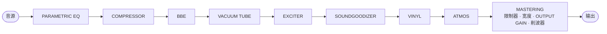
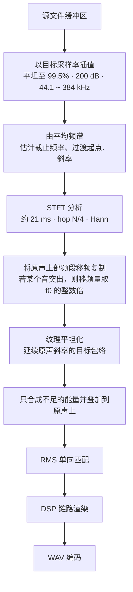

[한국어](README.md) · [English](README.en.md) · [日本語](README.ja.md) · **中文** · [Français](README.fr.md) · [Español](README.es.md)

# ANALOG SOUL DSP ENGINE

> 本文为译本。如与韩文原文（[README.md](README.md)）不一致，以韩文原文为准。

> 已经或将要参与合作、作出贡献的朋友，请私下与我联系。本项目是公开源代码、任何人都可以免费使用的软件。用于个人、非营利目的时可以免费使用，也可以自由修改使用。但著作权和所有权归原作者、合作者和贡献者所有，任何人不得将本程序声称为自己所有，也不得在其他地方分发或销售。

**在浏览器中运行的模拟音色处理器，同时也是为有损压缩音源补回被削掉的高频的修复工具。**

`v3.1` · 单个 HTML 文件 · 无需安装 · 无需联网即可运行 · 音源不会离开设备

第1部分至第4部分的每一节都分四段撰写。**动机**是该功能或设计之所以必要的原因，**依据**是作为根据的原理、标准与实测，**做法**是实际实现的方法，**为何如此**是选择该方法而非其他方法的理由以及测量结果。

---

## 目录

- [第1部分 · 通俗讲解](#part-1)
- [第2部分 · 原理](#part-2)
- [第3部分 · 工作方式](#part-3)
- [第4部分 · 算法与公式、物理、系统设计](#part-4)
  - [4.1 采样率转换与 STFT 内核](#s41) · [4.2 截止频率与斜率估计](#s42) · [4.3 移频复制与 f0 同步](#s43) · [4.4 包络外推与纹理](#s44) · [4.5 电平匹配](#s45)
  - [4.6 非线性传递函数](#s46) · [4.7 混叠预算](#s47) · [4.8 频段分割](#s48) · [4.9 动态](#s49)
  - [4.10 空间的物理](#s410) · [4.11 立体声](#s411) · [4.12 唱片模型](#s412) · [4.13 听觉的物理](#s413)
  - [4.14 系统设计](#s414) · [4.15 位深](#s415) · [4.16 问题与解决](#s416) · [4.17 优化](#s417) · [4.18 已知局限](#s418) · [4.19 主要优势](#s419)
- [仓库结构](#repo)
- [更新日志](#changelog)
  - [3.1](#cl-v31) · [3.0](#cl-v30) · [2.4](#cl-v24) · [2.3](#cl-v23) · [2.2](#cl-v22)
- [参考文献](#refs)
- [许可](#license)

---

<a id="part-1"></a>

## 第1部分 · 通俗讲解

### 这是什么

**动机：** 有时我们想改变音乐文件的感觉：让它像经过老式录音设备那样温暖，像在宽敞的演出厅里聆听那样弥漫开来，把忽大忽小的音量变得平稳。另外，从网上下载的音乐文件，为了减小体积，常常把很高的高音削掉了。

**依据：** 效果用计算来模仿真实设备和真实房间改变声音的方式。我们把一只电子管、唱片与唱机、房间的大小与墙壁对声音所起的作用都写成了公式。补回被削掉的高音的方法以及初次开启时的强度，是一边与未被削减的原始音源比较、一边确定的。

**做法：** 这是一个放入音乐文件就能改变声音感觉的程序。它还有一项功能：读取剩余声音的规律，把被削掉的上半部分以可信的方式补进去。无需安装任何东西。用浏览器窗口打开一个文件即可运行。放入的音乐不会被发送到任何地方，只在你自己的电脑里处理。连字体都包含在文件里，因此即使没有网络，画面也完全一样，并且不会向外部发出任何请求。

**为何如此：** 为了让边听边选出的声音原样变成文件，播放时和保存时按相同的顺序进行相同的计算。补回被削掉的声音时，也保持原来的声音不变，只补上缺少的部分。只有在被削掉位置正下方的狭窄边界内，才把原来的声音稍稍减弱，使它与补上的声音平滑衔接。

### 快速上手

**动机：** 第一次使用的人即使不读完说明文档，也应当能立刻试着改变声音并保存成文件。

**依据：** 本程序以最新的桌面版 Chrome 为基准开发和测试。在其他浏览器窗口中，部分显示或行为可能有所不同。

**做法：**

1. 用浏览器窗口打开 `analog-soul-dsp.html`。推荐使用 Chrome。
2. 打开后会先显示使用条款（‘사용 약관’），阅读并同意。直接上传音乐文件也视为同意。
3. 把音乐文件拖放到画面上方的框中。
4. 按下播放（‘재생’），逐个打开功能卡片的开关，听听声音如何变化。打开的卡片边框会像霓虹灯一样发光，一眼就能看出。
5. 满意的话，在下方的 EXPORT 中选择密度和精细度，然后用导出（‘내보내기’）按钮生成新文件。

说明文档从 `index.html` 开始看即可。从浅显的讲解到深入的讲解，共有五种。

**为何如此：** 推荐 Chrome，是因为像极高密度的保存（192 · 384）这类功能，各浏览器窗口的支持情况不同，而且测试也是在 Chrome 上进行的。推荐边开边关边听的顺序，是因为要分别听到每项功能带来的声音变化，才容易选出自己喜欢的。

### 九项功能

**动机：** 改变声音的工作要一次一件地分开做，才容易掌控。所以画面上的一张卡片就是一项功能。即使是同样的功能，经过的先后顺序不同，声音也会不同，因此必须能用眼睛看到顺序并加以改变。

**依据：** 每张卡片模仿录音棚中使用的一种处理。PARAMETRIC EQ 计算按音高分别提升或降低声音的均衡器，电子管卡片计算真实的电子管电路，VINYL 计算唱片被刻制、唱针读取的过程，DOLBY ATMOS 计算声音在房间里撞到墙壁再反射回来的情形。详细原理见[第2部分](#part-2)和[第3部分](#part-3)。

**做法：** 卡片上方的信号流程图显示声音经过的顺序。拖动流程图中的名称或卡片即可改变顺序，顺序一变，声音也随之改变。在流程图中拖动节点时（流程图为一行时），其他节点会向旁边让开，空出放置的位置；顺序改变后，流程图的节点和各张卡片会滑向新位置。最前面的 HD 修复和作为制作终点的 MASTER 位置固定，以虚线边框绘制，在流程图和卡片中都无法拖动。

| 卡片 | 作用 |
|---|---|
| **PARAMETRIC EQ** | 只挑出想要的音高的声音来增强或减弱。最多可以放 20 个点，看着图拖动来修改。 |
| **COMPRESSOR** | 把大的声音压小一点，把小的声音提起来，使整体变得平稳。 |
| **BBE** | 让说话声和乐器开头的那一下声音清晰挺立。 |
| **VACUUM TUBE** | 按真实电路计算一级电子管放大器，让声音像经过那台设备一样温暖、厚实。 |
| **EXCITER** | 为高音增添闪亮感。 |
| **SOUNDGOODIZER** | 把低音、中间的声音和高音分开，分别加厚。 |
| **VINYL** | 让声音像真的在播放唱片一样。连唱片上的灰尘、每转一圈咔嗒一声的划痕、轻微摇晃的音高、越往唱片内圈越模糊的高音都一并模仿。 |
| **DOLBY ATMOS** | 在录音棚、俱乐部、电影院、音乐厅、体育场中选择一个房间，计算声音在其中回响的情形并播放出来。 |
| **MASTERING** | 最后的整理。把从低音到高音分成四部分分别修饰，并防止声音大到破音。 |

**为何如此：** 不固定顺序、而是允许拖动改变，是因为顺序本身就会改变声音。不过 HD 修复固定在最前面，这样连补上的高音也由 MASTER 在最后一起修饰，防止破音。MASTER 是制作的最后整理，所以位置固定。

**卡片布局**

**动机：** 把高度不同的卡片无缝堆叠时，顺序会呈锯齿状散乱，只看方框无法知道处理顺序。

**依据：** 人像读文章一样从左到右、从上到下浏览。滚动条的粗细是通过一次模拟确定的，在容易抓取的程度与滑块长度之间做了权衡；关闭的卡片上的暗淡文字也保证了可读的亮度对比（3 : 1 以上）。

**做法：** 在宽屏幕（900 px 以上）上，卡片以相同大小（高 385 px）按左 → 右、上 → 下的顺序排列，只看位置就能读出处理顺序。高分辨率修复卡片与流程图一样排在最前面，在页面文档中也位于最前，因此用键盘（Tab）移动的顺序和屏幕阅读器朗读的顺序都与看到的顺序相同。打开的卡片内容溢出时在卡片内部滚动（右侧 22 px 滚动条），滚到底后再继续滚动，页面也不会跟着移动。卡片变窄时，名称和数值栏保持不变，只有滑块条变短。滑块条在刚开始变为 3 列、卡片最窄（360 px）时，在预留了滚动条位置的卡片中最短，约为 100 px。内容溢出的卡片（VINYL · ATMOS · MASTERING）的标题行有展开按钮（上下箭头），按下后只有该卡片伸长到内容的高度，可以一次看到全部控件。再按一次即恢复到瓷砖高度，所选状态会记在这个浏览器窗口中。关闭的卡片会退到控件无法按动的背景中，在它上面滚动滚轮时页面会滚动。如果在打开的卡片之外开始滚动页面，那么在滚轮停止 0.4 秒之前，即使打开的卡片经过光标下方，页面也会继续滚动。在此期间一移动鼠标就会立即解除，移到的卡片将接收滚轮和点击。拖动卡片时，原处会出现一个虚线空位跟随光标，其他卡片会让开，放下的卡片会从放下的位置滑入空位。在窄屏幕上，卡片排成一列堆叠。

**为何如此：** 以相同大小排列，位置就等于处理顺序。让关闭的卡片退到背景并使页面滚动得以延续，是为了在向下滚动页面、卡片从光标下方经过时，滚动不会卡在卡片里而中断。会溢出的卡片无论开关都始终预留滚动条的位置，所以内容不会左右抖动。滚到底的滚轮不传给页面，是因为一旦传过去，页面上移，卡片的下部就会钻到固定在上方的播放栏下面，按下方的控件时会按到播放栏。VINYL 的内容约为卡片内可见高度的 2.7 倍，这种情况尤其频繁。展开只会让该卡片所在的那一行变长，同一行的其他卡片保持瓷砖高度，因此按位置读出的处理顺序不变。在窄卡片中只缩短滑块条，是因为名称或数值一旦被截断，就无法读出调的是什么、调到多少。把高分辨率修复卡片在文档中也放在最前面，是为了让使用键盘或屏幕阅读器操作的人也按与画面相同的顺序经过。

**MACRO % 与初始状态**

**动机：** 为了改变卡片的强度而分别调整多个控件很麻烦，也难以调出彼此协调的值。初次打开时的声音也应当恰到好处，不能过度。

**依据：** 初始状态是用两种方式处理 4 首未被削减的原始音源（中间 20 秒）、比较之后确定的。MACRO 方式几乎保留了低音和宽广弥漫的感觉（+2.2 dB 左右），同时减轻了高音过度变大（+4.2 → +2.4 dB）和音量变小（−6.2 → −4.9 dB）的问题。

**做法：** 卡片最上方的 MACRO 控件会在最弱位置（0 %）与基准设计值（100 %）之间同时移动该卡片的主要控件。这与高分辨率修复的 AUTO % 是同一方式，数值会按滑块刻度取整。直接调整控件之后，在再次移动 MACRO 之前该值保持不变；设置文件中会同时保存 MACRO 和控件值。初次打开时，COMPRESSOR 50 % · BBE 40 % · EXCITER 80 % · SOUNDGOODIZER 65 % · MASTERING CHAIN 95 % 处于开启状态，PARAMETRIC EQ · VACUUM TUBE · VINYL RECORD · DOLBY ATMOS 处于关闭状态（MACRO 100 %）。PARAMETRIC EQ 的 MACRO 不移动控件，而是决定各点设定的提升与衰减施加多少（0 % 时为平直）。在 0 % 时，除 MASTERING CHAIN 外电平保持不变（±0.1 dB）。MASTERING CHAIN 的上限电平（ceiling）限制器与 MACRO 无关地工作，因此对于已被压到或削到上限电平的响亮母带，音量可能变小 0.2 ~ 0.9 dB。BBE · SOUNDGOODIZER · MASTERING CHAIN 的相位校正网络与频段分割会旋转相位，与原声并非逐个采样点完全相同，所以要彻底去掉其声音，请关闭卡片。

**为何如此：** 用一个控件决定强度后，为改变卡片强度而需要调整的控件从 16 个减少到 5 个。

**回放阶段**

**动机：** 当 VINYL 和 ATMOS 只能放在 MASTER 之前时，就连唱片的沙沙声这类回放噪声也会在 MASTER 中被压低、被放大。

**依据：** 真实的 LP 是用母带音源刻制漆盘、压制出唱片，再用唱机播放的，所以沙沙声、爆音、表面噪声、翘曲都产生在母带处理之后。Atmos 也是在母带完成之后，根据收听设备来描绘空间。

**做法：** MASTER 之后是用回放介质收听母带处理完成后的声音的阶段。只有 VINYL 和 ATMOS 可以移到 MASTER 之后。在两张卡片标题行下方的处理位置（‘처리 위치’）中选择 MASTER 之前或之后（‘MASTER 앞 · 뒤’），或者把卡片或流程图的节点拖到 MASTER 之后（在流程图中也可以用 Alt+→ 移过去）。回放阶段显示在流程图青绿色的‘回放’（‘재생’）边界之后、卡片板‘回放阶段 · MASTER 之后’（‘재생 단계 · MASTER 뒤’）区域之下，并带有青绿色编号标签；把其他卡片拖过来时会显示‘无法放置’（‘놓을 수 없음’）。CEILING 的保证只到 MASTER 为止，所以经过回放阶段的声音可能超过 CEILING。槽位和设置文件中也会一并保存回放阶段的顺序。

**为何如此：** 实际播放时产生的噪声，要像现实中一样在 MASTER 之后产生，才不会被 MASTER 压低或放大。‘处理位置’按钮在卡片正文之外，所以即使卡片处于关闭状态也可以按。

**VINYL · VACUUM TUBE · DOLBY ATMOS 的控件**

**动机：** 唱片、电子管、房间，每个人脑中浮现的声音都不同。与其使用笼统的‘强度’，不如能够选择真实物件的状态，这样才能接近想要的声音。

**依据：** VINYL 的控件直接使用真实设备说明书上标注的单位（每秒咔嗒声次数、分贝、毫米、皮法等）。VACUUM TUBE 的 DRIVE 和 BIAS 是加在电子管上的实际电压，DOLBY ATMOS 的各个房间则对应在同类真实房间中常测得的混响时长。

**做法：** VINYL 的控件分为唱片、唱机、唱针三组。设定唱片上积了多少灰尘、有没有划痕、是否翘曲、播放过多少次，并选择唱机转得有多均匀以及唱针的形状。把各设备说明书上的数字原样输入，就会得到那种组合的声音。试听时出现的咔嗒声，在保存的文件中也出现在同一位置。

VACUUM TUBE 的 DRIVE 是送入电子管的声音强度，BIAS 是电子管静止时的状态。降低 BIAS，一侧会先失真，温暖的色彩更浓；提高则变得干净。DOLBY ATMOS 的 SPACE 是房间的大小，DEPTH 是声音从多远处发出，HEIGHT 和 OBJECT 是从天花板和侧墙反射回来的声音强度。SPACE · HEIGHT · OBJECT 的中间值（50）就是真实房间的值。

**为何如此：** 咔嗒声按固定顺序预先生成，并按曲目的时间播放，所以听到的声音与保存的文件相同。使用真实单位，是为了让用户能把自己设备上的数字原样搬过来使用。

**PARAMETRIC EQ**

**动机：** 有的曲目低音嗡嗡作响，有的人声被乐器淹没，有的高音刺耳。很多时候需要不改变整体，只把那个音高的声音稍微提升或降低。

**依据：** 这正是录音棚里均衡器（EQ）的工作。把声音按音高分开来看，提升或降低哪个音高、提升或降低多少，决定了音色。画面上的曲线用与实际改变声音的计算相同的计算来绘制，所以听到的正如曲线所示。

**做法：** 卡片的图上有标着编号的点，一个点负责一个音高。左右拖动点会改变它负责的音高，上下拖动会改变提升或降低的量。在点上滚动滚轮，可以把该音高的周围处理得更窄或更宽。双击空白处会生成点（最多 20 个），双击点会暂时关闭它，右键单击则删除它。每个点都可以选择形状：只把一个音高鼓起或挖下的**钟形**（‘벨’），把下方或上方整体提升或降低的**搁架**（‘셸프’），把下方或上方切掉的**切除**（‘컷’），只把一个音高深深挖掉的**陷波**（‘노치’）。按下‘放大编辑’（‘크게’）会打开大图和所有点的表格，也可以用数字修改，并且可以在该窗口中播放和开关。播放期间，经过 EQ 之前（线）和之后（面）的声音图会叠在一起显示。初始状态是关闭的，放着四个即使打开声音也不变的平直的点。用大窗口中的**导入 AutoEQ**（‘AutoEQ 가져오기’）也可以把 AutoEQ 的耳机校正文件载入为点，但这样加入的校正也会进入保存的文件。如果目的是校正你所听的耳机，请使用下面的‘适配收听设备’。

**为何如此：** EQ 位于初始顺序的最前面。这是为了不让要切掉的嗡嗡声或低沉的噪声先去驱动后面的压缩和失真。如果想修饰压缩之后的声音，把它移到 COMP 之后即可。点按创建的先后编号，关闭期间编号也不会改变。

**INPUT GAIN**

**动机：** 通过让声音失真来增添味道的功能，输入的声音越大，反应就越浓烈。因此必须能分别设定送入每项功能的音量。

**依据：** 电子管或压缩器这类设备，输入变大时会失真得更多，或者压得更多。

**做法：** 每张卡片最上方都有 **INPUT GAIN**。它是送入该功能的声音大小（−24 ~ +24 dB，步进 0.1 dB，默认 0）。对于通过失真增添味道的功能，调高这里效果会更浓；像 PARAMETRIC EQ 这样不产生失真的功能，只会改变音量。

**为何如此：** INPUT GAIN 仅在卡片开启时才插入到该卡片的正前方。这是为了不让关闭的卡片的数值改变整体音量。

### 补回被削掉的高音

**动机：** 减小了体积的音乐文件，很高的高音被削掉了。即使以更高的密度保存，被削掉的地方依然是空的。

**依据：** 剩余声音的高音部分以怎样的斜率变小、哪些音在鸣响，都有规律可循。补回的方式和默认值，是与未被削减的原始音源比较后，朝着让补回的声音更接近原始音源的方向确定的。

**做法：** **HD** 和 **ULTRA · eXtreme HD** 栏负责这项工作。保存时把密度选得比原来的文件高（44.1 kHz 文件为 48 · 88.2 · 176.4 · 352.8，48 kHz 文件为 96 · 192 · 384），就会按那个高度补回。在某一件乐器或人声突出的曲目中，补回声音的音高会对准原来声音的谐波位置。补回的量由 **HF SYNTH** 决定，越往高处补回的声音铺得有多均匀由 **SMOOTH** 决定。把 HF SYNTH 设为 0，就不补回，只提高密度。

打开 **LIVE** 开关，就能在保存之前预先试听结果。打开的一瞬间需要稍等片刻，因为要先扫描整首曲目找出哪里被削掉，并把整首曲目先补回一遍。改变控件，或在 PRESET 面板中选择后关闭面板，都会重新生成。

**为何如此：** 这项功能不是找回被削掉的原来的声音，而是看着剩下的声音以可信的方式画进去。因此原来的声音保持不变，只补上缺少的部分，只有在被削掉位置正下方的狭窄边界内，才把原来的声音最多减到一半，与补回的声音衔接。让音高对准谐波位置，是因为如果只是简单地搬移粘贴，补回的声音就会偏离原来那个音的谐波位置。能否听出差别，取决于文件、耳朵和设备。体积压缩得越厉害的文件差别越大，本来就很好的文件几乎没有变化。

### 看图理解

**动机：** 只凭耳朵很难判断声音发生了怎样的变化。尤其是很高的高音有没有补回，可能不太容易听出来。

**依据：** 把声音按音高分开，画出每个音高有多大，被削掉的地方和补回的地方就一目了然。

**做法：** 上方的图表左边是原来的声音，右边是改变后的声音。同一时刻并排显示，所以能立刻看出哪里变了。点击图表会切换为随时间流动的图，颜色越亮，表示那个音高的声音越大。

图表上方的 X-AXIS 开关（自适应 · 48 · 96 · 192）可以固定横向范围。开关修复时，图表不会时而拉伸时而收缩，因此映入眼帘的只有新补回的部分。

**为何如此：** 两个图表使用同一套色表。颜色不同的话，就无法比较左右两边的大小。固定横向范围后，同一音高的声音总是画在同一位置。

### 适配收听设备

**动机：** 耳机和音箱各自会把某些音高的声音放得更大、把某些音高放得更小。带着这种习性一边听一边调，就会去修正曲目中本不存在的鸣响，或者把设备削弱了的音高额外加进曲目里。

**依据：** AutoEQ 是一个公开项目，它基于公开的耳机、耳塞测量数据，为每台设备给出使其响应符合目标曲线的校正值。其校正文件（ParametricEQ.txt）由十个左右与 PARAMETRIC EQ 的点同类的滤波器，以及整体降低的量（Preamp）构成。

**做法：** 按下播放栏的**监听校正**（‘모니터 보정’）按钮，在**导入 AutoEQ**中选择所用耳机的 ParametricEQ.txt 或粘贴其内容，然后按**应用**（‘적용’）。校正会立即开启，按钮上显示耳机名称。在窗口中可以查看校正曲线和滤波器表、开关校正，并以 0.1 dB 为步进修改 Preamp。曲线升到 0 dB 以上时，会提示大声处可能被削掉，按提示的量降低 Preamp 即可。

**为何如此：** 这种校正只在播放时施加，位置是所有处理完成的声音送往设备之前的最后一刻。它不会进入保存的音乐文件和设置文件，只记在这个浏览器窗口中。耳机的习性不是曲目的属性，而是收听设备的性质，放进文件里，对其他设备或其他人来说就成了错误的声音。画面上改变后的声音的图表显示的也是校正之前的声音，也就是将要成为文件的声音。只有在特意制作那款耳机专用的文件时，才使用 PARAMETRIC EQ 的导入 AutoEQ。

### 以相同响度对比聆听

**动机：** 人耳会觉得大的声音更好。做得很响的曲目，打开功能后常常会变小（默认设置下小 3 ~ 10 dB），一边开关一边听，关掉的那一边容易听起来更好。要听出到底变了什么，就必须让两个声音的响度一致。

**依据：** 声音的响度用国际标准 ITU-R BS.1770 的响度（LUFS）来测量。这是广播和音乐服务统一音量时所用的方法，对耳朵敏感的高音计得稍大一些，并且不计安静的间隙。

**做法：** 按下播放栏的**比较**（‘비교’），就会切换到对比音源（按钮上显示‘原声’（‘원음’）之类的名称，琥珀色边框），再按一次则回到‘处理后’（‘처리본’）的声音。对比音源起初是未作任何改变的原声，按旁边的**对比音源**（‘견줄 소리’），可以把它换成像‘去掉 SOUNDGOODIZER’（‘SOUNDGOODIZER 빼고’）那样只去掉一项已开启功能的声音。只少了那一项功能，其余保持不变，因此可以只听到那项功能所起的作用。第一次按下和进行选择时，由于要测量响度，会稍后才切换。旁边的**相同响度**（‘같은 크기’）开启时（初始状态），会把对比音源调到与处理后的声音相同的响度来播放，并以‘原声 −5.6 dB’、‘去掉 SG −2.6 dB’这样的形式显示调整的量。改变控件或卡片后，稍后会重新测量。

**为何如此：** 只调整对比音源一侧、不动处理后的声音，因此处理后的声音始终以与将要保存的文件相同的响度播放。需要调大对比音源时，只调大到最大的声音不被削掉为止（按钮上显示‘上限’（‘한도’））。两个声音按各处理单元造成的延迟时间（原声在默认设置下约 45 ms，去掉一项功能时为该功能的延迟）对齐，因此切换时节拍不会错位。去掉一项功能时，不额外再运行一套处理，而是让声音绕过该功能，所以播放不会变得吃力。这种比较只在试听时起作用，不会进入保存的音乐文件和设置文件。

### 保存设置

**动机：** 找到满意的设置后，应当能把它留存下来以便再次使用，能在多个设置之间切换比较，也能转移到其他电脑上。

**依据：** 设置只有控件值与开关状态、卡片顺序、EQ 的点，所以一个小小的文本文件就能装下。快捷槽位存放在浏览器窗口的存储空间中。

**做法：** 不包含音乐文件和监听校正，只包含设置。

| 按钮 | 作用 |
|---|---|
| **保存当前设置**（‘화면 설정 저장’） | 把当前画面的设置生成为文件。转移到其他电脑时使用。 |
| **快捷槽位 1~4**（‘빠른 슬롯 1~4’） | 短按载入，长按（0.6 秒）存入当前设置。按空槽位会回到初始状态。 |
| **复制**（‘복사’） | 按下后依次按两个槽位，前一个会被复制到后一个。前一个槽位保持不变。 |
| **清空一个槽位**（‘한 슬롯 비우기’） | 按下后再按一个槽位，只清除那一个。 |
| **清空全部槽位**（‘모든 슬롯 비우기’） | 按一次会要求确认，再按一次则全部清除。 |
| **备份全部槽位**（‘모든 슬롯을 백업’） | 把四个槽位打包成一个文件。 |
| **载入**（‘불러오기’） | 无论是设置文件还是备份文件，都能自动识别并恢复。 |

快捷槽位只保留在当前使用的浏览器窗口中。要在其他电脑上使用，请保存为文件。载入在没有 EQ 的 3.0 中保存的设置时，EQ 会回到初始状态（关闭，四个平直的点），因此会发出与保存时完全相同的声音。

保存时，上方的信号流程图和下方的各张卡片会按处理顺序闪烁两次，提示数值和顺序已被保存。载入时，流程图的节点和各张卡片会滑向保存时的位置。

**为何如此：** 去掉音乐文件、只保存设置，文件就很小，便于转移到任何地方。空槽位意味着‘无设置’（‘설정 없음’），所以按下后会回到初始状态。清空全部槽位无法撤销，因此会再问一次。载入会自行识别文件类型，所以不必选择是哪种文件。闪烁按处理顺序进行，是为了依次表明连顺序也已保存。

### 保存为文件

**动机：** 要在其他地方也能听到改变后的声音，就必须把它留存为新的音乐文件。用途不同，所需的密度和精细度也不同。

**依据：** 音乐文件就是把 1 秒切分得很细，并在每个时刻用数字记下声音大小。切分得多细（密度）和数字记得多精细（精细度）决定了文件的大小。

**做法：** 在下方的 EXPORT 中选好两项，然后按**导出**（‘내보내기’）按钮。

| 条 | 可选值 | 含义 |
|---|---|---|
| **SAMPLE RATE** | 44.1 · 48 · 96 · 192 · 384 | 把 1 秒切分得多密来记录。选得比原来的文件高，就会按那个高度补回被削掉的高音；选得低，则尽量保住原来的声音并降低密度。上传文件后，会设为与原来的文件相同的值，并在该刻度下方标上“（源文件）”（‘원본’）。如果没有相同的刻度，则设为紧邻的上一个刻度（原来的文件高于最高刻度时设为最高刻度），且不标“（源文件）”。原来的文件属于 44.1 系列（44.1 · 88.2 · 176.4 · 352.8）时，上方三个刻度会变为 88.2 · 176.4 · 352.8。 |
| **BIT DEPTH** | 16 · 24 · 32 | 每次记录时记得多精细。原来的文件为 16 位及以下时，选择 24 或 32 会把台阶之间连接补齐。 |

按钮下方会显示按怎样的顺序处理。数字越大，文件越大。1 分钟的曲目，44.1 和 16 约为 10 MB，96 和 24 约为 33 MB，192 和 32 约为 88 MB，384 和 32 约为 176 MB。用相同设置再次保存同一个文件，会得到连每一个字节都相同的文件。

**为何如此：** 起初选择与原来的文件相同的值，是为了在保持不动时不经转换地保存。对 44.1 系列的文件把上方刻度换成 88.2 · 176.4 · 352.8，是因为正好是两倍、四倍，计算更快。把 44.1 kHz 文件提升到 88.2 比提升到 96 快 32%，声音差异甚至小于文件中所记的最小单位。补齐 16 位文件的台阶之间时，不会超出原来的值所在的格子，因此记得更精细的同时也不会与原来的声音产生偏差。

### 须知

**动机：** 使用中有几件事可能让人困惑或吃惊。事先知道，就能避免听错或丢失设置。

**依据：** 这些来自人耳容易被音量欺骗的特性、浏览器窗口所支持的范围，以及本程序处理设置的方式。

**做法：**

- **如果觉得一打开就变好了**，可能是因为声音变大了。人耳会无条件地觉得变大的声音更好。反过来，已经做得很响的曲目打开功能后会变小 3 ~ 10 dB，关掉的一方可能听起来更好。请在开启**相同响度**（‘같은 크기’）的状态下使用播放栏的**比较**（‘비교’）来对比。某一项功能起了什么作用，可以在**对比音源**（‘견줄 소리’）中去掉该功能来听（见上文‘以相同响度对比聆听’）。
- **MASTERING 不会自动把声音变大。** 安静的部分保持不变，只压制响的部分。想让声音更大，请调高 MASTERING 的 INPUT GAIN 去推动限制器。
- **如果出现无法以 192 或 384 保存的提示**，说明浏览器窗口不支持那么高密度的保存。请使用 Chrome，或选择 96（44.1 系列则选 88.2）。
- **改变设置后想前往其他说明文档时**，会弹出确认窗口。因为设置不会自动保存。
- **画面颜色在最上方栏的右侧选择。**‘自动’（‘자동’）跟随电脑的深色与浅色设置，‘夜间’（‘야간’）和‘日间’（‘주간’）则分别始终保持深色、始终保持浅色。所选的设置会记在这个浏览器窗口中，同时应用于程序和说明文档。
- **保存的音乐文件里只有声音。** 不会留下是用什么设置做出来的，以后想再用，请把设置也一并保存。

**为何如此：** MASTERING 不会自动变大，是为了去掉隐藏的自动增大，让用户亲自决定打开什么会变大多少。前往其他说明文档时会询问，是因为在保存之前离开，改过的值会全部消失。

---

<a id="part-2"></a>
## 第2部分 · 原理

这一部分说明各项功能所依赖的物理与感知现象。计算方式在第3部分、公式在第4部分中讨论。每一节依次写出：这一原理为什么是程序所需要的（动机）、依据哪些理论和资料（依据）、程序如何运用这一原理（做法）、为何选择这种方式（为何如此）。

### 2.1 观察声音的两只眼睛——时间与频率

**动机：** 本程序从波形（时间）和频谱（频率）两个方面处理声音。保持源文件的采样频率、补回被削掉的高频、选择导出的采样频率，这些工作都从“这个文件最高能容纳到哪里”这一问题出发。要读懂画面上的两个分析器，还需要了解对数频率轴和分贝。

**依据：** 声音是空气压力随时间的变化。录音文件是以固定间隔测量这种变化得到的数列，这个间隔的倒数就是**采样频率**。44.1 kHz 表示每秒测量了 44,100 次。根据采样定理，采样频率的一半，即**奈奎斯特频率**，是该文件所能容纳的最高声音。同一个声音也可以分解为频率成分来观察，也就是查看各个音高的声音各混合了多少的**频谱**。人耳以对数尺度感知频率。从 100 Hz 到 200 Hz 与从 1 kHz 到 2 kHz 听起来同样是一个倍频程。大小以**分贝（dB）**计量。振幅变为两倍约为 +6 dB，相差 10 dB 听起来大约响一倍。

**做法：** 分析器把柱状频谱的横轴和频谱图的纵轴从 20 Hz 到显示奈奎斯特频率按对数绘制。128 根柱条在对数轴上均匀排列，每根柱条显示落在其区间内的 FFT 频点（bin）的最大值。纵向刻度为 −100 ~ −30 dB（3.7 节）。打开文件时，在交给浏览器解码器之前，先直接从文件头读取源文件的采样频率（3.9 节）。导出的采样频率在 44.1 ~ 384 kHz 之间选择（3.8 节）。

**为何如此：** 因为耳朵以对数方式听，图表也按对数绘制。如果是线性轴，一个倍频程所占的宽度越往上越成倍加宽，20 Hz ~ 1 kHz 的将近六个倍频程会挤在画面的最左端。从文件头读取源文件的采样频率，是因为浏览器解码器总会把它转换成播放设备的采样频率。只有知道原来的奈奎斯特频率，才能判断哪里是原本就空着的区域。

### 2.2 动态——压缩

**动机：** 音量忽大忽小时，后续饱和级中失真的深度会因段落而异。因此 COMPRESSOR 位于链路的最前端（3.2 节）。最后的 MASTERING 也用多频段压缩器和限制器来处理最终电平和峰值。

**依据：** 压缩器在声音超过**阈值**时，把超出的部分除以**比率**来降低。4:1 时，超过阈值 8 dB 的声音会被降到只超出 2 dB。**启动**是超过之后多快开始降低，**释放**是回落之后多快恢复原状。**拐点（knee）**决定在阈值附近是急剧地还是平缓地施加压缩。压缩会减小音量的起伏。由于最大瞬间与平均值之差即**峰值因数**变小，可以在相同的最大电平内提高平均音量。把因压缩而减小的部分整体再放大回来，称为**补偿增益**。

**做法：** 压缩单元是 Web Audio 的 `DynamicsCompressorNode`。该单元的拐点只从阈值**向上**展开，因此压缩开始的位置比硬件的对称拐点高出拐点宽度的一半。规范始终施加一个连阈值以下的信号也会放大的自动补偿增益 $`(1/c(1))^{0.6}`$。本程序用同样的公式计算这个值，并在压缩器正后方以其倒数抵消（COMPRESSOR 默认值下为 6.03 dB）。因此压缩器本身不触动阈值以下的安静声音，补偿增益只施加 MAKEUP 所设定的量。SOUNDGOODIZER 的输出压缩器、MASTERING 的四个频段压缩器和限制器也以同样方式抵消。公式与数值见 [4.9](#s49)。

**为何如此：** 如果保留自动补偿增益，只要打开压缩器声音就会变大，而且其量随阈值、拐点、比率而变化。抵消之前，在 COMPRESSOR 默认值下，安静的信号在 MAKEUP 4 dB 之上再加上隐藏的 6.03 dB，变大了 +10.0 dB；MASTERING 在各频段放大的量各不相同（+5.4 ~ +7.1 dB），使中频突出了 1.7 dB。抵消之后只有 MAKEUP 旋钮提供增益，旋钮的含义因此唯一确定，也更容易在相同音量下比较开启和关闭时的声音（2.10）。代价是默认设置的输出比抵消前小了约 6 dB。抵消依赖于规范中的公式，因此在实现方式与该公式不同的环境中，会产生相应的偏差。

### 2.3 相位与清晰度

**动机：** 声音的起始部分一旦模糊，乐器的轮廓听起来就会糊成一团。BBE 卡片通过改变时间关系来处理这种轮廓。另外，把只旋转了相位的信号与原声混合，特定频率会被抵消，因此使用并联路径的卡片（BBE 的旧结构、SOUNDGOODIZER）必须避开这一性质。决定语音和乐器清晰度的频段，是 BBE 的 PROCESS 和 SOUNDGOODIZER 的临场感增强所针对的目标。

**依据：** 扬声器无法让所有音高的声音同时发出。尤其是低音，往往比高音更晚发出。这种到达时间随频率而不同的现象称为**群延迟**。BBE 公司公开的处理，是把低频比高频延迟约 2.5 ms、把中频比高频延迟约 0.5 ms。厂商将其解释为扬声器的相位校正，但它是把扬声器已经延迟了的低频进一步延迟的方向，因此与其说是还原，不如说是一种让高频成分的启动先到达、从而突出起始声轮廓的处理。只改变相位而保持幅度不变的滤波器称为**全通滤波器**。直接通过这种滤波器，就可以在幅度不变的情况下只延迟低音。反之，把经过这种滤波器的信号与原信号混合，在相位相反的频率上声音会互相抵消，因此若只想改变时间，就不能混合。人的语音中辅音集中的 2 ~ 5 kHz 频段左右着**清晰度**。外耳道是一端被鼓膜封闭的管道，具有 1/4 波长共振（约 3.4 kHz），这一共振与耳廓的反射使 2 ~ 5 kHz 提升 10 ~ 15 dB。在等响曲线（ISO 226）中，耳朵最敏感的频段也在这里。把这个频段稍稍提升，就会产生话语向前凸显的感觉。

**做法：** BBE **串联**经过两个全通滤波器（220 Hz Q 0.59、1850 Hz Q 1.47），在幅度不变的情况下只产生群延迟。三个旋钮为 0 时全频段为 0.0 dB，群延迟为 50 Hz 2.58 ms、500 Hz 0.61 ms、5 kHz 0.03 ms。其后的 PROCESS 用 3 kHz 高架（0 ~ +8 dB）大范围提升辅音和启动集中的频段，HI DEF 用 10 kHz 高架（0 ~ +6 dB）负责其上方。SOUNDGOODIZER 用 2.5 kHz 峰值滤波器（Q 0.7，+AMOUNT×3 dB）提升临场感频段，并在把处理后的频段与原声并联相加时，在原声路径上也施加与频段之和相同的全通，以对齐相位（[4.8](#s48)）。

**为何如此：** 两个全通滤波器的中心频率和 Q，是用最小二乘法拟合目标群延迟（150 Hz 以下 2.5 ms，0.4 ~ 1.5 kHz 0.5 ms，5 kHz 以上 0）得到的值。旧结构把全通输出加到原声上，因此在相位为 −180° 处产生凹陷。混合比例 g = 0.6 时为 −12 dB，实际上在 LO CONTOUR 100 时，100 ~ 125 Hz 和 315 Hz 处为 −9.3 dB。改为串联后的现在，旋钮为 0 时平直，LO CONTOUR 100 以 31.5 Hz +9.7 dB、63 Hz +7.0 dB、100 Hz +3.1 dB 平滑地提升。硬件会根据信号改变高频强调的量，而这里是固定的搁架滤波器。在人声上把 PROCESS 提升超过 +6 dB 时，齿音也会一起升高。

### 2.4 非线性与谐波

**动机：** VACUUM TUBE、EXCITER、SOUNDGOODIZER 有意让声音失真以增添色彩，MASTERING 的安全削波器也是非线性的。产生哪些谐波、产生多少，就是该卡片的音色。在数字域中施加失真，可能混入原本不存在的、频率毫不相干的声音，这一点也必须加以控制。

**依据：** 让声音失真，会产生原本不存在的**谐波**。让 100 Hz 的声音失真，会新出现 200、300、400 Hz 的成分。产生哪些谐波、产生多少，由失真的方式决定。两侧同等压缩的**对称**方式（满足 $`f(-x) = -f(x)`$ 的奇函数）只产生奇次谐波（3 倍、5 倍…）。一侧压得更狠的**非对称**方式也会产生偶次谐波（2 倍、4 倍…）。在泰勒展开 $`f(x + b) = f(b) + f'(b)\,x + \tfrac12 f''(b)\,x^2 + \cdots`$ 中，产生二次谐波的 $`x^2`$ 项的系数与工作点的曲率 $`f''(b)`$ 成正比。二次谐波高一个倍频程，与原来的声音融合良好，听起来厚实；三次谐波是一个倍频程之上的五度，带来稍显粗糙的色彩。电子管音色被称为温暖，原因就在于非对称特性所产生的偶次谐波。三极管由于空间电荷定律的 3/2 次方和栅极电流，曲线本身就是非对称的（Koren 的三极管模型）。用数字方式让声音失真时有一点需要注意。新产生的谐波一旦超过奈奎斯特频率，并不会消失，而是向下**折叠**回来，出现在与原来声音毫无关系的频率上。这称为**混叠**。另外，即使失真率相同，曲率急剧变化的曲线所产生的高阶互调听起来最刺耳（Geddes & Lee）。

**做法：** VACUUM TUBE 通过求解 12AX7 共阴极放大级的方程得到曲线。在默认值（DRIVE 30，BIAS 50）下输入 1 kHz −6 dBFS 时，二次谐波为 −33.7 dB，三次谐波为 −67.5 dB。EXCITER 把 $`\tanh`$ 曲线正负两侧的饱和极限分别设为 +1 和 −0.7，SOUNDGOODIZER 把工作点移动 $`b = 0.08\,\mathrm{SAT}`$ 来产生偶次谐波。混叠分两层来减少。曲线以 4 倍过采样施加；EXCITER 和 SOUNDGOODIZER 高频段只在饱和路径之前放置 $`\max(1.4\,f_{\mathrm{lo}},\ f_s/3)`$ 低通，把开始出现可听混叠的谐波次数从 7 提高到 10.5。非对称曲线同时产生的直流，由饱和之后的高通（TUBE 10 Hz、EXCITER FREQ、SOUNDGOODIZER 12 Hz）阻断。曲线与测量见 [4.6](#s46)，混叠预算见 [4.7](#s47)。

**为何如此：** 电子管曲线不靠手工挑选而是从电路求解，是因为旧曲线与注释所说的相反，在默认 BIAS 下三次谐波领先 17 dB。现在的模型如实再现了这些物理趋势：小信号时二次谐波比三次谐波大 34 dB，推得很猛时三次谐波领先，冷偏置下二次谐波变强。SOUNDGOODIZER 的旧曲线是纯奇函数，二次谐波只有 −68.6 dB。只在负半周乘以增益的方式不会改变原点处的曲率，小信号时几乎产生不了偶次谐波，因此选择了移动工作点的方式。混叠次数会随着与奈奎斯特频率成正比的输入上限一同升高，因此与采样频率无关。仅提高采样率并不会改善，必须把输入频带限制在奈奎斯特频率的一个分数之内。以高倍数渲染整个链路的方法，渲染时间和内存会按倍数增加，还要多一次重采样，而且只作用于导出，导致听到的声音与文件不同，因此没有采用。TUBE 不设频带限制。因为在 MIX 100 时整个信号都经过曲线，频带限制会变成真实放大级中并不存在的 16 kHz 截止。

### 2.5 分频段处理

**动机：** 低音和高音性质不同，作同样的处理会损坏其中一方。SOUNDGOODIZER 对三个频段分别饱和，MASTERING 对四个频段分别压缩。要在保住低频冲击力的同时不让高频产生抽吸（pumping），各频段需要不同的设置。

**依据：** 用**分频器**把信号分成频段分别处理后再合并。此时把分出的各部分原样合并，应当得到与原来相同的大小。具有这种性质的分割称为**互补**分割。如果不互补，在分界处声音会鼓起或塌陷。4 阶 Linkwitz–Riley 分割由两个 2 阶巴特沃斯级联而成，低频与高频之和恰好是一个 2 阶全通，在所有频率上幅度均为 1。

**做法：** 两张卡片都使用 4 阶 Linkwitz–Riley 滤波器。SOUNDGOODIZER 每种模式有两个分频点（A 为 250 Hz / 4 kHz 等），MASTERING 在 120 Hz / 500 Hz / 5 kHz 处分割。分频点有两个以上时，采用在低频侧频段上乘以上方分频点之全通的树形结构，使总和为 $`AP_a AP_b \cdots`$。Web Audio 规范把 `lowpass`·`highpass` 的 Q 解释为 dB，因此巴特沃斯要填入的不是 0.707 而是 −3.0103。推导与数值见 [4.8](#s48)。

**为何如此：** 旧 SOUNDGOODIZER 把 LPF、BPF、HPF 并联放置，频段之和在 0.906 ~ 1.568 之间波动，2 kHz 附近鼓起约 +4 dB。如果只在相邻频段之间分割，MASTERING 会在约 411 Hz 处出现 −1.22 dB 的凹陷。若直接给 Q 填入 0.707，总和会在分频点处鼓起 +7.4 dB。改为树形结构后的现在，用规范系数计算出的总和偏差为 ±0.0000 dB。代价是相位旋转。频段之和在分频点处为 −180°，因此把处理后的频段并联加到原声上时，原声路径上也必须施加相同的全通才不会被抵消（否则 250 Hz 处为 −2.3 dB）。群延迟最大约为 $`0.543/f_c`$，在 MASTERING 的 120 Hz 分频点处约为 4.5 ms，小于低频群延迟的辨别阈值。含有饱和的频段不是线性的，因此总和的平坦性只在低电平下成立，四种模式的这一响应都在 ±1.3 dB 以内。

### 2.6 空间——反射与混响

**动机：** DOLBY ATMOS 卡片把声音置于某个房间之中。旧卡片使用固定的十个反射和每次都不同的随机混响，因此即使设置相同，混响的纹理也会改变。要用房间大小、墙壁吸声、与声源的距离、声源宽度这类实际物理量来调节空间，就需要房间声学的原理。

**依据：** 在房间中听到的声音分为三部分：从声源直接传来的**直达声**，撞到墙壁和天花板一两次后传来的**早期反射**，以及无数次碰撞后混在一起的**后期混响**。早期反射反映房间的大小和形状，后期混响反映房间的回响。混响衰减 60 dB 所需的时间称为 **RT60**。小录音棚为 0.3 ~ 0.5 秒，音乐厅在 2 秒左右。墙壁吸收的声音越多、房间越小，混响越短（Sabine、Eyring 的混响公式）。空气也会吸收高音（ISO 9613-1），因此房间越大，高音的混响越短。远离声源时，直达声变弱，而混响均匀地留在整个房间里，因此从某个距离开始，混响会大于直达声。这个距离称为**临界距离**。来自侧墙的早期反射向两耳送去不同的声音，使声源听起来更宽（Barron & Marshall、Hidaka 等）。来自上方的声音由于耳廓的作用，8 kHz 附近被强调后进入耳朵，耳朵把这种强调用作声音来自上方的线索（Blauert 的方向决定频带）。反射路径可以用镜像声源法计算，即反复放置声源在墙面上的镜像（Allen & Berkley）。

**做法：** ATMOS 用长方体房间的镜像声源反射生成早期反射，用在 Eyring 混响时间上加入空气吸声后的逐频率衰减生成扩散混响，然后进行卷积。直达声保持原声不变。早期反射和后期混响在混合时间（Polack，$`\min(\sqrt{V}\ \mathrm{ms},\ 150\ \mathrm{ms})`$）附近，以能量之和为 1 的方式交叉过渡。旋钮都是物理量。SPACE 是房间的尺寸，DEPTH 是声源与听者的距离，OBJECT 是侧墙反射的量，HEIGHT 是天花板与地板反射的量以及头顶反射的 8 kHz 强调（最大 +8 dB），REVERB 是扩散混响的量。初次打开时（SPACE 60）的 1 kHz 混响时间为 STUDIO 0.28 s、CONCERT 2.02 s，临界距离为 STUDIO 1.24 m ~ STADIUM 26.4 m。反射与混响的大小按照 Barron 的修正理论与收听距离相匹配。场景表与公式见 3.4 节的 DOLBY ATMOS 和 [4.10](#s410)。

**为何如此：** 吸声系数超过 0.2 时，Sabine 公式会高估混响时间（α 为 0.4 时约 28 %），因此采用 Eyring 公式。Eyring 公式假设每反射一次能量减为 $`1 - \alpha`$，与镜像声源反射立足于同样的假设。反射不是按阶数而是按到达时刻截断，在混合时间之前到达的反射无论阶数都全部纳入。扩散混响不是用倍频程频带滤波器过滤噪声，而是在频域中对每个频点施加衰减。这是因为这样不存在滤波器裙边的重叠，混响较长的相邻频带不会渗漏进来。随机数由根据设置确定种子的确定性生成器产生，因此相同的设置总是给出相同的响应；响应按输入组合缓存，旋转其他旋钮时混响的纹理不会晃动。测得的混响时间大多在期望值的 5 % 以内，反射与混响的能量比 Barron 修正理论小 0.4 ~ 0.9 dB。与名称不同，这是一个与基于对象的多声道格式无关的双声道房间声学模型。

### 2.7 立体声声像

**动机：** SOUNDGOODIZER 的 STEREO 和 MASTERING 的宽度调节会把声音展宽或收窄。VINYL 在刻纹阶段消除低音的左右差异，并模拟唱头的左右串扰。这些都依赖于把左右声道分解为中与侧来看待的视角。听者也可能像用智能手机扬声器那样只用一个扬声器收听，因此还必须知道在单声道下还剩下什么。

**依据：** 左右信号可以换算为**中（M）**和**侧（S）**。中是两侧完全相同的成分，侧是两侧之差（$`M = (L + R)/2`$，$`S = (L - R)/2`$）。增大侧成分，声音就变宽；减小则变窄。需要注意的是**单声道兼容性**。在只用一个扬声器收听的环境中，左右声道会相加（$`L' + R' = 2M`$），此时侧成分相互抵消而完全消失。被推向两侧过多的乐器，在单声道下可能听不到。

**做法：** 宽度调节由一个公用模块实现。$`L' = M + wS`$，$`R' = M - wS`$；$`w = 1`$ 时保持原样，为 0 时为单声道。实现依赖于“进入 `ChannelMergerNode` 同一输入的多个连接会被相加”这一规定。SOUNDGOODIZER STEREO 的范围为 0（单声道）~ 2 倍，默认值 55 时约为 1.1 倍。MASTERING 的宽度为 0 ~ 200（默认 110），位于限制器之后、OUTPUT GAIN 与安全削波器之前。VINYL 只对侧成分施加 150 Hz 高通，把低音汇聚到中间。公式见 [4.11](#s411)。

**为何如此：** 展宽时侧成分被叠加，峰值会再次升高，因此把它放在守住上限电平（ceiling）的削波器之前（[4.9](#s49)）。单声道和与 $`w`$ 无关，恒为 $`2M`$，所以以 $`w > 1`$ 加到侧边的信息在单声道下会全部消失。此外，$`w > 1`$ 只是放大侧成分，并不会使左右**去相关**。要降低双耳间相关（IACC）以展宽表观声源宽度，频率相关的相位旋转或短的随机延迟更为有效；在本程序中，这一角色由 ATMOS 的侧墙反射（OBJECT）承担。

### 2.8 黑胶唱片的缺陷

唱片的声音来自制作过程和读取过程的物理。VINYL 卡片是沿着这一过程建立的物理模型，其控件全都是实际唱机、唱头、唱片规格书上会写明的物理量。实时引擎和渲染引擎用同一个函数 `buildVinylChain` 构建这一模块。结构和控件见 3.4 节的 VINYL，公式见 [4.12](#s412)。

**刻纹**

**动机：** 唱片特有的圆润“噗”声、厚实的表面噪声以及汇聚在中间的低音，都是在刻制音槽的阶段决定的。要模拟这种质感，不能把噪声随便加在任何地方，而必须遵循刻纹和回放曲线所形成的顺序。

**依据：** 音槽刻下的是声音的速度。如果照原样刻制，低音会使音槽摆动过大，高音则太小而被噪声淹没，因此用削减低音、提升高音的 **RIAA 录制曲线**刻制，回放时再用相反的曲线还原。RIAA 回放曲线的时间常数为 3180 µs、318 µs、75 µs，IEC 修订案又增加了 20.02 Hz 的低频截止。此时，在音槽内产生的噪声和灰尘声只经过回放曲线，于是高音被削、低音膨胀，成为唱片特有的圆润“噗”声和厚实的表面噪声。立体声音槽分别刻制左右两壁，而低音的左右差异会使音槽大幅上下摆动、导致唱针跳槽，因此在刻纹时把低音汇聚到中间（椭圆 EQ）。

**做法：** 输入首先经过椭圆 EQ。侧（L−R）成分用 150 Hz LR4 高通（两个二阶巴特沃斯）滤波，中（L+R）成分则送入相位相同的二阶全通。表面噪声、噼啪声（crackle）、爆音（pop）、划痕、隆隆声（rumble）和翘曲全都在音槽域中生成，并通过 RIAA 回放曲线（含 IEC），目标电平则通过让信号实际经过该曲线并测量来匹配。白噪声经过回放曲线后，500 Hz ~ 2 kHz 平坦，其上方以及 50 ~ 500 Hz 以 −6 dB/oct 倾斜；短促的冲击经过 75 µs 极点时被积分，变成圆润的“噗”声。录制曲线在高频无限上升而无法实现，因此加上 50 kHz 的 Neumann 极点。电平基准为 0 dBFS = 1 kHz 下音槽速度 10 cm/s。

**为何如此：** 回放曲线的形状在双线性变换中很容易走样。若直接移植，在 48 kHz 下 20 kHz 处会比标准值多削 9 dB，因此加入校正零点，寻找使可听频段最大误差最小的值，将其降至 44.1 kHz 0.274 dB、48 kHz 0.175 dB。对椭圆 EQ 而言，如果只对侧成分做高通滤波，其相位旋转会使中与侧错位，在分频点以上的中频也会发生左右混合。以前只用一个二阶高通时，只存在于左声道的声音会泄漏到右声道，300 Hz 处为 −8 dB，1 kHz 处为 −19 dB。对中成分施加相位相同的全通后，分频点以上只剩幅度差，泄漏降至 300 Hz −30 dB、1 kHz −72 dB、3 kHz 以上 −110 dB 以下；低频的侧成分以每倍频程 24 dB 衰减，只剩 50 Hz −38 dB、100 Hz −16 dB、150 Hz −6 dB（以前为 −19 · −8 · −3 dB）。

**音槽的速度**

**动机：** 即使是同一首曲子，刻在唱片的哪个位置、以多少 rpm 旋转，都会使高频和失真有所不同。TRACK POS 和 SPEED 控件处理的就是这种差异。

**依据：** 唱片以恒定转速旋转，因此从唱针下方经过的音槽速度与半径成正比。在 33⅓ rpm 下，12 英寸 LP 的外圈音槽约为每秒 0.51 m，内圈音槽为 0.21 m。即使是同样高度的声音，在内圈音槽的波纹也更密，于是圆形针尖跟不上弯曲的**循迹失真**和把波纹读糊的**扫描损失**都会增大。循迹失真的 2 次谐波与针尖半径 × 速度振幅 × 角频率 / 线速度² 成正比。因此一面上的最后一首曲子最为不利，而 45 rpm 对音质更有利。

**做法：** 假定音槽间距恒定，随曲目时间把半径从外圈 146 mm 线性减小到内圈 60 mm。一首 4 分钟的曲子放在一面的最前面时经过 146 → 130 mm，放在最后时经过 76 → 60 mm。扫描损失用截止点为 $`v/\lambda_e`$ 的二阶低通实现，循迹失真则用音槽速度与其导数之积 $`V\,dV/dt`$ 实现。随半径变化的值，以自动化曲线的形式预排到曲目的剩余部分。椭圆形唱针、磨损 0.4 时，8 kHz −20 dBFS 的 2 次谐波在外圈音槽为 0.96 %，在内圈音槽为 5.63 %；在 45 rpm 下，同样条件减至 3.1 %。

**为何如此：** 对于正弦波，$`V\,dV/dt = \tfrac{A^2\omega}{2}\sin 2\omega t`$，因此这个乘积能精确地产生与循迹失真相同的依赖关系。扫描损失滤波器由于双线性变换的频率畸变，即使截止点相同，不同采样频率下的衰减也不同（内圈音槽 10 kHz 在 48 kHz 下为 −0.43 dB，在 192 kHz 下为 −1.94 dB），因此以 10 kHz 为基准进行预畸变，使得无论以什么采样频率导出，都产生相同的损失。

**旋转**

**动机：** 让唱片听起来像唱片的要素中，相当一部分是每转一圈就重复一次的时间结构：音高的缓慢晃动、同一位置的咔嗒声、翘曲唱片的起伏、前一道音槽的回声。

**依据：** 唱片中心孔只要稍微偏离中心，唱针所转的半径就会每圈变化，使音高缓慢晃动（**抖晃（wow）**）。即使偏心量相同，半径越小比例越大（$`\Delta f/f = e/r`$），因此在内圈晃动更大。皮带造成缓慢的漂移，电机造成快速的颤动（**颤动（flutter）**）。每圈重复的还不止这些。沿半径方向的划痕每转一圈都在同一位置发出咔嗒声，跨越多道音槽的大颗灰尘会重复好几圈，翘曲的唱片则以旋转周期起伏。紧邻的下一道音槽压出的痕迹，会在一圈之后留下微弱的**回声**。

**做法：** 偏心 0.21 mm 时，外圈音槽产生 ±0.14 %、内圈音槽产生 ±0.35 % 的抖晃。皮带的漂移（0.05 ~ 0.8 Hz）和电机的颤动（4 ~ 12 Hz）按 1 : 2 的比例混合，使音高偏差的 RMS 等于 WOW & FLUTTER 的值，再将其积分，转换为延迟线（中心 12 ms）的延迟变化。划痕每转一圈都在同一角度出现，大颗灰尘每圈重复 1 ~ 4 次并逐渐减弱。翘曲是旋转频率的垂直（L−R）成分，回声则在恰好一圈之后以 −54 + 14w dB 叠加。

**为何如此：** 素材用固定种子的随机数生成，与旋转相关的素材，其循环长度是旋转周期的整数倍。每种素材都按曲目的时间位置开始，因此在暂停、跳转、更换链路之后，以及在播放和导出中，同一位置都会出现同样的咔嗒声。大颗灰尘很少见，若装进短循环，会听出同一个咔嗒声在重复，因此把它做成覆盖整首曲子长度的事件列表，逐个预排。细小灰尘则预先给固定的事件流排好名次，只取与密度相应的份额，因此即使提高密度，已有的咔嗒声保持不变，只会增加新的。代价是，开启 VINYL 时会产生相当于延迟线中心的 12 ms 延迟。

**唱头**

**动机：** 唱头无法完美分离左右声道，线圈与放大器输入还会发生谐振，改变高频的质感。SEPARATION、AZIMUTH、LOAD CAP 控件处理的就是这种音色。

**依据：** 唱针无法把左右两壁完全分离，声音会相互泄漏（**串扰**），而且越往高音泄漏越多。唱针左右倾斜（方位角误差）时会更糟。MM 唱头的线圈电感与负载电容构成 RLC 谐振。

**做法：** 用 5 kHz 一阶高通使泄漏倾斜，使其在 1 kHz 处恰好等于 SEPARATION 的值、在 10 kHz 处约差 8 dB，并按方位角的 $`\tan\theta`$ 加上平坦的泄漏。唱头谐振按线圈 0.5 H · 600 Ω、负载 47 kΩ 的电路公式计算，负载电容 100 pF 时位于 22.5 kHz，470 pF 时位于 10.4 kHz。

**为何如此：** 若把谐振移植为双二阶（biquad）低通，在 48 kHz 下峰值会高出 2 dB，20 kHz 处会多削 9 dB 以上。因此极点用匹配 z 变换移植以保留谐振，分子则按可听频段 dB 误差最小的原则拟合，把最大误差降至 44.1 kHz 0.21 dB、48 kHz 0.13 dB。串扰同时乘以归一化系数，使整体电平不变。

### 2.9 有损压缩与消失的高频

**动机：** 像 mp3、AAC 这样经过有损压缩的文件，某一高度以上是空的。HD、ULTRA HD、eXtreme HD 修复就是为填补这片空白而存在的；在导出时选择高于源文件的采样频率时，也要经过同样的处理。要填补，首先必须知道是在哪里被截掉的、截止点以下是怎样的斜率。

**依据：** mp3 和 AAC 通过丢弃人难以察觉的成分来减小体积。紧挨着大声音的小声音会被遮盖而听不到，它们利用的就是这种**掩蔽**现象。码率越低，要丢弃的就越多，干脆把某一高度以上整块截掉。从频谱上看，会出现陡峭的**断崖**。自然的声音越往高处衰减得越平缓，而编码造成的断崖要陡峭得多。MPEG-4 的 **SBR** 技术在编码时另外记录高频的大致形状，回放时复制低频并按这个形状加以修整，从而恢复高频。本程序没有这样的记录，只根据剩下的低频来生成高频。这种方式称为**盲带宽扩展**。

**做法：** 用从整个文件中均匀收集的平均频谱，找出断崖的位置（截止点）和其下方的斜率。斜率限定在每倍频程 −24 ~ 0 dB。把过渡起点以下的原声频段整体向上搬移以覆盖空白处，将其幅度对齐到延续原声斜率画出的曲线，然后只合成比曲线不足的那部分能量，叠加到原声上。过渡起点以下的原声一个采样点也不改变，只在紧靠截止点下方的过渡带中把原声降低至一半，与合成部分衔接。步骤见 3.5 节，公式见 [4.2](#s42) ~ [4.5](#s45)。

**为何如此：** 盲扩展没有 SBR 传送的包络信息，因此用最小二乘法估计原声的斜率并外推是次优之选。搬移时不把频点（bin）编号乘以整数倍，而只是平移频率。这样成分密度才与源频段相同，帧间相位误差也不会累积成以跳步（hop）为周期的幅度调制（[4.3](#s43)）。截止点达到目标奈奎斯特频率的 0.95 倍以上时不做修复，这是为了在源文件本已是高分辨率时，不用合成内容覆盖真实的高频。剩下的局限在于，搬来的是源频段的声音。若源频段与实际高频的乐器构成不同，就无法连这个比例一起恢复（踩镲之前的高频比例：真值 −10.6 dB，修复 −4.0 dB）。

### 2.10 响度错觉

**动机：** 开启卡片后，声音通常会变大，而变大的声音单纯就会显得更好听。要判断处理是否真的改善了声音，必须先排除这种错觉。这就是本程序去除压缩器中隐藏的补偿增益、并在高频修复之后匹配电平的原因。

**依据：** 人会觉得哪怕只大一点的声音也更好。仅仅 1 dB 的差异就足以使判断偏向一边。要公正地比较处理的效果，必须先把响度对齐。对齐响度的基准也很重要。耳朵对不同频率的灵敏度不同，即使能量相同，2 ~ 5 kHz 也听起来更响。广播标准 **ITU-R BS.1770** 用反映这一特性的 **K 加权**来测量响度。K 加权把约 2 kHz 以上提升将近 +4 dB。

**做法：** 抵消所有压缩器的自动补偿增益，使阈值以下的增益为 1（2.2）。高频修复之后，逐声道测量 RMS，若比源文件大出 1 % 以上，就把多出的部分还原（[4.5](#s45)）。每张卡片都有 INPUT GAIN，MASTERING 还有 OUTPUT GAIN，因此可以手动对齐开启与关闭时的音量再作比较。原声（‘원음’）与处理后（‘적용본’）分析器使用相同的 dB 范围和色标。

**为何如此：** RMS 匹配是只在变大时才还原的单向校正，因此能防止处理后的信号系统性地变大的偏向。不过，这个度量是未加权的 RMS。带宽扩展恰恰在 K 加权所强调的区段上增加能量，因此若设新增高频能量的比例为 $`\rho`$、该频段的 K 加权增益为 $`G`$，则匹配之后仍可能听起来大约响 $`10\log_{10}(1 + (G - 1)\rho)`$ LU。$`G = 2.51`$（+4 dB）、$`\rho = 0.05`$ 时约为 +0.3 LU。严格的听音比较，应当用门限响度对齐到 ±0.1 LU 以内，再以随机打乱顺序的 ABX 进行。

### 2.11 听觉的极限

**动机：** 高频修复可以一直填充到 96 · 192 · 384 kHz，但填充的内容中实际能听到的部分，取决于听者的耳朵和回放设备。只有知道可以期待的效果有多大，才能恰当地选择设置和输出采样频率。

**依据：** 人能听到的最高声音会随着年龄增长而下降。十几岁时能听到接近 20 kHz，到了 50 多岁，很多人会降到 12 ~ 14 kHz 左右。回放设备也有局限，以 48 kHz 工作的设备无法输出 24 kHz 以上的成分，因为其奈奎斯特频率是 24 kHz。

**做法：** 带宽扩展所填充的内容中，能听到的部分只有 $`[\,f_{\mathrm{cut}},\ f_{\mathrm{hearing}}\,]`$ 区间。20 多岁的人听 128 kbps mp3（截止约 17 kHz）时，会出现 1 ~ 2 kHz 宽的区间；40 多岁的人听 320 kbps（约 20 kHz 以上）时，区间为空，没有收益。LIVE 试听会以 96 kHz 或 192 kHz 重新创建音频引擎，若设备不接受，就降到可行的值并在界面上提示（3.6 节）。分析器的横轴固定值（48 · 96 · 192 kHz）比实际数据宽时，会在边界画一条虚线，并把其右侧覆盖成暗色。各年龄段的表见 [4.13](#s413)。

**为何如此：** 实际有收益的区间通常位于可听频段之内，因此即使在 48 kHz 设备上，这部分也能传递出去。96 kHz 修复所填充的 20 ~ 48 kHz，以及 192 kHz 额外填充的 48 ~ 96 kHz，在任何年龄段都无法被直接感知。相反，可听上限以上的成分遇到放大级的非线性时，可能在可听频段内产生互调产物，因此过度加入高次谐波的设置可能适得其反。虽有报告称超声波会影响大脑活动（Oohashi 等，2000），但后续研究未能一致地重现这一结果。

---

<a id="part-3"></a>
## 第3部分 · 工作方式

### 3.1 两个引擎

**动机：** 本程序既要边播放边聆听，又要导出为文件。以前这两部分是分别实现的。播放会无视拖动调整过的卡片顺序，按固定顺序处理；导出也曾按固定顺序（BBE → TUBE → VINYL → EXCITER → SG → ATMOS → COMP）处理。还发生过已关闭的效果器在文件中仍被开启处理的情况，也有过因只存在于一边的笔误而只有导出的文件声音发闷的事。问题在于听到的声音与保存的文件不一致。

**依据：** 使用 Web Audio 的两种运行环境。`AudioContext` 通过设备发声并实时运行，`OfflineAudioContext` 则不经设备、以最高速度渲染同一个节点图并返回缓冲区。两种环境遵循相同的节点种类和相同的规范，因此用同一个函数构建同一个图，就得到同样的处理。

**做法：** 程序中有两个执行同样处理的引擎。

| | 实时引擎 | 渲染引擎 |
|---|---|---|
| 用途 | 边播放边聆听 | 导出为文件 |
| 基础 | `AudioContext` | `OfflineAudioContext` |
| 节点 | 开始播放时，以及播放中顺序、卡片开关、VINYL 转速改变时重新搭建。只有控件改变时保留节点，只写入值 | 每次导出时新建 |
| 值的变更 | 播放中立即生效。但当更改 ATMOS 的场景、SPACE 而需要重新生成扩散混响时，在控件停止 200 ms 后生效。PARAMETRIC EQ 以 10 ms 时间常数过渡到新值；频段数、类型、斜率、开关改变时，只重建 EQ 内部的滤波器列，并在 20 ms 内交叉过渡 | 创建时固定 |
| 高频修复 | 播放预先修复好的缓冲区 | 送入链路之前修复 |

每张卡片都由一个返回 `{ in, out, set(p) }` 的公用构建函数创建，两个引擎使用相同的构建函数和相同的取值函数。两个引擎**以完全相同的方式读取界面上的卡片顺序。**顺序由一个把卡片分为 MASTERING 之前（制作）和之后（回放阶段）的函数决定，两个引擎共用这个函数。因此，听到的声音和保存的文件按相同的顺序处理。

在播放中更改顺序或开关卡片时，音源节点保持不变，只替换处理链，因此播放位置得以保持、不会中断。VINYL 的噪声素材从当前播放位置重新开始。即使在信号流程图中更改顺序，流程图也以同样的方式移动卡片，因此两个引擎读取的顺序始终只有一个。此时，卡片会以与载入预设时相同的弹簧动画（§3.10）移到新位置。当顺序通过流程图或预设改变时，链路替换会推迟到下一帧绘制之后；若在替换之前再次改变，只替换最后一次。直接拖放卡片时，放下的那一刻立即替换。



MASTERING 是制作的最后一级。在它之后，只能接放在回放阶段的 VINYL · ATMOS。OUTPUT GAIN 在 MASTERING 内部紧挨着上限电平削波器之前施加；关闭 MASTERING 时，则作用于链路的最末端。实时引擎在输出之后、设备之前还多接一个监听校正。它是针对收听设备的一级，所以渲染引擎中没有（§3.11）。

**为何如此：** 构建函数和顺序函数各只保留一个，是为了从结构上防止只修改了一个引擎而导致两边结果不一致。实时引擎不在每次转动控件时都重搭链路，是出于重构成本的考虑。播放中重构一次链路需要 0.1 s 多一点。若每次顺序改变都立即重构，在开启了四张卡片的另一个预设中，界面会停顿 0.6 s 之后卡片才开始移动。因此把替换推迟一帧，让卡片的移动先开始。ATMOS 的扩散混响在大房间中生成最多需要 0.3 s，所以播放中要等控件停止后才生成一次。生成过的响应会保存下来重复使用，因此回到相同设置时会立即切换。

### 3.2 默认顺序的依据

**动机：** 卡片串联相接，前一级的输出就是后一级的输入。即使是同一张卡片，放置的位置不同，最终音色也会不同。初始顺序应当是不另作调整也能得到合理结果的顺序。

**依据：** 依据动态、非线性、线性处理的性质，以及实际制作和回放过程的顺序。非线性级的饱和深度随输入电平而变，压缩器会对混在检测信号中的所有成分作出反应。线性级（EQ）的响应与放置位置无关，但接收其输出的压缩器和非线性级的行为会随位置而变。实际的 LP 是用母带音源刻制漆盘、再回放由此压制出的唱片，而空间渲染是在母带完成之后、在回放设备上进行的。

**做法：** 初始顺序为 EQ → COMP → BBE → TUBE → EXCITER → SG → VINYL → ATMOS → MASTER。先调整音色的大体平衡，再调整电平，然后上色，质感与空间放在后面。

| 阶段 | 性质 | 放在此处的原因 |
|---|---|---|
| PARAMETRIC EQ | 线性音色 | 放在最前面加以调整，以免要去除的成分（嗡嗡声、低频噪声）先行牵动后面的压缩器检测和饱和。 |
| COMPRESSOR | 动态 | 先使音量平稳，后续失真的深度才不会因段落而异。 |
| BBE | 相位校正 | 要在谐波加入之前、原有相位关系仍然保留时进行校正才有意义。 |
| VACUUM TUBE | 非线性 | 构建基本的谐波结构。 |
| EXCITER | 高频非线性 | 连同电子管产生的谐波一起作为素材，扩展高频。 |
| SOUNDGOODIZER | 分频段非线性 | 按频段平衡前面各级的结果。 |
| VINYL | 劣化与噪声 | 要在音色全部完成后再叠加，噪声才不会在后面的非线性级中被放大。 |
| ATMOS | 空间 | 若先加混响，后面的压缩会对混响尾音作出反应，像呼吸一样起伏。 |
| MASTERING | 最终控制 | 若其后还有别的处理，上限电平的设置就失去意义。 |

**为何如此：** 改变顺序时，结果会有如下不同。把 TUBE 放在 COMP 之前，饱和会先把峰值磨圆，使进入压缩器的峰值因数降低。在相同阈值下压缩量减少，起音保留得更结实。把 VINYL 放在最前面，表面噪声和咔嗒声会在后面的饱和级中产生谐波，使噪声扩散到高频。把 ATMOS 放在靠前位置，混响会混入分频段压缩的检测信号，在混响尾音处产生增益回升的泵浦效应。把 EQ 移到 COMP 之后，用 EQ 提升的频段不会被压缩而直接变大，本想去除的低频则会先行牵动压缩器检测。若要修饰压缩之后的音色，那个位置才是对的。

### 3.3 输入增益

**动机：** 非线性卡片的声音随输入电平而变。仅凭卡片内的控件，无法单独设定该卡片所接收的电平。因此每张卡片都需要一个设定进入电平的控件。

**依据：** 这是增益分级（gain staging）的原理。线性倍率为 10^(dB/20)，因此 −6 dB 为 0.501 倍，+6 dB 为 1.995 倍。非线性元件的工作点和压缩器的阈值都是相对于输入电平而定的，因此提高输入与降低阈值或提高驱动的作用方向相同。

**做法：** 在进入每张卡片之前，各插入一个 −24 ~ +24 dB（以 0.1 dB 为单位，初始为 0 dB）的增益。卡片关闭时增益也从链路中移除，因此不会出现关掉开关后只有音量变化的情况。移动卡片时，输入增益也随该卡片一起移动。播放中更改数值时不重搭链路，只改变数值。

| 卡片 | 提高输入增益时 |
|---|---|
| VACUUM TUBE · EXCITER · SOUNDGOODIZER | 曲线上的工作点移动，饱和加深。这实际上与提高驱动相同。 |
| COMPRESSOR | 输入 +3 dB 产生与阈值 −3 dB 相同的压缩量。输出也相应变大。 |
| PARAMETRIC EQ · BBE · ATMOS | 属于线性处理，只有音量改变。 |
| VINYL | 只有音乐变大，表面噪声、咔嗒声和隆隆声保持不变，因此信噪比会改变。循迹失真与信号的平方成正比地增大。 |
| MASTERING | 分频段压缩器的阈值是固定的，因此输入直接决定压缩深度。 |

**为何如此：** 若把已关闭卡片的增益留在链路中，仅仅关闭卡片音量就会变化，开关对比就失去了意义。因此把增益当作卡片的一部分，随卡片一同移除。单位定为 0.1 dB，是为了能把开启与关闭时的音量对齐到 0.1 dB，并能直接搬用像 AutoEQ 的 Preamp 那样以 0.1 dB 表示的值（键盘 ←→ 也以 0.1 dB 为步进）。MASTERING 的输入增益同时也是让声音变响的控件。在抵消了压缩器所有隐藏的自动补偿增益之后，没有被压缩的信号不会变大，因此若要更响，就用 MASTERING 的 INPUT GAIN 推动限制器。

### 3.4 各卡片的结构

**动机：** 只有知道每张卡片以什么顺序处理什么、控件实际改变的是什么，才能找到想要的声音。初次打开时的值和 MACRO 所调节的范围也因卡片而异。

**依据：** 每张卡片都是实际设备或物理现象的模型，依据分别写在各卡片下方。所有卡片都由 Web Audio 规范中的节点（`DynamicsCompressor`、`BiquadFilter`、`WaveShaper`、`Convolver`、`IIRFilter`）构成，因此规范规定的行为也是依据。

**做法：** 在下面的框图中，纵向分支表示并行路径，`(+)` 表示相加。`D` 为驱动，`fs` 为采样频率。表中的‘初始’是首次打开程序时的值。卡片顶部的 MACRO 在最弱位置（0 %）与基准设计值（100 %）之间线性地联动该卡片的主要控件，数值按滑块刻度舍入。唯独 PARAMETRIC EQ 的 MACRO 不移动控件，而是乘到钟形（‘벨’）· 搁架增益上的深度。直接调整控件之后，该值会一直保留，直到再次移动 MACRO。初始状态下，COMPRESSOR 50 %、BBE 40 %、EXCITER 80 %、SOUNDGOODIZER 65 %、MASTERING 95 % 处于开启状态，PARAMETRIC EQ、VACUUM TUBE、VINYL、ATMOS 处于关闭状态、值为 100 %。所有压缩器之后都接有一个增益，它用相同的公式计算规范所施加的自动补偿增益并将其抵消，因此压缩器在阈值以下的增益恰好为 1（[4.9](#s49)）。把饱和路径与原声混合的卡片，也在原声路径中放入同样过采样的恒等曲线，以对齐两条路径的延迟（[4.6](#s46)）。

**为何如此：** 设置 MACRO 是为了用一个控件改变卡片的强度。确定初始状态时，用 4 首真值音源比较了把五张卡片按基准设计值叠加的声音与用 MACRO 减弱后的声音。MACRO 方式几乎保持了低频与宽度效果（+2.2 dB 级），同时把高频夸张从 +4.2 降至 +2.4 dB，把响度损失从 −6.2 降至 −4.9 dB，需要调整的控件也从 16 个减少到 5 个。MACRO 0 % 并非无效果，而是 MACRO 所移动的控件处于最弱位置。把单张卡片以 0 % 开启、与全部关闭时的声音比较电平（安静的粉红噪声、压到上限电平的响亮母带、经削波的响亮母带，48 kHz、20 秒），COMPRESSOR、BBE、EXCITER、SOUNDGOODIZER 都在 ±0.1 dB 以内，只有 MASTERING 为 −0.01 · −0.18 · −0.91 dB。这是因为分频段压缩器在比率 1 时什么也不压（−0.02 dB），但上限电平限制器始终在工作，而且频段分割会旋转相位，使响亮母带的峰值增大（+3.4 · +4.5 dB）。带有相位校正网络或频段分割的 BBE、SOUNDGOODIZER、MASTERING 与原声并非逐个采样点都相同，因此若要完全去掉其效果，应关闭该卡片。

**PARAMETRIC EQ**

**动机：** 其他卡片都以固定的频段和曲线改变音色，因此无法当场处理每首曲子各不相同的问题（特定频率的谐振、嗡嗡作响的低频、刺耳的齿音、不需要的超低频）。需要一个由用户设定频率、宽度和量的均衡器。还必须能一边用眼睛观察修改结果如何作用、一边调整，而且图形与声音不能不一致。

**依据：** Web Audio 规范的 `BiquadFilter`。规范中的双二阶系数遵循 RBJ 的 Audio EQ Cookbook 公式，`getFrequencyResponse` 则用同样的系数计算频率响应。陡峭的切除是把巴特沃斯多项式分解为二阶因子后的组合（[4.8](#s48)）。

**做法：**

```
输入 ─▶ 频段 1 ─▶ 频段 2 ─▶ … ─▶ 频段 n ─▶ 输出        (n ≤ 20，关闭的频段被移除)
          │ 钟形 · 搁架 · 陷波 · 12 dB/oct 切除 = 1 个双二阶
          └ 24 · 36 · 48 dB/oct 切除 = 2 · 3 · 4 个巴特沃斯二阶级
```

| 参数 | 范围 | 初始 | 适用类型 |
|---|---|---|---|
| 类型 | 钟形 · 低架（‘로우 셸프’） · 高架（‘하이 셸프’） · 低切（‘로우 컷’） · 高切（‘하이 컷’） · 陷波（‘노치’） | ① 低架 ② 钟形 ③ 钟形 ④ 高架 | — |
| 频率 | 20 Hz ~ 20 kHz | 80 Hz · 400 Hz · 2.5 kHz · 10 kHz | 全部 |
| 增益 | ±24 dB | 0 dB | 钟形 · 搁架 |
| Q | 0.1 ~ 18 | 钟形 1 | 钟形 · 陷波 · 12 dB/oct 切除 |
| 斜率 | 12 · 24 · 36 · 48 dB/oct | — | 切除 |
| MACRO | 0 ~ 100 % | 100 % | 乘到钟形 · 搁架增益上 |

频段按列表顺序串联，一个频段就是一个双二阶（钟形 `peaking`，搁架 `lowshelf` · `highshelf`，陷波 `notch`，低切 `highpass`，高切 `lowpass`）。24 dB/oct 以上的切除把 4 · 6 · 8 阶巴特沃斯分解为二阶级串接，12 dB/oct 切除的 Q 则成为截止频率处的谐振。按规范，搁架不使用 Q。按规范，`lowpass` · `highpass` 的 Q 以 dB 为单位，因此把线性 Q 换算为 $`20\log_{10}Q`$ dB 后写入。关闭的频段从链路中移除；若没有开启的频段，输入以增益 1 原样输出。MACRO 只是乘到钟形 · 搁架增益上的深度，因此即使在 0 %，切除和陷波仍然保留。初始状态下放着四个关闭且平坦的频段，因此即使开启，声音也不会改变。频段最多 20 个，编号按创建顺序。播放中更改数值时以 10 ms 时间常数过渡；频段数、类型、斜率、开关改变时，会新建滤波器列并在 20 ms 内交叉过渡。把类型改为切除时，Q 设为巴特沃斯值 1/√2（格中显示 0.71）；从切除 · 搁架改为钟形 · 陷波时设为 1。

卡片上的小图和大编辑窗口（‘크게’）中的大图，都是从与发声所用类型相同、数值相同的 `BiquadFilter` 通过 `getFrequencyResponse` 获取响应，绘制整体曲线和所选频段的曲线，并以正在播放的采样率计算。点位于（频率，增益 × MACRO），高度与实际听到的一致；纵轴刻度为 ±12 dB，曲线或点超过 11.5 dB 时扩大到 ±24 dB（拖动过程中保持不变）。播放中会叠加显示 EQ 之前（线）和之后（面）的频谱。变换长度 8192、时间平滑 0.75、1/6 倍频程平均，并以 1 kHz 为基准按每倍频程 +3 dB 倾斜，使粉红噪声显示为平坦。拖动点可改变频率和增益（按住 Shift 时以 1/5 精调），在点上滚动滚轮可改变 Q（陡峭切除则改变斜率），双击空白处添加频段，双击点可开关该频段，右键删除。所有操作也都可以用键盘完成（←→ 频率半音，↑↓ 增益 0.5 dB，PgUp · PgDn Q 10 %，[ ] 切换频段，Insert · Delete 添加 · 删除，空格键开关，Shift 精调）。大编辑窗口中有全部频段的表格、EQ 开关和播放按钮，可以开着窗口边听边比较。大编辑窗口中的**导入 AutoEQ**（‘AutoEQ 가져오기’）读取 AutoEQ 的 ParametricEQ.txt（Equalizer APO 格式）替换频段列表，并把文件中的 Preamp 写入本卡片的 INPUT GAIN。读取规则与 §3.11 相同。放在卡片中的校正位于处理链之内，因此也会写入导出的文件。

**为何如此：** 图形用同一节点的响应绘制，因此图形与声音一致。把所有类型同时施加后的渲染用冲激响应测量，在 40 Hz ~ 20 kHz 的 36 个点上与图形的差异最大为 0.002 dB；用正弦稳态测量 20 ~ 35 Hz，也在 0.001 dB 以内（48 kHz；更高采样率见 [4.18](#s418)）。设计值也如实得到：钟形 +6 dB 的中心为 6.000 dB，搁架的转角为设定值的一半（+4 dB → 2.000 dB），切除的截止频率不论斜率如何均为 −3.01 dB（[4.8](#s48)）。移除关闭的频段，是因为增益为 0 的滤波器也照样要计算。没有频段或全部关闭时，输出与输入逐采样点相同（测得最大差异为 0），初始的四个平坦频段用噪声输入测得的差异也为 0。把 MACRO 设为深度，是因为各频段的值各不相同，不像其他卡片那样有‘基准设计值’。结构改变时进行交叉过渡，是因为新建滤波器时内部状态从 0 开始，会产生咔嗒声。用 1 kHz 正弦测量，即使在添加或删除频段期间，采样点间的最大变化也与平时（0.065）相同。切换为切除时把 Q 设为 1/√2，是因为若把高 Q 的钟形直接改为切除，截止频率处会出现很大的谐振峰（Q 为 4 时 +12 dB）。不按频率重新为点编号，是为了在拖动过程中编号不发生变化。放在最前面的原因见 §3.2。

**COMPRESSOR**

**动机：** 先减小音量变化，使后面的非线性卡片不会在各段落中饱和程度不同。旧版本中隐藏着压缩元件按规格施加的自动补偿增益。在基准设计值下，MAKEUP 4 dB 之外还叠加了隐藏的 6.03 dB，连比阈值低 24 dB 的安静信号也被放大了 +10.0 dB。还有一段时间，MAKEUP 只在播放中不起作用，而在导出时压缩器之后被施加 +4 dB，导出的文件比听到的更“热”。

**依据：** Web Audio 规范的 `DynamicsCompressor`。它采用前馈（feed-forward）方式，规范规定始终乘以自动补偿增益 (1 / 曲线(1.0))^0.6，即把压缩曲线应用于 1.0 所得值的倒数取 0.6 次方。拐点只在阈值以上展开，在该区间内斜率按指数曲线从 1 变为 1/比率。

**做法：**

```
输入 ─▶ DynamicsCompressor ─▶ 抵消自动补偿增益 ─▶ 补偿增益 ─▶ 输出
```

| 参数 | 范围 | 初始（MACRO 50 %） | MACRO 0 % → 100 % |
|---|---|---|---|
| THRESHOLD | −60 ~ 0 dB | −9 dB | 0 → −18 dB |
| RATIO | 1:1 ~ 20:1 | 2.5:1 | 1:1 → 4:1 |
| ATTACK | 0.1 ~ 200 ms | 10 ms | — |
| RELEASE | 10 ~ 3000 ms | 250 ms | — |
| KNEE | 0 ~ 40 dB | 10 dB | — |
| MAKEUP | 0 ~ +24 dB | +2 dB | 0 → +4 dB |

自动补偿增益在初始值下为 +1.49 dB，在基准设计值（−18 dB · 拐点 10 dB · 4:1）下为 +6.03 dB。用与规范相同的公式计算这个值，并直接乘以其倒数加以消除，因此安静信号的增益恰好等于 MAKEUP 的值。在基准设计值下，1 kHz 正弦输入 −42 / −24 / −12 / 0 dBFS 的输出为 −38.0 / −20.0 / −9.5 / −6.0 dBFS。公式见 [4.9](#s49)。

增益压缩量指示条的显示公式是压缩量 dB 乘以 4 的百分比，因此指示条满格时约为 25 dB 压缩量。指示条在播放中每一帧读取 COMPRESSOR 模块内压缩器的压缩量值进行绘制。

**为何如此：** 抵消自动补偿增益后，压缩器像硬件一样在阈值以下是透明的，增益只由 MAKEUP 旋钮给出。与硬件压缩器不同、仅仅开启就会使声音变大的情况也随之消失。拐点只在阈值以上展开，这是规范的行为，因此保持原样。这与把拐点分布在阈值两侧的硬件惯例不同，即使数字相同，压缩开始的位置也会高出拐点宽度的一半。两个引擎使用同一个构建函数 `buildCompBlock`，并把补偿增益节点紧接在压缩器之后，因此播放与导出的增益不会不一致。

**BBE**

**动机：** 改变的不是声音的大小，而是时间关系，使轮廓更清晰。旧版本的结构是把经过全通的信号加到原声上。在相位相反的频率处会出现凹陷，本想提升低频的 LO CONTOUR 100 反而把 100 ~ 125 Hz 和 315 Hz 削减了 −9.3 dB。还有一段时间，HI DEF 的滤波器类型名称写错而被忽略，留下一个 8 kHz 低通，开启 BBE 时声音会发闷。

**依据：** BBE 公司公开的处理是让低频比高频延迟约 2.5 ms、中频比高频延迟约 0.5 ms。厂商将其解释为对扬声器相位失真的校正，但低音单元的低频截止和分频器具有最小相位特性，扬声器本来就会更晚发出低频。这种延迟与其说是还原扬声器，不如说是让高频的起音提前、使轮廓更突出的处理。只旋转相位而不改变幅度的滤波器就是全通滤波器，二阶全通的群延迟从 τ(0) = 2/(Q·ω₀) 开始，在 ω₀ 附近变为 4Q/ω₀。

**做法：**

```
输入 ─▶ 全通 220 Hz ─▶ 全通 1850 Hz ─▶ 低架 80 Hz ─▶ 高架 3 kHz ─▶ 高架 10 kHz ─▶ 输出
```

| 要素 | 值 | 初始（MACRO 40 %） | MACRO 0 % → 100 % |
|---|---|---|---|
| 全通 1 | 220 Hz, Q 0.59 | — | — |
| 全通 2 | 1850 Hz, Q 1.47 | — | — |
| LO CONTOUR | 低架 80 Hz, 0 ~ +10 dB | 16 (+1.6 dB) | 0 → 40 (+4.0 dB) |
| PROCESS | 高架 3 kHz, 0 ~ +8 dB | 24 (+1.9 dB) | 0 → 60 (+4.8 dB) |
| HI DEF | 高架 10 kHz, 0 ~ +6 dB | 20 (+1.2 dB) | 0 → 50 (+3.0 dB) |

三个旋钮的范围为 0 ~ 100，搁架增益与旋钮值成正比。信号**串联**经过两个全通，使低频比高频延迟约 2.5 ms、中频比高频延迟约 0.5 ms。由于不改变幅度，三个旋钮为 0 时全频段为 0.0 dB，只有群延迟变为 50 Hz 2.58 ms、500 Hz 0.61 ms、5 kHz 0.03 ms。

**为何如此：** 若把全通信号以 g 的比例加到原声上，和的幅度为 |1 + g·e^(jφ)|/(1 + g)，在相位为 −180° 的频率处降至 (1 − g)/(1 + g)（g = 0.6 时为 −12 dB）。两级的话，这样的凹陷会出现在两处，因此不做相加，只作串联。改为串联后，LO CONTOUR 100 平滑地提升 31.5 Hz +9.7 dB、63 Hz +7.0 dB、100 Hz +3.1 dB。两个全通的中心频率和 Q 是对目标群延迟（150 Hz 以下 2.5 ms，0.4 ~ 1.5 kHz 0.5 ms，5 kHz 以上 0）做最小二乘拟合得到的值。硬件会随信号改变高频强调的量，但没有侧链的 Web Audio 无法移植这一点，因此采用固定的搁架。对人声把 PROCESS 提升超过 +6 dB 时，齿音也会一起升高。

**VACUUM TUBE**

**动机：** 加入电子管放大级的饱和与谐波。旧版本手工挑选了一条只把 tanh 负半周乘以 1.15 的曲线，而且低频旁路路径与饱和路径的截止点不同，并不互补。只有饱和路径延迟 4 ms，在 250 Hz 处相互抵消达 −8.0 dB；而饱和之后的滤波器使 20 kHz 处为 −17 dB。

**依据：** 12AX7 三极管的 Koren（1996）板极电流公式、板极负载线、栅极为正时流过的栅极电流，以及密勒输入电容。不手工挑选曲线，而是从这些公式得到传递特性和高频极限。BIAS 50 的工作点（板极 200 V、0.5 mA、增益 51）是 12AX7 采用 100 kΩ 负载的典型放大级。

**做法：**

```
输入 ─┬─▶ 密勒 LPF(f_M) ─▶ 12AX7 曲线 4× ─▶ DC 隔直 10 Hz ─▶ ×MIX ─────▶ (+) ─▶ OUT ─▶ 输出
      └─▶ 延迟对齐 (同样的 4× 延迟) ─────────────────────────────▶ ×(1−MIX) ─┘
```

用方程求解单个 12AX7 三极管的共阴极放大级（B+ 250 V，板极负载 100 kΩ，源电阻 68 kΩ）。DRIVE 是 0 dBFS 加到栅极上的信号电压，BIAS 是栅极偏置。输出除以小信号增益，因此即使提高 DRIVE，小信号的大小也保持不变，只有饱和加深。密勒输入电容形成的低通放在栅极之前，也就是曲线之前。其截止点随 BIAS 在 19.6 ~ 77.5 kHz 之间变化（BIAS 50 时为 26.0 kHz）。在原声路径中加入同样的过采样延迟，因此无论 MIX 设在何处，两条路径都逐采样点对齐。公式见 [4.6](#s46)。

| 参数 | 范围 | 初始（MACRO 100 %） | MACRO 0 % → 100 % | 物理量 |
|---|---|---|---|---|
| DRIVE | 0 ~ 100 | 30 | 0 → 30 | 栅极信号电压 0.1 · 100^DRIVE V（0.1 ~ 10 V，30 时为 0.40 V） |
| BIAS | 0 ~ 100 | 50 | — | 栅极偏置 −3 + 2.5 · BIAS V（−3 ~ −0.5 V，50 时为 −1.75 V） |
| OUTPUT | −12 ~ +6 dB | 0 dB | — | 输出增益 |
| MIX | 0 ~ 100 | 50 | 0 → 50 | 饱和路径的比例 |

初始状态下该卡片处于关闭状态。在 MACRO 0 % 时 MIX 为 0，饱和路径不会混入。

**为何如此：** 采用物理模型后，旋钮就有了“电压”的含义，预期的趋势也会自然出现。在初始值（DRIVE 30 · BIAS 50）下，1 kHz −6 dBFS 正弦的 2 次谐波比 3 次谐波大 34 dB。冷偏置时 2 次谐波强，热偏置时干净，推得很猛时两侧都被削平，3 次谐波占上风。渲染结果与按公式计算的值在 0.1 dB 以内一致。高频极限只保留了实际放大级中存在的密勒截止这一个。不在饱和之前放置限带滤波器，是因为 MIX 100 % 时整个信号都要经过曲线，那就会成为实际放大级中并不存在的 16 kHz 截止。作为代价，在 DRIVE 100 这样的极端设置下，−6 dBFS 12 kHz 正弦的混叠会升到 −43 dB（[4.7](#s47)）。

**EXCITER**

**动机：** 恢复在录音和回放过程中减弱的高频谐波，增加明亮度和起音的清晰度。旧版本的曲线即使把 DRIVE 转到底，斜率也只变化 5 %，谐波只移动 1 dB 多一点。饱和之后的带通削掉了所生成谐波的上部，饱和路径的 4 ms 延迟则在 3 ~ 12 kHz 造成 ±3 dB 的梳状起伏。

**依据：** 这是 1970 年代 Aphex 的 Aural Exciter 最早商品化的方式。在高通侧链中生成谐波，以较低电平混入。即使电平相同，遵循原声谐波结构的成分也比用 EQ 提升的噪声听起来更自然；所生成的谐波位于原声上方一个倍频程以上，填补原声无法掩蔽的地方。

**做法：**

```
输入 ─┬─▶ 延迟对齐 ─────────────────────────────────────────────────────────▶ (+) ─▶ 输出
      └─▶ HPF(FREQ) ─▶ LPF(max(1.4·FREQ, fs/3)) ─▶ 饱和 4× ─▶ HPF(FREQ) ─▶ ×0.5·MIX ─┘
```

| 参数 | 范围 | 初始（MACRO 80 %） | MACRO 0 % → 100 % |
|---|---|---|---|
| FREQ | 2 ~ 12 kHz | 6 kHz | — |
| DRIVE | 0 ~ 100 | 32 | 0 → 40 |
| MIX | 0 ~ 100 | 28 | 0 → 35 |

饱和曲线为 $`f(Du)/D`$ 的形式，因此小信号的线性成分与 DRIVE 无关，只有谐波变大。DRIVE 为 0 ~ 24 dB 的驱动，并把正负饱和极限分别设为 +1 和 −0.7，从而也产生偶次谐波。饱和之前的低通只作用于侧链，用以减少混叠，其截止点限制在不超过 0.45·fs。饱和之后的 FREQ 高通保留所生成的谐波，去除饱和产生的低频产物和直流。MIX 最大时混入的量为 0.5 倍。

**为何如此：** 改为 f(D·u)/D 形式后，DRIVE 才真正起作用：7 kHz −12 dBFS 正弦（FREQ 6 kHz，MIX 100 %）的 2 次谐波在 DRIVE 0 / 50 / 100 时为 −68.9 / −50.1 / −54.8 dBFS，变化超过 20 dB。饱和之后用 FREQ 高通代替带通，以保留谐波的上部。饱和之前的低通把在 4 倍过采样下折叠进可听频段的谐波阶数从 7 推到 10.5。16 kHz 以上成分的谐波本来就在可听频段之外，因此不会损失效果。FREQ 附近的浅凹陷及其上方 1 dB 多一点的提升，是两级高通的相位所造成的侧链固有形状。它需要源文件中还留有高频才能起作用，因此高频被完全截掉的音源交给高频修复（§3.5）处理。

**SOUNDGOODIZER**

**动机：** 完整保留原声，混入按频段饱和后的信号，增加密度和存在感。旧版本并联使用低通、带通、高通，频段之和在 0.906 ~ 1.568 之间波动。即使在静音时也会输出 −42.3 dBFS 的直流，而且只有导出路径在每个分频点处有 +7.4 dB 的峰值。由于频段之和的相位，在 250 Hz 处还与原声相互抵消 −2.3 dB。STEREO 有一段时间改变的不是宽度，而只是压缩器的释放时间。

**依据：** 并行处理（俗称纽约式）在保留原声瞬态的同时，增加处理信号的密度。分频段饱和可以防止低频的大能量左右高频饱和的互调。频段分割采用 4 阶 Linkwitz–Riley（[4.8](#s48)）。2.5 kHz 的强调针对的是耳朵最敏感的频段：外耳道的 1/4 波长共振（约 3.4 kHz）和耳廓反射使 2 ~ 5 kHz 提升 10 ~ 15 dB。

**做法：**

```
输入 ─┬─▶ AP(lo) ─▶ AP(hi) ─▶ 延迟对齐 ─────────────────────────────────────────▶ (+) ─▶ ÷(1+0.3·AMT) ─▶ 峰值滤波 2.5 kHz ─▶ 压缩 ─▶ M/S 宽度 ─▶ 输出
      ├─▶ LR-LP(lo) ─▶ AP(hi) ────────────────────────▶ 饱和 ─▶ ×0.7·LOW ─┐                        │
      ├─▶ LR-HP(lo) ─▶ LR-LP(hi) ─────────────────────▶ 饱和 ─▶ ×0.5·MID ─┼─▶ DC 隔直 12 Hz ─▶ ×0.6·AMT ─┘
      └─▶ LR-HP(lo) ─▶ LR-HP(hi) ─▶ LPF(max(1.4·hi, fs/3)) ─▶ 饱和 ─▶ ×0.4·HI ──┘
```

| 模式 | 性质 | 分频点 lo / hi | 驱动（低 / 中 / 高） | 按钮写入的 SAT 低 / 中 / 高 · STEREO |
|---|---|---|---|---|
| A | Warm & Punchy | 250 Hz / 4 kHz | 0.40 / 0.34 / 0.28 | 60 / 50 / 35 · 55 |
| B | Bright & Airy | 180 Hz / 6 kHz | 0.55 / 0.47 / 0.39 | 35 / 45 / 70 · 70 |
| C | Full & Rich | 300 Hz / 3.5 kHz | 0.50 / 0.43 / 0.35 | 75 / 60 / 45 · 45 |
| D | Crispy & Detailed | 200 Hz / 8 kHz | 0.60 / 0.51 / 0.42 | 40 / 65 / 80 · 65 |

| 参数 | 范围 | 初始（MACRO 65 %，模式 A） | MACRO 0 % → 100 % |
|---|---|---|---|
| AMOUNT | 0 ~ 100 | 33 | 0 → 50 |
| LOW SAT | 0 ~ 100 | 39 | 0 → 60 |
| MID SAT | 0 ~ 100 | 33 | 0 → 50 |
| HI SAT | 0 ~ 100 | 26 | 0 → 40 |
| STEREO | 0 ~ 100 | 55 | — |

模式按钮改变分频点和驱动，并用上表中的值覆盖三个 SAT 和 STEREO 滑块。三个频段以树形分割，其和为 $`AP(lo)\cdot AP(hi)`$。在原声路径上施加同样的全通，使原声与频段之和在分频点处不会以相反相位相遇而相互抵消。饱和曲线混合了软削波与三次多项式，并加上 b = 0.08·SAT 的工作点偏移，再减去 f(0)，使输入为 0 时输出为 0。峰值滤波为 2.5 kHz、Q 0.7、+3·AMOUNT dB。输出压缩器的阈值为 `−10 − 8·AMOUNT dB`，比率 2:1，启动 3 ms，释放 200 ms，拐点 6 dB，自动补偿增益被抵消。AMOUNT 低于 25 时，压缩随 AMOUNT 逐渐介入。把 AMOUNT 读作 0 ~ 1，`c = min(1, AMOUNT / 0.25)` 时，比率为 `1 + c`，阈值为 `c·(−10 − 8·AMOUNT) dB`，因此在 AMOUNT 0 时为比率 1 · 阈值 0 dB，什么也不压。STEREO 把 M/S 宽度在 0（单声道）~ 2 倍之间调节，50 时为原样，初始值 55 时约为 1.1 倍。四种模式的低电平响应都在 ±1.3 dB 以内，峰值来自 2.5 kHz 的强调。

**为何如此：** 树形分割使三个频段之和成为幅度为 1 的全通，原声路径上同样的全通和延迟对齐则消除了并联相加时的抵消。两个饱和函数都是奇函数，仅仅混合只会产生奇次谐波，因此偶次谐波由工作点偏移产生。偏移所产生的直流中，静态部分从曲线中减去，随信号变化的部分由三个频段相加之后紧接的 12 Hz 高通阻挡，因此静音输入的输出恰好为 0。只在高频段于饱和之前进行限带，是因为低、中频段已由分频器限定了频带。压缩器的释放固定为 200 ms，与宽度调节分离。让压缩随 AMOUNT 一同介入，是因为 AMOUNT 为 0 时，压缩也应当与饱和、存在感一起停止工作。直到 3.1.6，即使在 AMOUNT 0 时也会以 2 : 1 压缩 −10 dBFS 以上的部分，响亮母带化的测试信号仅仅开启卡片就会变小 2.7 ~ 3.3 dB。让它在 AMOUNT 25 时达到设计值，因此初始状态（AMOUNT 33）的声音不变。

**VINYL**

**动机：** 它不是在音源上叠加噪声的效果，而是沿着唱片被刻制和被读取的过程来发出那种声音。旧版本中两个引擎是分别实现的，导出一侧的高架名称写错而被忽略，结果施加了 8 kHz 低通，声音比播放时更暗。大颗灰尘被装进短循环，同样的咔嗒声以固定间隔重复；即使暂停，噪声也仍在继续流出。

**依据：** RIAA 录制 · 回放曲线（T1 3180 µs，T2 318 µs，T3 75 µs）与噪声路径上的 IEC 20 Hz 低频截止（7950 µs）、刻纹时的椭圆 EQ、由唱针半径和线速度决定的扫描损失与循迹失真，以及 MM 唱头线圈（0.5 H · 600 Ω）与负载（47 kΩ）的 RLC 谐振。所有控件都是实际唱机、唱头、唱片规格书上会写明的物理量。

**做法：**

```
输入 ─▶ 椭圆 EQ (LR4, 150 Hz) ─┬──────────────────────────────────────────▶ (+) 音槽
                                    ├─▶ 后回声 (1 圈之后) ─────────────────────▶ ┤
                                    └─▶ RIAA 录制 ─▶ V·dV/dt ─▶ RIAA 回放 ─▶ HP 1k ─▶ ┤
   表面噪声 · 噼啪声 · 爆音 · 划痕 · 隆隆声 · 翘曲 ─▶ RIAA 回放 + IEC 20 Hz ─────────▶ ┘
(+) 音槽 ─▶ 扫描损失 LP (随半径) ─▶ 唱头谐振 ─▶ 抖晃·颤动延迟 ─▶ 频率相关串扰 ─▶ 输出
```

| 分类 | 参数 | 范围 · 初始 | 在模型中的作用 |
|---|---|---|---|
| 唱片 | SPEED | 33⅓ / 45 rpm · 33⅓ | 线速度、旋转周期、单面长度 |
| | TRACK POS | 0 ~ 100 % · 30 | 曲目所在的半径区间 |
| | SURFACE S/N | 40 ~ 75 dB · 60 | 表面噪声 RMS = −S/N dBFS |
| | CRACKLE | 0 ~ 40 /s · 8 | 细小灰尘咔嗒声的密度 |
| | POPS | 0 ~ 120 /min · 10 | 大颗灰尘咔嗒声的密度，每圈重复 1 ~ 4 次 |
| | SCRATCH | −60 ~ −10 dBFS · 无 | 每圈同一位置的划痕 |
| | WARP | 0 ~ 3 mm · 0.5 | 垂直速度 2π·f_rot·h |
| | ECCENTRICITY | 0 ~ 0.5 mm · 0.10 | 偏心抖晃 e/r |
| | PLAYS | 0 ~ 1000 次 · 100 | 磨损 w = 1 − e^(−n/300) |
| 唱机 | WOW & FLUTTER | 0.01 ~ 0.30 % · 0.08 | 皮带漂移与电机颤动的 RMS |
| | RUMBLE | −80 ~ −40 dB · −65 | 隆隆声 RMS |
| | ARM RESONANCE | 6 ~ 16 Hz · 10 | 唱臂谐振峰 |
| 唱头 | STYLUS | 圆锥形（‘원뿔’） · 椭圆形（‘타원’） · 微线形（‘마이크로라인’） · 椭圆形 | 半径 15.2 · 7.6 · 2.8 µm |
| | SEPARATION | 15 ~ 35 dB · 25 | 1 kHz 泄漏，高频约 +8 dB |
| | AZIMUTH | 0 ~ 3° · 0.5 | 按 tan θ 增加平坦泄漏 |
| | LOAD CAP | 100 ~ 470 pF · 200 | MM 线圈 RLC 谐振 |

初始状态下该卡片处于关闭状态，MACRO 为 100 %。MACRO 联动 SURFACE S/N 75 → 60 dB、CRACKLE 0 → 8、POPS 0 → 10、WARP 0 → 0.5、ECCENTRICITY 0 → 0.1、PLAYS 0 → 100、WOW & FLUTTER 0.01 → 0.08 %、RUMBLE −80 → −65 dB。即使在 0 %，表面噪声 −75 dBFS、隆隆声 −80 dB、抖晃 0.01 % 以及椭圆 EQ、扫描损失、串扰仍然保留。

电平基准为 0 dBFS = 1 kHz 下音槽速度 10 cm/s。两个引擎用同一个函数 `buildVinylChain` 构建这一模块，也用同一个函数读取数值。随半径变化的值（扫描损失截止点、循迹系数、偏心抖晃深度）以自动化曲线的形式，一次性预排到曲目的整个剩余部分。素材用固定种子的随机数生成，并按曲目的时间位置开始，因此在播放和导出中，同一位置会出现同样的咔嗒声。抖晃 · 颤动延迟线的中心为 12 ms，因此开启该卡片时会相应延迟这么多。公式见 [4.12](#s412)。

**为何如此：** 噪声和咔嗒声产生于音槽之内，因此让它们经过回放曲线。白噪声经过回放曲线后，会成为唱片特有的表面噪声形态；短促的冲击经过 75 µs 极点后，成为圆润的“噗”声。循迹失真用音槽速度与其导数之积 V·dV/dt 实现。对于正弦波，这个乘积是一个与电平、频率成正比、与线速度的平方成反比的 2 次谐波，具有与实际唱针相同的依赖关系。爆音是罕见的事件，装进短循环会听出重复，因此在整首曲子范围内单独预排。前回声需要预读后面的内容，无法得到与实时相同的结果，因此没有加入。把构建函数合并为一个，是为了防止只有一个引擎出错而导致听到的声音与文件不一致。

**DOLBY ATMOS**

**动机：** 加入音源在房间中回响的空间感。旧版本使用与房间大小无关的十个固定反射，以及每次都不同的随机数混响。每次导出时混响都不同，也与播放时不同。混响尾音是首个截止约在 150 Hz 的暗淡声音；直达声包含在早期响应之中，一同经过了高度搁架。OBJECT 把一个声道延迟后的副本加到原声上，形成了梳状滤波器。

**依据：** 长方体房间的镜像声源（image source）反射、Eyring 混响时间、ISO 9613-1 的空气吸声（20 °C · 相对湿度 50 %）、混合时间 ≈ √V ms（Polack）、关于反射能量的 Barron 修正理论，以及双耳相干性 sin(kd)/(kd)。侧墙反射降低双耳相关、使声源听起来更宽的研究（Barron · Marshall，Hidaka · Beranek · Okano），以及头顶方向频带（Blauert），也是依据。

**做法：**

```
输入 ─┬──────────────────────────────────────────────────────────────▶ (+) ─▶ 输出    直达声(原声不变)
      ├─▶ 早期反射 IR (镜像声源，两个声源 × 双耳) ─▶ ×MIX ───────────────┤
      └─▶ 扩散混响 IR (随频率衰减，两个声源 × 双耳) ─▶ ×MIX·2·REV·r·e^(−0.02r/T) ─┘
```

与名称不同，它是与基于对象的多声道规格无关的**双声道房间声学模型**。用长方体房间的镜像声源反射和 Eyring 混响时间计算冲激响应，再进行卷积。立体声输入被视为舞台上的两个声源，生成由双耳接收的 4 声道响应。早期反射把在混合时间 1.5 倍以内到达的镜像声源不论阶数全部纳入，扩散混响则按每个频率的精确衰减率合成，两者在 0.5 ~ 1.5 倍混合时间的区间内分配能量、衔接起来。只要设置相同，响应就始终相同。公式与验证见 [4.10](#s410)。

| 场景 | 尺寸（SPACE 60） | 吸声系数 | 混响时间 125 / 1k / 8k Hz | 临界距离 |
|---|---|---|---|---|
| STUDIO | 7.6 × 5.4 × 3.2 m | 0.37 | 0.28 / 0.28 / 0.23 s | 1.24 m |
| CLUB | 21.6 × 16.2 × 5.4 m | 0.29 | 0.80 / 0.79 / 0.52 s | 2.77 m |
| CINEMA | 27.0 × 19.4 × 9.7 m | 0.40 | 0.82 / 0.81 / 0.53 s | 4.49 m |
| CONCERT | 43.2 × 27.0 × 19.4 m | 0.29 | 2.10 / 2.02 / 0.87 s | 6.00 m |
| STADIUM | 162 × 119 × 43 m | 0.40 | 4.14 / 3.84 / 1.10 s | 26.4 m |

| 旋钮 | 初始（MACRO 100 %） | 物理量 |
|---|---|---|
| SPACE | 60 | 房间所有尺寸的 0.6 ~ 1.4 倍。混响时间和反射延迟随之一起变化。 |
| DEPTH | 50 | 声源与听者的距离 `r = 1 + DEPTH·(0.7·长度 − 1)` m |
| HEIGHT | 45 | 天花板 · 地板反射 0 ~ 2 倍，头顶反射的 8 kHz 强调 0 ~ +8 dB |
| OBJECT（界面上为 OBJECT MIX） | 40 | 侧墙反射 0 ~ 2 倍——声源的宽度 |
| REVERB | 35 | 扩散混响 0 ~ 2 倍 |
| MIX（界面上为 DRY/WET） | 60 | 反射与混响整体的量。直达声始终保持原声不变 |

旋钮的范围都是 0 ~ 100。初始状态下该卡片处于关闭状态，场景为 CINEMA。MACRO 把六个旋钮全部从 0 联动到上述初始值；在 0 % 时 MIX 为 0，只有直达声通过。HEIGHT · OBJECT · REVERB 的 50 是房间的物理值。场景表以首次打开时的 SPACE 60 为基准；按下场景按钮时，SPACE · HEIGHT · DEPTH · REVERB · OBJECT 也会变为各场景预设的值，1 kHz 混响时间变为 STUDIO（SPACE 25）0.21 s、CLUB（SPACE 55）0.76 s、CINEMA（SPACE 75）0.90 s、CONCERT（SPACE 85）2.37 s、STADIUM（SPACE 95）4.73 s。

**为何如此：** 在吸声系数超过 0.2 的房间中，Sabine 公式会高估混响时间（α 为 0.4 时约高 28 %），因此采用假定每次反射能量减为 (1 − α) 的 Eyring 公式。它与镜像声源反射基于相同的假设，因此早期反射与混响能平滑衔接。若用带通滤波器分频段生成扩散混响，滤波器的裙边会重叠，混响较长频段的成分会泄漏到高频，因此在频域中逐频点（bin）施加精确的混响时间和双耳相干性。直达声原样保留在原声路径上，因此任何旋钮都不会改变原声。把 OBJECT 从延迟副本改为侧墙反射的强度，是为了只保留实际房间中产生的反射梳状效应。响应用固定种子生成，并按输入组合保存，因此即使转动其他旋钮，混响的纹理也不会晃动。

**MASTERING**

**动机：** 在制作的最后负责分频段压缩、峰值控制、立体声宽度和输出增益，并确保输出采样点不超过上限电平。旧版本由于四个频段和限制器中隐藏的自动补偿增益，连安静的部分也在各频段被放大 +5.4 ~ +7.1 dB，中频突出 1.7 dB。只在相邻频段之间分割，导致 411 Hz 附近有 −1.2 dB 的凹陷；在冲激串下，输出超过上限，最高达 +2.97 dBFS。OUTPUT GAIN 位于削波器之后，只要提高 +3 dB，就会飙升到 +2.38 dBFS。

**依据：** 多频段压缩可以防止低频的大能量拉低高频增益的泵浦效应。频段分割采用 4 阶 Linkwitz–Riley 树形结构（[4.8](#s48)）。把波形尖锐地削平后再限带，转角附近会留下超出原高度约 9 % 的振荡，这种 Gibbs 现象是上限钳位的依据。采样点之间峰值（true peak）的测量方法由 ITU-R BS.1770 规定。

**做法：**

```
输入 ─┬─▶ LR-LP(120) ─▶ AP(500) ─▶ AP(5k) ──────▶ 压缩 1 ─┐
      ├─▶ LR-HP(120) ─▶ LR-LP(500) ─▶ AP(5k) ───▶ 压缩 2 ─┤
      ├─▶ LR-HP(120) ─▶ LR-HP(500) ─▶ LR-LP(5k) ▶ 压缩 3 ─┼─▶ (+) ─▶ 限制器 ─▶ M/S 宽度 ─▶ OUTPUT GAIN ─▶ 安全削波器 4× ─▶ 上限钳位 ─▶ 输出
      └─▶ LR-HP(120) ─▶ LR-HP(500) ─▶ LR-HP(5k) ▶ 压缩 4 ─┘
```

| 频段 | 范围 | 阈值 | 比率 | 启动 | 释放 | 拐点 |
|---|---|---|---|---|---|---|
| 1 | ~120 Hz | −24 dB | min(LOW, 4) | 30 ms | 80 ms | 10 |
| 2 | 120~500 Hz | −22 dB | LOW | 15 ms | 120 ms | 8 |
| 3 | 500 Hz~5 kHz | −20 dB | MID | 5 ms | 180 ms | 6 |
| 4 | 5 kHz~ | −22 dB | min(HIGH, 3) | 2 ms | 150 ms | 5 |

| 参数 | 范围 | 初始（MACRO 95 %） | MACRO 0 % → 100 % |
|---|---|---|---|
| LOW · MID · HIGH COMP（比率） | 1 ~ 10 | 2 · 3 · 2 | 1 → 2 · 3 · 2 |
| STEREO WIDTH | 0 ~ 200 | 110 | 100 → 110 |
| CEILING | −6 ~ 0 dB | −0.3 dB | — |
| OUTPUT GAIN | −12 ~ +12 dB | 0 dB | — |

初始值 95 % 由于刻度舍入，得到的值与 100 % 相同。限制器为阈值 = CEILING、比率 20:1、启动 1 ms、释放 50 ms、硬拐点。所有压缩器的自动补偿增益都被抵消，因此未被压缩的安静信号以全频段 0.0 dB 通过。在 MACRO 0 %（频段比率 1）时，分频段压缩器什么也不压，但限制器无论 MACRO 如何都在工作。频段分割之和即使幅度为 1，相位也会旋转，因此压到上限电平或经削波的响亮母带，峰值会变大（测试信号中为 +3.4 · +4.5 dB），限制器将其压下，使其变小 0.18 · 0.91 dB。之后还有 M/S 宽度、OUTPUT GAIN、软削波器，以及在原采样率下再用上限电平钳位一次的环节，因此 MASTERING 的输出采样点不会超过上限电平。软削波器在上限电平的 0.85 倍以下完全线性，其上则渐近于上限电平。若在回放阶段（MASTERING 之后）放置 VINYL · ATMOS，其输出可能超过上限电平。

**为何如此：** 分频点有三个时，只在相邻频段之间分割，其和不会成为全通，因此采用树形结构，使其和为 AP(120)·AP(500)·AP(5k)。启动时间在低频长，越往高频越短。120 Hz 的一个周期为 8.3 ms，30 ms 的启动约相当于 3.6 个周期，因此不会使波形畸变，只对包络作出反应；高频的瞬态很短，2 ms 也能抓住。低频压缩超过 4:1 时冲击感会消失，高频压缩超过 3:1 时会在镲片衰减段听到增益恢复，因此为频段 1 · 4 的比率设了上限。基于压缩器的限制器比率为 20:1，超出上限电平部分的 1/20 会残留下来，因此在末端放置削波器。经 4 倍过采样的削波器，其下采样滤波器会重新带回 Gibbs 过冲，因此在原采样率下再钳位一次，以保证采样点最大值。宽度放在限制器之后，使展宽后变大的峰值不会再被限制器压下；削波器放在宽度和输出增益之后，使提高 OUTPUT GAIN 或展宽时仍被钳位在上限电平以下。所保证的只到采样点最大值为止，true peak 并不另行计算。用有损压缩重新编码时峰值可能上升 0.5 ~ 1.5 dB，因此发行用的上限电平建议设为 −1.0 dB。
### 3.5 高频修复流程

**动机：** 有损压缩（MP3、AAC 等）为了节省比特，会把 16 kHz 左右以上的部分切掉。频谱上会留下一道垂直的断崖。自然界的声音越往高频只是逐渐减弱，并不会在某一频率戛然而止，因此即使耳朵无法直接察觉这道断崖，整体印象也会变得发闷。被切掉频段的下部，即 16 ~ 20 kHz，因年龄和个人而异，也是完全能听到的区间。即使以更高的采样率导出，若只做插值，新产生的上部频段仍是空的。本流程以与原声相称的方式填补这片空白。“修复”只是为方便而用的说法，准确地说是合成。它无法让被切掉的原始信号复活。

**依据：** 仿照 MPEG-4 SBR 的频带复制。SBR 经过修补（patching）、包络调整、本底噪声、逆滤波四个阶段，包络和本底噪声由编码器写入比特流传送。这里没有这些信息（盲），因此在 STFT 域中进行修补和包络调整，逆滤波的角色由纹理平坦化承担。包络通过以最小二乘法估计原声频谱的斜率并将其延续画出。插值遵循 Kaiser 窗 sinc 滤波器设计。目标曲线的形状和若干常数，是通过“把无损源文件切掉高频后再修复、与真值比较”的测试来校准的（[4.4](#s44)）。

**做法：** 按以下顺序处理。



1. **插值：** 把源文件提升到目标采样率。不交给浏览器的转换器而是自行计算，因此原有频段平坦地保留到奈奎斯特频率的 99.5%，新产生的上部是空的（[4.1](#s41)）。
2. **估计：** 每个声道在整个文件中均匀选取 64 个位置，以约 23.4 Hz 的分辨率求出平均频谱，从中找出断崖的位置（截止频率）、断崖开始的地方（过渡起点），以及截止频率 0.5 ~ 0.85 倍区间的斜率。若截止频率达到目标奈奎斯特频率的 0.95 倍以上，也就是源文件已经填满了目标频段，则在此停止（[4.2](#s42)）。
3. **分析：** 以约 21 ms 的帧（96 kHz 下 2048 点，192 kHz 下 4096 点）每次移动四分之一，用 Hann 窗分解为频率成分。立体声不按左右声道，而是转换为中（M）、侧（S）来处理。
4. **移频复制：** 把过渡起点以下的原声频段（截止频率的一半 ~ 过渡起点）整体向上搬移，覆盖空白区域。搬移后的片段之间让边缘重叠，以功率互补（cos/sin）加权衔接。从第四个片段起，源频段窗口逐步向下移动，部分片段在频率方向上翻转放置。在某个音突出的帧中，把搬移量对齐到该音基频（$`f_0`$）的整数倍，使搬移后的谐波无一遗漏地落在原有谐波栅格上（[4.3](#s43)）。
5. **包络：** 把搬移来的声音的纹理越往上越均匀地铺平（SMOOTH），并把幅度对齐到一条曲线。这条曲线先延续原声的斜率，在截止频率之上以余弦 S 形在 1 个倍频程内下降 30 dB，然后平行延伸。在音乐结束处（KNEE 2）之上，再在 2 个倍频程内多降低 30 dB；合成成分从奈奎斯特频率的 70% 开始衰减，到奈奎斯特频率处为 0。片段的边界不会在电平上显露出来（[4.4](#s44)）。
6. **补充：** 只合成比曲线不足的部分并叠加到原声上。过渡起点以下只做加法，因此原声成分原样保留。在过渡带（过渡起点 ~ 截止频率）中，以余弦方式衰减原声，但不低于一半振幅，并相应提升合成成分来衔接。编解码器在某一帧中一直空到过渡起点以下的空洞，则从该空洞处开始填充。
7. **匹配：** 每个声道的 RMS 若比源文件大出 1% 以上，则恢复为源文件的 RMS。变小的情况保持不变（[4.5](#s45)）。
8. **渲染：** 让修复后的缓冲区按画面顺序通过已开启的卡片。顺序与 LIVE 相同，MASTERING 的上限电平（ceiling）连同修复出的高频一并起作用。只有放在 MASTERING 之后回放阶段的 VINYL · ATMOS 排在其后。

**为何如此：** 自行插值，是因为规范没有规定浏览器转换器的质量。线性插值的实现会削减通带（16 kHz 处 −3.9 dB），并在原奈奎斯特频率之上留下镜像。截止频率若只看一帧则方差很大，因此用整首曲目的平均频谱来降低方差。也正因如此，修复无法实时进行（参见 3.6）。以前每个倍频程重复粘贴同一源频段的方式，在每个边界处电平跳变、稀疏程度改变，成为各倍频程听起来像彼此分离的层的线索。在对齐到一条曲线的现行方式下，相邻 1/12 倍频程频段之差的标准差从 1.05 dB 降到 0.25 dB（真值 0.26 dB）（[4.4](#s44)）。$`f_0`$ 对齐是把整个频段搬移相同量的平移，因此瞬态的时刻和帧间的相位衔接保持不变。移动和翻转片段，是因为若全部使用同一源频段，源频段内的纹样会按片段间隔重复出现（整曲平均残余细纹理的自相关为 0.55 ~ 0.64，原声为 0.1）。若从第二个片段起就移动，瞬态拖尾和谐波命中会逐渐变差，因此从第四个起移动。让曲线以 S 形下降，是因为真实录音在截止频率之上就是这样下降的。近乎笔直的延长在 20 ~ 24 kHz 过量了 +10 ~ 20 dB。奈奎斯特边缘的衰减，遵循的是这一格式特性：真实文件因转换器滤波器的作用，从奈奎斯特频率的约 70% 处开始下降。只加不足的部分，原声与合成就不会在同一位置重叠而变厚。不过，若在过渡带中只做加法，就只会在 MP3 打散的原声能量之上填补不足的频点，整曲平均比真值高出 1 dB 多。因此对原声做部分衰减，但不完全去除，从而保留编解码器留下的瞬时强度的一半。若对空洞置之不理，每一帧都会出现“空白最顶端之上已被填满的修复频段”这样的台阶（实际 MP3 64 kbps 中占帧的 43%）。只在 RMS 变大时才恢复，是为了不让 A/B 比较偏向处理后的一方。把修复放在链路之前，是为了与 LIVE 顺序一致，让 MASTERING 的上限电平在修复之后也得到保证。以前导出是在链路之后修复，结果与 LIVE 不同。

### 3.6 LIVE 试听

**动机：** 这一功能用于在导出前直接试听修复结果，确认调整修复控件的效果。

**依据：** 截止频率估计需要查看整个文件（参见 3.5），因此逐帧流式的实时处理在原理上不可能。另一方面，DSP 链路可以用 Web Audio 节点实时处理。所以只预先完成修复，链路照常实时运行。

**做法：** 在打开开关的那一刻，以与导出相同的方式（直接插值 → 修复）修复整首曲目并保存，然后播放该结果。

- HD LIVE 为 96 kHz，ULTRA HD LIVE 为 192 kHz。若为 44.1 系列源文件，则为 88.2 kHz 和 176.4 kHz。两个开关不会同时打开。
- 开启期间，音频引擎本身会以该采样率重新创建。若设备不接受该速率，则改用设备默认值，并在画面上显示“设备限制”（‘장치 제한’）。此时修复结果也直接降到该速率，避免播放中的转换把高频折叠进来。播放位置和播放状态保持不变。
- 结果只保存已开启模式的那一份。若模式、SYNTH、SMOOTH、其余修复控件（AUTO · KNEE · ATTACK · SUSTAIN · WIDTH）和文件（名称与大小）的组合相同，则不重新计算。关闭开关或打开新文件时会丢弃保存的结果，因此再次打开时会从头修复。
- 修复控件在松手时响应，并且只在该模式的 LIVE 开启时才重新修复。拖动过程中不会持续重新计算。
- 在 PRESET 面板中选择的值，会在关闭面板时（点击外部或按 Esc，以及切换到其他模式的面板时也一样）应用一次并重新修复。面板打开期间在各标签页之间挑选组合时不会重建；若选出的结果与当前试听的值相同，也不会重建。若该模式的 LIVE 已开启，面板下方会提示“关闭窗口后将重建 LIVE 试听。”（‘창을 닫으면 LIVE 미리듣기를 다시 만듭니다.’）。
- 重新修复期间若控件再次变化（如用键盘连续移动），不会丢弃，而是在结束后用最后的值再修复一次。修复在开始时一次性读取全部控件值，因此中途变化的值不会混入。
- 处理顺序与导出相同。两者都是 **修复 → 链路**。修复只在链路之前进行一次，因此转动卡片的旋钮也不会重新计算修复。
- 导出与 LIVE 开关无关，总是从源文件重新开始。修复不会被施加两次。

**为何如此：** 预先修复整首曲目，开启时需要准备时间，但可以原样使用与导出相同的算法。设备拒绝目标采样率时预先降低修复结果的采样率，是因为若交给播放中的浏览器转换，可能产生折叠。可听频段内的修复结果不变。控件只在松手时响应，是因为一次修复就要重新计算整首曲目，不希望在拖动中反复重建。LIVE 中听到的顺序在文件中也必须相同，听到的声音才能原样成为文件。以前 LIVE 先修复原声，而导出在链路之后修复，两个结果并不完全相同。在关闭面板时才应用预设，是为了在各标签页逐一挑选组合时，不必每选一次就重新修复整首曲目。到 3.1.9 为止，预设移动控件时没有发出重新修复的信号，因此控件显示的是新值（选择明亮（‘밝게’）时 SYNTH 为 65），听到的声音却是用旧值（50）生成的。

### 3.7 分析器

**动机：** 并排查看处理前后的频谱，用眼睛确认有损压缩在哪里切掉了高频，以及修复填补了哪里。

**依据：** 浏览器的 AnalyserNode 执行 FFT 和时间平滑，并把指定的 dB 范围归一化为 0 ~ 255 返回。柱条的 dB 栅格和频谱图的色标参照相同的上限和下限，因此两种显示始终一致。

**做法：** 原声信号在进入所有卡片之前分出并单独测量，处理后（湿声）信号在输出之前测量。监听校正（§3.11）位于这个测量点之后，因此处理后（湿声）图表就是将成为文件的声音。两个图表使用相同的 dB 范围和色标，因此相同的颜色代表相同的声压。打开 LIVE 时，播放的缓冲区是修复后的版本，因此原声图表中也会出现修复出的高频。点击图表可在柱状频谱与频谱图之间切换。

| 项目 | 值 |
|---|---|
| 变换长度 | 2048（1024 个频点） |
| 时间平滑 | 0.8 |
| 显示范围 | −100 ~ −30 dB，10 dB 刻度 |
| 柱条 | 对数间隔 128 个（20 Hz ~ 显示上限），取区间内最大值 |
| 频谱图 | 每帧 2 px，约 8.7 秒历史（宽 1040 px，按每秒 60 帧计） |
| 横轴固定 | 自适应（‘순응’） · 48 · 96 · 192 kHz（显示上限为其一半） |

固定范围比实际数据宽时，会在边界画一条虚线，并把右侧涂暗。频谱图中，实际奈奎斯特频率以上的部分也涂成空白色。

PARAMETRIC EQ 图表中的频谱与这个分析器分开，在 EQ 卡片的前后测量（§3.4 的 PARAMETRIC EQ）。

**为何如此：** 柱条取区间最大值而非平均值，是因为若用平均值，窄带峰值会被相邻频点稀释而消失。把柱条按对数区间分组，是因为线性分格的柱条与对数刻度对不上。时间平滑 0.8 能抑制帧间突变、便于读取，但短促瞬态的瞬时峰值会显得偏小。设置频谱图，是因为静态频谱只显示瞬时值。要判断贯穿整首曲目的频段限制，需要时间轴。固定横轴，是因为开关 LIVE 时实际奈奎斯特频率会变化，同一成分会出现在画面的不同位置。固定横轴后，只有新填补的区域会被区分出来。把边界之外留空，是因为若把边界值拉伸填满，会让不存在的信号看起来像存在一样。

### 3.8 导出

**动机：** 把处理结果保存为所需采样率和位深的文件。选择高于源文件的规格时，会填补空白的上部频段和比特；选择较低的规格时，则无折叠地降低。

**依据：** 依托于遵循采样定理（奈奎斯特频率）的采样率转换（[4.1](#s41)）、把整数 PCM 的舍入误差变为均匀噪声的 TPDF 抖动（dither）（Lipshitz · Wannamaker · Vanderkooy 1992）、利用源文件整数栅格的位深提升（[4.15](#s415)），以及 WAV（RIFF）格式和无压缩（store）zip 格式。

**做法：** 分别选择采样频率（44.1 · 48 · 96 · 192 · 384 kHz——若为 44.1 系列源文件，则为 44.1 · 48 · 88.2 · 176.4 · 352.8 kHz）和位深。上传文件后，采样频率和位深会对齐到与源文件相同的档位，并在该档位的数字下方标注“（源文件）”（‘원본’）。若源文件低于所有档位，则选 44.1 kHz · 16 位；若高于所有档位，则选最高档位 · 32 位；若介于档位之间，则不加标注地选择紧邻的上一档。位深未知的有损压缩源文件选择 16 位。像 32 位 float WAV、AIFF 这样没有整数栅格的源文件，从文件头读取位深。

| 相对源文件 | 处理 |
|---|---|
| 相同 | 不转换 |
| 更高 | 升格转换（upscaling）——最高规格插值（上采样）→ 高频修复（输出采样率在 96 kHz 及以下时用 HD，176.4 · 192 kHz 时用 ULTRA HD，352.8 · 384 kHz 时用 eXtreme HD 的设置） |
| 更低 | 下采样——高效规格转换，不修复 |

| 位深 | 编码 | 处理 |
|---|---|---|
| 16 | 整数 PCM | TPDF 抖动 |
| 24 | 整数 PCM | 位深提升 → TPDF 抖动 |
| 32 | 浮点 | 位深提升 |

TPDF 抖动在打开抖动开关（默认开启）时，以 ±1 LSB 的三角分布叠加。已经位于栅格上的采样点（数字静音、未经处理的整数源文件）不加抖动，直接原样写入。整体顺序为 **提升 → 转换 → 修复 → 链路 → 编码**。转换在升采样和降采样时规格不同（[4.1](#s41)），修复在 SYNTH 为 0 时跳过。位深提升仅在源文件为 16 位及以下的整数文件、以更深的位深写入且 REFINE 不为 0 时进行，并在源文件采样频率下率先完成（[4.15](#s415)）。文件名会附上所经过的路径。经过修复时附上 HD · UHD · XHD，如 `_HD48k24bit` · `_UHD192k32bit` · `_XHD384k32bit`；否则附上 dsp，如 `_dsp44.1k16bit`。

开始前检查两件事。即浏览器能否以该采样频率渲染，以及预计容量（时长 × 采样率 × 声道数 × 每采样点字节数）是否不超过约 1.8 GB。若超过，则不开始并给出提示。

监听校正不在渲染引擎中，因此不会进入导出的文件（§3.11）。

在普通浏览器中，会直接保存为 `.wav` 文件。在文件保存受限、且允许的格式中没有 wav 的嵌入环境中，则用无压缩 zip 包装后交付。由于未经压缩，解压后即与原文件完全相同。

**为何如此：** 为 44.1 系列源文件提供 88.2 · 176.4 · 352.8 kHz 档位，这些源文件就能找到自己的档位而不经转换输出；把 44.1 kHz 源文件提升到 88.2 kHz，比提升到 96 kHz 快 32%。两个系列的音质差异低于文件格式的舍入噪声底。升采样时使用最高规格，是因为插值是原样搬运源文件的阶段，不必计较成本；降采样时用高效规格就足够了。抖动使舍入误差不再是随信号而变的失真，而成为与信号无关的均匀噪声，让逐渐消失的尾音不会粗糙地碎裂。把位深提升放在最前面，是因为源文件的整数栅格只在源采样率下才原样保留。渲染前测试采样率，是为了防止这样的问题：在拒绝 192 kHz 的浏览器中异常未被处理，导致此后的导出全部受阻。预先估算容量，是因为这种大小会超出浏览器的限制。用 zip 包装，是因为发布环境的保存功能所允许的扩展名中没有 wav，但有 zip。

### 3.9 读取源文件采样率

**动机：** 浏览器的解码器总是会转换为解码所用音频上下文的采样率。这样一来，导出的“源文件”（‘원본’）采样率就无法名副其实地工作，高分辨率源文件会被降到设备采样率（例如 48 kHz）。

**依据：** 遵循各容器规格（RIFF/WAVE、FLAC `STREAMINFO`、Vorbis 标识头、MPEG 音频帧头、ISO 基础媒体文件格式的 box 结构）中采样频率写在何处的规定。

**做法：** 要保持源采样率，必须在解码前知道该值，因此直接读取文件头，并用该采样率的上下文解码。

| 格式 | 读取位置 |
|---|---|
| WAV | 找到 `fmt ` 块，读取其中的采样频率字段 |
| FLAC | `STREAMINFO` 块中的 20 位字段 |
| OGG Vorbis | 标识头数据包中的 32 位字段 |
| MP3 | 跳过 ID3v2 标签后，第一个帧头中的版本、索引组合 |
| MP4 · M4A · AAC | 沿 `moov → trak → mdia → minf → stbl → stsd` 找到 AudioSampleEntry 的 16.16 定点数字段 |

MP4 的 `mdhd` 时间刻度中也常写有相同的值，但在 SBR 系 AAC 中有时会写成输出采样率的一半。因此先查看 `stsd`，只在失败时才使用 `mdhd`。读取失败或超出 8 ~ 768 kHz 时，以设备默认值解码。以源采样率解码失败时，也会以设备默认值重试。AIFF 不在表中，以设备默认值解码。

**为何如此：** 先查看 `stsd`，是因为在上述 SBR 系中 `mdhd` 可能给出错误的值。上限为 768 kHz，是因为 Chromium 能接受到该采样率。上限为 192 kHz 时，352.8 · 384 kHz 的源文件在上传的那一刻就被转换成了 48 kHz。

### 3.10 预设

把画面上的全部设置序列化为一个 JSON。不包含音源。以文件（`.json`）保存、载入，并使用保存在浏览器中的四个快捷槽位（‘빠른 슬롯’）（短按为载入，长按 0.6 秒为保存）。

#### 保存的内容

**动机：** 让精心调好的设置日后能原样恢复，也能把同样的设置用于其他曲目。

**依据：** 依托于这样一点：画面的所有状态都包含在输入元素（滑块、复选框）、卡片的文档顺序，以及所选的模式和场景按钮中。只有 PARAMETRIC EQ 的频段列表不是输入元素，需要另外保存。

**做法：** 保存 85 个滑块、13 个复选框、卡片顺序、SOUNDGOODIZER 模式、ATMOS 场景，以及 PARAMETRIC EQ 的频段列表（`peq`：每个频段的类型、频率、增益、Q、斜率、开关状态）。EQ 的编辑格没有名称（id），因此不会混入滑块、复选框列表。滑块和复选框会保存画面上的全部，因此修复控件、导出采样率与位深、分析器横轴、LIVE 开关也都包含在内。不保存监听校正（§3.11）。

**为何如此：** 因为不包含音源，文件只有 3 KB 多一点（20 个 EQ 频段全部使用时约 5.5 KB），同样的设置可以原样用于其他曲目。

#### 应用顺序

**动机：** 有些值会覆盖其他值，因此若按任意顺序写入，保存的值就无法原样恢复。

**依据：** 场景和模式按钮在按下的瞬间，会把下级滑块覆盖为各自的默认值。LIVE 在开启的瞬间会重新修复整首曲目（参见 3.6）。

**做法：** 按 ATMOS 场景 → SOUNDGOODIZER 模式 → EQ 频段 → 滑块 → 切换项 → 卡片顺序 → LIVE 开关的顺序写入。若是还没有 EQ 的 3.0 版本的设置，则把 EQ 恢复到初始状态（关、平坦的四个频段、MACRO 100 %、INPUT GAIN 0），并且由于保存的卡片顺序中没有 EQ，EQ 卡片会放在最前面。写入卡片顺序时，高分辨率修复面板总是放在最前面的位置，MASTERING 之后只保留 VINYL · ATMOS。

**为何如此：** 必须先应用场景和模式，保存的滑块值才能覆盖在其上。LIVE 必须在其他值全部就位之后只启动一次，才不会重复修复。把 3.0 设置中的 EQ 恢复到初始状态，是因为如果当时不存在的 EQ 保持开启，声音就会与保存时不同。

#### 空槽位

**动机：** 空槽位表示“无设置”（‘설정 없음’）状态。按下它会把所有值恢复为默认值。

**依据：** 以 HTML 中写明的各输入的初始值（`defaultValue` · `defaultChecked`）作为默认值。

**做法：** 把页面刚加载完成时的状态作为默认值保存下来并加以应用。滑块和复选框以 HTML 中写明的 `defaultValue`·`defaultChecked` 为基准，EQ 恢复为平坦的四个频段。

**为何如此：** 这是为了即使应用初始化改动了值，也以文档中写明的值为基准。

#### 载入判别

**动机：** 用同一个按钮载入预设文件和槽位备份文件，同时无需用户选择类型。

**依据：** 在保存的每个文件的 `format` 字段中写明类型。

**做法：** 文件的 `format` 字段若为 `asde-preset`，则应用到当前值；若为 `asde-slots`，则恢复槽位。把文件拖放到面板上也一样。3.0.27 之前保存的设置中的旧名称（`uhd…`）会作为新名称（`uxhd…`）接续读取。

**为何如此：** 第二个修复模块的名称改成了 ULTRA · eXtreme HD，因此必须接续读取旧名称，以前的设置才能原样恢复。

#### 槽位编辑模式

**动机：** 槽位按钮平时按下即载入，长按即保存。要复制或清空，就得用同一个按钮选择对象。

**依据：** 采用让一个按钮一次只承担一种含义的模式方式。

**做法：** 复制（‘복사’）（依次按下源槽位 → 目标槽位）与清空一个槽位（‘한 슬롯 비우기’）不会同时开启。模式期间，槽位的默认动作暂停，用同一按钮或 `Esc` 取消。若选择空槽位作为复制源，或试图清空已经为空的槽位，则保持模式并让用户重新选择。清空全部槽位（‘모든 슬롯 비우기’）需在 6 秒内再按一次才会执行。

**为何如此：** 模式期间必须暂停默认动作，选择对象的按压才不会变成载入或覆盖。清空全部槽位无法撤销，因此需要再确认一次。

#### 保存提示

**动机：** 在画面上立即告知是否已保存，以及保存了什么。

**依据：** 预设代码即使没有界面层也必须能运行，因此应用本体只发送事件，绘制由界面层负责。

**做法：** 通过文件保存或长按槽位成功保存后，发送 `asde:preset-saved` 事件。界面层接收后，按处理顺序（HD 修复 → 链路 → MASTERING）以 38 ms 的间隔，在 640 ms 内让流程图节点和卡片内侧闪烁两次。颜色是各处理器的顶盖颜色。

**为何如此：** 按处理顺序闪烁，从闪烁的先后就能看出连顺序也一并保存了。

#### 载入时的移动

**动机：** 载入预设时卡片顺序会改变。卡片若瞬间移位，很容易看不清什么去了哪里。

**依据：** 使用测量变化前后的位置、只移动其差值的 FLIP 技法，以及质量为 1 的阻尼振动（弹簧）的闭式解。

**做法：** 在应用之前和之后同步发送 `asde:preset-apply-start` 和 `asde:preset-apply-end`。界面层在应用之前以卡片区为基准测量卡片位置，在应用之后立即重绘流程图，并用 FLIP 移动卡片和流程图节点。轨迹是把质量为 1 的阻尼振动闭式解（响应 0.38 s，阻尼比 0.86，过冲约 0.5 %）以 120 Hz 采样得到的 transform 关键帧，因此在合成器（compositor）中运动；当晃动的包络落入 0.25 px 以内时结束（0.15 ~ 1 s）。移动 800 px 时，到 90 % 约需 0.2 s，到 99 % 约需 0.3 s，到停止约需 0.6 s。运动途中再次载入时，以当前位置和速度作为初始条件接续。若开启了操作系统的“减少动态效果”设置，则不移动，保存提示也只淡淡地显示一次。

**为何如此：** 阻尼比 0.86 左右的弹簧，让静止的卡片无需等待便有力地出发，在目标前平滑减速，只轻微过冲后停下。以卡片区为基准测量，是为了即使上方内容增减导致整个卡片区被推移，也只保留卡片之间的相对运动。只移动 transform 就能在合成器中运行，以 120 Hz 采样则在高刷新率屏幕上也很顺滑。由于接续了速度，正在移动的卡片不会停下再重新出发。

#### 流程图动画

**动机：** 顺序改变时（拖动节点、Alt+←/→、拖动卡片、预设），流程图也会变为新顺序。必须像卡片一样显示从哪里移到了哪里。

**依据：** 使用与卡片相同的 FLIP 技法和相同的弹簧关键帧。

**做法：** 流程图每次重绘都会重新创建节点。因此在绘制前后测量单元（连线 + 节点）的位置，用节点的 `data-mod` 配对，并把位置改变的单元用与卡片相同的弹簧关键帧移动。运动中重绘时接续当前速度。拖动节点期间（单行时），按“新顺序排列单元的位置”与当前位置之差，把其他单元横向推开（0.3 s 过渡），腾出放置位置。单元的宽度与顺序无关（剩余宽度由连线平均分配），因此这个位置与放下后的位置相同（实测差异在 0.2 px 以内）。放置位置的判定使用推开之前的布局位置，因此不会因运动而晃动。若有多行，换行可能变化，因此不推开，只使用指示线。放下的节点从放下的位置（指针处）出发。

**为何如此：** 由于节点是重新创建的，必须不用元素本身、而用 `data-mod` 配对，才能把旧位置与新位置连接起来。空出的位置显示了放置处，因此拖动期间隐藏指示线。判定使用布局位置，因此放在同一处就得到同一顺序。

#### 链路重建

**动机：** 播放中的链路重建（`hotswapDSP`）每次要花 0.1 s 多一点。若每次模块开关、顺序变化都执行，在有四个开关状态不同的预设中，画面会冻结 0.6 秒之后卡片才开始移动。

**依据：** 在浏览器绘制下一帧之后再做繁重的工作，卡片移动会先交给合成器，画面就不会冻结。

**做法：** 应用期间的请求先汇总起来，在下一帧绘制之后只执行一次；其间若再次载入，只执行最后一次。卡片顺序若结果与当前相同则不动。

**为何如此：** 以相同顺序重新连接卡片，只会白白重建播放中的链路。在流程图中更改顺序时，把替换推迟到第一帧之后，第一帧就从 102 ~ 142 ms 提前到了 23 ~ 34 ms。

### 3.11 监听校正

**动机：** 收听设备（耳机、音箱）的频率响应并不平坦。若带着这种起伏一边听一边调整控件，曲目就会朝着填补设备起伏的方向改变。把 AutoEQ 校正值放进 PARAMETRIC EQ 卡片，听到的声音是对的，但校正也会进入文件，在其他设备上就成了错误的声音。因此需要一个与处理链路分开、只作用于播放的校正级。

**依据：** AutoEQ 输出的 ParametricEQ.txt 是 Equalizer APO 的设置格式。它由一行 `Preamp: -6.2 dB`，以及每个滤波器一行、像 `Filter 1: ON PK Fc 105 Hz Gain -2.7 dB Q 0.70` 这样写明类型、频率、增益、Q 的行组成。PK · LSC · HSC 是 RBJ cookbook 中的 peaking · low shelf · high shelf 双二阶（biquad）滤波器，因此可以移植到与 PARAMETRIC EQ 相同的 `BiquadFilter`。

**做法：**

```
… ─▶ MASTERING ─▶ (回放阶段) ─▶ 输出增益 ─▶ 处理后（湿声）分析器 ─▶ Preamp ─▶ 滤波器 1 … n ─▶ 设备
                                                                    └─ 监听校正（仅播放） ─┘
```

| 项目 | 值 |
|---|---|
| 位置 | 实时引擎的输出之后、设备之前（处理后（湿声）分析器之后）。渲染引擎中没有 |
| 滤波器 | 用与 PARAMETRIC EQ 相同的构建器（`buildPEQBlock`）构建的频段，最多 20 个，深度 100 % |
| Preamp | −24 ~ +24 dB，以 0.1 dB 为单位 |
| 关（‘꺼짐’） | Preamp 增益恰好为 1，没有频段——采样点原样输出 |
| 播放中更改 | Preamp 以 10 ms 时间常数过渡，0.1 s 后为精确值；频段数、类型、开关变化时进行 20 ms 交叉淡化 |
| 保存 | 此浏览器的存储（`asde.monitor.v1`）——不保存到预设、槽位中 |

文件按以下规则读取。PARAMETRIC EQ 的导入 AutoEQ（§3.4）也一样。

| 文件中的行 | 读法 |
|---|---|
| `Preamp: x dB` | Preamp（没有则为 0 dB）。导入到 EQ 卡片时作为卡片的 INPUT GAIN |
| `PK` · `PEQ` · `Modal` | 钟形 |
| `LSC` · `LS`, `HSC` · `HS` | 低架、高架 |
| `NO` | 陷波（无 Q 时为 10） |
| `HP` · `HPQ`, `LP` · `LPQ` | 低切、高切 12 dB/oct（无 Q 时为 1/√2） |
| `BW Oct b` | $`Q = \sqrt{2^b}\,/\,(2^b - 1)`$（1 个倍频程 → √2） |
| `OFF` | 作为关闭的频段写入 |
| 其他类型（`BP` 等） | 跳过并提示 |
| `GraphicEQ:` | 不读取（用数百个点绘制曲线的另一种格式） |

超出范围的值会按 PARAMETRIC EQ 的范围（20 Hz ~ 20 kHz，±24 dB，Q 0.1 ~ 18）修正，超过 20 个的滤波器会被丢弃，并在预览行中写明所做的更改。小数点逗号、注释（`#`）以及没有编号的 `Filter:` 也能读取。文件通过 FileReader 只在本机内读取，并把文件名去掉 ` ParametricEQ` 和 `.txt` 后剩下的部分用作校正名称。窗口中的曲线，是把 Preamp 与各频段合起来的实际校正，用与声音相同的 `getFrequencyResponse`，在正在播放的采样率下绘制。曲线的最高点超过 0.1 dB 时，会提示把 Preamp 降低相应的量。

**为何如此：** 把校正放在分析器之后，使画面上的处理后（湿声）频谱与导出的文件指向同一个声音。渲染引擎中没有这一级，因此开启和关闭校正时导出的两个文件逐字节相同（仅开启 PARAMETRIC EQ 的链路），即使开启所有卡片导出，监听校正函数也一次都不会被调用。关闭时输出与输入逐采样点相同（实测最大差异 0），开启时渲染出的声音与曲线的差异在 0.0006 dB 以内（48 kHz，50 Hz ~ 16 kHz 共 12 处）。播放 1 kHz 正弦波时开关校正或更改 Preamp，采样点间的最大变化与平时（0.065）相同，不会产生咔嗒声；关闭后从 0.1 s 起，与从未开启过时的声音逐采样点相同。开始播放时 Preamp 会立即设定到位，因此开头不会在没有 Preamp 的情况下大声播出。搁架滤波器的斜率在规范上是固定的（S = 1，等同于 Q 1/√2），与 AutoEQ 的搁架 Q 0.70 略有不同，但差异在 ±6 dB 搁架时为 0.029 dB，在 ±10 dB 时为 0.045 dB（[4.18](#s418)）。不保存到预设中，是因为校正不是属于曲目或设置的值，而是属于设备的值；若在把设置文件转移到其他电脑时随之带过去，就会成为错误的校正。出于同样的原因，只更改监听校正不算作设置变更，转到其他文档时不会询问确认。曲线超过 0 dB 时给出提示，是因为 MASTERING 的上限电平在校正之前就已结束，校正提升的部分可能在设备处被削掉。

### 3.12 比较、对比音源与相同响度

**动机：** 打开处理链路后，响度很大的母带曲目会变小。这是因为 SOUNDGOODIZER 的总线压缩和 MASTERING 的频段压缩、限制器压下了多少，MAKEUP 并没有相应补回（测试信号下初始状态为 −5.6 · −7.0 dB）。若一边开关一边聆听，“响的一方听起来更好”的偏向会让比较倒向原声一侧。可以用 INPUT GAIN 手动对齐，但那样处理链路的声音就会改变。若为了听某张卡片的作用而开关该卡片的电源，除了同样的偏向之外，节拍还会错开该卡片的延迟（初始状态下 2 ~ 21 ms——COMPRESSOR · SOUNDGOODIZER · MASTERING 各含压缩器 6 ms 的预读）。

**依据：** ITU-R BS.1770-4 的积分响度。K 加权（搁架 + 高通）、400 ms 块与 75 % 重叠、绝对 −70 LUFS 与相对 −10 LU 门限。在 48 kHz 以外的采样率下，把产生规范表中系数的模拟原型以双线性变换转换到该采样率。

**做法：**

```
原声：
输入增益 ─▶ 处理链路 … ─▶ 输出增益 ─▶ 处理后（湿声）分析器 ─▶ × 处理后增益 ─┐
    └─▶ 延迟（链路延迟） ─▶ × 原声增益 ────────────────────────────────────(+)─▶ 监听校正 ─▶ 设备

去掉卡片 X：
… ─▶ X 之前 ─▶ [X 的 INPUT GAIN ─▶ X] ─▶ × 通过增益 ─┐
        └─▶ 延迟（X 的延迟） ─▶ × 旁路增益 ─────────(+)─▶ 后续卡片 … ─▶ 输出增益 ─▶ 处理后（湿声）分析器 ─▶ × 处理后增益 ─▶ 监听校正 ─▶ 设备
```

| 项目 | 值 |
|---|---|
| 位置 | 仅在实时引擎中。原声——处理后（湿声）分析器之后、监听校正之前 / 去掉卡片——该卡片周围。渲染引擎中没有 |
| 对比音源（‘견줄 소리’） | 原声，或去掉一张已开启的卡片（列表按处理顺序）。选择后会重新连接链路并测量，然后切换到该声音。若关闭所选卡片，则回到原声、处理后 |
| 切换 | 原声——处理后增益、原声增益以 30 ms 线性交叉淡化 / 去掉卡片——通过、旁路、处理后增益在 (1, 0, 1) 与 (0, 1, $`g`$) 之间 30 ms 交叉淡化 |
| 原声 | 把链路输入（输入增益之后；若开启了 LIVE 修复，则为修复后的声音）延迟所测得的链路延迟量 |
| 旁路 | 在所选卡片的 INPUT GAIN 之前分出，延迟该卡片的延迟量后与卡片输出汇合。处理后一侧之和为 $`1\cdot x + 0\cdot y = x`$，因此与卡片输出逐采样点相同。不额外多运行一条链路 |
| 去掉 MASTER | 导出时若 MASTER 关闭，会在回放阶段（VINYL · ATMOS）之后的链路末端施加 OUTPUT GAIN——为与该位置一致，将其一并乘入处理后增益 |
| 相同响度（‘같은 크기’） | 对比音源增益 $`g = 10^{(L_B - L_A)/20}`$，处理后一侧始终为增益 1、通过。若需要提升，则只提升到峰值不超过 −0.1 dBFS 为止（原声按整首曲目，去掉卡片的声音按测量区间；显示“上限”（‘한도’）） |
| 测量区间 | 播放位置前 2 秒 ~ 后 8 秒（10 秒，在曲目末尾则向前取）。连同其前 2 秒一起渲染后丢弃，在压缩器、混响稳定之后测量 |
| 渲染 | 处理后——与导出相同的函数（`buildOfflineChain` · `getParams`），源采样率 / 去掉卡片的声音——在相同的值下只关闭该卡片。若曲目、值、顺序相同，且区间位于播放位置周围（距中心 15 秒以内），则重用处理后的渲染 |
| 延迟 | 在测量区间中央 2 秒，取两个声音声道和的互相关——先每 8 个采样点相加做粗略估计，再在原采样率下以 ±8 个采样点精确求取（最大 0.25 秒）。链路延迟取原声与处理后，卡片延迟取去掉卡片的声音与处理后 |
| 分析器 | 对比原声时原样显示处理后，聆听去掉卡片的声音时显示该声音（相同响度匹配之前） |
| 重新测量 | 首次按下时、选择对比音源时（测量后再切换）、设置改变后 1.2 秒内无新变化时、播放位置偏离所测区间中心超过 15 秒时。从未按下则不测量 |
| 新曲目、保存 | 若为新曲目，则回到处理后、原声，并丢弃测得的值。不保存到设置文件、槽位中 |

**为何如此：** 把处理后增益设为 1，使所听到的处理后声音始终与将要导出的文件相同。用 OfflineAudioContext 运行实时图时，处理后路径与导出链路逐采样点相同（最大差异 0），原声路径与“原声乘以匹配增益并延迟链路延迟量”的结果在 float 舍入范围内相同（3.6 × 10⁻⁸）。若随短区间的响度不断改变原声增益，就等于对原声施加压缩，因此用测量区间的单一积分响度值来匹配。测量播放位置周围而非整首曲目，是因为压缩在安静处和响亮处的作用不同，当前所听位置的差异才适合比较，渲染也会变短（初始状态下 12 秒的区间，在此测试环境中约需 1.5 秒）。提升原声时设上限，是因为若在设备处被削波，匹配响度就失去了意义。用测试信号测得的匹配量为：压到上限电平的响亮母带 −5.6 dB，经削波的响亮母带 −7.0 dB，安静的粉红噪声 +0.6 dB；链路延迟为 2,184 个采样点（48 kHz，45.5 ms）。响度计算方面，997 Hz −20 dBFS 正弦波在 48 kHz 下为 −20.000 LUFS（规范值），在 44.1 · 96 kHz 下因双线性变换后 K 滤波器的响应差异而为 −19.997 · −20.017 LUFS。原声和处理后在相同采样率下测量，因此对匹配没有影响。

去掉卡片的比较（3.1.9）不再多运行一套链路，而是在该卡片周围设置旁路。运行两套会使计算量翻倍，而且两套压缩器的状态各自独立，每次切换都需要重新稳定。旁路使后续卡片原样接收去掉该卡片后的声音，因此只要后续卡片对时间平移保持不变，结果就等同于把“只关闭该卡片的导出”延迟卡片延迟量后的结果。用 OfflineAudioContext 运行实时图时，即使接着旁路，处理后路径也与导出链路逐采样点相同（最大差异 0）；去掉卡片的路径与“只关闭该卡片的导出乘以匹配增益并延迟卡片延迟量”的结果相同，残差为 COMPRESSOR −46.8 · BBE −42.9 · EXCITER −53.4 · SOUNDGOODIZER −42.8 · MASTERING CHAIN −150.3 dB。后面还留有压缩器的卡片会出现残差，是因为 Chromium DynamicsCompressor 每 32 个采样点为一组计算增益，对于不是 32 倍数的延迟不会给出逐采样点相同的输出（单独测得的残差为 −41 ~ −49 dB，若为 32 的倍数则开始之后为 0）。在链路中，开始 0.5 秒之后，卡片延迟为 32 倍数的 COMPRESSOR · EXCITER 为 −97.0 · −94.2 dB，不是 32 倍数的 BBE · SOUNDGOODIZER 为 −43.1 · −45.3 dB。卡片延迟通过两次渲染（去掉卡片的声音、处理后）的互相关直接测量。若用经由原声测得的两个延迟之差来计算，在改变相位的卡片上会有 ±8 个采样点的波动。初始状态下测得的卡片延迟为 COMPRESSOR 288 · BBE 108 · EXCITER 192 · SOUNDGOODIZER 569 · MASTERING CHAIN 996 个采样点（48 kHz，6.0 · 2.3 · 4.0 · 11.9 · 20.8 ms）；匹配后，去掉卡片的声音与处理后的互相关延迟为 0 ~ 4 个采样点，响度差在 0.005 LU 以内。即使九张卡片全部开启并逐一去掉，处理后路径也与导出相同（最大差异 0）；而去掉 VINYL RECORD 之前的卡片时，残差会增大到 −15 ~ −29 dB。这是因为 VINYL 按曲目的时间叠加音槽噪声（表面噪声、噼啪声、爆音、划痕）和翘曲，若只有音乐延迟该卡片的延迟量，就会与这些声音错开相应的时间（幅度和性质相同）。测得的匹配量为 去掉 COMPRESSOR +0.14 · 去掉 BBE +0.37 · 去掉 EXCITER +0.01 · 去掉 SOUNDGOODIZER −2.59 · 去掉 MASTERING CHAIN −2.75 dB（原声 −5.60 dB）——使响亮母带曲目变小的部分来自 SOUNDGOODIZER 和 MASTERING CHAIN。首次选择卡片时需要两次渲染，约 2.7 秒；切换到其他卡片时重用处理后的渲染，约 1.6 ~ 2.0 秒；切换到原声时无需渲染，约 0.25 秒（48 kHz 响亮母带，播放中，此测试环境）。

---

<a id="part-4"></a>
## 第4部分 · 算法与公式、物理、系统设计

符号：$`x[n]`$ 原信号，$`f_s`$ 采样频率，$`N`$ 帧长，$`R`$ 跳距（hop），$`\Delta f = f_s/N`$ 频点间隔，$`X_m[k]`$ 帧 $`m`$ 的频谱。大写参数是归一化到 $`[0,1]`$ 的值。

<a id="s41"></a>

### 4.1 采样率转换与 STFT 内核

**采样率转换**

**动机：** 带宽扩展是在提升到目标采样率的信号之上进行的。因此，提升的方法决定了此后所有结果的上限。若把转换交给浏览器的播放节点，质量就无从得知。因为规范没有规定质量。在以线性插值实现的环境中，响应为 $`\mathrm{sinc}^2(f/f_{s,\mathrm{in}})`$，44.1 kHz 源文件的 5 · 10 · 16 kHz 会被削减 −0.37 · −1.50 · −3.94 dB，并在原奈奎斯特频率之上留下相对于最高倍频程 −12 ~ −25 dB 的镜像。关闭扩展时，这些镜像会原样输出；开启时，被削减的上部频段会成为扩展的源频段。旧版本的自有插值，其通带也在较低一侧采样率的 0.45 倍（44.1 kHz 时为 19.85 kHz）处结束，源文件的 20 ~ 22 kHz 在被削减的状态下（21 kHz 处 −7.1 dB）进入修复，被合成音填补。

**依据：** 使用多相（polyphase）采样率转换、Kaiser 窗 sinc 滤波器，以及 Kaiser（1974）的设计公式。把输出与输入采样率之比表示为既约分数 $`L/M`$（44.1 → 96 kHz 为 320/147），则输入位置的小数部分恰好只取 $`L`$ 个值。权重是加了 Kaiser 窗的 sinc。

$$
h(d) = 2f_c\,\mathrm{sinc}(2f_c d)\,\frac{I_0\!\left(\beta\sqrt{1-(d/D)^2}\right)}{I_0(\beta)},\qquad |d| < D
$$

$`d = u - i`$ 是以输入采样点为单位的距离，$`f_c`$ 是通带与阻带边界的正中点除以输入采样率得到的值，$`D`$ 是半长。确定阻带衰减 $`A`$ 和过渡带宽度 $`\Delta`$（以每输入采样点的周期数计）后，Kaiser 的设计公式会决定其余参数。

$$
\beta = 0.1102\,(A - 8.7),\qquad 2D \approx \frac{A - 7.95}{14.36\,\Delta}
$$

**做法：** 输出采样点 $`n`$ 位于输入位置 $`u = nM/L`$。输入位置不以浮点数累加，而以整数跟踪，因此即使是长文件，位置误差也不会累积。转换按方向分为两路。升采样是原样搬运源文件的插值，因此不计较成本，使用最高规格；降采样则在尽量保全源文件的同时优先考虑效率。

| 项目 | 升采样（插值） | 降采样 |
|---|---|---|
| 通带 | 平坦至输入奈奎斯特频率的 99.5%（44.1 kHz 时为 21.94 kHz） | 平坦至输出奈奎斯特频率的 98%（44.1 kHz 时为 21.61 kHz） |
| 阻带 | 从输入奈奎斯特频率起 200 dB（$`\beta = 21.08`$） | 从输出奈奎斯特频率起 180 dB（$`\beta = 18.88`$） |
| 陡峭滤波 | 在输入的两倍采样率下进行一次（44.1 kHz 源文件为 10,701 抽头） | 在经过减半级之后的采样率（低于输出的 4 倍）下进行一次（96 → 44.1 kHz 时在 96 kHz 下 2,610 抽头，48 → 44.1 kHz 时在 48 kHz 下，384 → 44.1 kHz 时在 96 kHz 下） |
| 前后级 | 用短多相级对齐到目标（目标恰为输入的两倍时没有此级） | 若输入为目标的 4 倍以上，先用短减半级，最后用短多相级（剩余采样率恰为输出的两倍时，没有末级，而是滤波后每隔一个丢弃一个） |
| 相位 | 线性相位，$`L`$ 个相位全部精确计算（$`L \le 8192`$，常见采样率都在 2560 以下） | 相同 |

陡峭滤波以重叠保留（overlap-save）FFT 卷积实现。块长取滤波器长度的 4 倍以上，有效输出在 3/4 以上，计算全部为双精度。减去奇数长度对称滤波器的延迟 $`(L_h - 1)/2`$，使输出与输入位于同一时刻。

短多相级因镜像距离较远，抽头较少（44.1 → 96 kHz 为 28 抽头，96 → 44.1 kHz 为 24 抽头，采样率接近的 48 → 44.1 kHz 为 148 抽头）。对齐目标的末级把截止（−6 dB 点）放在该级的输入奈奎斯特频率处，把阻带起点放在该级输入采样率减去内容上限之处。减半级只阻挡会折叠进输出频段的成分，因此把阻带起点放在该级输出采样率减去输出奈奎斯特频率之处。对每个相位把权重除以其总和，使直流增益精确为 1。权重表以双精度保存。级间缓冲区也是双精度，因此舍入只在最后进行一次；短多相级按块把输入连同余量一起搬入，不复制整个输入。

**为何如此：** 升采样的 200 dB 是比 float32 存储的舍入更深的取值，降采样的 180 dB 相当于 SoX VHQ 的 28 位精度水平。升采样的陡峭滤波有 10,701 抽头，若逐采样点相乘，每个输出采样点要超过 5 千次乘法。重叠保留 FFT 卷积的开销几乎与抽头数无关。短多相级中第一个镜像必须落在阻带内，是因为镜像若落在过渡带，按相位把直流增益归一为 1 时会把该镜像也混进来，使通带增益出错。权重表采用 float32 时，系数舍入形成固定的纹样，留下的不是噪声，而是 −166 dBc 左右、像音调一样聚集的成分。级间缓冲区为 float32 时，192 → 48 kHz 的混叠为 −149.7 dBc，改为双精度后为 −158.1 dBc，与 SoX 相同。

用 libsoxr（SoX 的重采样器）转换相同的输入，并排测量。响应以 1 kHz 为基准，镜像 · 混叠为本应去往频带外的成分的最大值，残差为减去 997 Hz 正弦后剩余部分的最大成分。振幅用对已知频率拟合的最小二乘正弦求得，以免混入测量窗的损失。

| 升采样 | 本程序 | SoX VHQ（28 位 · 95%） | SoX 最高（33 位 · 99.5%） |
|---|---|---|---|
| 44.1 → 96，21.5 kHz 响应 | 0.0000 dB | −6.10 dB | −0.0056 dB |
| 44.1 → 96，21.9 kHz 响应 | 0.0000 dB | −71.4 dB | −0.0075 dB |
| 44.1 → 96，镜像最大值 | −166.8 dBc | −168.7 dBc | −166.6 dBc |
| 44.1 → 384，镜像最大值 | −170.8 dBc | −172.0 dBc | −168.8 dBc |
| 44.1 → 96，997 Hz 残差最大值 | −180.5 dBc | −180.7 dBc | −180.4 dBc |

| 降采样 | 本程序 | SoX VHQ（28 位 · 95%） | SoX（28 位 · 98%） |
|---|---|---|---|
| 96 → 44.1，21.6 kHz 响应 | 0.0000 dB | −13.5 dB | −0.0042 dB |
| 96 → 44.1，混叠最大值 | −164.8 dBc | −164.8 dBc | −164.8 dBc |
| 48 → 44.1，混叠最大值 | −159.4 dBc | −159.4 dBc | −159.4 dBc |
| 384 → 44.1，混叠最大值 | −168.7 dBc | −170.6 dBc | −170.6 dBc |
| 192 → 48，混叠最大值 | −158.1 dBc | −158.1 dBc | −158.1 dBc |
| 96 → 44.1，997 Hz 残差最大值 | −179.7 dBc | −180.0 dBc | −179.6 dBc |

两路的通带都比 SoX 更宽、更平坦；镜像、混叠和残差都远低于 float32 存储的舍入噪声底（−150 dBc 左右），与 SoX 的差距在 2 dB 以内。得益于按块搬入，内存和速度与使用 float32 中间缓冲区时相同（±7%）。所有转换中的时间对齐误差均为 0 个采样点。处理 10 秒单声道时，升采样需 0.29 ~ 0.45 s，降采样需 0.27 ~ 0.48 s（Node）。在实际的 Chromium 中把 96 kHz 24 位文件降到 44.1 kHz，1 kHz 为 0.00 dB，30 kHz 正弦会折叠到的位置（14.1 kHz）为 −171.2 dBc。

**STFT 内核**

**动机：** 带宽扩展在每一帧中搬移频谱、对齐幅度，然后再变回时域信号。这个分析与合成内核既不能让原声变模糊，变回之后也不能留下接缝。

**依据：** 短时傅里叶变换（STFT）与重叠相加，以及完美重构条件（COLA）。分析和合成两侧都乘以相同的窗，因此有效窗为 $`w^2`$。完美重构要求 $`w^2`$ 的重叠和为常数。

**引理——Hann² 的 COLA：** 当 $`w[n] = \tfrac12 - \tfrac12\cos(2\pi n/N)`$、$`R = N/4`$ 时，在内部区间中

$$
w^2[n] = \frac38 - \frac12\cos\frac{2\pi n}{N} + \frac18\cos\frac{4\pi n}{N}
$$

并且，以 $`R = N/4`$ 平移的四项在第一个余弦中按 90° 间隔、在第二个余弦中按 180° 间隔均匀分布，因此各自之和为 0。因此

$$
\sum_m w^2[n - mR] = 4 \cdot \frac38 = \frac32 .
$$

**做法：**

| 项目 | 值 | 96 kHz | 192 kHz |
|---|---|---|---|
| 帧长 N | 约 21 ms | 2048 | 4096 |
| 跳距 R | N/4 | 512 (5.3 ms) | 1024 (5.3 ms) |
| 频点间隔 Δf | fs/N | 46.9 Hz | 46.9 Hz |
| 窗 | Hann | 主瓣宽度 4Δf | 最高旁瓣 −31.5 dB |

帧长是最接近 0.0213 s 的 2 的幂次点数。帧从 $`m = -3`$，即 $`-3R`$ 处开始，因此文件的每个采样点都被四个帧覆盖，除以常数 $`3/2`$ 在开头和结尾处也是精确的。变回时域的只有每帧生成的叠加量 $`h`$，原声 $`x`$ 本身不经过变换。$`h`$ 中同时包含合成的高频，以及在过渡带中部分衰减原声的量（4.4 中的部分交叉）。

$$
h[n] = \frac{2}{3}\sum_m w[n - mR]\;\mathcal{F}^{-1}\{Y_m\}[n - mR],\qquad y = x + h
$$

合成成分累积在长度为 $`N + R`$ 的环形缓冲区中，从经过一个跳距后已确定的区间开始叠加到原声上。下一帧从其后开始读取，因此已叠加的采样点不会混入原声分析。实数 FFT 把偶数、奇数采样点分别放入 $`N/2`$ 点复数 FFT 的实部和虚部，再经后处理拆分，使运算量减半（Sorensen 等，1987）。与直接计算的 DFT 之差在 $`10^{-11}`$ 以下。

只有截止频率检测以 23.4 Hz 的分辨率（96 kHz 下 4096 点，192 kHz 下 8192 点）单独变换。窗同样是 Hann。

**为何如此：** 帧长按时间而非采样点数确定，因此在 96 · 192 kHz 下时间与频率分辨率相同。约 21 ms 是一种折中：既能在一两个跳距内跟上踩镲的起音，又能在主瓣宽度（187.5 Hz）内分辨源频段的分音。与 16 kHz 处的听觉滤波器带宽（ERB 约 1.75 kHz）相比，46.9 Hz 的频点已足够精细。把跳距设为 $`N/4`$，是因为 Hann² 的重叠和恰好为常数，而且 4.3 中帧间的相位旋转只有 $`1, i, -1, -i`$，不会产生舍入误差。不设置与文件等长的合成缓冲区，因此 5 分钟 192 kHz 时每声道约节省 230 MB。把截止频率检测的变换单独设为 23.4 Hz，是为了以比扩展内核精细两倍的分辨率找到断崖位置。这里选择 Hann 窗的理由在于旁瓣特性。最高旁瓣 −31.5 dB、衰减 −18 dB/oct，使下一节的 −30 dB 判定不会被泄漏淹没。若用矩形窗（−13 dB，−6 dB/oct），断崖下方就会被泄漏填满。

**44.1 系列档位**

**动机：** 若把 88.2 · 176.4 · 352.8 kHz 源文件对齐到 96 · 192 · 384 kHz 档位，由于档位中没有与源文件相同的采样率，默认设置就总要经过转换。

**依据：** 44.1 kHz 整数倍的采样率之间比值为整数，转换级会变得简单。依据是把同一个 44.1 kHz 输入分别提升到两个系列并加以比较的测量。

**做法：** 若是 44.1 kHz 整数倍的源文件，96 · 192 · 384 kHz 档位会变为 88.2 · 176.4 · 352.8 kHz。在此系列中，扩展内核为 2048 · 4096 · 8192 点（约 23.2 ms，跳距 5.8 ms，频点间隔 43.1 Hz），截止频率检测的分辨率为 21.5 Hz。HD · ULTRA HD · eXtreme HD 按输出采样率划分（96 kHz 及以下 · 176.4 · 192 kHz · 352.8 · 384 kHz），因此把 352.8 kHz 源文件降到 176.4 kHz，无论频段如何，都是不做修复的下采样。

**为何如此：** 这不是为了音质，而是为了让 88.2 · 176.4 · 352.8 kHz 源文件找到自己的档位，默认不经转换输出。把同一个 44.1 kHz 输入提升到两个系列加以比较，差异远低于文件格式的舍入噪声底。

| 44.1 → | 21.9 kHz 响应 | 镜像最大值 | 997 Hz 残差最大值 / 整体 | 60 秒处理 |
|---|---|---|---|---|
| 88.2 / 96 | 0.0000 / 0.0000 dB | −171.1 / −166.8 dBc | −181.0 / −151.9 · −180.5 / −150.7 dBc | 539 / 793 ms |
| 176.4 / 192 | 0.0000 / 0.0000 dB | −169.7 / −168.9 dBc | −181.8 / −151.3 · −181.3 / −150.7 dBc | 1,017 / 1,028 ms |
| 352.8 / 384 | 0.0000 / 0.0000 dB | −171.2 / −170.8 dBc | −181.7 / −151.0 · −181.5 / −150.7 dBc | 1,361 / 1,530 ms |

88.2 kHz 恰好是两倍，省去了最后的多相级，因此快 32%。

<a id="s42"></a>

### 4.2 截止频率与斜率估计

**动机：** 要补什么、补多少，取决于源文件在哪里被截断（截止点 $`c`$）、截断前的高频以怎样的斜率下降，以及编码器从哪里开始削减高频（过渡起点 $`f_{lo}`$）。这三个值估错了，就会用合成覆盖真实的高频，或在接缝处出现缝隙、台坎。

**依据：** 编码器的带宽限制会在平均频谱中表现为断崖。单帧周期图的方差很大，因此用 Bartlett 平均来降低方差。参考频段 1 ~ 4 kHz 在等响曲线上灵敏度最高，也是感知编码器优先分配比特的频段，因此无论哪种音乐类型，它都是编码后仍能保留下来的参考点。斜率取为对数频率轴上的直线（每倍频程 dB）。

**做法：**

**平均频谱：** 在每个声道中选取均匀分布于整个文件的 64 个位置，把所有声道的幅度和功率一起平均（Bartlett 平均）。幅度平均用于判定截止点，功率平均用于斜率拟合。

$$
\bar A[k] = \frac{1}{M}\sum_{m=1}^{M} \left| X_m[k] \right|,\qquad
\bar P[k] = \frac{1}{M}\sum_{m=1}^{M} \left| X_m[k] \right|^2
$$

**平滑与 dB：** 经 9 抽头移动平均后，$`D[k] = 20\log_{10}\max(\bar A_9[k],\ 10^{-12})`$。由于这是算术平均的对数而不是对数的平均，能量大的帧权重更高，从而减少被安静段落误导的情况。

**参考电平：** $`D_{\mathrm{ref}}`$ = 1 ~ 4 kHz 区间的平均值。

**搜索：** 上限是源文件奈奎斯特频率与目标奈奎斯特频率中较低者的 0.995 倍。从上限开始每次向下移动 6 个频点（bin），把 12 个频点的平均值首次超过 $`D_{\mathrm{ref}} - 30\,\mathrm{dB}`$ 的位置（这 12 个频点的上端）视为截止点 $`c`$。如果截止点以上 12 个频点处的 12 频点平均值比截止点正下方低不到 15 dB，就认为那不是断崖，并重新寻找相邻 12 频点平均值之差超过 20 dB 的位置。结果被限制在 $`N/2`$ 的 0.05 倍以上、上限以下。如果截止点在目标奈奎斯特频率的 0.95 倍以上，就认为没有需要补的频段，不进行修复。

| 阈值 | 幅度比 | 含义 |
|---|---|---|
| −30 dB | 1/31.6 | 有无实质信号 |
| −15 dB | 1/5.6 | 断崖验证 |
| −20 dB | 1/10 | 重新搜索的骤降标准 |
| −1.5 dB | 1/1.19 | 过渡起点（以拟合线为基准） |

**斜率：** 把 $`[0.5c,\ 0.85c]`$ 分成 1/12 倍频程的频段，逐频段求出每个频点的平均功率（dB），再对 $`x = \log_2(f/c)`$ 用最小二乘法拟合直线。

$$
L(x) = L_c + \alpha x,\qquad \alpha \in [-24,\ 0]\ \mathrm{dB/oct}
$$

**过渡起点：** 从截止点向下移动，把平均功率（±1% 宽度）首次进入拟合线 −1.5 dB 以内的位置定为过渡起点 $`f_{lo}`$（限制在 $`[0.8c,\ c]`$ 内）。编码器的低通过渡带，以及逐帧时有时无的上部频段（MP3 的 sfb21）把平均值拉低的区间，就是从这里开始的。此点以下完全信任原声，此点以上补足欠缺的能量。

**为何如此：** 设置搜索上限，是因为上限以上本来就是源文件中从未有过的部分。0.95 倍规则是为了在源文件已经是高分辨率时，不用合成覆盖真实的高频。把斜率按频段分组拟合，是为了在对数频率轴上均匀加权。若逐个频点拟合，频点较多的上部会左右斜率。上升的斜率被限定为 0。原声的高频在上升，并不能说明它会一直升到超声波。若把过渡起点的标准设为 −3 dB，会停在上部频段闪烁区间的正中，在最顶端为空的帧中留下 0.5 kHz 左右的缝隙（比真值空缺 10 dB 以上的帧为 40.8% → −1.5 dB 时为 9.4%）。该估计假设带宽限制在整首曲目中都相同。逐帧截断得更低的情况由 4.3 的空洞填补负责。

<a id="s43"></a>

### 4.3 移频复制与 f0 同步

**源频段与补丁（单边带移频复制）**

**动机：** 要填补截断以上的部分，需要与原声纹理相同的素材。以前的方式是把频点编号乘以 $`k`$ 来搬移源频段，结果扩展频段中出现了以跳距（hop）为周期的幅度调制；每升高一个倍频程，成分就变得更稀疏，各层的纹理各不相同；高频还向瞬态之前扩散。

**依据：** 单边带（SSB）调制把频段整体平移，保持包络和时间结构不变。在 STFT 域中，这可以精确地表示为频点移动加上帧间相位旋转。

**命题 1——移位与相位旋转：** 帧 $`m`$ 观察的是 $`x[mR + n]`$。把正频率频点上移 $`s`$ 格并用共轭填充负频率，等同于把加窗帧的解析信号乘以 $`e^{\,i2\pi sn/N}`$ 再取实部。要让拼接后的各帧在整个时间轴上构成同一个调制 $`e^{\,i2\pi s(mR+n)/N}`$，每帧还需再乘以 $`e^{\,i2\pi smR/N}`$；当 $`R = N/4`$ 时，

$$
e^{\,i2\pi smR/N} = e^{\,i\pi sm/2} = i^{\,sm}
$$

成立。结果等同于把源频段移动 $`s\Delta f`$ 的**单边带（SSB）调制**。由于相乘的值只有 $`1, i, -1, -i`$，也没有舍入误差（f0 同步期间则为下文的累积旋转）。

**命题 2——密度保持：** 移位不改变频点间隔，因此扩展频段的成分密度与源频段相同。

**做法：** 源频段是过渡起点以下的 $`[c/2,\ f_{lo}]`$（频点 $`k_A`$ ~ $`k_B`$，宽度 $`W`$）。由于 $`f_{lo} \ge 0.8c`$，宽度为 0.68 ~ 1 个倍频程。补丁 $`p`$ 把整个源频段向上移动 $`s_p`$ 个频点。

$$
s_1 = k_{lo} - v - k_A,\qquad s_{p+1} = s_p + W - v,\qquad v = \max\!\big(8,\ \mathrm{round}(W/4)\big)
$$

第一个补丁从过渡起点以下 $`v`$ 个频点处开始，相邻补丁各重叠 $`v`$ 个频点。重叠区间用功率互补加权 $`\cos(\pi t/2)`$、$`\sin(\pi t/2)`$ 衔接。

$$
P_m[k] = \sum_p w_p(k)\; X_m[k - s_p]\; i^{\,s_p m}
$$

若截止点为 16 kHz，则把源频段 8.0 ~ 15.9 kHz 以 5.9 kHz 的间隔搬移所得的补丁，在 96 kHz 时有 6 个，在 192 kHz 时有 14 个，相邻补丁各重叠约 2 kHz。从第四个补丁起，源窗口逐步稍作偏移，部分补丁会被翻转（见下文“片段的重复花纹”）。

**为何如此：** 构成一个分音主瓣的各频点被一起搬移，因此主瓣的形状，也就是分音位于频点之间的哪个位置，被原样保留。若像以前那样把频点编号乘以 $`k`$，相邻频点会相隔 $`k`$ 格，载波被绑定在频点中心，与分音实际频率的差值会作为帧间相位误差，每个跳距最多累积 $`k\pi/4`$。在 $`k \ge 4`$ 时，这就成了以跳距为周期的幅度调制（+16 ~ +23 dB → 移频复制 −1.8 ~ +2.0 dB，真值信号本身为 +1 ~ +7.5 dB）。此外，把频点编号乘以 $`k`$ 时，目标区间中每 $`k`$ 格只有一个频点被填充，每升高一个倍频程密度就减半，各层纹理也各不相同。从频谱平坦度看，以前的方式在 35 kHz 为 −6.7 dB、70 kHz 为 −18.1 dB，移频复制则为 −0.8 dB（真值 −0.1 dB）。用功率互补衔接补丁重叠，是因为两个补丁来自不同的源频点，几乎不相关，相加的是功率而不是幅度。若采用幅度互补加权，交叉中央会出现约 −3 dB 的凹陷。由于源频段的时间结构被原样搬移，瞬态出现在原来的位置。扩散到咔嗒声之前 12 ~ 1 ms 的高频能量，从以前方式的 −14.9 dB（192 kHz 时 −12.3 dB）变为 −37.8 dB。

**非谐性与 f0 同步移频**

**动机：** 搬移后的分音 $`f + s\Delta f`$，如果移动量不是基音的整数倍，就会偏离谐波栅格。在把单音 220 Hz 于 16 kHz 处截断的测试中，仅靠移频时，扩展频段能量中有 0% 落在谐波栅格（±10 Hz）上。

**依据：** 16 kHz 处的听觉滤波器带宽（ERB 约 1.75 kHz）内同时包含多个分音，因此在这一频段传递音高的，与其说是各分音的位置，不如说是时间包络的周期，而单边带调制保留了这一周期。尽管如此，如果连位置也能对齐，会更好。把移动量对齐为 $`f_0`$ 的整数倍，则 $`k f_0 + n f_0 = (k + n) f_0`$，搬移后的谐波就落在栅格上。

**做法：** 在某个单音突出的帧中，把补丁的移动量对齐为该音 $`f_0`$ 的整数倍。

$$
\Delta_p = \mathrm{round}\!\left(\frac{s_p\,\Delta f}{f_0}\right) f_0,\qquad k f_0 + \Delta_p = (k + n_p)\,f_0
$$

由于 $`\Delta_p`$ 会是小数个频点，旋转按补丁以 $`\theta_p(m) = \theta_p(m-1) + \tfrac{\pi}{2}\,\Delta_p/\Delta f`$ 累积。没有对齐时增量为整数，因而与 $`i^{\,s_p m}`$ 相同。为了不让相邻补丁的重叠缩减到一半以下，只在 $`f_0 \le v\Delta f/2`$ 时进行对齐。

$`f_0`$ 逐帧从源频段的音调峰值求得。音调峰值是指：比两侧谷高出 6 dB 以上（若已经是音调峰值，则保持到 3 dB），且瞬时频率与前一帧相差在 0.5 个频点以内、连续 3 帧以上的峰值。瞬时频率是用与前一帧的相位差减去跳距的预期推进量 $`\pi k/2`$ 修正后的值。单音突出时，相邻的音调峰值就是相邻的谐波，因此把间隔的中位数（大于 2 个频点的值）作为候选，再用最小二乘 $`f_0 = \sum F_i k_i / \sum k_i^2`$ 精化。只有当峰值有 6 个以上、且其中 70% 以上落在整数倍（±0.1）上时才采用；即使丢失，也会在 8 帧（约 43 ms）内保持先前的值。多个音混合、无法用一个 $`f_0`$ 解释的帧使用原来的移动量。

| 44.1 kHz（16 kHz 截止）→ 96 kHz，HF SYNTH 60 · SMOOTH 40 | 仅移频 | f0 同步 |
|---|---|---|
| 单音 220 Hz——落在谐波栅格上（±10 Hz） | 0% | 100% |
| 单音——已填充的谐波序号 16.5 ~ 24 kHz · 24 ~ 40 kHz | 0/35 · 0/72 | 34/35 · 72/72 |
| 双音 220 · 277.18 Hz——栅格上 ±10 Hz · ±20 Hz | 26.1% · 45.3% | 32.2% · 49.8% |
| 填充能量差（谐波、噪声、混合） | 基准 | −0.1 · 0.0 · 0.0 dB（相对于 3.0.24 中关闭 f0 同步的版本：单音 −0.27 dB，多音 + 噪声 −0.02 dB） |
| 1/3 倍频程相邻差波动 · 最大拐点 | 0.14 · 0.27 dB | 0.14 · 0.28 dB |
| 咔嗒声产生的修复成分的前向拖尾（5 ~ 40 ms） | −31.8 dB | −31.2 dB |

处理时间增加约 40%（4 秒单声道 0.42 → 0.58 s）。

**为何如此：** 搬移后的谐波落在栅格上，间隔仍为 $`f_0`$，因此密度与包络周期一起得到保留。移动量对整个补丁仍是同一个值，所以命题 1 的性质（帧内的时刻、帧间的相位衔接）也保持不变。保持 8 帧，是为了即使瞬态扰乱判定，位置也不会来回跳动。移动量一旦来回变化，背景音的扩展部分就会挪动位置，看起来像拖尾。

**舍弃的方案——整数倍移调：** 对齐谐波的另一条途径是把每个峰值的频率乘以 $`T`$（Laroche–Dolson 1999，MPEG USAC eSBR 的谐波移调）。单音的栅格命中率达到 100%，但新的谐波只在每第 $`T`$ 个位置被填充（改进版中 16.5 ~ 24 kHz 为 17/35，24 ~ 40 kHz 为 30/72），间隔和包络周期变为 $`T`$ 倍；而且由于每个峰值搬移的量不同，帧内的时刻被破坏，瞬态产生了拖尾。即使加上在瞬态帧中用预测衔接音调峰值的改进，仅咔嗒声的前向拖尾仍为 −28.7 dB，比同条件下的 f0 同步（−31.2 dB）差，稀疏的纹理也依旧。这等于推翻命题 2 的密度保持，因此没有采用。

**真实编解码器音源的接缝**

**动机：** 平滑的测试信号很容易把斜率接续画出，接缝缺陷不会显现。在真实的 MP3、AAC 音源中，原声与补上的高频之间的接缝凹陷了 1 ~ 3 dB。

**依据：** 把 30 秒音乐（底鼓、军鼓、踩镲、贝斯、和弦、旋律）用真实编解码器压缩后的文件，在真实的 Chromium 中升格转换（upscaling）到 96 kHz，并以接缝两侧拟合的趋势线为基准，用 1/24 倍频程频段测量接缝区间（过渡起点 ~ 截止点的 1.15 倍）的凹陷和峰值（默认设置；AAC 因这个 Chromium 无法读取，把同一文件解码为 WAV 后载入）。

**做法：** 统计原声已有的能量时，让平均窗不越过截止点，并在截止点以下缩窄到 ±2 个频点。过渡带用部分交叉淡化衔接：把原声降低到一半，同时提升合成（4.4 只补足欠缺的部分）。

| 真实编解码器音源 → 96 kHz（过渡带） | 曲目平均凹陷 / 峰值，3.0.18 → 现在 | 1 秒块凹陷中位数 · 最差 5%，3.0.18 → 现在 | 逐帧台阶最高 5%，3.0.20 → 现在 |
|---|---|---|---|
| MP3 128 kbps（16.45 ~ 16.73 kHz） | −1.2 / +0.0 → +0.0 / +0.3 dB | −1.0 · −2.0 → −0.2 · −0.8 dB | +9.9 → +4.8 dB |
| AAC 96 kbps（15.77 ~ 16.73 kHz） | −2.8 / +0.1 → −0.1 / +0.4 dB | −1.3 · −2.0 → −0.2 · −0.9 dB | +5.5 → +5.5 dB |
| MP3 64 kbps（10.52 ~ 11.25 kHz） | −2.7 / −0.1 → −0.8 / +1.3 dB | −2.3 · −4.3 → −1.0 · −2.4 dB | +42.6 → +8.8 dB |

**为何如此：** 先前版本在两处补得不足。一是把欠缺量乘以覆盖整个过渡带的升余弦权重 $`r`$，使中间部分为 $`(1-r)\langle|X|^2\rangle + rT^2`$，达不到目标；二是用宽窗（±330 Hz 左右）平均原声的功率时，窗口跨过截止点和过渡带上部的陡坡，把原声估计得偏大。64 kbps 中剩下的数值，来自搬移原声得到的填充本身的起伏（接缝以外也有 ±1.6 dB），以及在原声仍处于正常电平的过渡带下部逐帧只补欠缺量所带来的小偏差。

**逐帧台阶**

**动机：** 即使曲目平均是平坦的，逐帧仍可能出现台阶。MP3 在约 6%（128 kbps）~ 三分之一（64 kbps）的帧中，会把截止点以下的最顶端整块清空。先前版本把开始填补的点固定为整首曲目的过渡起点，把这些空洞当作原声保留下来，于是在这些帧中，空着的最顶端之上叠着填满的修复频段，频谱图上出现了水平边界。

**依据：** 逐帧在接缝两侧拟合直线趋势，测量截止点正上方（修复侧）与过渡起点正下方（原声侧）偏离趋势的量之差（43 ms 帧）。

**做法：** 如果编解码器在某帧把截止点以下整块清空而形成空洞，该帧就从空洞处开始填补。从过渡起点向下搜索，若比目标低 30 dB 以上的频点连续 4 个以上，就视为空洞。向下搜索的下限是截止点的 75%，且不低于第一个补丁所能到达的位置。有空洞的帧，过渡带也是空的，因此不加权重，全部补满。有原声的频点并不欠缺，因此什么也不会加上。

**为何如此：** 逐帧台阶的最高 5% 在 MP3 64 kbps 中从 +42.6 → +8.8 dB，在 128 kbps 中从 +9.9 → +4.8 dB（见上表）。剩下的是向下折的帧（最低 5% 中为 −2 ~ −8 dB）。修复电平是延续截止点以下一个倍频程的斜率来确定的，因此在像瞬态那样原声最顶端比它更强的帧中，修复侧会低一级接上。

**片段的重复花纹**

**动机：** 如果源频段全部相同，源频段内的花纹会按片段间隔（约 6 kHz）重复出现。曲目平均残余纹理的自相关为 0.46 ~ 0.64（原声为 0.1 左右）。

**依据：** 即使把源窗口沿频率方向翻转，只要同时使用共轭和旋转，瞬态的时刻就能保留。彼此不同的无理数数列不会一起重复。在真实的 Chromium 中对 MP3 128k 进行升格转换，从曲目平均频谱中减去宽趋势后，测量了残余纹理沿频率方向的自相关。

**做法：** 部分片段把源窗口沿频率方向翻转（镜像），从第四个片段起，把源窗口逐步向下稍作偏移（源宽度的 ⅙ 以内）。翻转的片段在目标频点 $`k`$ 处放置源频点 $`c-k`$ 的共轭，并每帧旋转 $`c`$。瞬态因共轭与旋转相互抵消而落在同一时刻；若把 $`c`$ 对齐为 f0 的整数倍，翻转后的谐波也落在栅格上。翻转哪些片段由 $`\sqrt2-1`$ 数列决定，偏移量由黄金比数列决定，使两个数列不会一起重复；第一个片段保持不变，因此不改变接缝。

| 结果 | 片段间隔的重复（残余纹理自相关最大值，2 ~ 40 kHz 间隔），3.0.21 → 现在 |
|---|---|
| 44.1 → 176.4 / 352.8 kHz | 0.46 / 0.55 → 0.10 / 0.12 |
| 48 → 192 / 384 kHz | 0.51 / 0.64 → 0.08 / 0.13 |

**为何如此：** 只靠偏移，自相关停在 0.3 左右。因为花纹保持原样只是换了位置，近二十个片段中有几对又会落到相似的位置。把偏移幅度扩大到源宽度的 ⅓、½、⅔ 时，源频段下移，咔嗒声拖尾和连续性变差；只用镜像则为 0.26、0.29（镜像状态只有两种，约一半的片段对花纹相同）。从第二个片段起偏移 ⅙（3.0.22）把重复花纹压到了目标以内，但双音谐波命中 ±20 Hz 从 49.8 → 47.2%，仅咔嗒声的前向拖尾从 −31.2 → −31.0 dB，略有变差。把偏移幅度缩小到 ⅑、1/12 时，片段的排列组合整体改变，反而更差（±20 Hz 为 40.7、39.1%，拖尾 −29.8、−30.3 dB）；而从离接缝较远的第四个片段开始偏移后，各项都比 3.0.21 更好。

| 需守住的条件（合成信号，16 kHz 截止 → 96 kHz） | 3.0.21 | 从第二个起偏移（3.0.22） | 从第四个起偏移（现在） |
|---|---|---|---|
| 单音谐波命中 ±10 / ±20 Hz | 100 / 100% | 100 / 100% | 100 / 100% |
| 双音谐波命中 ±10 / ±20 Hz | 32.2 / 49.8% | 37.0 / 47.2% | 32.5 / 53.2% |
| 1/3 倍频程连续性波动 / 最大拐点 | 0.14 / 0.28 dB | 0.13 / 0.26 dB | 0.12 / 0.24 dB |
| 仅咔嗒声的前向拖尾 | −31.2 dB | −31.0 dB | −32.0 dB |

接缝与 3.0.21 相比在 ±0.1 dB 以内浮动（MP3 64 kbps 逐帧台阶的中位数和最高 5% 大 +0.1 dB、曲目平均峰值大 +0.01 dB，略大；凹陷和 1 秒块中位数略小）。第一个片段和过渡带与 3.0.21 相同，差异来自测量趋势线所跨越的截止点 1.5 ~ 1.8 倍频段中的上部片段。咔嗒声拖尾是扣除背景音的修复成分后，仅由咔嗒声产生的修复成分的前（5 ~ 40 ms）/ 后（0 ~ 20 ms）之比。

**真值对照测试**

**动机：** 仅凭没有真值的指标，无法知道补上的高频与原来的声音有多接近。

**依据：** 以无损源文件（FLAC 96 kHz、24 位，以 48 kHz 制作）中的 40 秒为真值。降到 44.1 kHz 后（SoX），压缩为 MP3 128k（截止 16.2 kHz）、MP3 96k（15.2 kHz）、AAC 128k（17.3 kHz），只经过应用的插值和修复升到 96 kHz，再与源文件比较（无 DSP 链路）。

**做法：** 合成的高频不可能与真值波形相同，因此看幅度谱。LSD 是每 43 ms 帧在截止点 ~ 22 kHz 范围内结果与真值 dB 差的均方根；听感近似误差是把接缝周围按听觉滤波器宽度（ERB）分成频段，每 10 ms 帧将响度（能量^0.23）与真值比较所得的值（曲目平均音色误差 + 包络误差）。

| 3.0.23 → 3.0.24 | MP3 128k | MP3 96k | AAC 128k |
|---|---|---|---|
| LSD（截止 ~ 22 kHz） | 16.5 → 11.0 dB | 15.9 → 11.6 dB | 14.9 → 11.0 dB |
| 20 ~ 22 kHz 电平偏差 | +13.4 → +1.7 dB | +14.5 → −0.1 dB | +10.2 → +3.1 dB |
| 过渡带电平偏差 | +2.6 → −0.3 dB | +2.5 → +0.1 dB | +1.6 → −0.8 dB |
| 截止以上 1 kHz 电平偏差 | +2.8 → −0.1 dB | +3.0 → +0.7 dB | +2.3 → −0.1 dB |
| 接缝台阶误差（相对于真值的台阶，偏差） | +3.4 → +2.3 dB | +1.2 → +2.0 dB | +5.7 → +4.5 dB |
| 听感近似误差 | 78.2 → 33.8% | 63.4 → 27.6% | 84.4 → 38.2% |

扩大真实音源的测试范围，又测试了三种编解码器。

| 扩展的编解码器（3.0.23 → 3.0.24） | 截止 · 过渡起点 | LSD | 过渡 · 截止以上 1 kHz · 20 ~ 22 kHz 偏差（3.0.24） | 听感近似误差 |
|---|---|---|---|---|
| MP3 VBR (LAME -V 6) | 15.9 · 13.4 kHz | 15.8 → 11.9 dB | +0.5 · +0.6 · +1.9 dB | 81.6 → 35.4% |
| Ogg Vorbis (-q 2) | 16.6 · 15.7 kHz | 16.7 → 12.2 dB | +0.7 · +1.5 · +4.1 dB | 80.4 → 43.3% |
| Opus 32 kbps | 20.0 kHz（无过渡） | 15.0 → 13.7 dB | — · +6.8 · +7.5 dB | 80.8 → 70.7% |

LIVE 试听的修复缓冲经过与导出相同的采样率转换和修复，在采样点级别上完全一致（真实 Chromium，HD 88.2 kHz · ULTRA HD 176.4 kHz 下最大差值为 0）。不同之处在于仅导出时才经过的位深提升（½ LSB 以下）和 DSP 链路，以及设备拒绝目标采样率时用于播放的转换。

**为何如此：** 先前的目标曲线（几乎笔直的延长线加上 3 dB/oct² 的曲率）能很好地反映高频何时变大、何时变小（16 ~ 20 kHz 时间相关 0.84 ~ 0.88，现在也相同），却跟不上这段录音在 16 kHz 以上从每倍频程 −20 dB 变陡到 −45 dB，因而把 20 ~ 24 kHz 多补了 10 ~ 20 dB。新曲线（4.4）沿用这一形状（先下降再变平），起始斜率为 0，因此接缝处没有断崖。直接使用倒摆线时，会在截止点垂直下落，16.5 ~ 24 kHz 误差为 3.7 dB；余弦 S 形则为 1.0 dB。

过渡带仅靠相加无法变平。因为原声能量（相对于真值为 0.87、0.89）与所需填充（逐频点的真值 − 原声，0.37、0.38）之和已经超过 1（MP3 128k、96k）。MP3 在量化这一频段时把能量打散，有的频点高于真值，有的频点为空，因此即使只精确填补欠缺的频点，曲目平均仍高 +0.9 ~ 1.0 dB。拓宽原声平均宽度、时间平滑、柔化欠缺量都只能降低 0.1 ~ 0.3 dB；交叉淡化（用滚降滤波器降低原声，用淡入提升合成）虽然把曲目平均对齐到真值的 ±0.8 dB，却把编解码器保留下来的瞬时强度换成了合成，使逐帧接缝台阶误差增大 0.5 ~ 1.6 dB。仅相加、部分交叉淡化、交叉淡化三者的听感近似误差在 1 个百分点以内相同（部分交叉淡化略微最低），因此选择了只把原声降到一半的部分交叉淡化。听感近似误差最大的地方不是接缝，而是截止点以上 1 ~ 2 个听觉滤波器频段（17 ~ 22 kHz，46 ~ 71%），这部分来自合成高频以 10 ms 为单位的包络与真值的偏离。

Opus 的截止点高达 20 kHz，因此改善较小。这段录音从 16 kHz 起就已陡降，而 S 形曲线从截止点才开始下降，又没有过渡带，所以局部斜率校正不起作用。这是因为音乐的自然衰减系于绝对频率，而不是编解码器的截止点。

需守住的条件为：单音 f0 同步 100%；双音谐波命中 ±10 / ±20 Hz 从 32.5 / 53.2 → 51.6 / 60.0%；仅咔嗒声的前向拖尾 −32.0 → −34.1 dB（部分交叉淡化之前为 −34.7 dB）；片段的重复花纹 0.08 ~ 0.13。在接缝两侧画直线趋势线的无真值指标，以及把 17 ~ 40 kHz 分成三个 1/3 倍频程频段来看的连续性指标，在目标曲线带有弯曲的现在会把设计好的弯曲误读为缺陷，因此改用相对于真值的指标来判断。

**截止点附近的台阶**

**动机：** 在分析器柱条中，截止点附近（44.1 kHz 源文件时为 16 ~ 20 kHz）出现了台阶。在 PRESET 最大（‘최대’）时最明显，默认值和其他预设，以及 HD · ULTRA · eXtreme HD 中也都会出现。

**依据：** 原样模拟应用的分析器（2048 点 Blackman 窗、平滑 0.8、128 根柱条，每根柱条取区间最大值），每 0.25 秒绘制一次柱条，把落差比下方频段的通常落差大 3.3 dB 以上、且其后各柱条比通常更平坦的位置计为台阶。原声柱条在同一位置也有的台阶，以及柱条触及底限（−100 dB）造成的落差都被排除（修复独有的台阶）。与应用一样对整个文件分析一次，并以应用的采样率（88.2 · 176.4 · 352.8 kHz）测量了 MP3、AAC 320 kbps 两首曲目的四个区间。真值是把同样两首曲目的解码结果（音乐一直延伸到 19.5 kHz）用 MP3、AAC、Vorbis 的多种码率重新编码得到的 84 种情况。

**做法：** 原因有三个。

1. 测试曲目 16 ~ 20 kHz 的衰减来自原声本身。这一频段的纹理（频谱平坦度 0.45 ~ 0.54）与下方频段相同，编解码器丢弃的频点只有 0.1 ~ 1.5 %（以低码率重新编码则为 18 ~ 47 %），以 320 kbps 重新编码也没有被削减。过渡起点以下的原声不做改变，因此这个落差会原样保留。
2. 目标曲线在截止点正下方按原声陡峭的局部斜率下降，到截止点以上却又从全局斜率重新出发。因此斜率在截止点突然变缓，原声陡峭的顶端之后立起了一个平坦的平台。现在截止点以上继承局部斜率差，并在 1 个倍频程内逐步释放，同时把第一段 S 形相应变浅，使其上方的总衰减与以前相同（[4.4](#s44) 中的 $`J`$）。
3. SYNTH 50 以上几乎平坦的线在截止点一次性折成每倍频程 −3 dB。在原声顶端陡至每倍频程 −31 ~ −39 dB 的曲目中，落差之后紧接着立起平坦的平台。现在平坦线在截止点以与 S 形分支相同的斜率出发，在 1 个倍频程内逐步放平，且不会比旧的平坦线更亮（[4.4](#s44) 中的 $`F`$）。

| 3.1.10 → 3.1.11 | 柔和（‘은은’） | 默认（‘기본’） | 明亮（‘밝게’） | 丰富（‘풍부’） | 最大 |
|---|---|---|---|---|---|
| 修复独有的台阶（两首曲目四个区间，应用采样率） | 3.1 → 1.8 % | 4.6 → 3.0 % | 9.1 → 4.2 % | 6.5 → 3.4 % | 19.8 → 11.5 % |

| 真值 84 种情况 | 默认 3.1.10 → 3.1.11 | 最大 3.1.10 → 3.1.11 |
|---|---|---|
| 截止以上 1 kHz · 其上 ~ 19.5 kHz 偏差（绝对值平均） | 2.64 · 2.69 → 2.61 · 2.60 dB | 2.74 · 4.74 → 2.62 · 3.77 dB |
| LSD · 真值中没有的台阶 | 6.06 dB · 5.9 % → 6.02 dB · 5.9 % | 7.36 dB · 9.2 % → 6.74 dB · 7.3 % |

**为何如此：** 把原声抬升到趋势线，可以消除原声的落差，但这会改变原本存在的声音，因此没有这样做。衔接对截止点低于 16 kHz 的文件不启用，到 17 kHz 时完全启用（两者之间按比例）。因为对于在音乐自然衰减开始的 16 kHz 附近正上方被截断的文件，衔接会让本已偏暗的截止点以上部分更暗（不加权重全部启用时，截止 16 kHz 以下组的 [c, c+1 kHz) 从 2.27 → 2.40 dB）。加上这道门之后，真值 84 种情况中的任何一组都没有比以前变差，截止 16 kHz 以下的结果连采样点都完全相同。若把平坦线在 0.5 个倍频程内窄幅放平，截止点正上方会立起新的台阶（整首分析的事件数从旧的 25 → 46），到 1 个倍频程时回到旧水平（23）。用末端斜率 0 找回远处上方的电平，同时限制其不超过旧的平坦线——若不加限制，把明亮的曲目升到 352.8 kHz 时，60 kHz 以上会比以前亮 +1.7 ~ +4.4 dB，输出峰值上升，RMS 复原会连原声频段一起降低。还测试过一种测量过渡带顶端原声电平来降低目标曲线的机制，但没有加入。应用分析整个文件时，它在测试曲目上不会启用，但解码前的延迟只要相差几百个采样点就会启用；在启用与关闭的边界上，过渡带输出最多跳动 0.9 dB；对于经过平缓预低通的源文件，它会使截止点以上比真值再暗 2 dB。逐帧把起始电平对齐到原声顶端的机制，也会把台阶移到接缝处或破坏 SYNTH 的单调性，因此没有加入。

**AUTO 规则与调节参数交叉验证**

**动机：** 每首曲目的高频性质不同，一个默认值无法适合所有曲目。

**依据：** 以四首无损源文件（ref5 和三首数字音源：明亮的嘻哈、偏暗的抒情 OST、声像宽的抒情）为真值，测量了调节参数的全部组合。每首取 40 秒压缩为 MP3 128k 后修复，用相对于真值的得分 J = 频段电平偏差的 RMS（dB）+ LSD（dB）+ 3 × 17 ~ 20 kHz 隆起与回落的相对误差进行评价。听感近似指标存在电平越低越好的偏向，因此不用于判定。网格方面，SMOOTH 9 × ATTACK 3 × SUSTAIN 3 进行了实际修复，SYNTH 21 × KNEE 7 则用目标曲线公式施加电平变化，每首曲目计算了 11,907 种组合。

**做法：** 只采纳在两首以上曲目中都变好的规则。低频斜率在 −14.8 dB/oct 以下的偏暗曲目设 ATTACK −3 dB；最顶端局部斜率比 −21.9 dB/oct 平缓的曲目把 KNEE 设为截止点 + 0.5 kHz。这两条规则按 AUTO 比例施加。SMOOTH 把纹理平滑按帧区分：敲击瞬间不施加，音调明显的帧（原声频段频谱平坦度低的帧）使用单独设定的强度。对三个变量（连续帧的 SMOOTH、敲击瞬间、音调明显的帧）轮换曲目进行验证，把四首曲目全部改善、同时让合成测试保持在过去各版本范围之内的组合定为 AUTO 100%。

| AUTO | 四首曲目的 J 变化（相对于 0%） | 合计 | 双音命中 ±10 / ±20 Hz | 仅咔嗒声的前向拖尾 |
|---|---|---|---|---|
| 0%（3.0.25） | 0 · 0 · 0 · 0 | 0 | 51.6 / 60.0% | −34.1 dB |
| 50% | −0.04 · −0.39 · −1.13 · −1.78 | −3.35 | 50.5 / 58.6% | −34.5 dB |
| **75%（默认）** | −0.09 · −0.72 · −1.24 · −2.54 | −4.58 | 50.1 / 58.1% | −33.9 dB |
| 100% | −0.13 · −1.02 · −0.95 · −2.92 | −5.02 | 49.8 / 57.6% | −33.4 dB |

**为何如此：** 各曲目的最优值很明显（每首 J 改善 0.7 ~ 5.0），但用低频线索预测各曲目取值的公式，在逐一留出一首曲目进行预测时比默认值更差（平均 3.1 对 2.1 dB），因此没有使用。SYNTH 没有找到依据合乎原理的线索来区分的规则（依据左右宽度区分的规则被视为偶然而舍弃）。SMOOTH 在四首曲目中都是施加越强越好（真值的高频纹理更均匀），但代价是咔嗒声的前向拖尾（−34.1 → −29.7 dB）和双音谐波命中（51.6 → 49.0%）变差。查明原因后发现，在敲击瞬间的帧中把幅度均匀铺开，会使瞬时声音的能量扩散到整帧；在音调明显的帧中，谐波峰值会被削平。这就是按帧区分的原因。在任何比例下四首曲目都会改善，75% 时咔嗒声与 3.0.25 处于同一水平。单音 f0 同步（±10 / ±20 Hz 100%）和已填充的谐波序号保持不变。

<a id="s44"></a>

### 4.4 包络外推与纹理

**目标包络**

**动机：** 如果搬移来的素材的幅度保持源频段的形状，补丁边界就会显露在电平上。要补的幅度应由一条曲线来决定，这条曲线接续原声在截止点以下所画出的斜率。此外，笔直接续的线比实际录音把 20 ~ 24 kHz 多补了 10 ~ 20 dB（4.3 真值对照测试）。

**依据：** 4.2 的全局斜率和过渡起点，以及以无损源文件为真值测得的高频实际形状（在截止点以上先变陡再变平）。曲线的形状是把摆线的高度对滚动角度作图所得的余弦 S 形。

**做法：** 每帧在源频段 $`[0.5c,\ \min(0.85c,\ f_{lo})]`$ 中重新拟合斜率 $`\alpha_m`$，但向全局值拉近，并在时间上加以平滑。

$$
\alpha' = \mathrm{clip}\!\big(\alpha + 0.5\,\mathrm{clip}(\alpha_m - \alpha,\ \pm 6),\ [-24,\ 0]\big),\qquad
\bar\alpha_m = a\,\bar\alpha_{m-1} + (1-a)\,\alpha',\quad a = e^{-R/(0.05 f_s)}
$$

帧电平是把斜率固定为 $`\bar\alpha_m`$ 的最小二乘截距 $`L_m = \bar y - \bar\alpha_m \bar x`$（$`\bar x`$、$`\bar y`$ 是各拟合频段的位置和电平的平均）。目标是从这条直线出发，在过渡带跟随原声实际的拐折，在截止点以上以余弦 S 形下降后平行延伸的曲线。

$$
T_m^2(f) = g^2 \cdot 10^{\left(L_m + \bar\alpha_m x + e(x) + J(x) - (D - c_J)\,S(x)\right)/10},\qquad x = \log_2\frac{f}{c},\qquad S(x) = \tfrac12\Big(1-\cos\big(\pi \min(1,\,\max(0,x)/W)\big)\Big)
$$

$$
e(x) = \begin{cases} 0 & x < x_\ell \\ o + \Delta\alpha\,\big(\min(x,0) - x_\ell\big) & x \ge x_\ell \end{cases},\qquad x_\ell = \log_2\frac{\ell}{c},\qquad D = 30\ \mathrm{dB},\ W = 1\ \mathrm{oct}
$$

$$
J(x) = \frac{s_J}{3}\Big(1 - \big(1 - \min(1,\,x^{+})\big)^3\Big),\qquad s_J = \Delta\alpha \cdot \mathrm{clip}\Big(\frac{c - 16\ \mathrm{kHz}}{1\ \mathrm{kHz}}\Big),\qquad c_J = \min\Big(D,\ -\frac{s_J}{3}\Big),\qquad x^{+} = \max(0, x)
$$

$`S`$ 的起始斜率为 0，因此在截止点原样接续原声斜率，中间最陡，到底部变平。$`J`$ 把截止点以下过渡带的局部斜率差 $`\Delta\alpha`$ 在截止点以上继承下来，在 1 个倍频程内逐步释放到 0。相应地（$`c_J`$）把第一段 S 形变浅，使 1 个倍频程以上的总衰减仍为 $`D`$。截止点低于 16 kHz 时不启用，到 17 kHz 时完全启用（4.3 截止点附近的台阶）。$`e(x)`$ 是过渡带校正。若过渡起点 $`\ell`$ 正下方（0.8ℓ ~ ℓ）的曲目平均局部斜率比延长线陡，就按其差值 $`\Delta\alpha`$ 下降得更陡（局部斜率限制在每倍频程 −48 dB；若较平缓则 $`\Delta\alpha = 0`$），并在过渡起点处按原声低于延长线的量 $`o`$（0 ~ −3 dB）降低后出发。

| 截止点以上 | 0.25 倍频程 | 0.5 倍频程 | 1 倍频程以上 |
|---|---|---|---|
| S 形衰减 $`D\,S(x)`$ | −4.4 dB | −15.0 dB | −30 dB |

在此公式之上，控件还会追加几项。把 KNEE 设得高于截止点时，$`S`$ 的起点会推移到 $`x_0 = \log_2(\mathrm{KNEE}/c)`$。从音乐终点（KNEE 2）起，在 2 个倍频程内以同样的余弦形状再降低 30 dB；在接近奈奎斯特频率处还要乘以边缘衰减（见下文）。ATTACK · SUSTAIN 加到该帧的 $`L_m`$ 上。

SYNTH 决定这条曲线的形状和量。50 以下按曲线原有形状整体降低（$`g = 0.5 + \mathrm{SYNTH}`$），50 以上则把截止点以上的曲线以 dB 为基准线性地移向平坦线 $`F`$，到 100 时成为 $`F`$。$`F`$ 在截止点以与 S 形分支相同的斜率 $`\bar\alpha_m`$ 出发，在 1 个倍频程内逐步放平，不会比旧的平坦线（每倍频程 −3 dB）更亮，也不会低于 S 形分支。

$$
F(x) = \max\Big(E_S(x),\ \min\big(\bar\alpha_m\,(x^{+} - R(x)),\ -3\,x^{+}\big)\Big),\qquad R(x) = \int_0^{x^{+}} \tfrac12\big(1 - \cos(\pi \min(1, t))\big)\,dt
$$

$`E_S(x)`$ 是截止点以上的 S 形分支（$`\bar\alpha_m x + J(x) - (D - c_J)S(x)`$）。完全放平后的平坦线比截止点电平低 $`|\bar\alpha_m|/2`$（曲目斜率为每倍频程 −16 dB 时为 −8 dB）。在旧的 −3 dB/oct 线比它更低的远处上方，则沿旧线走。SYNTH 为 0 时跳过修复，只做采样率转换。

| SYNTH | 0 | 1 | 25 | 50（默认） | 75 | 100 |
|---|---|---|---|---|---|---|
| 目标 | 仅插值 | 曲线 −5.8 dB | 曲线 −2.5 dB | 曲线原样 | 曲线与平坦线的中间 | 平坦线（在 1 个倍频程内放平，不高于旧的 −3 dB/oct 线） |

**为何如此：** 每帧重新拟合的斜率只有九个左右的频段，方差很大。把与全局值之差截断在 ±6 dB/oct 并只反映一半，偏差的方差就减小到 1/4，50 ms 指数平滑（约 9 个跳距）再滤掉剩余的波动。因此在明亮的瞬间扩展部分也会变亮，但短帧的拟合误差不会扰动包络。代价是在真正明亮的瞬间只跟随一半斜率的偏向。电平用固定斜率的截距求得，原样跟随帧的幅度。余弦 S 形起始斜率为 0，接缝处没有断崖，比在截止点垂直下落的原样摆线（16.5 ~ 24 kHz 误差 3.7 dB）更接近真值（1.0 dB）。$`D`$ 和 $`W`$ 是以无损源文件为真值拟合的暂定值（4.3 真值对照测试）。笔直的延长线会让过渡带比真值高出 1 ~ 2 dB，因此设置了过渡带校正 $`e(x)`$。设置衔接 $`J`$ 和平坦线 $`F`$ 的起始斜率，是为了消除因目标曲线斜率在截止点突然变缓而产生的台阶（4.3 截止点附近的台阶）。

**控件与 AUTO**

**动机：** 即使有以真值拟合的默认值，也需要能根据曲目、收听环境和喜好，分别调节高频的量、拐折位置、打击感和宽度。

**依据：** 控件直接对应目标曲线和纹理平滑的参数。AUTO 规则来自 4.3 的调节参数交叉验证。

**做法：** HD 与 ULTRA · eXtreme HD 模块有以下控件（KNEE 2 仅限 ULTRA · eXtreme HD）。

| 控件 | 范围 · 默认值 | 作用 |
|---|---|---|
| AUTO | 0 ~ 100% · 75% | 打开文件时，把根据原声分析确定的规则按此比例施加到 ATTACK · KNEE 上，把 SMOOTH 设在 10（0%）到 50（100%）之间，并把音调明显的帧的纹理平滑强度从 0.1 移向 0.25。0% 即 3.0.25 的默认行为（敲击瞬间不做纹理平滑这一点与比例无关，始终施加） |
| HF · UHF SYNTH | 0 ~ 100 · 50 | 上表中目标曲线的形状和量 |
| SMOOTH | 0 ~ 100 · 由 AUTO 决定（75% 时为 40） | 越往上把纹理铺得越均匀的程度 |
| KNEE | AUTO · 12 ~ 24 kHz | 第一段 S 形开始拐折的位置。AUTO 为截止点，且不会降到截止点以下（否则修复会比原声起始更低，在接缝处形成台坎） |
| KNEE 2 | AUTO · 24 ~ 64 kHz | 音乐结束的位置。AUTO 是目标曲线比截止点低 42 dB 的位置（限制在 24 ~ 48 kHz），原声越亮越高。从那里起在 2 个倍频程内再平缓地降低 30 dB |
| ATTACK · SUSTAIN | −6 ~ +6 dB · 0 | 只调节修复高频中的敲击瞬间和敲击后逐渐消退的余响。只在比基底高出 6 dB 以上时才起作用，延长的尾部不会超过比施加 ATTACK 后的打击高度低 1 dB 的线 |
| WIDTH | 0 ~ 150% · AUTO（100%） | 修复高频的左右宽度（见下文） |

**为何如此：** 设置 KNEE 2，是因为在实际录音中音乐会在 15 ~ 48 kHz 的某处结束，其上只有噪声。ATTACK · SUSTAIN 只在比基底高出 6 dB 以上时才起作用，是为了让细小的波动保持原样。AUTO 规则不采用各曲目最优值的预测公式，而采用在两首以上曲目中都成立的规则，原因已在 4.3 中说明。

**边缘衰减与中、侧修复**

**动机：** 若把合成成分一直填满到奈奎斯特频率，就与真实高分辨率文件的形状不同。若对立体声左右分别合成，两个合成成分彼此不相似，修复的高频会比真值宽出 10 dB 左右（17 ~ 20 kHz 处侧/中为 +3.0 dB，而真值为 −7.5、−10.8 dB）。

**依据：** 真实文件受转换器滤波器影响，从奈奎斯特频率的 70% 左右开始下降，到末端触及底限（96 kHz 源文件为 75%，384 kHz 源文件为 68%）。立体声的宽度表现为中（M）、侧（S）成分之比。MP3、AAC 的联合立体声会削减高频的侧成分。

**做法：** 无论哪种输出，填充都在各自的奈奎斯特频率处结束。合成成分从奈奎斯特频率的 70% 起以余弦方式减小幅度，到奈奎斯特频率处变为 0（原声保持不变，与 SYNTH 无关，始终施加）。立体声不修复左右，而是修复中、侧。侧合成成分由原声侧成分的高频接续生成，因此宽度时时刻刻跟随原声；联合立体声削减掉的部分用 +6 dB 补偿（WIDTH 是这个倍率，100% 为 AUTO）。在过渡带中降低原声的交叉成分不乘以这个倍率。

**为何如此：** 边缘衰减是格式本身的特性，因此与设置无关始终施加。侧合成成分的 +6 dB 补偿使四首曲目的宽度误差平均从 1.7 dB 变为 0.8 dB。

**预设**

**动机：** 控件很多，难以一次选定想要的方向。同时，AUTO 针对每首曲目调好的值必须保留下来。

**依据：** 基准（‘기준’）标签页是经真值验证的 AUTO 比例，其余标签页是按控件改变声音的方向制作的口味预设。

**做法：** 按下两个修复模块的 PRESET 按钮，会打开按标签页划分的面板（基准、亮度（‘밝기’）、质感（‘질감’）、空间（‘공간’）、音乐类型（‘음악 종류’），ULTRA · eXtreme HD 模块还会多出超高频（‘초고역’））。每个标签页各选一项，可以混合搭配。基准标签页决定 AUTO %（自然（‘자연’）75%、精确（‘정확’）100%、保留原声纹理（‘원음 결 보존’）0%），其余标签页决定从 AUTO 针对曲目设定的值移动多少（例：明亮（‘밝게’）= SYNTH +15 · KNEE +1 kHz，嘻哈/电子（‘힙합 · 전자음’）= SYNTH +10 · KNEE +1 kHz · ATTACK +2 · SUSTAIN −1 dB）。因此打开文件时，所选预设会再叠加在 AUTO 针对曲目设定的值之上；直接移动滑块时，摘要会变为“自定义（‘사용자 조정’）”。若 LIVE 已开启，关闭面板时会按所选的值重新修复一次（参见 3.6）。

**为何如此：** 预设不采用固定值而采用增减量，是为了让每首曲目的 AUTO 保持有效。经过真值验证的只有基准标签页。

**纹理平坦化（SMOOTH）**

**动机：** 搬移来的素材原样带来源频段的音调峰值，越往上，峰值就比真实乐器的高频越突出。在多个音混合、f0 同步不起作用的帧中，还会残留非谐性。

**依据：** 真实乐器的高频越往上，噪声成分越比谐波占优势。只对幅度的细微结构施加指数，再除以局部平均功率，就能不改变电平而只改变对比度。

**做法：** 对搬移后频谱的细微结构 $`F = |P|/\sqrt{\langle |P|^2\rangle}`$ 施加指数，越往上越把峰值压平。$`\langle\cdot\rangle`$ 是中心频率 ±4.5% 宽度的移动平均。

$$
G = F^{\gamma},\qquad \gamma(x) = \frac{1}{1 + 12\,\mathrm{SMOOTH}\cdot\max(0,\,x)},\qquad \hat G = \frac{G}{\sqrt{\langle G^2\rangle}}
$$

$`\hat G`$ 的局部平均功率恰好为 1，因此电平只由 $`T`$ 决定。在截止点处 $`\gamma = 1`$，纹理与原声相接，越往上音调峰值越像噪声那样均匀铺开。相位保持不变，因此时间结构不变。

指数逐帧混合。设敲击程度为 $`a`$（ATTACK 检测器），音调明显程度为 $`t`$（源频段的频谱平坦度在 0.15 以下为 1，0.45 以上为 0），则 $`\gamma = (1-a)\big((1-t)\,\gamma_S + t\,\gamma_L\big) + a\cdot 1`$。$`\gamma_S`$ 是上式中 SMOOTH 对应的值，$`\gamma_L`$ 是在同一公式中代入 AUTO 决定的强度（0% 0.1 ~ 100% 0.25）所得的值。敲击瞬间不做纹理平滑。

| SMOOTH（$`c`$ = 16 kHz 时为 22.6 · 32 · 48 · 96 kHz） | $`x = 0.5`$ | 1 | 1.58 | 2.58 |
|---|---|---|---|---|
| 0 | 1 | 1 | 1 | 1 |
| 10（AUTO 0%） | 0.62 | 0.45 | 0.34 | 0.24 |
| 40（AUTO 75%，默认） | 0.29 | 0.17 | 0.12 | 0.07 |
| 50（AUTO 100%） | 0.25 | 0.14 | 0.10 | 0.06 |
| 100 | 0.14 | 0.08 | 0.05 | 0.03 |

**为何如此：** 只施加指数并重新对齐电平，因此 SMOOTH 不搬移功率，只改变峰与谷的对比度。纹理平滑强度的刻度在引入 AUTO 时改为四倍（旧公式的系数 3 → 12，滑块 50 = 旧的 200）。因为在四首曲目的真值对照测试中，SMOOTH 施加得越强结果越好。分别处理敲击瞬间和音调明显的帧的原因，已在 4.3 AUTO 规则中说明。

**只补足欠缺的部分**

**动机：** 直接把合成叠加在原声上，会与原声已有的能量重叠而变厚。反过来，在编解码器削减了高频的过渡带中，由于原声打散的能量，仅靠相加时曲目平均比真值高出 1 dB 左右。

**依据：** 合成成分 $`H`$ 与原声 $`X`$ 在同一频点上不相关，因此 $`E|X + H|^2 = |X|^2 + E|H|^2`$。若设 $`E|H|^2 = T^2 - \langle|X|^2\rangle`$，则在原声达不到目标的地方和恰好为 $`T^2`$，在原声达到或超过目标的地方什么也不加。过渡带的处理方式是在 4.3 真值对照测试中选定的。

**做法：** 先统计原声已有的能量。原声的功率 $`\langle S_m\rangle`$ 在不越过截止点的范围内平均，在截止点以下缩窄到 ±2 个频点来统计。过渡起点以下的原声保持不变。过渡带 $`[\ell,\ c)`$ 采用部分交叉淡化：把原声以余弦方式降到一半（−6 dB）（滚降滤波器），合成则按 $`1 - w_o^2`$ 向目标提升（淡入）。截止点以上把欠缺量全部补满。

$$
D_m^2(k) = \begin{cases} \big(1 - w_o^2(k)\big)\,T_m^2(k), & \ell \le f_k < c \\ \max\!\big(0,\ T_m^2(k) - \langle S_m\rangle(k)\big), & f_k \ge c \end{cases},\qquad
w_o(k) = \max\!\Big(\tfrac12,\ \cos\frac{\pi\,(k - k_\ell)}{2\,(k_c - k_\ell)}\Big)
$$

$$
Y_m(k) = D_m(k)\,\hat G(k)\,\frac{P_m(k)}{|P_m(k)|} - \big(1 - w_o(k)\big)\,X_m(k)
$$

第二项只存在于过渡带 $`\ell \le f_k < c`$ 中。$`S_m = |X_m|^2`$ 是原声的功率。如果编解码器在某帧把截止点以下整块清空而形成空洞（4.3 逐帧台阶），该帧从空洞起点开始按第二行 $`\max(0,\ T^2 - \langle S\rangle)`$ 填补，且不降低原声。过渡起点以下的原声保持不变，在过渡带和上部频段为空的帧中，只填补空缺的部分。原声与合成不会在同一位置重叠而变厚。

**为何如此：** 先前版本把过渡带的欠缺量乘以升余弦权重，使中间部分达不到目标；宽范围的平均又跨过截止点和陡坡，把原声估计得偏大（4.3 真实编解码器音源的接缝）。部分交叉淡化不会把原声完全去掉，从而保留编解码器留下的瞬时强度的一半。完全交叉淡化虽然能对齐曲目平均，却使逐帧接缝台阶误差增大 0.5 ~ 1.6 dB。在真值对照测试中，过渡带偏差从 +1.6 ~ +2.6 dB 变为 −0.8 ~ +0.1 dB。

把已知真值的 192 kHz 合成音乐（弦乐、铜管、贝斯、踩镲、房间噪声）降到 44.1 kHz，在 16 kHz 处截断后修复，与以前的方式进行了比较。

| 96 kHz，16 kHz 截止 | 真值 | 以前的方式 | 现在 |
|---|---|---|---|
| 相邻 1/12 倍频程频段差的标准差 | 0.26 dB | 1.05 dB | 0.25 dB |
| 最大跳变 | 0.6 dB | 4.2 dB | 0.5 dB |
| 原声区间 12 ~ 14.4 kHz 的变化 | — | −4.9 dB | 0.00 dB |
| 35 kHz 频谱平坦度 | −0.1 dB | −6.7 dB | −0.8 dB |
| 扩展频段相对于真值的平均误差 | — | 11.8 dB | 0.7 dB |

在包括截止点 11、19.5 kHz，192 kHz，以及上部频段逐帧闪烁的源文件在内的八种条件下，标准差为 0.22 ~ 0.29 dB（真值 0.14 ~ 0.27 dB，以前 0.68 ~ 1.61 dB），最大跳变为 0.5 ~ 1.0 dB（以前 2.2 ~ 7.0 dB）。在闪烁的源文件中，上部频段为空的帧里 16 ~ 16.6 kHz 比真值空缺 10 dB 以上的比例，以前为 96.5 %，现在为 9.4 %。

<a id="s45"></a>

### 4.5 电平匹配

**动机：** 补上高频后信号会变大。比较处理后的信号与源文件时，存在响度大的一方听起来更好的偏向，若任其保持变大，A/B 比较就会偏向处理后的一方。

**依据：** 这是让信号能量（RMS）与源文件一致的简单度量。其局限用 ITU-R BS.1770 的 K 加权响度来衡量。K 加权会把约 2 kHz 以上的部分提升近 +4 dB。

**做法：** 修复结束后，逐声道将 RMS 与源文件比较，仅在变大超过 1% 时才拉回。

$$
\mathrm{RMS}_{\mathrm{out}} > 1.01\,\mathrm{RMS}_{\mathrm{in}}
\ \Rightarrow\
y \leftarrow y\cdot\frac{\mathrm{RMS}_{\mathrm{in}}}{\mathrm{RMS}_{\mathrm{out}}}
$$

这是只拉回变大情况的单向校正。修复在 DSP 链路之前进行，因此峰值由链路末端 MASTERING 的上限电平（ceiling）管理，修复阶段不另外削切采样点。

**为何如此：** 由于是单向校正，可以防止处理后的信号系统性变大所造成的 A/B 偏向。不过这一度量是**未加权的 RMS**。带宽扩展恰好在 K 加权所提升的那个区间增加能量，因此即使用未加权 RMS 匹配，加权响度仍会残留一点差异。设新增高频能量占总能量的比例为 $`\rho = \Delta E/E_{\mathrm{tot}}`$，该频段的 K 加权增益为 $`G`$（能量比），则未加权匹配后残留的响度差大致为：

$$
\Delta L \approx 10\log_{10}\!\big(1 + (G - 1)\rho\big)\ \mathrm{LU}
$$

K 加权 +4 dB 换算为能量比是 $`G = 10^{0.4} \approx 2.51`$，因此在 $`\rho = 0.05`$ 时 $`\Delta L \approx 10\log_{10}(1 + 1.51 \times 0.05) \approx +0.32`$，即约 +0.3 LU。这意味着匹配之后处理后的信号仍可能听起来稍大一些，调高 SYNTH 时感受到的改善中，有一部分可能来自这一响度增加。严格的听音比较，应当先用门限响度匹配到 ±0.1 LU 以内，再以随机打乱顺序的 ABX 进行。目前的 RMS 匹配并不满足这一要求。

<a id="s46"></a>

### 4.6 非线性传递函数

#### 电子管——12AX7 三极管

**动机：** 旧版本的 VACUUM TUBE 采用的是在 $`\tanh`$ 上只把负半周乘以 1.15 的曲线。低频经 120 ~ 200 Hz 低通旁路，再与饱和路径（100 ~ 180 Hz 高通）相加；但两个滤波器的截止点（截止频率）不同，并不互补，而且只有饱和路径晚了 4 ms，导致在 250 Hz 处以 −8.0 dB 相互抵消。由于饱和之后的那些滤波器，20 kHz 处也是 −17 dB。旋钮也不是物理量，无法知道 DRIVE 和 BIAS 对应实际放大级中的什么。

**依据：** 三极管的板极电流公式采用 Koren（1996）的 SPICE 模型及其 12AX7 系数。空间电荷限制了电流，因此板极电流与有效电压的 3/2 次方成正比（Child–Langmuir 定律）。板极电压由负载线确定，栅极前的高频限制由米勒效应（Miller, 1920）确定。米勒效应是指栅极与板极之间的小电容 $`C_{gp}`$ 按放大级的增益被放大后出现在输入端的现象。

**做法：** 不用手工挑选曲线，而是求解三极管的板极电流公式（Koren）与电路。

$$
E_1 = \frac{V_p}{k_p}\ln\!\left(1 + \exp\!\left(k_p\left(\frac{1}{\mu} + \frac{V_g}{\sqrt{k_{vb} + V_p^2}}\right)\right)\right),\qquad
I_p = \frac{2\,E_1^{\,x}}{k_{g1}}\quad(E_1 > 0)
$$

12AX7 的参数为 $`\mu = 100`$、$`x = 1.4`$、$`k_{g1} = 1060`$、$`k_p = 600`$、$`k_{vb} = 300`$。板极电压通过用二分法（50 次）求解负载线 $`V_p = B^{+} - I_p(V_g, V_p)\,R_p`$（$`B^{+} = 250`$ V，$`R_p = 100`$ kΩ）得到。栅极变为正时，栅极电流 $`K_g V_g^{1.5}`$（$`K_g = 0.5`$ mA/V^1.5）在源电阻 $`R_s = 68`$ kΩ 上产生压降，得到 $`V_s = V_g + R_s K_g V_g^{1.5}`$。这个式子同样用二分法反解，由 $`V_s`$ 求出 $`V_g`$。由于空间电荷定律的 3/2 次方和栅极电流，曲线本身就是不对称的。

旋钮对应 $`V_b = -3 + 2.5\,\mathrm{BIAS}`$ V、$`V_d = 0.1\cdot 100^{\mathrm{DRIVE}}`$ V（BIAS · DRIVE 为 0 ~ 1，即 −3 ~ −0.5 V 与 0.1 ~ 10 V），输出是以工作点为基准的变化量除以小信号增益 $`A`$ 所得的值。

$$
y(x) = \frac{V_q - V_p\big(V_b + V_d\,x\big)}{A\,V_d},\qquad A = -\frac{dV_p}{dV_g}\bigg|_{V_b}
$$

它把反相翻转回来，在输入为 0 时经过 0，小信号增益为 1。栅极前的米勒输入电容构成如下的低通：

$$
f_M = \frac{1}{2\pi R_s\big(C_{gk} + (1 + A)\,C_{gp}\big)},\qquad C_{gk} = 1.6\ \mathrm{pF},\ C_{gp} = 1.7\ \mathrm{pF}
$$

它被置于曲线之前。截止点可能超过奈奎斯特频率，因此选取单极点滤波器的极点，使其在直流和 $`\min(f_M, 0.35 f_s)`$ 处与模拟幅度精确一致。BIAS 改变时 $`f_M`$ 会随 $`A`$ 一起移动，因此重新生成滤波器并替换上去。饱和之后放置起耦合电容作用的 10 Hz 高通（参见[直流](#s46)），并通过 MIX 与原声路径混合。

| BIAS | 栅极 | 板极电压 | 板极电流 | 增益 A | 米勒截止 |
|---|---|---|---|---|---|
| 0 | −3.00 V | 243.4 V | 0.066 mA | 15.8 | 77.5 kHz |
| 50 | −1.75 V | 200.3 V | 0.497 mA | 51.0 | 26.0 kHz |
| 100 | −0.50 V | 123.9 V | 1.261 mA | 68.3 | 19.6 kHz |

**为何如此：** 将输出除以 $`A\,V_d`$ 后，即使调高 DRIVE，小信号的音量也保持不变，只有饱和加深。旧版本中的多个搁架滤波器和峰值滤波器都被舍弃，只保留了实际放大级的高频限制——米勒截止这一个。米勒截止在 26 kHz 上下，在 48 kHz 下超过奈奎斯特频率，无法使用预畸变双线性变换。因此选择了在两个点上匹配单极点幅度的方法，在 48 kHz 下直到 16 kHz 与模拟的差都在 0.3 dB 以内。BIAS 50 的工作点（板极 200 V、0.5 mA、增益 51）与以 100 kΩ 负载使用 12AX7 的典型放大级相同。由于 DRIVE 和 BIAS 变成了电压，旧版本中保存的预设即使旋钮值相同，声音也会不同。

以 1 kHz −6 dBFS、MIX 100 渲染，确认了该模型经过 4 倍过采样与曲线采样后依然保持不变（相对于基波）。渲染结果与直接用公式计算的值相差在 0.1 dB 以内。

| DRIVE / BIAS | 二次谐波 | 三次谐波 | 基波增益 |
|---|---|---|---|
| 30 / 50（默认） | −33.7 dB | −67.5 dB | 0.0 dB |
| 50 / 50 | −25.6 dB | −51.4 dB | −0.1 dB |
| 100 / 50 | −18.8 dB | −11.8 dB | −7.6 dB |
| 50 / 0 | −13.6 dB | −38.1 dB | +0.3 dB |
| 50 / 100 | −38.0 dB | −54.5 dB | −0.1 dB |

物理上预期的趋势也全部出现。小信号时二次谐波比三次谐波大 34 dB，推得很大时两侧都被削切，三次谐波占上风。冷偏置靠近电流截止的一侧，因此二次谐波强；热偏置使用曲线的直线段，因此干净。

#### EXCITER 曲线

**动机：** 旧版本的曲线是 $`\tanh(3x\,(1 + 0.05\,\mathrm{DRIVE}))`$，DRIVE 即使拧到底，斜率也只变化 5 %，谐波只变化 1 dB 多一点。DRIVE 实际上不起作用。

**依据：** 这是 1970 年代 Aphex Aural Exciter 商品化的方式。在高通侧链中生成谐波，并以低电平混入。奇函数曲线只产生奇次谐波，因此要获得偶次谐波，就要让正负两侧的饱和极限不同，以打破对称（参见[对称与谐波](#s46)）。

**做法：** $`D = 10^{1.2\,\mathrm{DRIVE}}`$（0 ~ 24 dB），

$$
y = \frac{f(D\,u)}{D},\qquad
f(u) = \begin{cases} \tanh u, & u \ge 0\\[2pt] 0.7\tanh(u/0.7), & u < 0 \end{cases}
$$

正半周在 +1、负半周在 −0.7 处饱和。曲线之前放置 FREQ 高通和饱和路径专用的频带限制（[4.7](#s47)），曲线之后再放置 FREQ 高通，只保留 FREQ 以上的谐波，并把 MIX 的一半加到原声上。

**为何如此：** 两侧在原点处的斜率都为 1，因此小信号的线性成分与 DRIVE 无关，只有谐波变大。在 7 kHz −12 dBFS、FREQ 6 kHz、MIX 100 下，DRIVE 0 / 50 / 100 的二次谐波为 −68.9 / −50.1 / −54.8 dBFS，三次谐波为 −65.7 / −45.4 / −41.3 dBFS，变化幅度比旧版本大 20 dB 以上。推得非常深时，波形接近不对称方波，这相当于对称方波加上直流，因此偶次谐波反而再次减少。二次谐波在 DRIVE 75 附近最大。饱和之后的滤波器由以前的带通（1.5·FREQ，Q 0.8）改为 FREQ 高通。这是因为带通会削掉所生成谐波的上部，并把相位已偏转的基波混入。

#### SOUNDGOODIZER 曲线——对称与谐波

**动机：** 仅仅混合两个奇函数项，或只对负半周乘以增益，小信号时几乎不会产生偶次谐波。要按频段用 SAT 控制偶次谐波的量，就需要另一种打破对称的方法。

**依据：** 满足 $`f(-x) = -f(x)`$ 的奇函数在切比雪夫展开中只有奇数阶项，因此只产生奇次谐波。产生偶次谐波的是**工作点偏移**。

$$
f(x + b) = f(b) + f'(b)\,x + \tfrac12 f''(b)\,x^2 + \cdots
$$

$`x^2`$ 项产生二次谐波和直流，其系数与 $`f''(b)`$ 成正比。奇函数满足 $`f''(0) = 0`$，因此**偏置为 0 时二次谐波也为 0**。只对负半周乘以增益的方式不改变原点处的曲率，所以小信号时几乎产生不了偶次谐波。

**做法：** $`\kappa = 1 + 2.5\,\mathrm{SAT}`$，$`d = 1 + 1.5\,\mathrm{DRIVE}`$，$`b = 0.08\,\mathrm{SAT}`$，$`u = (x + b)d`$，

$$
f(x) = \mathrm{clamp}\!\left[\left(1 - 0.3\,\mathrm{SAT}\right)\frac{u}{1 + \kappa|u|}
  + 0.3\,\mathrm{SAT}\left(u - \frac{u^3}{3\kappa}\right),\ -1,\ 1\right],\qquad
y(x) = f(x) - f(0)
$$

上面两项都是奇函数，仅靠混合不会产生偶次谐波，而是由 $`b`$ 移动工作点来打破对称。移动工作点后，即使输入为 0 也有 $`f(b) \ne 0`$，因此从曲线中减去 $`f(0)`$ 以消除静态直流。DRIVE 是模式的驱动量，中频使用其 0.85 倍，高频使用其 0.7 倍。

| SOUNDGOODIZER，DRIVE 0.4，振幅 0.7 | 二次谐波 | 三次谐波 | 四次谐波 |
|---|---|---|---|
| SAT 0.2 | −37.8 dB | −17.2 dB | −44.4 dB |
| SAT 0.6 | −28.8 dB | −17.8 dB | −35.2 dB |
| SAT 1.0 | −26.7 dB | −20.4 dB | −33.5 dB |

**为何如此：** 工作点偏移直接产生原点曲率 $`f''(b)`$，因此小信号时也会出现偶次谐波，且其量随 SAT 增大（见上表）。三次多项式成分的三阶导数为常数、更高阶导数为 0，因此产生的谐波阶数有限。工作点偏移同时产生的动态直流（$`\tfrac12 f''(b)\,A^2/2`$）随信号大小变化，无法用曲线消除，因此交由饱和之后的高通处理（参见[直流](#s46)）。

#### 曲线采样

**动机：** 旧版本的 EXCITER 和 SOUNDGOODIZER 曲线的栅格错开了半格，输入 0 落在两个采样点之间。曲线不经过原点，即使是对称曲线也会产生少量直流和偶次谐波。此外，`WaveShaper` 会把 ±1 以外的输入钳在曲线的端点值上，因此超过 0 dBFS 的信号无论曲线如何都会被削切。

**依据：** Web Audio 规范把输入 $`x`$ 映射到曲线索引 $`v = \tfrac{N-1}{2}(x + 1)`$，并做线性插值。

**做法：** 按照规范的映射，把采样点 $`i`$ 放在输入 $`2i/(N-1) - 1`$ 处。曲线为 4097 点。可能超过 0 dBFS 的 TUBE 和 EXCITER 将输入缩小到 1/8 后送入，并在 ±8（+18 dBFS）范围内生成曲线。曲线内部按原始大小计算，因此输出侧无需补偿。SOUNDGOODIZER 曲线本就设计为在 ±1 处饱和，因此不做范围调整，直接在 ±1 范围内生成。

**为何如此：** 若用 $`2i/N - 1`$ 生成，栅格会错开半格，曲线不经过原点，即使是对称曲线也会产生少量直流和偶次谐波。除以 $`N - 1`$ 时，输入 0 恰好落在曲线的中间采样点上。4097 点是奇数，因此存在中间采样点。

#### 过采样延迟

**动机：** 经 4 倍过采样的饱和路径会晚 4 ms，而原声路径不会，两者混合就成了梳状滤波器。旧版本中，TUBE 在 250 Hz 附近以 −8.0 dB 相互抵消，EXCITER 在 3 ~ 12 kHz 有 ±3 dB 的起伏。

**依据：** 过采样的上采样/下采样滤波器会产生延迟，规范把延迟的大小交由实现决定。复现 Chromium 方式的滤波器（Blackman 窗 sinc，上采样 128 抽头，下采样半带 256 抽头），2 倍时为 128 个采样点，4 倍时为 192 个采样点（以 48 kHz 计为 2.67 ms、4 ms）。把饱和路径与原声并联相加，这一延迟就会变成梳状滤波器。

$$
H(f) = 1 + g\,e^{-j2\pi f\tau},\qquad f_{\mathrm{notch}} = \frac{2k+1}{2\tau}
$$

**做法：** 在原声路径中加入**经过相同过采样的恒等曲线**。为了不超出曲线范围 ±1，先在前面缩小到 1/8，再在后面乘以 8 倍。TUBE · EXCITER · SOUNDGOODIZER 都使用这一延迟孪生路径。

**为何如此：** 若以数值填入延迟值来对齐，就会因各实现的延迟不同而错位。让两条路径经过相同的滤波器，延迟就会与实现无关地保持一致。把 TUBE 设为 MIX 50 并输入脉冲，峰值只出现在第 192 个采样点这一处。这说明两条路径已按采样点对齐。

#### 直流

**动机：** 不对称曲线在产生偶次谐波的同时也会产生直流。直流只从一侧侵蚀余量（headroom），并推移限制器的工作点，引起不对称削波。旧版本在饱和之后没有高通，直流一直泄漏到输出（SOUNDGOODIZER −26 dB，TUBE −30 dB）；此后 SOUNDGOODIZER 的中、高频饱和器之后也仍没有隔直，静音输入时会输出 −42.3 dBFS 的直流。

**依据：** 工作点偏移的 $`x^2`$ 项在产生二次谐波的同时也产生直流（[对称与谐波](#s46)）。直流分为输入为 0 时的部分（静态直流）和随信号大小变化的部分（动态直流）。

**做法：** 输入为 0 时的部分（静态直流）通过把曲线定义为经过原点来消除，随信号变化的部分由饱和之后的高通阻挡。

| 模块 | 静态直流（输入 0） | 动态直流（随信号变化） |
|---|---|---|
| TUBE | 把输出定义为以工作点为基准的变化量 $`V_q - V_p`$ | 饱和之后的 10 Hz 高通（耦合电容） |
| EXCITER | 曲线经过原点 | 饱和之后的 FREQ 高通 |
| SOUNDGOODIZER | 从曲线中减去 $`f(0)`$ | 三个频段合并后的总线上的一个 12 Hz 高通 |

**为何如此：** 若高通只位于饱和**之前**，就无法阻挡饱和所产生的直流。旧版本认为分频器的高通兼具这一作用，但那个滤波器位于饱和之前。SOUNDGOODIZER 不按频段分别设置，而是在合并后的总线上一次性阻挡。静音输入时，三个模块的输出都精确为 0。

#### 互调与感知

**动机：** 选择曲线时若只匹配谐波失真率，无法知道是否好听。谐波失真率与非线性在感知上的不悦程度相关性很低。

**依据：** 即使失真率相同，偏好也会因曲线的高阶导数特性而大相径庭。以低阶偶次谐波为主的柔和压缩受到偏好，而曲率急剧变化的曲线所产生的高阶互调最受排斥（Geddes & Lee）。

**做法：** 用这一标准审视三条曲线。三极管曲线除截止区和栅极电流区外是平滑的，EXCITER 的 $`\tanh`$ 无限可微。SOUNDGOODIZER 的三次多项式成分的三阶导数为常数。

**为何如此：** 平滑的曲线在这一标准下更有利。三极管曲线在小信号时二次谐波比三次谐波大几十 dB，接近受偏好的、以低阶偶次谐波为主的形态。SOUNDGOODIZER 的三次多项式成分更高阶的导数为 0，因此产生的谐波阶数有限。

<a id="s47"></a>

### 4.7 混叠预算

**动机：** 饱和会产生输入中没有的高阶谐波，其中超过奈奎斯特频率的成分会折叠进可听频段，成为非谐波成分（混叠）。规范允许的过采样最高为 4 倍，因此只有知道在此范围内折叠从哪里开始变得可闻，才能决定把频带限制放在哪里。

**依据：** 4 倍过采样在内部采样率 $`4f_s`$、内部奈奎斯特 $`2f_s`$ 下施加曲线，然后再下采样。超过内部奈奎斯特的成分 $`f`$ 会折叠到 $`4f_s - f`$，因此下采样之后仍会残留的条件为

$$
4f_s - f < \frac{f_s}{2}\ \Longleftrightarrow\ f > 3.5\,f_s .
$$

若把输入限制在 $`f_c`$ 以下，可闻混叠开始出现的谐波阶数为

$$
n^{*} = \frac{3.5\,f_s}{f_c}.
$$

由于输入上限与奈奎斯特频率成比例地一起升高，这个值**与采样频率无关**。没有限制时 $`f_c = f_s/2`$，$`n^{*} = 7`$；在饱和之前放置 $`f_s/3`$ 低通时，$`n^{*} = 10.5`$。仅提高采样率并不能改善，必须把输入频带限制在奈奎斯特频率的某个分数以内。

**做法：** EXCITER 和 SOUNDGOODIZER 高频段只在饱和路径上放置 $`\min\!\big(0.45\,f_s,\ \max(1.4\,f_{\mathrm{lo}},\ f_s/3)\big)`$ 的二阶 Butterworth 低通。$`f_{\mathrm{lo}}`$ 是 EXCITER 的 FREQ，以及 SOUNDGOODIZER 高频段的分频点。SOUNDGOODIZER 的低、中频段已由分频器限制了频带，因此不另行设置。原声路径不做改动。TUBE 不设此滤波器，而由物理上实际存在的米勒输入电容（[4.6](#s46)）在曲线之前起低通作用。

输入频率不与谐波及其折叠位置重叠的正弦波，测量可听频段内非谐波成分相对于基波的功率（48 kHz）。

| 设置 | 5 kHz，−6 dBFS | 12 kHz，−6 dBFS | 16 kHz，−12 dBFS |
|---|---|---|---|
| TUBE DRIVE 60，MIX 100 | −126 dB | −125 dB | −120 dB |
| TUBE DRIVE 100，MIX 100 | −53 dB | −43 dB | −49 dB |
| EXCITER DRIVE 100，MIX 100 | −101 dB | −55 dB | −63 dB |
| SOUNDGOODIZER D，AMOUNT·SAT 100 | −82 dB | −53 dB | −59 dB |

**为何如此：** 只在饱和路径上放置低通，是因为 16 kHz 以上成分的谐波反正都在可听频段之外，这样做不会失去效果。TUBE 在 MIX 100 时整个信号都经过曲线，因此不设频带限制。因为那会成为实际放大级中并不存在的 16 kHz 截止。上表中最差的值出现在向高频输入大幅正弦波并把驱动拉满的情况。TUBE DRIVE 100 是把栅极推到 10 V 的强削波，因此高阶谐波很大。实际音乐中 12 ~ 16 kHz 的成分比中频低 30 ~ 40 dB，因此相同设置下折叠进来的产物大约为 −70 ~ −90 dBFS，在 TUBE DRIVE 60 以下则接近测量极限。

若以目标采样率的整数倍渲染整条链路后再降采样，$`n^{*}`$ 会按倍数推高。这一做法曾在导出中加入过一次，并在下一个构建中撤回，未予采用。

| 内部渲染 | 起始阶数（频带限制路径） | 渲染时间 | 峰值内存（5 分钟立体声 48 kHz） |
|---|---|---|---|
| 1 倍（当前） | 10.5 | 基准 | 220 MB |
| 2 倍 | 21 | 2 倍 | 439 MB |
| 4 倍 | 42 | 4 倍 | 879 MB |

- 渲染时间和内存按倍数增加，采样频率越高的输出越没有余地。Chromium 的离线渲染上限为 768 kHz，因此 384 kHz 输出最多只能到 2 倍。
- 重采样从一次增加到两次，会新出现通带纹波和瞬态前后的振铃。
- 只作用于导出，因此试听到的声音与保存的文件又会在同一轴上出现差异。

<a id="s48"></a>

### 4.8 频段分割——4 阶 Linkwitz–Riley

#### LR4 滤波器对

**动机：** 旧版本的 SOUNDGOODIZER 将 LPF · BPF · HPF 并联放置，频段之和以模式 A 计在 0.906 ~ 1.568 之间波动，2 kHz 附近膨胀约 +4 dB。把频段分开再相加时，未经处理的信号应当还原如初。

**依据：** 将二阶 Butterworth（$`Q = 1/\sqrt2`$）级联两次的 4 阶 Linkwitz–Riley。设 $`s = j\omega/\omega_c`$，$`D(s) = s^2 + \sqrt2\,s + 1`$，则

$$
H_{LP} = \frac{1}{D^2},\qquad H_{HP} = \frac{s^4}{D^2}.
$$

两条路径之和为

$$
H_{LP} + H_{HP} = \frac{1 + s^4}{D^2}
= \frac{(s^2 + \sqrt2 s + 1)(s^2 - \sqrt2 s + 1)}{(s^2 + \sqrt2 s + 1)^2}
= \frac{s^2 - \sqrt2\,s + 1}{s^2 + \sqrt2\,s + 1}
$$

恰好是**二阶全通**。

**做法：** SOUNDGOODIZER 与 MASTERING 以相同的方式，把两个二阶 Butterworth 双二阶（biquad）滤波器串联，构成滤波器对。

**为何如此：** 和的幅度在所有频率上都为 1，只有相位从 0° 转到 −360°。数值确认的结果为：在 $`f/f_c`$ = 0.25、0.5、1、2、4 处，幅度为 1.000000，相位为 −41.3°、−86.6°、−180.0°、+86.6°、+41.3°（后两个是把 −273.4°、−318.7° 折叠到 ±180° 以内的值）。代价是群延迟。令 $`u = (\omega/\omega_c)^2`$，则

$$
\tau(\omega) = \frac{2\sqrt2}{\omega_c}\cdot\frac{1 + u}{1 + u^2},
$$

在 $`u = \sqrt2 - 1`$ 处取最大值 $`\tau_{\max} \approx 0.543/f_c`$。在 MASTERING 的 120 Hz 分频点约为 4.5 ms，小于低频群延迟的辨别阈值（几十 ms）。

#### 规范中的 Q 单位

**动机：** 直接填入表示 Butterworth 的 0.707，导致所有低通、高通滤波器都出现了峰。MASTERING 和 SOUNDGOODIZER 的频段之和在分频点处最多膨胀 +7.4 dB。渲染引擎的 SOUNDGOODIZER 滤波器对是以变量接收类型来生成的，因此在第一次修正时被漏掉，曾经出现只有导出的文件在每个分频点残留 +7.4 dB 峰的情况。

**依据：** 上面的推导以线性 $`Q = 1/\sqrt{2}`$ 为前提。Web Audio 规范把 `lowpass`·`highpass` 的 Q **按 dB 解释**。

$$
\alpha = \frac{\sin\omega_0}{2\cdot 10^{Q/20}}
$$

**做法：** Butterworth 填入 $`Q = 20\log_{10}(1/\sqrt{2}) = -3.0103`$（代码中的 `Q_BUTTER`）。临界阻尼低通以同样的方式填入 $`20\log_{10}0.5 = -6.0206`$。`peaking`·`allpass`·`bandpass` 使用线性 Q，因此只有这两种类型是例外。

**为何如此：** 直接填入 0.707 会变成线性 1.085，每一节产生 +1.74 dB 的峰，LR4 之和在分频点膨胀到 +7.4 dB。用线性 Q 仿真不会暴露这一缺陷，因此系数要用规范的公式计算来确认。两个引擎改为用同一个构建器生成滤波器之后，就不会再出现只有一方出错的情况。

#### 分频点为三个以上时

**动机：** MASTERING 的 4 个频段只在相邻频段之间分割时，411 Hz 附近有 −1.2 dB 的凹陷。

**依据：** 把分频点 $`a < b < c`$ 只在相邻频段之间分割（$`LP_a + HP_a LP_b + HP_b LP_c + HP_c`$）时，和不是全通，在 120 / 500 / 5000 Hz 下约 411 Hz 处会出现 −1.22 dB 的凹陷（48 kHz）。

**做法：** 在低频侧的频段上加上更高分频点的全通，在高频侧的频段上加上更低分频点的高通，构成树形结构。

$$
LP_a AP_b AP_c + HP_a LP_b AP_c + HP_a HP_b LP_c + HP_a HP_b HP_c = AP_a AP_b AP_c
$$

其中 $`AP_x = LP_x + HP_x`$。全通用线性 Q 为 $`1/\sqrt2`$ 的 `allpass` 生成。

**为何如此：** 树形结构之和的幅度精确为 1。RBJ 的 `allpass` 与低通、高通使用相同的预畸变，因此在数字域中也精确吻合，用规范系数计算的和的偏差在 44.1、48、192 kHz 下均为 ±0.0000 dB。

#### 并联之和的相位

**动机：** 对齐过采样延迟之后，SOUNDGOODIZER 在 250 Hz 处仍残留 −2.3 dB 的凹陷。

**依据：** 频段之和即使幅度为 1，相位也已偏转，在分频点处为 −180°。像 SOUNDGOODIZER 这样把处理过的频段并联加到原声上时，原声与频段之和在分频点处以反相相遇而相互抵消。

**做法：** 在原声路径上施加相同的 $`AP(lo)\cdot AP(hi)`$。SOUNDGOODIZER 的三个频段为：低 = $`LP^2(lo)\,AP(hi)`$，中 = $`HP^2(lo)\,LP^2(hi)`$，高 = $`HP^2(lo)\,HP^2(hi)`$；原声路径经过两个全通和延迟孪生路径（[4.6](#s46)）。

**为何如此：** 两条路径的相位变得一致，低电平时频段之和与原声同相相加，响应只是按各频段的增益平缓地倾斜。加入了饱和的频段不是线性的，因此和的平坦性只在低电平时成立，四种模式的这一响应都在 ±1.3 dB 以内。其中的峰是有意为之的 2.5 kHz 临场感提升。以前的 LPF + BPF + HPF 并联构成，其线性项之和以模式 A 计在 0.906 ~ 1.568 之间波动，2 kHz 附近膨胀约 +4 dB。

#### 参数 EQ 的双二阶滤波器

**动机：** PARAMETRIC EQ 的频段应当让设定的值原样成为声音。钟形（‘벨’）的中心增益、搁架（‘셸프’）的转角、切除（‘컷’）的截止频率和斜率都应与屏幕上的数字一致，而且即使提高切除的斜率，截止频率附近也不应膨胀，截止频率也不应偏移。

**依据：** 规范的双二阶按 RBJ 公式确定系数。钟形（`peaking`）用 $`A = 10^{G/40}`$、$`\alpha = \sin\omega_0/(2Q)`$，中心增益精确为 $`G`$ dB；搁架采用斜率 S = 1 的搁架公式，因此在转角 $`f_0`$ 处增益为 $`G/2`$ dB。$`n`$ 阶 Butterworth 的极点均匀分布在左半平面的单位圆上，每对共轭极点构成一个二阶因子 $`s^2 + s/Q_k + 1`$。

$$
Q_k = \frac{1}{2\sin\dfrac{(2k-1)\pi}{2n}},\qquad k = 1,\dots,\frac{n}{2}
$$

**做法：** 按斜率串联以下各级。

| 斜率 | 阶数 | 各级 Q |
|---|---|---|
| 12 dB/oct | 2 | 用户 Q（切换为切除时为 1/√2 ≈ 0.707，Butterworth） |
| 24 dB/oct | 4 | 0.541 · 1.307 |
| 36 dB/oct | 6 | 0.518 · 0.707 · 1.932 |
| 48 dB/oct | 8 | 0.510 · 0.601 · 0.900 · 2.563 |

`highpass` · `lowpass` 的 Q 在规范上是 dB，因此每一级填入 $`20\log_{10}Q_k`$（与前面“规范中的 Q 单位”同样的原因）。`peaking` · `notch` 直接使用线性 Q。MACRO 深度 $`d`$（0 ~ 1）只在钟形、搁架中以 $`G \to dG`$ 的形式进入。频段是串联的，因此整体响应是各级响应之积，图表也把同一级列表放入同类节点，将 `getFrequencyResponse` 相乘绘制。

**为何如此：** Butterworth 组合的通带最平坦，截止频率处的幅度与阶数无关，均为 $`1/\sqrt2`$（−3.01 dB），因此只改变斜率，切除的位置也不会偏移。在 48 kHz 下用脉冲响应测得的值如下。

| 频段 | 测量值 |
|---|---|
| 钟形 +6 dB · 1 kHz · Q 1.41 | 中心 6.000 dB |
| 钟形 −9 dB · 250 Hz · Q 4 | 中心 −9.000 dB |
| 低架（‘로우 셸프’） +4 dB · 100 Hz | 转角 2.000 dB，20 Hz 4.00 dB |
| 高架（‘하이 셸프’） −6 dB · 8 kHz | 转角 −3.000 dB |
| 陷波（‘노치’） 3 kHz · Q 8 | 中心 −119 dB，1 kHz −0.009 dB |
| 低切（‘로우 컷’） 200 Hz · 12 / 24 / 36 / 48 dB/oct（12 为 Q 1/√2） | 截止频率 −3.01 dB，低一个倍频程处 −12.3 / −24.1 / −36.1 / −48.2 dB |
| 12 dB/oct 低切 · Q 4 | 截止频率 +12.04 dB（$`20\log_{10}4`$） |

只对 12 dB/oct 切除开放 Q，是因为在单个二阶级中 Q 就是截止频率处的谐振，有其用途；而在陡峭的切除中改变各级 Q 就不再是 Butterworth，会失去截止频率和通带的平坦度。

<a id="s49"></a>

### 4.9 动态

#### 静态曲线

**动机：** 若把控件上的拐点（KNEE）值按与硬件压缩器相同的含义去理解，就会错误估计压缩开始的位置。

**依据：** COMPRESSOR、SOUNDGOODIZER 的总线压缩器、MASTERING 的 4 频段压缩器与限制器都是 Web Audio 的 `DynamicsCompressorNode`，其处理算法由规范规定。dB 与线性的换算为 $`g = 10^{\,\mathrm{dB}/20}`$。−6 dB → 0.501，+6 dB → 1.995。

**做法：** Web Audio 压缩器的拐点从阈值 $`T`$ **只向上方**展开 $`K`$ dB。阈值以下保持原样，拐点区间为指数曲线 $`y = T_{\mathrm{lin}} + (1 - e^{-k(x - T_{\mathrm{lin}})})/k`$，其上方是斜率为 $`1/R`$ 的直线。$`k`$ 用 15 次几何二分法确定，使拐点末端的斜率为 $`1/R`$。

**为何如此：** 这是规范规定的曲线，无法更改；它与硬件的对称拐点 $`[T - K/2,\ T + K/2]`$ 不同，即使数字相同，压缩开始的位置也高出 $`K/2`$。自动补偿增益的抵消（见下文）也必须原样重新计算这条曲线才能准确。

#### 自动补偿增益

**动机：** 这个节点只要打开，连安静的部分也会变大。旧版本在不知道这一点的情况下设计，COMPRESSOR 在 MAKEUP 4 dB 之上又叠加了隐藏的 6.03 dB，安静的信号变大了 +10.0 dB；限制器则超出上限电平（ceiling）0.17 dB，把负担推给了削波器。

**依据：** 规范把曲线作用于 1.0 所得值的倒数取 0.6 次方，并始终乘到输出上。

$$
\mathrm{makeup} = \left(\frac{1}{c(1)}\right)^{0.6}
$$

阈值以下的安静信号也会变大这么多，其大小随阈值、拐点和比率而变。

**做法：** 本程序把用同一公式计算出的倒数乘在压缩器的紧后方予以消除，因此所有压缩器在阈值以下增益都为 1，补偿增益只由 MAKEUP 提供。

| 压缩器（设置） | 阈值 · 拐点 · 比率 | 抵消的自动补偿增益 |
|---|---|---|
| COMPRESSOR（默认状态，MACRO 50 %） | −9 · 10 · 2.5 | 1.49 dB |
| COMPRESSOR（MACRO 100 %） | −18 · 10 · 4 | 6.03 dB |
| MASTERING 频段 1 / 2 / 3 / 4（默认值） | −24·10·2 / −22·8·2 / −20·6·3 / −22·5·2 | 5.68 / 5.43 / 6.93 / 5.90 dB |
| SOUNDGOODIZER 总线（AMOUNT 33 默认状态 / 50 / 100） | −12.6·6·2 / −14·6·2 / −18·6·2 | 2.94 / 3.35 / 4.55 dB |
| MASTERING 限制器（上限电平 −0.3） | −0.3 · 0 · 20 | 0.17 dB |

**为何如此：** 硬件压缩器的补偿增益由用户设定。在各频段设置不同的多频段压缩中，这一隐藏增益的差异本身就是音色的倾斜。若不抵消，MASTERING 会把安静的信号在各频段分别放大 +5.4 ~ +7.1 dB 不等，使中频突出 1.7 dB。抵消之后，COMPRESSOR 在所有输入电平下都等于规范曲线加上 MAKEUP 的值。不过抵消依赖于规范的公式，因此在与该公式实现不同的环境中，会偏差相应的量。由于去掉了隐藏增益，默认输出比旧版本小；若要更响，就用 MASTERING 的 INPUT GAIN 推动限制器。

#### 启动时间常数的下限

**动机：** 多频段压缩器的启动时间设得太短，低频段的波形会变形，听起来像失真。需要确定每个频段的启动时间不能缩短到多少以下。

**依据：** 增益 $`g(t)`$ 以时间常数 $`\tau`$ 变化时，$`y = g\,x`$ 的频谱会展宽 $`\pm 1/(2\pi\tau)`$。若这一边带进入频段最低频率 $`f_{\mathrm{lo}}`$ 以内，波形本身就会变形。

$$
\frac{1}{2\pi\tau} < f_{\mathrm{lo}}\ \Longleftrightarrow\ \tau > \frac{1}{2\pi f_{\mathrm{lo}}}
$$

**做法：** 把 MASTERING 四个频段的启动时间设在这一下限之上。

| 频段 | f_lo | τ 下限 | 设置 | 余量 |
|---|---|---|---|---|
| 1 | ~20 Hz | 8.0 ms | 30 ms | 3.8 倍 |
| 2 | 120 Hz | 1.33 ms | 15 ms | 11 倍 |
| 3 | 500 Hz | 0.32 ms | 5 ms | 16 倍 |
| 4 | 5 kHz | 0.03 ms | 2 ms | 63 倍 |

频段 1 和 4 设有比率上限（4:1、3:1）。

**为何如此：** 频段 1 的余量最小，并不是因为设计得紧，而是因为在低频这一约束确实起限制作用。短于 30 ms 时，底鼓基波的波形就开始变形。比率上限是为了防止低频失去冲击力和高频出现抽吸（pumping）。

#### 安全削波器

**动机：** `DynamicsCompressor` 没有侧链输入，比率为 20:1，超过上限电平部分的 1/20 会残留下来。仅靠限制器无法守住上限电平。旧版本在脉冲串下最多超出到 +2.97 dBFS；而且 OUTPUT GAIN 位于削波器之后，在上限电平 −0.3 dB 时只要提高 +3 dB，输出就会飙升到 +2.38 dBFS。

**依据：** 降低采样率的低通滤波器在还原被削切波形的棱角时，会重新产生峰（Gibbs 现象，对频带受限的方波约为 9 %）。回放设备在采样点之间产生的峰（true peak）是遵循 ITU-R BS.1770 定义的另一个测量对象。

**做法：** 在最后一级放置以上限电平为基准归一化的静态曲线。$`c = 10^{\,\mathrm{CEIL}/20}`$，$`t = 0.85`$，

$$
|y| =
\begin{cases}
|x|, & |x| \le t\\[2pt]
t + (1-t)\tanh\!\left(\dfrac{|x| - t}{1 - t}\right), & |x| > t
\end{cases}
$$

向曲线输入 $`x/c`$，再把结果乘以 $`c`$。曲线渐近于 1，为了减少削波产生的谐波，以 4 倍过采样施加。之后在原采样率下再用 $`\pm c`$ 钳位一次。顺序为限制器 → M/S 宽度调节 → OUTPUT GAIN → 削波器，位于链路的最末端。

| 最坏条件（上限电平 −0.3 dBFS） | 不钳位 | 钳位后 |
|---|---|---|
| 100 Hz 方波 0 dBFS，OUTPUT +12 dB | +0.32 dBFS | −0.30 dBFS |
| 脉冲串 +12 dBFS，OUTPUT +12 dB | +2.97 dBFS | −0.30 dBFS |
| 40 Hz 正弦 −6 dBFS，INPUT +24 dB | −0.62 dBFS | −0.62 dBFS |

**为何如此：** 上限电平的 85 % 以下完全线性，因此普通信号不会被染色；其上方的软拐点比硬削波产生的高阶谐波少。然而，曲线不超过 1 并不意味着输出就低于上限电平。下采样滤波器重新恢复的过冲由原采样率下最后的钳位捕获；过冲小且少见，因此这次钳位产生的混叠可以忽略。所保证的是**采样点**的最大值。回放设备的重建滤波器在采样点之间产生的峰（true peak）不另行计算。之所以放在 M/S 宽度调节和 OUTPUT GAIN **之后**、链路的最末端，是因为加宽宽度会叠加侧成分，提高输出增益会使整个信号变大，峰值会再次升高。

| OUTPUT GAIN | 置于削波器之后时的输出峰值 | 置于削波器之前时的输出峰值 |
|---|---|---|
| −6 dB | −6.62 dBFS | −6.30 dBFS |
| 0 dB | −0.62 dBFS | −0.62 dBFS |
| +3 dB | +2.38 dBFS（超出上限电平） | −0.62 dBFS |
| +12 dB | +11.38 dBFS（超出上限电平） | −0.62 dBFS |

条件为上限电平 −0.3 dB、限制器输出被压到上限电平。恰好触及上限电平的信号输出为 −0.62 dBFS，是因为曲线只是渐近于 1，并不会到达（$`0.85 + 0.15\tanh 1 = 0.964`$，−0.32 dB）。

<a id="s410"></a>

### 4.10 空间的物理

ATMOS 计算声源在长方体房间中发声的过程。直达声保持原声不变，早期反射和扩散混响则分别生成后再相加。

#### 镜像声源反射

**动机：** 旧版本的早期反射是与房间大小无关的 10 个固定延迟，而且直达声包含在早期响应中，一起经过了高度搁架滤波器。即使更换房间，反射的时刻与强度也不随房间而变化。

**依据：** 反复放置声源在墙面上的镜像，反射路径就变成直线（Allen & Berkley）。来自上方的声音因耳廓的作用在 8 kHz 附近被增强后进入耳朵，而提升了这一频段的声音会被感知为来自上方（Blauert 的方向决定频带）。

**做法：** $`x`$ 轴方向的镜像为

$$
x_n = nL + \begin{cases} x_s, & n\ \text{偶数}\\ L - x_s, & n\ \text{奇数}\end{cases}
$$

$`y`$、$`z`$ 同理。反射次数为 $`|n_x| + |n_y| + |n_z|`$，一次反射的振幅为

$$
a = \frac{1}{\sqrt2}\,\beta^{\,\mathrm{order}}\,\frac{r_0}{d}\,e^{-m(d - r_0)/2}\,\sqrt{1 - w(t)},\qquad \beta = \sqrt{1 - \alpha},\quad t = \frac{d - r_0}{c}
$$

其中 $`r_0`$ 是到头部中心的直达声距离，$`m`$ 是 1 kHz 的空气吸声系数，$`1/\sqrt2`$ 是把立体声输入分成两个声源时的份额。生成从两个声源到两耳的四个响应（真立体声）。不是按阶数，而是按**到达时刻**截断，在混合时间的 1.5 倍以内到达的反射，无论阶数都全部纳入。侧墙反射乘以 OBJECT、天花板与地面反射乘以 HEIGHT（均为 0 ~ 2 倍），来自头顶上方的反射则按 HEIGHT 把 8 kHz 附近最多提升 +8 dB。

**为何如此：** 反射由房间的几何计算得出，因此改变房间大小和距离时，反射的时刻与强度会一起变化。按到达时刻截断，混合时间之前到达的反射无论阶数都会全部纳入，之后的部分交由扩散混响负责。让两个声源各输出一半的输入功率，因此单声道信号下反射能量不会变成两倍。直达声不放入响应，而是留在原声路径中，使其不经过高度提升。

#### 混响时间

**动机：** 旧版本的混响尾音是用三个一阶低通（系数 0.98 · 0.95 · 0.90）滤波的噪声，在 48 kHz 下第一个截止点约为 150 Hz，是偏暗的尾音，而且这个截止点会随采样频率移动。

**依据：** 每反射一次能量衰减为 $`1 - \alpha`$ 的假设与 Eyring 公式相同。吸声率超过 0.2 时，Sabine 公式会高估混响时间（α 为 0.4 时约 28 %）。空气吸声采用 ISO 9613-1。

**做法：** 在 Eyring 公式上加入空气吸声后使用。

$$
T(f) = \frac{0.161\,V}{-S\ln(1 - \alpha) + 4\,m(f)\,V}
$$

$`m(f)`$ 是 20 °C、相对湿度 50 % 时的空气吸声（ISO 9613-1），在倍频程频带值之间做对数-对数插值所得。125 Hz 以下使用第一个值，8 kHz 以上按 $`f^2`$ 延长。每个场景设定平均吸声率 α，SPACE 把房间的所有尺寸改为 0.6 ~ 1.4 倍。

**为何如此：** 与镜像声源反射采用相同的假设，因此早期反射与混响在同一个模型内相互衔接。α 的取值使得在默认 SPACE（1.08 倍）下，Eyring 混响时间成为此类房间的典型值（录音室 0.28 s，俱乐部、电影院 0.8 s，音乐厅 2.0 s，室内体育场 3.8 s，1 kHz）。空气吸声近似随频率的平方增大，因此房间越大，高频混响越短。

#### 距离与混响的大小

**动机：** 声源远离时直达声会变弱，但混响在整个房间中均匀残留。要让 DEPTH 在物理上改变直达声与混响之比，就需要知道混响强度随距离的变化。

**依据：** 在临界距离 $`r_c = \sqrt{0.161\,V/(16\pi T)}`$ 处，直达声与混响的能量相等。听音距离 $`r`$ 处反射能量与直达声之比遵循 Barron 的修正理论。

$$
\frac{E_{\mathrm{refl}}}{E_{\mathrm{direct}}} = \left(\frac{r}{r_c}\right)^2 e^{-0.04\,r/T}
$$

混合时间 $`t_{\mathrm{mix}} = \min(\sqrt{V}\ \mathrm{ms},\ 150\ \mathrm{ms})`$ 是 Polack 的近似。

**做法：** DEPTH 对应距离 $`r = 1 + \mathrm{DEPTH}\cdot(0.7L - 1)`$ m。反射能量密度从直达声到达时起按 $`\varepsilon(t) = E\,k\,e^{-kt}`$、$`k = 13.82/T`$ 衰减，后期混响负责其中交叉淡化权重 $`w(t)`$ 所对应的部分。$`w`$ 是在 $`t_{\mathrm{mix}}`$ 的 0.5 ~ 1.5 倍区间内从 0 升到 1 的升余弦，早期反射承担能量 $`1 - w`$，后期混响承担 $`w`$，两者之和为 1。后期响应以 1 m 为基准生成，随距离变化的强度 $`r\,e^{-0.02\,r/T}`$（振幅）作为增益相乘。

**为何如此：** 早期反射和扩散混响是互不相关的信号，因此要按能量而不是按振幅分配，和才会是 1。让后期响应只取决于房间及其大小，转动 DEPTH 时就不必重新生成响应，只需改变增益。

#### 扩散混响的合成

**动机：** 旧版本用 `Math.random()` 生成后期混响，每次导出的混响都不同，也与回放时不同。此外还需要每个频段准确的混响时间和两耳间的相关性。

**依据：** 扩散场的双耳相干性为 $`\gamma(f) = \sin(kd)/(kd)`$（$`d = 0.18`$ m，Cook 等），在低频几乎相同，越往高频越不相关。

**做法：** 在频域中对每个频点（bin）施加衰减（帧长 1024，跳距 256，Hann 合成窗）。

$$
X(f, t) \propto e^{-\delta(f)\,t}\,N,\qquad \delta(f) = \frac{6.91}{T(f)}
$$

为使两耳的信号具有这一相干性，按下式

$$
L = a N_1 + b N_2,\qquad R = a N_1 - b N_2,\qquad a^2 = \frac{1+\gamma}{2},\ b^2 = \frac{1-\gamma}{2}
$$

生成（$`\gamma`$ 为负之处置为 0）。用一次复数逆变换生成两个实信号。随机数来自根据设置确定种子的确定性生成器，因此相同的设置总是给出相同的响应。

**为何如此：** 与用倍频程频带滤波器过滤噪声的方式不同，滤波器的裙带不会重叠，混响较长的相邻频段不会渗入。已将结果与理论进行对照。用 STFT 频段能量的 Schroeder 反向积分测得的混响时间，与倍频程频带积分的期望值大多相差在 5 % 以内，低频因频点较少，最多波动 10 %。双耳相干性在 125 / 500 / 1000 Hz 处为 0.96 / 0.54 / 0.04（理论值 0.97 / 0.60 / 0.00）。反射+混响能量比 Barron 修正理论小 0.4 ~ 0.9 dB，这是因为几何计算的早期反射与统计理论中平滑的密度不同。下表是在 SPACE 60（1.08 倍）下把 MIX · REVERB · OBJECT · HEIGHT 设为物理值，用单声道脉冲测得的反射+混响与直达声的能量比。

| 场景 · DEPTH | r | 渲染 | Barron 修正理论 |
|---|---|---|---|
| STUDIO 20 | 1.9 m | 1.7 dB | 2.4 dB |
| CINEMA 70 | 13.5 m | 6.1 dB | 6.7 dB |
| CONCERT 50 | 15.6 m | 6.2 dB | 7.0 dB |
| STADIUM 30 | 34.7 m | −0.1 dB | 0.8 dB |

#### 侧墙反射与声源宽度

**动机：** 旧版本的 OBJECT 把右声道延迟 1 ~ 5 ms 的副本叠加到原声上，在同一声道内形成了梳状滤波（τ = 3 ms 时第一个谷点在 167 Hz，间隔 333 Hz）。

**依据：** 前 80 ms 的双耳互相关系数 IACC<sub>E</sub> 越低，声源听起来越宽（Hidaka 等）。侧墙反射以不同的时刻和强度到达两耳，从而降低 IACC（Barron & Marshall）。

**做法：** OBJECT 把镜像声源反射中侧墙反射（$`n_y \ne 0`$）的强度在 0 ~ 2 倍之间改变。50 % 对应房间的物理值。

**为何如此：** 用反射来降低 IACC，留下的梳状效应就只有真实房间中本来就会产生的反射梳状效应。只向左输入送入脉冲测得的 IACC<sub>E</sub> 在 OBJECT 0 / 50 / 100 时为 0.40 / 0.27 / 0.20。

<a id="s411"></a>

### 4.11 立体声

#### M/S 宽度

**动机：** MASTER STEREO WIDTH 与 SOUNDGOODIZER STEREO 负责处理立体声宽度。旧版本的 MASTER STEREO WIDTH 只有滑块和数值，没有任何处理；SOUNDGOODIZER 的 STEREO 改变的也不是宽度，而只是压缩器的释放。

**依据：** 把左右信号分解为中（M）、侧（S）分量的 M/S 分解。

$$
M = \frac{L + R}{2},\quad S = \frac{L - R}{2},\qquad
L' = M + wS,\quad R' = M - wS
$$

**做法：** 用声道分离器和增益节点生成 $`M`$、$`S`$，再把 $`+wS`$、$`-wS`$ 分别加到各声道。实现依赖这样一条规定：接入 `ChannelMergerNode` 同一输入的多个连接会被求和。$`w = 0`$ 时为单声道，$`w = 2`$ 时侧分量为 2 倍。

**为何如此：** $`w = 1`$ 时 $`L' = L`$、$`R' = R`$，即恒等变换。局限也很明确。合并为单声道时得到

$$
L' + R' = 2M
$$

$`S`$ 完全消失，因此以 $`w > 1`$ 放到侧边的信息在单声道下全部消失。此外，$`w > 1`$ 只会放大侧分量，并不会将其**去相关**。要降低双耳间相关（IACC）、拓宽表观声源宽度（ASW），频率相关的相位旋转或短的随机延迟更为有效。

#### 声道串扰

**动机：** 播放唱片时，一个声道的声音会泄漏到另一个声道，而且泄漏量越往高频越大。VINYL 需要直接采用唱头规格书中的分离度和方位角来产生这种串扰。

**依据：** 唱头的分离度在高频变差；唱针左右倾斜（方位角误差 $`\theta`$）时，分离度还会在全频段平坦地再变差 $`\tan\theta`$。

**做法：** 设 1 kHz 分离度为 SEP 时 $`L_1 = 10^{-\mathrm{SEP}/20}`$，5 kHz 一阶高通为 $`H_1(f)`$，则

$$
\ell(f) = L_1\big(a + b\,H_1(f)\big) + \tan\theta,\qquad n = \frac{1}{1 + aL_1 + \tan\theta}
$$

$$
L' = n\big(L + \ell * R\big),\qquad R' = n\big(R + \ell * L\big)
$$

平坦分量与高通分量分别加到对侧声道，因此 $`\ell`$ 是复数和。所以系数 $`a, b`$ 用该采样率下实际使用的数字高通的复响应来求解。条件为 $`|a + b\,H_1(1\ \mathrm{kHz})| = 1`$ 和 $`|a + b\,H_1(10\ \mathrm{kHz})| = 2.5`$，可化为关于 $`r = b/a`$ 的二次式取正根求解，每个采样率只需计算一次。48 kHz 下 $`a = 0.874`$、$`b = 1.832`$；在 44.1 ~ 384 kHz 范围内，$`a`$ 为 0.858 ~ 0.877，$`b`$ 为 1.819 ~ 1.904。$`n`$ 按平坦泄漏量压低直达声，因此低频单声道信号的电平保持不变。

**为何如此：** 泄漏在 1 kHz 必须恰好等于分离度，才能直接填入唱头规格书中的数字。10 kHz 取 2.5 倍（+7.96 dB）是表示高频分离度变差程度的设计值。旧系数 0.579 和 2.149 是假定两个分量的幅度直接相加而定的，因此连同相位一起相加的实际泄漏在 1 kHz 比 $`L_1`$ 小约 2.3 dB（分离度 35 dB 表现为 37.3 dB）。把相位也纳入求解后，1 kHz 泄漏在 44.1、48、96、192 kHz 下都与 $`L_1`$ 相差 0.01 dB 以内，10 kHz 比 1 kHz 大 7.96 dB。10 kHz 和 20 kHz 的泄漏与以前相差在 0.2 dB 以内。下表是在 48 kHz 下用实际的串扰节点渲染仅含左声道的正弦并测得的泄漏（相对直达声）。

| 分离度 · 方位角 | 1 kHz | 10 kHz | 20 kHz |
|---|---|---|---|
| 35 dB · 0° | −35.0 dB | −27.0 dB | −26.4 dB |
| 25 dB · 0.5° | −23.8 dB | −16.5 dB | −15.9 dB |
| 15 dB · 3° | −12.8 dB | −6.1 dB | −5.5 dB |

<a id="s412"></a>

### 4.12 唱片模型

VINYL 不是在音源上叠加噪声的效果，而是沿着从刻纹到播放的物理过程建立的模型。噪声和咔嗒声都视为产生于音槽之内，并让它们经过 RIAA 播放曲线；唱针拾取阶段的损失和失真则随曲目在唱片面上所经过的位置而随时间变化。电平基准为 0 dBFS = 1 kHz 时音槽速度 10 cm/s。

#### RIAA 曲线

**动机：** 要让音槽中产生的噪声以及录制与播放之间的失真听起来像真实唱片，就必须准确经过 RIAA 录制、播放曲线。然而数字 RIAA 曲线在 48 kHz 下把 20 kHz 多削了 9 dB。

**依据：** 播放曲线为

$$
H_P(s) = \frac{1 + sT_2}{(1 + sT_1)(1 + sT_3)},\qquad
T_1 = 3180\,\mu\mathrm{s},\ T_2 = 318\,\mu\mathrm{s},\ T_3 = 75\,\mu\mathrm{s}
$$

噪声路径上再加入 IEC 修订案的低频截止 $`sT_4/(1 + sT_4)`$，$`T_4 = 7950\,\mu\mathrm{s}`$（20.02 Hz）。录制曲线 $`H_R = 1/H_P`$ 在高频无限上升、无法实现，因此加上 Neumann 极点 $`T_5 = 3.18\,\mu\mathrm{s}`$（50 kHz）。

**做法：** $`H_P`$ 的分母阶数高一阶，双线性变换会在 $`z = -1`$ 处放置零点，导致 48 kHz 下 20 kHz 比标准值 −19.6 dB 多削 9 dB。在分子中加入校正因子 $`(1 + sT_z)`$ 使阶数一致，并在对数轴上用黄金分割搜索，找出使 20 Hz ~ min(20 kHz, 0.45 $`f_s`$) 内最大误差最小的 $`T_z`$。曲线在 1 kHz 处归一化为 0 dB。

| 采样频率 | 44.1 kHz | 48 kHz | 96 kHz | 192 kHz |
|---|---|---|---|---|
| 可听频段最大误差 | 0.274 dB | 0.175 dB | 0.006 dB | 0.002 dB |

**为何如此：** 加入校正零点后，奈奎斯特处的强制零点就消失了。误差曲线关于 $`T_z`$ 是单峰的，因此黄金分割搜索能够收敛。如表所示，即使在 48 kHz 下，可听频段误差也低于 0.2 dB。

#### 音槽几何

**动机：** 唱片的高频损失和失真在唱针位于外圈音槽和内圈音槽时差别很大。只有跟踪曲目在唱片面上所处的位置，才能再现同一首曲目前段与后段声音不同的现象。

**依据：** 12 英寸 LP 的外圈音槽 $`R_o = 146`$ mm，内圈 $`R_i = 60`$ mm，单面最大长度 $`S`$（33⅓ rpm 22 分钟，45 rpm 15 分钟）。音槽间距恒定时，半径随转数，也就是随时间线性减小。

**做法：** 设曲目长度为 $`T`$、TRACK POS 为 $`p`$，则

$$
s(t) = p\left(1 - \frac{T}{S}\right) + \frac{t}{S},\qquad
r(t) = R_o - (R_o - R_i)\,s(t),\qquad
v(t) = 2\pi\,r(t)\,\frac{\mathrm{rpm}}{60}
$$

（$`T \ge S`$ 时曲目占满整个唱片面）。4 分钟的曲目放在唱片面最前端时经过 146 → 130 mm，放在最末端时经过 76 → 60 mm。随半径变化的三个值（扫描损失截止频率、循迹系数、偏心抖晃深度）以 96 点曲线的形式为剩余区间预先排程。

**为何如此：** 起点由曲目长度和 TRACK POS 决定，因此同一首曲目放在唱片面前部时损失和失真小，放在末尾时大。把三个值一次性以曲线形式排程到整个剩余区间，即使播放中不持续写入数值，它们也会随曲目时间变化。

#### 扫描损失

**动机：** 录制波长 $`\lambda = v/f`$ 接近唱针接触宽度时，高频会减弱。越是内圈音槽、唱针磨损越严重，削减就应越多。但移植为双二阶（biquad）后，即使 $`f_c`$ 相同，衰减也随采样频率而不同（内圈音槽 10 kHz 在 48 kHz 下为 −0.43 dB，在 192 kHz 下为 −1.94 dB）。

**依据：** 用有效扫描波长确定模拟截止频率。

$$
f_c = \frac{v(t)}{\lambda_e},\qquad \lambda_e = 10.7\,\mu\mathrm{m}\cdot\frac{r_s}{7.6\,\mu\mathrm{m}}\,(1 + 1.5\,w)
$$

**做法：** 用临界阻尼二阶低通来近似（截止频率不低于 800 Hz）。为避免双二阶的双线性频率畸变，进行预畸变，使其在参考频率 $`f_r = \min(10\,\mathrm{kHz},\ 0.4f_s)`$ 处与模拟响应一致。

$$
f_{c,d} = \frac{f_s}{\pi}\arctan\!\left(\tan\frac{\pi f_r}{f_s}\cdot\frac{f_c}{f_r}\right)
$$

| 10 kHz 损失，椭圆形（‘타원형’） | w 0 | w 0.4 | w 1 |
|---|---|---|---|
| 外圈音槽 | −0.37 dB | | |
| 内圈音槽 | −2.01 dB | −4.44 dB | −8.40 dB |

**为何如此：** 应用后，10 kHz 损失在四种采样率下精确到小数点后两位都相同。无论以 48 kHz 试听还是以 192 kHz 导出，损失都相同。$`\arctan`$ 不超过 $`\pi/2`$，因此结果也不会超过奈奎斯特。

#### 循迹失真

**动机：** 圆形的针尖无法准确跟随音槽的弯曲，从而产生二次谐波。这种失真在内圈音槽和齿音频段增大，是唱片众所周知的内圈音槽失真。

**依据：** 音槽位移 $`a\sin(2\pi x/\lambda)`$ 的最大曲率为 $`a(2\pi/\lambda)^2`$，代入速度幅度 $`V = a\omega`$ 和 $`\lambda = v/f`$ 后为 $`V\omega/v^2`$。半径为 $`r_s`$ 的针尖无法跟随这一曲率而产生的二次谐波为

$$
D_2 \propto \frac{r_s\,V\,\omega}{v^2}.
$$

**做法：** 对于正弦波

$$
V\,\frac{dV}{dt} = A\sin\omega t \cdot A\omega\cos\omega t = \frac{A^2\omega}{2}\sin 2\omega t
$$

因此音槽速度与其导数之积恰好产生相同的依赖关系。乘法作用于经过录制曲线的音槽速度，再经播放曲线还原，然后用 1 kHz 高通去除低频包络产物。系数为 $`K(t) = 0.006\,(r_s/7.6\,\mu\mathrm{m})\,(v_{\mathrm{ref}}/v(t))^2\,(1 + 2w)`$，$`v_{\mathrm{ref}} = 0.51`$ m/s（33⅓ rpm 外圈音槽线速度）。$`r_s`$ 为针尖半径（圆锥形（‘원뿔형’）15.2、椭圆形 7.6、微线形（‘마이크로라인’）2.8 µm），$`w`$ 为磨损度。进入 `AudioParam` 的信号会被合并为单声道，因此按声道分开相乘。

| 二次谐波，椭圆形，w 0.4 | 外圈音槽 | 内圈音槽 |
|---|---|---|
| 1 kHz −10 dBFS | 0.12 % | 0.69 % |
| 4 kHz −10 dBFS | 0.76 % | 4.49 % |
| 8 kHz −20 dBFS | 0.96 % | 5.63 % |

**为何如此：** 只有作用于经过录制曲线的音槽速度，才能得到高频被强调的真实音槽失真。表中为逐采样点仿真值（48 kHz，12 英寸 33⅓）。失真与电平和频率成正比、与线速度的平方成反比，因此在 45 rpm 下，内圈音槽 8 kHz −20 dBFS 条件降至 3.1 %。乘法之后的安全曲线不施加过采样。因为这是很小的乘积信号，不会造成混叠，而过采样只增加了 2.67 ms 的延迟。

#### 磨损

**动机：** 经常播放的唱片噪声增加、高频减少、失真加大。用播放次数这一个量同时驱动这些变化。

**依据：** 播放次数为 $`n`$ 时，磨损度为

$$
w = 1 - e^{-n/300}
$$

时间常数 300 次是模型假设，会随唱针状态和针压而变化。

**做法：** 100 次为 0.28，300 次为 0.63，1000 次为 0.96。$`w`$ 进入扫描波长（$`1 + 1.5w`$）、循迹系数（$`1 + 2w`$）、表面噪声（+12w dB）和后回声（+14w dB）。

**为何如此：** 这是指数饱和形式，因此最初几百次增长很快，之后趋近于 1。时间常数 300 次不是测量值而是模型假设，因此可能与唱针和针压不同的实际设备有所出入。

#### 速度波动

**动机：** 唱片的中心孔略微偏离中心（偏心），皮带和电机也会使转速波动。这种波动会使音高颤抖。

**依据：** 偏心 $`e`$（ECCENTRICITY）造成的速度变化与半径成反比，与转速无关。

$$
\frac{\Delta f}{f}(t) = \frac{e}{r(t)},\qquad A(t) = \frac{e/r(t)}{2\pi f_{\mathrm{rot}}}
$$

**做法：** $`A(t)`$ 为延迟幅度。$`e = 0.21`$ mm 时，外圈音槽为 ±0.14 %，内圈音槽为 ±0.35 %。皮带的漂移（0.05 ~ 0.8 Hz）与电机的颤动（4 ~ 12 Hz）按 1 : 2 的比例混合，使音高偏差 RMS 等于 WOW & FLUTTER 值，再用 $`\tau(t) = -\int p\,dt`$ 积分，转换为延迟变化。延迟线中心为 12 ms。

**为何如此：** 把音高偏差积分转换为延迟，就可以直接使用规格书中的 % WRMS 值。实测 RMS 相对目标 0.1 % 为 0.0997 %，0.30 % 时最大延迟偏差为 2.5 ms。为使从音槽读出的一切（音乐、噪声、咔嗒声）都经历相同的波动，延迟线放在唱头之后。

#### 唱头

**动机：** MM 唱头会因唱头放大器输入端的负载电容而在高频产生峰值和截止。移植为双二阶后，这一谐振会走样（48 kHz 下 20 kHz 偏差超过 9 dB）。

**依据：** MM 唱头的线圈电感与负载电容发生谐振。线圈 0.5 H、600 Ω，标准负载 47 kΩ 时

$$
H(s) = \frac{1}{LC\,s^2 + (L/R_L + R_c C)\,s + 1 + R_c/R_L}
$$

| 负载电容 | 谐振 | 10 kHz | 15 kHz | 20 kHz |
|---|---|---|---|---|
| 100 pF | 22.5 kHz | −0.4 dB | −1.2 dB | −2.6 dB |
| 200 pF | 15.9 kHz | +0.9 dB | −0.1 dB | −3.2 dB |
| 300 pF | 13.0 kHz | +2.0 dB | −0.5 dB | −5.6 dB |
| 470 pF | 10.4 kHz | +3.3 dB | −3.4 dB | −9.6 dB |

**做法：** 极点用匹配 z 变换 $`z = e^{sT}`$ 映射，分子的三个系数用 Nelder–Mead 拟合，使 100 Hz ~ min(20 kHz, 0.45 $`f_s`$) 范围内 dB 误差的平方和最小。IIR 系数在创建后不能更改，因此仅在负载电容改变时才重新创建滤波器并替换。

**为何如此：** 移植为双二阶低通时，48 kHz 下峰值高出 2 dB，20 kHz 多削 9 dB 以上。RIAA 的校正零点方法用于带谐振的二阶系统时也仍残留 2 dB 误差。匹配 z 变换能无畸变地保留谐振频率和阻尼。1 kHz 以上的最大误差为 44.1 kHz 0.21 dB、48 kHz 0.13 dB、192 kHz 0.00 dB。

#### 音槽内的声音

**动机：** 表面噪声和咔嗒声产生于音槽之内，并经过播放曲线。若只是把噪声简单叠加在播放曲线之后，就得不到唱片特有的噪声色彩和圆润的“嗒”声。

**依据：** 白噪声经过播放曲线后，会成为 500 Hz ~ 2 kHz 平坦、其上方以及 50 ~ 500 Hz 以 −6 dB/oct 倾斜的唱片特有表面噪声频谱。短脉冲经过 75 µs 极点时被积分，变成圆润的“嗒”声。

**做法：** 全部在音槽域生成，并经过 RIAA 播放曲线（含 IEC）。目标电平是在生成素材后让其实际通过播放曲线、测量后再匹配的。

| 素材 | 生成方式 | 经过播放曲线后的目标 |
|---|---|---|
| 表面噪声 | 左右相关 0.2 的白噪声 | RMS = −S/N + 12w dBFS |
| 噼啪声 | 从每秒 40 个的固定事件流中按排名选取，帕累托 α 1.6，宽 20 ~ 60 µs | 中位数 −40 dBFS |
| 爆音 | 从每分钟 120 个的固定事件流中按排名选取，整首曲目的事件列表逐个排程，α 1.3，宽 150 ~ 600 µs，每转 1 ~ 4 次 | 中位数 −28 dBFS |
| 划痕声 | 每转相同角度，间隔 0.3 ms 的双脉冲 | SCRATCH 值 |
| 隆隆声（rumble） | 3 ~ 28 Hz，垂直（L−R）为主，唱臂谐振 +8 dB | RMS = RUMBLE 值（不含谐振） |
| 翘曲 | 转动频率的正弦波，垂直（L−R） | 2π·f_rot·h / 10 cm/s，1 mm 时 −40 dBFS |
| 后回声 | 1 转之后的原声 | −54 + 14w dB |

**为何如此：** 电平是在生成素材后实际测量来匹配的，因此即使播放曲线随采样频率略有不同，目标电平也相同。翘曲高度 1 mm 在音槽域为 −29.1 dB，经过播放曲线和 IEC 低频截止后变为 −40 dBFS。表面噪声需要数百万个采样点，而宽带噪声的声音由频谱而非分布决定，因此使用方差为 1 的均匀随机数。

#### 确定性

**动机：** 试听到的声音和导出文件中咔嗒声的位置不应不同，每次转动密度控件时灰尘的分布也不应改变。暂停、跳转、更换链路之后，也必须在同一位置发出同样的声音。

**依据：** 固定种子的确定性随机数生成器，在相同种子下总是生成相同的数列。与转动相关的现象（跨越多条音槽的灰尘、划痕、翘曲、偏心、速度波动）每个转动周期重复一次。

**做法：** 噼啪声预先为每秒 40 个的固定事件流中的每个事件排名，只取设定密度所对应的份额。爆音生成为覆盖整首曲目长度的事件列表，并逐个排程。素材用固定种子的随机数生成，咔嗒声的时刻、大小和宽度以秒为单位确定，再在各采样频率下绘制。与转动相关的素材，其循环长度为转动周期的整数倍。开始播放时，各音源针对曲目时间 $`t_0`$ 以 $`t_0 \bmod L`$ 的偏移开始。素材对每种采样频率与转速的组合只生成一次，并保留最近的两种组合。

**为何如此：** 由于按排名选取，提高密度时已有的咔嗒声保持不变，只会增加新的。爆音很稀少，若放进短循环，就会听出同一个咔嗒声在重复，所以生成覆盖整首曲目的列表。以秒为单位确定，因此以 48 kHz 试听和以 192 kHz 导出时，会在同一位置以同样大小出现；循环长度取转动周期的整数倍，在循环边界处也能保持周期。以曲目时间偏移开始，因此暂停、跳转、更换链路后也在同一位置发出同样的声音。

<a id="s413"></a>

### 4.13 听觉的物理

**可听上限：**

**动机：** 只有知道高频修复所填补的频段中实际能听到的部分有多少，才能说明这项功能对哪些文件有用、对哪些文件没有意义。

**依据：** 人的可听上限随年龄下降。即使年轻、听力好，极限通常也在 18 ~ 20 kHz。

| 年龄段 | 大致上限 |
|---|---|
| 十几岁后期 | 17 ~ 20 kHz |
| 30 多岁 | 15 ~ 17 kHz |
| 50 多岁 | 12 ~ 14 kHz |

**做法：** 程序不另外询问听者的年龄。而是把截止频率以上一直填到目标采样率的奈奎斯特频率，能听到的那部分则另用下面的有效增益区间来说明。

**为何如此：** 即使是同一文件，每个听者能听到的上限也不同，因此不以单个数字承诺可听的收益，而以区间来说明。技术指南（‘기술 설명서’）中的“真的听得见吗”也是按同一标准整理的。

**有效增益区间：**

**动机：** 带宽扩展能造成可听差别的地方，只在源文件被截断的位置与听者的可听上限之间。这一区间若为空，修复就没有可听的收益。

**依据：** 有损压缩的截止频率和上表的可听上限。128 kbps mp3 在 LAME 默认设置下约在 17 kHz 截止，320 kbps 约在 20 kHz 以上。

**做法：** 可听的增益区间只有

$$
[\ f_{\mathrm{cut}},\ \ f_{\mathrm{hearing}}\ ]
$$

这一段。20 多岁的人听 128 kbps mp3（LAME 默认设置下约 17 kHz 截止）时会出现 1 ~ 2 kHz 宽的区间；40 多岁的人听 320 kbps（约 20 kHz 以上）时区间为空，没有收益。96 kHz 修复所填范围中的 20 ~ 48 kHz、192 kHz 额外填补的 48 ~ 96 kHz、384 kHz 额外填补的 96 ~ 192 kHz，在任何年龄都无法被直接感知。

**为何如此：** 源文件码率越低，截止频率越低，区间越宽；源文件越好，区间越窄。因此我们说明：这项功能对 128 kbps mp3 有用，对 320 kbps 效果微妙，对无损源文件没有意义。

**临界频带：**

**动机：** 如果修复内核的频率分辨率比听觉能区分的宽度更粗，合成高频的纹理就会被耳朵察觉。需要确认内核所处理的频段中分辨率是否足够。

**依据：** Moore–Glasberg 的等效矩形带宽 $`\mathrm{ERB}_N = 24.7\,(4.37F + 1)`$ Hz（$`F`$ 以 kHz 计）。

**做法：** 16 kHz 处的带宽约为 1752 Hz。修复内核的帧长约 21 ms，因此频点（bin）间隔在 48、96、192、384 kHz 下为 46.9 Hz，在 88.2、176.4、352.8 kHz 下为 43.1 Hz。46.9 Hz 的间隔以 37 个频点对这一频带进行采样。

**为何如此：** 在修复所处理的高频，这一分辨率绰绰有余。反之，1 kHz 的 ERB（133 Hz）只有 3 个频点，所以若要把这个内核用于低频处理，就需要多分辨率变换。修复只处理高频，因此单一分辨率就已足够。

**融合与分离：**

**动机：** 合成的分音（partial）是与原声**融合**为一个声音，还是**分离**为独立的一层，决定了结果的好坏。一旦分离，高频听起来就像叠在原声之上的另一个声音。

**依据：** Bregman 的听觉场景分析。共同起始、共同幅度调制、频谱包络的连续性与谐和性是融合的线索。

**做法：** 共同起始和共同幅度调制因为原样搬移了源频段的时间包络，所以能被强烈满足。**频谱包络的连续性**通过套用延续原声斜率绘制的目标曲线，在结构上得到保证。目标曲线是在截止频率处以斜率 0 起步的 S 形曲线，因此接缝处没有断崖；在真值对照测试中，截止频率以上 1 kHz 的电平偏差为 −0.1 ~ +0.7 dB（[4.3](#s43)、[4.4](#s44)）。谐和性是有条件的。搬移后的分音偏离整数倍，但这一频段的听觉滤波器会同时接收多个分音，并通过包络的周期传达音高，而单边带搬移保留了这一周期。在某个音突出的帧中，把搬移量对齐到 $`f_0`$ 的整数倍（[4.3](#s43)）。为了不让稀疏的音峰在高处带着金属感突显出来，SMOOTH 越往上越降低调性（tonality）（[4.4](#s44)）。

**为何如此：** 四个线索中有三个可以靠结构来保证，但谐和性在多个音混合时无法对齐。因此只在能对齐时才对齐位置，剩下的不谐和性则作为在这一频段中不太重要的个别位置问题保留。局限见 [4.18](#s418)。

**超声成分的间接影响：**

**动机：** 需要弄清填充听不见的频段是否对声音毫无影响，或者是否可能有害。

**依据：** 放大级的非线性与互调。有报告称超声会影响脑活动（Oohashi 等，2000），但在后续研究中未能一致地复现。

**做法：** 可听上限以上的成分遇到放大级的非线性时，可能在可听频段内产生互调产物。这不是改善，而是失真。修复把合成分量从输出奈奎斯特频率的 70% 起以余弦方式衰减，到奈奎斯特频率时为 0；ULTRA · eXtreme HD 则在音乐末端（KNEE 2）以上的 2 个倍频程内再衰减 30 dB（[4.4](#s44)）。

**为何如此：** 过度加入高次谐波的设置可能适得其反，其物理依据就是互调。因此让超高频像真实文件中转换器的滤波器一样在末端收拢；若要减轻回放设备的负担，可以使用降低 KNEE 2 的“设备保护（‘기기 보호’）”预设。

<a id="s414"></a>

### 4.14 系统设计

**预设格式：**

**动机：** 要在不重新调整的情况下保存设置、迁移到其他电脑、轮流试听两种设置，就需要承载设置的文件格式和浏览器内的快捷槽位。

**依据：** 界面上的所有控件都是带唯一 id 的滑块和复选框，卡片顺序就是卡片区的 DOM 顺序。把这些原样转为 JSON。

**做法：**

```json
{
  "format": "asde-preset",
  "version": 1,
  "savedAt": "2026-09-28T12:00:00.000Z",
  "sliders": { "compThr": "-18", "tubeDrive": "30" },
  "toggles": { "compOn": true, "hdLiveOn": false },
  "order": ["mod-hd", "mod-peq", "mod-comp", "mod-bbe", "mod-tube", "mod-exciter", "mod-sg", "mod-vinyl", "mod-atmos", "mod-master"],
  "sgMode": "A",
  "atmosScene": "cinema"
}
```

| 字段 | 内容 |
|---|---|
| `format` | `asde-preset` 为单个设置，`asde-slots` 为槽位合集 |
| `sliders` | 滑块 id → 值（字符串） |
| `toggles` | 复选框 id → 是否开启 |
| `order` | 卡片 id 的排列顺序。HD 修复卡片（`mod-hd`）始终位于第一格，MASTER 之后只放回放阶段卡片（VINYL · ATMOS）。3.1.4 及以前保存的文件中 `mod-hd` 位于末尾，载入时会移到最前 |
| `slots` | 在槽位合集中 `"1"`~`"4"` → 设置对象或 `null` |

不包含音源。快捷槽位位于浏览器存储的 `asde.preset.slot.1` ~ `.4`。载入时读取 `format` 字段：若是设置文件，就应用到当前值；若是槽位合集，则只恢复槽位。应用顺序为场景与模式 → 滑块 → 开关 → 卡片顺序 → LIVE。以旧名称（`uhd…`）保存的值在载入时会延续到新名称（`uxhd…`）。

**为何如此：** 场景与模式按钮会覆盖下级滑块，因此先应用；LIVE 会对整首曲目重新进行修复，因此放在最后只启用一次。顺序与当前相同时，卡片和链路都不改动。对浏览器存储的所有访问都用异常处理包裹，即使在存储被禁用的环境中也不会停止运行，只显示提示。格式不同的文件和非 JSON 文件会以不同的提示文字拒绝。

**WAV 编码：**

**动机：** 必须把处理后的声音以所选位深无损地写入文件。以整数写出时，若比例系数与解码器不一致，即使设置与源文件相同，采样点也会改变。

**依据：** RIFF/WAVE 标准文件头和格式码（1 PCM，3 IEEE float），以及 Chrome 解码整数时使用的除法约定。

**做法：**

| 位 | 格式码 | 转换 |
|---|---|---|
| 16 · 24 | 1 (PCM) | 负数 $`\times 2^{b-1}`$、正数 $`\times (2^{b-1}-1)`$ 后加入 TPDF 抖动再舍入。24 位为 3 字节小端序 |
| 32 | 3 (IEEE float) | 原样写入 |

44 字节的标准文件头之后接声道交错排列的采样点。声道数组只在采样点循环之外取出一次。比例系数和抖动见 [4.15](#s415)。

**为何如此：** 比例系数必须恰好是解码除法的逆运算，关闭所有卡片并以相同位深写出时才能与源文件逐位相同。若对每个采样点都请求声道数组，192 kHz 4 分钟立体声中会调用约 9200 万次，看起来就像卡死了一样（[4.16](#s416)）。

**图的生命周期：**

**动机：** 播放中更改卡片顺序或开关时，需要重建处理图。此时若复合模块的内部连线被断开，或者残留未停止的音源节点，就会出现声音消失或噪声持续流出的情况。

**依据：** Web Audio 的 `disconnect()` 只断开该节点的输出连接。`AudioBufferSourceNode` 一旦启动就不能再次启动，断开连接也不会使其停止。

**做法：** 实时引擎保留音源节点不动，重新创建处理图并替换。重新连线时，复合模块（M/S 宽度、唱片模型、LR 滤波器对）只断开通向外部的输出，以保留内部连线。输入连接由前一个节点的 `disconnect()` 处理。唱片模型的素材是 `AudioBufferSourceNode`，因此在停止播放、暂停、更换链路这三条路径上都显式停止，并在新链路中从曲目的同一时间位置重新开始。

**为何如此：** 若连内部也断开，模块就会损坏，链路重建后声音消失。若不停止唱片素材，暂停时也能听到表面噪声，而且每次播放都会累积抖晃振荡器，使 CPU 占用增加（[4.16](#s416)）。

**数值：**

**动机：** 把长曲目在数百万帧上处理时，舍入误差会累积，而归一化频率极低的滤波器对系数误差很敏感。原声不能在处理过程中变得模糊。

**依据：** 双精度的有效位数（约 $`10^{-16}`$）、直接型 IIR 结构的极点灵敏度，以及指数衰减信号会进入非规格化数（denormal）区域这一浮点特性。

**做法：** 修复只对合成分量以双精度做重叠相加，并把经过一个跳跃（hop）后确定下来的区间一次性加到原声上。每个采样点只叠加四帧，因此累积误差在 $`10^{-16}`$ 量级；原声不经过变换，原始值不会变模糊。重采样器各相位的权重表以双精度存储，求和也以双精度累加，级间缓冲区同样是双精度，因此舍入只在最后发生一次。192 kHz 下 120 Hz 分频器的归一化频率为 $`f_c/f_s = 6.25\times10^{-4}`$，直接型结构的极点集中在 $`z = 1`$ 附近，系数灵敏度变大。混响尾音和压缩器包络以指数方式趋近 0，会进入非规格化数区域。

**为何如此：** 若把权重表存为 float32，系数的舍入会留下 −166 dBc 左右的聚集残余分量。分频器方面，浏览器实现内部使用双精度，因此实际风险较低，但移植到其他环境时值得考虑状态变量型或格型结构。非规格化数在移植时也需要显式处理。

**分析器量化：**

**动机：** 只有知道频谱和频谱图的颜色与柱条表示实际 dB 的精细程度，才能读懂屏幕上的差异。

**依据：** Web Audio 分析器的字节输出把 `minDecibels` ~ `maxDecibels` 区间归一化到 0 ~ 255。

**做法：** 范围为 −100 ~ −30 dB，把这 70 dB 分为 256 级（255 格），因此显示分辨率约为 0.27 dB。原声和处理后（湿声）两个面板使用相同的范围和相同的 256 级色表。

**为何如此：** 两个面板的范围和颜色相同，同样的颜色才代表同样的 dB，左右对比才能成立。范围已明确设定，因此颜色和图例与实际值一致。

<a id="s415"></a>

### 4.15 位深

**动机：** 把 16 位源文件保存为 24 位或 32 位，源文件的舍入噪声仍会原样保留。这种噪声在经过链路中压缩器的补偿增益和限制器时，会在安静段落中一并被放大。反之，以整数写出时，新产生的舍入误差可能把渐弱的尾音粗糙地打碎。

**依据：** 整数源文件的栅格、一致重建（Thao & Vetterli 1994）、判决引导维纳滤波器（Ephraim & Malah 1984）、最小统计法系列的噪声估计（Martin 2001）、噪声整形（Wannamaker 1992）、TPDF 抖动（Lipshitz, Wannamaker & Vanderkooy 1992）。

**做法：** 判别源文件的栅格，仅在把 16 位及以下的整数源文件写成更深位深时，才在原始值所在的格内降低舍入噪声。经噪声整形的源文件另行识别，按各频率不同的噪声强度进行滤除。以整数写出时加入抖动，比例系数则取解码器除法的逆运算。下面各小节是分步实现。

**为何如此：** 栅格只存在于源文件中，因此提升要在采样频率转换之前、以源文件的采样频率进行。把结果约束在格内，从而守住不损害源文件的保证。

**栅格判别：**

**动机：** 提升和比特移位都必须先知道源文件原来是几位整数才能进行。若应用到有损压缩或 float 源文件上，就成了毫无依据的处理。

**依据：** $`b`$ 位整数源文件在解码后，所有采样点仍是 $`k/S`$ 的形式。除数 $`S`$ 因解码器而异。Chrome 把负数除以 $`2^{b-1}`$、正数除以 $`2^{b-1}-1`$，使 −1.0 和 +1.0 对齐整数范围的两端；也有解码器对两种符号都除以 $`2^{b-1}`$。

**做法：** 对每种符号分别测试两个候选。均匀抽查约 40 万个采样点，若每种符号的非零采样点中有 99.9% 落在某一栅格的 0.005 LSB 以内，就认定为该位深。按 8、16、24 位的顺序检查。任一符号的采样点不足 500 个的近乎静音的文件不作判断。

**为何如此：** 除以 $`2^{b-1}-1`$ 的值无法在 float32 中精确表示，因此留有容差；24 位只检查 $`2^{23}`$。这是因为在该位深下 float32 的精度与栅格间隔相同。有损压缩和 float 源文件没有栅格，因此不做提升。

**一致重建：**

**动机：** 舍入丢失的原始值无法找回，但可以在原始值可能所在的范围内选出更可信的值。此时不能允许超出源文件的估计。

**依据：** 若源文件是未加抖动直接舍入的，采样点 $`q`$ 就是把原始值 $`x`$ 舍入到最近栅格点的结果，因此 $`x`$ 原本位于格 $`C_q = [\,q-\Delta/2,\ q+\Delta/2\,]`$ 之内。对加了 TPDF 抖动的源文件，$`x`$ 可能偏离多达 ±1.5 LSB，因此这个格只是保守的近似。与格不矛盾的估计称为一致估计（Thao & Vetterli 1994）。

**做法：** 提升在这个格内寻找更可信的值。

1. 转换到 STFT（窗 2048，跳跃 512，√Hann）。把舍入误差视为方差 $`\sigma^2=\Delta^2/12`$ 的白噪声，则每个频点的噪声强度为 $`P_n = \sigma^2 \sum_n w_n^2 = \sigma^2 N/2`$。
2. 用后验 SNR $`\gamma_k = |Y_k|^2/P_n`$ 和判决引导的先验 SNR（Ephraim & Malah 1984）施加维纳增益。增益不低于 0.1。
3. 重叠相加还原得到的 $`\hat x`$ 若超出格，就拉回到格的边界。结果与源文件的偏差不超过 ½ LSB。格的半宽按各符号遵循解码器的除法（$`1/2S_+`$、$`1/2S_-`$）。
4. 按 REFINE $`r`$ 进行混合。格是凸集，因此混合后的值也在格内。连续超过 64 个采样点为 0 的数字静音保持为 0。

```math
\xi_k(t) = \alpha\, G_k(t-1)^2\, \gamma_k(t-1) + (1-\alpha)\max\bigl(\gamma_k(t)-1,\ 0\bigr),\qquad G_k(t) = \max\!\Bigl(\frac{\xi_k(t)}{1+\xi_k(t)},\ 0.1\Bigr),\qquad \alpha = 0.98
```

```math
\tilde x = \min\bigl(\max(\hat x,\ q-\Delta/2),\ q+\Delta/2\bigr),\qquad y = q + r\,(\tilde x - q)
```

**为何如此：** 先验 SNR 在时间上做了平滑，因此不会产生在各频点忽开忽关的音乐噪声。拉回到格的边界，结果就不会与源文件矛盾。这一过程只运行一次，因为增加迭代会使未加抖动的密集源文件的误差变大（见下文测量）。

**经噪声整形的源文件：**

**动机：** 商业音源常用噪声整形抖动来制作 16 位版本。这类源文件的误差会超出 ±½ LSB 格好几个 LSB，平坦噪声的假设也不成立，因此基于平坦假设的提升几乎没有效果（0.04 dB）。

**依据：** 误差反馈 $`q_n = \mathrm{round}(s_n - \sum_j F_j e_{n-j} + d_n)`$ 把舍入噪声按 $`|1 - F(e^{i\omega})|^2`$ 的形状推向高频（Wannamaker 1992）。音乐时有时无，而舍入噪声始终存在，因此安静时刻的底限就是噪声的形状（最小统计法系列，Martin 2001）。

**做法：** 识别出这类源文件，并对各频率使用不同的噪声强度。

1. 把所有声道的逐帧频谱以 7 个频点平滑后保存，对每个频点求 10% 百分位 $`L_k`$。用白噪声实测得到的系数，$`\hat P_k = L_k / 0.4915`$。排除数字静音帧。
2. 只有当 15 ~ 19.5 kHz 的底限同时满足三个条件时，才判别为噪声整形。高度：平坦舍入水平 $`P_\text{flat} = (\Delta^2/12)\,N/2`$ 的 10 倍以上、4000 倍（+36 dB）以下；形状：为 3 ~ 5 kHz 底限和 8 ~ 11 kHz 底限的 3 倍以上；平稳度：把这一频带的能量逐帧相加，位于 2% 百分位的帧为位于 10% 百分位的帧的 0.794 倍（−1 dB）以上。
3. 8 kHz 以上把 $`\hat P_k`$ 再平滑一次后使用，8 kHz 以下则约束为 $`\min(\hat P_k, P_\text{flat})`$。
4. 把维纳增益的后验 SNR 换成 $`|Y_k|^2/P_k`$，并把格扩宽为 $`[\,q - K\Delta,\ q + K\Delta\,]`$。$`K`$ 为估计出的整形噪声标准差 $`\sigma = \sqrt{\tfrac{2}{N^2}\big(P_0 + P_{N/2} + 2\sum_k P_k\big)}\,/\,\Delta`$ 的 3 倍（向上取整），且在任何情况下都不超过 16 LSB（−66 dBFS）。在进度窗口中显示这一宽度。

**为何如此：** “底限始终是噪声”这一假设，在高频持续不断的音乐中会失效。踩镲、叮叮镲、镲片连续不断的曲目在安静时刻的高频中仍有音乐，若把那个底限当成噪声，就会把音乐去掉（3.1.9 及以前：在合成踩镲曲目中，与真值的误差最多增大 34.8 dB，并偏离源文件多达 16 LSB）。因此第 2 步检查底限是否具备整形噪声的三个特征。整形噪声向最高的倍频程陡峭上升（相对 8 ~ 11 kHz 为 +5.3 ~ +39.0 dB），而镲片、踩镲的底限在上方是平的（+0.3 ~ +2.1 dB）。抖动噪声的强度始终不变，因此 2% 和 10% 百分位的帧相差在 0.6 dB 以内，而逐渐衰减的声音尾部会拉开这一差距。上限比已知最强的曲线（SoX high-shibata，+31 dB）高 5 dB。噪声整形只会降低低频噪声，因此第 3 步的约束可避免把始终有音乐存在的低频误判为噪声。逐帧频谱只用于估计，并在提升之前释放，因此瞬时峰值内存不会增加。平坦源文件不会被判别命中，处理与以前完全相同，½ LSB 的保证也保持不变。

**测量：**

**动机：** 需要用数值了解提升实际上能多接近原始值，以及对哪些源文件效果大、对哪些源文件效果小。

**依据：** 把已知真值的信号制成 16 位，再用误差能量测量提升结果接近真值的程度（REFINE 100，括号内为获得的位数）。

**做法：**

| 源文件 \ 16 位的制作方式 | 无抖动 | TPDF | Lipshitz 5 阶噪声整形 | F 加权 9 阶噪声整形 | 改进 E 加权 9 阶噪声整形 |
|---|---|---|---|---|---|
| 稀疏音乐（四种乐器，−20 → −100 dBFS） | 6.8 dB (1.1) | 6.3 dB (1.0) | 18.7 dB (3.1) | 19.2 dB (3.2) | 18.3 dB (3.0) |
| 同一音乐 + 录音噪声 −110 dBFS | 6.2 dB (1.0) | 5.8 dB (1.0) | 18.2 dB (3.0) | 18.9 dB (3.1) | 18.2 dB (3.0) |
| 安静持续的音 −60 dBFS | 10.4 dB (1.7) | 6.4 dB (1.1) | 19.5 dB (3.2) | 19.7 dB (3.3) | 18.6 dB (3.1) |
| 密集音乐（谐波音 + 粉红噪声 40%） | 0.4 dB (0.1) | 1.3 dB (0.2) | 2.4 dB (0.4) | 3.3 dB (0.5) | 4.3 dB (0.7) |
| 噪声整形时格的宽度 $`K`$（估计的 σ） | ½ LSB | ½ LSB | 7 LSB (2.0) | 13 LSB (4.2) | 16 LSB (7.1) |

在实际的 Chromium 中把 F 加权噪声整形的 16 位 WAV 导出为 24 位时，误差底限从 −77.9 降到 −97.1 dBFS，降低 19.2 dB，与源文件的最大偏离量恰好为 13 LSB。旧版本对经噪声整形的源文件只有 0.04 dB。4 分钟立体声曲目的提升在 Chrome 中约需 6 秒，加上噪声整形判别后也不到其两倍。

**判别测试（3.1.10）：** 把已知真值的 15 种合成信号，用 16 种制作 16 位的方式（无抖动、TPDF、倾斜 TPDF、八种 SoX 噪声整形、1 ~ 3 阶高通、两条听阈曲线）制成，在 44.1 kHz 和 48 kHz 下测量了 450 种情况（20 秒立体声，REFINE 100，48 kHz 下去掉了 SoX 仅适用于 44.1 kHz 的两条曲线）。数值为误差降低量，负数表示离真值更远。

| 源文件 | 3.1.9 | 3.1.10 |
|---|---|---|
| 高频始终存在的音乐 7 种（三种踩镲、叮叮镲、两首混合曲目、10 kHz 以上的高频噪声 −66 dBFS），共 210 种 | 全部判为噪声整形（K=16），−34.8 ~ +2.7 dB，偏离源文件 16 LSB | 全部判为平坦，−0.06 ~ +0.40 dB，在 ½ LSB 以内 |
| 有间歇的踩镲（敲 1 秒、停 1 秒），无抖动制作 | 噪声整形（K=16），−33.5 dB | 平坦，+0.15 dB |
| 经噪声整形的源文件（稀疏音乐、安静的音、录音噪声 −110 和 −90 dBFS、粉红噪声 −85 dBFS、有间歇的踩镲），共 119 种 | 噪声整形 | 判别结果、K、误差降低量均不变 |
| 最弱的 1 阶高通噪声整形（K=3） | 噪声整形，+2.8 ~ +18.0 dB | 平坦，+1.1 ~ +2.8 dB |
| 录音噪声 −90 dBFS 之上的弱曲线（修正 E 加权、2 阶） | 噪声整形（K=5），+3.6 ~ +3.7 dB | 平坦，+0.3 ~ +0.4 dB |
| 仅在 10 kHz 以上始终存在的噪声 −78 dBFS | 噪声整形（K=13 ~ 16），−22.2 ~ +7.6 dB | 不变（无法区分） |

音乐底限与整形噪声靠三个数值区分。相对 8 ~ 11 kHz 的上升：经噪声整形的源文件 +5.3 ~ +39.0 dB，音乐 +0.3 ~ +2.1 dB；平稳度：−0.27 ~ −0.57 dB 对 −0.53 ~ −2.03 dB（有间歇的踩镲在无抖动制作时为 −10.4 ~ −11.5 dB）；底限的高度：+13.3 ~ +32.0 dB 对 +34.4 ~ +73.9 dB。修改判别后，被判为噪声整形的源文件只会减少，因此平坦源文件的处理与以前完全相同。

**为何如此：** 决定收益大小的是频谱的密集程度。与噪声强度相近、落在同一频点上的音乐成分无法与噪声区分，因此覆盖宽频带的成分越多，收益越小。未加抖动直接舍入的密集源文件，误差已在格内均匀分布，在格内随意移动的估计反而可能使误差增大 3 dB（$`\Delta^2/12 \to \Delta^2/6`$）。增加迭代会让这种情况变差，因此只运行一次。利用稀疏性的反量化（Brauer 等 2016，Záviška 等 2021）需要把变换重复数十次以上，在浏览器中处理一整首曲目过于繁重。这一幅度真正有意义的地方在链路的放大之后。16 位源文件的舍入噪声经过压缩器的补偿增益和限制器时，会在安静段落中一并被放大，因此在链路前端先把它降低，24 位或 32 位输出的本底噪声就会相应降低。

**抖动：**

**动机：** 以整数写出时若直接舍入，误差会变成跟随信号的失真，渐弱的尾音会被粗糙地打碎。

**依据：** 三角概率密度（TPDF）抖动使总误差的一阶矩和二阶矩与信号无关（Lipshitz, Wannamaker & Vanderkooy 1992）。

**做法：** 以整数写出时，在舍入前加入 TPDF 抖动 $`d = u_1 - u_2`$（$`u_i \sim U[0,1)`$，单位为 LSB）。舍入误差变为方差 $`\Delta^2/4`$ 的均匀噪声。已经位于栅格上的采样点（与输出栅格相差 0.005 LSB 以内、数字静音、未经改动的整数源文件）不加抖动。随机数采用固定起始值的 xorshift32，对不加抖动的采样点也同样每次抽取两个，使每个采样点所用的随机数由其位置决定。32 位 float 不加抖动。可用 DITHER 关闭（默认开）。

**为何如此：** 16 位输出会加入约 −96 dBFS 的白噪声，换来的是渐弱的尾音不会被粗糙地打碎。不改动栅格上的采样点，可保持与源文件逐位相同的输出；固定起始值使相同输入得到相同文件。若对栅格上的采样点跳过随机数，前面一个极小的差异就会推移其后所有采样点的抖动，导致整个文件改变，因此每个采样点都使用相同数量的随机数（[4.16](#s416)）。

**整数比例系数：**

**动机：** 若对负采样点也使用与正数相同的比例系数（32767），超过 −6 dBFS 的负采样点会向 0 偏移 1 LSB（测试音源中占采样点的 0.23%）。把 16 位扩展为 24 位时，只有正数变成 256.0078 倍，两种符号还被施加了不同的微小增益。

**依据：** Chrome 读取整数时使用的除法（负数 $`2^{b-1}`$，正数 $`2^{b-1}-1`$），以及栅格判别所找到的源文件实际比例系数。

**做法：** 负数乘以 $`2^{b-1}`$，正数乘以 $`2^{b-1}-1`$。若存在从源文件判别出的栅格，并以相同或更深的位深写出，就在判别出的比例系数上乘以 $`2^{b-b_0}`$。把 16 位扩展为 24 位时，得到的是整数原样乘以 256 的值，只有提升所填入的值落在其间。是否位于栅格上，以源文件的单位判定。

**为何如此：** 这正好是解码除法的逆运算，因此关闭所有卡片并以与源文件相同的位深写出时，结果与源文件的整数逐位相同（实测 100%）。以源文件的单位进行栅格判定，是因为 $`k/32767`$ 的 float32 舍入误差在 24 位单位下会放大到 0.4 LSB。

<a id="s416"></a>

### 4.16 问题与解决

**动机：** 播放与保存的文件不一致、旋钮没有反应、超过上限电平（ceiling）、修复的高频出现分层——这些缺陷会直接损害听到的结果。

**依据：** 缺陷通过三条途径找到：编写文档时阅读实现代码发现的（2.3 版）；用遵循 Web Audio 规范的离线渲染器重新测量所有效果器的验证（2.4.31）；以无损源文件为真值的测试（3.0 版）。

**做法：** 下表为每个条目记录症状（动机）、原因及其依据（依据）、解决方法（做法），以及选择该方法的理由或测量结果（为何如此）。各构建的细节见[更新日志](#changelog)。

**为何如此：** 多个缺陷源于播放引擎与渲染引擎各自实现同一处理（MAKEUP、VINYL 高架滤波器、SOUNDGOODIZER 滤波器对的 Q）。因此解决方法大多是让两个引擎使用同一个模块构建器和同一个取值函数。

| 动机（症状） | 依据（原因与证据） | 做法（解决） | 为何如此（选择理由、结果） |
|---|---|---|---|
| 听到的声音与保存的文件不同 | 拖动的顺序只反映在导出中，播放使用固定顺序 | 两个引擎都读取屏幕上的顺序 | 让听到的声音原样成为文件。现在两个引擎用同一个函数把卡片顺序分为 MASTER 之前（制作）和之后（回放阶段） |
| SMOOTH 没有任何效果 | 只传给了修复函数，却未被使用 | 连接到修复的平滑强度（现为纹理平坦化指数，[4.4](#s44)） | 纹理平坦化把局部平均功率设为 1，因此电平只由目标曲线决定，只改变纹理 |
| STEREO WIDTH · VINYL WOBBLE · CROSSTALK 无反应（v2.3 之前的旋钮） | 只有数值，不在信号路径中 | 以 M/S 宽度、可变延迟调制、声道交叉求和实现 | 抖晃（wow）采用 33⅓ rpm 的旋转周期（0.556 Hz），颤动（flutter）采用 4.2 Hz，遵循实际设备的周期；串扰通过求和补偿不改变整体电平。唱片部分现在是规格书级别的物理模型（[4.12](#s412)） |
| SOUNDGOODIZER STEREO 不改变宽度 | 只调节输出压缩器的释放 | 换成真正的 M/S 宽度，释放固定为 200 ms | 使名称与行为一致（0 为单声道，50 与源文件相同，100 为侧成分 2 倍） |
| 合成高频的振幅抖动 | 转写时原样复制源文件的相位，帧间的匹配被破坏 | 将相位乘以阶数 | 这是为了对齐帧间相位推进的处方。这种方式在 $`k \ge 4`$ 时仍残留跳步（hop）周期的抖动，后来改为单边带移频（见下文“修复频段以跳步周期抖动”） |
| SOUNDGOODIZER 没有偶次谐波 | 两项都是奇函数，因此不产生偶次谐波（2 次谐波 −68.6 dB，与注释的意图相反） | 引入工作点偏移（−28.9 dB） | 把曲线的输入平移 $`b = 0.08 \times \mathrm{sat}`$，就会产生不对称，从而出现偶次谐波。sat 0.6 时 2 次谐波为 −28.9 dB |
| 输出中有直流成分 | 不对称饱和之后没有高通，而母带低频段是低通，因此直流原样到达输出（SOUNDGOODIZER −26 dB，TUBE −30 dB） | 饱和之后立即加 12 Hz 高通 | 用 2 阶高通把直流抑制到 −274 dB。现在 TUBE 像耦合电容一样在 10 Hz 处隔断 |
| 2 kHz 附近鼓起 | LPF+BPF+HPF 并联，总和 0.906 ~ 1.568 | 4 阶 Linkwitz–Riley，总和 1.000 | LR4 低通、高通对的总和是全通，因此幅度平坦（[4.8](#s48)） |
| 提高驱动量会出现粗糙噪声 | 饱和谐波越过奈奎斯特频率后折叠 | 4 倍过采样 + 饱和前频段限制，起始阶数 7 → 10.5 | 采样率 1/3 的频段限制把开始折叠的阶数提高到 10.5，与采样率无关。以倍数采样率渲染整个导出的方式只作用于 16 位标准输出，并使重采样增加为两次，因此已撤回（[4.7](#s47)） |
| 混响运算繁重 | 早期、后期对同一响应做了两次卷积 | 拆分为不同的响应，早期响应（当时）约 0.1 秒 | 早期响应变短，运算量减少。现在以混合时间为界，分为早期反射和扩散混响（[4.10](#s410)） |
| 峰值超过上限电平 | 限制器比率为 20:1，超出量的 1/20 会残留 | 最末级安全削波器 | 上限电平的 85% 以下完全线性，其上渐近于上限电平。放在立体声宽度调节之后，即使加宽，峰值也不会再次升高 |
| 提高 OUTPUT GAIN 会超过上限电平 | 输出增益作用在削波器之后（+3 dB 时 +2.4 dBFS） | 移到削波器之前（+12 dB 时也在上限电平以下） | 守住上限电平的最后一级必须始终位于最末端 |
| 播放时 MAKEUP 无效 | 实时引擎把 MAKEUP 写到最终输出节点，而 MASTER 模块随即覆盖同一节点。导出时在压缩器之后施加默认 +4 dB，两种结果不一致 | 在压缩器之后紧接着放置补偿增益节点，使两个引擎一致 | 逐一核对 60 个控制在两个引擎中各写入哪个节点，确认不存在一个节点被两个控制重叠写入的情况 |
| 暂停后继续会从头播放 | 播放函数在开头调用停止函数，而停止函数把播放位置重置为 0。进度条拖动和 LIVE 切换也走同一路径，因此都会回到开头 | 停止之前保存位置，然后恢复 | 三条路径都经过播放函数，只需修改那一处 |
| 播放中用进度条移动位置后看起来像停止了 | 移动时停止前一个源节点并以新源节点重新开始，但前一个源节点的 `ended` 异步地迟到，把新的播放当作已结束处理。声音在新位置继续，按钮却显示 ▶ PLAY，时间停止，再按一次则从曲目开头播放 | 只接收当前正在播放的源节点的 `ended` | 这是上一行的修复（2.4.29）之后仍然残留的问题。测试在播放 4 秒曲目时移到中间，0.4 秒后是否仍在播放（2.40 s）（3.1.8） |
| 暂停时仍能听到表面噪声 | 暂停只停止了音源，噪声源节点仍保持原样。缓冲源节点即使断开连接也会继续运转 | 在停止、暂停与更换链路时停止所有唱片素材 | 素材从曲目的同一时间位置重新开始，因此听到的咔嗒声会出现在文件的同一位置 |
| 开启 BBE 反而变闷，HI DEF 无反应 | 滤波器类型写成了 `'highShelf'`。Web Audio 只接受小写的 `'highshelf'`，并静默忽略错误值，于是保持默认的 8 kHz 低通。两个引擎错得一样，因此靠比较无法发现 | 改正为小写。ATMOS HEIGHT 也有同样的拼写错误 | 规范中的枚举值区分大小写，错误的值会被无报错地忽略。两个引擎错得一样时，比较两个引擎无法发现问题 |
| VINYL 的导出比播放更暗 | 两个引擎各自实现，导出侧的高架滤波器也因同样的拼写错误变成了 8 kHz 低通 | 两个引擎使用同一个构建器和同一个取值函数 | 实现只有一份，就不会只有一边出错 |
| 开启 MASTERING·SOUNDGOODIZER 后特定频段鼓起 | Web Audio 规范把 `lowpass`、`highpass` 的 Q 解释为 dB，而代码直接填入了意在巴特沃斯的 0.707。结果变成线性 1.085，LR4 总和在分割点处 +7.4 dB | 将 Q 校正为 −3.0103 dB。低通、高通共 36 处 | $`20\log_{10}(1/\sqrt2) = -3.0103`$ dB 就是用规范单位写出的巴特沃斯 Q |
| MASTERING 总和出现 −1.2 dB 凹陷 | 分频点有三个，却只在相邻频段之间分割（411 Hz 附近） | 树形结构与全通补偿，总和 ±0.0000 dB | 必须让所有频段经历相同的相位旋转，四个频段之和才会平坦（[4.8](#s48)） |
| 播放时 ATMOS 只听得到混响尾音 | 数值更新路径把一个不带区分参数生成的后期响应同时装入早期、后期两个卷积器 | 装入不同的响应，输入相同时复用 | 直达声与早期反射得以恢复，转动其他旋钮时也不再重新生成混响 |
| 越播放 CPU 占用越高 | 每次播放时创建的抖晃振荡器不会停止，不断累积 | 停止时一并清理 | 实时链路在每次播放时重新构建，因此已启动的源节点必须在停止路径中停止 |
| 链路重建后声音消失 | 连复合模块的内部连线也一起断开了 | 只断开输出 | `disconnect()` 只断开输出连接，传入的连接由前一个节点断开，因此只断开输出也能让模块退出链路（[4.14](#s414)） |
| 192 kHz 失败后导出永久被锁 | 创建未使用的上下文的代码位于异常处理之外，锁未被释放 | 用异常处理包住整体，并加入事先检查 | 先用小上下文测试目标采样率，不支持则在开始前提示；预计大小超过 1.8 GB 时予以阻止 |
| 192 kHz 编码慢得像卡住了 | 每个采样点都重新请求声道数组（4 分钟立体声约 9200 万次） | 在循环外只取出一次声道数组 | 采样点循环内只留下计算 |
| 大文件保存被静默取消 | 在保存开始之前就释放了临时 URL | 把链接附加到文档上并延迟释放 | 把释放推迟到 60 秒后，给大文件留出开始保存的时间 |
| 源文件采样率丢失 | 解码器转换为设备采样率 | 直接读取容器头，按该采样率解码 | `decodeAudioData` 会转换为上下文的采样率，因此必须创建源文件采样率的上下文来解码，源文件才会原样保留 |
| 352.8 · 384 kHz 源文件在载入的瞬间变成 48 kHz | 文件头中的采样率超过 192 kHz 时，以设备默认采样率而非源文件采样率解码 | 将上限提高到 768 kHz，失败时以默认值重试 | Chromium 支持到 768 kHz |
| 载入预设后部分数值错误 | 场景、模式按钮覆盖了滑块 | 先应用场景、模式，后应用滑块 | 保存的滑块值必须胜过场景预设值，才能按保存时的样子恢复 |
| 播放中载入预设时画面卡住后才响应（开关状态有四处不同的预设为 0.6 s） | 对开关状态改变的每个模块，即使顺序相同也重建链路。每次重建要 0.1 秒多 | 汇集请求，在下一帧之后只做一次，顺序相同则跳过 | 0.61 秒降到 32 ms，顺序相同的预设从 144 ms 降到 28 ms。卡片移动先显示在画面上 |
| 播放中在流程图里更改顺序，停顿 0.1 s 多后才生效 | 当场更换链路 | 推迟到下一帧绘制之后，连续更改只取最后一次 | 第一帧从 102 ~ 142 ms 提前到 23 ~ 34 ms |
| 切换文档时落在中间位置 | 浏览器的滚动自动恢复，以及平滑滚动取消了跳转 | 关闭自动恢复，只在跳转的瞬间立即滚动 | 平滑滚动以动画处理，在加载过程中会被取消，因此只在跳转的瞬间使用立即滚动 |
| 开启压缩器后连安静部分也变大 | 压缩器件的自动补偿增益（COMPRESSOR +6.03 dB，MASTERING 每个频段 +5.4 ~ +7.1 dB） | 乘以用同一公式算出的倒数来抵消 | 按规范的补偿增益公式原样计算并抵消，因此压缩器在阈值以下为单位增益，只有 MAKEUP 旋钮提供增益。默认输出比以前小约 6 dB |
| 安全削波器之后仍超过上限电平 | 在 4 倍采样率下削平的波形经下采样滤波器还原时出现 Gibbs 过冲（最大 +2.97 dBFS） | 在原来的采样率下再用上限电平钳位一次 | 频段限制滤波器在削平的拐角处无法避免过冲，因此必须在产生过冲之后的采样率下钳位，才能保证采样点最大值 |
| BBE LO CONTOUR 削减低频 | 把全通输出加到原声上，在相位相反的频率处抵消（100 Hz −9.3 dB） | 全通改为串联，低频改用搁架 | 全通只串联使用时幅度不变，因此旋钮为 0 时平坦 |
| 开启 VACUUM TUBE 后 250 Hz 出现空洞 | 只有饱和路径带有过采样延迟（4 ms），与低频旁路路径抵消（−8.0 dB）。搁架滤波造成 20 kHz −17 dB | 12AX7 电路模型，原声路径加上相同延迟 | 规范把过采样延迟的量交给实现决定，因此在原声路径中放入相同过采样的恒等曲线，使延迟与实现无关地对齐。默认值下全频段在 ±1 dB 以内 |
| EXCITER 高频凹凸不平 | 同样的延迟与原声形成梳状（3 ~ 12 kHz ±3 dB） | 延迟对齐，饱和之后的带通改为高通 | 与 TUBE 相同的延迟对齐 |
| EXCITER DRIVE 几乎无反应 | 曲线斜率最多只变化 5 %（谐波变化 1 dB 多） | 0 ~ 24 dB 驱动 | 配合不对称饱和，谐波变化超过 20 dB |
| 只有导出的文件中 SOUNDGOODIZER 分割点鼓起 | 渲染引擎滤波器对的 Q 仍为线性 0.707（+7.4 dB） | 两个引擎使用同一个构建器 | 这是 Q 校正只进入了一个引擎的结果，因此把实现合为一份 |
| 静音时也输出直流 | SOUNDGOODIZER 中、高频饱和之后没有隔直（−42.3 dBFS），曲线栅格偏了半格 | 从曲线中减去 f(0)，在求和母线上加 12 Hz 高通，校正栅格 | 规范把曲线索引对应为 $`(N-1)/2\cdot(x+1)`$，因此必须把采样点 $`i`$ 放在 $`2i/(N-1)-1`$，输入 0 才会落在曲线原点 |
| ATMOS 混响每次导出都不同 | 后期混响用 `Math.random()` 生成 | 固定种子的确定性生成器 | 相同设置总是得到相同响应，因此播放与文件、两次导出都相同 |
| ATMOS OBJECT 产生梳状滤波器 | 把右声道的延迟副本加到原声上。在同一声道上变成 $`1 + g\,e^{-j2\pi f\tau}`$ | 用侧墙反射的强度调节声源宽度 | 双耳间相关（IACC）越低，声源宽度听起来越宽；在真实房间中降低它的是来自侧面的早期反射（Hidaka 等） |
| HD 修复出现台阶状分层 | 每个倍频程以 1/k 重复截止点以下的同一倍频程（最大跳变 4.2 dB），频点（bin）编号乘以 k 使成分密度每个倍频程减半 | 原声上部频段的移频复制，将包络对齐到延续原声斜率的一条曲线（跳变 0.5 dB） | 移频不改变频点间隔，因此成分密度得以保留（[4.3](#s43)） |
| 上采样削减高频并留下镜像 | 交给浏览器播放节点的转换（线性插值实现下 16 kHz −3.9 dB，22 kHz 以上 −16 dB） | 直接计算 Kaiser 窗 sinc 多相转换（±0.0002 dB，镜像 −114 dB 以下） | 播放节点的转换质量不由规范规定。现在已用两路规格进一步提高（见下文“插值削减源文件的 20 ~ 22 kHz”，[4.1](#s41)） |
| 截止点以下的原声被削减 | 在截止点以下 25% 的区间把原声替换为合成音（12 ~ 14.4 kHz −4.9 dB） | 原声保持不变，只补加不足的能量 | 过渡起点以下的原声一个采样点也不改变，原声与合成也不会叠加变厚（12 ~ 14.4 kHz 变化 0.00 dB） |
| 修复频段以跳步周期抖动 | 绑定在频点中心的载波与 k 倍相位推进在 k ≥ 4 时错位（+20 dB） | 单边带移频，每帧 i^(s·m) 相位旋转 | 跳步为 N/4 时，帧旋转只有 $`1, i, -1, -i`$，也没有舍入误差（[4.3](#s43)） |
| HD 文件超过上限电平，在 ±0.99 处被截断 | 在链路（MASTERING）之后修复 | 在链路之前修复——与 LIVE 相同的顺序 | 听到的声音原样成为文件，MASTERING 的上限电平在修复之后仍得到保证 |
| 用合成覆盖了高解析度源文件中真实的高频 | 截止点搜索上限固定为目标采样率的 1/4 | 搜索到源文件的奈奎斯特频率，没有需要填补的频段则跳过 | 源文件中已有的高频，以源文件为真值 |
| 保存后每次都弹出“渲染错误”（‘렌더링 오류’） | 完成提示用另一个函数的局部变量计算大小 | 用编码后的字节计算，只在保存成功时显示完成 | 完成提示不会覆盖取消、失败提示 |
| 设备拒绝 96 kHz 时 LIVE 的高频可能折叠 | 把不同采样率缓冲区的转换交给播放节点 | 把修复结果直接降到设备速率后播放 | 使用与导出相同的采样率转换，可听频段的修复保持不变，高频也不会折叠进来 |
| 插值削减源文件的 20 ~ 22 kHz，镜像为 −112 dBc | 较低一侧采样率的 0.45 倍通带、100 dB 的单一规格（21 kHz −7.1 dB） | 向上转换 99.5%、200 dB，向下转换 98%、180 dB 两路，陡峭滤波用 FFT | 向上转换是搬运源文件的步骤，因此不计成本；向下转换则优先效率。镜像低于 −166 dBc，与同一输入的 SoX 对照，通带更宽，抑制在 4 dB 以内相同（[4.1](#s41)） |
| 多相级的残余成分聚集在 −166 dBc | 权重表以 float32 存储 | 双精度权重表 | float32 系数的舍入会变成像音调一样聚集的残余成分 |
| 移动后的谐波偏离原来的谐波栅格（单音 0%） | 移动量与基音无关 | 某个音突出时，把移动量设为 f0 的整数倍（100%） | 只有在音峰 6 个以上、其中 70% 以上位于 f0 的整数倍上时才对齐，并保持 8 帧，因此即使瞬态扰动判定，位置也不会来回跳动（[4.3](#s43)） |
| 经噪声整形抖动的源文件上位深提升无效（0.04 dB） | 假设平坦噪声、±½ LSB 格 | 估计噪声形状、按频率的噪声强度、±3σ 格，最大 16 LSB（19 dB） | 平坦的源文件不会被判定命中，因此与以前按位完全相同地处理（[4.15](#s415)） |
| 以 16、24 位写出时负采样点偏 1 LSB（采样点的 0.23%） | 负数也用与正数相同的倍率（32767）。把 16 位扩展为 24 位时只有正数为 256.0078 倍 | 负数 $`2^{b-1}`$ 倍、正数 $`2^{b-1}-1`$ 倍，存在源文件栅格时在该倍率上乘以 $`2^{b-b_0}`$ | 倍率与 Chrome 的解码相同，因此关闭所有卡片并以相同位深写出时，与源文件按位相同（[4.15](#s415)） |
| 实际编解码器音源中接缝出现凹陷（MP3、AAC −1.2 ~ −2.8 dB） | 过渡权重缓慢升到截止点；原声平均窗跨越截止点与陡降，把原声估得偏大 | 权重在前四分之一内升起，平均只取截止点以内、过渡带 ±2 个频点（−0.0 ~ −0.2 dB） | 编解码器在几个频点内就把过渡带削减几十 dB，因此宽窗会把原声估得偏大。64 kbps MP3 从 −2.6 变为 −1.5 dB |
| 修复的高频比真值在左右方向扩散得更宽（侧/中 +3.0 对 −7.5 dB） | 左右分别合成，两份合成成分彼此不相似 | 按中、侧修复，侧 +6 dB（宽度误差平均 1.7 → 0.8 dB） | 侧合成成分由原声侧成分的高频延续而成，宽度跟随原声；+6 dB 是对联合立体声削减高频侧成分那一部分的补偿 |
| 高频纹理比真值更不平滑（最佳 SMOOTH 为端值 100） | 纹理平滑强度 3，整帧一样 | 强度 12，敲击瞬间不施加，音调明显的帧单独处理（由 AUTO 设为 0.1 ~ 0.25） | 在敲击瞬间展平幅度会使瞬间的声音扩散到整帧，而在音调明显的帧中谐波峰值会被削掉。四首曲目都更接近真值，同时咔嗒声扩散保持同一水平 |
| 超高频一直延伸到输出的奈奎斯特频率末端 | 没有末端处理 | 从奈奎斯特频率的 70% 起，到末端为 0 | 仿照实际文件因转换器滤波而从奈奎斯特频率的 70% 左右开始下降的形状。这是格式的性质，因此无论 SYNTH 如何始终施加 |
| 载入无法读取的格式时只显示浏览器的英文错误信息 | 原样显示错误 | 提示原因（AAC、ALAC、64 位 float WAV 等）和替代方案，并说明之前的文件仍然保留 | 替代方案是 WAV 16、24 位或 FLAC，以及 Chrome、Edge |
| 高频填得比实际更响（相对真值 20 ~ 24 kHz +10 ~ 20 dB） | 近乎笔直的延长线 + 曲率 3 dB/oct²。跟不上录音在 16 kHz 以上以每倍频程 −20 到 −45 dB 变陡的情况 | 余弦 S 形衰减 30 dB、1 倍频程（+0 ~ +3 dB） | 起始斜率为 0，因此接缝处没有断崖。直接使用倒置摆线会在截止点处垂直下降，16.5 ~ 24 kHz 误差为 3.7 dB，余弦 S 形则为 1.0 dB |
| 过渡带比真值鼓起（+1.6 ~ +2.6 dB） | 笔直的延长线、只做加法。在编解码器打散的原声能量之上只填补不足的频点，曲目平均偏高 | 局部斜率、起始电平、部分交叉淡化（±0.8 dB） | 完全交叉淡化把编解码器保留的瞬时强度替换为合成，增大了逐帧的接缝误差；而听感近似误差在三种方式之间相差不到 1 个百分点，因此选择只把原声降到一半的部分交叉淡化 |
| 修复频段的细微残余纹理按片段间隔（约 6 kHz）重复（自相关 0.55 ~ 0.64） | 所有片段使用同一源频段 | 把部分片段沿频率方向翻转，并逐步平移源窗（0.08 ~ 0.13） | 仅靠平移会停在 0.3 左右。平移从远离接缝的第四个片段开始，因此双音谐波命中率和咔嗒声扩散不会变差 |
| 逐帧在源文件最高处为空的位置出现台阶（MP3 64 kbps 最高 5% +42.6 dB） | 填充起点固定为整首曲目的过渡起点 | 逐帧寻找空洞，从那里开始填充（+8.8 dB） | 比目标低 30 dB 以上的频点连续超过 4 个时视为空洞，最多向下到截止点的 75%。有原声的频点没有不足，保持不变 |
| 截止点附近出现台阶（分析器柱条，在最大（‘최대’）下修复独有的台阶为 19.8 %） | 在截止点以下沿局部斜率下来的目标曲线，在截止点以上又以全局斜率重新出发；最大的平坦线在截止点处一下子以 −3 dB/oct 弯折 | 截止点以上继承局部斜率之差，并在 1 倍频程内逐渐释放（截止点从 16 到 17 kHz 时权重从 0 到 1）；平坦线以与 S 形分支相同的斜率出发，在 1 倍频程内逐渐释放，且不超过旧曲线 | 修复独有的台阶：默认（‘기본’）4.6 → 3.0 %，最大 19.8 → 11.5 %，84 个真值情形的任何分组都没有变差。原声本身的落差因保护原声而保留 |
| 向下转换各级之间的舍入留下 −150 dBc 的谱线 | 中间缓冲区为 float32，复制整个输入 | 双精度中间缓冲区，按块留边（−158 dBc，与 SoX 相同） | 舍入减少为最后一次，内存与速度保持不变（±7%） |
| 以相同设置导出，每次运行的采样点也略有不同（相同设置 9 次得到 9 种，默认卡片最大 4.76 × 10⁻⁴、所有卡片 5.81 × 10⁻⁴） | 一个节点的输入汇集三个以上连接时，Chromium 每次运行都会改变这些连接相加的顺序。float 加法不满足结合律，最后一位因而不同，并在经过后面的压缩器（尤其是 MASTERING）时被放大。涉及 SOUNDGOODIZER 三个频段，VINYL 音槽信号、音槽噪声、声道串扰、抖晃延迟时间，ATMOS 直达声 + 反射，MASTERING 四个频段 | 三个以上时用增益为 1 的汇合点两两分组，按固定顺序相加。值不为 0 的 AudioParam 把连接合并为一个后再接入。重叠鸣响的爆音分装在不同的线路中 | 只有两个连接时 $`a+b=b+a`$，不存在顺序。即使打开所有卡片并每次重新打开页面导出，32 位 float、16 位文件也逐字节相同。改变的只是相加顺序，因此与上一版本的差异，也与以前各版本之间的差异同样大小 |
| 以 16 位写出时，一个采样点的差异会使文件约 22 % 的字节不同 | 对位于栅格上的采样点跳过抖动随机数。一个采样点偏离栅格后，其后所有采样点的抖动都错移一格 | 栅格上的采样点也抽取两个随机数，只是不使用 | 改变一个采样点，就只有该采样点不同（上一版本 42,212 字节 → 1 字节）。抖动的性质（均值 0，舍入误差方差 $`\Delta^2/4`$）不变 |
| 选择 HD 修复预设后 LIVE 试听不变（控件为 SYNTH 65，声音却是用 50 生成的） | 重新生成 LIVE 的信号只在松开控件时发出，预设不会发出该信号。修复期间到来的请求被丢弃，控件值在等待之后才读取 | 关闭面板或切换到另一模式的面板时，若数值有变化则重新修复一次；修复中到来的请求在结束后以最后的值处理；控件值在开始时一次性读取 | 在各标签页之间挑选组合的过程中，不会反复修复整首曲目。数值不变则不重新生成，播放不会中断 |
| 把高频始终存在的音乐当作经噪声整形抖动的源文件（合成踩镲曲目中与真实值的误差最多增大 34.8 dB，相对源文件移动多达 16 LSB） | 判定只看 15 ~ 19.5 kHz 底限的高度和 3 ~ 5 kHz 的对比。不间断的踩镲、叮叮镲、镲片在安静瞬间的高频底限也是音乐 | 加入底限的上端（+36 dB）、8 ~ 11 kHz 对比的上升（3 倍）、平整度（2% 与 10% 百分位帧相差 1 dB 以内） | 在 450 种合成信号（44.1 · 48 kHz）中，高频始终存在的 210 种音乐全部回到平坦（−0.06 ~ +0.40 dB，½ LSB 以内）。经噪声整形的源文件，其判定、K 与结果都不变 |

<a id="s417"></a>

### 4.17 优化

**动机：** 程序在浏览器的一个标签页中对整首曲目进行解码、修复、渲染并实时播放。计算繁重或内存溢出时，画面会卡住或保存失败。

**依据：** 实测的瓶颈（绘制调用次数、编码器的函数调用次数、素材生成时间、缓冲区大小）与信号处理的标准技术（实数 FFT、重叠保存卷积、多相重采样、环形缓冲区）。

**做法：** 下表为每个条目记录减少了什么以及依据。

**为何如此：** 只采用不改变声音的优化：不重复结果相同的计算（缓存），用更少的运算完成同一计算（FFT、预计算），或在计算过程中交还控制权。

| 项目 | 动机 | 依据 | 做法 | 为何如此 |
|---|---|---|---|---|
| **频谱图** | 每帧把柱条画成矩形需要约 300 次绘制调用 | 颜色只由归一化到 0 ~ 255 的分析器数值决定 | 把 11 个控制点预先烘焙成 256 级色表，用 `ImageData` 一次写入一列。滚动通过以 `copy` 合成方式把自身重绘实现 | 每帧绘制减少为 2 次图像写入。`copy` 合成使 alpha 不会累积 |
| **无中断切换** | 播放中更改顺序或开关时若重新启动音源，播放会中断 | 音源节点与处理图分别连接 | 即使顺序或开关改变，音源节点也保持不动，只更换处理图 | 播放位置得以保持，切换推迟到下一帧之后，画面先做出响应（[4.16](#s416)） |
| **LIVE 结果缓存** | LIVE 在开启的瞬间修复整首曲目，因此耗时较长 | 输入相同且控件相同，结果就相同 | 按模式、控件值、文件的组合缓存修复结果，相同组合不再重新计算 | 以相同组合再次开启时立即切换 |
| **修复响应性** | 处理长曲目期间画面卡住，就无法得知进度 | 浏览器只在脚本交还控制权时绘制画面 | 修复每 64 帧、重采样的多相级每 13 万余个采样点（2¹⁷）交还一次控制权并显示进度 | 处理长曲目期间画面也不会卡住 |
| **内核预计算** | 每个采样点都重新计算同样的系数是浪费 | 重采样器相位、FFT 旋转因子、CRC 值与输入无关 | 在循环外只生成一次重采样器的各相位权重表、FFT 的旋转因子和 CRC-32 表 | 内层循环只剩乘法和加法 |
| **实数 FFT 与分级** | 采样率转换和 STFT 占计算的大部分 | N 点实数变换可以用 N/2 点复数 FFT 计算。长滤波器用 FFT 卷积施加，成本几乎与抽头数无关 | 用 N/2 点复数 FFT 计算 N 点实数变换。陡峭滤波用重叠保存 FFT 卷积只施加一次；向上转换时在两倍采样率下滤波，再用短多相级对齐；向下转换时若输入为目标的 4 倍以上，先用减半级降低 | 实数 FFT 把运算减半。短多相级只用于镜像离得较远的级，以减少抽头（[4.1](#s41)） |
| **修复内存** | 把合成成分收集到与文件等长的缓冲区中，192 kHz 长曲目会内存不足 | 经过一个跳步后，不会再有帧加到该区间 | 把合成成分收集到长度为 N + R 的环形缓冲区，从已确定的区间起依次加到原声上 | 5 分钟 192 kHz 时每声道约减少 230 MB |
| **唱片素材复用** | 实时引擎在每次播放、暂停、切换时重建链路，若每次都生成素材，每次都会卡顿 | `AudioBuffer` 不绑定上下文，可在相同采样率的其他上下文中使用。宽带噪声决定声音的是频谱，而不是分布 | 表面噪声、灰尘、划痕、隆隆声（rumble）、速度波动缓冲区按采样频率与转速的每种组合只生成一次，并缓存最近两种组合。表面噪声用方差为 1 的均匀随机数代替正态随机数 | 首次生成在 48 kHz 下约 0.2 秒，复用为 0.01 ms。192 kHz 素材有几十 MB，因此只保留两种组合。表面噪声需要数百万个采样点，均匀随机数已经足够 |
| **唱头滤波器复用** | 匹配 z 变换与分子系数拟合是迭代计算，开销大 | 结果只由采样频率和负载电容决定 | 匹配 z 变换与 Nelder–Mead 拟合按采样频率、负载电容的每种组合只计算一次并保存。噼啪声（crackle）缓冲区也按密度缓存最近四种 | 转动旋钮时不重复同样的计算 |
| **空间响应复用** | 大房间的后期响应生成最多需要 0.3 秒 | 早期反射只由场景、SPACE、HEIGHT、DEPTH、OBJECT 决定，后期混响只由场景、SPACE 决定 | ATMOS 早期响应按采样频率、场景、SPACE、HEIGHT、DEPTH、OBJECT 的组合缓存，后期响应按采样频率、场景、SPACE 的组合缓存。播放中新的后期响应在滑块停止 0.2 秒后生成一次 | 转动其他卡片的旋钮时不重新生成混响；相同设置得到相同响应，混响的纹理不会摇摆 |
| **内存峰值** | 192 kHz 32 位渲染会占用大量内存 | 只有断开引用的缓冲区才会被回收 | 渲染结束后断开重采样缓冲区的引用使其可被回收，各声道的工作数组也在该声道处理完后释放。预计文件大小超过 1.8 GB 时在开始前阻止 | 渲染结束后归还内存，超出浏览器极限的渲染不会开始 |
| **编码器** | 每个采样点请求一次声道数组，在 192 kHz 4 分钟立体声中约调用 9200 万次 | 声道数组在编码过程中不变 | 声道数组只取出一次，在采样点循环中复用 | 192 kHz 编码慢得像卡住的现象消失了 |
| **EQ 图** | 每帧计算响应曲线和频谱会无谓地加重负担 | 曲线只在频段数值改变时变化，频谱只在播放中变化 | 只在有变化时绘制；仅当正在播放、EQ 开启且图在画面上可见时才每帧绘制。大编辑窗口打开时，被遮住的卡片图暂停。用于响应的滤波器复用已创建的节点，1/6 倍频程平均通过强度的累积和、每点一次减法求得 | 累积和每帧每个分析器只生成一次（4096 个频点），不对每个点重新累加频点 |
| **保存路径** | 已发布页面的保存功能所允许的扩展名中没有 wav | zip 的无压缩（store）条目只需文件头和 CRC-32 即可生成 | 直接组装无压缩 zip。不用压缩库，只写文件头、CRC-32 和 MS-DOS 日期。以本地文件打开时直接保存为 `.wav` | 无需外部库，单个文件即可运行，解压后内容原封不动 |

<a id="s418"></a>

### 4.18 已知局限

**动机：** 必须知道什么能做、什么不能做，才能选择设置并信任结果。隐藏的局限会导致错误的比较和期望。

**依据：** 用合成信号和真值音源测得的数值、模型所作的假设，以及浏览器规范交给实现决定的部分。

**做法：** 下表为每个条目记录局限产生的原因、作为依据的测量或假设、当前的行为与应对，以及保留现状的理由。

**为何如此：** 能修复的缺陷已在 [4.16](#s416) 中修复。这里剩下的，是由于成本、与实时播放的一致性、信息缺失而没有修复或无法修复的部分。

| 局限 | 动机 | 依据 | 做法 | 为何如此 |
|---|---|---|---|---|
| **饱和混叠** | 过采样最多 4 倍，饱和谐波的一部分会折叠 | 在 TUBE DRIVE 100 这样的极端设置下大幅送入高频正弦，测得相对基波最高 −43 dB。在音乐中大约为 −70 ~ −90 dBFS，DRIVE 60 以下接近测量极限 | 通过饱和前的频段限制，把开始折叠的阶数提高到 10.5 | 理由与成本见 [4.7](#s47) |
| **盲带宽扩展的局限** | 搬过来的是源频段的声音，因此当源频段与真实高频的乐器构成不同时，无法连其比例也恢复 | 踩镲之前高频的比例真值为 −10.6 dB，修复为 −4.0 dB，这是原样跟随源频段 −3.8 dB 的结果 | 跟随源频段的包络，电平对齐目标曲线 | 没有像 SBR 那样由编码器记录下来的包络和本底噪声信息 |
| **AUTO 规则是用四首曲目中的两首拟合的** | 接近阈值的曲目判定可能摇摆 | ref5 的局部斜率在源文件分析下为 −23.4，在 96 kHz 分析下为 −28.5 dB/oct，与阈值 −21.9 相差 1.5 dB | AUTO 75% 让出了 1.5 个百分点的双音谐波命中率，因此以纯音调为主的曲目降低 AUTO 即可 | 预测每首曲目取值的公式在留一首验证时比默认值更差，因此只采用了在两首以上曲目中都变好的规则（[4.3](#s43)） |
| **截止点高至 20 kHz 附近的源文件，高频略亮** | 音乐的自然衰减从绝对频率（此录音在 16 kHz 附近）开始，而 S 形曲线从截止点开始 | Opus 32 kbps（截止 20 kHz）下 20 ~ 22 kHz 比真值高出 +7 dB 多 | 没有过渡带，因此局部斜率校正不起作用。降低 SYNTH 可以减小 | 目标曲线必须以截止点为基准绘制，接缝处才不会出现断崖 |
| **合成高频的走势存在预测极限** | 0.1 秒以上的走势与真值仍有差异 | 合成高频与真值的时间相关（0.84 ~ 0.88）已与最能预测真值的下方频段的相关（0.85）相同 | 剩余的差异（听感近似 20 ~ 24%）是编解码器删去的高频中无法从下方频段推测的部分 | 曾测试按下方频段的瞬时强度对齐逐帧电平的校正，但未能减小包络误差，因此没有加入 |
| **衰减曲线是由一首曲目确定的暂定值** | 30 dB、1 倍频程是以一首无损源文件（48 kHz 制作）为真值拟合的 | 对高频延伸更远的录音可能画得比实际低，对更早弯折的录音可能画得偏高 | 提高 HF SYNTH 会向平坦方向移动。过渡带把原声降到一半，因此编解码器保留的瞬时强度有一半被替换为合成 | 作为对真值测试中一首曲目拟合的暂定值保留，各曲目不同的衰减交由 SYNTH 调节 |
| **原声本身的衰减可能看起来像台阶** | 音乐从 16 kHz 附近起自然急剧减弱，而修复不改变过渡起点以下的原声 | 两首测试曲目（320 kbps）在 16 ~ 20 kHz 的落差，无论是纹理、编解码器丢弃的频点还是重新编码的结果，都属于原声本身 | 在分析器中与原声对比，同一位置可见同样的落差。原声顶端非常陡的瞬间，即使在最大（‘최대’）下，截止点正上方的两三根柱条也会保持平坦（例：原声 91 之后为 88 · 90 · 88，3.1.10 为 90 · 96 · 98） | 把原声拉高到趋势线会改变原本存在的声音。逐帧对齐起始电平的机制会移动台阶或破坏 SYNTH 的单调性，因此没有加入 |
| **最大、明亮（‘밝게’）的超高频低于 3.1.10** | 平坦线在截止点以原声斜率出发，并在 1 倍频程内逐渐释放，释放多少，线就走低多少 | 测试曲目整首分析：最大 20 ~ 25 kHz −1.8 ~ −1.9 dB，28 kHz 以上 −4.3 ~ −4.7 dB（ULTRA HD），HD 采样率下 28 kHz 以上 −5.6 dB，仅看一条 1/24 倍频程带时 32 kHz 附近 −5.9 dB。明亮为 −1.9、−3.7 dB | 20 kHz 以下的可听频段不变。截止点正上方可通过提高 KNEE 变亮 | 释放范围窄时，截止点正上方会出现新的台阶。真值只到 19.5 kHz，20 kHz 以上的电平没有真值依据 |
| **接合是由两首曲目确定的值** | 截止点 16 → 17 kHz 的门限和 1 倍频程的宽度，是根据两首测试曲目的 84 个真值情形选定的 | 默认值下截止点以上也会改变（测试曲目：1/3 倍频程 25 kHz 处 Warak −3.4 dB、QWER −1.2 dB，20 kHz 处 −0.4、−0.2 dB） | 截止点正上方的第一个落差由平台变为斜坡而加深（接缝落差中位数 −2.2 → −3.0 dB）。把 48 kHz 源文件升到 HD（96 kHz）并用最大时，截止点正上方的台阶事件增多（Warak 6 个区间 9 → 22） | 没有其他曲目的真值，因此是样本内评估 |
| **多个音混合时无法对齐谐波栅格** | 把移动量对齐为 $`f_0`$ 的整数倍仅限于某个音突出时，因此在多个音混合的帧中，移过去的分音是非谐和的 | 双音测试中位于栅格（±10 Hz）上的比例为 50.1%（AUTO 75%） | 截止点低于 8 kHz 的文件中可能听起来像金属质感的染色。提高 SMOOTH 可以减轻 | 在这一频段听到的是包络的周期而不是单个位置，因此不太会成为问题（[4.13](#s413)） |
| **对整首曲目只估计一个截止点** | 有些 VBR 文件的带宽在各区间变化很大 | 只填补不足的部分，因此原声与合成不会重叠 | 逐帧在截止点以下寻找空洞，最多填到截止点的 75% | 在更低处被截断的帧，其下方保持空白 |
| **电平匹配不是 K 加权的** | 匹配之后，处理后的信号仍可能听起来稍响一些 | BS.1770 的 K 加权会强调带宽扩展增加能量的高频 | 严格比较应先用门控响度对齐，再做 ABX | 参见 [4.5](#s45) |
| **ATMOS 假设长方体房间和均匀吸声** | 没有各面墙不同的材质、家具与观众、散射，随频率变化的只有空气吸声 | 反射 + 混响能量比 Barron 修正理论小 0.4 ~ 0.9 dB | 用镜像声源反射、Eyring 混响和空气吸声（ISO 9613-1）计算 | 这是只用房间尺寸、吸声系数、聆听距离计算反射和混响的模型，因此旋钮就是物理量（[4.10](#s410)） |
| **压缩器抵消依赖规范的补偿增益公式** | 在以不同于该公式的方式实现的环境中，安静信号的增益会偏差相应的量 | Web Audio 规范的自动补偿增益公式 | 乘以用同一公式（包括 15 次拐点系数搜索）算出的倒数 | 没有办法直接读取压缩器件的内部增益 |
| **上限电平是采样点最大值** | 不保证采样点之间的峰值（true peak） | 在原来的采样率下把采样点钳位到上限电平 | 将要以有损压缩重新编码的文件，把上限电平设在 −1 dB 左右较安全。把 VINYL · ATMOS 放在 MASTER 之后（回放阶段）时，其声音可能超过 CEILING | CEILING 的保证只到 MASTER 输出为止 |
| **过采样延迟因环境而异** | 规范把 WaveShaper 过采样的延迟量交给实现决定（Chromium 4 倍为 192 个采样点） | 让原声路径通过同样的过采样，使两条路径对齐 | 声音与环境无关，但开启 TUBE · EXCITER · SOUNDGOODIZER 后整个链路会延迟数 ms，其量可能因环境而异 | 这是不假设延迟量的对齐方法，因此在任何实现中都不会出现梳状 |
| **扫描损失的高频端** | 10 kHz 的衰减与采样频率无关地对齐，但在 44.1 · 48 kHz 下 15 kHz 附近接近奈奎斯特频率 | 对高频损失滤波器做预畸变，使各采样率下的衰减相同 | 在 44.1 · 48 kHz 下，15 kHz 附近比目标多削减 2 ~ 5 dB | 双线性变换的频率畸变只能在一个基准频率上与模拟一致，因此把该基准设在 10 kHz（低采样率下为 $`0.4 f_s`$） |
| **唱片的预回声**没有加入 | 前一圈音槽被压出的痕迹在 1 圈**之前**就被听到，因此需要预知后面的内容 | 实时播放无法看到未来的采样点 | 只有后回声 | 因为无法得到与实时播放相同的结果 |
| **磨损的时间常数 300 次**与**唱头线圈值（0.5 H、600 Ω）** | 实际设备因唱针状态、针压、唱头型号而异 | 这是设定典型值的模型假设 | 磨损 $`= 1 - e^{-\text{次数}/300}`$，MM 唱头为线圈 0.5 H、600 Ω，负载电阻 47 kΩ | 播放次数由旋钮调节，时间常数和线圈值作为模型常数固定。旋钮遵循规格书中记载的参数和单位 |
| **假设曲目位于一面之内** | 不反映实际专辑中前后曲目的长度 | 半径轨迹由曲目长度和 TRACK POS 决定 | 用 TRACK POS 选择曲目所在的位置 | 程序只知道当前这一首曲目 |
| **VINYL 会增加 12 ms 延迟** | 表现抖晃的可变延迟线会延迟其中心值 | 延迟线的中心值 12 ms | 开启后整个链路延迟 12 ms | 必须前后摆动延迟才能使音高升降，因此需要中心值 |
| **M/S 宽度不是去相关** | 宽度 1.3 倍以上时需要确认单声道兼容性 | 合并为单声道时侧成分完全消失，加宽所承载的信息在单声道中全部消失 | 只对侧成分乘以倍率 | 参见 [4.11](#s411) |
| **极低码率下，接缝会残留 ±1.5 dB 左右的起伏** | 源于移植过来的原声纹理，以及在原声仍保持自身电平的过渡带下部逐帧只填补不足所造成的偏差 | 64 kbps MP3 下曲目平均凹陷 −0.8 dB、峰值 +1.3 dB（3.0.21，无真值的指标）；逐帧来看，在原声最高处很强的瞬态帧中，修复一侧最多以 −8 dB 偏低接上 | 128 kbps MP3 和 96 kbps AAC 下曲目平均在 0.4 dB 以内 | 参见 [4.3](#s43) |
| **位深提升的幅度取决于内容** | 以与噪声相近的强度叠在同一频点中的音乐成分无法与噪声区分 | 稀疏的音乐中约 1 位（经噪声整形的源文件约 3 位），而在覆盖宽频段的密集音乐中为 0.1 ~ 0.7 位 | 噪声整形判定依据安静瞬间的底限，因此只在 10 kHz 以上始终均匀铺开的噪声（如合成的高频噪声）无法与噪声整形的噪声区分，会被视为噪声整形。此时改变的量也在 ±16 LSB 以内（以平坦抖动生成的含 −78 dBFS 高频噪声的 16 位文件中 K=13，与真实值的误差增大 17.4 ~ 22.2 dB）。最弱的 1 阶噪声整形（K=3）按平坦处理 | 有损压缩的源文件没有栅格，因此不适用。参见 [4.15](#s415) |
| **高采样率的极低频段中，EQ 图与声音有极细微的差异** | 极点较低的滤波器（低切、低频钟形、搁架）在 20 ~ 30 Hz，浏览器渲染出的声音与理论响应（图）略有不同，采样率越高差异越大 | 以正弦稳态测量时，44.1 · 48 kHz 在 20 Hz ~ 20 kHz 全区间 0.002 dB 以内；30 Hz 48 dB/oct 低切在 20 ~ 30 Hz 处，96 kHz 最大 0.013 dB，192 kHz 最大 0.055 dB。40 Hz 以上即使在 192 kHz 也在 0.004 dB 以内。以冲激响应测量时该区间差异更大（48 kHz 约 0.05 dB），但这是稳态中不存在的差异，视为长低频尾巴中累积的运算噪声 | 图用与理论系数相同的 `getFrequencyResponse` 绘制 | 这是浏览器内部的运算，无法修复。差异最大处也已位于大幅衰减的斜坡上 |
| **AutoEQ 的搁架 Q 是近似的** | Web Audio 的搁架按规范不使用 Q，斜率固定为 S = 1（相当于 Q 1/√2） | AutoEQ 文件的搁架 Q 为 0.70。用 RBJ 公式比较两种响应，±3 dB 搁架最大相差 0.015 dB，±6 dB 为 0.029 dB，±10 dB 为 0.045 dB | 搁架以 S = 1 施加；当 Q 与 1/√2 相差超过 0.02，或遇到 6 dB 搁架（`LS 6dB`）时，提示为近似 | 其他斜率的搁架只能用直接填入系数的滤波器（IIRFilter）实现，而该滤波器无法在播放中平滑改变数值 |
| **不读取 AutoEQ 的 GraphicEQ 格式** | GraphicEQ 是用数百个频率、增益点绘制曲线的格式 | 20 个频段的双二阶（biquad）序列无法逐点吻合 | 只读取 ParametricEQ.txt，载入 GraphicEQ 时会如此提示 | 若近似转换，无法保证与原曲线相差多少 |
| **嵌入的字体只包含用到的字符** | 把字体嵌入文件会使文件相应变大，因此无法整个嵌入韩文字体（Noto Sans KR）（每种字重约 6 MB） | 七个页面用到的字符为韩文音节 958 个、其他符号 181 个和 ASCII。只保留这些时，Noto Sans KR 每种字重为 74 KB 出头，Barlow 每种字重为 17 KB 出头 | 把只保留所用字符的 WOFF2 嵌入每个 HTML（程序 605 KB → 1.05 MB，每个文档页面约增加 0.5 MB）。其他字符（例如载入的文件名中少见的韩文）由电脑上的字体绘制 | 多个页面共用一个字体文件虽然总体更小，但程序是单个 HTML 文件，单独搬移该文件时画面也必须保持不变，因此每个文件都嵌入 |
| **192 · 384 kHz 路径**取决于浏览器支持 | 离线渲染的采样率上限由浏览器决定 | Chromium 的离线渲染支持到 768 kHz | 先用小上下文测试目标采样率，不支持则在开始前提示 | 在开始前提示，失败的渲染就不会锁住导出（[4.16](#s416)） |
| **未知容器** | 无法读取源文件采样率 | 直接读取头部的格式为 WAV · FLAC · OGG · MP3 · MP4 | 以设备默认值解码 | 不猜测无法读取的头部 |

<a id="s419"></a>

### 4.19 主要优势

**动机：** 把本程序与其他方法有何不同、为何可以信赖其结果，集中在一处说明。

**依据：** 各项依托前面各节的实现与测量。表格最后一列指向相应的节。

**做法：** 下表每一项写明为何需要、依据、实现，以及选择该方式的原因。

**为何如此：** 每项主张都同时写出实现与测量，让用户可以通过文档和程序亲自验证。

| 优势 | 动机 | 依据 | 做法 | 为何如此 |
|---|---|---|---|---|
| **只有一个文件** | 若需要安装、账户、服务器或构建工具，使用前就多了一道门槛 | 仅靠 Web Audio 和文件 API 即可完成解码、处理与编码 | 整个程序就是一个 HTML 文件。字体也只保留用到的字形并嵌入文件内，即使断网，连界面也照常运行，且不向外部发出任何请求 | 不借助压缩库，连 zip 也自行组装，因而没有外部依赖（[4.17](#s417)） |
| **音源不会离开设备** | 音源是用户的资产 | 从解码到保存均由浏览器 API 处理 | 从解码到保存全部在浏览器内完成，音源不会传送到服务器。预设中也不包含音源 | 没有负责处理的服务器，因此也无处可发送 |
| **听到什么就保存什么** | 若播放与文件不同，试听就失去意义 | 同一个函数给出同一个结果 | 播放引擎与渲染引擎使用相同的顺序规则和相同的效果器模块。修复在两条路径中也都在链路前端进行 | 源于两个引擎分别实现时出现的种种偏差（[4.16](#s416)）。唯有监听校正（§3.11）为了抵消收听设备的频响起伏，特意只作用于播放 |
| **相同设置得到相同文件** | 若每次运行结果不同，就无法比较两个文件，也无法重新生成同一个文件 | float 加法的最后一位会随相加顺序而变，而浏览器并不按固定顺序累加汇入同一输入的多个连接 | 让所有汇合点的连接不超过两个，从而不存在相加顺序；并把抖动随机数绑定到采样点位置。同一源文件以相同设置导出，无论多少次都逐字节相同 | 处理中用到的噪声和混响也是固定种子的随机数，因此听到的声音、文件与再次导出的文件全都相同（[4.16](#s416)） |
| **保持源文件采样率** | 浏览器解码器会转换为设备采样率 | 容器头部记有源文件采样率 | 直接读取 WAV · FLAC · OGG · MP3 · MP4 的头部，并以该采样率解码（最高 768 kHz） | 除非以低于源文件的采样率保存，否则不经过采样率转换 |
| **不损伤源文件** | 关闭处理后的结果不应与源文件不同 | 整数倍率与解码时的除法相同，提升被投影到格内 | 关闭所有卡片并以与源文件相同的位深写出时，与源文件逐位相同；位深提升相对源文件的偏移不超过 ½ LSB（经噪声整形的源文件为原有噪声的 3σ，最大 16 LSB） | 参见 [4.15](#s415) |
| **比较是公平的** | 处理后的声音若更响，就会产生听起来更好的错觉 | 响度错觉（[4.5](#s45)） | 以相同刻度和相同色标并排显示原声与处理后（湿声）的声音，修复只回调增大的能量 | 这是只在变大时才回调的单向校正，可防止处理后的信号系统性地变响的偏向 |
| **修复保住原声频段** | 补高频时若改变了原有的声音就得不偿失 | 双路采样率转换与只补不足部分的合成（[4.1](#s41)、[4.4](#s44)） | 插值把原有频段在奈奎斯特频率的 99.5% 以内以 0.0001 dB 以内的误差搬移（镜像抑制与 SoX 最高设置同一水平）；高频修复保留过渡起点以下的原声不变，只补不足的能量（仅截止点正下方的过渡带会把原声最多降低到一半来衔接） | 原声区间 12 ~ 14.4 kHz 的变化为 0.00 dB |
| **补出的谐波落在正确位置** | 搬移的谐波若偏离栅格，听起来可能带金属感 | f0 同步移频（[4.3](#s43)） | 当某个音突出时，搬移的谐波会无一遗漏地落在原有谐波的整数倍位置上 | 在单音测试中，落在栅格上的比例从 0% 变为 100% |
| **按真实规格调节唱片** | 抽象的 0 ~ 100 旋钮难以模仿想要的设备 | 唱机、唱头与唱片规格书上写的参数和单位 | 像抖晃、颤动 %，隆隆声 dB，分离度 dB，负载电容 pF 这样，直接填入设备说明书上的数字 | 旋钮上的数字可以直接与真实设备的说明书对照（[4.12](#s412)） |
| **用物理而非模仿来制作唱片** | 叠加噪声的方式并不遵循唱片改变声音的过程 | 刻纹与重放的 RIAA 曲线、音槽半径与扫描损失、转动周期 | 有 RIAA 录制与重放曲线、随音槽半径变化的损失与失真、每转重复出现的灰尘和划痕；在某个位置听到的咔嗒声，在文件中也出现在同一位置 | 因为素材由固定种子的随机数生成，并按曲目的时间位置回放 |
| **EQ 画成什么就听到什么** | 若图形与声音不一致，边看边调就没有意义 | 同一节点的 `getFrequencyResponse` | 用与发声的滤波器同类型、同参数值的响应来绘制曲线，播放时叠加显示 EQ 前后的频谱 | 在 44.1 · 48 kHz 下，声音与曲线之差在 20 Hz ~ 20 kHz 全区间内不超过 0.002 dB（§3.4） |
| **不超过上限电平** | 输出超过上限电平，就会在播放设备或下一次编码时被削掉 | 4 倍采样率削波器的 Gibbs 过冲测量（+2.97 dBFS） | MASTERING 最末端在软削波器之后有一个原采样率下的上限钳位，因此即使提高 OUTPUT GAIN，MASTER 输出的采样点也不会超过 CEILING | 保证只到 MASTER 输出为止。把 VINYL · ATMOS 放在 MASTER 之后时，其声音可能超过 CEILING（[4.18](#s418)） |
| **没有隐藏增益** | 如果只是开启模块声音就变响，比较就会失准 | Web Audio 规范中的自动补偿增益公式 | 抵消压缩节点按规范施加的自动补偿增益，使开关模块时的响度变化恰好等于所做的调整量 | 只有 MAKEUP 旋钮提供增益 |
| **用物理计算电子管与房间** | 任意曲线和固定反射无法解释旋钮与声音之间的关系 | Koren 三极管方程、镜像声源反射、Eyring 混响 | VACUUM TUBE 求解 12AX7 三极管的方程与电路，DOLBY ATMOS 求解镜像声源反射与 Eyring 混响。旋钮是栅极电压、房间尺寸和距离之类的物理量 | 旋钮的值是物理量，因此可以用物理追溯结果（[4.6](#s46)、[4.10](#s410)） |
| **不会丢失设置** | 精心调好的设置不应在关闭标签页后消失 | 文件保存与浏览器存储 | 有文件保存、快捷槽位、批量备份和离开确认 | 即使在存储被禁用的环境中，仍保留文件这条途径（[4.14](#s414)） |
| **系数是公开的** | 不知道做了什么处理，就无法验证结果 | 代码中的常数与测量 | 滤波器截止点、Q、时间常数、曲线和阈值全部写在文档中，并经过实测确认 | 规格书和开发者论述中有相同的值 |
| **用数值说明局限** | 把听不见的说成听得见，会让用户判断失误 | 听觉的物理（[4.13](#s413)）与真值对照测试 | 不隐瞒哪些能听见、哪些听不见，以及残余误差有多大 | 局限汇总于 [4.18](#s418) |

---

<a id="repo"></a>

## 仓库结构

| 文件 | 内容 |
|---|---|
| `analog-soul-dsp.html` | 程序本体 |
| `index.html` | 文档索引。五份说明文档、按主题的交叉引用、各版本修订记录 |
| `analog-soul-manual.html` | 官方手册。所有卡片与功能的参考 |
| `analog-soul-plain.html` | 通俗说明。不用专业术语讲解全部功能 |
| `analog-soul-guide.html` | 技术指南（自学指南）。参数范围与选择依据、按场景的设置 |
| `analog-soul-engineering.html` | 信号处理规格书。框图、系数表、实测 |
| `analog-soul-internals.html` | 开发者论述。实现代码与推导、证明 |
| `README.md` | 本文档。通俗讲解、原理、工作方式、算法与更新日志 |
| `CNAME` | 网页发布用的自定义域名设置 |

文档之间通过同一文件夹中的文件名相互链接，因此把整个仓库下载下来后，即使没有网络，也能从 `index.html` 访问全部文档。每个文件都内嵌字体（只保留用到字形的 WOFF2），因此程序和文档在打开时不向外部发出任何请求。

**支持环境：** 以在最新桌面版 Google Chrome 上流畅运行为前提进行开发与测试。在 Edge 等 Chromium 系浏览器上运行方式相同；在其他浏览器上，部分显示（例如卡片内滚动条的粗细）或行为可能有所不同。192 · 384 kHz 渲染视浏览器而定可能不受支持，此时会在开始前显示提示。

**当前版本：** v3.1。各版本的变更内容见 `index.html` 的修订记录，各构建的详细变更见下方[更新日志](#changelog)。

---

<a id="changelog"></a>

## 更新日志

记录每个构建的改动。最新的构建排在最上面。

- **编号**为 `版本.构建`。构建号在每个版本内从 0 开始计数。
- **日期**为韩国标准时间（KST）。
- **各版本摘要**见 `index.html` 的修订记录，面向用户的摘要见官方手册的修订记录。这里写得比那些更细，逐个构建记录改了什么。
- 条目分为**新增**（新功能）、**变更**（行为或外观有所改变）、**修复**（纠正缺陷）、**移除**、**文档**。**注意事项**中写明旧设置或声音会发生变化的情况。
- 在下一个构建中撤回的变更，也按其在该构建中的原样记录，并在撤回它的构建中再记一次。

| 版本 | 构建 | 时间段 | 摘要 |
|---|---|---|---|
| [3.1](#cl-v31) | 3.1.0 ~ 3.1.13（14 个） | 2026-10-11 ~ 2026-10-21 | 参数 EQ（20 个频段、曲线、频谱、大编辑窗口、预设），导入 AutoEQ 与监听校正，INPUT GAIN 0.1 dB，卡片展开与溢出卡片的底部手柄，嵌入字体（无外部请求），相同设置得到相同文件，HD 卡片的文档顺序与窄瓷砖的数值格，等宽格中的韩文字体，SOUNDGOODIZER AMOUNT 0 的压缩与 MACRO 0 % 实测，与原声比较与相同响度，去掉一张卡片对比与用语统一，修复预设在 LIVE 中的反映与噪声整形判别，点亮效果、霓虹光、数值条滑动、按钮涟漪与标签页图标，高频修复截止点附近的台阶，卡片拖动，README 六种语言 |
| [3.0](#cl-v30) | 3.0.0 ~ 3.0.36（37 个） | 2026-09-28 ~ 2026-10-11 | 录音控制台界面、信号流程图、夜间与日间控制台、文档界面统一、卡片动效、导出格式、位深、384kHz、f0 同步、经噪声整形的源文件、接缝、源文件显示、逐帧接缝、片段纹样校正、真值对照测试与新目标曲线、扩大验证、AUTO 与修复控件、命名体系与修复预设、卡片瓷砖与滚动、回放阶段、MACRO 与初始状态、流程图动效、论述公式 TeX 化、说明整理、VINYL 声道泄漏、椭圆 EQ 相位 |
| [2.4](#cl-v24) | 2.4.0 ~ 2.4.32（33 个） | 2026-09-14 ~ 2026-09-28 | 预设与快捷槽位、效果器物理重构、VINYL 唱片模型、HD 修复重新设计、README |
| [2.3](#cl-v23) | 2.3.0 ~ 2.3.29（30 个） | 2026-03-06 ~ 2026-09-14 | A/B 分析器、LIVE 试听、INPUT GAIN、两个引擎的顺序一致、五种文档与总索引 |
| [2.2](#cl-v22) | — | — | 初版 |

<a id="cl-v31"></a>

### 3.1

这是新增参数 EQ 卡片的版本。最多可设置 20 个频段，在曲线上拖动修改，播放时可叠加查看 EQ 前后的频谱。曲线以与发声的滤波器相同的响应绘制，因此画成什么就听到什么。还新增了监听校正：读取 AutoEQ 校正文件，只在播放时把所用耳机的频响校平。另有比较（‘비교’）功能：把处理后的声音与原声或去掉一张卡片的声音以相同响度对比聆听。

#### 3.1.13 — 2026-10-21

**新增**

- README 以六种语言发布——韩语（README.md）、English（README.en.md）、日本語（README.ja.md）、中文简体（README.zh.md）、Français（README.fr.md）、Español（README.es.md）。六个文件顶部都有相同的语言选择行，可以相互切换；正文、表格、公式乃至更新日志全部翻译。文档内链接使用相同的锚点，因此在任何语言中都跳到同一节。
- 应用界面上的韩文名称（PRESET 名称等）在译文后用括号附上原名，以便与界面对照。译本与韩文原文不一致时，以韩文原文为准。

**变更**

- 成果包由 8 个文件变为 13 个文件（新增 README 的五种语言版本）。

**修复**

- 修正了翻译时发现的韩语原文中的两处笔误：3.0.20 条目中的‘HD · ULTRA · eXtreme HD · eXtreme HD’改为‘HD · ULTRA HD · eXtreme HD’（README、总索引）；3.1.11“注意事项”中数值条那句里的‘끄기’（关闭）改为‘끌기’（拖动）。

#### 3.1.12 — 2026-10-21

**修复**

- 修复了把卡片拖到相邻卡片位置时不易成功的问题。放置位置是按光标所在卡片的左、右两半来区分的，因此放在相邻卡片较近的一半上（右邻则为左半，左邻则为右半）时，卡片会回到原位。一张瓷砖宽 400 px 有余，必须拖过相邻卡片的一半以上才能移动。
- 现在，进入当前位置之后的卡片上方时，移到该卡片之后；进入当前位置之前的卡片上方时，移到该卡片之前。放在相邻卡片的任何位置都会互换位置；放在相隔两格的卡片上，则移到该卡片之后。MASTER 卡片的左半表示紧接其前、右半表示回放阶段最前端，这一点保持不变。
- 换了位置的卡片在借弹簧动画滑动期间仍停留在光标下方，因此在光标离开该卡片之前不再重新判定。否则放置位置标记会前后来回闪烁（光标停住的 1.2 秒内最多 59 次）。
- 测量值（1280 px 瓷砖，把 COMPRESSOR 放在相邻卡片的 20、45、55、80 % 位置）：3.1.11 在八个位置中有四个回到原位；3.1.12 在八个位置全部移动成功，放置位置标记的变化次数为 0。测试为 orig/dnd_swap_test.js（已纳入 final.sh——在 3.1.11 上失败 3 项）。

#### 3.1.11 — 2026-10-14

**新增**

- 卡片的开关和信号流程图的指示灯会像灯泡一样点亮。按住期间，熄灭的指示灯中心点会不规则地闪烁（一个周期 0.44 秒，松开前一直重复）；松开的瞬间，光点泛白膨胀后复原，同时扩散出两层冲击波环、光晕和十颗火花（0.3 ~ 0.56 秒）。声音开启与关闭的时刻与以前一样，是开关切换的瞬间（松开的瞬间）；按住期间声音保持不变。
- 开启的效果器边框会像霓虹一样发光。夜间界面使用在处理器颜色中混入 30% 白光的细边框与处理器颜色的光晕（外侧 1 px 环、12 px、30 px，内侧 12 px）；日间界面在明亮背景上白色灯管与深色晕染会显得浑浊，因此用处理器颜色的边框与淡光晕绘制。流程图节点也采用同样的方式（外侧 1 px 环、10 px，内侧 6 px）；HD 修复卡片在 LIVE 作用于播放期间发光。这是静止的光，开启期间不会重绘画面。卡片的内侧光画在卡片最上层，以免被标题栏背景遮挡。
- 松开的瞬间，霓虹光从指示灯的位置扩散开。卡片的霓虹边框从开关处环绕卡片扩散（0.57 秒），并有一道淡淡的光波沿其前沿掠过卡片。节点则是开启后的底色与霓虹光从指示灯处扩散（0.35 秒）。前沿用边缘柔和的圆形遮罩绘制，光晕上不会留下生硬的弧线；它以几乎匀速推进，到最后减速。卡片与节点无论按哪一个，都在同一瞬间一起开启和关闭。
- 关闭时，指示灯像灯丝冷却一样短暂残留后变暗（0.3 秒），霓虹光在 0.25 秒内逐渐熄灭。已关闭卡片的暗淡正文在开关时也会在 0.3 秒内变亮或变暗。
- 不拖动、只点击数值条时，手柄会滑到点击的位置。它缓慢起步、加速，再像踩刹车一样停下（cubic-bezier(.65, 0, .25, 1)），耗时按在数值条上移动的比例为 0.24 ~ 0.6 秒（240 + 360 × √比例 ms）。移动期间像拖动手柄一样发送 input，让声音跟随；由 MACRO · AUTO 带动的控件也以同一曲线一起移动。change 只在结束时发送一次，因此 HD 修复控件在移动完成后只重新修复一次。按住拖动时，从那一刻起按浏览器原生方式跟随；只按手柄本身不会移动；键盘方向键立即逐格改变。移动途中点击同一数值条的其他位置时，从当前位置继续移向那里；点击其他地方或按键时，立即停在终点位置。导出格式的刻度开关保持不变。
- 当按钮一次改变多个控件时（HD · ULTRA HD 修复 PRESET、SOUNDGOODIZER 模式、ATMOS 场景、槽位与文件载入、重置（‘초기화’）），被改变的数值条也以同样的动作移动。数值与声音在按下按钮的瞬间就改变，只有手柄和填充部分从先前位置滑动绘制。因此在此期间即使重建链路、修复 LIVE 或导出，也使用最终值；HD 修复 PRESET 不会变成自定义（‘사용자 조정’）；保存的控件值也不会被 MACRO 覆盖。
- 按下保存（‘저장’）、载入（‘불러오기’）、槽位（‘슬롯’）、复制（‘복사’）、播放（‘재생’）、导出（‘내보내기’）等按钮，以及 SOUNDGOODIZER 模式、ATMOS 场景按钮时，按下处会像水滴落下一样溅起小光点，水面变亮，三层圆形波纹扩散开来，然后在按钮内减弱消失（0.9 秒）。涟漪以淡化的按钮文字颜色画在背景之上、文字之下，并按按钮形状裁切，不会溢出。用键盘按下时从中心扩散；被禁用的按钮不扩散。
- 新增了标签页图标（favicon）。程序与六份文档使用同一个图标。它是不带颜色、用单色线条绘制的仪表指针（刻度弧、指针、轴），并跟随电脑的显示设置，在亮色界面中画成黑色、在暗色界面中画成白色。图标以 data: 地址嵌入文件内，因此没有外部请求（通过本地 HTTP 打开七个文件，确认收到的请求只有文档本身）。

**变更**

- 将开启卡片的边框从混入 42% 处理器颜色的线条改为霓虹光，将开启的流程图节点边框从处理器颜色的线条改为霓虹光。回放阶段节点保留青绿色边框，光也为青绿色；回放阶段卡片保留顶部的青绿色线（3 px），另加霓虹光。拖动流程图节点期间使用拖动阴影，暂停霓虹光。
- HF SYNTH 50 以上（PRESET 明亮（‘밝게’）、最大（‘최대’）、丰富（‘풍부’）等）的平坦曲线从截止点以原声斜率起步，在 1 个倍频程内逐渐放开，因此超高频按放开的程度降低了。在测试曲目（整曲分析）中，最大在 20 ~ 25 kHz 为 −1.8 ~ −1.9 dB，28 kHz 以上为 −4.3 ~ −4.7 dB（ULTRA HD）、−5.6 dB（HD），以单个 1/24 倍频程带看，32 kHz 附近为 −5.9 dB；明亮为 −1.9、−3.7 dB。20 kHz 以下的可听频段保持不变。不会比旧的平坦曲线（每倍频程 −3 dB）更亮。
- 在默认值（SYNTH 50）下，截止点高于 16 kHz 的文件在截止点以上也略有降低。在测试曲目中，1/3 倍频程 25 kHz 处 Warak 为 −3.4、QWER 为 −1.2 dB，20 kHz 处为 −0.4、−0.2 dB。截止点低于 16 kHz 的文件与 3.1.10 逐采样点相同。

**修复**

- 减轻了高频修复（HD · ULTRA · eXtreme HD）中分析器柱条在截止点附近（44.1 kHz 源文件为 16 ~ 20 kHz）出现台阶的现象。原因有两个。其一，目标曲线在截止点正下方沿原声陡峭的局部斜率下降，而到截止点以上又从全局斜率重新起步，于是在原声陡峭的顶端之后出现了平坦的平台。其二，HF SYNTH 50 以上几乎平坦的曲线在截止点处一下子折为每倍频程 −3 dB，在最大设置下落差之后紧接着出现平台。
- 截止点以上继承过渡带的局部斜率之差，并在 1 个倍频程内逐渐放开，同时相应地把第一个 S 形调浅，使其上方的总衰减（30 dB）保持不变。截止点低于 16 kHz 时不施加，从 17 kHz 起完全施加（因为对在音乐自然衰减开始的 16 kHz 正上方被截断的文件施加，会把本已偏暗的截止点以上部分弄得更暗）。音乐终点（AUTO KNEE 2）的计算中也加入了同样的衔接。
- 平坦曲线在截止点以与 S 形分支相同的斜率起步，在 1 个倍频程内平缓地放开为平坦；它不会比旧的平坦曲线（每倍频程 −3 dB）更亮，也不会低于 S 形分支。因此不存在调高 SYNTH 反而变暗的地方，预设顺序（柔和 < 默认 < 明亮 ≤ 最大）也一直保持到截止点正上方。
- 测量值（3.1.10 → 3.1.11，与应用一样分析整个文件，两首曲目四个区间、88.2、176.4、352.8 kHz）：修复独有的台阶 柔和（‘은은’）3.1 → 1.8、默认（‘기본’）4.6 → 3.0、明亮 9.1 → 4.2、丰富 6.5 → 3.4、最大 19.8 → 11.5 %，变差的格为 0。最大设置下的截止点接缝台阶 3.6 → 1.3 %。真值 84 种情况（把同样两首曲目以多种编解码器、码率重新编码）：默认 LSD 6.06 → 6.02 dB，最大 LSD 7.36 → 6.74 dB、截止以上 1 kHz ~ 19.5 kHz 的偏差 4.74 → 3.77 dB，任何一组都没有变差。原声频段（过渡起点以下）保持不变（差值低于 −150 dB）。

**注意事项**

- 按住时移出开关或指示灯范围，闪烁就会停止；按住移回来又会闪烁。在外面松开时开关不会切换。键盘在按住空格期间闪烁，松开时开启；按住时用 Tab 移走则取消。像流程图中的 Enter 这样不经按住而切换的开关，会先让被按一侧的指示灯闪一次（0.27 秒），然后卡片与节点一起开启。已开启的开关在按住期间保持不变，松开的瞬间关闭。
- 像载入设置这样由程序切换的开关，以及在电脑的“减少动态效果”设置下，开关会不带效果地立即切换（霓虹光照常）。在减少动态效果设置下，数值条也会立即移动，按钮涟漪不扩散，只淡淡地亮一次。
- 卡片是裁掉边角绘制的（overflow: hidden），卡片内元素的光无法溢出边框，因此仅在霓虹光扩散期间，在卡片板上叠加一个与卡片位置、尺寸相同的层。扩散完成后，卡片接手自己的霓虹光，该层在同一帧移除，因此不会出现光晕双层重叠或出现空缺的帧（卡片与节点在 70 帧记录中均为 0）。该层与卡片边框完全重合（在瓷砖、堆叠布局、折叠卡片中偏差均为 0 px）。
- 流程图在每次开关切换时都会重绘，因此节点效果会记下开始时刻和火花纹样，再从同一时间点接续到新绘制的节点上。即使在效果进行中切换其他卡片导致流程图重绘，扩散与火花也不会中断。效果状态不放在 class 中，而放在 data-ign 属性中，因此监视卡片 class 的溢出检测不会因效果而重新运行。
- 测得的扩散时间（屏幕帧记录，从松开瞬间算起）：卡片 575 ms、节点 351 ms（设定值 0.57、0.35 秒）。
- 数值条的测量值（COMPRESSOR MACRO 50 → 20 %，数值条的 30 %）：移动完成需 409 ms，推进速度为开头 20 % 区间 0.0012、中段 0.0118、最后 20 % 0.0015 /ms（中段约为开头的 10 倍），按下后 40 ms 时几乎不动，input 17 次、change 1 次。最终值与浏览器直接移动的值相同（MACRO 20、THRESHOLD −3.5 dB），拖动、再次点击、点击其他地方之后的值也与直接移动的值相同。SOUNDGOODIZER 模式 D 在按下的瞬间把 HI SAT 26 → 80，只有手柄从 72.4 px 之前滑过来，input 为 0 次；HD 修复 PRESET 柔和（‘은은하게’）立即设入 HF 35，摘要保持为‘自然 · 柔和’（‘자연 · 은은하게’）。
- 与用户界面相同的时刻（最大，原声顶端柱条 91 之后），修复的前几根柱条由 90、96、98 降为 88、90、88，但在原声顶端极为陡峭的时刻，仍有两三根柱条保持平坦。原因不在电平，而在斜率之差（原声顶端约每倍频程 −40 dB，修复起步 −13 ~ −16 dB）。逐帧把起步电平对齐原声顶端的机制，会把台阶移到接缝处或破坏 SYNTH 的单调性，因此没有采用。
- 两首测试曲目（MP3、AAC 320 kbps）在 16 ~ 20 kHz 的衰减是原声本身的（纹理与下方频段相同，编解码器丢弃的频点为 0.1 ~ 1.5 %，以 320 kbps 重新编码也不会被削掉）。原声不做改变，因此这一落差在分析器上原样可见。
- 截止点正上方的第一个落差由平台变成了斜坡，因而加深了（接缝落差的中位数 −2.2 → −3.0 dB）。在把 48 kHz 源文件升至 HD（96 kHz）的最大设置中，截止点正上方的台阶事件在 Warak 的六个区间中由 9 增至 22（总台阶数 145 → 94）。
- 真值只到 19.5 kHz，因此 20 kHz 以上的电平变化没有真值依据；衔接的门槛（16 → 17 kHz）与宽度是依据两首曲目的真值选定的。测量过渡带顶端的原声电平以压低目标曲线的机制，只要解码前的延迟稍有不同就会时开时关，在其边界处过渡带输出最多跳动 0.9 dB，还会把平缓的预低通源文件再压暗 2 dB，因此没有采用。

**文档**

- README 第1部分（快速上手）、官方手册（STEP 02、模块开/关、数值条、按钮、信号流程图、修订记录）、通俗说明（只开一个装置、装置的外观）、自学指南（处理链）、总索引（3.1.11 三行、信号流程图、日间控制台）
- README 4.3（截止点附近的台阶——新节）、4.4（目标曲线的衔接 J、平坦曲线 F、SYNTH 表）、4.16（问题一行）、4.18（已知局限三行），开发者论述 §3（目标曲线公式、代码引用、截止点衔接与平坦曲线），信号处理规格书（目标曲线公式与 SYNTH 表——把旧写法 −1.5x²、HD 默认 60 按当前代码更正），官方手册修订记录，总索引（3.1.11 台阶一行）

#### 3.1.10 — 2026-10-14

**修复**

- 修复了在 HD · ULTRA · eXtreme HD 修复的 PRESET 面板中选择的值未反映到 LIVE 试听的问题。预设会移动控件，但不发出重新修复的信号（松开控件时才会产生的信号），于是控件已是新值（选择明亮（‘밝게’）时为 SYNTH 65），听到的声音却是用旧值（50）生成的。现在关闭面板时（点击外部、按 Esc，或切换到其他模式的面板时也一样），若选定的结果与当前试听不同，就重新修复一次。面板打开期间在各标签页之间挑选组合时不会重新生成，值相同时也不重新生成，因此播放不会中断。若该模式的 LIVE 已开启，会在面板下方提示‘关闭窗口后将重新生成 LIVE 试听。’（‘창을 닫으면 LIVE 미리듣기를 다시 만듭니다.’）。
- 修复了重新修复期间丢弃新到请求的问题。用键盘连续移动控件时，只按第一个值修复，最后的值没有被反映。现在会保留最后一个请求，结束后若模式或值有变，就接着再修复。
- 修复了这样一个问题：LIVE 修复结果的缓存键在 30 ms 等待之前计算，而修复控件在等待重采样之后才读取，因此用这期间改变的值生成的结果可能以旧值的名义被缓存。现在修复所用的控件在第一次等待之前一次性读取，缓存键也在渲染前一刻计算。
- 修复了位深提升把踩镲、叮叮镲、镲片这类高频始终铺底的音乐误判为噪声整形抖动源文件的问题。判别原先只看安静时刻 15 ~ 19.5 kHz 的本底是否达到平坦舍入水平的 10 倍以上、且为 3 ~ 5 kHz 本底的 3 倍以上；而高频不停歇的音乐，其本底就是音乐本身，因此会越过这一条件。这样一来，音乐被当成噪声去除，在合成踩镲曲目中与真值的误差最多增大 34.8 dB，并且相对源文件偏移最多 16 LSB。
- 判别中增加了三个条件。本底高度须不超过平坦舍入水平的 4000 倍（+36 dB）（比已知最强的曲线 SoX high-shibata +31 dB 高 5 dB）。本底须为 8 ~ 11 kHz 本底的 3 倍以上，即在最高倍频程陡峭上升（整形噪声为 +5.3 ~ +39.0 dB，踩镲、叮叮镲、镲片的本底为 +0.3 ~ +2.1 dB）。把该频带的能量逐帧相加，处于 2% 百分位的帧须为处于 10% 百分位的帧的 0.794 倍（−1 dB）以上（始终铺底的抖动噪声为 −0.27 ~ −0.57 dB，渐弱声音的尾部为 −0.53 ~ −2.03 dB）。

**注意事项**

- 用 16 种方式（无抖动、TPDF、倾斜 TPDF、SoX 14.4.2 的八种整形、1 ~ 3 阶高通、两条听阈曲线）把 15 种已知真值的合成信号制成 16 位，在 44.1、48 kHz 下测量了 450 种情况（20 秒立体声，REFINE 100）。高频始终铺底的音乐 7 种（三种踩镲、叮叮镲、两首混合曲、10 kHz 以上 −66 dBFS 的高频噪声）共 210 种情况，在 3.1.9 中全部被判为整形（K=16），误差减少量为 −34.8 ~ +2.7 dB；现在全部按平坦处理，为 −0.06 ~ +0.40 dB，相对源文件在 ½ LSB 以内。不加抖动制作的“敲 1 秒、停 1 秒”的踩镲源文件，也由 −33.5 dB 变为 +0.15 dB。
- 经噪声整形的源文件（稀疏的音乐、安静的音、录音噪声 −110、−90 dBFS、粉红噪声 −85 dBFS、间歇的踩镲）中，原本判为整形的 119 种情况在判别、K 乃至误差减少量上都保持不变。README 4.15 的测量表也保持不变。
- 代价是最弱的 1 阶高通整形（K=3）在最高倍频程的上升只有 +3.3 ~ +3.7 dB，因此按平坦处理（误差减少量 +2.8 ~ +18.0 → +1.1 ~ +2.8 dB）。录音噪声 −90 dBFS 覆盖 3 ~ 11 kHz 的源文件中的较弱曲线（修正 E 加权、2 阶）也是如此（+3.6 ~ +3.7 → +0.3 ~ +0.4 dB）。两者都不会损伤源文件。
- 只在 10 kHz 以上始终均匀铺底的噪声，在高度、形状和均匀度上都与整形噪声相同，无法区分。用平坦抖动制作、带 −78 dBFS 高频噪声的 16 位文件，现在仍被判为整形（K=13），与真值的误差增大 17.4 ~ 22.2 dB（在 ±16 LSB 以内）。README 4.18 的已知局限已改为这一案例。以前写的“高频始终很强、中频安静的罕见曲目”现在不再被判为整形。
- 已通过实际导出确认（关闭所有卡片、源文件采样率、24bit、32bit float）。六种 16 位源文件中，两个平坦源文件和两个整形源文件（F 加权 K=13、Lipshitz K=7）与 3.1.9 逐字节相同；两个踩镲源文件（TPDF、Lipshitz）相对源文件的最大偏移量由 16 LSB 降至 0.500 LSB。
- float 源文件的导出文件与 3.1.9 逐字节相同（两个测试信号 × 7 种配置，14 个）。

**文档**

- README 第1部分（LIVE）、3.6（LIVE 试听——PRESET、等待中的请求）、4.4（修复预设）、4.15（整形源文件判别、判别测试）、4.16（问题两行）、4.18（已知局限），官方手册（LIVE 试听、修复 PRESET、位深提升、修订记录），通俗说明（预先试听、PRESET），自学指南（LIVE 模式、PRESET、位深提升），信号处理规格书（整形源文件判别式、判别测试、已知局限、LIVE 缓存键），开发者论述 §9（重新生成 LIVE 修复的时机）、§19（整形源文件——判别、代码引用、验证），总索引（3.1.10 两行）
- 信号处理规格书中有一个字（‘뺄’）不在文档嵌入的字体中，因而在不同电脑上以不同字体绘制，现已改写为（‘빼면’）（3.1.9 中新增的句子）。本版本的文字只使用嵌入字体中包含的字形。

#### 3.1.9 — 2026-10-13

**新增**

- 在播放栏新增 **对比音源**（‘견줄 소리’）按钮。可以选择只去掉一张已开启卡片的处理后声音，来代替原声作为比较对象。按下后，原声与已开启的卡片按处理顺序列出；选择‘去掉 SOUNDGOODIZER’（‘SOUNDGOODIZER 빼고’）时，只去掉 SOUNDGOODIZER，其余卡片保持不变，因此可以单独比较该卡片所做的工作。选择后先测量响度与延迟，随即切换到该声音（按钮上显示测量中…（‘재는 중’））。
- 去掉卡片的声音不额外运行一套链路，而是通过同一链路中设在该卡片周围的旁路产生。旁路在该卡片的 INPUT GAIN 之前分出，延迟该卡片的延迟量，并在汇合处与卡片输出进行 30 ms 交叉淡化。后面的卡片直接接收去掉该卡片后的声音。卡片延迟通过“仅关闭该卡片的渲染”与“处理后的渲染”的互相关来测量（初始状态 48 kHz——COMPRESSOR 288、BBE 108、EXCITER 192、SOUNDGOODIZER 569、MASTERING CHAIN 996 采样点）。
- 相同响度（‘같은 크기’）也会把去掉卡片的声音对齐到处理后声音的综合响度（ITU-R BS.1770-4）。用仅关闭该卡片的设置把测量区间再渲染一次来测量，并以‘去掉 SG −2.6 dB’（‘SG 빼고 −2.6 dB’）的形式显示对齐量。需要提升时，只提升到测量区间的峰值不超过 −0.1 dBFS 为止。去掉 MASTERING CHAIN 时，为了像导出那样让 OUTPUT GAIN 作用于链路末端（回放阶段之后），把它一并乘入处理后增益（把 ATMOS 放在 MASTER 之后、在 OUTPUT GAIN −3 dB 下去掉 MASTER 的路径，与导出之间的残差为 −135.1 dB）。

**变更**

- 将播放栏上的与原声比较（‘원음 비교’）按钮改名为 **比较**（‘비교’）。它在处理后声音与对比音源之间切换；收听对比音源期间，按钮上显示‘原声’（‘원음’）、‘去掉 SG’ 等当前所听的声音。相同响度按钮和切换方式保持不变。
- 重用处理后渲染。若曲目、设置、卡片顺序都相同，且测量区间仍在播放位置附近（距中心 15 秒以内），就重用处理后声音的响度与延迟，因此只更换对比音源时只需一次渲染（原声不需要）。播放 48 kHz 响亮母带时测得的等待时间：首次选择卡片约 2.7 秒，换成其他卡片约 1.6 ~ 2.0 秒，换成原声约 0.25 秒。
- 关闭所选卡片时，对比音源回到原声，并收听处理后声音（去掉已关闭卡片的声音与处理后声音相同）。打开新曲目时，恢复为处理后声音与原声。
- 统一了升格转换（upscaling）（插值 + 修复）、上采样（插值步骤）、下采样的用语。导出按钮下方的处理路径提示改用与文档相同的措辞——‘升格转换——最高音质插值’ → ‘升格转换——最高规格插值’，‘下采样（平坦至 98%）’ → ‘下采样——高效规格转换（平坦至 98%）’。HD 修复代码的头部注释原把整个过程称为‘HD Upsample’，现改为‘HD 升格转换：上采样（插值）→ 基于 FFT 的频谱延长修复’。
- 3.1.8 发布版中的‘上采样’共 16 处（README 4、总索引 2、官方手册 3、信号处理规格书 2、开发者论述 3、应用注释 2），全都指插值步骤——高频修复中的 Kaiser 窗 sinc 多相插值、过采样中的 4 倍上采样——因此保持不变。通俗说明和自学指南中没有这个词。

**注意事项**

- 即使接上旁路，处理后路径也与导出链路逐采样点相同。用 OfflineAudioContext 运行实时音频图，在初始状态下把开启的五张卡片逐一去掉、在九张卡片全开时逐一去掉、以及把 ATMOS 放在 MASTER 之后并在 OUTPUT GAIN −3 dB 下去掉时，最大差值均为 0（直通增益 1 与旁路增益 0 之和在 IEEE 754 中为 1 · x + 0 · y = x）。
- 去掉卡片的路径，与“对仅关闭该卡片的导出乘以对齐增益、再延迟卡片延迟量”的结果相同，残差为 COMPRESSOR −46.8、BBE −42.9、EXCITER −53.4、SOUNDGOODIZER −42.8、MASTERING CHAIN −150.3 dB（48 kHz 响亮母带 20 秒）。在后面仍有压缩器的卡片上残留残差，是因为 Chromium DynamicsCompressor 每 32 个采样点为一组计算增益，对不是 32 倍数的延迟不会输出逐采样点相同的结果。开始 0.5 秒之后，卡片延迟为 32 倍数的 COMPRESSOR、EXCITER 为 −97.0、−94.2 dB，不是 32 倍数的 BBE、SOUNDGOODIZER 为 −43.1、−45.3 dB（单独测量一个压缩器时，L = 1、8、264 采样点为 −49、−41、−41 dB；若为 32 的倍数，开始之后为 0）。
- 去掉卡片的声音与处理后声音在节拍（互相关延迟 0 ~ 4 采样点）与响度（响度差 0.005 LU 以内）上都对齐。若不校正延迟，处理后声音会晚该卡片的延迟量。改变相位的卡片，其延迟会随测量区间的声音相差几个采样点（MASTERING CHAIN 996、986 采样点，0.2 ms 以内）。
- 收听去掉卡片的声音期间，频谱分析器也显示该声音（因为是在链路内切换，所以是相同响度对齐之前的声音）。对比原声时，与以前一样显示处理后声音。
- 把 VINYL RECORD 放在后面并去掉它前面的卡片时，音乐会晚该卡片的延迟量，但 VINYL 的音槽噪声（表面噪声、噼啪声、爆音、划痕）和翘曲是按曲目时间叠加的，因此与导出（仅关闭该卡片）相差同样的量。九张卡片全开时，去掉 VINYL 前面卡片的路径的残差为 −15 ~ −29 dB，噪声与翘曲的大小和性质相同。
- 在 48 kHz 响亮母带上测得的去掉卡片声音的对齐量（初始状态）：去掉 COMPRESSOR +0.14、去掉 BBE +0.37、去掉 EXCITER +0.01、去掉 SOUNDGOODIZER −2.59、去掉 MASTERING CHAIN −2.75 dB（原声 −5.60 dB）。把响亮母带的曲目变小的份额来自 SOUNDGOODIZER 和 MASTERING CHAIN。
- 导出文件与 3.1.8 逐字节相同（两个测试信号 × 7 种配置，14 个）。

**文档**

- 修改了 README 第1部分（以相同响度对比聆听、须知）、3.12（比较、对比音源与相同响度），官方手册（目录、监听工具、预设排除项、修订记录），通俗说明（第 3 章、第 8 章、出现问题时），自学指南，信号处理规格书，开发者论述 §8（去掉一张卡片的声音）和总索引。

#### 3.1.8 — 2026-10-13

**新增**

- 在播放栏新增 **与原声比较**（‘원음 비교’）、**相同响度**（‘같은 크기’）按钮。按下与原声比较后，以 30 ms 交叉淡化切换为未经处理链路的原声，再按一次则回到处理后声音。原声预先延迟处理链路的延迟量（初始状态约 45 ms），切换时节拍不会错位。收听原声期间，按钮变为琥珀色边框并显示‘原声’（‘원음’）。
- 相同响度（初始为开启）把原声对齐到处理后声音的综合响度（ITU-R BS.1770-4——K 加权，400 ms 块、75 % 重叠，绝对 −70 LUFS、相对 −10 LU 门限）。用与导出相同的函数渲染播放位置之前 2 秒至之后 8 秒（其前 2 秒也一并渲染后丢弃），测量原声与处理后声音的响度以及链路延迟，并在按钮上以‘原声 −5.6 dB’（‘원음 −5.6 dB’）的形式显示对齐量。处理后声音保持不变，因此所听到的处理后声音始终与将要导出的声音相同。需要提升原声时，只提升到整曲峰值不超过 −0.1 dBFS 为止，并附上上限（‘한도’）标记。
- 首次按下时，先测量再切换（按钮显示测量中…（‘재는 중’），在本测试环境中约 1.5 秒）。此后，控件、卡片或顺序改变后静止 1.2 秒时，或播放位置离测量区间中心超过 15 秒时，会重新测量。一次也没按过就不测量；打开新曲目时回到处理后声音。只作用于播放，不进入导出、设置文件和槽位。

**修复**

- 修复了播放中点击进度条跳转时，声音在新位置继续播放，应用却以为已停止的问题。按钮回到 ▶ PLAY，时间停止，再按一次则从曲目开头播放。跳转时被停止的旧音源的结束通知（`ended`）在新播放开始之后才迟迟到达，把新播放当成已结束来处理。现在只接收当前正在播放的音源的结束通知。这是 2.4.29 修复保持播放位置之后遗留下来的问题。

**注意事项**

- 在测试信号上测得的相同响度对齐量（初始状态）：压到上限电平的响亮母带 原声 −5.6 dB（原声 −8.52、处理后 −14.12 LUFS），削波的响亮母带 −7.0 dB，安静的粉红噪声 +0.6 dB。链路延迟为 2,184 采样点（48 kHz，45.5 ms）。
- 用 OfflineAudioContext 运行实时音频图进行测量。原声路径与“原声乘以对齐增益、再延迟链路延迟量”的结果在 float 舍入范围内相同（最大差值 3.6 × 10⁻⁸），处理后路径与导出链路逐采样点相同（最大差值 0）。
- 响度计算中，997 Hz −20 dBFS 正弦波在 48 kHz 下为 −20.000 LUFS，与规范一致。在 44.1、96 kHz 下，由于双线性变换后的 K 滤波器响应差异，为 −19.997、−20.017 LUFS；但原声与处理后声音在相同采样率下测量，因此对齐没有差别。门限方面，在把 −23 dBFS 与 −80、−40 dBFS 区间连接起来的信号上，结果与连边界块也计入的计算值（−23.033、−23.064 LUFS）一致。
- 导出文件与 3.1.7 逐字节相同（两个测试信号 × 7 种配置，14 个）。
- 3.0.30 更新日志中写的变小原因（‘主要是 MAKEUP 相对于 COMPRESSOR 的压缩量偏小’）与 3.1.7 的测量不符。在初始状态下，COMPRESSOR 反而把响亮母带提升 0.4 ~ 0.6 dB，变小的份额来自 SOUNDGOODIZER（单独 −4.2、−4.8 dB）和 MASTERING CHAIN（单独 −4.0、−4.5 dB）（两个测试信号，README 3.12）。
- 若要以相同响度聆听单张卡片的效果，请只开启该卡片并使用与原声比较。开关卡片电源的比较目前仍不对齐响度。与原声比较显示‘原声’时，听到的是未经处理的声音，因此转动控件声音也不会改变。

**文档**

- 已加入 README 第1部分（与原声以相同响度比较、须知）、3.12（与原声比较、相同响度）、4.16（进度条），官方手册（目录、监听工具、预设排除项、修订记录），通俗说明（第 3 章、第 8 章、出现问题时），自学指南，信号处理规格书，开发者论述 §8 和总索引。还纠正了官方手册修订记录中 3.1.7 一行排在 3.1.6 之前的顺序。

#### 3.1.7 — 2026-10-13

**修复**

- 修复了 SOUNDGOODIZER 的输出压缩器在 AMOUNT 0 时也以 2 : 1 压缩 −10 dBFS 以上部分，导致只要以 MACRO 0 %（AMOUNT 与三个 SAT 均为 0）开启，响亮母带的曲目就会变小的问题（测试信号上为 −2.72、−3.33 dB）。饱和与临场感在 AMOUNT 0 时不工作，只有压缩一直在工作。现在压缩随 AMOUNT 一起介入。把 AMOUNT 读作 0 ~ 1，当 c = min(1, AMOUNT / 0.25) 时，比率为 1 + c，阈值为 c·(−10 − 8·AMOUNT) dB；因此在 AMOUNT 0 时比率为 1、阈值为 0 dB，不压缩任何东西，从 AMOUNT 25（MACRO 50 %）起与以前相同。
- 重新测量了文档中写的 MACRO 0 % 的电平变化（BBE、SOUNDGOODIZER、MASTERING CHAIN 为 −2.1、−5.4、−4.9 dB）。那些值是对齐时间后乘到原声上的匹配增益，因此只要相位转动，即使响度不变也会变小。用同样的方法（最小二乘）测量，电平为 0.00 dB 的 BBE 也会得出 −2.8 ~ −6.4 dB。改用去掉前后 0.5 秒后的能量重新测量，并更新了信号处理规格书与 README 中的数值和说明。

**注意事项**

- 单独以 MACRO 0 % 开启的卡片的电平变化（安静的粉红噪声、压到上限电平的响亮母带、削波的响亮母带，48 kHz、20 秒、32bit float）：COMPRESSOR 0.00 · 0.00 · 0.00，BBE 0.00 · 0.00 · 0.00，EXCITER −0.01 · 0.00 · −0.01，SOUNDGOODIZER +0.08 · +0.04 · +0.07（3.1.6 为 +0.05 · −2.72 · −3.33），MASTERING CHAIN −0.01 · −0.18 · −0.91 dB。
- SOUNDGOODIZER 残留的 +0.04 ~ +0.08 dB 来自 STEREO 55（宽度 1.1 倍）。STEREO 是 MACRO 不带动的控件，因此在 0 % 时仍然生效；设为 50 时为 0.00 dB。
- MASTERING CHAIN 的频段压缩器在比率 1 时不压缩任何东西（−0.02 dB）。上限限制器与 MACRO 无关地工作；频段分割之和虽然幅度为 1，但相位会转动，使压到上限电平或削波的母带峰值升高（+3.4、+4.5 dB），因此限制器会相应地压下去。在安静的信号上它不工作。
- BBE、SOUNDGOODIZER 在 0 % 时也保留相位校正网络（全通），幅度不变而峰值形状改变（响亮母带上峰值 +3.0 ~ +4.8 dB）。若后面有 MASTERING CHAIN，其限制器会把它压下去。要完全去掉该卡片对声音的影响，请关闭卡片。
- 初始状态（SOUNDGOODIZER MACRO 65 %，AMOUNT 33）以及 AMOUNT 25 以上时，声音保持不变。把三个测试信号分别以全部关闭、初始状态、各卡片单独初始 MACRO、单独 MACRO 0 % 导出的 32bit float 文件共 36 个中，只有 SOUNDGOODIZER 0 % 的三个发生变化，其余与 3.1.6 逐字节相同。把 SOUNDGOODIZER MACRO 降到 50 % 以下时（AMOUNT 1 ~ 24），压缩比以前弱。

**文档**

- 在信号处理规格书（把 MACRO % 的 0 % 实测做成表格、SOUNDGOODIZER 输出压缩、MASTERING 限制器），开发者论述（§6 自动补偿增益表、§12 BBE、§15 SOUNDGOODIZER 代码引用与说明、§18 MASTERING），README 第1部分（MACRO % 与初始状态）、3.4（卡片规格中的 MACRO 说明、SOUNDGOODIZER、MASTERING），官方手册（修订记录、SOUNDGOODIZER AMOUNT）和总索引中加入了此项修复。

#### 3.1.6 — 2026-10-13

**修复**

- 修复了信号处理规格书、开发者论述和总索引中等宽字体单元（表格的数值栏、公式行、代码注释、块状图）以及开发者论述公式（MathML）中的韩文，没有用文件内嵌的 Noto Sans KR，而是在每台电脑上用不同字体绘制的问题。等宽字体列表（JetBrains Mono、IBM Plex Mono、系统等宽字体）和公式字体列表（电脑的数学字体）中没有包含韩文的字体，因此只有韩文会退回到该电脑的默认韩文字体。这一情况在 3.1.3 把字体嵌入文件之前就已存在（仓库中保留的 3.0.30 文档也是同样的列表）。已在两个列表的英文字体之后加入 Noto Sans KR（与正文字体列表中的位置相同）。
- 含韩文的元素中，字体列表里没有 Noto Sans KR 的元素，原先在信号处理规格书中有 192 个、开发者论述中有 197 个（其中公式 6 个）、总索引中有 1 个，现在所有页面均为 0。在本测试环境中，用电脑字体绘制的韩文从规格书 1,540 字、论述 2,798 字、索引 6 字变为 0 字。同一单元中的符号“∝”（规格书中一处）现在也用嵌入的 Noto Sans KR 绘制。
- 只写了“JetBrains Mono, monospace”的三条规则（总索引、官方手册的标签、控件名称）中也加入了 Noto Sans KR。目前这些单元中没有韩文，因此画面不变。

**注意事项**

- 由于韩文的字体改变，信号处理规格书和开发者论述的换行和行高略有变化。在本测试环境中，两份文档在 1280 px 下分别缩短 84、19 px，在 390 px 下分别缩短 147、122 px（以前的韩文字体因电脑而异，变化量也各不相同）。两者都没有横向溢出，其他四份文档的布局和程序不变。
- 嵌入的四种字体中都没有的字符（上标负号 ⁻ 等）以及公式中的数学符号，仍像以前一样用电脑的字体绘制。

**文档**

- 在官方手册修订记录和总索引中加入了此修复。

#### 3.1.5 — 2026-10-13

**变更**

- 设置文件和槽位中保存的卡片顺序（`order`）的第一项改为 HD 修复卡片（`mod-hd`）（与卡片区的文档顺序一致）。对于 3.1.4 及之前保存的文件，即使 `mod-hd` 位于末尾，载入时也会把它移到最前面；若顺序与当前相同，则不会重新挂接卡片。在 3.1.4 中载入 3.1.5 保存的文件时，HD 卡片会放在该版本中的位置（末尾），其余顺序不变。

**修复**

- 修复了三列布局刚开始、卡片宽度为 360 ~ 371 px 时（在页面滚动条为 15 px 的窗口中为 1,175 ~ 1,209 px），VINYL · ATMOS · MASTERING 的数值栏右侧被截断的问题（1,180 px 下的 MASTERING 中 95 % → 95、0.0 → 0、2:1 → 2、−0.3 → −0）。内容溢出的卡片会空出 22 px 的滚动条位置，但滑块条不会缩到范围输入的默认宽度 129 px 以下，导致控件行最多超出卡片正文的内容宽度 28 px，其中内边距（16 px）之外最多 12 px 被截断。现在瓷砖中的滑块条可以比这更短（与 HD 卡片的方式相同），名称和数值栏保持不变，只有滑块条缩短。最短的滑块条是卡片宽度 360 px 时空出滚动条位置的卡片中的 101 px。
- 出于同样的原因，那些虽未被截断、但行尾伸入正文内边距的地方也一并得到修正。在 1,175 ~ 1,191 px 下，其余六张效果器卡片（PARAMETRIC EQ · COMP · BBE · TUBE · EXCITER · SOUNDGOODIZER）的所有行，以及在 1,210 px 以上时 VINYL · ATMOS · MASTERING 的 33 行都伸入了内边距（1,210 px 下为 16 px，在卡片宽度最大为 387 px 的 1,280 px 以上为 1.2 px）。现在在 900 ~ 2,560 px 的 85 种宽度下，所有行都位于内边距之内。因此，宽屏下这三张卡片的滑块条也缩短了 1.5 px（129 → 127.5 px）。
- 修复了 HD 修复卡片仅通过 CSS（order）显示在卡片区最前面、而在文档中位于最末，导致用 Tab 移动时要先经过 PARAMETRIC EQ、最后才到达 HD 卡片，屏幕阅读器也最后才读 HD 卡片的问题（WCAG 2.4.3 焦点顺序）。现在 HD 卡片在文档中也位于最前面，显示顺序、Tab 顺序和阅读顺序一致，均为 HD → EQ → COMP → … → MASTER。拖放卡片后、通过流程图或处理位置按钮移动后、载入设置后的整理也会把 HD 卡片放在最前面，若已在最前面则不做改动。以前每次整理都会把 HD 卡片拆下再重新挂上，导致其中的键盘焦点丢失。
- 修复了按住 HD 修复卡片的标题栏拖动时会开始拖动、卡片消失并出现占位标记，松开后又回到原位的问题。现在它和 MASTER 一样不能拖动。
- 修复了开发者论述 §10 表格中的上标 ⁵、⁸（10⁻⁵、10⁻⁸）在嵌入字体中不存在，而用电脑的其他字体绘制的问题。3.1.4 加入表格时没有重新生成字体要收录的字符列表。现在嵌入字体收录七个页面中用到的韩文音节 958 个、其他符号 181 个以及 ASCII，各文件字体注释中记录的字符数也从这一列表计算。上标负号（⁻）在嵌入的四种字体中都没有，因此仍像以前一样用电脑的字体绘制。

**注意事项**

- 画面布局、处理顺序和导出的声音不变。HD 卡片位于处理链之外，读取处理顺序的函数会跳过它；用与 3.1.4 相同的设置导出的 32bit float 文件逐采样点相同（默认卡片、所有卡片、SOUNDGOODIZER · VINYL · ATMOS · MASTERING 组合）。卡片、回放阶段标记以及流程图 21 个节点的位置，在 390 ~ 1,920 px 的六种宽度下也与 3.1.4 相同。

**文档**

- 在 README 第1部分（九项功能、卡片布局）、4.14（设置文件示例、`order` 说明）、4.18（嵌入字体的字符数）、官方手册修订记录和总索引中加入了此修复。4.14 的设置文件示例中缺少自 3.1.0 起就有的 `mod-peq`，已补上。

#### 3.1.4 — 2026-10-11

**修复**

- 修复了即使用相同设置导出，每次运行的采样点也略有不同的问题。当一个节点的输入上汇集三个或以上连接时，Chromium 每次渲染都会改变这些连接相加的顺序，而浮点加法不满足结合律，(a+b)+c 与 (a+c)+b 会在最后一位上不同。这样的汇合点存在于 SOUNDGOODIZER（三个频段）、VINYL（四路音槽信号、五路音槽噪声、两个声道的声道串扰）、ATMOS（直达声 + 早期反射 + 后期混响）和 MASTERING（四个频段）中，而 VINYL 抖晃（wow）的延迟时间（AudioParam）是在中心值上加两路连接。把同一设置导出 9 次（3 个页面 × 3 次，32bit float），默认卡片得到 9 种结果，差异最大达 4.76 × 10⁻⁴（约 −66 dBFS），所有卡片最大达 5.81 × 10⁻⁴。现在三个或以上的连接通过增益为 1 的汇合点两两组合，按固定顺序相加（只有两个时 a+b = b+a，不存在顺序问题）；对于值不为 0 的 AudioParam，则把连接合并为一路再输入。在同样的测试中，所有配置都只有 1 种结果。
- VINYL 的爆音（pop）每个事件只有一个源，因此三个或以上重叠发声时会出现同样的问题（把五个重叠的爆音汇集到一个输入上渲染 10 次，得到 10 种结果）。现在按时间顺序把爆音轮流放入 K 条线路，再把各线路两两相加。若爆音 i 结束后爆音 i + 2K 才开始，则同一条线路中不可能有三个同时发声，因此 K 取曲目事件列表中满足这一条件的最小的 2 的幂。K 几乎总是 1，此时不使用线路，像现在一样直接连接。
- 修复了 16、24bit 抖动（dither）的随机数在位于栅格上的采样点处错位的问题。对于位于栅格上、因而不使用抖动的采样点，会跳过随机数，于是前面一个极小的差异会推移其后所有采样点的抖动（在 48 kHz、1 秒的立体声中改变一个采样点，16bit 文件 192,000 字节中有 42,212 字节不同）。现在每个采样点都抽取两个随机数，栅格上的采样点不使用它们，因此只有该采样点的 1 字节不同。

**注意事项**

- 只要源文件和设置相同，现在无论导出多少次，文件都逐字节相同（打开所有卡片、每次重新打开页面，用 32bit float 和 16bit 抖动文件确认）。
- 声音不变。改变的只有相加顺序，因此与 3.1.3 的差异和 3.1.3 自身每次运行之间的差异大小相同（默认卡片最大 4.75 × 10⁻⁴，3.1.3 之间为 4.76 × 10⁻⁴）；只打开没有汇合点的 PARAMETRIC EQ · COMP · BBE · TUBE · EXCITER 时，与 3.1.3 逐采样点相同。
- 以 16、24bit 打开抖动导出的文件，其抖动噪声的图样与 3.1.3 的文件不同。大小和性质（均值 0，舍入误差方差 Δ²/4）相同。

**文档**

- 在 README 第1部分（保存为文件）、4.15（抖动）、4.16（相同设置的导出每次运行都不同、扩散到整个 16bit 文件的抖动错位）、4.19（相同设置得到相同文件）、开发者论述 §10（汇合点的加法顺序）、§16（爆音线路）、§19（编码器）、信号处理规格书和自学指南（抖动）、官方手册修订记录以及总索引中加入了相关内容。
- 3.1.1 中记录的导出波动（默认卡片组合最大 6.65 × 10⁻⁶）是关闭 MASTER 时的值。在打开 MASTER 的默认状态下，前面产生的微小差异经过 MASTERING 的各个压缩器后被放大，为 4.76 × 10⁻⁴。

#### 3.1.3 — 2026-10-11

**变更**

- 把字体嵌入了文件。把原先从 Google Fonts 获取的 Barlow · Barlow Condensed · Noto Sans KR（文档还包括 JetBrains Mono）精简为只保留七个页面中用到的字符（韩文音节 957 个、其他符号 179 个、ASCII）的 WOFF2，并以 data: 地址嵌入各 HTML 的 @font-face。字体微调（hinting）、OpenType 功能（统一数字宽度的 tnum 等）和名称表保持不变。现在程序和文档打开时不再向外部发出任何请求（以前每个页面都会请求 Google Fonts），没有网络时画面也相同。

**注意事项**

- 文件变大了。程序从 605 KB → 1.05 MB，文档每个页面各增加约 0.5 MB（Noto Sans KR 每种字重 74 KB 有余，Barlow 每种字重 17 KB 有余）。
- 嵌入字体中没有的字符（例如载入的文件名中罕见的韩文）用电脑上已有的字体绘制。
- 字体不适用本程序的许可，而是遵循 SIL Open Font License 1.1。版权声明和许可全文放在各 HTML 的字体注释和字体名称表中。

**文档**

- 在 README 第1部分（这是什么、卡片布局）、4.18（嵌入字体只含用到的字符）、4.19（单个文件）、仓库结构、许可（字体）、官方手册（离线运行、修订记录）和总索引中加入了字体嵌入的说明。
- 把 README 仓库结构中仍停留在 v3.0 的当前版本更正为 v3.1。
- 3.1.2 中记录的卡片高度数值，是本测试环境无法获取 Google Fonts（证书错误）、用替代字体测得的值。现已用嵌入字体重新测量。修复前（3.1.1），滚动到底后继续滚动，页面会上移 605 ~ 785 px，每张卡片底部有 6 ~ 7 个控件位于屏幕外或播放栏下方（此前记为 594 ~ 774 px、5 ~ 7 个）；展开后的 VINYL 在窗口宽度 1280 px 以上为 861 px（920 ~ 1100 px 下为 846 px，此前记为 876 px）。因展开按钮而标题栏多出一行的卡片是 VINYL（1280 px 以上，卡片内可见高度 292 → 277 px）、ATMOS（1000 px 左右，292 → 277 px）和 MASTERING（900 ~ 920 px，336 → 315 px），ATMOS 在 1280 px 以上不变（此前记为 ATMOS 1280 px 以上、VINYL 920 px 左右）。VINYL 的内容约为卡片内可见高度的 2.7 倍（此前记为约 2.8 倍）。
- EQ 频段按钮“最多 9 个排成一行”在使用嵌入字体时，于窗口宽度 1280 px 以上依然成立。比这更窄的宽屏（900 ~ 1280 px）卡片更宽，最多 10 ~ 13 个排成一行，因此在手册和自学指南中注明了窗口宽度。

#### 3.1.2 — 2026-10-11

**新增**

- 卡片展开：在宽屏上，内容溢出的卡片（VINYL · ATMOS · MASTERING）的标题栏中会出现展开按钮（上下尖括号）。按下后只有该卡片按内容高度展开（1440 px 屏幕上的 VINYL 385 → 876 px），无需滚动即可看到全部控件；再按一次则恢复到瓷砖高度。同一行的其他卡片保持瓷砖高度，因此按位置读取的处理顺序不变。展开状态保存在此浏览器中（`asde.ui.grown`）。折叠的卡片和窄屏（单列堆叠，卡片本来就是内容高度）中，该按钮会隐藏。

**变更**

- 卡片副标题换行时在词与词之间换行（keep-all）。由于加入展开按钮后标题栏变窄，ATMOS 在 1280 px 以上的屏幕上、VINYL 在 920 px 左右时副标题会换到下一行，卡片内可见高度分别减少 18 px（261 → 243）和 14 px（292 → 278）（展开后可全部看到）。其他卡片的标题栏不变。

**修复**

- 内容溢出的卡片（VINYL · ATMOS · MASTERING）的正文滚动到底后继续滚动滚轮，页面会随之上移，卡片底部进入顶部固定的导航栏和播放栏下方，点击底部控件时会点到播放栏的问题。溢出且已打开的卡片正文即使到达末尾，也不再把滚轮传给页面（overscroll-behavior: contain）。在 1280×720 · 1440×900 · 1920×1080 下，滚动到底后继续滚动，页面移动为 0 px，三张卡片的控件都能点击。以前页面会上移 594 ~ 774 px，底部有 5 ~ 7 个控件位于屏幕外或播放栏下方。在不溢出的卡片上滚动滚轮，仍会照常滚动页面。
- 页面滚动后的 0.4 秒内，已打开的卡片不接收滚轮和点击，因此滚动后立即移到卡片上滚动时页面会继续滚动、点击控件也没有反应的问题。鼠标移动超过 6 px 时立即解除。鼠标不动持续滚动期间保持原样，因此即使已打开的卡片经过光标下方，页面也会继续滚动。

**文档**

- 在 README 第1部分的卡片布局、官方手册（卡片展开、修订记录）、自学指南（如何阅读界面、单个模块的外观）、通俗版（浏览界面、出现问题时）和总索引中加入了卡片展开和此修复。

#### 3.1.1 — 2026-10-11

**新增**

- 监听校正：通过播放栏上的监听校正（‘모니터 보정’）按钮打开的窗口。读取 AutoEQ 的 ParametricEQ.txt，拉平所用耳机、音箱的响应。只在播放时作用于实时引擎的输出之后、设备之前（处理后（湿声）分析器之后），不会进入导出的文件、设置文件或槽位。开关状态、名称、Preamp（−24 ~ +24 dB，以 0.1 dB 为单位）和滤波器保存在此浏览器的存储（`asde.monitor.v1`）中。
- 监听校正窗口：包含合并 Preamp 与滤波器的校正曲线（与声音相同的 getFrequencyResponse，按正在播放的采样率计算）、滤波器表、开关、名称（‘이름’）栏和清空（‘비우기’）（3 秒内再按一次）。曲线最高点超过 0.1 dB 时，会提示将 Preamp 降低相应的量。播放栏按钮上会显示开关状态和校正名称。
- 导入 AutoEQ（‘AutoEQ 가져오기’）窗口：通过选择文件（‘파일 고르기’）、拖放或粘贴读取 ParametricEQ.txt（Equalizer APO 格式），预览滤波器数量、类型、Preamp 以及转换的内容后再应用。可读取 PK · PEQ · Modal（钟形）、LSC · LS · HSC · HS（搁架）、NO（陷波）、HP · HPQ · LP · LPQ（12 dB/oct 切除）、BW Oct（转换为 Q）、OFF（关闭的频段），其他类型跳过，不接受 GraphicEQ。范围外的值被限制到边界，超过 20 个的滤波器被舍弃。文件只在本机内读取。
- PARAMETRIC EQ 大编辑窗口中的“导入 AutoEQ”：用文件中的滤波器替换频段列表，并把 Preamp 填入卡片的 INPUT GAIN。窗口和状态栏会提示：放入卡片的校正也会进入导出的文件。

**变更**

- 把所有卡片的 INPUT GAIN 从 0.5 dB 步进改为 0.1 dB 步进（键盘 ←→ 也以 0.1 dB 为单位）。目的是让打开与关闭两侧的音量能匹配到 0.1 dB，并能原样搬用 AutoEQ 的 Preamp 这类以 0.1 dB 记录的值。以前保存的值照常读取。

**注意事项**

- 监听校正只作用于播放，因此打开时所听到的声音与导出的文件有意不同。只有在制作耳机专用文件时，才将其导入 EQ 卡片。
- AutoEQ 的搁架（Q 0.70）用本程序的搁架（规范上 S = 1，相当于 Q 1/√2）实现。两者响应的差异在 ±6 dB 搁架时为 0.029 dB，±10 dB 时为 0.045 dB。
- 实测值：关闭的监听校正与输入逐采样点相同（最大差异 0），打开时渲染出的声音与曲线的差异在 0.0006 dB 以内（48 kHz，50 Hz ~ 16 kHz 的 12 处）。在播放中开关校正、改变 Preamp 期间，1 kHz 正弦波采样点间的最大变化与平时相同（0.065）。开、关校正后分别导出的两个文件逐字节相同（只打开 PARAMETRIC EQ 的链路），打开所有卡片导出期间，监听校正函数一次也没有被调用。

**文档**

- 在 README 第1部分（PARAMETRIC EQ、INPUT GAIN、新小节“适配收听设备”、保存设置）、3.1、3.3、3.4、3.7、3.8、3.10、新小节 3.11 监听校正、4.18（搁架 Q 近似、GraphicEQ）和 4.19 中加入了监听校正与导入 AutoEQ，并把 INPUT GAIN 的单位改为 0.1 dB。2.3 版本更新日志中记录的 0.5 dB 保留该版本当时的原样。
- 在官方手册、通俗版、自学指南和信号处理规格书中加入了监听校正与导入 AutoEQ，并在总索引中加入了 3.1.1 记录和交叉引用行。
- 在通俗版中加入第 8 章“配合耳机聆听”，后面的章号各顺延一位（保存为文件 第 9 章 ~ 术语解释 第 12 章）。
- 官方手册监测工具小节的标题原为“3 种可视化工具”，但小节内的工具卡片有九张，因此去掉数量并加入监听校正进行了修正。

#### 3.1.0 — 2026-10-11

**新增**

- PARAMETRIC EQ 卡片：最多可设置 20 个频段，每个频段可设定类型（钟形（‘벨’）、低架（‘로우 셸프’）、高架（‘하이 셸프’）、低切（‘로우 컷’）、高切（‘하이 컷’）、陷波（‘노치’））、频率（20 Hz ~ 20 kHz）、增益（±24 dB）、Q（0.1 ~ 18）以及切除的斜率（12 · 24 · 36 · 48 dB/oct）。一个频段就是一个 Web Audio 双二阶（biquad）滤波器，24 dB/oct 以上的切除由 2 ~ 4 个巴特沃斯二阶节级联而成。关闭的频段从链路中移除，没有开启的频段时采样点原样输出。
- EQ 的 MACRO 是乘到钟形和搁架增益上的深度（0 % 时为平坦，切除和陷波不变）。INPUT GAIN 与其他卡片相同。初始为关闭状态，并放置了四个平坦频段（80 Hz 低架、400 Hz 钟形、2.5 kHz 钟形、10 kHz 高架）。
- EQ 图表：卡片上的小图和大编辑窗口中的大图绘制整体响应曲线和所选频段的曲线。曲线由与发声滤波器相同类型、相同数值的滤波器通过 getFrequencyResponse 获得，并按正在播放的采样率计算。纵轴刻度为 ±12 dB，曲线或点超过 11.5 dB 时扩展为 ±24 dB（拖动过程中不变）。
- 播放时叠加绘制 EQ 前（线）和后（面）的频谱。变换长度 8192、1/6 倍频程平均、以 1 kHz 为基准每倍频程 +3 dB 倾斜，因此粉红噪声显示为平坦。只有当图表在屏幕上可见、EQ 已打开且正在播放时才重绘。
- 图表操作：拖动点改变频率和增益（按住 Shift 时以 1/5 精细调整），在点上滚动滚轮改变 Q（陡峭的切除则改变斜率），双击空白处添加钟形，双击点切换开关，右键删除。键盘：←→ 频率（半音，Shift 1/48 倍频程），↑↓ 增益（0.5 dB，Shift 0.1 dB），PgUp · PgDn Q（10 %，Shift 2 %），[ ] 切换频段，Home · End 第一个、最后一个频段，Insert 添加，Delete 删除，空格键 开关，Enter 大编辑窗口。
- 大编辑窗口（放大编辑（‘크게’））：以表格编辑所有频段。窗口中有 EQ 开关和播放按钮，可以开着窗口边听边比较；恢复初始状态（‘처음 상태로’）需在 3 秒内再按一次才会还原。按 Esc 或点击窗口外即可关闭，焦点回到打开窗口前的位置（通常是“放大编辑”按钮）。
- 数字栏：输入过程中只即时反映范围内的值（以免频率“1”→“10”→“100”逐一短暂作用于声音），输入结束后把范围外的值限制到边界。↑↓ 的步进与图表键盘相同。
- 预设（设置文件、槽位）一并保存 EQ 频段列表（`peq`）。

**变更**

- 把 EQ 放在默认处理顺序的最前面（EQ → COMP → BBE → TUBE → EXCITER → SG → VINYL → ATMOS → MASTER）。宽屏的卡片区变为 3 × 3 瓷砖。
- 播放中改变 EQ 的值时以 10 ms 时间常数过渡；频段数、类型、斜率或开关改变时，会生成新的滤波器序列，并在 20 ms 内交叉淡变切换。添加或删除频段期间，1 kHz 正弦波采样点间的最大变化也与平时相同（0.065）。
- 类型改为切除时把 Q 设为巴特沃斯值 1/√2（栏中显示 0.71），从切除、搁架改为钟形、陷波时设为 1。这是为了避免把高 Q 的钟形改为切除时，在截止频率处出现大的谐振峰。
- 两个引擎只在屏幕上没有卡片区时才使用的备用顺序原本彼此不同（渲染引擎为旧的固定顺序 BBE → TUBE → VINYL → EXCITER → SG → ATMOS → COMP），现已统一为默认顺序。屏幕上总是读取卡片区的顺序，因此声音不会改变。
- 宽屏上的卡片在内部内容高度变化时也会重新测量溢出（滚动条位置 22 px）。EQ 频段达到 10 个以上时，频段按钮变为两行，在卡片内滚动。
- 把顶部的版本标记改为 v3.1。

**修复**

- ✕ 重置（‘✕ 초기화’）按钮下方的文字原为“文件及设置重置”（‘파일 및 설정 초기화’），但该按钮只会停止播放、清空载入的文件、LIVE 试听和分析器图像，并把 INPUT GAIN 恢复为 0，其他控件、卡片开关和顺序保持不变。已把文字改为“还原文件和 INPUT GAIN”（‘파일 · INPUT GAIN 되돌리기’）。要把所有值恢复到初始状态，请点击空的 SLOT。

**注意事项**

- 3.0 中保存的设置文件和槽位里没有 EQ。载入时会把 EQ 恢复为初始状态（关闭、四个平坦频段、MACRO 100 %、INPUT GAIN 0），原样还原保存时的声音。由于卡片顺序中没有 EQ，EQ 卡片会放在最前面。
- 渲染出的声音与图表的差异在 44.1 · 48 kHz 下、20 Hz ~ 20 kHz 全频段内不超过 0.002 dB（同时应用所有类型的脉冲响应在 36 处最大 0.002 dB，20 ~ 35 Hz 正弦稳态 0.001 dB）。采样率较高时，极点较低的滤波器在 20 ~ 30 Hz 处差异略大，30 Hz 48 dB/oct 低切在 96 kHz 下最大 0.013 dB，在 192 kHz 下最大 0.055 dB。

**文档**

- 在 README 的第1部分（九项功能、PARAMETRIC EQ、保存设置）、3.1、3.2、3.3、3.4（PARAMETRIC EQ）、3.7、3.10、4.8（参数 EQ 的双二阶）、4.17、4.18 和 4.19 中加入了 EQ，并把版本标记改为 3.1。
- 把 README 3.10 中的设置文件大小更正为实测值。原记为“1 KB 有余”，但在 3.0.36 中已是 2.4 KB，现在为 3 KB 有余（EQ 频段 20 个时约 5.5 KB）。
- 在官方手册、通俗版、自学指南和信号处理规格书中加入了 EQ 卡片，并在总索引中加入了 3.1 版本和记录行。
- 官方手册把 EQ 作为 MODULE 01，后面的模块编号和分区编号各顺延一位。版本徽章 v3.1 为绿色，v3.0 为琥珀色。
- 通俗版中 DOLBY ATMOS 和 MASTER 的说明自 3.0.30 起会原样显示 `\1\n` 且各缺了一句，现已用之前版本的原文（“体育场最宽，录音室最窄。按一下就能立刻听出差别。”“阻止声音超过一定的大小。”）恢复。
- 把通俗版和官方手册中“用重置按钮恢复初始状态、重置所有设置”的说明改为与实际行为一致。✕ 重置只还原文件、INPUT GAIN 和 LIVE，把所有值恢复到初始状态的是空的 SLOT。

<a id="cl-v30"></a>

### 3.0

这是以录音控制台风格重新设计界面的版本。放大了文字，按照电脑的深色/浅色设置以夜间控制台、日间控制台呈现，并加入了用于查看和更改处理顺序的信号流程图。保存预设时卡片会按处理顺序闪烁，载入或更改顺序时卡片会滑到新位置。文档集也统一为同样的控制台界面。

#### 3.0.36 — 2026-10-11

**变更**

- 椭圆 EQ（elliptical EQ）的斜率从每倍频程 12 dB 变为 24 dB，低频更彻底地变为单声道。剩余的侧（S）成分在 50 Hz 为 −38 dB、100 Hz 为 −16 dB、150 Hz 为 −6 dB（以前为 −19、−8、−3 dB）。侧成分为 −3 dB 的位置从 150 Hz 升至约 187 Hz。
- 中（M）成分所经过的全通滤波器不改变幅度，只旋转低频的相位（150 Hz 附近群延迟约 3 ms）。

**修复**

- VINYL 椭圆 EQ 的左右混合：在刻纹阶段消除低频左右差异的椭圆 EQ 只对侧（L−R）成分做二阶 150 Hz 高通滤波，其相位旋转导致分频点以上的中频也出现左右混合（只在左声道的声音漏到右声道：300 Hz −8 dB、1 kHz −19 dB、10 kHz −41 dB）。决定中频左右分离的是这一处，而非唱头分离度（SEPARATION）。现在侧成分送入 150 Hz LR4 高通（两个巴特沃斯二阶），中成分送入相位相同的二阶全通，使两种成分的相位一致。向实际 VINYL 链路输入正弦波测得的泄漏为 300 Hz −30 dB、1 kHz −72 dB、3 kHz 以上低于 −110 dB。

**文档**

- 用新结构和实测值修改了 README 2.8、3.4 和信号处理规格书中的椭圆 EQ 说明，并在总索引中加入了记录行。

#### 3.0.35 — 2026-10-10

**修复**

- VINYL 声道泄漏系数：平坦泄漏与 5 kHz 高通泄漏分别加到相反声道上，连同相位一起合成，但系数（0.579 · 2.149）是按两者幅度直接相加来确定的。因此 1 kHz 泄漏比 SEPARATION 小约 2.3 dB（35 dB 实际为 37.3 dB）。现在用该采样率下实际使用的高通复数响应求解系数（48 kHz 下为 0.874 · 1.832），1 kHz 泄漏与 SEPARATION 相差在 0.01 dB 以内，10 kHz 比其大 7.96 dB（2.5 倍）。用实际的串扰节点渲染只有左声道的正弦波，在 44.1 · 48 · 96 · 192 kHz 下进行了确认。10 · 20 kHz 泄漏与以前相差在 0.2 dB 以内，随采样率而变的差异从 0.2 dB 降至 0.03 dB。

**注意事项**

- 在相同的 SEPARATION 下，1 kHz 附近的左右混合会增大约 2.3 dB。以前保存的设置中，中频的立体声听起来可能略窄。

**文档**

- 用新系数和实测值修改了 README 4.11 和信号处理规格书中的泄漏公式与表格，并在总索引中加入了记录行。

#### 3.0.34 — 2026-10-04

**文档**

- 把 README 顶部的说明改为与许可一致。去掉“开源”“完全免费”的说法，改为写明：这是公开源代码的软件，若用于个人及非营利目的，可以免费使用并尝试修改；版权和所有权归原作者、合作者和贡献者所有，不得声称为己有，也不得分发或销售。

#### 3.0.33 — 2026-10-03

**修复**

- 修复了导出时忽略高频修复控件（KNEE · KNEE 2 · ATTACK · SUSTAIN · WIDTH，以及由 AUTO 决定的音调明确的帧的纹理平滑）的问题。本应传给修复函数的控件值被错误地作为参数传给了另一个生成进度文字的函数，因此导出的文件以默认值修复，与用 LIVE 听到的声音不同。现在 LIVE 与导出使用相同的控件值进行修复。
- 修复了在打开 LIVE 的状态下载入预设（设置文件、槽位）时，载入的修复控件未反映到试听中的问题。LIVE 开关不变时就没有重建的信号。现在载入后会再确认一次，只在修复控件或文件发生变化时才重建。
- 修复了 COMPRESSOR 的增益衰减（gain reduction）条始终停留在 0 的问题。把压缩器移入 COMPRESSOR 模块内部之后，该条仍在读取旧的位置。
- 开发者论述中的响度残差示例：若把 K 加权增益 G（+4 dB）视为能量比 10^0.4 ≈ 2.51，则在 ΔE/E_tot = 0.05 时 10·log₁₀(1 + 1.51 × 0.05) = +0.32 LU，但原文写成“约 +0.5 LU”。现已注明 G 是能量比，并连同计算过程改为“约 +0.3 LU”（若视为幅度比则为 +0.13 LU，若把幅度比对能量用两次则为 +1.0 LU，哪一种都不是 0.5）。
- 使开发者论述中的高频修复公式与当前代码一致：纹理平滑指数 γ 的系数 3 → 12；过渡带的部分交叉（把原声降低到 w_o = max(½, cos …) 倍，合成部分为 (1 − w_o²)T²）；删除已不起作用的权重 r(k) 的说明；空洞判定“超过 4 个频点”→“4 个频点及以上”；源频段宽度“一个倍频程多一点”→“0.68 ~ 1 倍频程”。

**文档**

- 把 README 第1至第4部分的每一节改写为四段（动机、依据、做法、为何如此）。一节中有多个处理器或项目时，为每一个各写四段，或在表格中设置相同的四列。原因和依据只写代码注释、更新日志和文档中已有的内容。
- 把 README 的所有说明与代码逐一对照，修正了不一致之处。主要有：44.1 kHz 文件的导出刻度（88.2 · 176.4 · 352.8）；使用条款每次打开时都会出现；COMPRESSOR 的初始值（MACRO 50 %：−9 dB · 2.5 : 1 · +2 dB，隐藏的 MAKEUP 1.49 dB——以前记载的 −18 · 4 : 1 是 MACRO 100 % 的值）；纹理平滑 γ 表（系数 12）；高频修复在过渡带中把原声最多降低到一半（以前记载的“原声一个采样点也不改变”只适用于过渡起点以下）；读取范围 8 ~ 768 kHz；预设中保存的输入（滑块 83 个、复选框 12 个）；实时引擎在开始播放、改变顺序、开关、改变转速时重新构建音频图；重采样器的权重表为双精度；VINYL 声道泄漏是平坦泄漏与高频泄漏连同相位一起相加，在 1 kHz 处比 L1 低约 2.2 dB（表格改为代码中的实际值）；CEILING 保证仅到 MASTER 输出为止。
- 在 README 顶部加入了合作、贡献联系说明和免费使用说明。
- 使信号处理规格书中的纹理平滑 γ 公式和表格（系数 3 → 12，两个模块的默认 SMOOTH 均为 AUTO 75 % 时的 40）以及 VINYL 声道泄漏表（连同相位合成后的值）与当前代码一致。

#### 3.0.32 — 2026-10-02

**变更**

- 把开发者论述中的 30 个公式框（正文 21 个、定理框 9 个）用 TeX 重写，并在生成文档时用 KaTeX 0.16（MathML 输出）转换为 MathML 嵌入。生成结果中既没有脚本也没有外部字体，由浏览器用电脑的数学字体（Windows 为 Cambria Math，macOS 为 STIX Two Math）绘制分数、根号、上下标和分情况表达式。原始 TeX 保留在各公式的 annotation（application/x-tex）中，可以复制使用。
- 公式框中的名称（负载线、输出等）和附加说明保留为文字，只把公式改为数学排版。名称栏和公式栏按网格对齐，紧跟公式的括号和助词与公式一起换行。较宽的公式仍像以前一样在框内横向滚动查看。
- 记法整理：三极管输出的 A 不再用竖线下标，改写为“在 (V_g = V_b) 处”；镜像声源的“n 偶数 ? … : …”改写为分情况表达式。Chrome 的 MathML 不遵循列对齐，因此跨两行的公式（压缩器输出、频段之和）拆成多行，并在等号前留空来对齐。
- 开发者论述 251 → 351 KB。

**修复**

- 方波 Gibbs 过冲公式：(1/π)∫₀^π sin t / t dt · 2 − 1 等于 0.179，是旁边所写 0.0895（正文中的“约 9 %”）的两倍。已更正为以单位阶跃为基准的 (1/π)Si(π) − 1/2 ≈ 0.0895（Si(π) = 1.85194，数值积分）。分贝值为 20·log₁₀(1.0895) = +0.74 dB，因此把“约 +0.75 dB”改为“约 +0.74 dB”。

**注意事项**

- 在没有数学字体的电脑上（部分 Linux），会用替代字体绘制，符号的形状和间距可能较粗糙。

**文档**

- 在总索引中加入了记录行。

#### 3.0.31 — 2026-10-02

**变更**

- 信号流程图也与卡片使用同样的弹簧动画移动。以前顺序改变时，流程图会在原地重绘，节点没有任何动画就换成新顺序。现在测量绘制前后的位置，位置改变的节点会从旧位置滑到新位置（响应 0.38 秒、阻尼比 0.86，与卡片相同的曲线）。拖动节点、Alt+← / →、处理位置按钮、拖动卡片、载入预设都一样；移动过程中再次改变时会接续当前速度。
- 拖动节点期间（流程图为单行时），其他节点会向旁边让开，空出将要放置的位置（0.3 秒过渡）。空出的位置表明了放置处，因此隐藏琥珀色指示线，也隐藏被拖动节点的连线。让开后的位置与放下后的位置相同（实测差异在 0.2 px 以内）。放下时，被拖动的节点从放下的位置（指针处）进入新位置；按 Esc 取消时，与让开的节点一起回到原位。
- 在折成多行的流程图中，换行位置可能改变，因此拖动期间不让开，而像以前一样用指示线显示位置。放下后的弹簧动画相同。
- 放置位置按让开之前的布局位置判定（而不是移动中节点在屏幕上的位置）。判定标准与以前相同，放在同一处就得到同一顺序。
- 若电脑设置了减少动态效果，则不使用让开过渡和弹簧动画，直接切换到新位置。

**文档**

- 把 README、手册、自学指南、通俗版和总索引中的流程图说明（“流程图立即切换”）改为新的动画，并在总索引中加入记录行，在 README 预设部分加入流程图动画的实现。

#### 3.0.30 — 2026-10-02

**新增**

- MACRO %：在每张卡片顶部设置了 MACRO 控件。它在最弱位置（0 %）与基准设计值（100 %）之间一起移动该卡片的主要控件（与高分辨率修复的 AUTO % 方式相同），数值按滑块刻度取整。直接调整控件后，在再次移动 MACRO 之前保持该值。界面设置文件同时保存 MACRO 和控件值，没有 MACRO 的旧文件也能照常载入。

**变更**

- 初始状态：COMPRESSOR 50 % · BBE 40 % · EXCITER 80 % · SOUNDGOODIZER 65 % · MASTERING CHAIN 95 % 以打开状态启动，VACUUM TUBE · VINYL RECORD · DOLBY ATMOS 以关闭状态（MACRO 100 %）启动。界面设置的重置也回到这一状态。
- 确定初始状态的依据：用 4 首真值音源（中间 20 秒）进行处理，比较了把数字读作处理顺序的方式和读作 MACRO 的方式。顺序方式与当前顺序的差异在所有指标上都不超过 0.35 dB，数字对声音几乎没有影响。MACRO 方式几乎保留了低频和宽度效果（+2.2 dB 左右），同时减少了高频夸张（+4.2 → +2.4 dB）和响度损失（−6.2 → −4.9 dB），改变卡片强度时需要调整的控件也从 16 个减少到 5 个。
- 卡片瓷砖高度 350 → 385 px：增加了一行 MACRO 的高度，因此内容溢出的卡片仍和以前一样是 VINYL · ATMOS · MASTER 这三张。

**注意事项**

- MACRO 0 % 并不等于没有效果。单独打开一张卡片并设为 0 %，与全部关闭时的声音比较，COMPRESSOR · EXCITER 实际上是透明的（残差 −50 · −60 dB），但 BBE · SOUNDGOODIZER · MASTERING CHAIN 的卡片结构本身就会改变电平（−2.1 · −5.4 · −4.9 dB）和音色。要完全去除效果，请关闭卡片。
- 打开效果器后，响亮母带处理的曲目会变小 3 ~ 10 dB（主要因为 MAKEUP 相对于 COMPRESSOR 压低的量偏小）。开关对比时，请考虑到关闭的一侧听起来更响。

**文档**

- 在 README、手册、技术指南、通俗版和总索引中记录了 MACRO 和初始状态，并把手册中的核心理念改为与新的初始状态一致。在技术指南中加入了各卡片的 MACRO 表、0 % 实测值以及两种方式的比较结果。

#### 3.0.29 — 2026-10-01

**新增**

- 回放阶段（MASTER 之后）：可以把 VINYL 和 DOLBY ATMOS 移到 MASTER 之后。真正的 LP 是用母带音源刻制漆盘、压制成唱片，再用唱机播放，因此噼啪声、爆音、表面噪声和翘曲产生在母带处理之后；Atmos 的空间渲染也是在母带完成后、在收听设备上进行的。以前这两张卡片只能放在 MASTER 之前，连播放噪声也要经过多频段压缩和限制器，被压扁、被放大。
- 移动方法：两张卡片标题栏下方的处理位置（‘처리 위치’）按钮（MASTER 之前（‘MASTER 앞’）、MASTER 之后（‘뒤’））、拖动卡片、拖动流程图节点、在流程图中按 Alt+← / →。“处理位置”条位于正文之外，因此即使卡片关闭也能点击，折叠卡片时也会一起折叠。
- 识别方式：流程图中 MASTER 之后的青绿色回放（‘재생’）边界、卡片区中的“回放阶段 · MASTER 之后”（‘재생 단계 · MASTER 뒤’）区域标题（为空时显示虚线提示）、回放阶段卡片的青绿色编号标签和节点边框。把其他卡片拖到回放阶段时，区域和边界会变红，提示无法放置（‘놓을 수 없음’），位置不变。

**变更**

- 处理顺序：实时与导出使用同一个函数，把卡片顺序分为 MASTER 之前（制作）和之后（回放阶段）进行处理，因此所听到的声音与导出文件的顺序不会错位。导出过程中的进度文字也会在实际位置显示 MASTER。
- 槽位和设置文件会保存并恢复回放阶段的顺序。以前保存的设置中 MASTER 位于末尾，因此照常适用。
- CEILING 保证仅到 MASTER 输出为止。经过回放阶段的声音可能超过 CEILING。
- 测试（实际 Chromium）：打开 VINYL，把同一输入分别放在 MASTER 之前、之后渲染，输出最多相差 4.3 × 10⁻²；关闭时则在渲染波动水平（2.4 × 10⁻⁷）上相同。卡片和节点拖动的允许与拒绝、Alt 移动、槽位保存与恢复、折叠、移动端布局、对比度检查 10 个画面全部通过。

**文档**

- 把 README、手册、技术指南、通俗版、规格书、内部结构和总索引中的“MASTER 始终在最后”改为“制作的最后一级，其后是回放阶段（VINYL · ATMOS）”，并说明了回放阶段。

#### 3.0.28 — 2026-10-01

**新增**

- 支持环境：在使用须知第 6 条以及 README 和文档中加入了“以最新的桌面版 Google Chrome 为基准进行开发和测试”的说明。

**变更**

- 效果器卡片布局：在宽屏（900 px 以上）上，卡片以相同大小（高度 350 px）按从左 → 右、从上 → 下的顺序排列。以前把高度不同的卡片无缝堆叠的方式使顺序呈之字形分散，仅凭位置无法看出处理顺序。高分辨率修复卡片与流程图一样放在最前面。窄屏仍为单列堆叠。
- 已打开的卡片在内容溢出时在卡片内部滚动（右侧 22 px 滚动条，无箭头——粗细通过在抓取时间与滑块条长度之间权衡的模拟确定）。溢出的卡片无论开关状态如何都始终空出滚动条位置，因此开关时内容不会跳动。
- 关闭的卡片退为正文不可交互（inert）的背景，控件无法点击，在其上滚动滚轮时页面会滚动。标题栏中的打开、拖动、折叠照常可用。淡化程度设定为使不可用文字的对比度也达到 3 : 1 以上。
- 页面滚动接续：在已打开的卡片外开始滚动滚轮时，直到滚轮停止 0.4 秒为止，即使已打开的卡片经过光标下方，页面也会继续滚动。
- 拖动卡片时，原位置会出现虚线空位并跟随光标，其他卡片以与流程图相同的弹簧动画让开。放下的卡片从放下处滑入空位，取消时回到原位。若设置了减少动态效果，则直接移动。

**文档**

- 在 README、手册、技术指南、通俗版和总索引中记录了卡片布局、卡片内滚动、关闭的卡片、页面滚动接续、拖动移动动画以及支持环境。

#### 3.0.27 — 2026-09-30

**新增**

- 高频修复预设：点击两个修复模块的 PRESET 按钮，会打开按标签页分开的面板（基准（‘기준’）、亮度（‘밝기’）、质感（‘질감’）、空间（‘공간’）、音乐类型（‘음악 종류’），ULTRA · eXtreme HD 另有超高频（‘초고역’））。每个标签页可各选一项并加以组合；基准决定 AUTO %，其余决定从 AUTO 按曲目设定的值移动多少。直接移动滑块后，摘要会变为自定义（‘사용자 조정’）。用真值验证过的只有基准标签页，其余是偏好预设。

**变更**

- 命名体系：把输出等级分为 HD（88.2 · 96kHz）、ULTRA HD（176.4 · 192kHz）和 eXtreme HD（352.8 · 384kHz）。第二个修复模块改名为 ULTRA · eXtreme HD RESTORE，导出摘要按输出采样率显示为 HD · ULTRA HD · eXtreme HD 修复，文件名后缀为 _HD · _UHD · _XHD（例：_UHD176.4k16bit、_XHD352.8k16bit）。
- 随界面和文档的写法一起，也修改了源代码中的标识符（uhd… → uxhd…）和注释。作用于所有输出的音乐末端衰减的设置值名称从 uhdRoll 更正为 endRoll。以前保存的设置（槽位、设置文件）中的旧名称在载入时会接续到新名称。

**文档**

- 把 README、总索引、手册、技术指南、通俗版和规格书中的所有等级写法改为新的命名体系（只指 176.4 · 192kHz 的地方和最高播放到 192kHz 的 LIVE 写法为 ULTRA HD），并加入了预设说明。把技术指南中以已消失的旧导出按钮为基准写的段落改为现在的方式，并按改变后的标识符重新提取了论述中的代码引用。

#### 3.0.26 — 2026-09-30

**新增**

- AUTO %：每个 HD · ULTRA · eXtreme HD 模块都设置了 AUTO 控件（默认 75%）。打开文件时分析原声，按曲目设置 SMOOTH · ATTACK · KNEE，并调整音调明确的帧的纹理平滑强度。规则是用四首无损源文件测量全部组合，只采用在两首及以上曲目中各项都得到改善的规则（低频斜率 −14.8 dB/oct 以下 → ATTACK −3 dB，最顶端局部斜率超过 −21.9 dB/oct → KNEE 截止点 + 0.5 kHz）。0% 即 3.0.25 的默认行为。
- 加入了 KNEE（第一拐点，12 ~ 24kHz）、KNEE 2（音乐末端，ULTRA · eXtreme HD，24 ~ 64kHz）、ATTACK · SUSTAIN（±6 dB）、WIDTH（0 ~ 150%）控件。ATTACK · SUSTAIN 只调节修复高频中的起音瞬间和渐弱的余音，基底保持不变。

**变更**

- 从音乐末端（KNEE 2 AUTO：目标曲线比截止点低 42 dB 的位置，24 ~ 48kHz）起，在 2 个倍频程范围内再平缓衰减 30 dB；合成部分在每种输出下从奈奎斯特频率的 70% 开始按余弦衰减，到奈奎斯特频率处为 0（与实际文件中转换器滤波器的形状相同）。
- 以中、侧方式修复立体声。左右分别合成时，修复的高频比真值宽 10 dB 有余（17 ~ 20kHz 侧/中 +3.0 对 −7.5 dB）。侧合成部分乘以 +6 dB 作为联合立体声补偿（四首曲目的宽度误差平均 1.7 → 0.8 dB）。
- 把 SMOOTH 的纹理平滑强度从 3 提高到 12（滑块 50 = 以前的 200），对逐帧分割的起音瞬间不施加，对音调明确的帧（原声频段频谱平坦度低的帧）使用 AUTO 决定的强度。默认 SMOOTH 在 AUTO 75% 时为 40。
- 真值对比（四首无损源文件，AUTO 75% 对 3.0.25）：分数 J 合计 −4.58，四首曲目都更接近真值；仅咔嗒声的扩散为 −33.9 dB（3.0.25 为 −34.1 dB），单音 f0 同步保持 100%。

**文档**

- 修改了 README 的控件表、SMOOTH 公式、4.3（AUTO 规则与操纵变量交叉验证）、4.16、4.18，手册、技术指南和通俗版中的控件说明，规格书 03，论述 §3（新装置、代码引用）以及总索引。把技术指南中 HF SYNTH 默认值的写法（60）更正为 50。
- 也记录了变差的数值。AUTO 75% 时，两音谐波命中率从 51.6 / 60.0% 变为 50.1 / 58.1%，仅咔嗒声的扩散变差 0.2 dB。降低 AUTO 即可回到以前的数值。

#### 3.0.25 — 2026-09-29

**新增**

- 上传浏览器无法读取的格式时，会在状态栏中告知原因（部分 Chromium 构建中的 AAC、ALAC，64 位 float WAV 等）、替代方案（WAV 16 · 24 位或 FLAC，Chrome、Edge）以及前一个文件仍然保留这一事实。以前只显示浏览器的英文错误信息。

**文档**

- 把真值对照测试扩展到 MP3 VBR（−V 6）、Ogg Vorbis（−q 2）和 Opus 32k（LSD 3.0.23 → 3.0.24：15.8 → 11.9、16.7 → 12.2、15.0 → 13.7 dB）。截止点高达 20kHz 的 Opus，其自然衰减在截止点以下就已开始，20 ~ 22kHz 比真值高出 +7 dB 有余，因此写入了局限。
- 在实际 Chromium 中确认了 LIVE 试听的修复缓冲区经过与导出相同的采样率转换和修复，在采样点级别上完全相同（HD 88.2 · ULTRA HD 176.4kHz，最大差异 0）。剩下的差异是只有导出才经过的位深提升和 DSP 链路，以及设备拒绝目标采样率时用于回放的转换。
- 重新测量了其余的修复数值：单音填充的谐波序号 35/35 · 72/72；开启与关闭 f0 同步的两个版本之间的填充能量差，单音 −0.27、多音 −0.02 dB；已弃用的替代方案（以峰为单位的整数倍移位，改进后）的仅咔嗒声扩散 −28.7 dB（同一时间测得的 f0 同步为 −31.2 dB）。替换了按旧定义记录的 −16.6 · −30.5 dB。
- 测试了一种校正：让合成高频的逐帧电平匹配过渡起点正下方频段的瞬时强度，但它未能减小包络误差，因此没有加入。合成高频与真值的时间相关（0.84 ~ 0.88）已与最能预测真值的下方频段的相关（0.85）相同，所以剩余的时间走向差异是编解码器抹去的高频的可预测极限，已写入 README 4.18。
- 修订了 README 4.3、4.16、4.18，规格书 03，论述 §3，手册，技术指南与通俗版中的问题排查，以及总索引。

#### 3.0.24 — 2026-09-29

**新增**

- 真值对照测试：把无损源文件（FLAC 96kHz · 24 位）中的 40 秒降到 44.1kHz，用 MP3 128k、MP3 96k、AAC 128k 压缩，再把只经过插值和修复的结果直接与源文件比较。考察 LSD、各频段电平偏差、相对于真值台阶的接缝台阶误差，以及 ERB 频段听感近似误差（10 ms 响度的平均音色与包络差异）。

**变更**

- 把高频目标曲线改为：相对原声斜率的延长线，以余弦 S 形在 1 个倍频程内下降 30 dB，之后与其平行延伸的曲线（摆线的高度对滚动角度作图所得的形状，起始斜率为 0）。以前的目标曲线（笔直的延长线 + 曲率 3 dB/oct²）在 20 ~ 24kHz 比真值多填充 10 ~ 20 dB。LSD 14.9 ~ 16.5 → 11.0 ~ 11.6 dB，听感近似误差 63 ~ 84% → 28 ~ 38%。
- 改变了 HF SYNTH 和 UHF SYNTH 的含义。50 即为这条曲线（两个控件的默认值均为 50，HD 由 60 改来）；高于 50 时向每倍频程 −3 dB 的近乎平坦的线靠拢，到 100 时几乎平坦；低于 50 时保持曲线形状、整体降低。
- 把过渡带的目标曲线改为利用过渡起点正下方的局部斜率和起始电平差来匹配原声实际的拐点，并改为部分交叉：原声以余弦降低到一半，合成提升 1 − w²。相对于真值，过渡带偏差 +1.6 ~ +2.6 → −0.8 ~ +0.1 dB，截止点以上 1kHz 范围 +2.3 ~ +3.0 → −0.1 ~ +0.7 dB。
- 让修复模块的提示文字与新曲线一致。

**文档**

- 修订了 README 的目标曲线说明（公式、S 形衰减表、SYNTH 表）、3.5、4.3（真值对照测试）、4.16、4.18，规格书 03（目标曲线、真值对照测试、局限），论述 §3（目标曲线说明、公式、代码引用），手册、技术指南与通俗版中的 SYNTH 说明和推荐值，以及总索引。
- 变差的数值也记录了下来。相对于真值台阶的接缝台阶误差偏差比只做加法时增大了 0.5 ~ 1.6 dB（这是与曲目平均平坦度的取舍，听感近似误差的差异在 1%p 以内），仅咔嗒声扩散由部分交叉前的 −34.7 变为 −34.1 dB（3.0.23 为 −32.0 dB）。

#### 3.0.23 — 2026-09-29

**修复**

- 纠正了 3.0.22 的源频段窗推移使应当保持的条件略微变差的问题。从第二个片段开始推移时源频段下移，双音谐波命中 ±20 Hz 由 49.8 → 47.2%，仅咔嗒声的前向扩散由 −31.2 → −31.0 dB。把推移幅度减为 ⅑ · 1/12 时，片段落位的组合整体改变，结果更差；而从远离接缝的第四个片段开始推移，各项都比 3.0.21 更好（双音 32.5 / 53.2%，连续性 0.14 → 0.12 dB，扩散 −31.2 → −32.0 dB，单音 100%）。
- 重复纹样在 176.4 · 352.8kHz 为 0.10 · 0.12，在 192 · 384kHz 为 0.08 · 0.13，处于目标之内。接缝与 3.0.21 相比在 ±0.1 dB 范围内起伏（MP3 64kbps 逐帧台阶的中位数与最高 5% 为 +0.1 dB、曲目平均峰值为 +0.01 dB，略大；凹陷与 1 秒区块中位数略小）。第一个片段和过渡带与 3.0.21 相同。

**文档**

- 3.0.22 文档中“接缝保持不变”（README、规格书、更新日志）以及“连续性、咔嗒声扩散、接缝保持不变或略有改善”（总索引）的表述与实测不符，已予纠正；并在 README 4.3 和规格书 03 中加入了把“从第二个开始推移”“从第四个开始推移”与 3.0.21 并列比较的表。论述 §3 的代码引用与正文、手册与技术指南中的工作原理也作了修订。

#### 3.0.22 — 2026-09-29

**变更**

- 消除了修复频段的细微残余纹理按片段间隔（约 6kHz）重复的现象。以前所有片段都搬移同一个源频段，源频段内的纹样被层层印上（自相关 0.55 ~ 0.64）；现在部分片段把源频段窗沿频率方向翻转（在目标频点（bin）k 放入源频点 c − k 的共轭，每帧旋转 c），并且每个片段都把源频段窗在源频段宽度的 ⅙ 范围内向下推移。翻转哪些片段由 √2 − 1 决定，推移量由黄金比例数列决定；第一个片段保持不变，因此不改变接缝。
- 在实际 Chromium 中把 MP3 128k 做升格转换（upscaling）后，结果的自相关在 176.4 · 352.8kHz 由 0.46 · 0.55 → 0.09 · 0.10，在 192 · 384kHz 由 0.51 · 0.64 → 0.09 · 0.14。单音 f0 同步 100%，1/3 倍频程连续性 0.14 → 0.13 dB，仅咔嗒声的前向扩散 −31.2 → −31.0 dB，接缝不变。

**文档**

- 3.0.17 中记录的咔嗒声前向扩散 −34.9 → −33.8 dB（平移 → f0 同步）现在用任何版本都无法复现，因此明确了定义，改为扣除背景音修复成分后的仅咔嗒声前向扩散 −31.8 → −31.2 dB，予以纠正。用同样的方法测量 3.0.16 到 3.0.21，每个版本都在 −31 dB 左右且相同，也确认了这期间瞬态没有变差。
- 修订了 README 4.3（片段的重复纹样）、4.16，规格书 03 中新增的小节“片段的重复纹样”，论述 §3（镜像片段说明与代码引用、两处片段引用），手册与技术指南中的工作原理，以及总索引。

#### 3.0.21 — 2026-09-29

**修复**

- 修复了在源文件频段与修复频段相接的接缝处逐帧出现台阶的问题。MP3 常常逐帧把截止点以下的最上端整块清空（128kbps 约 6%，64kbps 约三分之一），而填充起点固定在整首曲目的过渡起点，于是这个空洞仍以原声状态保留，只有正上方的修复频段被填满，频谱图上出现了水平边界。
- 现在每帧从过渡起点向下检查，若比目标低 30 dB 以上的频点连续超过 4 个，就视为空洞，从那里开始（直至截止点的 75%）不加权重地全部填满。有原声的频点没有不足，保持不变。
- 逐帧相对于接缝两侧趋势的台阶（修复侧 − 原声侧）的最高 5% 有所减小：MP3 128kbps 由 +9.9 → +4.8 dB，64kbps 由 +42.6 → +8.8 dB。曲目平均凹陷与峰值为 128kbps +0.0 / +0.3 dB，AAC 96kbps −0.1 / +0.4 dB，64kbps −0.8 / +1.3 dB。

**文档**

- 修订了 README 3.5、4.3（曲目平均、1 秒区块、逐帧台阶表与“逐帧台阶”）、4.16、4.18（把 VBR 局限缩小到截断位置低于截止点 75% 的帧），规格书 03 接缝，论述 §3（命题 3.5 的前提、空洞判定代码引用），手册与技术指南的工作原理，以及总索引。

#### 3.0.20 — 2026-09-29

**新增**

- 在导出刻度中，与源文件相同的那一格的数字下方加上（源文件）（‘원본’）标记，并默认选中。采样率和位深都适用。源文件低于刻度时选 44.1kHz · 16 位，高于刻度时选最高刻度 · 32 位，介于刻度之间时选正上方的刻度，且不加标记。
- 若源文件为 44.1kHz 的整数倍（44.1 · 88.2 · 176.4 · 352.8），采样率刻度变为 44.1 · 48 · 88.2 · 176.4 · 352.8。88.2 · 176.4 · 352.8kHz 的源文件能找到自己的刻度，默认不经转换直接导出；把 44.1kHz 源文件升到 88.2kHz 比升到 96kHz 快 32%。音质差异低于文件格式的舍入噪声底。
- 对于 32 位 float WAV、AIFF 这类没有整数栅格的源文件，从文件头读取位深。

**变更**

- 按导出采样率区分 HD · ULTRA HD · eXtreme HD。96kHz 及以下为 HD，176.4 · 192kHz 为 ULTRA HD，352.8 · 384kHz 为 eXtreme HD 设置；导出采样率低于源文件时，无论属于哪个区段都不做修复，只做下采样。把修复模块的标示改为 HD 48 ~ 96kHz、ULTRA HD 176.4 ~ 384kHz。
- LIVE 试听的采样率跟随源文件的系列。44.1 系列的源文件为 88.2 · 176.4kHz，其他为 96 · 192kHz。
- 刻度上的（源文件）标记放在数字下方的第二行，即使在最末一格也不会与相邻文字重叠。

**修复**

- 修复了文件头中的采样率超过 192kHz 时，不按源文件采样率而按设备默认采样率解码，导致 352.8 · 384kHz 源文件一上传就变为 48kHz 的问题。上限提高到 768kHz，失败时与以前一样用默认值重试。

**文档**

- 修订了 README 3.8、4.1（44.1 系列刻度与两个系列的比较表）、第1部分的保存表，手册（STEP 04 · 05、MODULE 09、SECTION 11），技术指南（05 · 07），通俗版，以及总索引中关于采样率刻度、HD 区分和源文件标记的说明。

#### 3.0.19 — 2026-09-29

**修复**

- 修复了对用真实编解码器压缩的音源做升格转换时，原声与填充高频之间的接缝出现凹陷的问题。过渡带的不足量乘上了覆盖整个区间的升余弦权重，使中间达不到目标；同时用宽窗口（约 ±330 Hz）对原声功率求平均，窗口跨过截止点和过渡带上部的陡坡，把原声估计得偏大。
- 现在权重在过渡带的前 1/4 内由 0 → 1 上升，其上则把不足部分全部填满。原声平均不越过截止点，在过渡带内收窄为 ±2 个频点。
- 在实际 Chromium 中把 30 秒音乐升格转换到 96kHz，相对接缝两侧趋势线测得的曲目平均凹陷：MP3 128kbps −1.2 → −0.2 dB，AAC 96kbps −2.8 → −0.0 dB，MP3 64kbps −2.6 → −1.5 dB。峰值在 +0.8 dB 以内。

**文档**

- 修订了 README 3.5、4.3（真实编解码器音源的接缝测量表）、4.16、4.18，规格书 03 中新增的小节“接缝”，论述 §3 的命题 3.5 与代码引用。

#### 3.0.18 — 2026-09-29

**新增**

- 支持经噪声整形抖动的源文件：若 16bit 源文件是用噪声整形抖动制作的，就从整个文件的逐帧频谱中按频点收集安静时刻的底限，估计噪声形状，并按频率以不同强度滤除。在 F 加权噪声整形源文件上，误差降幅由 0.04 dB 变为 19.2 dB（3.2 位）（实际 Chromium，−77.9 → −97.1 dBFS）。
- 对经噪声整形的源文件，偏离源文件的量限制在估计出的整形噪声 σ 的 3 倍，且任何情况下不超过 16 LSB，并在进度窗口中告知该幅度（F 加权为 13 LSB）。平坦源文件不会被判定为噪声整形，处理与以前逐位相同，½ LSB 保证也不变。

**变更**

- 把采样率转换的级间缓冲区改为双精度，并让多相级不再复制整个输入，而是按区块连同余量搬入。内存和速度不变（±7%），舍入减为最后一次，残差降低 1 ~ 4 dB，192 → 48kHz 混叠由 −149.7 降到 −158.1 dBc，与 SoX 相同。
- 导出的采样率提示分为升格转换（插值 + 修复）与下采样两种来写。

**文档**

- 在 README 4.15 中加入了对经噪声整形的源文件的处理，以及按源文件特性、16 位制作方式扩展的测量表。纠正了“舍入格”前提只在无抖动的源文件上才精确这一点，并修订了 4.1、4.16、4.18、4.19 和参考文献（Martin 2001, Wannamaker 1992）。
- 在规格书 07 中增加了经噪声整形的源文件小节，在论述 §19 中增加了经噪声整形的源文件与代码引用，并把手册、技术指南、通俗版、总索引中的位深说明与表格换成新的测量。在 README 3.8 和手册表格中加注了升格转换、下采样的标示。

#### 3.0.17 — 2026-09-29

**新增**

- 采样率 384kHz 与五格开关：把 SAMPLE RATE 改为 44.1 · 48 · 96 · 192 · 384 五格。上传文件后，会对准与源文件相同的值（没有时选正上方的值），旁边的提示会告知将发生“与源文件相同”“插值与修复”“高效转换”中的哪一种。
- 只要采样率高于源文件，无论哪个值都会把高频填充到目标奈奎斯特频率。96kHz 及以下使用 HD，192kHz 使用 ULTRA HD，384kHz 使用 eXtreme HD 设置，384kHz 时填充到 192kHz。
- 高频修复的 f0 同步移频：在单个音突出的时刻，把搬移原声上部频段的量对齐到该音基频的整数倍，使搬过来的谐波毫无遗漏地落在原有的谐波栅格上。单音测试中，落在栅格上的比例由 0% 变为 100%，填充的谐波序号由 0/35 · 0/72 变为 34/35 · 72/72；瞬态前向扩散（−34.9 → −33.8 dB）、填充能量（0.1 dB 以内）和连续性与以前相同。

**变更**

- 把采样率转换分为两路。上变换（插值）不计成本，平坦到输入奈奎斯特频率的 99.5%、抑制 200 dB；下变换以效率优先，平坦到输出奈奎斯特频率的 98%、抑制 180 dB。陡峭的滤波只用 FFT 卷积施加一次；输入为目标的 4 倍以上时，先用短的半带级降低。
- 把同样的输入与 SoX（libsoxr）对照，确认通带比 SoX VHQ（95%）和 SoX 最高设置更宽、更平坦（44.1 → 96kHz 时到 21.9kHz 为 0.0000 dB），镜像、混叠和残差抑制与 SoX 相差在 4 dB 以内（−160 ~ −180 dBc）。
- 把多相级的系数表改为双精度。float32 系数的舍入曾留下 −166 dBc 左右的聚集成分。
- 把高分辨率修复模块的标示改为 HD 48 · 96kHz、ULTRA · eXtreme HD 192 · 384kHz。

**修复**

- 修复了上采样插值的通带止于较低采样率的 0.45 倍（44.1kHz 时为 19.85kHz），使源文件的 20 ~ 22kHz 在被削弱的状态下（21kHz −7.1 dB）进入修复、被合成音填补的问题。镜像也由 −112 dBc 降到 −166 dBc 以下。

**文档**

- 把 README 4.1 重写为采样率转换与 STFT 内核（两路规格、与 SoX 对照），在 4.3 中加入了 f0 同步移频以及已弃用替代方案（以峰为单位的整数倍移位）的测量。第1部分、3.5、3.8、4.16 ~ 4.19 和参考文献也作了修订。
- 纠正了 README 4.7 和规格书 08 中倍率渲染的论据把浏览器离线渲染上限写成 192kHz 的问题。Chromium 可接受最高 768kHz。
- 让手册（MODULE 09 新增的小节“谐波对齐”、SECTION 11 表）、通俗版、技术指南（07 的“采样率转换——两路”）、规格书（03 采样率转换、f0 同步，08 局限）、论述（§2 采样率转换，§3 非谐性与 f0 同步，代码引用）和总索引与新行为一致。

#### 3.0.16 — 2026-09-28

**新增**

- 导出格式选择：不再使用 WAV · HD · ULTRA HD 三个按钮，而是用与频谱 X-AXIS 相同的刻度开关分别选择采样率（源文件（‘원본’） · 48 · 96 · 192）和位深（16 · 24 · 32），再用一个导出按钮保存。也可以用键盘方向键移动。
- 按钮文字显示所选格式，其下方显示处理路径（例如：位深提升（‘비트 깊이 향상’） → 96kHz 转换 → HD 修复 → DSP 处理 → 24bit（抖动））。两个开关旁边会显示相对于源文件有什么改变。
- 可以选择 48kHz 采样率。源文件更高时降低采样率，不做修复，只改变采样率。
- 位深提升：把 16bit 整数源文件写成 24 · 32bit 时，只减少舍入噪声，且不越出原值所在的格（±½ LSB）。在已知真值的信号上，音乐的误差减少 1.4 dB（渐隐段 2.7 dB），安静的正弦波减少 7 dB 左右。用高分辨率修复模块 BIT DEPTH 列中的 REFINE 设定强度（默认 100）。
- 写成整数时加入 TPDF 抖动再舍入。已在栅格上的采样点不加抖动，相同输入得到相同文件。可以用 BIT DEPTH 列的 DITHER 关闭（默认开）。
- 上传文件时判定源文件的整数栅格，并在文件信息中显示位深（例如 16bit）。对有损压缩的源文件不显示，也不做提升。

**变更**

- 把位深与采样率分离。以前 HD 绑定 24bit、ULTRA HD 绑定 32bit；现在可以像 96kHz 16bit 或源文件采样率 24bit 那样自由组合。
- 把高分辨率修复模块的徽章分为 96kHz · 192kHz · 24 · 32bit，并在 HD · ULTRA · eXtreme HD 列旁边设置 BIT DEPTH 列。宽屏为三列，变窄时依次排成两列、一列。
- 文件名后缀按所经路径添加。经过修复时为 _HD96k24bit · _UHD192k32bit，否则为 _dsp44.1k16bit 这样的形式。
- 采样率与位深、REFINE、DITHER 一同保存到预设中。
- 让文档导航栏的链接颜色与程序一致。七个文件中，主页一律为琥珀色，其他文档为灰色，当前文档为亮色文字。

**修复**

- 修复了写成 16 · 24bit 整数时负采样点也使用与正采样点相同的倍率（32767），导致超过 −6 dBFS 的负采样点各向 0 偏移 1 LSB 的问题（测试音源中占采样点的 0.23%）。现在倍率与 Chrome 的解码一致，关闭所有模块并以与源文件相同的位深写出时，结果与源文件逐位相同。
- 修复了把 16bit 源文件写成 24bit 时只有正采样点变为 256.0078 倍，两种符号被施加不同微小增益的问题。现在正好是 256 倍。

**文档**

- 在 README 中新设 4.15 位深（栅格判定、一致重建、测量、抖动、整数倍率），后面各节顺延为 4.16 ~ 4.19。修订了第1部分的“保存为文件”、3.8 导出、4.7、4.14 的 WAV 编码、已知局限、主要优势，并增加了五篇参考文献。
- 按新方式修订了手册的 STEP 04 · 05、MODULE 09（位深提升小节）、SECTION 11 导出（采样率、位深、文件大小表）、使用技巧和修订记录。
- 重写了通俗版的“保存为文件”（密度、精细度）、技术指南的 07 导出（位深提升、整数转换与抖动）、规格书的 07 位深与输出（规格上的局限移到 08）、论述的 §19 位深（参考文献移到 §20）。
- 在总索引的主题地图和 v3.0 修订记录中增加了新条目。

#### 3.0.15 — 2026-09-28

**新增**

- 选择画面颜色：用顶部导航栏右侧的自动（‘자동’）、夜间（‘야간’）、日间（‘주간’）选择画面颜色。自动跟随电脑的深色/浅色设置，夜间和日间则不论设置如何都固定不变。
- 所选的值会记在这个浏览器中，同时应用于程序和所有文档，已打开的其他窗口也会立即跟着改变。保存的值在绘制页面之前就已应用，不会短暂闪现别的颜色。

**文档**

- 在手册的画面颜色说明与修订记录、技术指南的‘如何看懂画面’、通俗版的‘浏览画面’以及 README 第1部分‘须知’中写明了选择方法。

#### 3.0.14 — 2026-09-28

**新增**

- 在信号流程图中拖动节点时，如果按下 Esc、窗口失去焦点或右键菜单打开，就取消拖动，把节点放回原位。

**变更**

- 用鼠标按住节点时，浏览器的文字选择和默认拖动不会再插进来。

**修复**

- 修复了拖动节点途中漏掉松开按钮的信号时拖动不会结束，松开后节点仍跟着指针走、流程图也不重绘的问题。现在拖动期间在整个窗口监听移动与松开，一旦察觉按钮已经松开，就在最后的位置结束。
- 修复了节点捕获被解除后指针离开节点时节点会顿住停下的问题。现在在节点外也会继续跟随。
- 修复了拖动残留时再按另一个节点，两个节点会一起被拖动的问题。现在一次只拖动一个节点。

**文档**

- 在手册的操作表、技术指南与通俗版的‘更改顺序’中写明了拖动时按 Esc 取消的方法。

#### 3.0.13 — 2026-09-28

**变更**

- 在信号流程图中，MASTER 节点也像 HD 修复节点一样用虚线边框绘制。包括两端的原声、输出在内，位置固定的一律为虚线，可以拖动移动的节点为实线。开与关用指示灯和底色来表示。

**文档**

- 在手册的操作表与修订记录、技术指南与通俗版的‘更改顺序’以及 README 第1部分中写明了虚线边框的含义。
- 总索引修订记录的‘文字对比度’条目把关闭的 HD 节点写成以“虚线边框和灰点”表示，现已纠正为“空心底色和灰点”。虚线不表示关闭，而表示固定的位置。

#### 3.0.12 — 2026-09-28

**文档**

- 把按构建记录的更新日志从单独的文件移到 README 的‘更新日志’中，并删除了 `CHANGELOG.md`。
- 让 README 的目录与当前版本说明、仓库结构表，以及总索引修订记录与官方手册修订记录中的说明与之一致。

#### 3.0.11 — 2026-09-28

**文档**

- 新增按构建记录的更新日志文件 `CHANGELOG.md`。从 2.3.0 到本构建共 75 个构建，按 `版本.构建` 编号分开记录。
- 在总索引修订记录的开头与 v3.0 表、官方手册修订记录的开头与 [文档] 行，以及 README 的当前版本说明与仓库结构表中加入了 `CHANGELOG.md` 的说明。

#### 3.0.10 — 2026-09-28

**变更**

- 把版本标示升为 v3.0。从改为录音控制台画面的 3.0.0 起视为新版本。程序页眉、总索引的封面与页脚、官方手册的封面与页脚以及 README 均为 v3.0。

**文档**

- 在总索引的修订记录和手册的修订记录中新设‘v3.0 — 当前版本’，把画面改版之后的条目从 v2.4 移了过来。v2.4 中只留下改版前的条目和说明。
- 从‘通用顶部工具栏’条目中把改为控制台外观的部分拆出来，移到 v3.0 的‘顶部工具栏控制台化’。
- 把手册正文中的版本徽章分为三种颜色。v3.0 为绿色，v2.4 为紫色，v2.3 为蓝色；画面改版之后的 10 处功能带有 v3.0 徽章。
- 修正了总索引中的手册卡片仍为‘ENTRY · v2.3’的问题，并从手册‘实际画面’的说明中去掉了版本标示。

#### 3.0.9 — 2026-09-28

**新增**

- 在信号流程图中拖动节点或用 Alt+←/→ 改变顺序时，下方的卡片会以与载入预设时相同的弹簧动画移到新位置。流程图在放下的瞬间就会改变。若开启了“减少动态效果”设置，卡片只是直接换到新位置。

**变更**

- 如果改变顺序的一方已经立即绘制了流程图，下一帧就不再把相同的内容重绘一次。载入预设也同样变快了。

**修复**

- 修复了播放中在流程图上改变顺序时，画面要停住直到链路替换（每次 0.1 秒多一点）完成后才反映出来的问题。把替换推迟到第一帧绘制之后，第一帧由 102~142 ms 提前到 23~34 ms；替换之前再次改变时，只替换最后一次。

**文档**

- 在手册的操作表与操作步骤 STEP 03、通俗版与技术指南的‘更改顺序’以及 README 第1部分与第3部分中加入了卡片移动。

#### 3.0.8 — 2026-09-28

**新增**

- 预设保存提示：用保存当前设置（‘화면 설정 저장’）或长按槽位进行保存时，信号流程图的节点和卡片按处理顺序（HD 修复 → 链路 → MASTERING）以各自的颜色闪烁两次。这是以 38 ms 间隔相继进行、共 640 ms 的闪烁，折叠的卡片也会闪烁。
- 载入动画：载入预设时，流程图在按下的瞬间变为保存的顺序，卡片则滑动到保存的位置。这是响应 0.38 秒、阻尼比 0.86 的弹簧，因此无需等待即可出发；800 px 的移动约 0.2 秒到达 90%，约 0.3 秒到达 99%，约 0.6 秒停下。文件、槽位、空槽位（默认值）都一样。
- 卡片移动途中再次载入时，不会停下再出发，而是继承当前的位置和速度，转向新位置。
- 若操作系统的“减少动态效果”设置已开启，卡片直接放到新位置，保存提示不分先后，只淡淡地闪烁一次。

**修复**

- 修复了播放中载入预设时，每个开关状态改变的模块都要重组链路、即使顺序相同也要重组，导致画面停住后才响应的问题。开关状态有四处不同的预设，载入时间由 0.61 秒变为 32 ms。现在把重组请求合并起来，在第一帧绘制之后只做一次。
- 载入顺序相同的预设时，卡片和链路都不再改动（播放中 144 ms → 28 ms）。

**注意事项**

- 模块顺序自 2.4.11 起一直保存在预设中并被恢复。从这个构建起，恢复的过程以卡片移动的形式呈现出来。

**文档**

- 在手册第 10 节中加入了‘保存与载入时’表格和“减少动态效果”的说明，并在 README 第3部分 §3.10 中写明了工作方式和数值。

#### 3.0.7 — 2026-09-28

**修复**

- 让总索引与手册保持一致：总索引的提示框没有内边距，文字贴着竖条；区块分隔线以浏览器默认的立体线绘制；页脚没有上边线和左右排布。
- 收窄了总索引封面上韩文副标题的字距。
- 手册实际画面框中旧的霓虹发光和黑色晕染阴影在浅色模式下看起来像污渍，已改为控制台卡片的阴影。

**文档**

- 把官方手册的‘实际画面’换成在真实电脑上截取的运行画面（JPEG 126 KB）。现在以真实的 Barlow 字体显示。

#### 3.0.6 — 2026-09-28

**变更**

- 开发者论述也改为控制台画面。区块编号为编号徽章，命题、引理为蓝色竖条框；现在程序和六个文档使用同样的画面和同样的导航栏。
- 把 43 处代码引用改为仪表窗样式。顶部条带随模式变化，代码在两种模式下都是深色画面。语法颜色在两种模式下相同，与底色的对比度在 7:1 以上。

**修复**

- 把论述的对比度不足（深色模式 2,787 处中的 302 处，浅色模式 77 处）减为 0。最小的文字由 10 px 变为 12.5 px。
- 修复了论述和规格书中公式、框图区域比正文窄、长行被截断的问题。需要横向滚动才能看到的区域：论述由 12 个 → 1 个，规格书由 15 个 → 2 个。

#### 3.0.5 — 2026-09-28

**变更**

- 把总索引、官方手册、通俗版、技术指南和规格书改为与程序相同的控制台画面。按电脑设置以夜间控制台或日间控制台绘制，也可以用 `data-theme` 属性强制使用其中一种；字体（包括韩文的 Noto Sans KR）、面板卡片、区块标题、编号徽章、胶囊标签都与程序相同。
- 给说明模块的卡片加上与程序相同的处理器颜色。代码、公式、框图等相当于画面的格子在两种模式下都是深色。
- 把顶部导航栏改为与程序相同的控制台外观。它跟随两种模式，分隔符‘/’不会被屏幕阅读器朗读。程序中也加入了同样的 `data-theme` 规则。
- 把总索引的正文宽度收拢到与手册相同，并把覆盖整个窗口的封面缩小为文字标志。

**修复**

- 把五个文档的对比度不足在两种模式、两种宽度下都减为 0。改动之前，总索引 515 处中的 177 处、手册约 290 处、规格书约 180 处、技术指南浅色模式 10 处未达到 4.5:1。
- 把 7.7~9.6 px 的小字放大到 12 px 以上（公式的上下标除外）。
- 修复了在手机宽度下总索引（89 px）和手册（57 px）整页横向溢出的问题。

**移除**

- 去掉了手册的粒子背景、光标拖尾、卡片飞入的演出效果、扫描线闪烁、悬浮的区块编号和进度条。内容一开始就全部可见，不停运转的背景绘制也没有了。

**文档**

- 把手册的‘实际画面’换成了现在的画面。

#### 3.0.4 — 2026-09-28

**新增**

- 日间控制台：电脑为浅色模式时绘制明亮的日间控制台，为深色模式时绘制夜间控制台。它只跟随操作系统设置，因此在应用打开时更改设置，也无需刷新就会跟着变化。
- 频谱、曲线、电平表这类仪表窗像真实设备一样，在两种模式下都保持深色。琥珀色分为文字用（深）和面用（亮），在浅色底上绘制淡淡的圆环来代替灯光的晕染。许可、进度、离开确认窗口和许可拒绝画面也跟随模式。

**修复**

- 修复了夜间控制台中也存在的对比度不足（频率轴刻度 2.6:1、关闭节点的编号、提示文字、错误红色、HD 徽章等）。两种模式的主画面和四种窗口中的 360 处文字全部在 4.5:1 以上。
- 把 ATMOS 的 3D SPATIAL 徽章中写死的旧青绿色换成了 ATMOS 的处理器颜色。

**文档**

- 在手册‘监看工具’、技术指南‘如何看懂画面’和通俗版‘浏览画面’中加入了画面颜色说明。

#### 3.0.3 — 2026-09-28

**文档**

- 把 3.0.0~3.0.2 的画面工作记入总索引修订记录（9 项）和手册修订记录（4 行）。
- 在手册 STEP 02·03 和处理链表中加入了信号流程图、卡片编号与折叠，并修改了“dB 数字在横向重复四次”这句旧文字。
- 让技术指南的‘如何看懂画面’‘更改顺序’、频谱刻度以及通俗版的‘浏览画面’‘更改顺序’与当前画面一致。
- 在 README 第1部分‘八项功能’和 3.1 节中加入了信号流程图。

#### 3.0.2 — 2026-09-28

**变更**

- 信号流程图会测量实际宽度，从“单行”“缩小边距和文字的紧凑单行”“多行”中选择一种。不预设基准宽度，因此字体改变时也能适配。多行时不缩小尺寸，并在每行开头绘制从上一行折下来的连线。
- 在触摸屏上跳过紧凑阶段，并把指示灯的按压区域从 24 px 扩大到 32×34 px。
- 在多行状态下拖动时，以‘按阅读顺序位于指针之前的节点数’决定放置位置。放在行末时，标记出现在该行最后一个节点之后；位置标记悬浮显示，不会挤开布局，并绘制在被拖动的节点之上。

**修复**

- 修复了多行状态下把节点放回原位也会改变顺序的问题。

#### 3.0.1 — 2026-09-28

**新增**

- 信号流程图：在处理链上方用一行显示 原声 → HD 修复 → 处理器 → MASTER → 输出。拖动节点可改变顺序，按指示灯可开关，按名称会跳到该卡片并让卡片闪一下。键盘上用 Alt+←/→ 一格一格移动，播放时连线上有信号流动。
- 卡片名称前的处理顺序编号，卡片折叠与全部折叠（刷新后仍保持），在长卡片旁边无空隙地堆叠。
- 滑块的槽按数值用处理器颜色填充。像 INPUT GAIN 这样跨越 0 的值从 0 开始填充。
- 滚动时播放栏也固定在画面顶部（宽度 640 px 以下时留在原处）。

**变更**

- 以录音控制台通道条的方式把画面重新设计为‘夜间控制台’。蓝灰色面板配象牙色刻字，数值为 VU 表那样的琥珀色；每个处理器定一种旋钮帽颜色，同样用于卡片头部、流程图节点和滑块填充。去掉了扫描线和荧光晕染。
- 把混杂的四种字体统一为 Barlow、Barlow Condensed 一个系列，并配合窄字体把文字再放大一级（12~15 px）。
- 频谱的 dB 数字改为每 20 dB 只放在左侧，以免遮住柱条。网格线仍为每 10 dB 一条。
- 把文件放置区的英文提示改为韩语句子，例如“将音乐文件拖放到这里”（‘음악 파일을 여기에 놓으세요’）。

**修复**

- 修复了开关无法获得键盘焦点、只能用鼠标开启的问题。现在用 Tab 移过去，按 Space 开关。

#### 3.0.0 — 2026-09-28

**变更**

- 放大了画面文字。把大多为 8~10.4 px（最小 7.7 px）的文字按角色移到 11·12·13·14 px 四个等级，不再有小于 11 px 的文字。每个等级用一个变量定义。
- 为容纳变大的文字，把标签与数值格按最长的字数加宽，把应用最大宽度由 1100 → 1240 px、卡片最小宽度由 320 → 360 px 增大。卡片名称较长时副标题换到下一行，窄屏上 HD 的两个格上下排列。

**修复**

- 修复了频谱画布中的刻度文字随画面宽度横向拉伸或被压扁的问题。现在以屏幕像素为基准绘制。
- 修复了放大后的频率刻度中末端两个刻度重叠的问题（与末端刻度相隔 40 px 以上）。

<a id="cl-v24"></a>

### 2.4

这是建立了保存设置并重新载入的途径的版本。用物理模型和实测重新验证并纠正了所有效果器，把高分辨率修复重做为没有分层、连续衔接的移频方式，还一并整理了文档集的导航结构和离开保护。

#### 2.4.32 — 2026-09-28

**变更**

- 把 HD · ULTRA · eXtreme HD 修复重做为移频方式。以前把截断点以下一个倍频程以 1/k 的强度复制到 2·4·8…倍的位置；现在改为只对原声的上部频段做频率搬移（单边带移频）来衔接，并匹配延续原声斜率的曲线，消除了每个倍频程出现的台阶分层（最大跳变 4.2 dB → 0.5 dB）。
- 上采样不再交给浏览器回放节点的转换，而是用 Kaiser 窗 sinc 多相转换直接计算。通带 ±0.0002 dB，镜像 −100 dB 以下（以前是线性插值，14.4 kHz 被削 −3.2 dB，22 kHz 以上残留 −16.5 dB 的镜像）。
- 导出也按与 LIVE 相同的‘修复 → 链路’顺序处理。听到的声音原样成为文件，MASTERING 的上限电平也一直守到修复之后。

**修复**

- 把截断点以下 25% 区间的原声替换为合成音，使 12~14.4 kHz 被削 −4.9 dB 的问题。
- 把频点编号乘以 k 的映射在 k ≥ 4 时帧间相位错位，使修复频段以跳距（hop）周期抖动的问题。
- HD 文件因链路之后的修复而超出上限电平、在 ±0.99 处被削掉的问题。
- 截止点搜索上限固定为目标采样率的 1/4，可能用合成覆盖已是高分辨率的源文件中真实高频的问题。
- 设备拒绝 96·192 kHz 时，把修复缓冲区的转换交给回放节点，导致高频折叠的问题。现在由应用直接降到 48 kHz 回放。
- 文件已保存却每次都弹出“渲染错误”，并且取消保存的提示文字也被遮住的问题。现在只有在保存后才显示完成。

**注意事项**

- SYNTH 的含义改变了。50 恰好是原声斜率的延长线，60 为 +0.8 dB，100 为 +3.5 dB。已保存预设中的 SYNTH 值会发出与以前不同的声音。

**文档**

- 按新方式修订了 README 3.5·3.6 节与 4.1~4.5 节，开发者论述 §2·§3（多相相位的精确性、单边带移频、旧方式相位误差的原理、功率互补交叉），规格书第 03 章，以及手册、技术指南、通俗版中的工作原理和推荐值。
- 纠正了技术指南局限列表中“原始采样率不会被保留”这一错误条目。

#### 2.4.31 — 2026-09-28

**变更**

- 用遵循 Web Audio 规范的离线渲染器测量并重新验证所有效果器，并依据物理模型和实测加以纠正。回放与导出在所有模块中使用同一个区块构建器。
- COMPRESSOR：规范中有一个连阈值以下的信号也会放大的隐藏自动补偿增益（+6.03 dB），已用同一公式算出并加以抵消。现在只有 MAKEUP 旋钮提供增益。
- BBE：以前是把全通滤波器的输出加到原声上的结构，在相位相反的频率处产生凹谷（LO CONTOUR 100 时 100 Hz −9.3 dB）。改为把原声串联延迟的相位对齐，旋钮为 0 时平坦。
- VACUUM TUBE：用 12AX7 三极管的 Koren 方程与负载线、栅极电流、密勒输入电容计算传递曲线。DRIVE 为栅极信号电压（0.1~10 V），BIAS 为栅极偏置（−3 ~ −0.5 V）。
- EXCITER：以前 DRIVE 拧到底谐波也只变化 1 dB 多一点，改为 0~24 dB 驱动与非对称饱和后，谐波变化超过 20 dB。
- SOUNDGOODIZER：阻断了无声时产生的直流（−42.3 dBFS），把频段分割改为树形结构加原声全通。还修复了导出路径中残留的分频器 Q 使只有文件中出现 +7.4 dB 峰的问题。
- DOLBY ATMOS：把固定的十个反射和每次都不同的随机混响换成房间的物理模型：镜像声源反射、Eyring 混响与空气吸声（ISO 9613-1）、能量互补交叉；相同设置下响应总是相同。
- MASTERING：抵消了四个频段与限制器的隐藏自动补偿增益（每个频段 +5.4~+7.1 dB），并在原始采样率下再限制一次，使任何输入的采样最大值都不超过上限电平（−0.3 dB）。以前在冲激串上最高超出到 +2.97 dBFS。
- 4 倍过采样的饱和路径延迟 4 ms，而原声路径没有延迟，两者混合就成了梳状滤波器。在原声路径中也加入相同的延迟以对齐。
- 大房间的 ATMOS 后期响应生成最多需要 0.3 秒，因此播放中在滑块停下之后才生成一次。

**修复**

- TUBE 卡片的 THD 数值和波形图另行按已不存在的旧曲线计算，并且只按正弦成分测量谐波，无法计入 2 次谐波的问题。现在用与声音相同的曲线计算（默认值 2.06%）。
- 去掉了 MASTERING 频段 1 中残留的 ×0.95（−0.445 dB）衰减。

**注意事项**

- 去掉隐藏的自动补偿增益后，默认设置的输出比以前小约 6 dB。要加大音量，请用 MASTERING 的 INPUT GAIN 推动限制器。
- TUBE 的 DRIVE 与 BIAS 变为电压，因此已保存预设的声音与以前不同。
- 上限电平的保证只到采样最大值为止，不保证采样之间的峰值（true peak）。在 TUBE DRIVE 100 这样的极端设置下，混叠相对基波最高残留 −43 dB。

**文档**

- 把开发者论述重组为 19 章，在 §11~§18 中按效果器设立条目（说明、物理世界、公式、原始代码、实测验证、纠正之处）。227 行代码引用与原文一致，参考文献共 34 篇。
- 修订了规格书的模块章节、README、手册、技术指南、通俗版中的旋钮含义与音量说明，并把各文档中互不一致的 BBE 原理说明统一为‘让高频领先以突出轮廓的处理’。

#### 2.4.30 — 2026-09-28

**变更**

- 把 VINYL 的控件改为 16 种，参数和单位与实际唱机、唱头、唱片规格书上写的完全相同：唱片（转速、音轨位置 %、表面噪声 S/N dB、噼啪声 /s、爆音 /min、划痕 dBFS、翘曲 mm、偏心 mm、播放次数），唱机（抖晃·颤动 % WRMS、隆隆声 dB、唱臂共振 Hz），唱头（针尖形状、通道分离度 dB、方位角 °、负载电容 pF）。
- 用匹配 z 变换把唱头线圈与负载电容的 RLC 共振数字化。用双二阶（biquad）时在 48 kHz 下 20 kHz 处偏差超过 9 dB，现在可听频段误差在 0.21 dB 以内。
- 把大颗灰尘按整首曲目的事件列表预排，而不再用短循环，同样的咔嗒声不会以固定间隔重复。

**修复**

- Web Audio 把低通、高通滤波器的 Q 解释为 dB，而代码直接填入了意指巴特沃斯的 0.707，导致所有滤波器都有峰。MASTERING 和 SOUNDGOODIZER 的频段之和在分频点处最多鼓起 +7.4 dB，共校正了 36 处。
- MASTERING 的 4 频段分割以前只在相邻频段之间划分，411 Hz 附近有 −1.2 dB 的凹谷，现在改为加入全通补偿的树形结构，使总和平坦。

**注意事项**

- 由于控件改变，以前保存的预设中的 VINYL 值不会被载入。
- 分频点的鼓起消失后，开启 MASTERING 和 SOUNDGOODIZER 时的声音与以前不同。

#### 2.4.29 — 2026-09-28

**变更**

- 把 VINYL 重做为沿着唱片刻制与读取过程的物理模型：刻纹的椭圆 EQ 与 RIAA 录制曲线；对音槽内产生的灰尘、划痕、隆隆声、翘曲进行滤波的 RIAA 回放曲线；随半径增大的高频损失、循迹失真、偏心抖晃；每转一圈重复的缺陷与下一道音槽的回声；在高频泄漏更多的通道串扰。
- 加入了新旋钮 SCRATCH、TRACK POS、SPEED（33⅓ / 45 rpm）。
- 用固定种子的随机数生成唱片素材，并按曲目的时间位置回放，播放中听到的咔嗒声会出现在导出文件的相同位置。
- 数字 RIAA 曲线以前在 48 kHz 下 20 kHz 处多削 9 dB，现在通过校正零点优化把可听频段误差减到 0.18 dB；高频损失滤波器做了预畸变，使各采样率下的衰减相同。

**修复**

- 暂停后恢复、进度条拖动定位、LIVE 切换都会回到曲目开头的问题。
- 暂停只停止音源、唱片噪声却继续流出的问题。
- BBE HI DEF 和 ATMOS HEIGHT 的滤波器类型写成 'highShelf' 而被忽略，仍停留在 8 kHz 低通的问题。开启 BBE 反而发闷，HI DEF 也没有效果。
- 旧 VINYL 的导出路径也因同一笔误而比回放更暗的问题。

**注意事项**

- 旋钮含义改变，以前保存的预设的 VINYL 声音会有所不同。开启 VINYL 会产生 12 ms 的延迟。

#### 2.4.28 — 2026-09-28

**变更**

- 按输入组合保存 ATMOS 响应，转动其他旋钮时不再重新生成。混响的纹理不会摇摆。
- 逐一核对了 60 个控件在两个引擎中分别写入哪个节点，确认没有两个控件重复写入同一节点的地方。

**修复**

- OUTPUT GAIN 位于安全削波器之后，上限电平为 −0.3 dB 时只要提升 +3 dB，输出就飙到 +2.38 dBFS 的问题。移到削波器之前后，即使 +12 dB 也被限制在上限电平以下。
- 播放中 COMPRESSOR 的 MAKEUP 毫无效果，而导出时在压缩器之后施加默认 +4 dB，使文件以比听到的更热的信号生成的问题。在压缩器紧后方设置补偿增益节点，使两个引擎一致。
- 播放中 ATMOS 在早期与后期都放入了相同的后期混响响应，导致直达声和早期反射缺失、只有混响尾巴叠加两次的问题。

**文档**

- 把规格书中误写为 Voss-McCartney 方式的粉红噪声生成方式纠正为 Paul Kellet 的 IIR 方式。
- 从 README 的已知局限中删除了输出增益条目，并补充了问题表和优化条目。

#### 2.4.27 — 2026-09-28

**文档**

- 新增 README.md。第1部分是不用专业术语的通俗讲解，第2部分是原理，第3部分是工作方式，第4部分是算法与公式、物理、系统设计、问题与解决、优化、局限、主要优势；公式只放在第4部分。
- 韩文标题的自动锚点不稳定，因此为目录加上了显式锚点，并加入了许可条款和商标声明。

#### 2.4.26 — 2026-09-14

**变更**

- 在文档间链接中去掉了发布地址替换，151 个链接全部写成同一文件夹内的相对路径。无需脚本，按 HTML 中所写的原样连接。
- 把总索引的本地说明由脚本弹出改为始终可见的文字。

#### 2.4.25 — 2026-09-14

**变更**

- 文档间链接不再写发布地址，而是写文件名（`analog-soul-manual.html#preset` 等），反过来只在发布版中替换为发布地址。即使脚本不运行，本地文件之间也能互相连接。

#### 2.4.24 — 2026-09-14

**文档**

- 把手册中的‘已在 v2.3 中实现’文字也换成徽章，并给 v2.4 的全部功能加上了徽章（v2.4 25 个，v2.3 12 个）。
- 按版本区分徽章颜色。当时的当前版本 v2.4 为绿色，v2.3 为蓝色，并在修订记录开头加入了图例。

#### 2.4.23 — 2026-09-14

**文档**

- 把手册中 8 处‘在 v2.4 中新增’文字换成版本徽章，并加入规则：位于句首的徽章加右侧边距。

#### 2.4.22 — 2026-09-14

**文档**

- 在手册的八处（使用方法、输入、处理链、监听、SOUNDGOODIZER、DOLBY ATMOS、HD 修复、导出）加入了 v2.4 的说明，内容包括槽位的用法、预设中不包含音源、先应用场景和模式的还原顺序、最后才开启 LIVE 的原因等。
- 在使用技巧中新增了两张卡片（把两套设置放进槽位交替聆听；导出前保存设置）。

#### 2.4.21 — 2026-09-14

**变更**

- 把版本标记提升为 v2.4（程序页眉、总索引、手册）。

**文档**

- 把总索引的修订记录分为 v2.4、v2.3 和 v2.2 初版。
- 在手册中新设“SECTION 10 预设——保存设置”一节，并把其后各节的编号顺延（导出 11，使用技巧 12）。
- 在总索引的交叉引用表中加入预设一行，主题增至 24 个，151 个深层链接全部有效。

#### 2.4.20 — 2026-09-14

**变更**

- 把“⬇ 仅保存单个槽位”（‘단일 슬롯만 저장’）按钮改名为“⬇ 保存当前设置”（‘화면 설정 저장’）。动作不变。

#### 2.4.19 — 2026-09-14

**变更**

- 撤回了上一构建的槽位选择模式。“⬇ 仅保存单个槽位”（‘단일 슬롯만 저장’）把屏幕上的当前设置导出为一个文件，“⬇ 备份全部槽位”（‘모든 슬롯을 백업’）把四个槽位打包成一个文件。

#### 2.4.18 — 2026-09-14

**变更**

- 把保存按钮改名为“⬇ 仅保存单个槽位”（‘단일 슬롯만 저장’）和“⬇ 备份全部槽位”（‘모든 슬롯을 백업’），并把单个槽位保存改为选择模式：选择一个槽位，导出为带编号的文件。下一构建中撤回了这一动作。

#### 2.4.17 — 2026-09-14

**新增**

- 在预设面板内加入了结果显示行。状态栏位于 EXPORT 下方，预设操作的结果原先显示在屏幕之外。全部 39 处消息也都显示在这一行上，并用颜色区分成功、注意和错误。

**变更**

- 把“确定清空吗？”（‘정말 지울까요?’）确认状态的保持时间从 4 秒延长到 6 秒。

**修复**

- 槽位全部为空时，“清空全部槽位”（‘모든 슬롯 비우기’）看起来毫无反应的问题。现在按钮会暂时变为“空”（‘비어 있음’）。

#### 2.4.16 — 2026-09-14

**新增**

- 清空一个槽位（‘한 슬롯 비우기’）：按下按钮后选择槽位，只清除该槽位。
- 把“清空”（‘비우기’）改为“清空全部槽位”（‘모든 슬롯 비우기’），由于这是无法撤销的操作，加入了两步确认。第一次按下时按钮变为“确定清空吗？”（‘정말 지울까요?’），必须在限定时间内再按一次才会执行。

**变更**

- 复制模式和清空模式不会同时开启。模式进行中，槽位的载入和保存暂停；再按一次按钮或按 Esc 即可取消。

#### 2.4.15 — 2026-09-14

**新增**

- 槽位复制：按下“复制”（‘복사’）后依次点击源槽位和目标槽位，即可复制过去。模式和源槽位用颜色标示；若目标槽位中已有内容，结果中会注明已被覆盖。若选择了空槽位或同一槽位，则保持模式，可以重新选择。

#### 2.4.14 — 2026-09-14

**新增**

- 点击空槽位，所有值都会恢复为默认值。以页面刚加载完成时的状态为基准，滑块和复选框则用标记（markup）中的默认值覆盖，从而准确恢复初始状态。音源保持不变。

#### 2.4.13 — 2026-09-14

**新增**

- 把文件拖放到预设面板上，也按同一路径处理。拖动进入时，用边框颜色提示放置的位置。

**变更**

- 把载入（‘불러오기’）合并为一个。读取文件的 `format` 字段：若是设置文件，就应用到当前值；若是槽位备份，就恢复槽位。若不是本程序的文件或不是 JSON，则分别以不同的提示告知。

#### 2.4.12 — 2026-09-14

**新增**

- 槽位批量备份：把四个槽位打包成一个文件导出并恢复。空槽位记录为 `null`，连位置也一并恢复；恢复只替换槽位，不触动当前屏幕上的设置。显示正在使用的槽位数，全部为空时备份按钮被禁用。

#### 2.4.11 — 2026-09-14

**新增**

- 预设：在 EXPORT 上方加入了 PRESET 面板。可把设置保存为 `.json` 文件或从中载入，并使用保存在浏览器中的四个快捷槽位（短按为载入，长按 0.6 秒为覆盖，有内容的槽位显示为绿色）。
- 包含 50 个滑块、10 个开关、模块顺序、SOUNDGOODIZER 模式和 ATMOS 场景，不包含音源（1 KB 左右）。
- 应用顺序为场景、模式 → 滑块 → 开关 → 模块顺序 → LIVE。场景和模式按钮会覆盖下级滑块，因此先应用；LIVE 会重新修复整首曲目，因此放在最后只开启一次。若正在播放，只替换链路，播放不会中断。
- 所有存储访问都用异常处理包裹，即使在存储被阻止的环境中也不会停止，只显示提示。拒绝格式不同的文件。

#### 2.4.10 — 2026-09-14

**新增**

- 离开确认：更改数值后，若要通过顶部导航栏前往其他文档，会弹出确认窗口。窗口显示原本要去的位置，可选择“留在此页”（‘머무르기’）或“离开”（‘나가기’），点击背景或按 Esc 即可关闭。模块顺序的改变也视为更改，重置后回到无更改的状态。刷新和关闭标签页则由浏览器的默认警告处理。

#### 2.4.9 — 2026-09-14

**新增**

- 在导航栏中点击当前正在查看的文档，会回到页面顶部。

**修复**

- 切换文档后仍然不回到顶部的问题。由于文档设置了平滑滚动，跳转被当作动画处理，并在加载过程中被取消。现在只在跳转的瞬间改用即时滚动，在加载的多个时间点重复执行，并移动各浏览器中各不相同的所有滚动主体。

#### 2.4.8 — 2026-09-14

**修复**

- 切换文档时，由于浏览器的滚动位置自动恢复，页面会落在之前浏览的中间位置的问题。现在关闭自动恢复，没有哈希时从顶部开始，并处理后退缓存的恢复。
- 通过锚点跳转时，目标位置被导航栏遮住、看不到第一行的问题（scroll-margin-top 46 px）。

#### 2.4.7 — 2026-09-14

**变更**

- 撤回了上一构建中导航栏的两分支和封面更改。导航栏左侧又只剩“◂ 总索引”（‘통합 색인’）一项。
- 把导航栏中的“程序”（‘프로그램’）改为“启动主程序”（‘메인 어플리케이션 실행하기’）。

**文档**

- 总索引的修订记录保持原来的两栏格式，条目从 9 个增至 36 个。

#### 2.4.6 — 2026-09-14

**变更**

- 把导航栏左侧分为“总索引 / 更新日志”（‘통합 색인 / 업데이트 로그’）两个分支，并把总索引的记录一节扩展为分新增、实现、修复、改进四类的更新日志（22 项）。下一构建中撤回。

#### 2.4.5 — 2026-09-14

**变更**

- 把各文档中分为两种的顶部导航栏统一为一种。它使用与文档主题无关的固定调色板，因此在任何文档中外观都相同；它标示当前文档，并位于除许可窗口外的所有元素之上。打印时隐藏。

**修复**

- 技术指南（‘기술 설명서’）、规格书（‘사양서’）和论述（‘논고’）的左侧目录钻到导航栏下方的问题。按导航栏的高度修正了侧栏的位置和高度。

#### 2.4.4 — 2026-09-14

**新增**

- 在程序中也加入了顶部导航栏。以前程序中没有通往文档的链接。

**修复**

- 索引有 `analog-soul-index.html` 和 `index.html` 两份，根据进入路径不同会到达不同文件的问题。现已合并为 `index.html` 一个。

#### 2.4.3 — 2026-09-14

**新增**

- 本地入口 `index.html`：把所有文件放在同一个文件夹中打开，就可以相互跳转。在本地打开时，把以发布地址写成的链接自动转换为同一文件夹中的文件名（保留锚点），并提示在此环境中导出会直接保存为 `.wav`。

#### 2.4.2 — 2026-09-14

**修复**

- 程序页眉的版本标记仍停留在 v2.2，现已改为 v2.3。

#### 2.4.1 — 2026-09-14

**文档**

- 撤掉官方手册的文档入口中心和范围声明，恢复原貌。v2.3 的修订记录移到手册中的一节（RELEASE NOTES），放在目录最上方。
- 以与手册相同的设计语言（字体、颜色令牌、封面、分区标题、表格、框、页脚）重新制作了总索引。把程序启动卡片放在最上方，并扩展为包括官方手册在内的五种文档和 6 栏交叉引用表（23 个主题，111 个深层链接）。
- 把六个文档的导航栏统一为“总索引 / 程序 / 官方手册 / 通俗版 / 技术指南 / 规格书 / 论述”（‘통합 색인 / 프로그램 / 공식 매뉴얼 / 쉬운 말 / 기술 설명서 / 사양서 / 논고’）。

#### 2.4.0 — 2026-09-14

**文档**

- 按照 v2.3 的功能充实了官方手册正文。在监听一节加入 A/B 左右频谱、频谱图和 X-AXIS 卡片，在处理链一节加入 INPUT GAIN 小节，在 HD 一节加入 LIVE 和 SMOOTH 小节；在 VINYL 和 MASTER 两节写入新实现的参数和末级削波器，在输入一节写入源文件采样率的保留，在导出一节写入保存路径的差异。
- 把手册的范围声明改为 v2.3 修订记录，并给新功能加上 v2.3 徽标。删除了正文中所有的 v2.2 标记。

<a id="cl-v23"></a>

### 2.3

这一版本加入了原声与处理后（湿声）的 A/B 分析器和频谱图、HD · ULTRA HD 的 LIVE 试听以及各模块的 INPUT GAIN，并使播放与导出采用相同的顺序和相同的处理。编写五种文档和总索引期间阅读实现代码时发现的缺陷，也在这一版本中修复。

#### 2.3.29 — 2026-09-14

**新增**

- 在线发布的页面上也能导出了。发布环境的保存功能允许的扩展名中没有 wav，因此把 WAV 包进无压缩 ZIP 中交付（自行写入 CRC-32 和 MS-DOS 日期，解压后与原文件完全一致）。以本地文件打开时，仍像现在一样直接保存为 `.wav`。
- 针对保存被拒、容量超限、请求过多等各种错误，分别设置了状态栏提示文字。

**文档**

- 把总索引开头的错误说明（发布页面无法使用导出）替换为程序启动链接，并在手册中心加入了启动卡片。

#### 2.3.28 — 2026-09-14

**文档**

- 在官方手册开头设置了文档入口中心（文档卡片、总索引横幅、顶部导航栏），并加入范围声明，告知当时手册中缺少的功能（LIVE、INPUT GAIN、频谱图、X-AXIS）。在 2.4.1 中撤掉了这个中心，把入口恢复为总索引。

#### 2.3.27 — 2026-09-14

**文档**

- 新增了总索引（当时的文件名为 `analog-soul-index.html`）。其中包含文档卡片与前置知识水平、按目的划分的四条阅读路径、把 22 个主题连接到四份文档相应章节的交叉引用表（90 个深层链接），以及编写文档时发现并修复的九个缺陷。
- 在各文档顶部加上了通往总索引和其他文档的导航栏。

#### 2.3.26 — 2026-09-14

**修复**

- SOUNDGOODIZER 的饱和曲线是纯奇函数，因而不产生偶次谐波的问题（2 次谐波 −68.6 dB，与注释相反）。加入工作点偏移 b = 0.08 × sat，使 sat 0.6 时 2 次谐波为 −28.9 dB。
- 非对称饱和产生的直流一直泄漏到输出的问题（SOUNDGOODIZER −26 dB，TUBE −30 dB）。饱和之后的路径上没有高通，而 MASTERING 的低频段是低通，因此直流原样到达输出。在两处饱和之后紧接着加入 12 Hz 二阶高通，将其压到 −274 dB。

**文档**

- 把 TUBE 注释中的“以 2 次谐波为主”更正为实测结果（默认 BIAS 50 时 3 次谐波高出 17 dB，偶次谐波由 BIAS 控制），并用实测值修改了三份文档。论述中“未经验证的主张”的标记已替换为命题和测量表。

#### 2.3.25 — 2026-09-14

**文档**

- 新增了开发者论述（12 章，23 个代码块，11 个公式，10 个定理与命题）。引用的 96 行代码已与实际实现自动比对。
- 内容包括 hop = N/4 的 COLA 证明、相位倍乘映射的正当性、非谐性与阶次无关的结论、从 Bregman 听觉场景分析线索看带宽扩展的局限，以及无加权 RMS 匹配仍会留下 K 加权响度差异的指出等；参考文献共 15 篇。

#### 2.3.24 — 2026-09-14

**变更**

- 撤回了上一构建的过采样渲染。原因是：它只作用于最不需要这项好处的 16 位标准输出（HD · UHD · XHD 受浏览器上限所限，无法使用倍数）；重采样增加到两次，会引入振铃；而且实时播放与导出又会在同一方面再次产生差异。

**文档**

- 在规格书中加入了“残余混叠估算”一节，写入起始阶次 10.5 次、折叠进来的产物约 −80 dBFS、1、2、4 倍过采样的残余量、渲染时间和内存实测表，以及未采用的理由。

#### 2.3.23 — 2026-09-14

**变更**

- 在导出中加入过采样渲染。90 秒以下用 4 倍，更长时用 2 倍，内存不足时自动调整为 1 倍。下一构建中撤回。

#### 2.3.22 — 2026-09-14

**新增**

- M4A/AAC 的源文件采样率读取。沿 MP4 的 box 结构查找，先读取 stsd 中的采样率，只有失败时才使用 mdhd（SBR 类格式的 mdhd 中有时写的是输出速率的一半）。

**变更**

- 在 TUBE、EXCITER 和 SOUNDGOODIZER 高频段的饱和之前加入采样率 1/3 的频带限制，把开始产生混叠的谐波阶次从 7 次提高到 10.5 次。这一关系与采样率无关。

**修复**

- OGG 采样率搜索循环漏掉最后一个候选位置的问题。

#### 2.3.21 — 2026-09-14

**修复**

- WOBBLE 设为 0 时播放与导出相差 6 ms 的问题。导出也始终插入抖晃（wow）模块，使两者一致。

**移除**

- 删除了未使用的数据字段：SOUNDGOODIZER 预设中的 loQ、hiQ（更换频段分割后已无用处），以及 ATMOS 场景的 roomSize（从未被读取）。

#### 2.3.20 — 2026-09-14

**新增**

- 在链路末级加入了砖墙安全削波器。上限电平（ceiling）的 85% 以下完全线性，其上则渐近于上限电平。它放在立体声宽度调节之后，因此即使展宽，峰值也不会再次升高。
- 源文件采样率保留。解码原先按设备采样率重采样，现改为直接读取 WAV、FLAC、OGG、MP3 的文件头，并以该采样率解码。现在 WAV 导出保持源文件采样率不变。

**变更**

- 把 SOUNDGOODIZER 的频段分割改为 4 阶 Linkwitz-Riley 互补结构。原先 LPF、BPF、HPF 并联，频段之和在 0.906~1.568 之间波动，现在全频段为 1.000。
- 把用于饱和的六个波形整形器的过采样从 2 倍提高到 4 倍。

**修复**

- 重建链路时连复合模块的内部连线也一并断开，导致模块损坏的问题。现在只断开通往外部的输出。
- 每次播放时新建的抖晃、颤动振荡器不被停止而不断累积的问题。

#### 2.3.19 — 2026-09-14

**新增**

- 实现了 MASTER STEREO WIDTH。原先只有滑块和数值，没有实际处理。现在分解为 M/S，将侧信号乘以宽度系数，放在限制器之后。
- 实现了 VINYL WOBBLE。以抖晃 0.556 Hz（33⅓ rpm 的旋转周期）和颤动 4.2 Hz 调制中心为 6 ms 的可变延迟，最大音高偏差为 ±0.31%。
- 实现了 VINYL CROSSTALK。通过声道交叉相加，最多泄漏 −9.1 dB，并通过相加补偿使整体电平不变。

**变更**

- SOUNDGOODIZER 的 STEREO 原先改变的不是立体声宽度，而只是压缩器的释放时间，现改为真正的 M/S 宽度调节（0 为单声道，50 为原样，100 为侧信号 2 倍）。释放时间固定为 200 ms。
- ATMOS 原先对早期反射和后期混响两次卷积同一个响应，现在分为不同的响应。早期响应变短，运算量也随之减少。
- 为使播放与导出使用同一套公用模块，三项新处理在两边对称地加入。

**修复**

- 高分辨率修复的谐波转录原样复制原始相位，导致帧间匹配被破坏的问题。现在相位也按阶次倍乘。

#### 2.3.18 — 2026-09-13

**文档**

- 把技术参考文档重写为信号处理规格书。去掉实现细节（节点名称、代码、内存、编码、浏览器兼容性），加入信号处理框图以及滤波器类型、截止频率、Q、时间常数表、传递函数、取值的声学依据和听觉极限一章。把 11 个主要数值与代码进行了比对。

#### 2.3.17 — 2026-09-13

**文档**

- 新增了技术参考文档（`analog-soul-engineering.html`）。仅用从代码中提取的数值，写出了各模块的信号图、滤波器系数表、带宽扩展从 STFT 构成到 OLA 归一化的公式，以及运算成本。
- 在第 7 章记录了未实现的参数（MASTER STEREO WIDTH、VINYL WOBBLE · CROSSTALK）、名称与动作不符的 SOUNDGOODIZER STEREO、谐波转录中相位的遗漏，以及 ATMOS 的双重卷积。已在 2.3.19 中修复。

#### 2.3.16 — 2026-09-13

**文档**

- 把通俗说明中的模块名称恢复为屏幕上显示的原样（COMPRESSOR、BBE SONIC MAXIMIZER、VACUUM TUBE …），含义则以一行副标题附上。设置示例也使用屏幕上的名称。

#### 2.3.15 — 2026-09-13

**文档**

- 以面向成人读者的敬语重写了通俗说明（`analog-soul-plain.html`）。用比喻代替专业术语，数值只保留必要的部分，高分辨率修复是篇幅最大的一章。把模块名称改用韩语称呼的做法在下一构建中撤回。

#### 2.3.14 — 2026-09-13

**文档**

- 新增了以儿童视角编写的通俗说明初版。下一构建中改写为面向成人读者。

#### 2.3.13 — 2026-09-13

**新增**

- 在播放过程中改变顺序时，保持播放位置不变，只替换处理链。

**变更**

- 把 ULTRA · eXtreme HD 的 AIR MIX 标签改为 SMOOTH。实际上二者控制的是同一个平滑参数。

**修复**

- 播放（实时引擎）忽略拖动改变的顺序、按固定顺序处理，导致听到的声音与导出文件的处理顺序不同的问题。现在两个引擎都读取屏幕上的卡片顺序，INPUT GAIN 也随模块一起移动。MASTERING 始终位于最后。
- SMOOTH 只是传给修复函数而未被使用的问题。现在它控制高斯核的半径（1~4）和应用比例。为 0 时跳过平滑，为 100 时完全应用 9 抽头核。

**文档**

- 删除了技术指南中的两项限制（SMOOTH 无效、顺序差异），并加入按 SMOOTH 取值列出核半径和应用比例的表。

#### 2.3.12 — 2026-09-13

**文档**

- 新增了技术指南（`analog-soul-guide.html`）。11 章分别标注初级、中级、高级，按顺序阅读即可自学；第 5 章整章（8 节）讲的是 HD · ULTRA · eXtreme HD 修复。内容包括修复算法的 8 个步骤、HD 与 ULTRA · eXtreme HD 的区别、LIVE 的原理、关于是否真的听得出来的整理，以及频谱图验证流程。
- 把编写过程中发现的两个缺陷（SMOOTH 不起作用、播放与导出的模块顺序不同）记为局限。已在 2.3.13 中修复。

#### 2.3.11 — 2026-09-13

**新增**

- 在全部八个模块的标题下第一行加入 INPUT GAIN（−24 ~ +24 dB，步进 0.5 dB，默认 0）。只有模块开启时，它才插入到该模块正前方，因此关闭的模块的增益不会改变电平；播放时不重建链路，只改变数值。重置后回到 0 dB。

#### 2.3.10 — 2026-09-13

**新增**

- 频谱 X-AXIS 四挡开关（自适应（‘순응’） · 48 · 96 · 192）。把坐标轴上限固定为相应采样率的奈奎斯特频率，因此无论开启还是关闭 LIVE，同一频率都位于同一位置。
- 固定范围比实际数据宽时，在边界画虚线，把其右侧覆盖为暗色，并显示“实际数据到 …kHz 为止”。

**修复**

- 固定范围较宽时，频谱图用最顶端的值涂满没有数据的超高频的问题。该区间改为按静音绘制。

#### 2.3.9 — 2026-09-13

**变更**

- 网格线和频谱图的频率线也使用相同的刻度；采样率改变时清空频谱图的历史。

**修复**

- 频率刻度固定标为 20 Hz ~ 20 kHz 且等间距排列，与实际图表（对数轴，到设备采样率的奈奎斯特频率为止）不符的问题。现在根据实际奈奎斯特频率计算刻度并放在对数坐标上（48 kHz 时 24k，HD LIVE 时 48k，ULTRA HD LIVE 时 96k），并突出显示最末的刻度。刻度之间至少相隔 80 px。

#### 2.3.8 — 2026-09-13

**新增**

- 渲染前先用小型上下文测试目标采样率，若不支持则给出提示；预计文件大小超过 1.8 GB 时在开始前阻止。渲染结束后断开对重采样缓冲区的引用，释放内存。

**修复**

- 192 kHz 导出失败后所有导出都没有反应的问题。一个未被使用的渲染上下文在异常处理之外创建，导致锁没有释放。现已删除它，并用异常处理包裹整个导出过程。
- WAV 编码对每个采样点都请求一次声道数组，在 192 kHz 4 分钟立体声下调用约 9,200 万次的问题。改为在循环外只取一次。
- 大文件保存被悄无声息地取消的问题。保存开始之前临时地址就被释放了。现在先把链接附加到文档上再点击，并把释放推迟到 60 秒后。

#### 2.3.7 — 2026-09-13

**新增**

- 在柱状频谱的纵轴上加入 −30 ~ −100 dB、间隔 10 dB 的刻度，并把数字在横向四个位置重复显示。20 dB 的倍数显示得更深，文字加描边，即使在柱条上也能看清。

#### 2.3.6 — 2026-09-13

**变更**

- 把频谱图改为基于声压的彩虹色（黑 → 藏青 → 青绿 → 绿 → 黄 → 红 → 白，256 级色表）。左右面板使用同样的颜色，相同颜色即相同 dB。
- 把分析器的 dB 范围明确为 −100 ~ −30 dB，使颜色和图例与实际值一致，并在画布下方加入 dB 图例。每一列一次绘制完成，每帧的绘制调用从 300 次减至 2 次。

#### 2.3.5 — 2026-09-13

**新增**

- HD · ULTRA · eXtreme HD RESTORE 的 LIVE 试听。在导出前播放修复结果。开启的瞬间先把整首曲目修复一次并保存下来，再播放该缓冲区；只有参数改变时才重新生成。两者不会同时开启；把音频设备以 96 或 192 kHz 重新打开，若设备拒绝则以默认值代替，并显示“设备限制”（‘장치 제한’）。播放位置和状态保持不变。

**注意事项**

- LIVE 先修复原声再经过链路，而当时的导出是在链路之后修复，因此两个结果并不完全相同。在 2.4.32 中，导出也统一为修复 → 链路。

#### 2.3.4 — 2026-09-13

**新增**

- 点击频谱图表，柱状频谱和频谱图会相互切换。为了以相同基准比较原声与处理后（湿声），两个面板一起切换；在 1040 px 宽度下保留约 8~9 秒的历史，停止播放后历史仍会保留。

#### 2.3.3 — 2026-09-13

**新增**

- A/B 左右频谱：在文件信息下方、播放栏上方并排绘制原声（ORIGINAL）与处理后（PROCESSED）。原声在进入所有模块之前分出，不作为声音输出。
- 加入了每根柱条缓慢下落的峰值保持线，以及能量最大的频率及其 dB 显示。宽度小于 900 px 时上下堆叠。

**变更**

- 把频谱画布高度从 90 px 增大到 150 px。

**修复**

- 柱条按线性频率格划分、网格却是对数刻度，导致刻度与柱条位置错位的问题。现在把 128 根柱条按对数频率区间归并。

#### 2.3.2 — 2026-03-06

**变更**

- 把导出进度窗口中的日志缩减为 4.5 行，并让最后一行以渐变方式逐渐消失。

#### 2.3.1 — 2026-03-06

**变更**

- 把默认模块顺序改为 COMP → BBE → TUBE → EXCITER → SG → VINYL → ATMOS → MASTER。先调整电平，再上色，质感和空间放在后面。

#### 2.3.0 — 2026-03-06

**变更**

- 导出进度窗口中的步骤文字按已开启效果器的实际处理顺序显示。

**修复**

- 已关闭的效果器在导出文件中仍以开启状态处理的问题。现在导出读取开关状态，把关闭的模块从链路中完全移除。
- 导出忽略屏幕上的卡片顺序，按固定顺序（BBE → TUBE → VINYL → EXCITER → SG → ATMOS → COMP）处理的问题。现在按卡片区中的顺序处理，MASTERING 始终在最后。

<a id="cl-v22"></a>

### 2.2 — 初版

这一版本具备八个处理模块（COMPRESSOR、BBE SONIC MAXIMIZER、VACUUM TUBE、EXCITER、SOUNDGOODIZER、VINYL RECORD、DOLBY ATMOS、MASTERING CHAIN）、HD · ULTRA · eXtreme HD 修复导出、通过拖动卡片改变的处理顺序、基本的频谱显示以及官方手册。这是开始给构建编号之前的版本，因此没有详细记录。2.3 以后修复的缺陷，都是这一版本中原本就存在的。

---

<a id="refs"></a>

## 参考文献

- Allen, J. B. (1977). Short-term spectral analysis, synthesis, and modification by discrete Fourier transform. *IEEE Trans. ASSP*, 25(3).
- Griffin, D. & Lim, J. (1984). Signal estimation from modified short-time Fourier transform. *IEEE Trans. ASSP*, 32(2).
- Laroche, J. & Dolson, M. (1999). Improved phase vocoder time-scale modification of audio. *IEEE Trans. Speech and Audio Processing*, 7(3).
- Dietz, M., Liljeryd, L., Kjörling, K. & Kunz, O. (2002). Spectral Band Replication, a novel approach in audio coding. *AES 112th Convention*.
- Laroche, J. & Dolson, M. (1999). New phase-vocoder techniques for real-time pitch shifting, chorusing, harmonizing, and other exotic audio modifications. *JAES*, 47(11).
- Larsen, E. & Aarts, R. M. (2004). *Audio Bandwidth Extension: Application of Psychoacoustics, Signal Processing and Loudspeaker Design*. Wiley.
- Kaiser, J. F. (1974). Nonrecursive digital filter design using the I0-sinh window function. *Proc. IEEE ISCAS*.
- Martin, R. (2001). Noise power spectral density estimation based on optimal smoothing and minimum statistics. *IEEE Trans. Speech and Audio Processing*, 9(5).
- Wannamaker, R. A. (1992). Psychoacoustically optimal noise shaping. *JAES*, 40(7/8).
- ISO/IEC 23003-3:2012. *Information technology — MPEG audio technologies — Part 3: Unified speech and audio coding*.
- *SoX — Sound eXchange* · *libsoxr (the SoX Resampler library)*.
- Thao, N. T. & Vetterli, M. (1994). Deterministic analysis of oversampled A/D conversion and decoding improvement based on consistent estimates. *IEEE Trans. Signal Processing*, 42(3).
- Ephraim, Y. & Malah, D. (1984). Speech enhancement using a minimum mean-square error short-time spectral amplitude estimator. *IEEE Trans. ASSP*, 32(6).
- Lipshitz, S. P., Wannamaker, R. A. & Vanderkooy, J. (1992). Quantization and dither: A theoretical survey. *JAES*, 40(5).
- Brauer, C., Gerkmann, T. & Lorenz, D. (2016). Sparse reconstruction of quantized speech signals. *ICASSP 2016*.
- Záviška, P., Rajmic, P. & Mokrý, O. (2021). Audio dequantization using (co)sparse (non)convex methods. *ICASSP 2021*.
- Crochiere, R. E. & Rabiner, L. R. (1983). *Multirate Digital Signal Processing*. Prentice-Hall.
- Sorensen, H. V., Jones, D. L., Heideman, M. T. & Burrus, C. S. (1987). Real-valued fast Fourier transform algorithms. *IEEE Trans. ASSP*, 35(6).
- Moore, B. C. J. & Glasberg, B. R. (1990). Derivation of auditory filter shapes from notched-noise data. *Hearing Research*, 47.
- Zwicker, E. & Fastl, H. (1999). *Psychoacoustics: Facts and Models*. Springer.
- Bregman, A. S. (1990). *Auditory Scene Analysis*. MIT Press.
- Blauert, J. (1997). *Spatial Hearing*. MIT Press.
- Linkwitz, S. H. (1976). Active crossover networks for noncoincident drivers. *JAES*, 24(1).
- Schroeder, M. R. (1962). Natural sounding artificial reverberation. *JAES*, 10(3).
- Polack, J.-D. (1993). Playing billiards in the concert hall. *Applied Acoustics*, 38.
- Geddes, E. R. & Lee, L. W. (2003). Auditory perception of nonlinear distortion. *AES 115th Convention*.
- ITU-R BS.1770-4 (2015). Algorithms to measure audio programme loudness and true-peak audio level.
- Borland, D. & Taylor, R. M. (2007). Rainbow color map (still) considered harmful. *IEEE CG&A*, 27(2).
- Oohashi, T. et al. (2000). Inaudible high-frequency sounds affect brain activity. *J. Neurophysiology*, 83.
- Lewis, W. D. & Hunt, F. V. (1941). A theory of tracing distortion in sound reproduction from phonograph records. *JASA*, 12.
- IEC 60098 (1987). Analogue audio disk records and reproducing equipment.
- Langmuir, I. (1913). The effect of space charge and residual gases on thermionic currents in high vacuum. *Physical Review*, 2(6).
- Miller, J. M. (1920). Dependence of the input impedance of a three-electrode vacuum tube upon the load in the plate circuit. *Scientific Papers of the Bureau of Standards*, 15(351).
- Koren, N. (1996). Improved vacuum-tube models for SPICE simulations. *Glass Audio*, 1996年第5期.
- Giannoulis, D., Massberg, M. & Reiss, J. D. (2012). Digital dynamic range compressor design — A tutorial and analysis. *JAES*, 60(6).
- W3C (2021). *Web Audio API* (Recommendation).
- ISO 226 (2003). Acoustics — Normal equal-loudness-level contours.
- Sabine, W. C. (1922). *Collected Papers on Acoustics*. Harvard University Press.
- Eyring, C. F. (1930). Reverberation time in "dead" rooms. *JASA*, 1(2).
- Allen, J. B. & Berkley, D. A. (1979). Image method for efficiently simulating small-room acoustics. *JASA*, 65(4).
- ISO 9613-1 (1993). Acoustics — Attenuation of sound during propagation outdoors — Part 1: Calculation of the absorption of sound by the atmosphere.
- Cook, R. K., Waterhouse, R. V., Berendt, R. D., Edelman, S. & Thompson, M. C. (1955). Measurement of correlation coefficients in reverberant sound fields. *JASA*, 27(6).
- Schroeder, M. R. (1965). New method of measuring reverberation time. *JASA*, 37(3).
- Barron, M. & Marshall, A. H. (1981). Spatial impression due to early lateral reflections in concert halls. *J. Sound and Vibration*, 77(2).
- Barron, M. & Lee, L.-J. (1988). Energy relations in concert auditoriums. I. *JASA*, 84(2).
- Hidaka, T., Beranek, L. L. & Okano, T. (1995). Interaural cross-correlation, lateral fraction, and low- and high-frequency sound levels as measures of acoustical quality in concert halls. *JASA*, 98(2).
- Kuttruff, H. (2009). *Room Acoustics* (5th ed.). Spon Press.
- Hewitt, E. & Hewitt, R. E. (1979). The Gibbs–Wilbraham phenomenon: An episode in Fourier analysis. *Archive for History of Exact Sciences*, 21(2).

---

<a id="license"></a>

## 许可

Copyright (c) 2026 Velvitty(연이). All Rights Reserved.

1. **仅限个人及非营利用途：** 仅可出于个人学习、教育和非营利研究目的浏览和运行。
2. **禁止分发：** 禁止分发、再许可和销售本软件及其源代码。所有分发权归原作者所有。
3. **禁止分发修改版：** 允许为个人学习而进行修改，但不得将修改后的代码分发给他人。
4. **禁止商业使用：** 未经原作者书面许可，禁止一切商业使用。

全文见 `analog-soul-dsp.html` 的头部注释，以及程序首次运行时显示的同意窗口。

**字体：** 程序和文档中嵌入的 Barlow、Barlow Condensed（Copyright 2017 The Barlow Project Authors）、Noto Sans KR（(c) 2014-2021 Adobe, with Reserved Font Name 'Source'）和 JetBrains Mono（Copyright 2020 The JetBrains Mono Project Authors）归各自的版权所有者所有，不受上述许可约束，而遵循 [SIL Open Font License 1.1](https://openfontlicense.org)。它们是只保留所用字符的子集字体，版权声明和许可全文原样保留在各 HTML 文件的字体注释和字体名称表中。

**商标：** Dolby Atmos 是 Dolby Laboratories 的商标或产品名称，BBE 和 Sonic Maximizer 是 BBE Sound 的商标或产品名称，Soundgoodizer 是 Image-Line 的商标或产品名称。本程序中的卡片名称仅用于指明处理的性质，与相关公司没有关系，也并未实现相应产品的算法。
